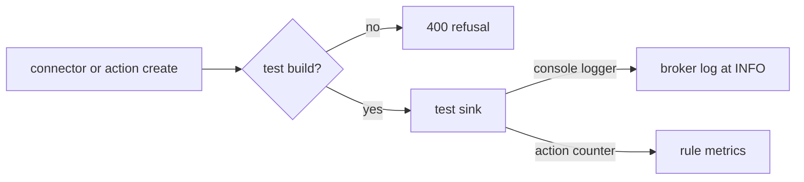

# Test connector

The `test` name is a test-only helper. A release build refuses it. The v1 connector route answers 400 with an unknown-kind error. The v5 connector and action routes answer 400 with code `ALREADY_EXISTS`. Nothing is stored.

A test build enables the helper with a runtime switch. That build registers the console logger sink. Use it only when a rule test must prove the forward path without an external system.



## Before you start

- A release build needs no setup. It refuses the name.
- A test build sets the test-kind switch before it creates the helper.

## Settings

This name takes no settings. A release build refuses the create and stores nothing.

| Setting | Required | Meaning |
|---|---|---|
| `type` | yes | It must be `test`. |
| `name` | yes | Connector id. It must not be empty. |

Example:

```json
{
  "type": "test",
  "name": "test-1"
}
```

> [!NOTE]
> The docs run starts a release build. The broker refuses this name on both routes. The test-build send path stays not verified in this run. See [Verification failures](../_verification/failures.md).

## Check that it works

Create the connector on the v1 route and on the v5 route. Both routes refuse the name in a release build. Both answers print `refused`.

```toml test
[node]
id = "docs-connector-test"

[listeners.tcp]
bind = "0.0.0.0:1883"

[listeners.api]
bind = "0.0.0.0:18083"

[logging]
level = "warn"

[auth]
allow_anonymous = true
```

```sh test
python3 - <<'PY'
import json, os, urllib.request, urllib.error
port = os.environ.get("API_PORT", "18083")
key = os.environ["API_KEY"]
def call(method, path, body):
    data = json.dumps(body).encode() if body is not None else None
    req = urllib.request.Request(
        f"http://127.0.0.1:{port}{path}", data=data, method=method,
        headers={"Authorization": f"Bearer {key}", "Content-Type": "application/json"})
    try:
        with urllib.request.urlopen(req, timeout=5) as res:
            return res.status, json.load(res)
    except urllib.error.HTTPError as err:
        return err.code, json.load(err)
s1, b1 = call("POST", "/api/v1/connectors",
              {"id": "test-v1", "kind": "test", "config": {}})
assert s1 == 400, (s1, b1)
assert "test" in json.dumps(b1), (s1, b1)
s2, b2 = call("POST", "/api/v5/connectors",
              {"name": "test-1", "type": "test"})
assert s2 == 400, (s2, b2)
assert b2["code"] == "ALREADY_EXISTS", (s2, b2)
assert "test" in json.dumps(b2), (s2, b2)
print("refused")
PY
```

```output
refused
```

## Limits

- `POST /api/v1/connectors` with this kind answers 400. The message names an unknown connector kind.
- `POST /api/v5/connectors` with this type answers 400 with code `ALREADY_EXISTS`. The message names `test`.
- `GET /api/v5/connector_types` and `GET /api/v5/action_types` omit this name in a release build.
- Nothing is stored. No rows leave the broker through this name.
- Only a test build enables the helper.

## Next steps

- Send rows with a supported connector in [Connectors](./index.md).
- See the rule path in [Actions](../rules/actions.md).
