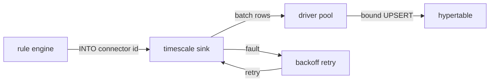

# Timescale connector

The `timescale` name writes each rule result as one TimescaleDB hypertable row. It runs the `timescaledb` sink. It sends bound parameters through the maintained PostgreSQL driver. It buffers rows and flushes full or stale batches.

Use it when a console or a stored configuration names `timescale`. You get the same rows and settings as the `timescaledb` kind.



## Before you start

- Run TimescaleDB. Note the connection URL.
- Create the hypertable with time, device_id, topic, and metrics columns.
- This kind ships in the default build. No feature flag is necessary.

## Settings

Set `kind` to `timescale` on the v1 route. The v1 route also accepts `timescaledb`. It stores the runtime as `timescaledb` and answers with `timescaledb`. Set `type` to `timescale` on the v5 route. The v5 route stores the posted type. It registers no live sink, so a rule that names the connector reaches no target. Use a v1 connector for live delivery.

The v1 route reads the settings below. The v5 route stores the same body and applies no setting.

| Setting | Required | Meaning |
|---|---|---|
| `connection_url` | yes | URL `postgresql://[user[:password]@]host[:port][/dbname][?params]`. The driver also accepts `postgres://`. Default user is `postgres`. Default port is 5432. Default database is the user name. A missing host is refused. |
| `hypertable` | yes | Target hypertable. It must match `[A-Za-z0-9_]+`. |
| `time_column` | no | Time partition column. Default `time`. It must match `[A-Za-z0-9_]+`. |
| `sql_template` | yes | UPSERT statement with `$1` (time), `$2` (device id), `$3` (topic), and `$4` (metrics). Markers inside strings, quoted names, and comments do not count. Any other set is refused. |
| `pool_size` | no | Driver pool size. Default 10. A value of 0 is refused. |
| `batch_size` | no | Rows per batch. Default 200. A value of 0 is refused. |
| `batch_timeout_ms` | no | Linger before a stale batch flushes. Default 50. |

Example:

```json
{
  "id": "ts-sink-1",
  "kind": "timescale",
  "config": {
    "connection_url": "postgresql://u:p@127.0.0.1:5432/db",
    "hypertable": "sensor_metrics",
    "time_column": "time",
    "sql_template": "INSERT INTO sensor_metrics (time, device_id, topic, metrics) VALUES ($1, $2, $3, $4::jsonb) ON CONFLICT (time, device_id) DO UPDATE SET metrics = EXCLUDED.metrics",
    "pool_size": 2,
    "batch_size": 50,
    "batch_timeout_ms": 25
  }
}
```

> [!NOTE]
> The docs run creates the v1 connector and shows the v5 store. Creation validates only; it writes no row. The send path needs a TimescaleDB server. See the failure record in [Verification failures](../_verification/failures.md).

## Check that it works

The test creates the connector on the v1 route. It shows the v5 store and the refusals of a bad scheme, a bad template, and a zero pool.

```toml test
[node]
id = "docs-connector-timescale"

[listeners.tcp]
bind = "0.0.0.0:1883"

[listeners.api]
bind = "0.0.0.0:18083"

[logging]
level = "warn"

[auth]
allow_anonymous = true
```

```sh test
python3 - <<'PY'
import json, os, urllib.request, urllib.error
port = os.environ.get("API_PORT", "18083")
key = os.environ["API_KEY"]

def call(method, path, body=None):
    data = None if body is None else json.dumps(body).encode()
    req = urllib.request.Request(
        f"http://127.0.0.1:{port}{path}", data=data, method=method,
        headers={"Authorization": f"Bearer {key}",
                 "Content-Type": "application/json"})
    try:
        with urllib.request.urlopen(req, timeout=5) as res:
            raw = res.read().decode()
            return res.status, (json.loads(raw) if raw else None)
    except urllib.error.HTTPError as err:
        raw = err.read().decode()
        try:
            return err.code, json.loads(raw)
        except ValueError:
            return err.code, raw

full = {
    "connection_url": "postgresql://u:p@127.0.0.1:5432/db",
    "hypertable": "sensor_metrics",
    "time_column": "time",
    "sql_template": "INSERT INTO sensor_metrics (time, device_id, topic, metrics) VALUES ($1, $2, $3, $4::jsonb) ON CONFLICT (time, device_id) DO UPDATE SET metrics = EXCLUDED.metrics",
    "pool_size": 2,
    "batch_size": 50,
    "batch_timeout_ms": 25,
}

status, created = call("POST", "/api/v1/connectors",
                       {"id": "ts-v1", "kind": "timescale", "config": full})
assert status == 201 and created["kind"] == "timescaledb", (status, created)

status, created = call("POST", "/api/v1/connectors",
                       {"id": "ts-bad-scheme", "kind": "timescale",
                        "config": {**full, "connection_url": "mysql://u:p@h/db"}})
assert status == 400 and "connection_url" in json.dumps(created), (status, created)

status, created = call("POST", "/api/v1/connectors",
                       {"id": "ts-bad-template", "kind": "timescale",
                        "config": {**full,
                                   "sql_template": "INSERT INTO t VALUES ($1, $2, $3)"}})
assert status == 400 and "sql_template" in json.dumps(created), (status, created)

status, created = call("POST", "/api/v1/connectors",
                       {"id": "ts-bad-pool", "kind": "timescale",
                        "config": {**full, "pool_size": 0}})
assert status == 400 and "pool_size" in json.dumps(created), (status, created)

status, created = call("POST", "/api/v5/connectors",
                       {"name": "ts-v5", "type": "timescale", **full})
assert status == 201 and created["type"] == "timescale", (status, created)
assert created["status"] == "disconnected", created
print("created")
PY
```

```output
created
```

## Limits

- A `connection_url` without the `postgresql://` or `postgres://` prefix is refused with 400. A missing host is refused. A bad port is refused.
- A `hypertable` or `time_column` outside `[A-Za-z0-9_]+` is refused with 400.
- A template without exactly `$1` to `$4` is refused with 400.
- A `pool_size` of 0 is refused. A `batch_size` of 0 is refused.
- The v1 route registers the live sink. The v5 route stores the entry and registers no live sink. It reads back `disconnected`.
- The production path uses `DriverTimescaleDbTransport` through the maintained driver. The unit tests use `MockTimescaleTransport`.
- An explicit `sslmode=require`, `verify-ca`, or `verify-full` opts into TLS through the system trust store. Other URLs stay plaintext. An empty trust store denies the connection.
- Values travel bound: `$1` time, `$2` device id, `$3` topic, `$4` metrics. One extended-protocol round trip runs per row.
- `$1` carries RFC 3339 millis text. `$2` comes from the JSON `device_id` field or the topic. `$4` carries the payload as JSON or as a JSON string.
- A payload that is not valid UTF-8 is refused. An empty topic is refused.
- Retryable states restore and back off: class `08`, `57P01` to `57P03`, `40001`, `40P01`. Other states fail the flush; the sink restores the rows.
- A failed flush restores rows in order and backs off. Backoff waits 2s, then doubles to 30s. Flushes fail fast during backoff.
- The connect deadline is 5 seconds. The statement deadline is 10 seconds.
- The connector runs behind the rule engine bounded queue. A slow server sheds load; it never stalls publishers.
- The tier is community. The kind ships in the default build.

## Next steps

- Feed the connector from a rule in [Actions](../rules/actions.md).
- See the base kind in [TimescaleDB](./timescaledb.md).
- See every kind in [Connectors](./index.md).
