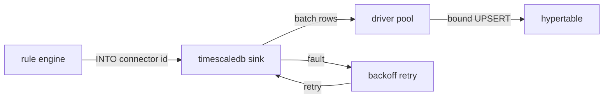

# TimescaleDB connector

The TimescaleDB connector writes each rule result as one hypertable row. It sends bound parameters through the maintained driver with one round trip per row. It buffers rows and flushes full or stale batches.

Use it when metrics must land in TimescaleDB hypertables. You get one UPSERT per row in each batch with your own hypertable mapping.



## Before you start

- Run TimescaleDB. Note the connection URL.
- Create the hypertable with time, device, topic, and metrics columns.
- This kind ships in the default build. No feature flag is necessary.

## Settings

Set `kind` to `timescaledb`. The broker also accepts the alias `timescale`. It stores the kind as `timescaledb`.

| Setting | Required | Meaning |
|---|---|---|
| `connection_url` | yes | URL `postgresql://[user[:password]@]host[:port][/dbname][?params]`. The driver also accepts the `postgres://` spelling. Default user is `postgres`. Default port is 5432. Default database is the user name. A missing host is refused. |
| `hypertable` | yes | Target hypertable. It must match `[A-Za-z0-9_]+`. |
| `time_column` | no | Time partition column. Default `time`. It must match `[A-Za-z0-9_]+`. |
| `sql_template` | yes | UPSERT statement with `$1` (time), `$2` (device id), `$3` (topic), and `$4` (metrics). Markers inside strings, quoted names, and comments do not count. Any other set is refused. |
| `pool_size` | no | Driver pool size. Default 10. A value of 0 is refused. |
| `batch_size` | no | Rows per batch. Default 200. A value of 0 is refused. |
| `batch_timeout_ms` | no | Linger before a stale batch flushes. Default 50. |

Example:

```json
{
  "id": "ts-sink-1",
  "kind": "timescaledb",
  "config": {
    "connection_url": "postgresql://u:p@127.0.0.1:5432/db",
    "hypertable": "sensor_metrics",
    "time_column": "time",
    "sql_template": "INSERT INTO sensor_metrics (time, device_id, topic, metrics) VALUES ($1, $2, $3, $4::jsonb) ON CONFLICT (time, device_id) DO UPDATE SET metrics = EXCLUDED.metrics",
    "pool_size": 2,
    "batch_size": 50,
    "batch_timeout_ms": 25
  }
}
```

> [!NOTE]
> The docs run creates this shape. Creation validates only; it writes no row. The send path needs a TimescaleDB server. See the failure record in [Verification failures](../_verification/failures.md).

## Check that it works

Create the connector. The broker answers 201 with the kind.

```toml test
[node]
id = "docs-connector-timescaledb"

[listeners.tcp]
bind = "0.0.0.0:1883"

[listeners.api]
bind = "0.0.0.0:18083"

[logging]
level = "warn"

[auth]
allow_anonymous = true
```

```sh test
python3 - <<'PY'
import json, os, urllib.request
port = os.environ.get("API_PORT", "18083")
key = os.environ["API_KEY"]
body = json.dumps({"id": "ts-sink-1", "kind": "timescaledb",
                   "config": {"connection_url": "postgresql://u:p@127.0.0.1:5432/db",
                              "hypertable": "sensor_metrics",
                              "time_column": "time",
                              "sql_template": "INSERT INTO sensor_metrics (time, device_id, topic, metrics) VALUES ($1, $2, $3, $4::jsonb) ON CONFLICT (time, device_id) DO UPDATE SET metrics = EXCLUDED.metrics",
                              "pool_size": 2, "batch_size": 50,
                              "batch_timeout_ms": 25}}).encode()
req = urllib.request.Request(
    f"http://127.0.0.1:{port}/api/v1/connectors", data=body, method="POST",
    headers={"Authorization": f"Bearer {key}", "Content-Type": "application/json"})
with urllib.request.urlopen(req, timeout=5) as res:
    assert res.status == 201
    print(json.load(res)["kind"])
PY
```

```output
timescaledb
```

## Limits

- A `connection_url` without the `postgresql://` or `postgres://` prefix is refused with 400. A missing host is refused. A bad port is refused.
- A `hypertable` or `time_column` outside `[A-Za-z0-9_]+` is refused with 400.
- A template without exactly `$1` to `$4` is refused with 400.
- A `pool_size` of 0 is refused. A `batch_size` of 0 is refused.
- The production path uses `DriverTimescaleDbTransport` through the maintained driver. The hand-written framing path serves offline unit tests only.
- An explicit `sslmode=require`, `verify-ca`, or `verify-full` opts into TLS through the system trust store. Other URLs stay plaintext. An empty trust store denies the connection.
- The driver runs MD5 and SCRAM-SHA-256 logins. A wrong password fails closed with a connection error.
- Values travel bound (`$1` time, `$2` device id, `$3` topic, `$4` metrics). One extended-protocol round trip runs per row.
- `$1` carries RFC 3339 millis text. Time targets bind as time. Date targets bind as days. Other targets bind as text. Bad time fails the row with 22008.
- `$2` comes from the JSON `device_id` field or the topic. `$4` carries the payload as JSON or as a JSON string.
- A payload that is not valid UTF-8 is refused. An empty topic is refused.
- Retryable states restore and back off: class `08`, `57P01` to `57P03`, `40001`, `40P01`. Other states fail the batch.
- A failed flush restores rows in order and backs off. Backoff waits 2s, then doubles to 30s. Flushes fail fast during backoff.
- The connect deadline is 5 seconds. The statement deadline is 10 seconds.
- The connector runs behind the rule engine bounded queue. A slow server sheds load; it never stalls publishers.
- The tier is community. The kind ships in the default build.

## Other names

This connector is also known as `timescale`. The alias `timescale` redirects to this page.

The v1 route accepts `timescaledb` and `timescale`. The kind is pending under ticket SB-27 on v5 routes.

## Next steps

- Feed the connector from a rule in [Actions](../rules/actions.md).
- See every kind in [Connectors](./index.md).
