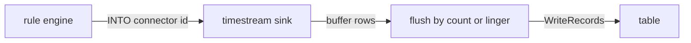

# Timestream connector

The Timestream connector writes rule results as table records. It signs each write with SigV4. It buffers rows and flushes by count or by linger.

Use it when metrics must land in Amazon Timestream. You get one write per flush.



## Before you start

- Create the Timestream database and table.
- Note the region and the access keys. Credentials travel in the connector only.

## Settings

Set `kind` to `timestream`. The alias `aws_timestream` selects the same runtime.

| Setting | Required | Meaning |
|---|---|---|
| `database` | yes | Timestream database name. |
| `table` | yes | Timestream table name. |
| `region` | yes | AWS region, for example `us-east-1`. |
| `access_key_id` | yes | AWS access key. |
| `secret_access_key` | yes | AWS secret key. |
| `measures` | yes | Payload field to measure type map: `DOUBLE`, `BIGINT`, `BOOLEAN`, `VARCHAR`, `TIMESTAMP`. |
| `endpoint` | no | Custom ingest endpoint. Default is the regional endpoint. |
| `measure` | no | Measure name template. Default `metrics`. |
| `precision` | no | `ms`, `us` or `ns`. Default `ms`. |
| `dimensions` | no | Extra dimension templates. Every record carries the `topic` dimension. |

The action may override `table`, `measures`, `measure`, `precision` and `dimensions` per target.

### `database`

Timestream database name. Type: string. Required: yes. Absent: 400 naming `database`.

```sh test
python3 - <<'PY'
import json, os, urllib.request
port = os.environ.get("API_PORT", "18083")
key = os.environ["API_KEY"]
def post(body):
    req = urllib.request.Request(
        f"http://127.0.0.1:{port}/api/v5/connectors", data=json.dumps(body).encode(), method="POST",
        headers={"Authorization": f"Bearer {key}", "Content-Type": "application/json"})
    try:
        with urllib.request.urlopen(req, timeout=5) as res:
            return res.status, json.load(res)
    except urllib.error.HTTPError as err:
        return err.code, json.load(err)
status, body = post({"name": "ts-db-bad", "type": "timestream",
                     "table": "m", "region": "r",
                     "access_key_id": "k", "secret_access_key": "s",
                     "measures": {"f": "DOUBLE"}})
assert status == 400 and "database" in body["message"], body
print("ok")
PY
```

```output
ok
```

### `table`

Timestream table name. Type: string. Required: yes. Absent: 400 naming `table`.

```sh test
python3 - <<'PY'
import json, os, urllib.request
port = os.environ.get("API_PORT", "18083")
key = os.environ["API_KEY"]
def post(body):
    req = urllib.request.Request(
        f"http://127.0.0.1:{port}/api/v5/connectors", data=json.dumps(body).encode(), method="POST",
        headers={"Authorization": f"Bearer {key}", "Content-Type": "application/json"})
    try:
        with urllib.request.urlopen(req, timeout=5) as res:
            return res.status, json.load(res)
    except urllib.error.HTTPError as err:
        return err.code, json.load(err)
status, body = post({"name": "ts-table-bad", "type": "timestream",
                     "database": "db", "region": "r",
                     "access_key_id": "k", "secret_access_key": "s",
                     "measures": {"f": "DOUBLE"}})
assert status == 400 and "table" in body["message"], body
print("ok")
PY
```

```output
ok
```

### `region`

AWS region. Type: string. Required: yes. Absent: 400 naming `region`.

```sh test
python3 - <<'PY'
import json, os, urllib.request
port = os.environ.get("API_PORT", "18083")
key = os.environ["API_KEY"]
def post(body):
    req = urllib.request.Request(
        f"http://127.0.0.1:{port}/api/v5/connectors", data=json.dumps(body).encode(), method="POST",
        headers={"Authorization": f"Bearer {key}", "Content-Type": "application/json"})
    try:
        with urllib.request.urlopen(req, timeout=5) as res:
            return res.status, json.load(res)
    except urllib.error.HTTPError as err:
        return err.code, json.load(err)
status, body = post({"name": "ts-region-bad", "type": "timestream",
                     "database": "db", "table": "m",
                     "access_key_id": "k", "secret_access_key": "s",
                     "measures": {"f": "DOUBLE"}})
assert status == 400 and "region" in body["message"], body
print("ok")
PY
```

```output
ok
```

### `access_key_id`

AWS access key. Type: string. Required: yes. Absent: 400 naming `access_key_id`.

```sh test
python3 - <<'PY'
import json, os, urllib.request
port = os.environ.get("API_PORT", "18083")
key = os.environ["API_KEY"]
def post(body):
    req = urllib.request.Request(
        f"http://127.0.0.1:{port}/api/v5/connectors", data=json.dumps(body).encode(), method="POST",
        headers={"Authorization": f"Bearer {key}", "Content-Type": "application/json"})
    try:
        with urllib.request.urlopen(req, timeout=5) as res:
            return res.status, json.load(res)
    except urllib.error.HTTPError as err:
        return err.code, json.load(err)
status, body = post({"name": "ts-key-bad", "type": "timestream",
                     "database": "db", "table": "m", "region": "r",
                     "secret_access_key": "s", "measures": {"f": "DOUBLE"}})
assert status == 400 and "access_key_id" in body["message"], body
print("ok")
PY
```

```output
ok
```

### `secret_access_key`

AWS secret key. Type: string. Required: yes. Absent: 400 naming `secret_access_key`.

```sh test
python3 - <<'PY'
import json, os, urllib.request
port = os.environ.get("API_PORT", "18083")
key = os.environ["API_KEY"]
def post(body):
    req = urllib.request.Request(
        f"http://127.0.0.1:{port}/api/v5/connectors", data=json.dumps(body).encode(), method="POST",
        headers={"Authorization": f"Bearer {key}", "Content-Type": "application/json"})
    try:
        with urllib.request.urlopen(req, timeout=5) as res:
            return res.status, json.load(res)
    except urllib.error.HTTPError as err:
        return err.code, json.load(err)
status, body = post({"name": "ts-secret-bad", "type": "timestream",
                     "database": "db", "table": "m", "region": "r",
                     "access_key_id": "k", "measures": {"f": "DOUBLE"}})
assert status == 400 and "secret_access_key" in body["message"], body
print("ok")
PY
```

```output
ok
```

### `measures`

Payload field to measure type map. Type: object. Required: yes. Values: `DOUBLE`, `BIGINT`, `BOOLEAN`, `VARCHAR`, `TIMESTAMP`. Empty: 400 naming `measures`.

```sh test
python3 - <<'PY'
import json, os, urllib.request
port = os.environ.get("API_PORT", "18083")
key = os.environ["API_KEY"]
def post(body):
    req = urllib.request.Request(
        f"http://127.0.0.1:{port}/api/v5/connectors", data=json.dumps(body).encode(), method="POST",
        headers={"Authorization": f"Bearer {key}", "Content-Type": "application/json"})
    try:
        with urllib.request.urlopen(req, timeout=5) as res:
            return res.status, json.load(res)
    except urllib.error.HTTPError as err:
        return err.code, json.load(err)
status, body = post({"name": "ts-measures-bad", "type": "timestream",
                     "database": "db", "table": "m", "region": "r",
                     "access_key_id": "k", "secret_access_key": "s", "measures": {}})
assert status == 400 and "measures" in body["message"], body
print("ok")
PY
```

```output
ok
```

### `endpoint`

Custom ingest endpoint. Type: string. Required: no. Default is the regional endpoint.

```sh test
python3 - <<'PY'
import json, os, urllib.request
port = os.environ.get("API_PORT", "18083")
key = os.environ["API_KEY"]
def post(body):
    req = urllib.request.Request(
        f"http://127.0.0.1:{port}/api/v5/connectors", data=json.dumps(body).encode(), method="POST",
        headers={"Authorization": f"Bearer {key}", "Content-Type": "application/json"})
    try:
        with urllib.request.urlopen(req, timeout=5) as res:
            return res.status, json.load(res)
    except urllib.error.HTTPError as err:
        return err.code, json.load(err)
status, created = post({"name": "ts-ep-ok", "type": "timestream",
                        "database": "db", "table": "m", "region": "r",
                        "access_key_id": "k", "secret_access_key": "s",
                        "measures": {"f": "DOUBLE"}, "endpoint": "http://127.0.0.1:9"})
assert status == 201, (status, created)
print("ok")
PY
```

```output
ok
```

### `measure`

Measure name template. Type: string. Required: no. Default `metrics`. The action value wins.

```sh test
python3 - <<'PY'
import json, os, urllib.request
port = os.environ.get("API_PORT", "18083")
key = os.environ["API_KEY"]
def post(body):
    req = urllib.request.Request(
        f"http://127.0.0.1:{port}/api/v5/connectors", data=json.dumps(body).encode(), method="POST",
        headers={"Authorization": f"Bearer {key}", "Content-Type": "application/json"})
    try:
        with urllib.request.urlopen(req, timeout=5) as res:
            return res.status, json.load(res)
    except urllib.error.HTTPError as err:
        return err.code, json.load(err)
status, created = post({"name": "ts-measure-ok", "type": "timestream",
                        "database": "db", "table": "m", "region": "r",
                        "access_key_id": "k", "secret_access_key": "s",
                        "measures": {"f": "DOUBLE"}, "measure": "env"})
assert status == 201, (status, created)
print("ok")
PY
```

```output
ok
```

### `precision`

Timestamp precision. Type: string. Required: no. Allowed: `ms`, `us`, `ns`. Default `ms`. A wrong value is 400.

```sh test
python3 - <<'PY'
import json, os, urllib.request
port = os.environ.get("API_PORT", "18083")
key = os.environ["API_KEY"]
def post(body):
    req = urllib.request.Request(
        f"http://127.0.0.1:{port}/api/v5/connectors", data=json.dumps(body).encode(), method="POST",
        headers={"Authorization": f"Bearer {key}", "Content-Type": "application/json"})
    try:
        with urllib.request.urlopen(req, timeout=5) as res:
            return res.status, json.load(res)
    except urllib.error.HTTPError as err:
        return err.code, json.load(err)
status, body = post({"name": "ts-precision-bad", "type": "timestream",
                     "database": "db", "table": "m", "region": "r",
                     "access_key_id": "k", "secret_access_key": "s",
                     "measures": {"f": "DOUBLE"}, "precision": "s"})
assert status == 400 and "precision" in body["message"], body
print("ok")
PY
```

```output
ok
```

### `dimensions`

Extra dimension templates. Type: object. Required: no. Default empty. Every record still carries the `topic` dimension.

```sh test
python3 - <<'PY'
import json, os, urllib.request
port = os.environ.get("API_PORT", "18083")
key = os.environ["API_KEY"]
def post(body):
    req = urllib.request.Request(
        f"http://127.0.0.1:{port}/api/v5/connectors", data=json.dumps(body).encode(), method="POST",
        headers={"Authorization": f"Bearer {key}", "Content-Type": "application/json"})
    try:
        with urllib.request.urlopen(req, timeout=5) as res:
            return res.status, json.load(res)
    except urllib.error.HTTPError as err:
        return err.code, json.load(err)
status, created = post({"name": "ts-dim-ok", "type": "timestream",
                        "database": "db", "table": "m", "region": "r",
                        "access_key_id": "k", "secret_access_key": "s",
                        "measures": {"f": "DOUBLE"}, "dimensions": {"room": "r1"}})
assert status == 201, (status, created)
print("ok")
PY
```

```output
ok
```

Example:

```json
{
  "name": "ts-sink-1",
  "type": "timestream",
  "database": "telemetry",
  "table": "metrics",
  "region": "us-east-1",
  "access_key_id": "AKID",
  "secret_access_key": "SECRET",
  "measures": {"temperature": "DOUBLE"}
}
```

> [!NOTE]
> The docs run creates this shape. Creation validates only; it writes nothing. The send path needs Timestream. See the failure record in [Verification failures](../_verification/failures.md).

## Check that it works

Create the connector. The broker answers 201 with the kind. It prints `ok`.

```toml test
[node]
id = "docs-connector-timestream"

[listeners.tcp]
bind = "0.0.0.0:1883"

[listeners.api]
bind = "0.0.0.0:18083"

[logging]
level = "warn"

[auth]
allow_anonymous = true
```

```sh test
python3 - <<'PY'
import json, os, urllib.request
port = os.environ.get("API_PORT", "18083")
key = os.environ["API_KEY"]
body = json.dumps({"name": "ts-sink-1", "type": "timestream",
                   "database": "telemetry", "table": "metrics",
                   "region": "us-east-1",
                   "access_key_id": "AKID", "secret_access_key": "SECRET",
                   "measures": {"temperature": "DOUBLE"}}).encode()
req = urllib.request.Request(
    f"http://127.0.0.1:{port}/api/v5/connectors", data=body, method="POST",
    headers={"Authorization": f"Bearer {key}", "Content-Type": "application/json"})
try:
    with urllib.request.urlopen(req, timeout=5) as res:
        status, created = res.status, json.load(res)
except urllib.error.HTTPError as err:
    status, created = err.code, json.load(err)
assert status == 201, (status, created)
assert created["type"] == "timestream", created
print("ok")
PY
```

```output
ok
```

## Limits

- Seconds have no sink resolution. Only `ms`, `us` and `ns` pass.
- A throttled write retries with backoff. Rejected records requeue by index.
- An empty measure set stops the batch with a failure.

## Next steps

- Feed the connector from a rule in [Actions](../rules/actions.md).
- See every kind in [Connectors](./index.md).
