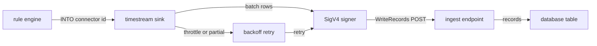

# Timestream connector

The `timestream` name writes each rule result as one Amazon Timestream record. It batches rows into `WriteRecords` calls with typed measures. It signs every call with AWS Signature Version 4. It buffers rows and flushes full or stale batches.

Use it when metrics must land in Timestream tables. You get one record per result row with your own dimensions and measure mapping. The service is closed to new customers.



## Before you start

- Note the Timestream `database_name`, `table_name`, and `region`.
- Keep an access key id and a secret access key.
- This kind ships in the default build. No feature flag is necessary.

## Settings

Set `kind` to `timestream` on the v1 route. The v1 route also accepts `ts` and `aws_timestream`. It stores the runtime as `timestream`. Set `type` to `timestream` on the v5 route. The v5 route stores the posted type and registers the live sink.

The v1 route reads the settings below. The v5 route reads `database_name` or `database`, `table_name` or `table`, `region`, `endpoint` or `url`, `access_key_id`, `secret_access_key`, and `timeout_ms`. It fixes the dimensions, the measure mapping, the measure name, the time unit, and the batch policy. Its defaults are `telemetry_db`, `metrics`, `us-east-1`, `test`, and `test`.

| Setting | Required | Meaning |
|---|---|---|
| `database_name` | yes | Timestream database name. An empty value is refused. The v5 route also reads `database` and defaults to `telemetry_db`. |
| `table_name` | yes | Timestream table name. An empty value is refused. The v5 route also reads `table` and defaults to `metrics`. |
| `region` | yes | AWS region. An empty value is refused. The v5 route defaults to `us-east-1`. |
| `endpoint` | no | Custom ingest endpoint. It must start with `http://` or `https://`. Default is `https://ingest.timestream.{region}.amazonaws.com`. The v5 route also reads `url`. |
| `access_key_id` | yes | AWS access key id. An empty value is refused. The v5 route defaults to `test`. |
| `secret_access_key` | yes | AWS secret access key. An empty value is refused. The v5 route defaults to `test`. |
| `session_token` | no | STS session token for temporary credentials. Default is none. The v5 route fixes none. |
| `dimensions` | no | Dimension templates with `${topic}`, `${client_id}`, `${qos}`, `${timestamp}`, and `${payload.<field>}`. Default is none. An empty name is refused. The v5 route fixes `device` to `${client_id}`. The sink always adds a `topic` dimension. |
| `time_unit` | no | `milliseconds`, `microseconds`, or `nanoseconds`. Default is `milliseconds`. The v5 route fixes milliseconds. |
| `measure_name_template` | no | Measure name template. Default is `metrics`. The v5 route fixes `${topic}`. |
| `multi_measure_mappings` | no | Payload field to measure type (`DOUBLE`, `BIGINT`, `BOOLEAN`, `VARCHAR`, `TIMESTAMP`). Default is none. A bad type is refused. The v5 route fixes `temperature` to `DOUBLE`. |
| `batch_size` | no | Records per `WriteRecords` call. Default 100. A value of 0 is refused. `null` means no count bound. The v5 route fixes 1. |
| `batch_bytes` | no | Batch byte limit. Default 1048576. A value of 0 is refused. `null` means no byte bound. The v5 route fixes 1048576. |
| `linger_ms` | no | Linger before a partial batch flushes. Default 20. `null` disables the time flush. The v5 route fixes 10. |
| `max_retries` | no | Retries on throttles and partials. Default 4. `null` means no bound. A value of 0 means no retry. The v5 route fixes 3. |
| `initial_backoff_ms` | no | Base retry delay. Default 100. A value below 1 reads as 1. The v5 route fixes 100. |
| `max_backoff_ms` | no | Retry delay ceiling before jitter. Default 2500. A value below 1 reads as 1. The v5 route fixes 2000. |
| `timeout_ms` | no | Request deadline. Default 5000. A value below 1 reads as 1. The v5 route also reads `timeout` and `request_timeout_ms`. |

Example:

```json
{
  "id": "ts-1",
  "kind": "timestream",
  "config": {
    "database_name": "iot_database",
    "table_name": "telemetry",
    "region": "us-east-1",
    "access_key_id": "AKID",
    "secret_access_key": "secret",
    "dimensions": {"device": "${client_id}"},
    "time_unit": "milliseconds",
    "measure_name_template": "${topic}",
    "multi_measure_mappings": {"temperature": "DOUBLE", "humidity": "BIGINT"},
    "batch_size": 50,
    "batch_bytes": 65536,
    "linger_ms": 20,
    "max_retries": 2,
    "initial_backoff_ms": 10,
    "max_backoff_ms": 100
  }
}
```

> [!NOTE]
> The docs run sends one signed `WriteRecords` body to a local receiver. The receiver checks the target, the content type, the SigV4 signature, and the record body. The real service and its own signature check stay not verified. See the failure record in [Verification failures](../_verification/failures.md).

## Check that it works

The test starts a local ingest receiver. It creates the connector on the v1 and v5 routes, creates a forwarding rule, and publishes one message. The receiver checks the signature and the record.

```toml test
[node]
id = "docs-connector-timestream"

[listeners.tcp]
bind = "0.0.0.0:1883"

[listeners.api]
bind = "0.0.0.0:18083"

[logging]
level = "warn"

[auth]
allow_anonymous = true
```

```sh test
python3 - <<'PY'
import hashlib, hmac, json, os, socket, struct, threading, time, urllib.request, urllib.error
from http.server import BaseHTTPRequestHandler, HTTPServer

received = []

class Handler(BaseHTTPRequestHandler):
    def do_POST(self):
        length = int(self.headers.get("Content-Length", 0))
        body = self.rfile.read(length)
        received.append((self.path,
                         {k.lower(): v for k, v in self.headers.items()}, body))
        out = json.dumps({"RecordsIngested": {"Total": 1}}).encode()
        self.send_response(200)
        self.send_header("Content-Type", "application/x-amz-json-1.0")
        self.send_header("Content-Length", str(len(out)))
        self.end_headers()
        self.wfile.write(out)
    def log_message(self, *args):
        pass

server = HTTPServer(("127.0.0.1", 0), Handler)
ingest_port = server.server_address[1]
threading.Thread(target=server.serve_forever, daemon=True).start()

mqtt_port = int(os.environ.get("MQTT_PORT", "1883"))
api_port = int(os.environ.get("API_PORT", "18083"))
key = os.environ["API_KEY"]

def call(method, path, body=None):
    data = None if body is None else json.dumps(body).encode()
    req = urllib.request.Request(
        f"http://127.0.0.1:{api_port}{path}", data=data, method=method,
        headers={"Authorization": f"Bearer {key}",
                 "Content-Type": "application/json"})
    try:
        with urllib.request.urlopen(req, timeout=5) as res:
            raw = res.read().decode()
            return res.status, (json.loads(raw) if raw else None)
    except urllib.error.HTTPError as err:
        raw = err.read().decode()
        try:
            return err.code, json.loads(raw)
        except ValueError:
            return err.code, raw

common = {
    "database_name": "iot_database",
    "table_name": "telemetry",
    "region": "us-east-1",
    "endpoint": f"http://127.0.0.1:{ingest_port}",
    "access_key_id": "AKID",
    "secret_access_key": "secret",
}
full = {
    **common,
    "dimensions": {"device": "${client_id}"},
    "time_unit": "milliseconds",
    "measure_name_template": "${topic}",
    "multi_measure_mappings": {"temperature": "DOUBLE", "humidity": "BIGINT"},
    "batch_size": 1,
    "batch_bytes": 65536,
    "linger_ms": 10,
    "max_retries": 2,
    "initial_backoff_ms": 10,
    "max_backoff_ms": 100,
    "timeout_ms": 5000,
}

status, created = call("POST", "/api/v1/connectors",
                       {"id": "tim-v1", "kind": "timestream", "config": full})
assert status == 201 and created["kind"] == "timestream", (status, created)

status, created = call("POST", "/api/v1/connectors",
                       {"id": "tim-bad", "kind": "timestream",
                        "config": {**full, "database_name": ""}})
assert status == 400 and "database_name" in json.dumps(created), (status, created)

status, created = call("POST", "/api/v5/connectors",
                       {"name": "tim-v5", "type": "timestream", **common})
assert status == 201 and created["type"] == "timestream", (status, created)
assert created["status"] == "connected", created

status, created = call("POST", "/api/v5/connectors",
                       {"name": "tim-v5-bad", "type": "timestream",
                        **{**common, "endpoint": "ftp://example.com"}})
assert status == 400 and "endpoint" in json.dumps(created), (status, created)

status, rule = call("POST", "/api/v1/rules",
                    {"name": "tim-rule", "topic_filter": "docs/tim/in",
                     "actions": [{"type": "forwardconnector",
                                  "connector_id": "tim-v1"}]})
assert status == 201, (status, rule)

def packet(kind, body):
    return bytes([kind, len(body)]) + body

def field(data):
    return struct.pack(">H", len(data)) + data

pub = socket.create_connection(("127.0.0.1", mqtt_port), timeout=5)
pub.sendall(packet(0x10, b"\x00\x04MQTT\x04\x02\x00\x3c" + field(b"tim-pub")))
assert pub.recv(4) == b"\x20\x02\x00\x00"
payload = b'{"client_id": "sensor-7", "temperature": 21.5, "humidity": 40}'
pub.sendall(packet(0x30, field(b"docs/tim/in") + payload))

deadline = time.time() + 15
while not received and time.time() < deadline:
    time.sleep(0.1)
assert received, "no WriteRecords request arrived"
path, headers, body = received[0]
assert path == "/", path
assert headers.get("x-amz-target") == "Timestream_20181101.WriteRecords", headers
assert headers.get("content-type") == "application/x-amz-json-1.0", headers

date = headers["x-amz-date"]
short = date[:8]
signed = {k: headers[k] for k in
          ("content-type", "host", "x-amz-date", "x-amz-target")}
names = sorted(signed)
canon_headers = "".join(f"{k}:{signed[k].strip()}\n" for k in names)
signed_names = ";".join(names)
canonical = "\n".join(["POST", "/", "", canon_headers, signed_names,
                       hashlib.sha256(body).hexdigest()])
scope = f"{short}/us-east-1/timestream/aws4_request"
to_sign = "\n".join(["AWS4-HMAC-SHA256", date, scope,
                     hashlib.sha256(canonical.encode()).hexdigest()])
k_date = hmac.new(b"AWS4secret", short.encode(), hashlib.sha256).digest()
k_region = hmac.new(k_date, b"us-east-1", hashlib.sha256).digest()
k_service = hmac.new(k_region, b"timestream", hashlib.sha256).digest()
k_sign = hmac.new(k_service, b"aws4_request", hashlib.sha256).digest()
signature = hmac.new(k_sign, to_sign.encode(), hashlib.sha256).hexdigest()
expected = (f"AWS4-HMAC-SHA256 Credential=AKID/{scope}, "
            f"SignedHeaders={signed_names}, Signature={signature}")
assert headers.get("authorization") == expected, headers

doc = json.loads(body)
assert doc["DatabaseName"] == "iot_database", doc
assert doc["TableName"] == "telemetry", doc
record = doc["Records"][0]
assert record["MeasureName"] == "docs/tim/in", record
assert record["TimeUnit"] == "MILLISECONDS", record
dims = {d["Name"]: d["Value"] for d in record["Dimensions"]}
assert dims == {"device": "sensor-7", "topic": "docs/tim/in"}, dims
measures = {m["Name"]: (m["Value"], m["Type"])
            for m in record["MeasureValues"]}
assert measures == {"humidity": ("40", "BIGINT"),
                    "temperature": ("21.5", "DOUBLE")}, measures
print("delivered")
PY
```

```output
delivered
```

## Limits

- An empty `database_name`, `table_name`, `region`, or `access_key_id` is refused with 400. An empty `secret_access_key` is refused with 400.
- An `endpoint` outside `http://` and `https://` is refused with 400.
- An empty dimension name is refused with 400. An empty measure field is refused with 400. A measure type outside the five allowed values is refused with 400.
- A `batch_size` of 0 is refused with 400. A `batch_bytes` of 0 is refused with 400.
- The v1 route registers the live sink. The v5 route registers the live sink with its fixed fields.
- The production path uses `HttpTimestreamTransport` through the maintained HTTP client. The memory transport serves offline unit tests only.
- Dimensions sort by name. The sink always adds a `topic` dimension. A missing mapped field is skipped. A record with no measures fails the batch.
- A throttled batch retries with backoff. A rejected batch requeues only the rejected indices. A validation fault is terminal.
- The first retry waits about 200 ms plus jitter, because `flush` increments the attempt before the wait. The delay doubles to a 2500 ms ceiling before jitter. Jitter can add half the grown delay. The final cap is two times the ceiling, so the default can reach about 3750 ms.
- The connector runs behind the rule engine bounded queue. A slow endpoint sheds load; it never stalls publishers.
- The tier is enterprise. The kind ships in the default build. The service is closed to new customers. The live service stays not verified for this task.

## Next steps

- Feed the connector from a rule in [Actions](../rules/actions.md).
- See the long name in [AWS Timestream](./aws_timestream.md).
- See every kind in [Connectors](./index.md).
