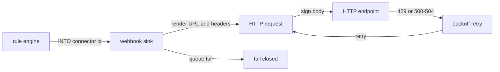

# Webhook connector

The `webhook` name posts rule results to an HTTP endpoint. It supports POST, PUT, and PATCH. It supports Basic, Bearer, and API-key auth. It sends raw JSON, a JSON array, or a form body. It can sign each request with HMAC. It retries throttles and server faults with backoff.

Use it when any HTTP service must receive broker data. You get one request per event or per batch with your own URL, headers, and signature.



## Before you start

- Run an HTTP receiver. Note its URL.
- Pick the method, the body format, and the credentials.
- This kind ships in the default build. No feature flag is necessary.

## Settings

Set `kind` to `webhook` on the v1 route. The v1 route also accepts `http` and `rest`. It stores the runtime as `webhook`. Set `type` to `webhook` on the v5 route. The v5 route stores the posted type and registers a live sender.

The v1 route reads the settings below. The v5 route reads only `url` or `endpoint`. It sends a raw POST with a 5 second timeout. It adds the `Content-Type`, `X-MQTT-Topic`, and `X-MQTT-QoS` headers. It uses no auth, no custom header, no signature, no batch, and no retry. A v5 body without a URL stores an entry and registers no sink. That entry reads back `disconnected`.

| Setting | Required | Meaning |
|---|---|---|
| `url` | yes | Target URL with `${topic}`, `${client_id}`, `${qos}`, and `${timestamp}` substitution. HTTP or HTTPS only. The v5 route also reads `endpoint`. |
| `method` | no | `post` (default), `put`, or `patch`. |
| `headers` | no | Extra headers with the same substitution. An empty name is refused. |
| `auth` | no | `{"type":"none"}` (default), `{"type":"basic","username","password"}`, `{"type":"bearer","token"}`, or `{"type":"apikey","header_name","key"}`. An empty credential is refused. |
| `body_format` | no | `rawjson` (default) sends one request per event with the payload. `jsonbatcharray` sends one array per rendered target. `formurlencoded` sends one form per event. |
| `signature` | no | HMAC object with `header_name`, `algorithm` (`sha256` or `sha1`), `secret`, and `encoding` (`hex` or `base64`). The tag covers the exact body bytes. An empty header or secret is refused. |
| `batch_size` | no | Flush trigger record count. Default 100. A value of 0 is refused. `null` means no count bound. |
| `batch_bytes` | no | Flush trigger byte limit. Default 1048576. A value of 0 is refused. `null` means no byte bound. |
| `linger_ms` | no | Linger flush window. Default 50. `null` disables the time flush. |
| `timeout_ms` | no | Per-request timeout. Default 5000. A value below 1 reads as 1. |
| `max_retries` | no | Retries on 429 and 500 to 504. Default 3. `null` means no bound. A value of 0 means no retry. |
| `initial_backoff_ms` | no | Base retry delay. Default 100. A value below 1 reads as 1. |
| `max_backoff_ms` | no | Retry delay ceiling before jitter. Default 2000. A value below 1 reads as 1. |
| `buffer_capacity` | no | Outer backlog ceiling in rows. Default 10000. A value of 0 is refused. `null` means the finite default, never unlimited. |

Example:

```json
{
  "id": "hook-1",
  "kind": "webhook",
  "config": {
    "url": "https://hooks.example.com/ingest/${topic}",
    "method": "post",
    "headers": {"X-Source": "docs"},
    "auth": {"type": "bearer", "token": "tok"},
    "body_format": "rawjson",
    "signature": {"header_name": "X-Signature", "algorithm": "sha256",
                  "secret": "sig-secret", "encoding": "hex"},
    "batch_size": 50,
    "batch_bytes": 65536,
    "linger_ms": 25,
    "timeout_ms": 1000,
    "max_retries": 2,
    "initial_backoff_ms": 10,
    "max_backoff_ms": 100,
    "buffer_capacity": 100
  }
}
```

> [!NOTE]
> The docs run sends one request on the v1 route and one on the v5 route. A local receiver checks the path, the auth header, the custom header, the signature, and the body. A real HTTPS receiver and a third-party signature check stay not verified. See the failure record in [Verification failures](../_verification/failures.md).

## Check that it works

The test starts a local receiver. It creates a v1 connector with auth, a custom header, a URL template, and a signature. It creates a v5 connector with only a URL. It creates two forwarding rules and publishes one message for each. The receiver checks both requests.

```toml test
[node]
id = "docs-connector-webhook"

[listeners.tcp]
bind = "0.0.0.0:1883"

[listeners.api]
bind = "0.0.0.0:18083"

[logging]
level = "warn"

[auth]
allow_anonymous = true
```

```sh test
python3 - <<'PY'
import hashlib, hmac, json, os, socket, struct, threading, time, urllib.request, urllib.error
from http.server import BaseHTTPRequestHandler, HTTPServer

received = []

class Handler(BaseHTTPRequestHandler):
    def do_POST(self):
        length = int(self.headers.get("Content-Length", 0))
        body = self.rfile.read(length)
        received.append((self.path,
                         {k.lower(): v for k, v in self.headers.items()}, body))
        self.send_response(200)
        self.send_header("Content-Length", "2")
        self.end_headers()
        self.wfile.write(b"ok")
    def log_message(self, *args):
        pass

server = HTTPServer(("127.0.0.1", 0), Handler)
hook_port = server.server_address[1]
threading.Thread(target=server.serve_forever, daemon=True).start()

mqtt_port = int(os.environ.get("MQTT_PORT", "1883"))
api_port = int(os.environ.get("API_PORT", "18083"))
key = os.environ["API_KEY"]

def call(method, path, body=None):
    data = None if body is None else json.dumps(body).encode()
    req = urllib.request.Request(
        f"http://127.0.0.1:{api_port}{path}", data=data, method=method,
        headers={"Authorization": f"Bearer {key}",
                 "Content-Type": "application/json"})
    try:
        with urllib.request.urlopen(req, timeout=5) as res:
            raw = res.read().decode()
            return res.status, (json.loads(raw) if raw else None)
    except urllib.error.HTTPError as err:
        raw = err.read().decode()
        try:
            return err.code, json.loads(raw)
        except ValueError:
            return err.code, raw

full = {
    "url": f"http://127.0.0.1:{hook_port}/ingest/${{topic}}",
    "method": "post",
    "headers": {"X-Source": "docs"},
    "auth": {"type": "bearer", "token": "tok"},
    "body_format": "rawjson",
    "signature": {"header_name": "X-Signature", "algorithm": "sha256",
                  "secret": "sig-secret", "encoding": "hex"},
    "batch_size": 1,
    "batch_bytes": 65536,
    "linger_ms": 10,
    "timeout_ms": 5000,
    "max_retries": 1,
    "initial_backoff_ms": 10,
    "max_backoff_ms": 100,
    "buffer_capacity": 100,
}

status, created = call("POST", "/api/v1/connectors",
                       {"id": "hook-v1", "kind": "webhook", "config": full})
assert status == 201 and created["kind"] == "webhook", (status, created)

status, created = call("POST", "/api/v1/connectors",
                       {"id": "hook-bad", "kind": "webhook",
                        "config": {**full, "batch_size": 0}})
assert status == 400 and "batch_size" in json.dumps(created), (status, created)

status, created = call("POST", "/api/v1/connectors",
                       {"id": "hook-bad-url", "kind": "webhook",
                        "config": {**full, "url": "ftp://example.com/hook"}})
assert status == 400 and "url" in json.dumps(created), (status, created)

status, created = call("POST", "/api/v5/connectors",
                       {"name": "hook-v5", "type": "webhook",
                        "url": f"http://127.0.0.1:{hook_port}/v5"})
assert status == 201 and created["type"] == "webhook", (status, created)
assert created["status"] == "connected", created

status, rule = call("POST", "/api/v1/rules",
                    {"name": "hook-rule-v1", "topic_filter": "docs/hook/in",
                     "actions": [{"type": "forwardconnector",
                                  "connector_id": "hook-v1"}]})
assert status == 201, (status, rule)
status, rule = call("POST", "/api/v1/rules",
                    {"name": "hook-rule-v5", "topic_filter": "docs/hook/v5",
                     "actions": [{"type": "forwardconnector",
                                  "connector_id": "hook-v5"}]})
assert status == 201, (status, rule)

def packet(kind, body):
    return bytes([kind, len(body)]) + body

def field(data):
    return struct.pack(">H", len(data)) + data

pub = socket.create_connection(("127.0.0.1", mqtt_port), timeout=5)
pub.sendall(packet(0x10, b"\x00\x04MQTT\x04\x02\x00\x3c" + field(b"hook-pub")))
assert pub.recv(4) == b"\x20\x02\x00\x00"
pub.sendall(packet(0x30, field(b"docs/hook/in") + b'{"temp": 90}'))
pub.sendall(packet(0x30, field(b"docs/hook/v5") + b'{"temp": 91}'))

deadline = time.time() + 15
while len(received) < 2 and time.time() < deadline:
    time.sleep(0.1)
assert len(received) == 2, received
v1 = [item for item in received if item[0].startswith("/ingest/")]
v5 = [item for item in received if item[0] == "/v5"]
assert len(v1) == 1 and len(v5) == 1, received

path, headers, body = v1[0]
assert path == "/ingest/docs/hook/in", path
assert headers.get("authorization") == "Bearer tok", headers
assert headers.get("x-source") == "docs", headers
assert headers.get("content-type") == "application/json", headers
expected = hmac.new(b"sig-secret", body, hashlib.sha256).hexdigest()
assert headers.get("x-signature") == expected, headers
assert json.loads(body) == {"temp": 90}, body

path, headers, body = v5[0]
assert path == "/v5", path
assert headers.get("x-mqtt-topic") == "docs/hook/v5", headers
assert headers.get("x-mqtt-qos") == "0", headers
assert headers.get("content-type") == "application/json", headers
assert body == b'{"temp": 91}', body
print("delivered")
PY
```

```output
delivered
```

## Limits

- A `url` outside `http://` and `https://` is refused with 400. An empty header name is refused. An empty auth credential is refused. An empty signature header or secret is refused.
- A `batch_size`, `batch_bytes`, or `buffer_capacity` of 0 is refused with 400.
- A 2xx answer is success. A 429 or 500 to 504 answer retries. A 400, 401, 403, 404, or other status is terminal. A transport error is terminal for that flush and restores the batch.
- The first retry waits about 200 ms plus jitter, because `flush` increments the attempt before the wait. The delay doubles to a 2000 ms ceiling before jitter. Jitter can add half the grown delay. The final cap is two times the ceiling, so the default can reach about 3000 ms.
- A failed batch restores its rows in order and engages backoff. Flushes fail fast during backoff.
- The outer backlog holds at most `buffer_capacity` rows and fails closed when full. The sink refuses the row with a connection error.
- `rawjson` parses the payload as JSON and re-encodes it. A payload that is not valid JSON is sent as a JSON string. A payload that is not UTF-8 is refused.
- `jsonbatcharray` groups events by their rendered URL and headers. Each group becomes one array request.
- `formurlencoded` sends `topic`, `qos`, `timestamp`, and `payload` fields.
- The v5 route uses the minimal sender. It sends a raw POST and ignores the batch, auth, header, signature, and retry settings.
- The connector runs behind the rule engine bounded queue. A slow endpoint never stalls publishers.
- The tier is community. The kind ships in the default build.

## Next steps

- Feed the connector from a rule in [Actions](../rules/actions.md).
- See the HTTP name in [HTTP webhook](./http.md).
- See every kind in [Connectors](./index.md).
