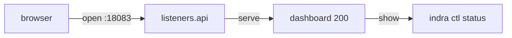

# Console

Start the broker from [First start](./first-start.md). Open the dashboard in a browser:

## Before you start

- Start the broker from [First start](./first-start.md).
- Use a browser on the same machine.
- Use the file below. It allows anonymous clients.

```toml test
[node]
id = "docs-console"

[listeners.tcp]
bind = "0.0.0.0:1883"

[listeners.api]
bind = "0.0.0.0:18083"

[logging]
level = "warn"

[auth]
allow_anonymous = true
```

## Check that it works

Open `http://localhost:18083/dashboard`. Use port 18083 or your API bind. The dashboard serves a 200 answer.

<!-- screenshot: dashboard home with nodes and clients -->



```sh test
python3 - <<'PY'
import os, socket
port = int(os.environ.get("API_PORT", "18083"))
sock = socket.create_connection(("127.0.0.1", port), timeout=5)
sock.sendall(b"GET /dashboard HTTP/1.0\r\nHost: docs\r\n\r\n")
print(sock.makefile().read().splitlines()[0].split()[1])
PY
```

```output
200
```

The operator command shows the same broker in a terminal:

```sh no-test
# Output lists live nodes and varies. The example test does not compare it.
indra ctl --endpoint http://localhost:18083 --api-key "$API_KEY" status
```

## Next steps

Learn the model in [Concepts](../concepts/index.md). It explains topics, sessions and delivery.
