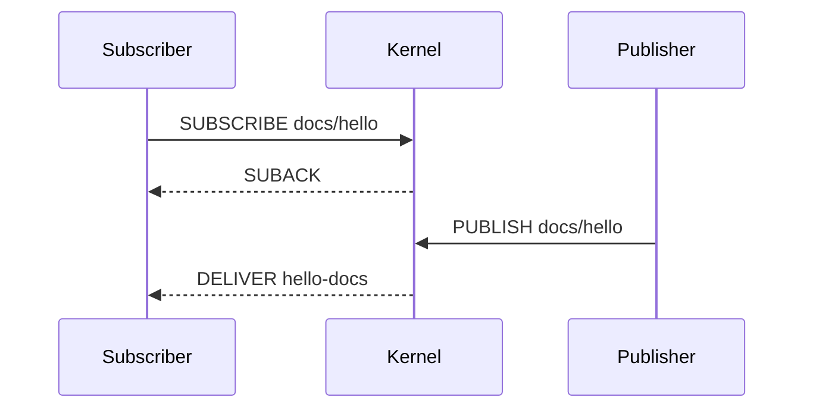

# First publish

Start the broker from [First start](./first-start.md). This page uses an open broker. It sets `allow_anonymous` so clients connect without credentials while no users exist.

## Before you start

- Start the broker from [First start](./first-start.md).
- Use the file below. It allows anonymous clients.

```toml test
[node]
id = "docs-publish"

[listeners.tcp]
bind = "0.0.0.0:1883"

[listeners.api]
bind = "0.0.0.0:18083"

[logging]
level = "warn"

[auth]
allow_anonymous = true
```

## Check that it works

Subscribe to `docs/hello`. Publish `hello-docs` to it. The subscriber prints the payload.



```sh test
python3 - <<'PY'
import os, socket, struct
mqtt_port = int(os.environ.get("MQTT_PORT", "1883"))

def packet(kind, body):
    return bytes([kind, len(body)]) + body

def field(data):
    return struct.pack(">H", len(data)) + data

def connect(sock, client_id):
    sock.sendall(packet(0x10, b"\x00\x04MQTT\x04\x02\x00\x3c" + field(client_id)))
    assert sock.recv(4) == b"\x20\x02\x00\x00"

topic = b"docs/hello"
sub = socket.create_connection(("127.0.0.1", mqtt_port), timeout=5)
connect(sub, b"docs-sub")
sub.sendall(packet(0x82, b"\x00\x01" + field(topic) + b"\x00"))
assert sub.recv(5)[:1] == b"\x90"
pub = socket.create_connection(("127.0.0.1", mqtt_port), timeout=5)
connect(pub, b"docs-pub")
pub.sendall(packet(0x30, field(topic) + b"hello-docs"))
sub.settimeout(5)
print(sub.recv(100).split(topic)[-1].decode())
PY
```

```output
hello-docs
```

A common MQTT client does the same in two terminals:

```sh no-test
# Needs mosquitto clients. The test environment has none, so it does not run this block.
mosquitto_sub -h localhost -p 1883 -t 'docs/hello'
mosquitto_pub -h localhost -p 1883 -t 'docs/hello' -m 'hello-docs'
```

## Next steps

Create a user with a password in [First user](./first-user.md). It guards the broker with credentials.
