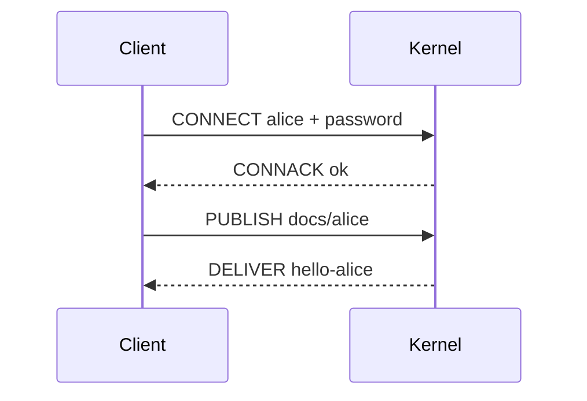

# First user

Start the broker from [First start](./first-start.md). Create the user `alice` through the management API. Use an API key in the `Authorization` header.

## Before you start

- Start the broker from [First start](./first-start.md).
- Set `API_KEY` to the broker API key.
- Use the file below. It allows anonymous clients.

```toml test
[node]
id = "docs-user"

[listeners.tcp]
bind = "0.0.0.0:1883"

[listeners.api]
bind = "0.0.0.0:18083"

[logging]
level = "warn"

[auth]
allow_anonymous = true
```

## Check that it works

Create the user. The call answers 201. It also grants the user publish and subscribe access to `docs/#`.

```sh test
python3 - <<'PY'
import json, os, urllib.request
port = os.environ.get("API_PORT", "18083")
key = os.environ["API_KEY"]

def call(method, path, body=None):
    req = urllib.request.Request(
        f"http://127.0.0.1:{port}{path}",
        data=None if body is None else json.dumps(body).encode(),
        method=method,
        headers={"Authorization": f"Bearer {key}", "Content-Type": "application/json"},
    )
    with urllib.request.urlopen(req, timeout=5) as res:
        return res.status

status = call("POST", "/api/v1/auth/users",
              {"username": "alice", "password": "Alice-docs-pw-1"})
assert status == 201
for action in ("publish", "subscribe"):
    assert call("POST", "/api/v1/auth/acls",
                {"client_pattern": "*", "action": action,
                 "topic_pattern": "docs/#", "allow": True}) == 201
print(status)
PY
```

```output
201
```

Connect as `alice`. The right password opens access. A wrong password fails. The check prints `ok` and then `denied`.



```sh test
python3 - <<'PY'
import os, socket, struct
mqtt_port = int(os.environ.get("MQTT_PORT", "1883"))

def packet(kind, body):
    return bytes([kind, len(body)]) + body

def field(data):
    return struct.pack(">H", len(data)) + data

def try_connect(client_id, username, password):
    sock = socket.create_connection(("127.0.0.1", mqtt_port), timeout=5)
    body = (b"\x00\x04MQTT\x04\xc2\x00\x3c" + field(client_id)
            + field(username) + field(password))
    sock.sendall(packet(0x10, body))
    try:
        reply = sock.recv(4)
    except OSError:
        return None
    return sock if reply == b"\x20\x02\x00\x00" else None

topic = b"docs/alice"
sub = try_connect(b"docs-alice-sub", b"alice", b"Alice-docs-pw-1")
assert sub is not None
sub.sendall(packet(0x82, b"\x00\x01" + field(topic) + b"\x00"))
assert sub.recv(5)[:1] == b"\x90"
pub = try_connect(b"docs-alice-pub", b"alice", b"Alice-docs-pw-1")
assert pub is not None
pub.sendall(packet(0x30, field(topic) + b"hello-alice"))
sub.settimeout(5)
assert sub.recv(100).endswith(b"hello-alice")
print("ok")
print("denied" if try_connect(b"docs-alice-bad", b"alice", b"wrong-password") is None else "open")
PY
```

```output
ok
denied
```

## Next steps

Open the dashboard in [Console](./console.md). It shows the broker in a browser.
