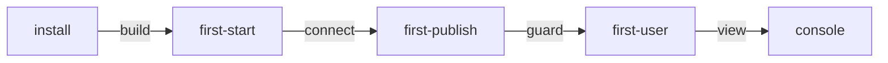

# Getting started

Follow the steps in order.



## Before you start

- Install the binaries with [Install](./install.md).
- Keep ports 1883 and 18083 free.
- Set these variables before the commands that need them:

```sh no-test
# Example only: shows the variables that the tested commands use.
export API_KEY=your-api-key-here
export MQTT_PORT=1883
export API_PORT=18083
```

## Check that it works

Each step ends with a check. Each check prints its expected output. The example test runs every check.

## Next steps

1. [Install](./install.md): get the binaries.
2. [First start](./first-start.md): write the configuration and start the broker.
3. [First publish](./first-publish.md): subscribe and publish the first message.
4. [First user](./first-user.md): create a user with a password.
5. [Console](./console.md): open the dashboard.
