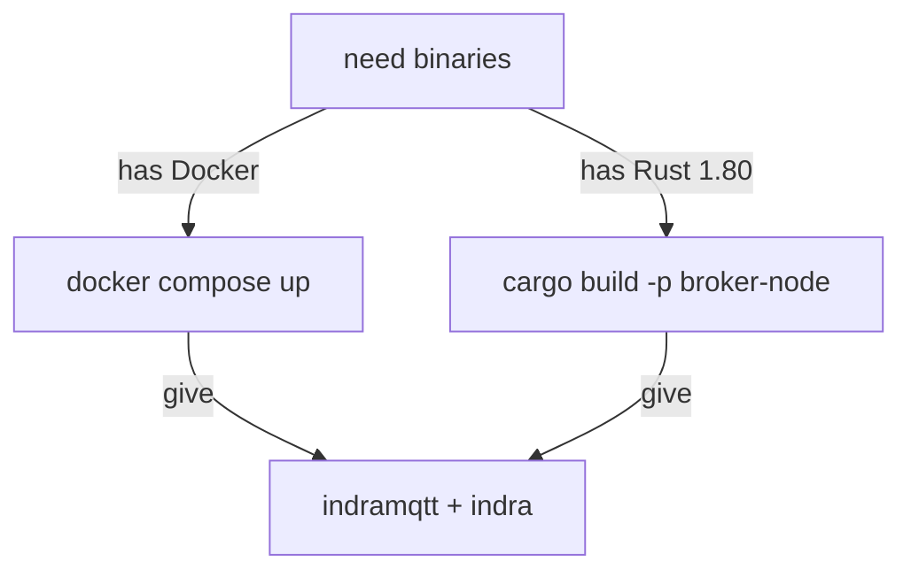

# Install

Use Docker or build from source. Both paths give the same two binaries: `indramqtt` (the broker) and `indra` (the operator command).



## Before you start

- Get Docker or Rust 1.80 or later.
- Keep ports 1883 and 18083 free for the check below.

## Option A: Docker

Start the broker with Docker Compose:

```sh no-test
# Needs a Docker daemon. The example test has none, so it does not run this block.
git clone https://github.com/ankur-paan/indramqtt.git && cd indramqtt
docker compose up -d
```

Open the dashboard at `http://localhost:18083/dashboard`. Clients connect to port 1883.

## Option B: Build from source

Install Rust 1.80 or later. Build the broker with all connectors:

```sh no-test
# Needs the Rust toolchain and network access. The example test has neither, so it does not run this block.
cargo build --release -p broker-node --features full
```

## Check that it works

Start the broker with this file. The example test starts it for you.

```toml test
[node]
id = "docs-install"

[listeners.tcp]
bind = "0.0.0.0:1883"

[listeners.api]
bind = "0.0.0.0:18083"

[logging]
level = "warn"
```

Show the version of each binary:

```sh test
"${INDRAMQTT_BIN:-indramqtt}" --version
```

```output
indramqtt 0.1.0
```

```sh test
"${INDRACLI_BIN:-indra}" --version
```

```output
indra 0.1.0
```

## Next steps

Write the configuration in [First start](./first-start.md). It starts the broker and checks health.
