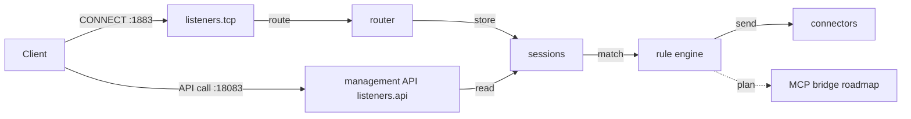

# IndraMQTT

IndraMQTT is the complete MQTT platform in one small binary: broker, SQL rules, data connectors and multi-tenancy in a single process.

It serves IoT fleets, industrial edge systems and cloud deployments. One process holds the client sockets and does the broker work. There is no second process to install or monitor.

Start with [Getting started](./getting-started/index.md). It installs the broker, starts it, sends the first message, creates the first user and opens the console. Each step runs as a test.

The MCP bridge is deferred. This release exposes no MCP endpoint. Details live in `ROADMAP.md`.

Learn the model in [Concepts](./concepts/index.md). Guard access with [Security](./security/index.md). Route and transform messages with [Rules](./rules/index.md). Send data out with [Connectors](./connectors/index.md). Isolate customers with [Multi-tenancy](./multi-tenancy/index.md). Run production with [Operations](./operations/index.md). Look up each setting in the [Reference](./reference/index.md). Read measured numbers in [Benchmarks](./benchmarks/index.md).
