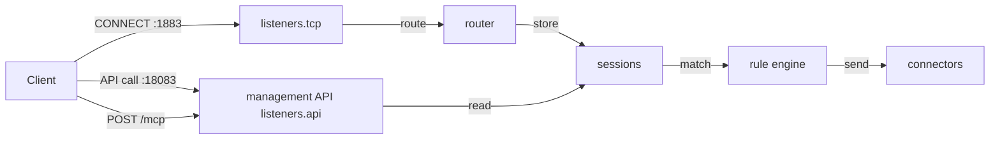

# IndraMQTT

IndraMQTT runs an MQTT broker, SQL rules, data connectors, and tenant isolation in one Rust process. The current pre-1.0 broker supports single-node evaluation.

It serves IoT fleets, industrial edge systems and cloud deployments. One process holds the client sockets and does the broker work. There is no second process to install or monitor.

Start with [Getting started](./getting-started/index.md). It installs the broker, starts it, sends the first message, creates the first user and opens the console. Each step runs as a test.



The [MCP management endpoint](./mcp.md) exposes operator tools on the management listener.

SSO login is deferred. Protocol gateways, message schema validations, OpenTelemetry export and cluster links are also deferred. Each list or config read answers an empty or disabled state. Each write refuses with 400. Nothing is stored.

## Before you start

- Install the broker from [Install](./getting-started/install.md).
- Keep ports 1883 and 18083 free.
- Read [Concepts](./concepts/index.md) for topics, sessions and delivery.

## Check that it works

Start the broker with this file. The health endpoint returns `OK`.

```toml test
[node]
id = "docs-index"

[listeners.tcp]
bind = "0.0.0.0:1883"

[listeners.api]
bind = "0.0.0.0:18083"

[logging]
level = "warn"
```

```sh test
python3 - <<'PY'
import os, socket
port = int(os.environ.get("API_PORT", "18083"))
sock = socket.create_connection(("127.0.0.1", port), timeout=5)
sock.sendall(b"GET /healthz HTTP/1.0\r\nHost: docs\r\n\r\n")
print(sock.makefile().read().strip().splitlines()[-1])
PY
```

```output
OK
```

## Next steps

- Start with [Getting started](./getting-started/index.md).
- Learn the model in [Concepts](./concepts/index.md).
- Guard access with [Security](./security/index.md).
- Route messages with [Rules](./rules/index.md).
- Send data out with [Connectors](./connectors/index.md).
- Isolate customers with [Multi-tenancy](./multi-tenancy/index.md).
- Run production with [Operations](./operations/index.md).
- Look up settings in [Reference](./reference/index.md).
- Read measured numbers in [Benchmarks](./benchmarks/index.md).
- Move from another broker with [Migration](./migration.md).
