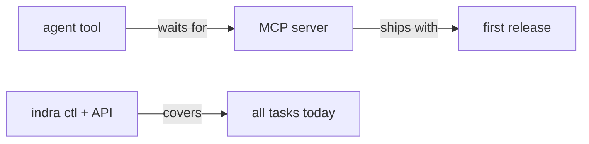

# MCP

This page states the plan for machine access. Use it to decide whether to wait for it. You get the current state in one screen.



The MCP server arrives with the first release. This tree exposes no MCP endpoint today. The page links nothing until it ships.

Use the management API and `indra ctl` for every machine task today. They cover users, access rules, clients, metrics, and config. See [Reference](./reference/index.md) and [Operations](./operations/index.md).

<!-- screenshot: MCP tool list in the console after the first release -->

## Check that it works

Start the broker with this file. The health endpoint returns `OK`.

```toml test
[node]
id = "docs-mcp"

[listeners.tcp]
bind = "0.0.0.0:1883"

[listeners.api]
bind = "0.0.0.0:18083"

[logging]
level = "warn"
```

```sh test
python3 - <<'PY'
import os, socket
port = int(os.environ.get("API_PORT", "18083"))
sock = socket.create_connection(("127.0.0.1", port), timeout=5)
sock.sendall(b"GET /healthz HTTP/1.0\r\nHost: docs\r\n\r\n")
print(sock.makefile().read().strip().splitlines()[-1])
PY
```

```output
OK
```

## Next steps

- Automate with [Reference](./reference/index.md).
- Operate with [Operations](./operations/index.md).
