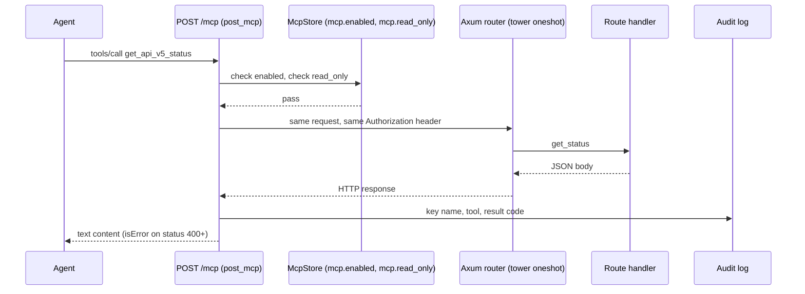

# MCP server

The broker exposes a Model Context Protocol (MCP) server on the
management listener. Use it when an agent must do what an operator
does. Each tool runs the same handler as one HTTP route. You get one
tool for each management operation, with the same permissions.
Tools form groups selected with `toolsets=a,b` on `/mcp` (see
Toolsets below).



## Endpoint

- `POST /mcp` takes a JSON-RPC 2.0 message and returns a JSON-RPC 2.0
  response. Other methods get `405`.
- The server speaks Streamable HTTP with JSON responses only. It sends
  no server-sent events.
- One request body holds one JSON-RPC object or one batch array.
  A notification (no id) answers `202` with an empty body.
- Methods: `initialize`, `ping`, `tools/list`, `tools/call`.
  A method that starts with `notifications/` gets `202` with an empty
  body. Any other unknown method gets JSON-RPC error `-32601`.
- `initialize` negotiates the protocol version. The server names the
  newest version it speaks. It accepts an older known version back.
- A malformed envelope gets `400`. A body above the size limit gets
  `413`. A valid envelope with a method error gets `200` with the
  JSON-RPC error body.
- The reference specification defines no MCP surface, so this shape is
  our own. The implementation parses JSON-RPC by hand on the existing
  HTTP stack. Reason: a hand-written subset needs no new dependency,
  and the one new dependency (`tower` with `util`, MIT) only dispatches
  calls in process. A full SDK would add review surface for no gain.

## Authentication

- Use an API key: Basic `api_key:api_secret`, the secret as a bearer
  credential, or an operator key from the environment.
- The check uses the same code path as the management API.
- A key reaches `/mcp` itself with the `monitoring` scope or the
  `publish` scope. A key with neither scope gets `403`.
- A publish-only key sees the messaging tools and no monitoring tool.
  A monitoring-only key sees the monitoring tools and no messaging tool.
- No key or a wrong key gets HTTP `401` with the management error
  shape. The body is never a JSON-RPC response.
- A dashboard login token gets `401`. Agents authenticate with keys.
- A tool call re-enters the router with the same `Authorization`
  header. Key scopes and the viewer read-only rule apply as over HTTP.

> NOTE: The dashboard session token always fails here. Use an API key.

## Connect a client

Point any agent client at the management address. Send the API key
in the `Authorization` header. Replace `<api_secret>` with the
secret of the key.

<!-- client-config-example -->

```json
{
  "mcpServers": {
    "indramqtt": {
      "url": "http://127.0.0.1:18083/mcp",
      "headers": {
        "Authorization": "Bearer <api_secret>"
      }
    }
  }
}
```

The Basic form works too. Send `api_key:api_secret` encoded in
base64 after the word `Basic`. A user login token is refused with
`401`. The endpoint accepts an API key only.

<!-- screenshot: agent client configuration screen with URL and header fields -->

## Toolsets

Tools form groups by operation tag. The client selects groups with the
query parameter `toolsets=a,b` on `/mcp`. With no parameter the client
gets the `core` set. `toolsets=all` gives every tool. Unknown group
names select nothing. The tool `list_toolsets` is always present. It
names the groups with their tool counts.

| Toolset | Holds | In `core` |
|---|---|---|
| `status` | Node status and version | Yes |
| `clients` | Connected clients, bans, session counts | Yes |
| `subscriptions` | Subscription listing | Yes |
| `topics` | Topic listing and retained topics | Yes |
| `publish` | Publish of messages through the broker | Yes |
| `metrics` | Metrics, alarms, traces, monitor history | Yes |
| `rules` | Rules, actions, sources, schemas, transformations | No |
| `connectors` | Connector instances and probes | No |
| `authentication` | Users, authenticators, single sign-on | No |
| `authorization` | Authorization sources, rules, caches | No |
| `tenants` | Managed tenant namespaces | No |
| `listeners` | Network listeners and their status | No |
| `configuration` | Broker configuration, certificates, data files | No |
| `cluster` | Cluster topology and nodes | No |
| `gateways` | Protocol gateways | No |
| `license` | Licence document and settings | No |
| `audit` | Management audit log | No |

## Permissions

- The scope of the API key applies exactly as over HTTP. A tool that
  the key may not call is absent from `tools/list` and refused in
  `tools/call` with JSON-RPC error `-32602`.
- A viewer key sees read tools only and cannot call a write tool.
- An operator key from the environment keeps full access, as over HTTP.
- `list_toolsets` is always present: every key sees it and may call it.

## Audit

- Every `tools/call` writes one audit record through the existing audit log.
- The record carries the key name, the tool name and the result code.
- It never carries tool arguments: arguments may hold secrets.
- Read the records with `GET /api/v5/audit`, for example with `from=mcp`.

## Settings

| Setting | Default | Effect |
|---|---|---|
| `mcp.enabled` (`INDRA_MCP__ENABLED`) | `true` | `false` answers `404` on `POST /mcp` for every call. |
| `mcp.read_only` (`INDRA_MCP__READ_ONLY`) | `false` | `true` lists and runs read-only tools only, for every key. A write call is refused with `FORBIDDEN` and `isError`. |

- Set `[mcp]` keys in `indra.toml` to change the endpoint. A `conf.d`
  fragment or the environment works too.
- Boot applies the resolved section to the shared switch. A disabled
  endpoint answers `404` with the management error shape.

> Read-only mode refuses at the MCP layer before dispatch. The inner
> write never runs, so no audit record and no state change result.

## Tools

- `get_api_v5_status` reads the node status. `get_status` is its
  public alias. Both run the same handler through the router.
- `post_api_v5_publish` runs the management publish operation. It
  takes the same body as HTTP `POST /api/v5/publish` and returns the
  same answer. It sits in the `publish` toolset, in the `core` set.
  The key needs the `publish` scope, as over HTTP.
- `subscribe_collect` subscribes briefly and collects matching
  messages. It has no HTTP route. It takes `topic_filter` (required),
  `max_messages` (1 to 100, default 10), `timeout_seconds` (1 to 30,
  default 5) and `qos` (0 or 1, required). It returns one row per
  message with `topic`, `qos`, `retain`, `payload`,
  `payload_encoding` (`plain`, or `base64` for binary payloads) and
  `truncated` (true when the payload passed 64 KiB and was cut). It
  removes its temporary subscription on every exit path, including a
  client disconnect mid-collect. It sits in the `publish` toolset, in
  the `core` set. It needs the `publish` scope: the HTTP subscribe
  operation is a POST (a write), so read-only mode and viewer keys
  hide it.
- `broker_status` reads the version, uptime and node name without a
  router round trip. It proves the path end to end.
- `list_toolsets` names the tool groups with their tool counts. It is
  always present, for every key and every query.
- Every other tool maps to one HTTP operation. The build scans the
  router source and emits one row per `(method, path)` pair. The tool
  list derives from that table at startup. No hand-written copy of a
  schema exists.
- The tool name derives from the method and the path in snake case,
  for example `get_api_v5_clients_by_clientid`. Names stay stable while
  routes stay stable.
- The tool description reuses the first doc line of the handler. A
  route without docs falls back to `METHOD path`. Descriptions never
  copy the reference text.
- `inputSchema` derives from the path template and the method:
  path segments become required string fields, `query` carries query
  keys, `body` carries the JSON body, `body_base64` carries raw bytes
  in base64. Use either `body` or `body_base64`, never both.
- Annotations: `readOnlyHint` is true for `GET`; `destructiveHint` is
  true for `DELETE` and for operations that stop, kick, purge, reset,
  restart, deactivate or evacuate.
- `tools/call` returns the JSON body as text content. An HTTP status
  of 400 or more gives `isError: true` with the code and message of
  the API. A binary answer (file downloads) returns base64 inside a
  small JSON envelope with its content type. Text answers return as
  text.

## Check that it works

Call the status tool through `/mcp` with an API key:

```json
{"jsonrpc": "2.0", "method": "tools/call",
 "params": {"name": "get_api_v5_status",
            "arguments": {"query": {"format": "json"}}}, "id": 1}
```

The result content holds the same JSON as HTTP
`GET /api/v5/status?format=json`. The object has four fields:
`rel_vsn` (the build version with a `v` prefix), `node_name`,
`broker_status` (`started` or `stopped`) and `app_status`
(`running` or `not_running`).

The test
`mcp_initialize_lists_and_calls_over_a_real_socket` asserts the MCP
answer equals the HTTP answer on a live server. The boot smoke script
`tools/boot_smoke.sh` repeats the call against a booted kernel.

List the default tool set with a key. The answer holds
`broker_status` and `list_toolsets` plus the core groups. Repeat the
call with no `Authorization` header. The endpoint refuses it with
HTTP `401`. The test suite covers the default set, a named set,
`all`, a viewer key, read-only mode and the audit record. Read the
call history with `GET /api/v5/audit?from=mcp`.

Publish one message through `/mcp` with an API key:

```json
{"jsonrpc": "2.0", "method": "tools/call",
 "params": {"name": "post_api_v5_publish",
            "arguments": {"body": {"topic": "mcp/docs",
                                   "payload": "hello"}}}, "id": 2}
```

The tool runs the same handler as HTTP `POST /api/v5/publish`
and returns the same answer. With no subscriber the answer is
`202` with `no_matching_subscribers`. The test `mcp_client_proof`
publishes a retained message through the tool and reads it
with `subscribe_collect`, which proves the publish path end to end.

## Exclusions

The code holds one exclusion table with a reason for each entry:

- The API key group: key management stays operator-only.
- Login, logout, MFA setup and single sign-on flows: agents use keys,
  not sign-in flows.
- Console pages, assets, probes and the transport itself: these are
  not management operations.

## Limits

- One `/mcp` body holds 8 MiB or less. A larger body gets `413`.
  Keep tool arguments small.
- One tool answer holds 8 MiB or less. Larger files stay available
  over the HTTP route directly.
- At most 8 collects run at once. The ninth fails closed. Each
  collect holds at most 128 queued messages of at most 64 KiB each.
- No multipart operation exists in the router. File uploads take JSON
  or raw bytes through `body` or `body_base64`; file downloads return
  through the base64 envelope. The same 8 MiB limit applies both ways.
- The management API defines no request rate limit, so `/mcp` defines
  none either. TODO(parity): decide a shared management rate limit.
- Each inner handler still applies its own body cap to the re-entered
  request, exactly as over HTTP.

## Tenants

- A tool call adds no tenant logic. It forwards the same HTTP request
  an operator would send, so tenant scoping stays exactly as over
  HTTP. No new message path exists, so no new tenant test is needed.
- `subscribe_collect` observes the default tenant only. Keys carry no
  tenant, so the collect cannot name one. Publishes of other tenants
  never reach it.

## Open work

- None in this area: toolsets, permissions and audit ship in this task.

## Next steps

- Read `docs/settings-reference.md` for the `mcp` settings table.
- Read `docs/configuration.md` for file, fragment and environment layers.
- Query `GET /api/v5/audit?from=mcp` for the call history.
<!-- screenshot: management dashboard showing the MCP tool list -->
