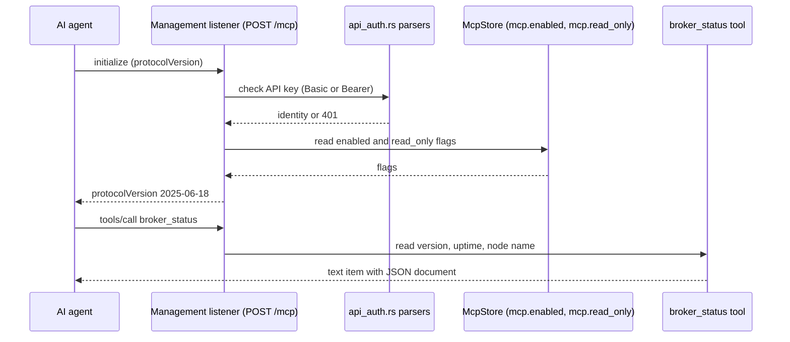

# Built-in MCP endpoint

The broker serves a built-in MCP endpoint on the management listener.
Use it when an AI agent must act as an operator.
The agent gets the same rights as its API key, nothing more.
The endpoint exposes management functions as tools.



## Reference check

The reference specification 6.3.0 defines no MCP surface.
The file `openapi.json` holds no path, tag or schema with `mcp`.
The paths and shapes below are therefore new and broker-specific.

## Implementation choice

The endpoint implements the JSON-RPC 2.0 subset by hand on the HTTP stack of the management API.
It uses no external MCP crate.
The hand implementation keeps the dependency gate clean: no new crate enters `Cargo.lock` and `deny.toml` stays unchanged.
An SDK stays an option for a later task with many tools, after its licence check passes and its release proves recent.

## Before you start

- Start the broker with the management listener active.
- Create an API key with the `monitoring` scope.
- Keep the key secret. Send it as a header on each call.

## Endpoint

- Route: `POST /mcp` on the management listener.
- Transport: Streamable HTTP with JSON responses.
- The endpoint serves no SSE stream.
- One request body holds one JSON-RPC object or one batch array.
- A notification (no id) answers `202` with an empty body.
- One body is at most 64 KiB.

> WARNING: A body above 64 KiB answers `413`. Keep tool arguments small.

## Methods

| Method | Answer |
|---|---|
| `initialize` | Server protocol version, tool capability and server info. |
| `ping` | Empty result. |
| `tools/list` | Tool list. This task ships `broker_status`. |
| `tools/call` | Tool result for the named tool. |
| Any other method | JSON-RPC error `-32601`. |

Protocol negotiation answers the server version `2025-06-18`.
The client sends its version in `initialize`.
The server answers its own version in every case.

## Tool `broker_status`

The tool takes no arguments.
It returns one text item with a JSON document:

- `version`: build version of the broker.
- `uptime_seconds`: seconds since the node started.
- `node`: local node name.

All three values come from the live node.
No constant stands in for a measurement.

## Authentication

- Send an API key as `Authorization: Basic base64(api_key:api_secret)` or `Authorization: Bearer <api_secret>`.
- An operator key from the process environment also works as a bearer credential.
- The check runs through `api_auth.rs`: same parsers and same key stores as the management API.
- A missing or wrong credential answers HTTP `401` with a plain error object.
- The `401` body carries no JSON-RPC member.
- A dashboard session token never authenticates here and answers `401`.
- A key needs the `monitoring` scope for `/mcp`, as for other monitoring reads.
- A viewer key calls read-only tools only.

> NOTE: The dashboard session token always fails here. Use an API key.

## Settings

```toml
[mcp]
enabled = true
read_only = false
```

- `mcp.enabled` turns the path on or off. Default: `true`. A disabled path answers `404`.
- `mcp.read_only` refuses mutating tool calls. Default: `false`. Read-only mode still serves `broker_status`.
- Set each value in `indra.toml`, in a `conf.d` fragment or through the environment: `INDRA_MCP__ENABLED`, `INDRA_MCP__READ_ONLY`.
- An unknown tool answers `-32602` in read-write mode and `-32600` (read-only refusal) in read-only mode.

## Check that it works

Run these commands against a local broker.
Replace `KEY` with a valid API secret.

```sh
curl -s http://127.0.0.1:18083/mcp \
  -H 'Content-Type: application/json' \
  -H "Authorization: Bearer KEY" \
  -d '{"jsonrpc":"2.0","id":1,"method":"initialize","params":{"protocolVersion":"2025-06-18","capabilities":{},"clientInfo":{"name":"smoke","version":"0"}}}'
curl -s http://127.0.0.1:18083/mcp \
  -H 'Content-Type: application/json' \
  -H "Authorization: Bearer KEY" \
  -d '{"jsonrpc":"2.0","id":2,"method":"tools/list","params":{}}'
curl -s http://127.0.0.1:18083/mcp \
  -H 'Content-Type: application/json' \
  -H "Authorization: Bearer KEY" \
  -d '{"jsonrpc":"2.0","id":3,"method":"tools/call","params":{"name":"broker_status","arguments":{}}}'
```

The first call returns `protocolVersion` `2025-06-18`.
The second call lists a tool named `broker_status`.
The third call returns one text item with `version`, `uptime_seconds` and `node`.
A call with no key returns HTTP `401` with no JSON-RPC member.

## Limits of this task

- Only `broker_status` exists. Later tasks add the remaining management tools.
- Later tasks map each new tool to its management scope.
- Later tasks decide the session and SSE behaviour, if the scope needs it.

## Next steps

- Read `docs/settings-reference.md` for the `mcp` settings table.
- Read `docs/configuration.md` for file, fragment and environment layers.
<!-- screenshot: management dashboard showing the MCP tool list -->
