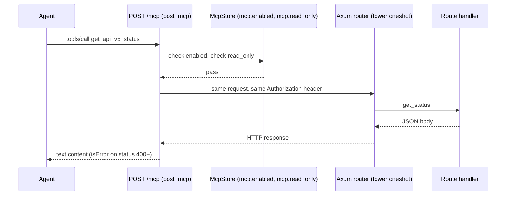

# MCP server

The broker exposes a Model Context Protocol (MCP) server on the
management listener. Use it when an agent must do what an operator
does. Each tool runs the same handler as one HTTP route. You get one
tool for each management operation, with the same permissions.



## Endpoint

- `POST /mcp` takes a JSON-RPC 2.0 message and returns a JSON-RPC 2.0
  response. Other methods get `405`.
- The server speaks Streamable HTTP with JSON responses only. It sends
  no server-sent events.
- One request body holds one JSON-RPC object or one batch array.
  A notification (no id) answers `202` with an empty body.
- Methods: `initialize`, `ping`, `tools/list`, `tools/call`.
  A method that starts with `notifications/` gets `202` with an empty
  body. Any other unknown method gets JSON-RPC error `-32601`.
- `initialize` negotiates the protocol version. The server names the
  newest version it speaks. It accepts an older known version back.
- A malformed envelope gets `400`. A body above the size limit gets
  `413`. A valid envelope with a method error gets `200` with the
  JSON-RPC error body.
- The reference specification defines no MCP surface, so this shape is
  our own. The implementation parses JSON-RPC by hand on the existing
  HTTP stack. Reason: a hand-written subset needs no new dependency,
  and the one new dependency (`tower` with `util`, MIT) only dispatches
  calls in process. A full SDK would add review surface for no gain.

## Authentication

- Use an API key: Basic `api_key:api_secret`, the secret as a bearer
  credential, or an operator key from the environment.
- The check uses the same code path as the management API.
- A key needs the `monitoring` scope for `/mcp`, as for other
  monitoring reads. A key without it gets `403`.
- No key or a wrong key gets HTTP `401` with the management error
  shape. The body is never a JSON-RPC response.
- A dashboard login token gets `401`. Agents authenticate with keys.
- A tool call re-enters the router with the same `Authorization`
  header. Key scopes and the viewer read-only rule apply as over HTTP.

> NOTE: The dashboard session token always fails here. Use an API key.

## Settings

| Setting | Default | Effect |
|---|---|---|
| `mcp.enabled` (`INDRA_MCP__ENABLED`) | `true` | `false` answers `404` on `POST /mcp` for every call. |
| `mcp.read_only` (`INDRA_MCP__READ_ONLY`) | `false` | `true` refuses every tool that writes with `FORBIDDEN`. Reads still work. `tools/list` still lists all tools. |

- Set `[mcp]` keys in `indra.toml` to change the endpoint. A `conf.d`
  fragment or the environment works too.
- Boot applies the resolved section to the shared switch. A disabled
  endpoint answers `404` with the management error shape.

> Read-only mode refuses at the MCP layer before dispatch. The inner
> write never runs, so no audit record and no state change result.

## Tools

- `get_api_v5_status` reads the node status. `get_status` is its
  public alias. Both run the same handler through the router.
- Every other tool maps to one HTTP operation. The build scans the
  router source and emits one row per `(method, path)` pair. The tool
  list derives from that table at startup. No hand-written copy of a
  schema exists.
- The tool name derives from the method and the path in snake case,
  for example `get_api_v5_clients_by_clientid`. Names stay stable while
  routes stay stable.
- The tool description reuses the first doc line of the handler. A
  route without docs falls back to `METHOD path`. Descriptions never
  copy the reference text.
- `inputSchema` derives from the path template and the method:
  path segments become required string fields, `query` carries query
  keys, `body` carries the JSON body, `body_base64` carries raw bytes
  in base64. Use either `body` or `body_base64`, never both.
- Annotations: `readOnlyHint` is true for `GET`; `destructiveHint` is
  true for `DELETE` and for operations that stop, kick, purge, reset,
  restart, deactivate or evacuate.
- `tools/call` returns the JSON body as text content. An HTTP status
  of 400 or more gives `isError: true` with the code and message of
  the API. A binary answer (file downloads) returns base64 inside a
  small JSON envelope with its content type. Text answers return as
  text.

## Check that it works

Call the status tool through `/mcp` with an API key:

```json
{"jsonrpc": "2.0", "method": "tools/call",
 "params": {"name": "get_api_v5_status",
            "arguments": {"query": {"format": "json"}}}, "id": 1}
```

The result content holds the same JSON as HTTP
`GET /api/v5/status?format=json`. The object has four fields:
`rel_vsn` (the build version with a `v` prefix), `node_name`,
`broker_status` (`started` or `stopped`) and `app_status`
(`running` or `not_running`).

The test
`mcp_initialize_lists_and_calls_over_a_real_socket` asserts the MCP
answer equals the HTTP answer on a live server. The boot smoke script
`tools/boot_smoke.sh` repeats the call against a booted kernel.

## Exclusions

The code holds one exclusion table with a reason for each entry:

- The API key group: key management stays operator-only.
- Login, logout, MFA setup and single sign-on flows: agents use keys,
  not sign-in flows.
- Console pages, assets, probes and the transport itself: these are
  not management operations.

## Limits

- One `/mcp` body holds 8 MiB or less. A larger body gets `413`.
  Keep tool arguments small.
- One tool answer holds 8 MiB or less. Larger files stay available
  over the HTTP route directly.
- No multipart operation exists in the router. File uploads take JSON
  or raw bytes through `body` or `body_base64`; file downloads return
  through the base64 envelope. The same 8 MiB limit applies both ways.

## Tenants

- A tool call adds no tenant logic. It forwards the same HTTP request
  an operator would send, so tenant scoping stays exactly as over
  HTTP. No new message path exists, so no new tenant test is needed.

## Open work

- Toolsets (the next MC task).
- Audit records with tool names (the middleware already audits the
  inner write by path).

## Next steps

- Read `docs/settings-reference.md` for the `mcp` settings table.
- Read `docs/configuration.md` for file, fragment and environment layers.
<!-- screenshot: management dashboard showing the MCP tool list -->
