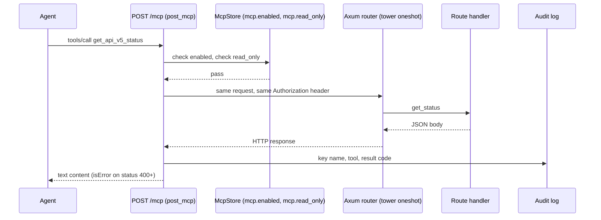

The broker exposes a Model Context Protocol (MCP) server on the
management listener. Use it when an agent must do what an operator
does. Each tool runs the same handler as one HTTP route. You get one
tool for each management operation, with the same permissions.
Tools form groups selected with `toolsets=a,b` on `/mcp` (see
Toolsets below).



## Endpoint

- `POST /mcp` takes a JSON-RPC 2.0 message and returns a JSON-RPC 2.0
  response. Other methods get `405`.
- The server speaks Streamable HTTP with JSON responses only. It sends
  no server-sent events.
- One request body holds one JSON-RPC object or one batch array.
  A notification (no id) answers `202` with an empty body.
- Methods: `initialize`, `ping`, `tools/list`, `tools/call`.
  A method that starts with `notifications/` gets `202` with an empty
  body. Any other unknown method gets JSON-RPC error `-32601`.
- `initialize` negotiates the protocol version. The server names the
  newest version it speaks. It accepts an older known version back.
- A malformed envelope gets `400`. A body above the size limit gets
  `413`. A valid envelope with a method error gets `200` with the
  JSON-RPC error body.
- The reference specification defines no MCP surface, so this shape is
  our own. The implementation parses JSON-RPC by hand on the existing
  HTTP stack. Reason: a hand-written subset needs no new dependency,
  and the one new dependency (`tower` with `util`, MIT) only dispatches
  calls in process. A full SDK would add review surface for no gain.

## Authentication

- Use an API key: Basic `api_key:api_secret`, the secret as a bearer
  credential, or an operator key from the environment.
- The check uses the same code path as the management API.
- A key reaches `/mcp` itself with the `monitoring` scope or the
  `publish` scope. A key with neither scope gets `403`.
- A publish-only key sees the messaging tools and no monitoring tool.
  A monitoring-only key sees the monitoring tools and no messaging tool.
- No key or a wrong key gets HTTP `401` with the management error
  shape. The body is never a JSON-RPC response.
- A dashboard login token gets `401`. Agents authenticate with keys.
- A tool call re-enters the router with the same `Authorization`
  header. Key scopes and the viewer read-only rule apply as over HTTP.

> NOTE: The dashboard session token always fails here. Use an API key.

## Connect a client

Point any agent client at the management address. Send the API key
in the `Authorization` header. Replace `<api_secret>` with the
secret of the key.

<!-- client-config-example -->

```json
{
  "mcpServers": {
    "indramqtt": {
      "url": "http://127.0.0.1:18083/mcp",
      "headers": {
        "Authorization": "Bearer <api_secret>"
      }
    }
  }
}
```

The Basic form works too. Send `api_key:api_secret` encoded in
base64 after the word `Basic`. A user login token is refused with
`401`. The endpoint accepts an API key only.

<!-- screenshot: agent client configuration screen with URL and header fields -->

## Toolsets

Tools form groups by operation tag. The client selects groups with the
query parameter `toolsets=a,b` on `/mcp`. With no parameter the client
gets the `core` set. `toolsets=all` gives every tool. Unknown group
names select nothing. The tool `list_toolsets` is always present. It
names the groups with their tool counts.

| Toolset | Holds | In `core` |
|---|---|---|
| `status` | Node status and version | Yes |
| `clients` | Connected clients, bans, session counts | Yes |
| `subscriptions` | Subscription listing | Yes |
| `topics` | Topic listing and retained topics | Yes |
| `publish` | Publish of messages through the broker | Yes |
| `metrics` | Metrics, alarms, traces, monitor history | Yes |
| `rules` | Rules, actions, sources, schemas, transformations | No |
| `connectors` | Connector instances and probes | No |
| `authentication` | Users, authenticators, single sign-on | No |
| `authorization` | Authorization sources, rules, caches | No |
| `tenants` | Managed tenant namespaces | No |
| `listeners` | Network listeners and their status | No |
| `configuration` | Broker configuration, certificates, data files | No |
| `cluster` | Cluster topology and nodes | No |
| `gateways` | Protocol gateways | No |
| `license` | Licence document and settings | No |
| `audit` | Management audit log | No |

## Permissions

- The scope of the API key applies exactly as over HTTP. A tool that
  the key may not call is absent from `tools/list` and refused in
  `tools/call` with JSON-RPC error `-32602`.
- A viewer key sees read tools only and cannot call a write tool.
- An operator key from the environment keeps full access, as over HTTP.
- `list_toolsets` is always present: every key sees it and may call it.

## Audit

- Every `tools/call` writes one audit record through the existing audit log.
- The record carries the key name, the tool name and the result code.
- It never carries tool arguments: arguments may hold secrets.
- Read the records with `GET /api/v5/audit`, for example with `from=mcp`.

## Settings

| Setting | Default | Effect |
|---|---|---|
| `mcp.enabled` (`INDRA_MCP__ENABLED`) | `true` | `false` answers `404` on `POST /mcp` for every call. |
| `mcp.read_only` (`INDRA_MCP__READ_ONLY`) | `false` | `true` lists and runs read-only tools only, for every key. A write call is refused with `FORBIDDEN` and `isError`. |

- Set `[mcp]` keys in `indra.toml` to change the endpoint. A `conf.d`
  fragment or the environment works too.
- Boot applies the resolved section to the shared switch. A disabled
  endpoint answers `404` with the management error shape.

> Read-only mode refuses at the MCP layer before dispatch. The inner
> write never runs, so no audit record and no state change result.

## Tools

One entry per tool, in route-table order within each toolset. The
`inputSchema` shape is mechanical: path segments become required string
fields, `query` carries query keys, `body` carries the JSON body and
`body_base64` carries raw bytes in base64 (use either `body` or `body_base64`, never both).
Verified examples were captured against a running broker for 30 tool entries with live examples.
The full catalogue with one entry per tool lives in [MCP tools catalogue](./reference/mcp-tools.md).

### `broker_status`

- Toolset: `status`
- Route: `GET /api/v5/status`
- Description: Read the version, uptime and node name of this node. (GET /api/v5/status)

**inputSchema**
```json
{
  "type": "object",
  "properties": {
    "query": {
      "type": "object",
      "description": "Query keys of the operation. Omit keys the call does not need.",
      "additionalProperties": true
    }
  },
  "required": [],
  "additionalProperties": false
}
```

**Verified `tools/call`**
```json
{
 "jsonrpc": "2.0",
 "method": "tools/call",
 "params": {
  "name": "broker_status",
  "arguments": {
   "query": {
    "format": "json"
   }
  }
 },
 "id": 9
}
```

**Output**
```
{"version":"2026.11.0-beta.1","uptime_ms":112883,"node":"indra-node-1@bfe554c525c5"}
```

### `get_api_v5_status`

- Toolset: `status`
- Route: `GET /api/v5/status`
- Description: Node status read. (GET /api/v5/status)

**inputSchema**
```json
{
  "type": "object",
  "properties": {
    "query": {
      "type": "object",
      "description": "Query keys of the operation. Omit keys the call does not need.",
      "additionalProperties": true
    }
  },
  "required": [],
  "additionalProperties": false
}
```

**Verified `tools/call`**
```json
{
 "jsonrpc": "2.0",
 "method": "tools/call",
 "params": {
  "name": "get_api_v5_status",
  "arguments": {
   "query": {
    "format": "json"
   }
  }
 },
 "id": 9
}
```

**Output**
```
{"rel_vsn":"v2026.11.0-beta.1","node_name":"indra-node-1@bfe554c525c5","broker_status":"started","app_status":"running"}
```

### `get_status`

- Toolset: `status`
- Route: `GET /status`
- Description: Node status read. (GET /status)

**inputSchema**
```json
{
  "type": "object",
  "properties": {
    "query": {
      "type": "object",
      "description": "Query keys of the operation. Omit keys the call does not need.",
      "additionalProperties": true
    }
  },
  "required": [],
  "additionalProperties": false
}
```

**Verified `tools/call`**
```json
{
 "jsonrpc": "2.0",
 "method": "tools/call",
 "params": {
  "name": "get_status",
  "arguments": {
   "query": {
    "format": "json"
   }
  }
 },
 "id": 9
}
```

**Output**
```
{"rel_vsn":"v2026.11.0-beta.1","node_name":"indra-node-1@bfe554c525c5","broker_status":"started","app_status":"running"}
```

### `list_toolsets`

- Toolset: `status`
- Description: List the MCP toolsets with their tool counts.

**inputSchema**
```json
{
  "type": "object",
  "properties": {},
  "required": [],
  "additionalProperties": false
}
```

**Verified `tools/call`**
```json
{
 "jsonrpc": "2.0",
 "method": "tools/call",
 "params": {
  "name": "list_toolsets",
  "arguments": {}
 },
 "id": 9
}
```

**Output**
```
{"toolsets":[...]}
```

### `delete_api_v5_banned`

- Toolset: `clients`
- Route: `DELETE /api/v5/banned`
- Description: `DELETE /banned`: drop every entry and report success with 204. (DELETE /api/v5/banned)

**inputSchema**
```json
{
  "type": "object",
  "properties": {
    "query": {
      "type": "object",
      "description": "Query keys of the operation. Omit keys the call does not need.",
      "additionalProperties": true
    }
  },
  "required": [],
  "additionalProperties": false
}
```

_No live example captured: this operation requires a path-segment value or a request body (see `inputSchema` above)._

### `delete_api_v5_banned_by_as_by_who`

- Toolset: `clients`
- Route: `DELETE /api/v5/banned/:as/:who`
- Description: `DELETE /banned/{as}/{who}`: drop one entry addressed by its kind plus (DELETE /api/v5/banned/:as/:who)

**inputSchema**
```json
{
  "type": "object",
  "properties": {
    "as": {
      "type": "string",
      "description": "Value for the :as path segment."
    },
    "who": {
      "type": "string",
      "description": "Value for the :who path segment."
    },
    "query": {
      "type": "object",
      "description": "Query keys of the operation. Omit keys the call does not need.",
      "additionalProperties": true
    }
  },
  "required": [
    "as",
    "who"
  ],
  "additionalProperties": false
}
```

_No live example captured: this operation requires a path-segment value or a request body (see `inputSchema` above)._

### `delete_api_v5_clients_by_clientid`

- Toolset: `clients`
- Route: `DELETE /api/v5/clients/:clientid`
- Description: DELETE /api/v5/clients/:clientid

**inputSchema**
```json
{
  "type": "object",
  "properties": {
    "clientid": {
      "type": "string",
      "description": "Value for the :clientid path segment."
    },
    "query": {
      "type": "object",
      "description": "Query keys of the operation. Omit keys the call does not need.",
      "additionalProperties": true
    }
  },
  "required": [
    "clientid"
  ],
  "additionalProperties": false
}
```

_No live example captured: this operation requires a path-segment value or a request body (see `inputSchema` above)._

### `delete_api_v5_clients_by_clientid_authorization_cache`

- Toolset: `clients`
- Route: `DELETE /api/v5/clients/:clientid/authorization/cache`
- Description: Per-client authorization decision cache clear. (DELETE /api/v5/clients/:clientid/authorization/cache)

**inputSchema**
```json
{
  "type": "object",
  "properties": {
    "clientid": {
      "type": "string",
      "description": "Value for the :clientid path segment."
    },
    "query": {
      "type": "object",
      "description": "Query keys of the operation. Omit keys the call does not need.",
      "additionalProperties": true
    }
  },
  "required": [
    "clientid"
  ],
  "additionalProperties": false
}
```

_No live example captured: this operation requires a path-segment value or a request body (see `inputSchema` above)._

### `get_api_v1_clients`

- Toolset: `clients`
- Route: `GET /api/v1/clients`
- Description: Sorted ids of currently connected clients. (GET /api/v1/clients)

**inputSchema**
```json
{
  "type": "object",
  "properties": {
    "query": {
      "type": "object",
      "description": "Query keys of the operation. Omit keys the call does not need.",
      "additionalProperties": true
    }
  },
  "required": [],
  "additionalProperties": false
}
```

**Verified `tools/call`**
```json
{
 "jsonrpc": "2.0",
 "method": "tools/call",
 "params": {
  "name": "get_api_v1_clients",
  "arguments": {}
 },
 "id": 9
}
```

**Output**
```
[]
```

### `get_api_v1_clients_by_id`

- Toolset: `clients`
- Route: `GET /api/v1/clients/:id`
- Description: Full detail row for one client session. (GET /api/v1/clients/:id)

**inputSchema**
```json
{
  "type": "object",
  "properties": {
    "id": {
      "type": "string",
      "description": "Value for the :id path segment."
    },
    "query": {
      "type": "object",
      "description": "Query keys of the operation. Omit keys the call does not need.",
      "additionalProperties": true
    }
  },
  "required": [
    "id"
  ],
  "additionalProperties": false
}
```

_No live example captured: this operation requires a path-segment value or a request body (see `inputSchema` above)._

### `get_api_v5_banned`

- Toolset: `clients`
- Route: `GET /api/v5/banned`
- Description: `GET /banned`: wrapped page (`data` plus `meta`). An empty store reads (GET /api/v5/banned)

**inputSchema**
```json
{
  "type": "object",
  "properties": {
    "query": {
      "type": "object",
      "description": "Query keys of the operation. Omit keys the call does not need.",
      "additionalProperties": true
    }
  },
  "required": [],
  "additionalProperties": false
}
```

**Verified `tools/call`**
```json
{
 "jsonrpc": "2.0",
 "method": "tools/call",
 "params": {
  "name": "get_api_v5_banned",
  "arguments": {}
 },
 "id": 9
}
```

**Output**
```
{"data":[],"meta":{"page":1,"limit":100,"count":0,"hasnext":false}}
```

### `get_api_v5_clients`

- Toolset: `clients`
- Route: `GET /api/v5/clients`
- Description: GET /api/v5/clients

**inputSchema**
```json
{
  "type": "object",
  "properties": {
    "query": {
      "type": "object",
      "description": "Query keys of the operation. Omit keys the call does not need.",
      "additionalProperties": true
    }
  },
  "required": [],
  "additionalProperties": false
}
```

**Verified `tools/call`**
```json
{
 "jsonrpc": "2.0",
 "method": "tools/call",
 "params": {
  "name": "get_api_v5_clients",
  "arguments": {}
 },
 "id": 9
}
```

**Output**
```
{"data":[],"meta":{"page":1,"limit":100,"count":0,"hasnext":false}}
```

### `get_api_v5_clients_by_clientid`

- Toolset: `clients`
- Route: `GET /api/v5/clients/:clientid`
- Description: GET /api/v5/clients/:clientid

**inputSchema**
```json
{
  "type": "object",
  "properties": {
    "clientid": {
      "type": "string",
      "description": "Value for the :clientid path segment."
    },
    "query": {
      "type": "object",
      "description": "Query keys of the operation. Omit keys the call does not need.",
      "additionalProperties": true
    }
  },
  "required": [
    "clientid"
  ],
  "additionalProperties": false
}
```

_No live example captured: this operation requires a path-segment value or a request body (see `inputSchema` above)._

### `get_api_v5_clients_by_clientid_authorization_cache`

- Toolset: `clients`
- Route: `GET /api/v5/clients/:clientid/authorization/cache`
- Description: Per-client authorization decision cache read. (GET /api/v5/clients/:clientid/authorization/cache)

**inputSchema**
```json
{
  "type": "object",
  "properties": {
    "clientid": {
      "type": "string",
      "description": "Value for the :clientid path segment."
    },
    "query": {
      "type": "object",
      "description": "Query keys of the operation. Omit keys the call does not need.",
      "additionalProperties": true
    }
  },
  "required": [
    "clientid"
  ],
  "additionalProperties": false
}
```

_No live example captured: this operation requires a path-segment value or a request body (see `inputSchema` above)._

### `get_api_v5_clients_by_clientid_inflight_messages`

- Toolset: `clients`
- Route: `GET /api/v5/clients/:clientid/inflight_messages`
- Description: GET /api/v5/clients/:clientid/inflight_messages

**inputSchema**
```json
{
  "type": "object",
  "properties": {
    "clientid": {
      "type": "string",
      "description": "Value for the :clientid path segment."
    },
    "query": {
      "type": "object",
      "description": "Query keys of the operation. Omit keys the call does not need.",
      "additionalProperties": true
    }
  },
  "required": [
    "clientid"
  ],
  "additionalProperties": false
}
```

_No live example captured: this operation requires a path-segment value or a request body (see `inputSchema` above)._

### `get_api_v5_clients_by_clientid_mqueue_messages`

- Toolset: `clients`
- Route: `GET /api/v5/clients/:clientid/mqueue_messages`
- Description: GET /api/v5/clients/:clientid/mqueue_messages

**inputSchema**
```json
{
  "type": "object",
  "properties": {
    "clientid": {
      "type": "string",
      "description": "Value for the :clientid path segment."
    },
    "query": {
      "type": "object",
      "description": "Query keys of the operation. Omit keys the call does not need.",
      "additionalProperties": true
    }
  },
  "required": [
    "clientid"
  ],
  "additionalProperties": false
}
```

_No live example captured: this operation requires a path-segment value or a request body (see `inputSchema` above)._

### `get_api_v5_clients_by_clientid_subscriptions`

- Toolset: `clients`
- Route: `GET /api/v5/clients/:clientid/subscriptions`
- Description: GET /api/v5/clients/:clientid/subscriptions

**inputSchema**
```json
{
  "type": "object",
  "properties": {
    "clientid": {
      "type": "string",
      "description": "Value for the :clientid path segment."
    },
    "query": {
      "type": "object",
      "description": "Query keys of the operation. Omit keys the call does not need.",
      "additionalProperties": true
    }
  },
  "required": [
    "clientid"
  ],
  "additionalProperties": false
}
```

_No live example captured: this operation requires a path-segment value or a request body (see `inputSchema` above)._

### `get_api_v5_clients_v2`

- Toolset: `clients`
- Route: `GET /api/v5/clients_v2`
- Description: GET /api/v5/clients_v2

**inputSchema**
```json
{
  "type": "object",
  "properties": {
    "query": {
      "type": "object",
      "description": "Query keys of the operation. Omit keys the call does not need.",
      "additionalProperties": true
    }
  },
  "required": [],
  "additionalProperties": false
}
```

_No live example captured: this operation requires a path-segment value or a request body (see `inputSchema` above)._

### `get_api_v5_sessions_count`

- Toolset: `clients`
- Route: `GET /api/v5/sessions_count`
- Description: `GET /sessions_count`: the number of sessions that have not expired. (GET /api/v5/sessions_count)

**inputSchema**
```json
{
  "type": "object",
  "properties": {
    "query": {
      "type": "object",
      "description": "Query keys of the operation. Omit keys the call does not need.",
      "additionalProperties": true
    }
  },
  "required": [],
  "additionalProperties": false
}
```

**Verified `tools/call`**
```json
{
 "jsonrpc": "2.0",
 "method": "tools/call",
 "params": {
  "name": "get_api_v5_sessions_count",
  "arguments": {}
 },
 "id": 9
}
```

**Output**
```
"0"
```

### `post_api_v5_banned`

- Toolset: `clients`
- Route: `POST /api/v5/banned`
- Description: `POST /banned`: create one entry from a who-value plus what-kind and (POST /api/v5/banned)

**inputSchema**
```json
{
  "type": "object",
  "properties": {
    "query": {
      "type": "object",
      "description": "Query keys of the operation. Omit keys the call does not need.",
      "additionalProperties": true
    },
    "body": {
      "description": "JSON body of the operation, exactly as the HTTP route takes it."
    },
    "body_base64": {
      "type": "string",
      "description": "Raw body bytes in base64 for file operations. Use either body or body_base64, never both."
    }
  },
  "required": [],
  "additionalProperties": false
}
```

_No live example captured: this operation requires a path-segment value or a request body (see `inputSchema` above)._

### `post_api_v5_clients_by_clientid_subscribe`

- Toolset: `clients`
- Route: `POST /api/v5/clients/:clientid/subscribe`
- Description: POST /api/v5/clients/:clientid/subscribe

**inputSchema**
```json
{
  "type": "object",
  "properties": {
    "clientid": {
      "type": "string",
      "description": "Value for the :clientid path segment."
    },
    "query": {
      "type": "object",
      "description": "Query keys of the operation. Omit keys the call does not need.",
      "additionalProperties": true
    },
    "body": {
      "description": "JSON body of the operation, exactly as the HTTP route takes it."
    },
    "body_base64": {
      "type": "string",
      "description": "Raw body bytes in base64 for file operations. Use either body or body_base64, never both."
    }
  },
  "required": [
    "clientid"
  ],
  "additionalProperties": false
}
```

_No live example captured: this operation requires a path-segment value or a request body (see `inputSchema` above)._

### `post_api_v5_clients_by_clientid_subscribe_bulk`

- Toolset: `clients`
- Route: `POST /api/v5/clients/:clientid/subscribe/bulk`
- Description: POST /api/v5/clients/:clientid/subscribe/bulk

**inputSchema**
```json
{
  "type": "object",
  "properties": {
    "clientid": {
      "type": "string",
      "description": "Value for the :clientid path segment."
    },
    "query": {
      "type": "object",
      "description": "Query keys of the operation. Omit keys the call does not need.",
      "additionalProperties": true
    },
    "body": {
      "description": "JSON body of the operation, exactly as the HTTP route takes it."
    },
    "body_base64": {
      "type": "string",
      "description": "Raw body bytes in base64 for file operations. Use either body or body_base64, never both."
    }
  },
  "required": [
    "clientid"
  ],
  "additionalProperties": false
}
```

_No live example captured: this operation requires a path-segment value or a request body (see `inputSchema` above)._

### `post_api_v5_clients_by_clientid_unsubscribe`

- Toolset: `clients`
- Route: `POST /api/v5/clients/:clientid/unsubscribe`
- Description: POST /api/v5/clients/:clientid/unsubscribe

**inputSchema**
```json
{
  "type": "object",
  "properties": {
    "clientid": {
      "type": "string",
      "description": "Value for the :clientid path segment."
    },
    "query": {
      "type": "object",
      "description": "Query keys of the operation. Omit keys the call does not need.",
      "additionalProperties": true
    },
    "body": {
      "description": "JSON body of the operation, exactly as the HTTP route takes it."
    },
    "body_base64": {
      "type": "string",
      "description": "Raw body bytes in base64 for file operations. Use either body or body_base64, never both."
    }
  },
  "required": [
    "clientid"
  ],
  "additionalProperties": false
}
```

_No live example captured: this operation requires a path-segment value or a request body (see `inputSchema` above)._

### `post_api_v5_clients_by_clientid_unsubscribe_bulk`

- Toolset: `clients`
- Route: `POST /api/v5/clients/:clientid/unsubscribe/bulk`
- Description: POST /api/v5/clients/:clientid/unsubscribe/bulk

**inputSchema**
```json
{
  "type": "object",
  "properties": {
    "clientid": {
      "type": "string",
      "description": "Value for the :clientid path segment."
    },
    "query": {
      "type": "object",
      "description": "Query keys of the operation. Omit keys the call does not need.",
      "additionalProperties": true
    },
    "body": {
      "description": "JSON body of the operation, exactly as the HTTP route takes it."
    },
    "body_base64": {
      "type": "string",
      "description": "Raw body bytes in base64 for file operations. Use either body or body_base64, never both."
    }
  },
  "required": [
    "clientid"
  ],
  "additionalProperties": false
}
```

_No live example captured: this operation requires a path-segment value or a request body (see `inputSchema` above)._

### `post_api_v5_clients_kickout_bulk`

- Toolset: `clients`
- Route: `POST /api/v5/clients/kickout/bulk`
- Description: `POST /clients/kickout/bulk`: disconnect many clients. The reference (POST /api/v5/clients/kickout/bulk)

**inputSchema**
```json
{
  "type": "object",
  "properties": {
    "query": {
      "type": "object",
      "description": "Query keys of the operation. Omit keys the call does not need.",
      "additionalProperties": true
    },
    "body": {
      "description": "JSON body of the operation, exactly as the HTTP route takes it."
    },
    "body_base64": {
      "type": "string",
      "description": "Raw body bytes in base64 for file operations. Use either body or body_base64, never both."
    }
  },
  "required": [],
  "additionalProperties": false
}
```

_No live example captured: this operation requires a path-segment value or a request body (see `inputSchema` above)._

### `put_api_v5_clients_by_clientid_keepalive`

- Toolset: `clients`
- Route: `PUT /api/v5/clients/:clientid/keepalive`
- Description: Update the keepalive of one connected client. (PUT /api/v5/clients/:clientid/keepalive)

**inputSchema**
```json
{
  "type": "object",
  "properties": {
    "clientid": {
      "type": "string",
      "description": "Value for the :clientid path segment."
    },
    "query": {
      "type": "object",
      "description": "Query keys of the operation. Omit keys the call does not need.",
      "additionalProperties": true
    },
    "body": {
      "description": "JSON body of the operation, exactly as the HTTP route takes it."
    },
    "body_base64": {
      "type": "string",
      "description": "Raw body bytes in base64 for file operations. Use either body or body_base64, never both."
    }
  },
  "required": [
    "clientid"
  ],
  "additionalProperties": false
}
```

_No live example captured: this operation requires a path-segment value or a request body (see `inputSchema` above)._

### `get_api_v5_subscriptions`

- Toolset: `subscriptions`
- Route: `GET /api/v5/subscriptions`
- Description: GET /api/v5/subscriptions

**inputSchema**
```json
{
  "type": "object",
  "properties": {
    "query": {
      "type": "object",
      "description": "Query keys of the operation. Omit keys the call does not need.",
      "additionalProperties": true
    }
  },
  "required": [],
  "additionalProperties": false
}
```

**Verified `tools/call`**
```json
{
 "jsonrpc": "2.0",
 "method": "tools/call",
 "params": {
  "name": "get_api_v5_subscriptions",
  "arguments": {}
 },
 "id": 9
}
```

**Output**
```
[]
```

### `get_api_v5_topics`

- Toolset: `topics`
- Route: `GET /api/v5/topics`
- Description: Topic list as a paged collection (W1-15). (GET /api/v5/topics)

**inputSchema**
```json
{
  "type": "object",
  "properties": {
    "query": {
      "type": "object",
      "description": "Query keys of the operation. Omit keys the call does not need.",
      "additionalProperties": true
    }
  },
  "required": [],
  "additionalProperties": false
}
```

**Verified `tools/call`**
```json
{
 "jsonrpc": "2.0",
 "method": "tools/call",
 "params": {
  "name": "get_api_v5_topics",
  "arguments": {}
 },
 "id": 9
}
```

**Output**
```
{"data":[],"meta":{"page":1,"limit":100,"count":0,"hasnext":false}}
```

### `get_api_v5_topics_by_topic`

- Toolset: `topics`
- Route: `GET /api/v5/topics/:topic`
- Description: Topic detail for one exact topic name (W1-15). (GET /api/v5/topics/:topic)

**inputSchema**
```json
{
  "type": "object",
  "properties": {
    "topic": {
      "type": "string",
      "description": "Value for the :topic path segment."
    },
    "query": {
      "type": "object",
      "description": "Query keys of the operation. Omit keys the call does not need.",
      "additionalProperties": true
    }
  },
  "required": [
    "topic"
  ],
  "additionalProperties": false
}
```

_No live example captured: this operation requires a path-segment value or a request body (see `inputSchema` above)._

### `post_api_v5_publish`

- Toolset: `publish`
- Route: `POST /api/v5/publish`
- Description: POST /api/v5/publish

**inputSchema**
```json
{
  "type": "object",
  "properties": {
    "query": {
      "type": "object",
      "description": "Query keys of the operation. Omit keys the call does not need.",
      "additionalProperties": true
    },
    "body": {
      "description": "JSON body of the operation, exactly as the HTTP route takes it."
    },
    "body_base64": {
      "type": "string",
      "description": "Raw body bytes in base64 for file operations. Use either body or body_base64, never both."
    }
  },
  "required": [],
  "additionalProperties": false
}
```

_No live example captured: this operation requires a path-segment value or a request body (see `inputSchema` above)._

### `post_api_v5_publish_bulk`

- Toolset: `publish`
- Route: `POST /api/v5/publish/bulk`
- Description: Bulk management publish through the single-entry injection routine. (POST /api/v5/publish/bulk)

**inputSchema**
```json
{
  "type": "object",
  "properties": {
    "query": {
      "type": "object",
      "description": "Query keys of the operation. Omit keys the call does not need.",
      "additionalProperties": true
    },
    "body": {
      "description": "JSON body of the operation, exactly as the HTTP route takes it."
    },
    "body_base64": {
      "type": "string",
      "description": "Raw body bytes in base64 for file operations. Use either body or body_base64, never both."
    }
  },
  "required": [],
  "additionalProperties": false
}
```

_No live example captured: this operation requires a path-segment value or a request body (see `inputSchema` above)._

### `subscribe_collect`

- Toolset: `publish`
- Route: none (built-in messaging tool)
- Description: Subscribe briefly and collect matching messages.

**inputSchema**
```json
{
  "type": "object",
  "properties": {
    "topic_filter": {
      "type": "string"
    },
    "max_messages": {
      "type": "integer",
      "minimum": 1,
      "maximum": 100,
      "default": 10
    },
    "timeout_seconds": {
      "type": "integer",
      "minimum": 1,
      "maximum": 30,
      "default": 5
    },
    "qos": {
      "type": "integer",
      "enum": [
        0,
        1
      ]
    }
  },
  "required": [
    "topic_filter",
    "qos"
  ]
}
```

_No live example captured: this operation requires a path-segment value or a request body (see `inputSchema` above)._

### `delete_api_v5_alarms`

- Toolset: `metrics`
- Route: `DELETE /api/v5/alarms`
- Description: `DELETE /alarms`: deactivate every alarm (active entries move to the (DELETE /api/v5/alarms)

**inputSchema**
```json
{
  "type": "object",
  "properties": {
    "query": {
      "type": "object",
      "description": "Query keys of the operation. Omit keys the call does not need.",
      "additionalProperties": true
    }
  },
  "required": [],
  "additionalProperties": false
}
```

_No live example captured: this operation requires a path-segment value or a request body (see `inputSchema` above)._

### `delete_api_v5_monitor`

- Toolset: `metrics`
- Route: `DELETE /api/v5/monitor`
- Description: `DELETE /monitor`: drop every history point and report success with (DELETE /api/v5/monitor)

**inputSchema**
```json
{
  "type": "object",
  "properties": {
    "query": {
      "type": "object",
      "description": "Query keys of the operation. Omit keys the call does not need.",
      "additionalProperties": true
    }
  },
  "required": [],
  "additionalProperties": false
}
```

_No live example captured: this operation requires a path-segment value or a request body (see `inputSchema` above)._

### `delete_api_v5_slow_subscriptions`

- Toolset: `metrics`
- Route: `DELETE /api/v5/slow_subscriptions`
- Description: `DELETE /slow_subscriptions`: drop every recorded slow delivery and (DELETE /api/v5/slow_subscriptions)

**inputSchema**
```json
{
  "type": "object",
  "properties": {
    "query": {
      "type": "object",
      "description": "Query keys of the operation. Omit keys the call does not need.",
      "additionalProperties": true
    }
  },
  "required": [],
  "additionalProperties": false
}
```

_No live example captured: this operation requires a path-segment value or a request body (see `inputSchema` above)._

### `delete_api_v5_trace`

- Toolset: `metrics`
- Route: `DELETE /api/v5/trace`
- Description: `DELETE /trace`: drop every session and report success with 204. (DELETE /api/v5/trace)

**inputSchema**
```json
{
  "type": "object",
  "properties": {
    "query": {
      "type": "object",
      "description": "Query keys of the operation. Omit keys the call does not need.",
      "additionalProperties": true
    }
  },
  "required": [],
  "additionalProperties": false
}
```

_No live example captured: this operation requires a path-segment value or a request body (see `inputSchema` above)._

### `delete_api_v5_trace_by_name`

- Toolset: `metrics`
- Route: `DELETE /api/v5/trace/:name`
- Description: `DELETE /trace/{name}`: drop one session and report success with 204. (DELETE /api/v5/trace/:name)

**inputSchema**
```json
{
  "type": "object",
  "properties": {
    "name": {
      "type": "string",
      "description": "Value for the :name path segment."
    },
    "query": {
      "type": "object",
      "description": "Query keys of the operation. Omit keys the call does not need.",
      "additionalProperties": true
    }
  },
  "required": [
    "name"
  ],
  "additionalProperties": false
}
```

_No live example captured: this operation requires a path-segment value or a request body (see `inputSchema` above)._

### `get_api_v1_metrics`

- Toolset: `metrics`
- Route: `GET /api/v1/metrics`
- Description: Prometheus text exposition of node counters and gauges. (GET /api/v1/metrics)

**inputSchema**
```json
{
  "type": "object",
  "properties": {
    "query": {
      "type": "object",
      "description": "Query keys of the operation. Omit keys the call does not need.",
      "additionalProperties": true
    }
  },
  "required": [],
  "additionalProperties": false
}
```

**Verified `tools/call`**
```json
{
 "jsonrpc": "2.0",
 "method": "tools/call",
 "params": {
  "name": "get_api_v1_metrics",
  "arguments": {}
 },
 "id": 9
}
```

**Output**
```
# HELP indramqtt_messages_received_total Total MQTT ingress messages accepted over BrokerLink.
# TYPE indramqtt_messages_received_total counter
indramqtt_messages_received_total 1
# HELP indramqtt_messages_forwarded_total Total PublishOut frames admitted into the shard transport mailbox (transport enqueue, not edge arrival; compare with transport_sent).
# TYPE indramqtt_messages_forwarded_total counter
indramqtt_messages_forwarded_total 0
# HELP indramqtt_messages_dropped_total Total ingress messages dropped by quota/rate policing.
# TYPE indramqtt_messages_dropped_total counter
indramqtt_messages_dropped_total 0
# HELP indramqtt_rules_executed_total Total ingress rules whose filter matched.
# TYPE indramqtt_rules_executed_total counter
indramqtt_rules_executed_total 0
# HELP indramqtt_connections_active Currently bound edge connections.
# TYPE indramqtt_connections_active gauge
indramqtt_connections_active 0
# HELP indramqtt_unknown_conn_dropped_total Frames routed to a conn_id with no registered mailbox.
# TYPE indramqtt_unknown_conn_dropped_total counter
indramqtt_unknown_conn_dropped_total 0
# HELP indramqtt_dead_mailbox_dropped_total Frames sent into a dead mailbox whose receiver is gone.
# TYPE indramqtt_dead_mailbox_dropped_total counter
indramqtt_dead_mailbox_dropped_total 0
# HELP indramqtt_detached_clean_dropped_total Frames dropped for detached clean sessions.
# TYPE indramqtt_detached_clean_dropped_total counter
indramqtt_detached_clean_dropped_total 0
# HELP indramqtt_offline_queue_evicted_total Offline-queue entries evicted for detached durable sessions.
# TYPE indramqtt_offline_queue_evicted_total counter
indramqtt_offline_queue_evicted_total 0
# HELP indramqtt_inflight_dropped_total QoS 1 downlinks delivered live but untracked for redelivery (per-session inflight window full).
# TYPE indramqtt_inflight_dropped_total counter
indramqtt_inflight_dropped_total 0
# HELP indramqtt_inflight_spilled_total QoS 1 downlinks spilled past the window into the bounded overflow buffer (still tracked for DUP redelivery).
# TYPE indramqtt_inflight_spilled_total counter
indramqtt_inflight_spilled_total 0
# HELP indramqtt_inflight_spill_replayed_total Spilled QoS 1 entries redelivered with DUP set on reconnect replay.
# TYPE indramqtt_inflight_spill_replayed_total counter
indramqtt_inflight_spill_replayed_total 0
# HELP indramqtt_inflight_spill_evicted_total Live QoS 1 deliveries past both window and spill bounds, left untracked.
# TYPE indramqtt_inflight_spill_evicted_total counter
indramqtt_inflight_spill_evicted_total 0
# HELP indramqtt_rule_spill_spilled_total Rule-ingress events appended to the on-disk spill buffer instead of erroring.
# TYPE indramqtt_rule_spill_spilled_total counter
indramqtt_rule_spill_spilled_total 0
# HELP indramqtt_rule_spill_replayed_total Spilled rule-ingress events replayed to the consumer in order.
# TYPE indramqtt_rule_spill_replayed_total counter
indramqtt_rule_spill_replayed_total 0
# HELP indramqtt_rule_spill_dropped_total Rule-ingress overflow events refused (no spill directory, oversize event, disk cap, I/O error).
# TYPE indramqtt_rule_spill_dropped_total counter
indramqtt_rule_spill_dropped_total 0
# HELP indramqtt_rule_spill_torn_total Torn spill tails truncated (plus later segments discarded) on recovery or replay.
# TYPE indramqtt_rule_spill_torn_total counter
indramqtt_rule_spill_torn_total 0
# HELP indramqtt_rule_spill_recovered_total Rule-ingress events found on disk when a spill directory opened.
# TYPE indramqtt_rule_spill_recovered_total counter
indramqtt_rule_spill_recovered_total 0
# HELP indramqtt_tenant_mismatch_dropped_total Fan-out matches excluded by tenant scope.
# TYPE indramqtt_tenant_mismatch_dropped_total counter
indramqtt_tenant_mismatch_dropped_total 0
# HELP indramqtt_transport_sent_total Frames actually written toward the edge by successful transport batch writes.
# TYPE indramqtt_transport_sent_total counter
indramqtt_transport_sent_total 0
# HELP indramqtt_transport_send_failed_total Failed transport batch writes toward the edge.
# TYPE indramqtt_transport_send_failed_total counter
indramqtt_transport_send_failed_total 0
# HELP indramqtt_egress_qos0_shed_total QoS 0 frames shed at route time by the per-connection egress bound.
# TYPE indramqtt_egress_qos0_shed_total counter
indramqtt_egress_qos0_shed_total 0
# HELP indramqtt_puback_deferred_total QoS 1 publishes whose PUBACK is deferred for credit.
# TYPE indramqtt_puback_deferred_total counter
indramqtt_puback_deferred_total 0
# HELP indramqtt_puback_deferred_released_total Deferred PUBACKs released after credit arrived.
# TYPE indramqtt_puback_deferred_released_total counter
indramqtt_puback_deferred_released_total 0

```

### `get_api_v5_alarms`

- Toolset: `metrics`
- Route: `GET /api/v5/alarms`
- Description: `GET /alarms`: wrapped page (`data` plus `meta`). An empty store reads (GET /api/v5/alarms)

**inputSchema**
```json
{
  "type": "object",
  "properties": {
    "query": {
      "type": "object",
      "description": "Query keys of the operation. Omit keys the call does not need.",
      "additionalProperties": true
    }
  },
  "required": [],
  "additionalProperties": false
}
```

**Verified `tools/call`**
```json
{
 "jsonrpc": "2.0",
 "method": "tools/call",
 "params": {
  "name": "get_api_v5_alarms",
  "arguments": {}
 },
 "id": 9
}
```

**Output**
```
{"data":[],"meta":{"page":1,"limit":100,"count":0,"hasnext":false}}
```

### `get_api_v5_metrics`

- Toolset: `metrics`
- Route: `GET /api/v5/metrics`
- Description: Documented `GET /metrics` snapshot: a flat object of named counters. (GET /api/v5/metrics)

**inputSchema**
```json
{
  "type": "object",
  "properties": {
    "query": {
      "type": "object",
      "description": "Query keys of the operation. Omit keys the call does not need.",
      "additionalProperties": true
    }
  },
  "required": [],
  "additionalProperties": false
}
```

**Verified `tools/call`**
```json
{
 "jsonrpc": "2.0",
 "method": "tools/call",
 "params": {
  "name": "get_api_v5_metrics",
  "arguments": {}
 },
 "id": 9
}
```

**Output**
```
{"bytes.received":0,"bytes.sent":0,"packets.received":1,"packets.sent":0,"packets.connect.received":0,"packets.connack.sent":0,"packets.connack.error":0,"packets.connack.auth_error":0,"packets.publish.received":1,"packets.publish.sent":0,"packets.subscribe.received":0,"packets.suback.sent":0,"packets.pingreq.received":0,"packets.pingresp.sent":0,"messages.received":1,"messages.sent":0,"messages.dropped":0,"messages.delivered":0,"messages.delayed":0,"messages.qos0.received":1,"messages.qos1.received":0,"messages.qos2.received":0,"delivery.dropped":0,"delivery.dropped.no_subscribers":0,"delivery.dropped.qos0_msg":0,"delivery.dropped.queue_full":0,"client.connect":0,"client.connack":0,"client.connected":0,"client.subscribe":0,"rules.matched":0,"actions.executed":0,"messages.transformation_succeeded":0,"messages.transformation_failed":0}
```

### `get_api_v5_monitor`

- Toolset: `metrics`
- Route: `GET /api/v5/monitor`
- Description: `GET /monitor`: ordered history array (oldest first). An empty store (GET /api/v5/monitor)

**inputSchema**
```json
{
  "type": "object",
  "properties": {
    "query": {
      "type": "object",
      "description": "Query keys of the operation. Omit keys the call does not need.",
      "additionalProperties": true
    }
  },
  "required": [],
  "additionalProperties": false
}
```

**Verified `tools/call`**
```json
{
 "jsonrpc": "2.0",
 "method": "tools/call",
 "params": {
  "name": "get_api_v5_monitor",
  "arguments": {}
 },
 "id": 9
}
```

**Output**
```
[{"time_stamp":1794834153,"connections":0,"live_connections":0,"topics":0,"subscriptions":0,"received":0,"sent":0,"dropped":0,"rules_matched":0,"tenant":"default"},{"time_stamp":1794834163,"connections":0,"live_connections":0,"topics":0,"subscriptions":0,"received":0,"sent":0,"dropped":0,"rules_matched":0,"tenant":"default"},{"time_stamp":1794834173,"connections":0,"live_connections":0,"topics":0,"subscriptions":0,"received":1,"sent":0,"dropped":0,"rules_matched":0,"tenant":"default"},{"time_stamp":1794834183,"connections":0,"live_connections":0,"topics":0,"subscriptions":0,"received":1,"sent":0,"dropped":0,"rules_matched":0,"tenant":"default"},{"time_stamp":1794834193,"connections":0,"live_connections":0,"topics":0,"subscriptions":0,"received":1,"sent":0,"dropped":0,"rules_matched":0,"tenant":"default"}]
```

### `get_api_v5_monitor_current`

- Toolset: `metrics`
- Route: `GET /api/v5/monitor_current`
- Description: Documented `GET /monitor_current` snapshot: one object with the (GET /api/v5/monitor_current)

**inputSchema**
```json
{
  "type": "object",
  "properties": {
    "query": {
      "type": "object",
      "description": "Query keys of the operation. Omit keys the call does not need.",
      "additionalProperties": true
    }
  },
  "required": [],
  "additionalProperties": false
}
```

**Verified `tools/call`**
```json
{
 "jsonrpc": "2.0",
 "method": "tools/call",
 "params": {
  "name": "get_api_v5_monitor_current",
  "arguments": {}
 },
 "id": 9
}
```

**Output**
```
{"connections":0,"live_connections":0,"topics":0,"subscriptions":0,"cluster_sessions":0,"retained_msg_count":0,"received_msg_rate":0,"sent_msg_rate":0,"dropped_msg_rate":0,"rules_matched_rate":0}
```

### `get_api_v5_monitor_current_nodes_by_node`

- Toolset: `metrics`
- Route: `GET /api/v5/monitor_current/nodes/:node`
- Description: `GET /monitor_current/nodes/{node}`: node-scoped read of the same (GET /api/v5/monitor_current/nodes/:node)

**inputSchema**
```json
{
  "type": "object",
  "properties": {
    "node": {
      "type": "string",
      "description": "Value for the :node path segment."
    },
    "query": {
      "type": "object",
      "description": "Query keys of the operation. Omit keys the call does not need.",
      "additionalProperties": true
    }
  },
  "required": [
    "node"
  ],
  "additionalProperties": false
}
```

_No live example captured: this operation requires a path-segment value or a request body (see `inputSchema` above)._

### `get_api_v5_monitor_nodes_by_node`

- Toolset: `metrics`
- Route: `GET /api/v5/monitor/nodes/:node`
- Description: `GET /monitor/nodes/{node}`: node-scoped read over the same bounded (GET /api/v5/monitor/nodes/:node)

**inputSchema**
```json
{
  "type": "object",
  "properties": {
    "node": {
      "type": "string",
      "description": "Value for the :node path segment."
    },
    "query": {
      "type": "object",
      "description": "Query keys of the operation. Omit keys the call does not need.",
      "additionalProperties": true
    }
  },
  "required": [
    "node"
  ],
  "additionalProperties": false
}
```

_No live example captured: this operation requires a path-segment value or a request body (see `inputSchema` above)._

### `get_api_v5_prometheus`

- Toolset: `metrics`
- Route: `GET /api/v5/prometheus`
- Description: `GET /prometheus`: the stored exporter settings in the documented (GET /api/v5/prometheus)

**inputSchema**
```json
{
  "type": "object",
  "properties": {
    "query": {
      "type": "object",
      "description": "Query keys of the operation. Omit keys the call does not need.",
      "additionalProperties": true
    }
  },
  "required": [],
  "additionalProperties": false
}
```

**Verified `tools/call`**
```json
{
 "jsonrpc": "2.0",
 "method": "tools/call",
 "params": {
  "name": "get_api_v5_prometheus",
  "arguments": {}
 },
 "id": 9
}
```

**Output**
```
{"collectors":{"mnesia":"disabled","vm_dist":"disabled","vm_memory":"disabled","vm_msacc":"disabled","vm_statistics":"disabled","vm_system_info":"disabled"},"enable_basic_auth":true,"latency_buckets":"10ms, 100ms, 1s, 5s, 30s","push_gateway":{"enable":false,"headers":{},"interval":"15s","job_name":"${name}/instance/${name}~${host}","method":"put","url":"http://127.0.0.1:9091"}}
```

### `get_api_v5_prometheus_auth`

- Toolset: `metrics`
- Route: `GET /api/v5/prometheus/auth`
- Description: `GET /prometheus/auth`: same exposition as `/prometheus/stats`. One (GET /api/v5/prometheus/auth)

**inputSchema**
```json
{
  "type": "object",
  "properties": {
    "query": {
      "type": "object",
      "description": "Query keys of the operation. Omit keys the call does not need.",
      "additionalProperties": true
    }
  },
  "required": [],
  "additionalProperties": false
}
```

**Verified `tools/call`**
```json
{
 "jsonrpc": "2.0",
 "method": "tools/call",
 "params": {
  "name": "get_api_v5_prometheus_auth",
  "arguments": {}
 },
 "id": 9
}
```

**Output**
```
# Same true counters as GET /metrics and GET /stats, one line per key.
# TYPE indramqtt_actions_executed_total counter
indramqtt_actions_executed_total 0
# TYPE indramqtt_bytes_received_total counter
indramqtt_bytes_received_total 0
# TYPE indramqtt_bytes_sent_total counter
indramqtt_bytes_sent_total 0
# TYPE indramqtt_client_connack_total counter
indramqtt_client_connack_total 0
# TYPE indramqtt_client_connect_total counter
indramqtt_client_connect_total 0
# TYPE indramqtt_client_connected_total counter
indramqtt_client_connected_total 0
# TYPE indramqtt_client_subscribe_total counter
indramqtt_client_subscribe_total 0
# TYPE indramqtt_delivery_dropped_total counter
indramqtt_delivery_dropped_total 0
# TYPE indramqtt_delivery_dropped_no_subscribers_total counter
indramqtt_delivery_dropped_no_subscribers_total 0
# TYPE indramqtt_delivery_dropped_qos0_msg_total counter
indramqtt_delivery_dropped_qos0_msg_total 0
# TYPE indramqtt_delivery_dropped_queue_full_total counter
indramqtt_delivery_dropped_queue_full_total 0
# TYPE indramqtt_messages_delayed_total counter
indramqtt_messages_delayed_total 0
# TYPE indramqtt_messages_delivered_total counter
indramqtt_messages_delivered_total 0
# TYPE indramqtt_messages_dropped_total counter
indramqtt_messages_dropped_total 0
# TYPE indramqtt_messages_qos0_received_total counter
indramqtt_messages_qos0_received_total 1
# TYPE indramqtt_messages_qos1_received_total counter
indramqtt_messages_qos1_received_total 0
# TYPE indramqtt_messages_qos2_received_total counter
indramqtt_messages_qos2_received_total 0
# TYPE indramqtt_messages_received_total counter
indramqtt_messages_received_total 1
# TYPE indramqtt_messages_sent_total counter
indramqtt_messages_sent_total 0
# TYPE indramqtt_messages_transformation_failed_total counter
indramqtt_messages_transformation_failed_total 0
# TYPE indramqtt_messages_transformation_succeeded_total counter
indramqtt_messages_transformation_succeeded_total 0
# TYPE indramqtt_packets_connack_auth_error_total counter
indramqtt_packets_connack_auth_error_total 0
# TYPE indramqtt_packets_connack_error_total counter
indramqtt_packets_connack_error_total 0
# TYPE indramqtt_packets_connack_sent_total counter
indramqtt_packets_connack_sent_total 0
# TYPE indramqtt_packets_connect_received_total counter
indramqtt_packets_connect_received_total 0
# TYPE indramqtt_packets_pingreq_received_total counter
indramqtt_packets_pingreq_received_total 0
# TYPE indramqtt_packets_pingresp_sent_total counter
indramqtt_packets_pingresp_sent_total 0
# TYPE indramqtt_packets_publish_received_total counter
indramqtt_packets_publish_received_total 1
# TYPE indramqtt_packets_publish_sent_total counter
indramqtt_packets_publish_sent_total 0
# TYPE indramqtt_packets_received_total counter
indramqtt_packets_received_total 1
# TYPE indramqtt_packets_sent_total counter
indramqtt_packets_sent_total 0
# TYPE indramqtt_packets_suback_sent_total counter
indramqtt_packets_suback_sent_total 0
# TYPE indramqtt_packets_subscribe_received_total counter
indramqtt_packets_subscribe_received_total 0
# TYPE indramqtt_rules_matched_total counter
indramqtt_rules_matched_total 0
# TYPE indramqtt_channels_count gauge
indramqtt_channels_count 0
# TYPE indramqtt_channels_max gauge
indramqtt_channels_max 0
# TYPE indramqtt_cluster_sessions_count gauge
indramqtt_cluster_sessions_count 0
# TYPE indramqtt_cluster_sessions_max gauge
indramqtt_cluster_sessions_max 0
# TYPE indramqtt_connections_count gauge
indramqtt_connections_count 0
# TYPE indramqtt_connections_max gauge
indramqtt_connections_max 0
# TYPE indramqtt_delayed_count gauge
indramqtt_delayed_count 0
# TYPE indramqtt_live_connections_count gauge
indramqtt_live_connections_count 0
# TYPE indramqtt_live_connections_max gauge
indramqtt_live_connections_max 0
# TYPE indramqtt_retained_count gauge
indramqtt_retained_count 1
# TYPE indramqtt_retained_max gauge
indramqtt_retained_max 1
# TYPE indramqtt_sessions_count gauge
indramqtt_sessions_count 0
# TYPE indramqtt_sessions_max gauge
indramqtt_sessions_max 0
# TYPE indramqtt_suboptions_count gauge
indramqtt_suboptions_count 0
# TYPE indramqtt_suboptions_max gauge
indramqtt_suboptions_max 0
# TYPE indramqtt_subscriptions_count gauge
indramqtt_subscriptions_count 0
# TYPE indramqtt_subscriptions_max gauge
indramqtt_subscriptions_max 0
# TYPE indramqtt_topics_count gauge
indramqtt_topics_count 0
# TYPE indramqtt_topics_max gauge
indramqtt_topics_max 0

```

### `get_api_v5_prometheus_data_integration`

- Toolset: `metrics`
- Route: `GET /api/v5/prometheus/data_integration`
- Description: `GET /prometheus/data_integration`: same exposition as (GET /api/v5/prometheus/data_integration)

**inputSchema**
```json
{
  "type": "object",
  "properties": {
    "query": {
      "type": "object",
      "description": "Query keys of the operation. Omit keys the call does not need.",
      "additionalProperties": true
    }
  },
  "required": [],
  "additionalProperties": false
}
```

**Verified `tools/call`**
```json
{
 "jsonrpc": "2.0",
 "method": "tools/call",
 "params": {
  "name": "get_api_v5_prometheus_data_integration",
  "arguments": {}
 },
 "id": 9
}
```

**Output**
```
# Same true counters as GET /metrics and GET /stats, one line per key.
# TYPE indramqtt_actions_executed_total counter
indramqtt_actions_executed_total 0
# TYPE indramqtt_bytes_received_total counter
indramqtt_bytes_received_total 0
# TYPE indramqtt_bytes_sent_total counter
indramqtt_bytes_sent_total 0
# TYPE indramqtt_client_connack_total counter
indramqtt_client_connack_total 0
# TYPE indramqtt_client_connect_total counter
indramqtt_client_connect_total 0
# TYPE indramqtt_client_connected_total counter
indramqtt_client_connected_total 0
# TYPE indramqtt_client_subscribe_total counter
indramqtt_client_subscribe_total 0
# TYPE indramqtt_delivery_dropped_total counter
indramqtt_delivery_dropped_total 0
# TYPE indramqtt_delivery_dropped_no_subscribers_total counter
indramqtt_delivery_dropped_no_subscribers_total 0
# TYPE indramqtt_delivery_dropped_qos0_msg_total counter
indramqtt_delivery_dropped_qos0_msg_total 0
# TYPE indramqtt_delivery_dropped_queue_full_total counter
indramqtt_delivery_dropped_queue_full_total 0
# TYPE indramqtt_messages_delayed_total counter
indramqtt_messages_delayed_total 0
# TYPE indramqtt_messages_delivered_total counter
indramqtt_messages_delivered_total 0
# TYPE indramqtt_messages_dropped_total counter
indramqtt_messages_dropped_total 0
# TYPE indramqtt_messages_qos0_received_total counter
indramqtt_messages_qos0_received_total 1
# TYPE indramqtt_messages_qos1_received_total counter
indramqtt_messages_qos1_received_total 0
# TYPE indramqtt_messages_qos2_received_total counter
indramqtt_messages_qos2_received_total 0
# TYPE indramqtt_messages_received_total counter
indramqtt_messages_received_total 1
# TYPE indramqtt_messages_sent_total counter
indramqtt_messages_sent_total 0
# TYPE indramqtt_messages_transformation_failed_total counter
indramqtt_messages_transformation_failed_total 0
# TYPE indramqtt_messages_transformation_succeeded_total counter
indramqtt_messages_transformation_succeeded_total 0
# TYPE indramqtt_packets_connack_auth_error_total counter
indramqtt_packets_connack_auth_error_total 0
# TYPE indramqtt_packets_connack_error_total counter
indramqtt_packets_connack_error_total 0
# TYPE indramqtt_packets_connack_sent_total counter
indramqtt_packets_connack_sent_total 0
# TYPE indramqtt_packets_connect_received_total counter
indramqtt_packets_connect_received_total 0
# TYPE indramqtt_packets_pingreq_received_total counter
indramqtt_packets_pingreq_received_total 0
# TYPE indramqtt_packets_pingresp_sent_total counter
indramqtt_packets_pingresp_sent_total 0
# TYPE indramqtt_packets_publish_received_total counter
indramqtt_packets_publish_received_total 1
# TYPE indramqtt_packets_publish_sent_total counter
indramqtt_packets_publish_sent_total 0
# TYPE indramqtt_packets_received_total counter
indramqtt_packets_received_total 1
# TYPE indramqtt_packets_sent_total counter
indramqtt_packets_sent_total 0
# TYPE indramqtt_packets_suback_sent_total counter
indramqtt_packets_suback_sent_total 0
# TYPE indramqtt_packets_subscribe_received_total counter
indramqtt_packets_subscribe_received_total 0
# TYPE indramqtt_rules_matched_total counter
indramqtt_rules_matched_total 0
# TYPE indramqtt_channels_count gauge
indramqtt_channels_count 0
# TYPE indramqtt_channels_max gauge
indramqtt_channels_max 0
# TYPE indramqtt_cluster_sessions_count gauge
indramqtt_cluster_sessions_count 0
# TYPE indramqtt_cluster_sessions_max gauge
indramqtt_cluster_sessions_max 0
# TYPE indramqtt_connections_count gauge
indramqtt_connections_count 0
# TYPE indramqtt_connections_max gauge
indramqtt_connections_max 0
# TYPE indramqtt_delayed_count gauge
indramqtt_delayed_count 0
# TYPE indramqtt_live_connections_count gauge
indramqtt_live_connections_count 0
# TYPE indramqtt_live_connections_max gauge
indramqtt_live_connections_max 0
# TYPE indramqtt_retained_count gauge
indramqtt_retained_count 1
# TYPE indramqtt_retained_max gauge
indramqtt_retained_max 1
# TYPE indramqtt_sessions_count gauge
indramqtt_sessions_count 0
# TYPE indramqtt_sessions_max gauge
indramqtt_sessions_max 0
# TYPE indramqtt_suboptions_count gauge
indramqtt_suboptions_count 0
# TYPE indramqtt_suboptions_max gauge
indramqtt_suboptions_max 0
# TYPE indramqtt_subscriptions_count gauge
indramqtt_subscriptions_count 0
# TYPE indramqtt_subscriptions_max gauge
indramqtt_subscriptions_max 0
# TYPE indramqtt_topics_count gauge
indramqtt_topics_count 0
# TYPE indramqtt_topics_max gauge
indramqtt_topics_max 0

```

### `get_api_v5_prometheus_message_transformation`

- Toolset: `metrics`
- Route: `GET /api/v5/prometheus/message_transformation`
- Description: `GET /prometheus/message_transformation`: same exposition as (GET /api/v5/prometheus/message_transformation)

**inputSchema**
```json
{
  "type": "object",
  "properties": {
    "query": {
      "type": "object",
      "description": "Query keys of the operation. Omit keys the call does not need.",
      "additionalProperties": true
    }
  },
  "required": [],
  "additionalProperties": false
}
```

**Verified `tools/call`**
```json
{
 "jsonrpc": "2.0",
 "method": "tools/call",
 "params": {
  "name": "get_api_v5_prometheus_message_transformation",
  "arguments": {}
 },
 "id": 9
}
```

**Output**
```
# Same true counters as GET /metrics and GET /stats, one line per key.
# TYPE indramqtt_actions_executed_total counter
indramqtt_actions_executed_total 0
# TYPE indramqtt_bytes_received_total counter
indramqtt_bytes_received_total 0
# TYPE indramqtt_bytes_sent_total counter
indramqtt_bytes_sent_total 0
# TYPE indramqtt_client_connack_total counter
indramqtt_client_connack_total 0
# TYPE indramqtt_client_connect_total counter
indramqtt_client_connect_total 0
# TYPE indramqtt_client_connected_total counter
indramqtt_client_connected_total 0
# TYPE indramqtt_client_subscribe_total counter
indramqtt_client_subscribe_total 0
# TYPE indramqtt_delivery_dropped_total counter
indramqtt_delivery_dropped_total 0
# TYPE indramqtt_delivery_dropped_no_subscribers_total counter
indramqtt_delivery_dropped_no_subscribers_total 0
# TYPE indramqtt_delivery_dropped_qos0_msg_total counter
indramqtt_delivery_dropped_qos0_msg_total 0
# TYPE indramqtt_delivery_dropped_queue_full_total counter
indramqtt_delivery_dropped_queue_full_total 0
# TYPE indramqtt_messages_delayed_total counter
indramqtt_messages_delayed_total 0
# TYPE indramqtt_messages_delivered_total counter
indramqtt_messages_delivered_total 0
# TYPE indramqtt_messages_dropped_total counter
indramqtt_messages_dropped_total 0
# TYPE indramqtt_messages_qos0_received_total counter
indramqtt_messages_qos0_received_total 1
# TYPE indramqtt_messages_qos1_received_total counter
indramqtt_messages_qos1_received_total 0
# TYPE indramqtt_messages_qos2_received_total counter
indramqtt_messages_qos2_received_total 0
# TYPE indramqtt_messages_received_total counter
indramqtt_messages_received_total 1
# TYPE indramqtt_messages_sent_total counter
indramqtt_messages_sent_total 0
# TYPE indramqtt_messages_transformation_failed_total counter
indramqtt_messages_transformation_failed_total 0
# TYPE indramqtt_messages_transformation_succeeded_total counter
indramqtt_messages_transformation_succeeded_total 0
# TYPE indramqtt_packets_connack_auth_error_total counter
indramqtt_packets_connack_auth_error_total 0
# TYPE indramqtt_packets_connack_error_total counter
indramqtt_packets_connack_error_total 0
# TYPE indramqtt_packets_connack_sent_total counter
indramqtt_packets_connack_sent_total 0
# TYPE indramqtt_packets_connect_received_total counter
indramqtt_packets_connect_received_total 0
# TYPE indramqtt_packets_pingreq_received_total counter
indramqtt_packets_pingreq_received_total 0
# TYPE indramqtt_packets_pingresp_sent_total counter
indramqtt_packets_pingresp_sent_total 0
# TYPE indramqtt_packets_publish_received_total counter
indramqtt_packets_publish_received_total 1
# TYPE indramqtt_packets_publish_sent_total counter
indramqtt_packets_publish_sent_total 0
# TYPE indramqtt_packets_received_total counter
indramqtt_packets_received_total 1
# TYPE indramqtt_packets_sent_total counter
indramqtt_packets_sent_total 0
# TYPE indramqtt_packets_suback_sent_total counter
indramqtt_packets_suback_sent_total 0
# TYPE indramqtt_packets_subscribe_received_total counter
indramqtt_packets_subscribe_received_total 0
# TYPE indramqtt_rules_matched_total counter
indramqtt_rules_matched_total 0
# TYPE indramqtt_channels_count gauge
indramqtt_channels_count 0
# TYPE indramqtt_channels_max gauge
indramqtt_channels_max 0
# TYPE indramqtt_cluster_sessions_count gauge
indramqtt_cluster_sessions_count 0
# TYPE indramqtt_cluster_sessions_max gauge
indramqtt_cluster_sessions_max 0
# TYPE indramqtt_connections_count gauge
indramqtt_connections_count 0
# TYPE indramqtt_connections_max gauge
indramqtt_connections_max 0
# TYPE indramqtt_delayed_count gauge
indramqtt_delayed_count 0
# TYPE indramqtt_live_connections_count gauge
indramqtt_live_connections_count 0
# TYPE indramqtt_live_connections_max gauge
indramqtt_live_connections_max 0
# TYPE indramqtt_retained_count gauge
indramqtt_retained_count 1
# TYPE indramqtt_retained_max gauge
indramqtt_retained_max 1
# TYPE indramqtt_sessions_count gauge
indramqtt_sessions_count 0
# TYPE indramqtt_sessions_max gauge
indramqtt_sessions_max 0
# TYPE indramqtt_suboptions_count gauge
indramqtt_suboptions_count 0
# TYPE indramqtt_suboptions_max gauge
indramqtt_suboptions_max 0
# TYPE indramqtt_subscriptions_count gauge
indramqtt_subscriptions_count 0
# TYPE indramqtt_subscriptions_max gauge
indramqtt_subscriptions_max 0
# TYPE indramqtt_topics_count gauge
indramqtt_topics_count 0
# TYPE indramqtt_topics_max gauge
indramqtt_topics_max 0

```

### `get_api_v5_prometheus_namespaced_stats`

- Toolset: `metrics`
- Route: `GET /api/v5/prometheus/namespaced_stats`
- Description: `GET /prometheus/namespaced_stats`: same exposition as (GET /api/v5/prometheus/namespaced_stats)

**inputSchema**
```json
{
  "type": "object",
  "properties": {
    "query": {
      "type": "object",
      "description": "Query keys of the operation. Omit keys the call does not need.",
      "additionalProperties": true
    }
  },
  "required": [],
  "additionalProperties": false
}
```

**Verified `tools/call`**
```json
{
 "jsonrpc": "2.0",
 "method": "tools/call",
 "params": {
  "name": "get_api_v5_prometheus_namespaced_stats",
  "arguments": {}
 },
 "id": 9
}
```

**Output**
```
# Same true counters as GET /metrics and GET /stats, one line per key.
# TYPE indramqtt_actions_executed_total counter
indramqtt_actions_executed_total 0
# TYPE indramqtt_bytes_received_total counter
indramqtt_bytes_received_total 0
# TYPE indramqtt_bytes_sent_total counter
indramqtt_bytes_sent_total 0
# TYPE indramqtt_client_connack_total counter
indramqtt_client_connack_total 0
# TYPE indramqtt_client_connect_total counter
indramqtt_client_connect_total 0
# TYPE indramqtt_client_connected_total counter
indramqtt_client_connected_total 0
# TYPE indramqtt_client_subscribe_total counter
indramqtt_client_subscribe_total 0
# TYPE indramqtt_delivery_dropped_total counter
indramqtt_delivery_dropped_total 0
# TYPE indramqtt_delivery_dropped_no_subscribers_total counter
indramqtt_delivery_dropped_no_subscribers_total 0
# TYPE indramqtt_delivery_dropped_qos0_msg_total counter
indramqtt_delivery_dropped_qos0_msg_total 0
# TYPE indramqtt_delivery_dropped_queue_full_total counter
indramqtt_delivery_dropped_queue_full_total 0
# TYPE indramqtt_messages_delayed_total counter
indramqtt_messages_delayed_total 0
# TYPE indramqtt_messages_delivered_total counter
indramqtt_messages_delivered_total 0
# TYPE indramqtt_messages_dropped_total counter
indramqtt_messages_dropped_total 0
# TYPE indramqtt_messages_qos0_received_total counter
indramqtt_messages_qos0_received_total 1
# TYPE indramqtt_messages_qos1_received_total counter
indramqtt_messages_qos1_received_total 0
# TYPE indramqtt_messages_qos2_received_total counter
indramqtt_messages_qos2_received_total 0
# TYPE indramqtt_messages_received_total counter
indramqtt_messages_received_total 1
# TYPE indramqtt_messages_sent_total counter
indramqtt_messages_sent_total 0
# TYPE indramqtt_messages_transformation_failed_total counter
indramqtt_messages_transformation_failed_total 0
# TYPE indramqtt_messages_transformation_succeeded_total counter
indramqtt_messages_transformation_succeeded_total 0
# TYPE indramqtt_packets_connack_auth_error_total counter
indramqtt_packets_connack_auth_error_total 0
# TYPE indramqtt_packets_connack_error_total counter
indramqtt_packets_connack_error_total 0
# TYPE indramqtt_packets_connack_sent_total counter
indramqtt_packets_connack_sent_total 0
# TYPE indramqtt_packets_connect_received_total counter
indramqtt_packets_connect_received_total 0
# TYPE indramqtt_packets_pingreq_received_total counter
indramqtt_packets_pingreq_received_total 0
# TYPE indramqtt_packets_pingresp_sent_total counter
indramqtt_packets_pingresp_sent_total 0
# TYPE indramqtt_packets_publish_received_total counter
indramqtt_packets_publish_received_total 1
# TYPE indramqtt_packets_publish_sent_total counter
indramqtt_packets_publish_sent_total 0
# TYPE indramqtt_packets_received_total counter
indramqtt_packets_received_total 1
# TYPE indramqtt_packets_sent_total counter
indramqtt_packets_sent_total 0
# TYPE indramqtt_packets_suback_sent_total counter
indramqtt_packets_suback_sent_total 0
# TYPE indramqtt_packets_subscribe_received_total counter
indramqtt_packets_subscribe_received_total 0
# TYPE indramqtt_rules_matched_total counter
indramqtt_rules_matched_total 0
# TYPE indramqtt_channels_count gauge
indramqtt_channels_count 0
# TYPE indramqtt_channels_max gauge
indramqtt_channels_max 0
# TYPE indramqtt_cluster_sessions_count gauge
indramqtt_cluster_sessions_count 0
# TYPE indramqtt_cluster_sessions_max gauge
indramqtt_cluster_sessions_max 0
# TYPE indramqtt_connections_count gauge
indramqtt_connections_count 0
# TYPE indramqtt_connections_max gauge
indramqtt_connections_max 0
# TYPE indramqtt_delayed_count gauge
indramqtt_delayed_count 0
# TYPE indramqtt_live_connections_count gauge
indramqtt_live_connections_count 0
# TYPE indramqtt_live_connections_max gauge
indramqtt_live_connections_max 0
# TYPE indramqtt_retained_count gauge
indramqtt_retained_count 1
# TYPE indramqtt_retained_max gauge
indramqtt_retained_max 1
# TYPE indramqtt_sessions_count gauge
indramqtt_sessions_count 0
# TYPE indramqtt_sessions_max gauge
indramqtt_sessions_max 0
# TYPE indramqtt_suboptions_count gauge
indramqtt_suboptions_count 0
# TYPE indramqtt_suboptions_max gauge
indramqtt_suboptions_max 0
# TYPE indramqtt_subscriptions_count gauge
indramqtt_subscriptions_count 0
# TYPE indramqtt_subscriptions_max gauge
indramqtt_subscriptions_max 0
# TYPE indramqtt_topics_count gauge
indramqtt_topics_count 0
# TYPE indramqtt_topics_max gauge
indramqtt_topics_max 0

```

### `get_api_v5_prometheus_schema_validation`

- Toolset: `metrics`
- Route: `GET /api/v5/prometheus/schema_validation`
- Description: `GET /prometheus/schema_validation`: same exposition as (GET /api/v5/prometheus/schema_validation)

**inputSchema**
```json
{
  "type": "object",
  "properties": {
    "query": {
      "type": "object",
      "description": "Query keys of the operation. Omit keys the call does not need.",
      "additionalProperties": true
    }
  },
  "required": [],
  "additionalProperties": false
}
```

**Verified `tools/call`**
```json
{
 "jsonrpc": "2.0",
 "method": "tools/call",
 "params": {
  "name": "get_api_v5_prometheus_schema_validation",
  "arguments": {}
 },
 "id": 9
}
```

**Output**
```
# Same true counters as GET /metrics and GET /stats, one line per key.
# TYPE indramqtt_actions_executed_total counter
indramqtt_actions_executed_total 0
# TYPE indramqtt_bytes_received_total counter
indramqtt_bytes_received_total 0
# TYPE indramqtt_bytes_sent_total counter
indramqtt_bytes_sent_total 0
# TYPE indramqtt_client_connack_total counter
indramqtt_client_connack_total 0
# TYPE indramqtt_client_connect_total counter
indramqtt_client_connect_total 0
# TYPE indramqtt_client_connected_total counter
indramqtt_client_connected_total 0
# TYPE indramqtt_client_subscribe_total counter
indramqtt_client_subscribe_total 0
# TYPE indramqtt_delivery_dropped_total counter
indramqtt_delivery_dropped_total 0
# TYPE indramqtt_delivery_dropped_no_subscribers_total counter
indramqtt_delivery_dropped_no_subscribers_total 0
# TYPE indramqtt_delivery_dropped_qos0_msg_total counter
indramqtt_delivery_dropped_qos0_msg_total 0
# TYPE indramqtt_delivery_dropped_queue_full_total counter
indramqtt_delivery_dropped_queue_full_total 0
# TYPE indramqtt_messages_delayed_total counter
indramqtt_messages_delayed_total 0
# TYPE indramqtt_messages_delivered_total counter
indramqtt_messages_delivered_total 0
# TYPE indramqtt_messages_dropped_total counter
indramqtt_messages_dropped_total 0
# TYPE indramqtt_messages_qos0_received_total counter
indramqtt_messages_qos0_received_total 1
# TYPE indramqtt_messages_qos1_received_total counter
indramqtt_messages_qos1_received_total 0
# TYPE indramqtt_messages_qos2_received_total counter
indramqtt_messages_qos2_received_total 0
# TYPE indramqtt_messages_received_total counter
indramqtt_messages_received_total 1
# TYPE indramqtt_messages_sent_total counter
indramqtt_messages_sent_total 0
# TYPE indramqtt_messages_transformation_failed_total counter
indramqtt_messages_transformation_failed_total 0
# TYPE indramqtt_messages_transformation_succeeded_total counter
indramqtt_messages_transformation_succeeded_total 0
# TYPE indramqtt_packets_connack_auth_error_total counter
indramqtt_packets_connack_auth_error_total 0
# TYPE indramqtt_packets_connack_error_total counter
indramqtt_packets_connack_error_total 0
# TYPE indramqtt_packets_connack_sent_total counter
indramqtt_packets_connack_sent_total 0
# TYPE indramqtt_packets_connect_received_total counter
indramqtt_packets_connect_received_total 0
# TYPE indramqtt_packets_pingreq_received_total counter
indramqtt_packets_pingreq_received_total 0
# TYPE indramqtt_packets_pingresp_sent_total counter
indramqtt_packets_pingresp_sent_total 0
# TYPE indramqtt_packets_publish_received_total counter
indramqtt_packets_publish_received_total 1
# TYPE indramqtt_packets_publish_sent_total counter
indramqtt_packets_publish_sent_total 0
# TYPE indramqtt_packets_received_total counter
indramqtt_packets_received_total 1
# TYPE indramqtt_packets_sent_total counter
indramqtt_packets_sent_total 0
# TYPE indramqtt_packets_suback_sent_total counter
indramqtt_packets_suback_sent_total 0
# TYPE indramqtt_packets_subscribe_received_total counter
indramqtt_packets_subscribe_received_total 0
# TYPE indramqtt_rules_matched_total counter
indramqtt_rules_matched_total 0
# TYPE indramqtt_channels_count gauge
indramqtt_channels_count 0
# TYPE indramqtt_channels_max gauge
indramqtt_channels_max 0
# TYPE indramqtt_cluster_sessions_count gauge
indramqtt_cluster_sessions_count 0
# TYPE indramqtt_cluster_sessions_max gauge
indramqtt_cluster_sessions_max 0
# TYPE indramqtt_connections_count gauge
indramqtt_connections_count 0
# TYPE indramqtt_connections_max gauge
indramqtt_connections_max 0
# TYPE indramqtt_delayed_count gauge
indramqtt_delayed_count 0
# TYPE indramqtt_live_connections_count gauge
indramqtt_live_connections_count 0
# TYPE indramqtt_live_connections_max gauge
indramqtt_live_connections_max 0
# TYPE indramqtt_retained_count gauge
indramqtt_retained_count 1
# TYPE indramqtt_retained_max gauge
indramqtt_retained_max 1
# TYPE indramqtt_sessions_count gauge
indramqtt_sessions_count 0
# TYPE indramqtt_sessions_max gauge
indramqtt_sessions_max 0
# TYPE indramqtt_suboptions_count gauge
indramqtt_suboptions_count 0
# TYPE indramqtt_suboptions_max gauge
indramqtt_suboptions_max 0
# TYPE indramqtt_subscriptions_count gauge
indramqtt_subscriptions_count 0
# TYPE indramqtt_subscriptions_max gauge
indramqtt_subscriptions_max 0
# TYPE indramqtt_topics_count gauge
indramqtt_topics_count 0
# TYPE indramqtt_topics_max gauge
indramqtt_topics_max 0

```

### `get_api_v5_prometheus_stats`

- Toolset: `metrics`
- Route: `GET /api/v5/prometheus/stats`
- Description: `GET /prometheus/stats`: text exposition of the node counters and (GET /api/v5/prometheus/stats)

**inputSchema**
```json
{
  "type": "object",
  "properties": {
    "query": {
      "type": "object",
      "description": "Query keys of the operation. Omit keys the call does not need.",
      "additionalProperties": true
    }
  },
  "required": [],
  "additionalProperties": false
}
```

**Verified `tools/call`**
```json
{
 "jsonrpc": "2.0",
 "method": "tools/call",
 "params": {
  "name": "get_api_v5_prometheus_stats",
  "arguments": {}
 },
 "id": 9
}
```

**Output**
```
# Same true counters as GET /metrics and GET /stats, one line per key.
# TYPE indramqtt_actions_executed_total counter
indramqtt_actions_executed_total 0
# TYPE indramqtt_bytes_received_total counter
indramqtt_bytes_received_total 0
# TYPE indramqtt_bytes_sent_total counter
indramqtt_bytes_sent_total 0
# TYPE indramqtt_client_connack_total counter
indramqtt_client_connack_total 0
# TYPE indramqtt_client_connect_total counter
indramqtt_client_connect_total 0
# TYPE indramqtt_client_connected_total counter
indramqtt_client_connected_total 0
# TYPE indramqtt_client_subscribe_total counter
indramqtt_client_subscribe_total 0
# TYPE indramqtt_delivery_dropped_total counter
indramqtt_delivery_dropped_total 0
# TYPE indramqtt_delivery_dropped_no_subscribers_total counter
indramqtt_delivery_dropped_no_subscribers_total 0
# TYPE indramqtt_delivery_dropped_qos0_msg_total counter
indramqtt_delivery_dropped_qos0_msg_total 0
# TYPE indramqtt_delivery_dropped_queue_full_total counter
indramqtt_delivery_dropped_queue_full_total 0
# TYPE indramqtt_messages_delayed_total counter
indramqtt_messages_delayed_total 0
# TYPE indramqtt_messages_delivered_total counter
indramqtt_messages_delivered_total 0
# TYPE indramqtt_messages_dropped_total counter
indramqtt_messages_dropped_total 0
# TYPE indramqtt_messages_qos0_received_total counter
indramqtt_messages_qos0_received_total 1
# TYPE indramqtt_messages_qos1_received_total counter
indramqtt_messages_qos1_received_total 0
# TYPE indramqtt_messages_qos2_received_total counter
indramqtt_messages_qos2_received_total 0
# TYPE indramqtt_messages_received_total counter
indramqtt_messages_received_total 1
# TYPE indramqtt_messages_sent_total counter
indramqtt_messages_sent_total 0
# TYPE indramqtt_messages_transformation_failed_total counter
indramqtt_messages_transformation_failed_total 0
# TYPE indramqtt_messages_transformation_succeeded_total counter
indramqtt_messages_transformation_succeeded_total 0
# TYPE indramqtt_packets_connack_auth_error_total counter
indramqtt_packets_connack_auth_error_total 0
# TYPE indramqtt_packets_connack_error_total counter
indramqtt_packets_connack_error_total 0
# TYPE indramqtt_packets_connack_sent_total counter
indramqtt_packets_connack_sent_total 0
# TYPE indramqtt_packets_connect_received_total counter
indramqtt_packets_connect_received_total 0
# TYPE indramqtt_packets_pingreq_received_total counter
indramqtt_packets_pingreq_received_total 0
# TYPE indramqtt_packets_pingresp_sent_total counter
indramqtt_packets_pingresp_sent_total 0
# TYPE indramqtt_packets_publish_received_total counter
indramqtt_packets_publish_received_total 1
# TYPE indramqtt_packets_publish_sent_total counter
indramqtt_packets_publish_sent_total 0
# TYPE indramqtt_packets_received_total counter
indramqtt_packets_received_total 1
# TYPE indramqtt_packets_sent_total counter
indramqtt_packets_sent_total 0
# TYPE indramqtt_packets_suback_sent_total counter
indramqtt_packets_suback_sent_total 0
# TYPE indramqtt_packets_subscribe_received_total counter
indramqtt_packets_subscribe_received_total 0
# TYPE indramqtt_rules_matched_total counter
indramqtt_rules_matched_total 0
# TYPE indramqtt_channels_count gauge
indramqtt_channels_count 0
# TYPE indramqtt_channels_max gauge
indramqtt_channels_max 0
# TYPE indramqtt_cluster_sessions_count gauge
indramqtt_cluster_sessions_count 0
# TYPE indramqtt_cluster_sessions_max gauge
indramqtt_cluster_sessions_max 0
# TYPE indramqtt_connections_count gauge
indramqtt_connections_count 0
# TYPE indramqtt_connections_max gauge
indramqtt_connections_max 0
# TYPE indramqtt_delayed_count gauge
indramqtt_delayed_count 0
# TYPE indramqtt_live_connections_count gauge
indramqtt_live_connections_count 0
# TYPE indramqtt_live_connections_max gauge
indramqtt_live_connections_max 0
# TYPE indramqtt_retained_count gauge
indramqtt_retained_count 1
# TYPE indramqtt_retained_max gauge
indramqtt_retained_max 1
# TYPE indramqtt_sessions_count gauge
indramqtt_sessions_count 0
# TYPE indramqtt_sessions_max gauge
indramqtt_sessions_max 0
# TYPE indramqtt_suboptions_count gauge
indramqtt_suboptions_count 0
# TYPE indramqtt_suboptions_max gauge
indramqtt_suboptions_max 0
# TYPE indramqtt_subscriptions_count gauge
indramqtt_subscriptions_count 0
# TYPE indramqtt_subscriptions_max gauge
indramqtt_subscriptions_max 0
# TYPE indramqtt_topics_count gauge
indramqtt_topics_count 0
# TYPE indramqtt_topics_max gauge
indramqtt_topics_max 0

```

### `get_api_v5_prometheus_topic_metrics`

- Toolset: `metrics`
- Route: `GET /api/v5/prometheus/topic_metrics`
- Description: `GET /prometheus/topic_metrics`: same exposition as (GET /api/v5/prometheus/topic_metrics)

**inputSchema**
```json
{
  "type": "object",
  "properties": {
    "query": {
      "type": "object",
      "description": "Query keys of the operation. Omit keys the call does not need.",
      "additionalProperties": true
    }
  },
  "required": [],
  "additionalProperties": false
}
```

**Verified `tools/call`**
```json
{
 "jsonrpc": "2.0",
 "method": "tools/call",
 "params": {
  "name": "get_api_v5_prometheus_topic_metrics",
  "arguments": {}
 },
 "id": 9
}
```

**Output**
```
# Same true counters as GET /metrics and GET /stats, one line per key.
# TYPE indramqtt_actions_executed_total counter
indramqtt_actions_executed_total 0
# TYPE indramqtt_bytes_received_total counter
indramqtt_bytes_received_total 0
# TYPE indramqtt_bytes_sent_total counter
indramqtt_bytes_sent_total 0
# TYPE indramqtt_client_connack_total counter
indramqtt_client_connack_total 0
# TYPE indramqtt_client_connect_total counter
indramqtt_client_connect_total 0
# TYPE indramqtt_client_connected_total counter
indramqtt_client_connected_total 0
# TYPE indramqtt_client_subscribe_total counter
indramqtt_client_subscribe_total 0
# TYPE indramqtt_delivery_dropped_total counter
indramqtt_delivery_dropped_total 0
# TYPE indramqtt_delivery_dropped_no_subscribers_total counter
indramqtt_delivery_dropped_no_subscribers_total 0
# TYPE indramqtt_delivery_dropped_qos0_msg_total counter
indramqtt_delivery_dropped_qos0_msg_total 0
# TYPE indramqtt_delivery_dropped_queue_full_total counter
indramqtt_delivery_dropped_queue_full_total 0
# TYPE indramqtt_messages_delayed_total counter
indramqtt_messages_delayed_total 0
# TYPE indramqtt_messages_delivered_total counter
indramqtt_messages_delivered_total 0
# TYPE indramqtt_messages_dropped_total counter
indramqtt_messages_dropped_total 0
# TYPE indramqtt_messages_qos0_received_total counter
indramqtt_messages_qos0_received_total 1
# TYPE indramqtt_messages_qos1_received_total counter
indramqtt_messages_qos1_received_total 0
# TYPE indramqtt_messages_qos2_received_total counter
indramqtt_messages_qos2_received_total 0
# TYPE indramqtt_messages_received_total counter
indramqtt_messages_received_total 1
# TYPE indramqtt_messages_sent_total counter
indramqtt_messages_sent_total 0
# TYPE indramqtt_messages_transformation_failed_total counter
indramqtt_messages_transformation_failed_total 0
# TYPE indramqtt_messages_transformation_succeeded_total counter
indramqtt_messages_transformation_succeeded_total 0
# TYPE indramqtt_packets_connack_auth_error_total counter
indramqtt_packets_connack_auth_error_total 0
# TYPE indramqtt_packets_connack_error_total counter
indramqtt_packets_connack_error_total 0
# TYPE indramqtt_packets_connack_sent_total counter
indramqtt_packets_connack_sent_total 0
# TYPE indramqtt_packets_connect_received_total counter
indramqtt_packets_connect_received_total 0
# TYPE indramqtt_packets_pingreq_received_total counter
indramqtt_packets_pingreq_received_total 0
# TYPE indramqtt_packets_pingresp_sent_total counter
indramqtt_packets_pingresp_sent_total 0
# TYPE indramqtt_packets_publish_received_total counter
indramqtt_packets_publish_received_total 1
# TYPE indramqtt_packets_publish_sent_total counter
indramqtt_packets_publish_sent_total 0
# TYPE indramqtt_packets_received_total counter
indramqtt_packets_received_total 1
# TYPE indramqtt_packets_sent_total counter
indramqtt_packets_sent_total 0
# TYPE indramqtt_packets_suback_sent_total counter
indramqtt_packets_suback_sent_total 0
# TYPE indramqtt_packets_subscribe_received_total counter
indramqtt_packets_subscribe_received_total 0
# TYPE indramqtt_rules_matched_total counter
indramqtt_rules_matched_total 0
# TYPE indramqtt_channels_count gauge
indramqtt_channels_count 0
# TYPE indramqtt_channels_max gauge
indramqtt_channels_max 0
# TYPE indramqtt_cluster_sessions_count gauge
indramqtt_cluster_sessions_count 0
# TYPE indramqtt_cluster_sessions_max gauge
indramqtt_cluster_sessions_max 0
# TYPE indramqtt_connections_count gauge
indramqtt_connections_count 0
# TYPE indramqtt_connections_max gauge
indramqtt_connections_max 0
# TYPE indramqtt_delayed_count gauge
indramqtt_delayed_count 0
# TYPE indramqtt_live_connections_count gauge
indramqtt_live_connections_count 0
# TYPE indramqtt_live_connections_max gauge
indramqtt_live_connections_max 0
# TYPE indramqtt_retained_count gauge
indramqtt_retained_count 1
# TYPE indramqtt_retained_max gauge
indramqtt_retained_max 1
# TYPE indramqtt_sessions_count gauge
indramqtt_sessions_count 0
# TYPE indramqtt_sessions_max gauge
indramqtt_sessions_max 0
# TYPE indramqtt_suboptions_count gauge
indramqtt_suboptions_count 0
# TYPE indramqtt_suboptions_max gauge
indramqtt_suboptions_max 0
# TYPE indramqtt_subscriptions_count gauge
indramqtt_subscriptions_count 0
# TYPE indramqtt_subscriptions_max gauge
indramqtt_subscriptions_max 0
# TYPE indramqtt_topics_count gauge
indramqtt_topics_count 0
# TYPE indramqtt_topics_max gauge
indramqtt_topics_max 0

```

### `get_api_v5_slow_subscriptions`

- Toolset: `metrics`
- Route: `GET /api/v5/slow_subscriptions`
- Description: `GET /slow_subscriptions`: paged list of recorded slow deliveries. (GET /api/v5/slow_subscriptions)

**inputSchema**
```json
{
  "type": "object",
  "properties": {
    "query": {
      "type": "object",
      "description": "Query keys of the operation. Omit keys the call does not need.",
      "additionalProperties": true
    }
  },
  "required": [],
  "additionalProperties": false
}
```

**Verified `tools/call`**
```json
{
 "jsonrpc": "2.0",
 "method": "tools/call",
 "params": {
  "name": "get_api_v5_slow_subscriptions",
  "arguments": {}
 },
 "id": 9
}
```

**Output**
```
{"data":[],"meta":{"page":1,"limit":100,"count":0,"hasnext":false}}
```

### `get_api_v5_slow_subscriptions_settings`

- Toolset: `metrics`
- Route: `GET /api/v5/slow_subscriptions/settings`
- Description: `GET /slow_subscriptions/settings`: current thresholds. (GET /api/v5/slow_subscriptions/settings)

**inputSchema**
```json
{
  "type": "object",
  "properties": {
    "query": {
      "type": "object",
      "description": "Query keys of the operation. Omit keys the call does not need.",
      "additionalProperties": true
    }
  },
  "required": [],
  "additionalProperties": false
}
```

**Verified `tools/call`**
```json
{
 "jsonrpc": "2.0",
 "method": "tools/call",
 "params": {
  "name": "get_api_v5_slow_subscriptions_settings",
  "arguments": {}
 },
 "id": 9
}
```

**Output**
```
{"enable":true,"threshold":"500ms","top_k_num":10,"expire_interval":"300s","stats_type":"whole"}
```

### `get_api_v5_stats`

- Toolset: `metrics`
- Route: `GET /api/v5/stats`
- Description: Documented `GET /stats` snapshot: aggregated resource and session statistics. (GET /api/v5/stats)

**inputSchema**
```json
{
  "type": "object",
  "properties": {
    "query": {
      "type": "object",
      "description": "Query keys of the operation. Omit keys the call does not need.",
      "additionalProperties": true
    }
  },
  "required": [],
  "additionalProperties": false
}
```

**Verified `tools/call`**
```json
{
 "jsonrpc": "2.0",
 "method": "tools/call",
 "params": {
  "name": "get_api_v5_stats",
  "arguments": {}
 },
 "id": 9
}
```

**Output**
```
[{"channels.count":0,"channels.max":0,"connections.count":0,"connections.max":0,"delayed.count":0,"live_connections.count":0,"live_connections.max":0,"cluster_sessions.count":0,"cluster_sessions.max":0,"retained.count":0,"retained.max":0,"sessions.count":0,"sessions.max":0,"suboptions.count":0,"suboptions.max":0,"subscriptions.count":0,"subscriptions.max":0,"topics.count":0,"topics.max":0,"node":"indra-node-1@bfe554c525c5"}]
```

### `get_api_v5_telemetry_data`

- Toolset: `metrics`
- Route: `GET /api/v5/telemetry/data`
- Description: `GET /telemetry/data`: miss. Telemetry is disabled, and the documented (GET /api/v5/telemetry/data)

**inputSchema**
```json
{
  "type": "object",
  "properties": {
    "query": {
      "type": "object",
      "description": "Query keys of the operation. Omit keys the call does not need.",
      "additionalProperties": true
    }
  },
  "required": [],
  "additionalProperties": false
}
```

**Verified `tools/call`**
```json
{
 "jsonrpc": "2.0",
 "method": "tools/call",
 "params": {
  "name": "get_api_v5_telemetry_data",
  "arguments": {}
 },
 "id": 9
}
```

**Output**
```
NOT_FOUND: telemetry is currently not enabled
```

### `get_api_v5_telemetry_status`

- Toolset: `metrics`
- Route: `GET /api/v5/telemetry/status`
- Description: `GET /telemetry/status`: disabled. The broker collects no telemetry. (GET /api/v5/telemetry/status)

**inputSchema**
```json
{
  "type": "object",
  "properties": {
    "query": {
      "type": "object",
      "description": "Query keys of the operation. Omit keys the call does not need.",
      "additionalProperties": true
    }
  },
  "required": [],
  "additionalProperties": false
}
```

**Verified `tools/call`**
```json
{
 "jsonrpc": "2.0",
 "method": "tools/call",
 "params": {
  "name": "get_api_v5_telemetry_status",
  "arguments": {}
 },
 "id": 9
}
```

**Output**
```
{"enable":false}
```

### `get_api_v5_trace`

- Toolset: `metrics`
- Route: `GET /api/v5/trace`
- Description: `GET /trace`: list sessions as a bare JSON array (newest first). (GET /api/v5/trace)

**inputSchema**
```json
{
  "type": "object",
  "properties": {
    "query": {
      "type": "object",
      "description": "Query keys of the operation. Omit keys the call does not need.",
      "additionalProperties": true
    }
  },
  "required": [],
  "additionalProperties": false
}
```

**Verified `tools/call`**
```json
{
 "jsonrpc": "2.0",
 "method": "tools/call",
 "params": {
  "name": "get_api_v5_trace",
  "arguments": {}
 },
 "id": 9
}
```

**Output**
```
[]
```

### `get_api_v5_trace_by_name_download`

- Toolset: `metrics`
- Route: `GET /api/v5/trace/:name/download`
- Description: `GET /trace/{name}/download`: serve one session's captured log as a (GET /api/v5/trace/:name/download)

**inputSchema**
```json
{
  "type": "object",
  "properties": {
    "name": {
      "type": "string",
      "description": "Value for the :name path segment."
    },
    "query": {
      "type": "object",
      "description": "Query keys of the operation. Omit keys the call does not need.",
      "additionalProperties": true
    }
  },
  "required": [
    "name"
  ],
  "additionalProperties": false
}
```

_No live example captured: this operation requires a path-segment value or a request body (see `inputSchema` above)._

### `get_api_v5_trace_by_name_log`

- Toolset: `metrics`
- Route: `GET /api/v5/trace/:name/log`
- Description: `GET /trace/{name}/log`: paged inline read over one session's captured (GET /api/v5/trace/:name/log)

**inputSchema**
```json
{
  "type": "object",
  "properties": {
    "name": {
      "type": "string",
      "description": "Value for the :name path segment."
    },
    "query": {
      "type": "object",
      "description": "Query keys of the operation. Omit keys the call does not need.",
      "additionalProperties": true
    }
  },
  "required": [
    "name"
  ],
  "additionalProperties": false
}
```

_No live example captured: this operation requires a path-segment value or a request body (see `inputSchema` above)._

### `get_api_v5_trace_by_name_log_detail`

- Toolset: `metrics`
- Route: `GET /api/v5/trace/:name/log_detail`
- Description: `GET /trace/{name}/log_detail`: file facts for one session. (GET /api/v5/trace/:name/log_detail)

**inputSchema**
```json
{
  "type": "object",
  "properties": {
    "name": {
      "type": "string",
      "description": "Value for the :name path segment."
    },
    "query": {
      "type": "object",
      "description": "Query keys of the operation. Omit keys the call does not need.",
      "additionalProperties": true
    }
  },
  "required": [
    "name"
  ],
  "additionalProperties": false
}
```

_No live example captured: this operation requires a path-segment value or a request body (see `inputSchema` above)._

### `get_api_v5_tracing`

- Toolset: `metrics`
- Route: `GET /api/v5/tracing`
- Description: `GET /tracing`: whether packet tracing is active. (GET /api/v5/tracing)

**inputSchema**
```json
{
  "type": "object",
  "properties": {
    "query": {
      "type": "object",
      "description": "Query keys of the operation. Omit keys the call does not need.",
      "additionalProperties": true
    }
  },
  "required": [],
  "additionalProperties": false
}
```

**Verified `tools/call`**
```json
{
 "jsonrpc": "2.0",
 "method": "tools/call",
 "params": {
  "name": "get_api_v5_tracing",
  "arguments": {}
 },
 "id": 9
}
```

**Output**
```
{"enable":false}
```

### `post_api_v5_alarms_force_deactivate`

- Toolset: `metrics`
- Route: `POST /api/v5/alarms/force_deactivate`
- Description: `POST /alarms/force_deactivate`: deactivate one named active alarm. (POST /api/v5/alarms/force_deactivate)

**inputSchema**
```json
{
  "type": "object",
  "properties": {
    "query": {
      "type": "object",
      "description": "Query keys of the operation. Omit keys the call does not need.",
      "additionalProperties": true
    },
    "body": {
      "description": "JSON body of the operation, exactly as the HTTP route takes it."
    },
    "body_base64": {
      "type": "string",
      "description": "Raw body bytes in base64 for file operations. Use either body or body_base64, never both."
    }
  },
  "required": [],
  "additionalProperties": false
}
```

_No live example captured: this operation requires a path-segment value or a request body (see `inputSchema` above)._

### `post_api_v5_trace`

- Toolset: `metrics`
- Route: `POST /api/v5/trace`
- Description: `POST /trace`: create one session from a filter plus name. (POST /api/v5/trace)

**inputSchema**
```json
{
  "type": "object",
  "properties": {
    "query": {
      "type": "object",
      "description": "Query keys of the operation. Omit keys the call does not need.",
      "additionalProperties": true
    },
    "body": {
      "description": "JSON body of the operation, exactly as the HTTP route takes it."
    },
    "body_base64": {
      "type": "string",
      "description": "Raw body bytes in base64 for file operations. Use either body or body_base64, never both."
    }
  },
  "required": [],
  "additionalProperties": false
}
```

_No live example captured: this operation requires a path-segment value or a request body (see `inputSchema` above)._

### `put_api_v5_prometheus`

- Toolset: `metrics`
- Route: `PUT /api/v5/prometheus`
- Description: `PUT /prometheus`: validated settings replace, answered in the (PUT /api/v5/prometheus)

**inputSchema**
```json
{
  "type": "object",
  "properties": {
    "query": {
      "type": "object",
      "description": "Query keys of the operation. Omit keys the call does not need.",
      "additionalProperties": true
    },
    "body": {
      "description": "JSON body of the operation, exactly as the HTTP route takes it."
    },
    "body_base64": {
      "type": "string",
      "description": "Raw body bytes in base64 for file operations. Use either body or body_base64, never both."
    }
  },
  "required": [],
  "additionalProperties": false
}
```

_No live example captured: this operation requires a path-segment value or a request body (see `inputSchema` above)._

### `put_api_v5_slow_subscriptions_settings`

- Toolset: `metrics`
- Route: `PUT /api/v5/slow_subscriptions/settings`
- Description: `PUT /slow_subscriptions/settings`: validated update. (PUT /api/v5/slow_subscriptions/settings)

**inputSchema**
```json
{
  "type": "object",
  "properties": {
    "query": {
      "type": "object",
      "description": "Query keys of the operation. Omit keys the call does not need.",
      "additionalProperties": true
    },
    "body": {
      "description": "JSON body of the operation, exactly as the HTTP route takes it."
    },
    "body_base64": {
      "type": "string",
      "description": "Raw body bytes in base64 for file operations. Use either body or body_base64, never both."
    }
  },
  "required": [],
  "additionalProperties": false
}
```

_No live example captured: this operation requires a path-segment value or a request body (see `inputSchema` above)._

### `put_api_v5_telemetry_status`

- Toolset: `metrics`
- Route: `PUT /api/v5/telemetry/status`
- Description: `PUT /telemetry/status`: refused. The broker collects no telemetry. (PUT /api/v5/telemetry/status)

**inputSchema**
```json
{
  "type": "object",
  "properties": {
    "query": {
      "type": "object",
      "description": "Query keys of the operation. Omit keys the call does not need.",
      "additionalProperties": true
    },
    "body": {
      "description": "JSON body of the operation, exactly as the HTTP route takes it."
    },
    "body_base64": {
      "type": "string",
      "description": "Raw body bytes in base64 for file operations. Use either body or body_base64, never both."
    }
  },
  "required": [],
  "additionalProperties": false
}
```

_No live example captured: this operation requires a path-segment value or a request body (see `inputSchema` above)._

### `put_api_v5_trace_by_name_stop`

- Toolset: `metrics`
- Route: `PUT /api/v5/trace/:name/stop`
- Description: `PUT /trace/{name}/stop`: halt capture for one session, keeping it listed. (PUT /api/v5/trace/:name/stop)

**inputSchema**
```json
{
  "type": "object",
  "properties": {
    "name": {
      "type": "string",
      "description": "Value for the :name path segment."
    },
    "query": {
      "type": "object",
      "description": "Query keys of the operation. Omit keys the call does not need.",
      "additionalProperties": true
    },
    "body": {
      "description": "JSON body of the operation, exactly as the HTTP route takes it."
    },
    "body_base64": {
      "type": "string",
      "description": "Raw body bytes in base64 for file operations. Use either body or body_base64, never both."
    }
  },
  "required": [
    "name"
  ],
  "additionalProperties": false
}
```

_No live example captured: this operation requires a path-segment value or a request body (see `inputSchema` above)._

### `put_api_v5_tracing`

- Toolset: `metrics`
- Route: `PUT /api/v5/tracing`
- Description: `PUT /tracing`: flip the packet-tracing flag. (PUT /api/v5/tracing)

**inputSchema**
```json
{
  "type": "object",
  "properties": {
    "query": {
      "type": "object",
      "description": "Query keys of the operation. Omit keys the call does not need.",
      "additionalProperties": true
    },
    "body": {
      "description": "JSON body of the operation, exactly as the HTTP route takes it."
    },
    "body_base64": {
      "type": "string",
      "description": "Raw body bytes in base64 for file operations. Use either body or body_base64, never both."
    }
  },
  "required": [],
  "additionalProperties": false
}
```

_No live example captured: this operation requires a path-segment value or a request body (see `inputSchema` above)._


## Check that it works

Call the status tool through `/mcp` with an API key:

```json
{"jsonrpc": "2.0", "method": "tools/call",
 "params": {"name": "get_api_v5_status",
            "arguments": {"query": {"format": "json"}}}, "id": 1}
```

```output
{"result":{"content":[{"type":"text","text":"{\"rel_vsn\":\"v2026.11.0-beta.1\",\"node_name\":\"indra-node-1@bfe554c525c5\",\"broker_status\":\"started\",\"app_status\":\"running\"}"}]},"jsonrpc":"2.0","id":1}
```

The result content holds the same JSON as HTTP
`GET /api/v5/status?format=json`. The object has four fields:
`rel_vsn` (the build version with a `v` prefix), `node_name`,
`broker_status` (`started` or `stopped`) and `app_status`
(`running` or `not_running`).

The test
`mcp_initialize_lists_and_calls_over_a_real_socket` asserts the MCP
answer equals the HTTP answer on a live server. The boot smoke script
`tools/boot_smoke.sh` repeats the call against a booted kernel.

List the default tool set with a key. The answer holds
`broker_status` and `list_toolsets` plus the core groups. Repeat the
call with no `Authorization` header. The endpoint refuses it with
HTTP `401`. The test suite covers the default set, a named set,
`all`, a viewer key, read-only mode and the audit record. Read the
call history with `GET /api/v5/audit?from=mcp`.

Publish one message through `/mcp` with an API key:

```json
{"jsonrpc": "2.0", "method": "tools/call",
 "params": {"name": "post_api_v5_publish",
            "arguments": {"body": {"topic": "mcp/docs",
                                   "payload": "hello"}}}, "id": 2}
```

The tool runs the same handler as HTTP `POST /api/v5/publish`
and returns the same answer. With no subscriber the answer is
`202` with `no_matching_subscribers`. The test `mcp_client_proof`
publishes a retained message through the tool and reads it
with `subscribe_collect`, which proves the publish path end to end.

## Exclusions

The code holds one exclusion table with a reason for each entry:

- The API key group: key management stays operator-only.
- Login, logout, MFA setup and single sign-on flows: agents use keys,
  not sign-in flows.
- Console pages, assets, probes and the transport itself: these are
  not management operations.
- Gateways: gateways are not in the MVP. The router exposes the
  gateway honest markers only (an empty list, an unknown-name miss and
  refused writes), so the catalog holds those tools and `list_toolsets`
  lists the `gateways` set.

## Limits

- An envelope above 8 MiB gets HTTP 413.
- A `body_base64` value that is not base64 gives a tool error.
- At most 8 collects run at once. The ninth fails closed. Each
  collect holds at most 128 queued messages of at most 64 KiB each.
- No multipart operation exists in the router. File uploads take JSON
  or raw bytes through `body` or `body_base64`; file downloads return
  through the base64 envelope.
- The management API defines no request rate limit, so `/mcp` defines
  none either. TODO(parity): decide a shared management rate limit.
- Each inner handler still applies its own body cap to the re-entered
  request, exactly as over HTTP.

## Tenants

- A tool call adds no tenant logic. It forwards the same HTTP request
  an operator would send, so tenant scoping stays exactly as over
  HTTP. No new message path exists, so no new tenant test is needed.
- `subscribe_collect` observes the default tenant only. Keys carry no
  tenant, so the collect cannot name one. Publishes of other tenants
  never reach it.

## Open work

- None in this area: toolsets, permissions and audit ship in this task.

## Next steps

- Read [Settings reference](./reference/settings.md) for the `mcp` settings table.
- Read [Configuration](./operations/configuration.md) for file, fragment and environment layers.
- Query `GET /api/v5/audit?from=mcp` for the call history.
<!-- screenshot: management dashboard showing the MCP tool list -->

## Check that it works

Start the broker with this file. A call to `/mcp` with no API key gets
`401`: the endpoint is on, and it refuses a caller that has no key.

```toml test
[node]
id = "docs-mcp"

[listeners.tcp]
bind = "0.0.0.0:1883"

[listeners.api]
bind = "0.0.0.0:18083"

[logging]
level = "warn"
```

```sh test
python3 - <<'PY'
import http.client, os
port = int(os.environ.get("API_PORT", "18083"))
conn = http.client.HTTPConnection("127.0.0.1", port, timeout=5)
conn.request("POST", "/mcp", body='{"jsonrpc":"2.0","id":1,"method":"tools/list"}',
             headers={"Content-Type": "application/json"})
print(conn.getresponse().status)
PY
```

```output
401
```

