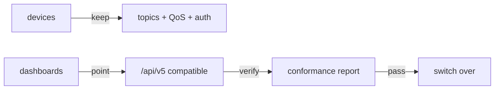

# Migration

This page shows how to move from another MQTT broker. Use it to plan the switch. You get the same device behavior, a compatible management API, and a checklist before cutover.



## Before you start

- List every topic, QoS class, and credential in use.
- List every dashboard and script that calls the management API.
- Keep the old broker running until the checklist passes.

## What stays the same for devices

Devices keep standard MQTT behavior. No device firmware change is needed for these.

| Item | Behavior |
|---|---|
| Protocols | MQTT 3.1.1 and MQTT 5 on TCP, TLS, WebSocket, secure WebSocket |
| QoS | QoS 0 at most once, QoS 1 at least once, QoS 2 exactly once |
| Topics | Wildcards `+` and `#`, retained messages, last will |
| Sharing | Shared subscriptions `$share/<group>/<filter>` |
| Delay | Delayed publishes `$delayed/<seconds>/<topic>` |
| Auth | User name and password, JWT, PSK, client certificates |

Point devices at the new host and port. Keep client IDs, topics, and credentials. Test one fleet slice first.

## Management API compatibility

The `/api/v5` surface follows the reference management API. It covers nodes, clients, rules, and metrics. The native `/api/v1` surface covers users, access rules, tenants, metrics, and the console. See [Reference](./reference/index.md).

The conformance checker lives in `tests/api_conformance/`. It validates a running kernel against the published API specification. Its usage:

```sh no-test
# Needs a running kernel and the spec file by path. The example test does not run it.
python -m tests.api_conformance --spec <openapi.json> --base http://127.0.0.1:18083/api/v5 --user admin --password <pw>
```

The baseline report is `tests/api_conformance/BASELINE.md` with raw rows in `baseline-2026-09-19.json`. It ran against the old two-process stack, so treat its numbers as a starting point and rerun the checker against your build before cutover. The next baseline run uses the kernel listener only.

> [!NOTE]
> Compatibility covers the documented API surface, not internals. Error text, ordering, and timing can differ. Test each script you move.

## Removed connectors

The S3 Tables connector is removed. New connector, action and source records of type `s3_tables`, `s3tables` or `iceberg` get `400` with `connector type s3_tables is not available in this broker`. Stored records from an earlier version still load and are reported as `disconnected`, with alarms. See [Removed connectors](./reference/removed-connectors.md) for the stored-state behaviour and the delete order.

## What to check before the switch

| Check | How | Good |
|---|---|---|
| Devices connect | Connect one device per auth method | CONNACK accepts |
| Messages flow | Publish and subscribe per QoS class | Each message arrives |
| Retained state | Read retained topics | Last value present |
| Rules fire | Publish through each rule | Connector gets exact counts |
| API scripts pass | Run the conformance checker | No new failures vs baseline |
| Dashboards read | Scrape `/api/v1/metrics` | Status 200 with credentials |
| Load holds | Replay peak rate in staging | Delivery 90 percent or more |
| Backup works | Restore a copy in staging | Users, rules, sessions return |

Cut over in slices: move one device group, watch [Monitoring](./operations/monitoring.md), then move the next. Keep the old broker until every slice proves itself.

## Check that it works

Start the broker with this file. The health endpoint returns `OK`.

```toml test
[node]
id = "docs-migration"

[listeners.tcp]
bind = "0.0.0.0:1883"

[listeners.api]
bind = "0.0.0.0:18083"

[logging]
level = "warn"
```

```sh test
python3 - <<'PY'
import os, socket
port = int(os.environ.get("API_PORT", "18083"))
sock = socket.create_connection(("127.0.0.1", port), timeout=5)
sock.sendall(b"GET /healthz HTTP/1.0\r\nHost: docs\r\n\r\n")
print(sock.makefile().read().strip().splitlines()[-1])
PY
```

```output
OK
```

## Next steps

- Deploy with [Deployment](./operations/deployment.md).
- Size with [Sizing](./operations/sizing.md).
- Reproduce numbers in [Benchmarks](./benchmarks/index.md).
