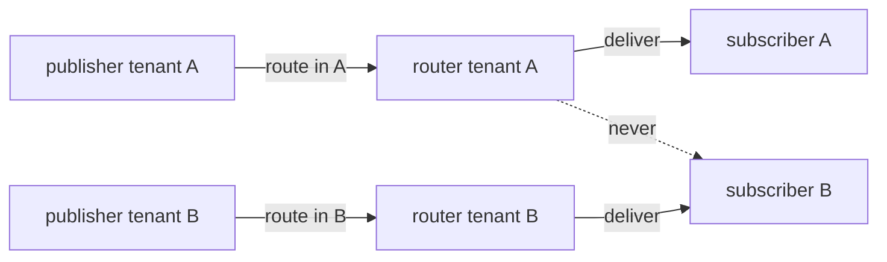

# Multi-tenancy

Each client belongs to one tenant. A message never leaves its tenant. Rules, connectors, retained messages, sessions, and offline queues all keep the tenant. A session takeover never crosses tenants.

Use tenants when one broker serves several customers. You get full isolation in one process with no second deployment. The complete MQTT platform in one small binary: broker, SQL rules, data connectors and multi-tenancy in a single process.



## Before you start

- Install the broker from [Install](../getting-started/install.md).
- Keep ports 1883 and 18083 free.
- Pick tenant ids without control characters, at most 128 characters.

## The model

| Item | Rule |
|---|---|
| Assignment | `tenants.rules` map a connection to a tenant at connect. The first matching rule wins. No rule means the `default` tenant. |
| Routing | The router delivers only inside the publisher tenant. |
| Rules | Each rule owns one tenant. It fires only for that tenant. |
| Connectors | A forwarding action sends only rows of the rule tenant. |
| Sessions | Sessions are keyed by tenant plus client id. Two tenants hold the same client id at once. |
| Retained | Retained messages are stored per tenant. |
| Users | Credentials and access rules live in per-tenant tables. |

Tenant rules render an expression against the connect context:

```toml no-test
# Fragment: shows one rule only. It is not a full file.
[[tenants.rules]]
listener = ""
attribute = "tenant"
expression = "t-${username}"
```

| Field | Meaning |
|---|---|
| `listener` | Scope: empty or `*` means all listeners, else one listener name. |
| `attribute` | Must read `tenant` to assign tenants. |
| `expression` | Template with `${clientid}`, `${username}`, `${peerhost}`, `${cert_cn}`, `${cert_subject}`, `${cert_sans}`, `${listener}`. |

A missing optional value fails closed to the `default` tenant. An unknown `${...}` variable fails closed to the `default` tenant. A client never lands in another tenant by accident.

## How to create a tenant

1. Create the namespace: `POST /api/v5/mt/ns/{id}` with `{}`. It answers 204.
2. Create users in it: `POST /api/v1/auth/users?tenant={id}`. It answers 201.
3. Create access rules in it: `POST /api/v1/auth/acls?tenant={id}`. It answers 201.
4. Create rules in it: `POST /api/v1/rules` with `"tenant": "{id}"`. It answers 201.
5. Map connections with `tenants.rules`, or connect clients whose assignment renders the id.

List namespaces with `GET /api/v5/mt/ns_list`. It answers 200 with the id array. Delete one with `DELETE /api/v5/mt/ns/{id}`. Delete kicks its clients first, then drops its users, rules, and retained messages. The `default` tenant never leaves.

## Check that it works

This test proves isolation through sockets. Two clients share one client id in two tenants. A publish of tenant A reaches the subscriber of tenant A only.

```toml test
[node]
id = "docs-tenants"

[listeners.tcp]
bind = "0.0.0.0:1883"

[listeners.api]
bind = "0.0.0.0:18083"

[logging]
level = "warn"

[auth]
enabled = true
allow_anonymous = false

[[tenants.rules]]
listener = ""
attribute = "tenant"
expression = "t-${username}"
```

```sh test
python3 - <<'PY'
import json, os, socket, struct, urllib.request
mqtt_port = int(os.environ.get("MQTT_PORT", "1883"))
api_port = os.environ.get("API_PORT", "18083")
key = os.environ["API_KEY"]

def call(method, path, body=None):
    req = urllib.request.Request(
        f"http://127.0.0.1:{api_port}{path}",
        data=None if body is None else json.dumps(body).encode(),
        method=method,
        headers={"Authorization": f"Bearer {key}", "Content-Type": "application/json"})
    with urllib.request.urlopen(req, timeout=5) as res:
        raw = res.read().decode()
        return res.status, (json.loads(raw) if raw else None)

for tenant, user in (("t-alice", "alice"), ("t-bob", "bob")):
    status, _ = call("POST", f"/api/v5/mt/ns/{tenant}", {})
    assert status == 204, (tenant, status)
    status, _ = call("POST", f"/api/v1/auth/users?tenant={tenant}",
                     {"username": user, "password": "Tenant-docs-pw-1"})
    assert status == 201, (tenant, status)
    for action in ("publish", "subscribe"):
        status, _ = call("POST", f"/api/v1/auth/acls?tenant={tenant}",
                         {"client_pattern": "*", "action": action,
                          "topic_pattern": "#", "allow": True})
        assert status == 201, (tenant, action, status)

def packet(kind, body):
    return bytes([kind, len(body)]) + body

def field(data):
    return struct.pack(">H", len(data)) + data

def connect(client_id, username, password):
    sock = socket.create_connection(("127.0.0.1", mqtt_port), timeout=5)
    body = (b"\x00\x04MQTT\x04\xc2\x00\x3c" + field(client_id)
            + field(username) + field(password))
    sock.sendall(packet(0x10, body))
    assert sock.recv(4) == b"\x20\x02\x00\x00"
    return sock

topic = b"docs/tenants/iso"
sub_a = connect(b"shared-sub", b"alice", b"Tenant-docs-pw-1")
sub_b = connect(b"shared-sub", b"bob", b"Tenant-docs-pw-1")
for sub in (sub_a, sub_b):
    sub.sendall(packet(0x82, b"\x00\x01" + field(topic) + b"\x00"))
    assert sub.recv(5)[:1] == b"\x90"
pub = connect(b"docs-tenant-pub", b"alice", b"Tenant-docs-pw-1")
pub.sendall(packet(0x30, field(topic) + b"tenant-a-only"))
sub_a.settimeout(10)
assert sub_a.recv(100).endswith(b"tenant-a-only")
sub_b.settimeout(3)
try:
    leaked = sub_b.recv(100)
    assert False, leaked
except socket.timeout:
    print("isolated")
PY
```

```output
isolated
```

Both subscribers share the client id `shared-sub`. Both stay connected, so takeover never crosses tenants. Only tenant A receives the publish.

## Next steps

- Bound tenants with [Quotas](./quotas.md).
- Route per tenant with [Actions](../rules/actions.md).
