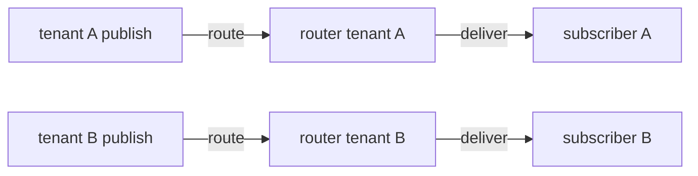

# Multi-tenancy

Each client belongs to one tenant. A message never leaves its tenant. Rules, connectors, retained messages, sessions and the offline queue all keep the tenant. The boot test proves this with two tenants: a subscriber gets the publish of its own tenant only.



## Tenant rules

Tenant rules map a client to a tenant at connect. The rule below puts each username in its own tenant:

```toml no-test
# Fragment: shows one rule only. It is not a full file.
[[tenants.rules]]
expression = "t-${username}"
```

Scope a rule to one listener with the `listener` key (`tcp`, `tls`, `ws` or `wss`). Clients without credentials use the default tenant.

## Same client id in two tenants

Two clients with the same client id stay connected in two tenants. A session takeover never crosses tenants.

## Limits

Bound each tenant with `quotas.max_connections_per_tenant`, `quotas.max_sessions_per_tenant` and `quotas.max_retained_per_tenant`. A value of 0 leaves the dimension unlimited. Set an explicit limit in production.

## Manage

Create namespaces through `/api/v5/mt/ns/{ns}`. Create users and access rules per tenant with the `tenant` query key on `/api/v1/auth/users` and `/api/v1/auth/acls`. Users, passwords and rules of a tenant stay after a restart.

## Check that it works

Start the broker with this file. It bounds each tenant to 1000 connections. The health endpoint returns `OK`.

```toml test
[node]
id = "docs-tenants"

[listeners.tcp]
bind = "0.0.0.0:1883"

[listeners.api]
bind = "0.0.0.0:18083"

[logging]
level = "warn"

[quotas]
max_connections_per_tenant = 1000
```

```sh test
python3 - <<'PY'
import os, socket
port = int(os.environ.get("API_PORT", "18083"))
sock = socket.create_connection(("127.0.0.1", port), timeout=5)
sock.sendall(b"GET /healthz HTTP/1.0\r\nHost: docs\r\n\r\n")
print(sock.makefile().read().strip().splitlines()[-1])
PY
```

```output
OK
```
