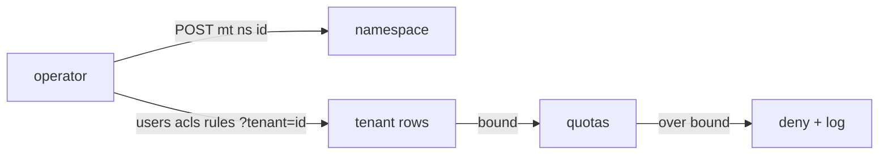

# Tenant quotas and administration

Quotas bound what one tenant holds: connections, sessions, retained topics, and publish rate. Tenant administration scopes users, access rules, and rules to one tenant through the management API.

Use this page to cap tenants and to operate them. You get the settings, the bounds, and the exact calls.



## Before you start

- Read [Multi-tenancy](./index.md) for the model.
- Create the namespace before its rows.
- There is no separate tenant-admin role. One operator credential set manages all tenants; each call names its tenant.

## Quota settings

| Setting | Default | Meaning |
|---|---|---|
| `quotas.default_max_connections` | 10000 | The broker parses the value but applies no bound from it. |
| `quotas.default_max_publish_rate` | 50000 | The broker parses the value but applies no bound from it. |
| `quotas.burst_multiplier` | 2.0 | The broker parses the value but applies no bound from it. |
| `quotas.max_connections_per_tenant` | 0 (unlimited) | Max live connections per tenant. |
| `quotas.max_sessions_per_tenant` | 0 (unlimited) | Max sessions per tenant. |
| `quotas.max_retained_per_tenant` | 0 (unlimited) | Max retained topics per tenant. |

Per-user quotas ride on user creation: `max_connections`, `max_publish_rate`, `max_publish_burst`. Omitted fields stay unlimited.

> [!WARNING]
> The three `default_*` and `burst_multiplier` values have no effect. Set the per-user fields or the per-tenant bounds instead.

> [!WARNING]
> Tenant quotas default to 0, which means unlimited. Set an explicit bound in production, or one tenant starves the rest.

## Fixed bounds

| Bound | Value | Reason |
|---|---|---|
| Tenant rules per registry | 32 | Caps connect-time evaluation. |
| Rule expression length | 1024 characters | Caps per-connect rendering. |
| Rendered tenant id | 128 characters, no control characters | Caps map-key memory. |
| Managed namespaces | 1024 | Caps management-plane memory. |

## What a tenant administrator can do

| Task | Call | Answer |
|---|---|---|
| Create a namespace | `POST /api/v5/mt/ns/{id}` with `{}` | 204 |
| List namespaces | `GET /api/v5/mt/ns_list` | 200 with the id array |
| List clients | `GET /api/v5/mt/ns/{id}/client_list` | 200 |
| Count clients | `GET /api/v5/mt/ns/{id}/client_count` | 200 |
| Read metrics | `GET /api/v5/mt/ns/{id}/metrics` | 200 |
| Read or write config | `GET`, `PUT /api/v5/mt/ns/{id}/config` | 200 |
| Kick every client | `POST /api/v5/mt/ns/{id}/kick_all_clients` | 204 |
| Delete the namespace | `DELETE /api/v5/mt/ns/{id}` | 204 |
| Create a user | `POST /api/v1/auth/users?tenant={id}` | 201 |
| Create an access rule | `POST /api/v1/auth/acls?tenant={id}` | 201 |
| Create a rule | `POST /api/v1/rules` with `"tenant": "{id}"` | 201 |

Delete kicks each connected client first, then drops the tenant users, access rules, rule rows, and retained messages. A deleted tenant denies instead of serving stale rows.

> [!NOTE]
> API keys are global. The broker holds no per-tenant credential. Scope each call with the tenant parameter instead.

## Check that it works

Start the broker with a per-tenant connection bound. Create a namespaced user with a per-user rate bound. Both calls answer as documented.

```toml test
[node]
id = "docs-tenant-quotas"

[listeners.tcp]
bind = "0.0.0.0:1883"

[listeners.api]
bind = "0.0.0.0:18083"

[logging]
level = "warn"

[auth]
enabled = true
allow_anonymous = false

[quotas]
max_connections_per_tenant = 1000
```

```sh test
python3 - <<'PY'
import json, os, urllib.request
port = os.environ.get("API_PORT", "18083")
key = os.environ["API_KEY"]

def call(method, path, body=None):
    req = urllib.request.Request(
        f"http://127.0.0.1:{port}{path}",
        data=None if body is None else json.dumps(body).encode(),
        method=method,
        headers={"Authorization": f"Bearer {key}", "Content-Type": "application/json"})
    with urllib.request.urlopen(req, timeout=5) as res:
        raw = res.read().decode()
        return res.status, (json.loads(raw) if raw else None)

status, _ = call("POST", "/api/v5/mt/ns/docs-quota-a", {})
assert status == 204, status
status, listed = call("GET", "/api/v5/mt/ns_list")
assert status == 200 and "docs-quota-a" in listed, (status, listed)
status, _ = call("POST", "/api/v1/auth/users?tenant=docs-quota-a",
                 {"username": "quota-01", "password": "Quota-docs-pw-1",
                  "quotas": {"max_connections": 5, "max_publish_rate": 100}})
assert status == 201, status
print("ok")
PY
```

```output
ok
```

## Next steps

- Prove isolation with [Multi-tenancy](./index.md).
- See every setting in the [settings reference](../reference/settings.md).
