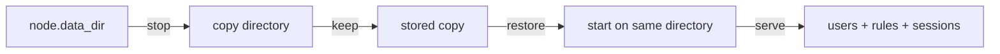

# Backup and restore

This page shows what to copy and how to restore it. Use it before upgrades and before host moves. You get the same users, rules, sessions, and retained messages after a restore.



## Before you start

- Find your `node.data_dir`. The image uses `/var/lib/indramqtt/data`.
- Plan a short stop. A copy of a running directory can miss writes.
- Keep the config directory copy with the data copy.

## What to back up

| Item | Path | Holds |
|---|---|---|
| State | `node.data_dir` | Users, access rules, sessions, retained messages |
| Config | `--config-dir` (`indra.toml`, `conf.d/`) | The setup that produced the state |

A restart on the same directory keeps state. A new empty directory starts empty.

> [!WARNING]
> A lost data directory resets state: users, rules, sessions, and retained messages start empty. Back it up before you touch the volume.

## Back up

Stop the broker. Copy the directory. Start the broker again.

```sh no-test
# Stop first so the copy is complete. Adjust the service name to your setup.
sudo systemctl stop indramqtt
cp -a /var/lib/indramqtt/data /backup/indramqtt-data-$(date +%F)
cp -a /etc/indramqtt /backup/indramqtt-conf-$(date +%F)
sudo systemctl start indramqtt
```

For a container, stop the container and copy the volume instead.

```sh no-test
# Adjust the volume name to your setup. The example test does not run this block.
docker stop indramqtt-broker
docker cp indramqtt-broker:/var/lib/indramqtt/data /backup/indramqtt-data-$(date +%F)
docker start indramqtt-broker
```

## Restore

Stop the broker. Replace the directory with the copy. Validate the config. Start the broker.

```sh no-test
# Restore data and config together. A mix of old data and new config can surprise.
sudo systemctl stop indramqtt
rm -rf /var/lib/indramqtt/data
cp -a /backup/indramqtt-data-2026-10-01 /var/lib/indramqtt/data
indramqtt --config-dir /etc/indramqtt --check-config
sudo systemctl start indramqtt
```

## Check that it works

Start the broker with this file. Validate the directory. The command prints `ok`.

```toml test
[node]
id = "docs-backup"

[listeners.tcp]
bind = "0.0.0.0:1883"

[listeners.api]
bind = "0.0.0.0:18083"

[logging]
level = "warn"
```

```sh test
"${INDRAMQTT_BIN:-indramqtt}" --config-dir "${DOCS_CFG_DIR:-./docs-backup}" --check-config
```

```output
ok
```

## Next steps

- Upgrade in [Upgrade](./upgrade.md).
- Watch health in [Monitoring](./monitoring.md).
