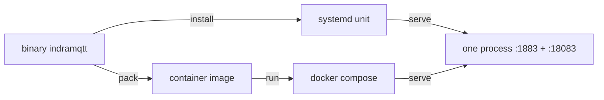

# Deployment

This page shows three ways to run the broker. Use the binary to try it. Use the container to ship it. Use the service unit to keep it up. You get the same single process in each way.



## Before you start

- Build the release binary or pull the image.
- Keep ports 1883 and 18083 free.
- Prepare a config directory with `indra.toml`.

## Binary

Build with the `full` feature to include all connectors. The container image includes them.

```sh no-test
# Slow build. The example test does not run it. Run it once per release.
cargo build --release -p broker-node --features full --bin indramqtt --bin indra
```

Validate the config directory first. Then start the kernel.

```sh no-test
# Runs until stopped. The example test starts the broker itself, so it does not run this block.
indramqtt --config-dir /etc/indramqtt --check-config
indramqtt --config-dir /etc/indramqtt
```

## Container

Build the image from the repository root. The image holds the kernel and the operator CLI. It runs one process.

```sh no-test
# Slow build. The example test does not run it. See Dockerfile for the stages.
docker build -t indramqtt/indramqtt:0.1.0 .
```

Start the single-node stack with compose. It mounts the example file at `deploy/compose/indra.toml`.

```sh no-test
# Needs Docker. The example test does not run it. See deploy/compose/README.md.
docker compose up -d --build
curl -sf http://localhost:18083/healthz
```

> [!NOTE]
> The image sets `node.data_dir` to `/var/lib/indramqtt/data`. Mount a volume there to keep state across restarts. See [Backup](./backup.md).

## Service unit

Install the binary and the config directory on the host. The unit restarts the kernel on failure.

```sh no-test
# Needs root. The example test does not run it. Adjust paths to your host.
sudo install -m 0755 target/release/indramqtt /usr/local/bin/indramqtt
sudo mkdir -p /etc/indramqtt
```

```text no-test
# /etc/systemd/system/indramqtt.service — example only, adjust User and paths.
[Unit]
Description=IndraMQTT broker
After=network-online.target
Wants=network-online.target

[Service]
User=indra
ExecStartPre=/usr/local/bin/indramqtt --config-dir /etc/indramqtt --check-config
ExecStart=/usr/local/bin/indramqtt --config-dir /etc/indramqtt
Restart=on-failure
RestartSec=5

[Install]
WantedBy=multi-user.target
```

Enable and start the unit. Then check the health endpoint.

```sh no-test
# Needs systemd. The example test does not run it.
sudo systemctl enable --now indramqtt
curl -sf http://127.0.0.1:18083/healthz
```

## Check that it works

Start the broker with this file. Validate the directory. The command prints `ok`.

```toml test
[node]
id = "docs-deployment"

[listeners.tcp]
bind = "0.0.0.0:1883"

[listeners.api]
bind = "0.0.0.0:18083"

[logging]
level = "warn"
```

```sh test
"${INDRAMQTT_BIN:-indramqtt}" --config-dir "${DOCS_CFG_DIR:-./docs-deployment}" --check-config
```

```output
ok
```

## Next steps

- Size the host in [Sizing](./sizing.md).
- Back up state in [Backup](./backup.md).
- Watch it in [Monitoring](./monitoring.md).
