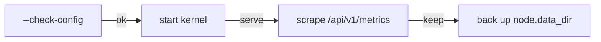

# Operations

Read [Configuration](./configuration.md) for the full layer model. This page lists daily tasks.



## Validate before start

Run `--check-config` against the config directory. It prints `ok` and exits 0 for a valid directory. Fix each error it names before you start.

```sh no-test
# Reads only. It never starts the broker, so the example test does not run this duplicate.
indramqtt --check-config --config-dir /etc/indramqtt
```

## Inspect the running broker

`indra ctl status` shows broker state. It needs the API endpoint and a key:

```sh no-test
# Output lists live nodes and varies. The example test does not compare it.
indra ctl --endpoint http://localhost:18083 --api-key "$API_KEY" status
```

`explain` shows the value in operation for one setting:

```sh no-test
# Output shows local values and varies. The example test does not compare it.
indra ctl --endpoint http://localhost:18083 --api-key "$API_KEY" config explain --key node.id
```

## Observe

Scrape Prometheus metrics at `/api/v1/metrics`. It needs credentials. Set buckets and the push target with the `prometheus.*` settings.

## Back up

Keep the data directory (`node.data_dir`). It holds users, access rules, sessions and retained messages. A restart on the same directory keeps them.

## Bounds

Each accumulating queue has a bound and a finite default. The publish path sheds QoS 0 past `session.max_qos0_backlog` (default 1000) so a slow subscriber cannot grow memory without limit. QoS 1 and QoS 2 never shed.

## Check that it works

Start the broker with this file. Validate the directory. The command prints `ok`.

```toml test
[node]
id = "docs-operations"

[listeners.tcp]
bind = "0.0.0.0:1883"

[listeners.api]
bind = "0.0.0.0:18083"

[logging]
level = "warn"
```

```sh test
"${INDRAMQTT_BIN:-indramqtt}" --config-dir "${DOCS_CFG_DIR:-./docs-operations}" --check-config
```

```output
ok
```
