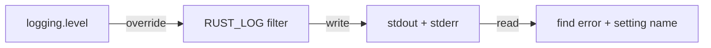

# Logs

This page shows how to set log levels and where to look first. Use it when a check fails. You get one stream with levels you control.



## Before you start

- Know your config directory.
- Know how you run the broker: unit journal, `docker logs`, or a file.

## Levels

Set the base level with `logging.level`. Override it per module with `RUST_LOG`. `RUST_LOG` wins over the file. It is a developer filter such as `RUST_LOG=broker_router=trace`. It has no schema home.

| Level | Use |
|---|---|
| `error` | Failures only |
| `warn` | Failures plus risks (default in these examples) |
| `info` | Startup, binds, and key events |
| `debug` | Per-connection detail for a fault hunt |
| `trace` | Full detail for a short capture only |

```sh no-test
# Example only. Values differ per site. The example test does not run this block.
INDRA_LOGGING__LEVEL=info indramqtt --config-dir /etc/indramqtt
RUST_LOG=broker_router=trace indramqtt --config-dir /etc/indramqtt
```

## Where to read

| Setup | Command |
|---|---|
| systemd unit | `journalctl -u indramqtt --since -1h` |
| compose stack | `docker compose logs indramqtt --since 1h` |
| plain binary | The stdout and stderr of the process |

Start each hunt at startup lines: config errors name the file and the setting. Then move to connection and auth lines.

> [!TIP]
> Raise the level only for the hunt, then set it back. `trace` on a busy broker floods the disk.

## Check that it works

Start the broker with this file. Validate the directory. The command prints `ok`.

```toml test
[node]
id = "docs-logging"

[listeners.tcp]
bind = "0.0.0.0:1883"

[listeners.api]
bind = "0.0.0.0:18083"

[logging]
level = "warn"
```

```sh test
"${INDRAMQTT_BIN:-indramqtt}" --config-dir "${DOCS_CFG_DIR:-./docs-logging}" --check-config
```

```output
ok
```

## Next steps

- Match symptoms in [Troubleshooting](./troubleshooting.md).
- Watch signals in [Monitoring](./monitoring.md).
