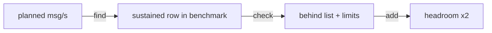

# Sizing

This page helps you pick CPU and memory for a node. Use it before you order hosts. You get load numbers that a committed report backs.



## Before you start

- Read [`benchmark/README.md`](../../benchmark/README.md) for the full method.
- Note your shape: point-to-point, fan-in, or fan-out.
- Note your QoS class and payload size.

## Measured numbers

The table shows the highest sustained load at 1 CPU and 1 GB, MQTT 5, 256 B payload, 180 s runs. Source: `benchmark/README.md` sections 5 and 6, raw data in `benchmark/results/`. Each value is one search plus one 180 s run on a shared server.

| Scenario | Sustained load | Note |
|---|---|---|
| Point-to-point QoS 0 | 100,000 msg/s | Strongest shape |
| Point-to-point QoS 1 | 30,000 msg/s | Same shape, ack cost |
| Fan-in QoS 0 | 40,000 msg/s | Behind the fastest row at 80,000 msg/s |
| Fan-out QoS 0 | 160,000 deliveries/s | Stops at 25,000 subscribers of one topic |
| 10,000 idle connections | 283 MiB | About 21 KiB per connection |

> [!IMPORTANT]
> The broker is behind in two rows: fan-in at 40,000 msg/s against 80,000 msg/s, and idle memory at 76 MiB with no clients against 1.6 MiB. Plan fan-in and tiny hosts with care.

## Rules for use

- Quote a number only with its scenario, QoS class, payload, CPU, memory, and run length.
- A figure that still rises at cutoff is "still rising at cutoff", never final.
- Double the measured need for headroom. One run is not a guarantee.
- The test uses MQTT without TLS and one payload size. TLS and large payloads need their own runs.

## When the numbers do not apply

- You use TLS, large payloads, durable sessions, rules, connectors, or clustering. The test uses none of them.
- You need latency bounds at a different load. Latency values sit at each broker's own highest load, so they do not compare across brokers.
- You run many subscribers of one topic past 25,000. Subscriptions did not complete in 180 s there.

## Check that it works

Start the broker with this file. Validate the directory. The command prints `ok`.

```toml test
[node]
id = "docs-sizing"

[listeners.tcp]
bind = "0.0.0.0:1883"

[listeners.api]
bind = "0.0.0.0:18083"

[logging]
level = "warn"
```

```sh test
"${INDRAMQTT_BIN:-indramqtt}" --config-dir "${DOCS_CFG_DIR:-./docs-sizing}" --check-config
```

```output
ok
```

## Next steps

- Deploy in [Deployment](./deployment.md).
- Reproduce the numbers in [Benchmarks](../benchmarks/index.md).
