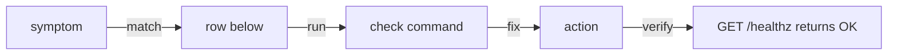

# Troubleshooting

This page lists the ten most probable faults. Each entry gives the symptom, the cause, and the action. Use it when a check turns red. You get the broker back without guessing.



## Before you start

- Keep an API key with 16 characters or more.
- Know your config directory and data directory.
- Read [Logs](./logging.md) for where to look.

## The ten faults

### 1. The broker refuses startup with an unknown setting

- Symptom: exit code 2, error names the setting.
- Cause: typo or a setting from another broker.
- Action: fix the name in `indra.toml` or `conf.d/`. See the [settings reference](../reference/settings.md). Validate with `--check-config`.

### 2. The broker refuses startup with an unknown variable

- Symptom: exit code 2, error names the `INDRA_*` variable.
- Cause: typo in the variable name. The loader refuses unknown names.
- Action: fix the name to the `INDRA_` plus path form. See [Configuration](./configuration.md).

### 3. The bind fails with address in use

- Symptom: startup error on the listener bind.
- Cause: another process holds the port.
- Action: stop the other process or move the bind. Then validate and start.

```sh no-test
# Finds the holder. The example test does not run it because ports differ per run.
ss -ltn | grep 1883
```

### 4. Anonymous clients get refused

- Symptom: connect fails when users exist.
- Cause: the broker rejects anonymous clients unless `auth.allow_anonymous` is true.
- Action: create users first (see [First user](../getting-started/first-user.md)), or set `auth.allow_anonymous = true` for evaluation only.

### 5. A known user gets refused

- Symptom: connect fails with bad credentials.
- Cause: wrong password or unknown user name.
- Action: reset the password through the API or console. Check the exact user name.

### 6. The TLS listener fails at startup

- Symptom: startup error on the TLS bind.
- Cause: missing or unreadable `cert_file` or `key_file`.
- Action: install the files, fix ownership and permissions, then validate and start.

### 7. The API answers 401

- Symptom: API calls fail with unauthorized.
- Cause: missing, short, or wrong API key. Each key needs 16 characters or more.
- Action: export `INDRA_API_KEYS` and `INDRA_API_KEY` with the same long key. Retry.

### 8. QoS 0 messages go missing for one subscriber

- Symptom: one slow subscriber misses QoS 0, others do not.
- Cause: the broker sheds QoS 0 past `session.max_qos0_backlog` (default 1000). QoS 1 and QoS 2 never shed.
- Action: speed up the subscriber, add subscribers, or raise the bound. The bound caps memory, so raising it raises memory.

### 9. Memory grows without new clients

- Symptom: RSS rises while connections stay flat.
- Cause: offline queues or retained messages accumulate.
- Action: check offline queue depths and retained counts. Lower the bounds. See `session.max_offline_queue` in the [settings reference](../reference/settings.md).

### 10. `/healthz` answers nothing

- Symptom: connection refused on the API port.
- Cause: the broker is down, or it binds another port.
- Action: check the process, check the bind in `indra.toml`, read the startup lines in [Logs](./logging.md).

## Check that it works

Start the broker with this file. Validate the directory. The command prints `ok`.

```toml test
[node]
id = "docs-troubleshooting"

[listeners.tcp]
bind = "0.0.0.0:1883"

[listeners.api]
bind = "0.0.0.0:18083"

[logging]
level = "warn"
```

```sh test
"${INDRAMQTT_BIN:-indramqtt}" --config-dir "${DOCS_CFG_DIR:-./docs-troubleshooting}" --check-config
```

```output
ok
```

## Next steps

- Prevent repeats with [Monitoring](./monitoring.md).
- Move safely with [Upgrade](./upgrade.md).
