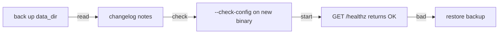

# Upgrade

This page shows how to move to a new release. Use it for each version step. You get the new binary on your old state and config.



## Before you start

- Back up state and config in [Backup](./backup.md).
- Read `CHANGELOG.md` for breaking changes.
- Keep the old binary or image tag until the new one proves itself.

## Steps

1. Validate the current config with the new binary. It prints `ok` for a valid directory.
2. Stop the broker.
3. Install the new binary or point the compose file at the new image tag. Never use `:latest` for a running deployment.
4. Start the broker.
5. Check `/healthz` and reconnect one client before you declare success.

```sh no-test
# Adjust paths and the image tag to your setup. The example test does not run this block.
indramqtt --config-dir /etc/indramqtt --check-config
sudo systemctl stop indramqtt
sudo install -m 0755 target/release/indramqtt /usr/local/bin/indramqtt
sudo systemctl start indramqtt
curl -sf http://127.0.0.1:18083/healthz
```

> [!TIP]
> Keep `node.data_dir` and the config directory across the upgrade. A new empty directory starts empty instead of resuming.

## Roll back

Stop the new broker. Restore the backup from [Backup](./backup.md). Reinstall the old binary or tag. Start and check `/healthz`.

## Check that it works

Start the broker with this file. Validate the directory. The command prints `ok`.

```toml test
[node]
id = "docs-upgrade"

[listeners.tcp]
bind = "0.0.0.0:1883"

[listeners.api]
bind = "0.0.0.0:18083"

[logging]
level = "warn"
```

```sh test
"${INDRAMQTT_BIN:-indramqtt}" --config-dir "${DOCS_CFG_DIR:-./docs-upgrade}" --check-config
```

```output
ok
```

## Next steps

- Confirm behavior in [Troubleshooting](./troubleshooting.md).
- Watch metrics in [Monitoring](./monitoring.md).
