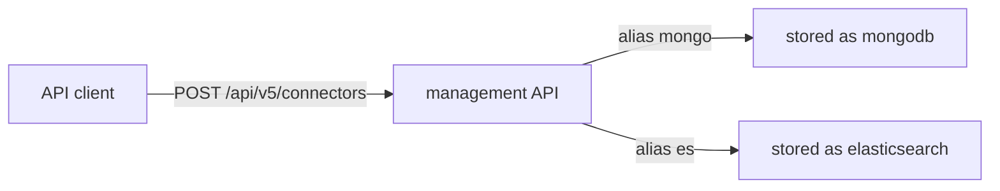

# API deviations

This page documents deliberate deviations in the management API from reference 6.3.0.
Operators use aliases for common connector kinds.
The broker accepts the aliases and maps them to canonical types.

## Connector aliases

CTO ruling 2026-11-15 and CEO decision 2026-11-15 permit connector type aliases.
The broker accepts short alias names on `POST /api/v5/connectors` and returns HTTP 201 Created.
The stored connector record keeps the canonical type name.

| Request type | Canonical stored type | Status | Reason |
| --- | --- | --- | --- |
| `mongo` | `mongodb` | 201 Created | Ergonomic short alias for MongoDB connectors. |
| `es` | `elasticsearch` | 201 Created | Ergonomic short alias for Elasticsearch connectors. |

See the [Reference index](./index.md) for other API documentation.
