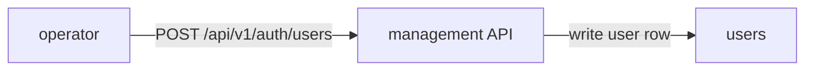

# Authentication & ACL

<!-- GENERATED by `python3 tools/gen_reference_docs.py`. Do not edit by hand. -->

The complete MQTT platform in one small binary: broker, SQL rules, data connectors and multi-tenancy in a single process.

Manage users and ACL rules. Use it to add a user or a rule. Reads come from the user store.



## Before you start

- Start the broker from [First start](../../getting-started/first-start.md).
- Set `INDRA_API_KEY` to an operator key. The examples read it.

> **Note:** Calls except `/healthz` need an operator API key. Pass it as `Authorization: Bearer $INDRA_API_KEY`.

User credential management and topic ACL rules

### `GET /api/v1/auth/acls`

List ordered ACL rules

Operation id: `listAcls`.

Parameters:

| Name | In | Required | Type | Description |
|---|---|---|---|---|
| `tenant` | query | false | string | Tenant table to list; absent lists the default tenant |

Request body:

No request body.

Responses:

| Status | Description |
|---|---|
| 200 | List of ACL rules evaluated in order |

Response `200` body:

Media type `application/json`:

```json
{
  "type": "array",
  "items": {
    "type": "object",
    "properties": {
      "client_pattern": {
        "type": "string"
      },
      "action": {
        "type": "string",
        "enum": [
          "publish",
          "subscribe",
          "all"
        ]
      },
      "topic_pattern": {
        "type": "string"
      },
      "allow": {
        "type": "boolean"
      }
    }
  }
}
```


Notes:

- Related calls sit on the same tag page.

Not verified: see `../_verification/failures.md`.

Example:

```curl
# Illustrative request. Values come from the schema above.
# The example flow below runs verified calls on a live broker.
curl -s -X GET 'http://127.0.0.1:18083/api/v1/auth/acls' \
  -H "Authorization: Bearer $INDRA_API_KEY"
```

### `POST /api/v1/auth/acls`

Add new ACL rule

Operation id: `createAcl`.

Parameters:

| Name | In | Required | Type | Description |
|---|---|---|---|---|
| `tenant` | query | false | string | Tenant table to write; absent writes the default tenant |

Request body:

Media type `application/json`:

Required: `client_pattern`, `action`, `topic_pattern`, `allow`.

| Field | Type | Description |
|---|---|---|
| `client_pattern` | string |  |
| `action` | string |  |
| `topic_pattern` | string |  |
| `allow` | boolean |  |


Responses:

| Status | Description |
|---|---|
| 201 | ACL rule registered |
| 400 | Invalid ACL input |
| 500 | Registry save failed after the in-memory write |


Notes:

- Send `client_pattern`, `action`, `topic_pattern`, `allow`. An empty required string fails with 400.

- Success answers 201 with the stored row.

- Related calls sit on the same tag page.

Not verified: see `../_verification/failures.md`.

Example:

```curl
# Illustrative request. Values come from the schema above.
# The example flow below runs verified calls on a live broker.
curl -s -X POST 'http://127.0.0.1:18083/api/v1/auth/acls' \
  -H "Authorization: Bearer $INDRA_API_KEY" \
  -H "Content-Type: application/json" \
  -d '{
  "client_pattern": "doc-client",
  "action": "publish",
  "topic_pattern": "sensors/#",
  "allow": true
}'
```

### `DELETE /api/v1/auth/acls/{id}`

Delete one ACL rule by index

Operation id: `deleteAcl`.

Parameters:

| Name | In | Required | Type | Description |
|---|---|---|---|---|
| `id` | path | true | integer | Index in the tenant rule list |
| `tenant` | query | false | string | Tenant table to write; absent writes the default tenant |

Request body:

No request body.

Responses:

| Status | Description |
|---|---|
| 204 | ACL rule deleted |
| 404 | ACL rule not found |
| 500 | Registry save failed after the in-memory write |


Notes:

- Success answers 204 with no body.

- An unknown id fails with 404.

- Related calls sit on the same tag page.

Not verified: see `../_verification/failures.md`.

Example:

```curl
# Illustrative request. Values come from the schema above.
# The example flow below runs verified calls on a live broker.
curl -s -X DELETE 'http://127.0.0.1:18083/api/v1/auth/acls/1' \
  -H "Authorization: Bearer $INDRA_API_KEY"
```

### `GET /api/v1/auth/users`

List all configured users and quotas

Operation id: `listUsers`.

Parameters:

| Name | In | Required | Type | Description |
|---|---|---|---|---|
| `tenant` | query | false | string | Tenant table to list; absent lists the default tenant |

Request body:

No request body.

Responses:

| Status | Description |
|---|---|
| 200 | List of users with quota allocations |

Response `200` body:

Media type `application/json`:

```json
{
  "type": "array",
  "items": {
    "type": "object",
    "properties": {
      "username": {
        "type": "string"
      },
      "quotas": {
        "type": "object",
        "properties": {
          "max_connections": {
            "type": "integer"
          },
          "max_publish_rate": {
            "type": "integer"
          },
          "max_publish_burst": {
            "type": "integer"
          }
        }
      }
    }
  }
}
```


Notes:

- Related calls sit on the same tag page.

Verified: the example flow below runs this call.

Example:

```curl
# Illustrative request. Values come from the schema above.
# The example flow below runs verified calls on a live broker.
curl -s -X GET 'http://127.0.0.1:18083/api/v1/auth/users' \
  -H "Authorization: Bearer $INDRA_API_KEY"
```

### `POST /api/v1/auth/users`

Create or update user credentials and quotas

Operation id: `createUser`.

Parameters:

| Name | In | Required | Type | Description |
|---|---|---|---|---|
| `tenant` | query | false | string | Tenant table to write; absent writes the default tenant |

Request body:

Media type `application/json`:

Required: `username`, `password`.

| Field | Type | Description |
|---|---|---|
| `username` | string |  |
| `password` | string |  |
| `quotas` | object |  |


Responses:

| Status | Description |
|---|---|
| 201 | User created or updated successfully |
| 400 | Invalid input payload |
| 500 | Registry save failed after the in-memory write |


Notes:

- Send `username`, `password`. An empty required string fails with 400.

- Success answers 201 with the stored row.

- Related calls sit on the same tag page.

Verified: the example flow below runs this call.

Example:

```curl
# Illustrative request. Values come from the schema above.
# The example flow below runs verified calls on a live broker.
curl -s -X POST 'http://127.0.0.1:18083/api/v1/auth/users' \
  -H "Authorization: Bearer $INDRA_API_KEY" \
  -H "Content-Type: application/json" \
  -d '{
  "username": "doc-user-1",
  "password": "Secret123!",
  "quotas": {}
}'
```

### `DELETE /api/v1/auth/users/{username}`

Delete one user

Operation id: `deleteUser`.

Parameters:

| Name | In | Required | Type | Description |
|---|---|---|---|---|
| `username` | path | true | string | User name |
| `tenant` | query | false | string | Tenant table to write; absent writes the default tenant |

Request body:

No request body.

Responses:

| Status | Description |
|---|---|
| 204 | User deleted |
| 404 | User not found |
| 500 | Registry save failed after the in-memory write |


Notes:

- Success answers 204 with no body.

- An unknown id fails with 404.

- Related calls sit on the same tag page.

Verified: the example flow below runs this call.

Example:

```curl
# Illustrative request. Values come from the schema above.
# The example flow below runs verified calls on a live broker.
curl -s -X DELETE 'http://127.0.0.1:18083/api/v1/auth/users/doc-user-1' \
  -H "Authorization: Bearer $INDRA_API_KEY"
```

### `GET /api/v1/auth/verify_stats`

Show password verification counters

Operation id: `getVerifyStats`.

Parameters:

No parameters.

Request body:

No request body.

Responses:

| Status | Description |
|---|---|
| 200 | Verification and deduplication counters |

Response `200` body:

Media type `application/json`:

```json
{
  "type": "object",
  "properties": {
    "verifications": {
      "type": "integer"
    },
    "dedup_joins": {
      "type": "integer"
    }
  }
}
```


Notes:

- Related calls sit on the same tag page.

Not verified: see `../_verification/failures.md`.

Example:

```curl
# Illustrative request. Values come from the schema above.
# The example flow below runs verified calls on a live broker.
curl -s -X GET 'http://127.0.0.1:18083/api/v1/auth/verify_stats' \
  -H "Authorization: Bearer $INDRA_API_KEY"
```

## Example flow

Create a real object through the management API, read it back, then delete it. The docs harness runs this flow against a started broker.

```sh test
python3 - <<'PY'
import json, os, urllib.request, urllib.error
port = os.environ.get("API_PORT", "18083")
key = os.environ.get("API_KEY", "")
base = f"http://127.0.0.1:{port}"
def call(method, path, body=None):
    data = json.dumps(body).encode() if body is not None else None
    req = urllib.request.Request(base + path, data=data, method=method)
    req.add_header("Authorization", f"Bearer {key}")
    if body is not None:
        req.add_header("Content-Type", "application/json")
    try:
        with urllib.request.urlopen(req, timeout=5) as r:
            return r.status, r.read().decode()
    except urllib.error.HTTPError as e:
        return e.code, e.read().decode()
s, b = call("POST", "/api/v1/auth/users", {"username": "doc-user-1", "password": "Secret123!"})
assert s == 201, b
assert "doc-user-1" in b, b
s, b = call("GET", "/api/v1/auth/users")
assert s == 200, b
assert "doc-user-1" in b, b
s, b = call("DELETE", "/api/v1/auth/users/doc-user-1")
assert s in (200, 204), b
s, b = call("GET", "/api/v1/auth/users")
assert s == 200, b
assert "doc-user-1" not in b, b
print("OK")
PY
```

```output
OK
```

## Check that it works

Start the broker with this file. The health endpoint returns `OK`.

```toml test
[node]
id = "doc-ref"

[listeners.tcp]
bind = "0.0.0.0:1883"

[listeners.tls]
bind = "0.0.0.0:8883"

[listeners.ws]
bind = "0.0.0.0:8083"

[listeners.wss]
bind = "0.0.0.0:8084"

[listeners.api]
bind = "0.0.0.0:18083"

[logging]
level = "warn"
```

```sh test
python3 - <<'PY'
import os, socket
port = int(os.environ.get("API_PORT", "18083"))
sock = socket.create_connection(("127.0.0.1", port), timeout=5)
sock.sendall(b"GET /healthz HTTP/1.0\r\nHost: docs\r\n\r\n")
print(sock.makefile().read().strip().splitlines()[-1])
PY
```

```output
OK
```

Check one documented call. `GET /api/v1/auth/users` answers 200 with its rows. It prints `OK`.

```sh test
python3 - <<'PY'
import os, urllib.request
port = os.environ.get("API_PORT", "18083")
key = os.environ.get("API_KEY", "")
base = f"http://127.0.0.1:{port}"
req = urllib.request.Request(base + "/api/v1/auth/users", method="GET")
req.add_header("Authorization", f"Bearer {key}")
with urllib.request.urlopen(req, timeout=5) as r:
    body = r.read().decode()
    assert r.status == 200, body
assert body.strip().startswith("["), body
print("OK")
PY
```

```output
OK
```

## Next steps

- [API reference](index.md): the other tags.
- [Configuration reference](../configuration.md): the settings behind the rows.
- [Metrics reference](../metrics.md): the counter names.
