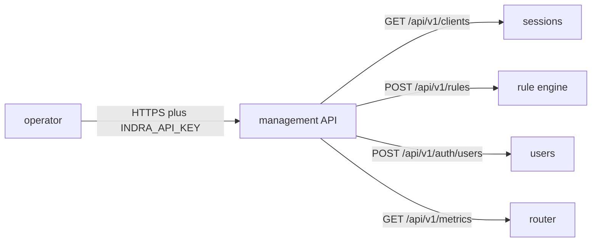

# API reference

<!-- GENERATED by `python3 tools/gen_reference_docs.py`. Do not edit by hand. -->

The complete MQTT platform in one small binary: broker, SQL rules, data connectors and multi-tenancy in a single process.

Read and change broker state through HTTPS. Use it when a client or a script must operate the broker. You get JSON rows.



## Before you start

- Start the broker from [First start](../../getting-started/first-start.md).
- Set `INDRA_API_KEY` to an operator key. The examples read it.
- Each page documents one tag of the served OpenAPI document.
  The drift test fails when a page differs from the served document.

> **Note:** Calls except `/healthz` need an operator API key. Pass it as `Authorization: Bearer $INDRA_API_KEY`. `/healthz` answers `OK` with no key.

The pages document the served document. The served document lists the native routes of the router.

The served document lists `http://localhost:8081` as its server URL. The kernel binds `127.0.0.1:18083` by default. The examples use the kernel default.

## Tags

- [Cluster & Nodes](cluster-nodes.md) (2 operations)
- [Clients & Sessions](clients-sessions.md) (2 operations)
- [Observability](observability.md) (1 operation)
- [Rule Engine](rule-engine.md) (7 operations)
- [Data Connectors](data-connectors.md) (2 operations)
- [Authentication & ACL](authentication-acl.md) (7 operations)
- [Configuration](configuration.md) (7 operations)
- [Licence](licence.md) (3 operations)

## Check that it works

Start the broker with this file. The health endpoint returns `OK`.

```toml test
[node]
id = "doc-ref"

[listeners.tcp]
bind = "0.0.0.0:1883"

[listeners.tls]
bind = "0.0.0.0:8883"

[listeners.ws]
bind = "0.0.0.0:8083"

[listeners.wss]
bind = "0.0.0.0:8084"

[listeners.api]
bind = "0.0.0.0:18083"

[logging]
level = "warn"
```

```sh test
python3 - <<'PY'
import os, socket
port = int(os.environ.get("API_PORT", "18083"))
sock = socket.create_connection(("127.0.0.1", port), timeout=5)
sock.sendall(b"GET /healthz HTTP/1.0\r\nHost: docs\r\n\r\n")
print(sock.makefile().read().strip().splitlines()[-1])
PY
```

```output
OK
```

Check one documented call. `GET /api/v1/nodes` answers 200 with its rows. It prints `OK`.

```sh test
python3 - <<'PY'
import os, urllib.request
port = os.environ.get("API_PORT", "18083")
key = os.environ.get("API_KEY", "")
base = f"http://127.0.0.1:{port}"
req = urllib.request.Request(base + "/api/v1/nodes", method="GET")
req.add_header("Authorization", f"Bearer {key}")
with urllib.request.urlopen(req, timeout=5) as r:
    body = r.read().decode()
    assert r.status == 200, body
assert "running" in body or "node_id" in body, body
print("OK")
PY
```

```output
OK
```

## Next steps

- [Configuration reference](../configuration.md): the settings behind the rows.
- [Command line reference](../cli.md): the flags that set the same values.
- [First start](../../getting-started/first-start.md): boot the broker.
