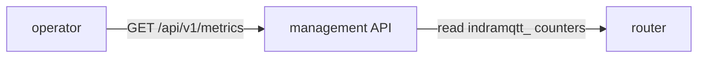

# Observability

<!-- GENERATED by `python3 tools/gen_reference_docs.py`. Do not edit by hand. -->

The complete MQTT platform in one small binary: broker, SQL rules, data connectors and multi-tenancy in a single process.

Read broker counters. Use it to watch traffic and drops. You get Prometheus text from the metrics endpoint.



## Before you start

- Start the broker from [First start](../../getting-started/first-start.md).
- Set `INDRA_API_KEY` to an operator key. The examples read it.

> **Note:** Calls except `/healthz` need an operator API key. Pass it as `Authorization: Bearer $INDRA_API_KEY`.

Live throughput, latency, and Prometheus metrics

### `GET /api/v1/metrics`

Get broker metrics

Operation id: `getMetrics`.

Parameters:

No parameters.

Request body:

No request body.

Responses:

| Status | Description |
|---|---|
| 200 | Prometheus text exposition of live counters |

Response `200` body:

Media type `text/plain`:

```json
{
  "type": "string"
}
```


Notes:

- Related calls sit on the same tag page.

Verified: the example flow below runs this call.

Example:

```curl
# Illustrative request. Values come from the schema above.
# The example flow below runs verified calls on a live broker.
curl -s -X GET 'http://127.0.0.1:18083/api/v1/metrics' \
  -H "Authorization: Bearer $INDRA_API_KEY"
```

## Example flow

Read real rows through the management API, then read them back. The docs harness runs this flow against a started broker.

```sh test
python3 - <<'PY'
import os, urllib.request
port = os.environ.get("API_PORT", "18083")
key = os.environ.get("API_KEY", "")
base = f"http://127.0.0.1:{port}"
req = urllib.request.Request(base + "/api/v1/metrics", method="GET")
req.add_header("Authorization", f"Bearer {key}")
with urllib.request.urlopen(req, timeout=5) as r:
    body = r.read().decode()
    assert r.status == 200, body
assert "indramqtt_" in body, body
req2 = urllib.request.Request(base + "/api/v1/metrics", method="GET")
req2.add_header("Authorization", f"Bearer {key}")
with urllib.request.urlopen(req2, timeout=5) as r2:
    body2 = r2.read().decode()
    assert r2.status == 200, body2
assert body == body2, "read back the same metrics text"
print("OK")
PY
```

```output
OK
```

## Check that it works

Start the broker with this file. The health endpoint returns `OK`.

```toml test
[node]
id = "doc-ref"

[listeners.tcp]
bind = "0.0.0.0:1883"

[listeners.tls]
bind = "0.0.0.0:8883"

[listeners.ws]
bind = "0.0.0.0:8083"

[listeners.wss]
bind = "0.0.0.0:8084"

[listeners.api]
bind = "0.0.0.0:18083"

[logging]
level = "warn"
```

```sh test
python3 - <<'PY'
import os, socket
port = int(os.environ.get("API_PORT", "18083"))
sock = socket.create_connection(("127.0.0.1", port), timeout=5)
sock.sendall(b"GET /healthz HTTP/1.0\r\nHost: docs\r\n\r\n")
print(sock.makefile().read().strip().splitlines()[-1])
PY
```

```output
OK
```

Check one documented call. `GET /api/v1/metrics` answers 200 with its rows. It prints `OK`.

```sh test
python3 - <<'PY'
import os, urllib.request
port = os.environ.get("API_PORT", "18083")
key = os.environ.get("API_KEY", "")
base = f"http://127.0.0.1:{port}"
req = urllib.request.Request(base + "/api/v1/metrics", method="GET")
req.add_header("Authorization", f"Bearer {key}")
with urllib.request.urlopen(req, timeout=5) as r:
    body = r.read().decode()
    assert r.status == 200, body
assert "indramqtt_" in body, body
print("OK")
PY
```

```output
OK
```

## Next steps

- [API reference](index.md): the other tags.
- [Configuration reference](../configuration.md): the settings behind the rows.
- [Metrics reference](../metrics.md): the counter names.
