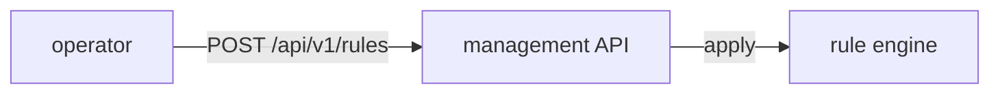

# Rule Engine

<!-- GENERATED by `python3 tools/gen_reference_docs.py`. Do not edit by hand. -->

The complete MQTT platform in one small binary: broker, SQL rules, data connectors and multi-tenancy in a single process.

Manage SQL rules. Use it to add, test or remove a rule. Reads come from the rule engine.



## Before you start

- Start the broker from [First start](../../getting-started/first-start.md).
- Set `INDRA_API_KEY` to an operator key. The examples read it.

> **Note:** Calls except `/healthz` need an operator API key. Pass it as `Authorization: Bearer $INDRA_API_KEY`.

Streaming SQL rules and analytical functions

### `GET /api/v1/rules`

List all streaming SQL rules

Operation id: `listRules`.

Parameters:

No parameters.

Request body:

No request body.

Responses:

| Status | Description |
|---|---|
| 200 | Array of configured rules |

Response `200` body:

Media type `application/json`:

```json
{
  "type": "array",
  "items": {
    "type": "object",
    "properties": {
      "id": {
        "type": "string"
      },
      "name": {
        "type": "string"
      },
      "tenant": {
        "type": "string"
      },
      "topic_filter": {
        "type": "string"
      },
      "sql_query": {
        "type": "string"
      },
      "enabled": {
        "type": "boolean"
      }
    }
  }
}
```


Notes:

- Related calls sit on the same tag page.

Verified: the check below runs this call.

Example:

```curl
# Illustrative request. Values come from the schema above.
# The example flow below runs verified calls on a live broker.
curl -s -X GET 'http://127.0.0.1:18083/api/v1/rules' \
  -H "Authorization: Bearer $INDRA_API_KEY"
```

### `POST /api/v1/rules`

Create new streaming SQL rule

Operation id: `createRule`.

Parameters:

No parameters.

Request body:

Media type `application/json`:

Required: `name`, `topic_filter`.

| Field | Type | Description |
|---|---|---|
| `name` | string |  |
| `tenant` | string |  |
| `topic_filter` | string |  |
| `sql_query` | string |  |
| `actions` | array |  |
| `enabled` | boolean |  |


Responses:

| Status | Description |
|---|---|
| 201 | Rule created |
| 400 | Invalid rule |
| 500 | Rule save failed after the in-memory write |


Notes:

- Send `name`, `topic_filter`. An empty required string fails with 400.

- Success answers 201 with the stored row.

- Related calls sit on the same tag page.

Verified: the example flow below runs this call.

Example:

```curl
# Illustrative request. Values come from the schema above.
# The example flow below runs verified calls on a live broker.
curl -s -X POST 'http://127.0.0.1:18083/api/v1/rules' \
  -H "Authorization: Bearer $INDRA_API_KEY" \
  -H "Content-Type: application/json" \
  -d '{
  "name": "doc-rule-1",
  "tenant": "",
  "topic_filter": "sensors/#",
  "sql_query": "",
  "actions": [],
  "enabled": true
}'
```

### `GET /api/v1/rules/functions`

List catalog of analytical SQL functions

Operation id: `listFunctions`.

Parameters:

No parameters.

Request body:

No request body.

Responses:

| Status | Description |
|---|---|
| 200 | Catalog of supported streaming functions |

Response `200` body:

Media type `application/json`:

```json
{
  "type": "array",
  "items": {
    "type": "object",
    "properties": {
      "name": {
        "type": "string"
      },
      "category": {
        "type": "string"
      },
      "description": {
        "type": "string"
      },
      "aggregate": {
        "type": "boolean"
      },
      "arity": {
        "type": "string"
      },
      "example": {
        "type": "string"
      }
    }
  }
}
```


Notes:

- Related calls sit on the same tag page.

Not verified: see `../_verification/failures.md`.

Example:

```curl
# Illustrative request. Values come from the schema above.
# The example flow below runs verified calls on a live broker.
curl -s -X GET 'http://127.0.0.1:18083/api/v1/rules/functions' \
  -H "Authorization: Bearer $INDRA_API_KEY"
```

### `GET /api/v1/rules/sources`

List available rule event sources

Operation id: `listRuleSources`.

Parameters:

No parameters.

Request body:

No request body.

Responses:

| Status | Description |
|---|---|
| 200 | List of event sources |

Response `200` body:

Media type `application/json`:

```json
{
  "type": "array",
  "items": {
    "type": "object"
  }
}
```


Notes:

- Related calls sit on the same tag page.

Not verified: see `../_verification/failures.md`.

Example:

```curl
# Illustrative request. Values come from the schema above.
# The example flow below runs verified calls on a live broker.
curl -s -X GET 'http://127.0.0.1:18083/api/v1/rules/sources' \
  -H "Authorization: Bearer $INDRA_API_KEY"
```

### `POST /api/v1/rules/test`

Test streaming SQL query against mock payload

Operation id: `testRule`.

Parameters:

No parameters.

Request body:

Media type `application/json`:

Required: `sql_query`, `topic`, `payload`.

| Field | Type | Description |
|---|---|---|
| `sql_query` | string |  |
| `topic` | string |  |
| `payload` | string |  |


Responses:

| Status | Description |
|---|---|
| 200 | Rule test evaluation result |

Response `200` body:

Media type `application/json`:

```json
{
  "type": "object",
  "properties": {
    "matched": {
      "type": "boolean"
    },
    "projected": {}
  }
}
```


Notes:

- Send `sql_query`, `topic`, `payload`. An empty required string fails with 400.

- Related calls sit on the same tag page.

Not verified: see `../_verification/failures.md`.

Example:

```curl
# Illustrative request. Values come from the schema above.
# The example flow below runs verified calls on a live broker.
curl -s -X POST 'http://127.0.0.1:18083/api/v1/rules/test' \
  -H "Authorization: Bearer $INDRA_API_KEY" \
  -H "Content-Type: application/json" \
  -d '{
  "sql_query": "SELECT * FROM \"sensors/#\"",
  "topic": "sensors/1",
  "payload": "{\"temp\": 21}"
}'
```

### `DELETE /api/v1/rules/{id}`

Delete rule by ID

Operation id: `deleteRule`.

Parameters:

| Name | In | Required | Type | Description |
|---|---|---|---|---|
| `id` | path | true | string |  |

Request body:

No request body.

Responses:

| Status | Description |
|---|---|
| 204 | Rule deleted |
| 404 | Rule not found |
| 500 | Rule save failed after the in-memory write |


Notes:

- Success answers 204 with no body.

- An unknown id fails with 404.

- Related calls sit on the same tag page.

Verified: the example flow below runs this call.

Example:

```curl
# Illustrative request. Values come from the schema above.
# The example flow below runs verified calls on a live broker.
curl -s -X DELETE 'http://127.0.0.1:18083/api/v1/rules/1' \
  -H "Authorization: Bearer $INDRA_API_KEY"
```

### `GET /api/v1/rules/{id}`

Get rule by ID

Operation id: `getRule`.

Parameters:

| Name | In | Required | Type | Description |
|---|---|---|---|---|
| `id` | path | true | string |  |

Request body:

No request body.

Responses:

| Status | Description |
|---|---|
| 200 | Rule details |
| 404 | Rule not found |


Notes:

- An unknown id fails with 404.

- Related calls sit on the same tag page.

Verified: the example flow below runs this call.

Example:

```curl
# Illustrative request. Values come from the schema above.
# The example flow below runs verified calls on a live broker.
curl -s -X GET 'http://127.0.0.1:18083/api/v1/rules/1' \
  -H "Authorization: Bearer $INDRA_API_KEY"
```

## Example flow

Create a real object through the management API, read it back, then delete it. The docs harness runs this flow against a started broker.

```sh test
python3 - <<'PY'
import json, os, urllib.request, urllib.error
port = os.environ.get("API_PORT", "18083")
key = os.environ.get("API_KEY", "")
base = f"http://127.0.0.1:{port}"
def call(method, path, body=None):
    data = json.dumps(body).encode() if body is not None else None
    req = urllib.request.Request(base + path, data=data, method=method)
    req.add_header("Authorization", f"Bearer {key}")
    if body is not None:
        req.add_header("Content-Type", "application/json")
    try:
        with urllib.request.urlopen(req, timeout=5) as r:
            return r.status, r.read().decode()
    except urllib.error.HTTPError as e:
        return e.code, e.read().decode()
s, b = call("POST", "/api/v1/rules", {"name": "doc-rule-1", "topic_filter": "sensors/#"})
assert s == 201, b
rule_id = json.loads(b).get("id")
assert rule_id, b
s, b = call("GET", f"/api/v1/rules/{rule_id}")
assert s == 200, b
assert "doc-rule-1" in b, b
s, b = call("DELETE", f"/api/v1/rules/{rule_id}")
assert s in (200, 204), b
s, b = call("GET", f"/api/v1/rules/{rule_id}")
assert s == 404, b
print("OK")
PY
```

```output
OK
```

## Check that it works

Start the broker with this file. The health endpoint returns `OK`.

```toml test
[node]
id = "doc-ref"

[listeners.tcp]
bind = "0.0.0.0:1883"

[listeners.tls]
bind = "0.0.0.0:8883"

[listeners.ws]
bind = "0.0.0.0:8083"

[listeners.wss]
bind = "0.0.0.0:8084"

[listeners.api]
bind = "0.0.0.0:18083"

[logging]
level = "warn"
```

```sh test
python3 - <<'PY'
import os, socket
port = int(os.environ.get("API_PORT", "18083"))
sock = socket.create_connection(("127.0.0.1", port), timeout=5)
sock.sendall(b"GET /healthz HTTP/1.0\r\nHost: docs\r\n\r\n")
print(sock.makefile().read().strip().splitlines()[-1])
PY
```

```output
OK
```

Check one documented call. `GET /api/v1/rules` answers 200 with its rows. It prints `OK`.

```sh test
python3 - <<'PY'
import os, urllib.request
port = os.environ.get("API_PORT", "18083")
key = os.environ.get("API_KEY", "")
base = f"http://127.0.0.1:{port}"
req = urllib.request.Request(base + "/api/v1/rules", method="GET")
req.add_header("Authorization", f"Bearer {key}")
with urllib.request.urlopen(req, timeout=5) as r:
    body = r.read().decode()
    assert r.status == 200, body
assert len(body.strip()) > 0, body
print("OK")
PY
```

```output
OK
```

## Next steps

- [API reference](index.md): the other tags.
- [Configuration reference](../configuration.md): the settings behind the rows.
- [Metrics reference](../metrics.md): the counter names.
