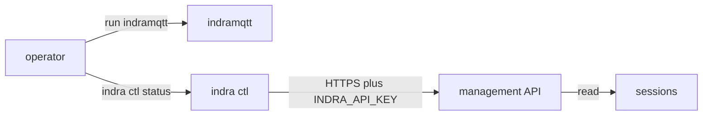

# Command line reference

<!-- GENERATED by `python3 docs/_tools/entries.py` from `docs/_inventory/`, `docs/_text/` and `docs/_verified/`. Do not edit by hand. -->

The complete MQTT platform in one small binary: broker, SQL rules, data connectors and multi-tenancy in a single process.

Read every flag and every operator command. Use it when a command line looks wrong. You get one row per flag and per command.



The product is one native binary. `indramqtt` runs the broker. `indra ctl` operates it through the management API.
The drift test fails when a flag or a command differs from the command definitions.

## Before you start

- Start the broker from [First start](../getting-started/first-start.md).
- `indra ctl` needs an operator key: `--api-key`, `--api-key-file`, or `INDRA_API_KEY`. A missing key fails closed before any request.

> **Note:** Destructive commands require `--yes` or a confirm. Without `--yes` on a pipe, the command refuses to run.

The table lists each flag and each command. The drift test checks each flag and each command against the live help.

## indramqtt

Start the broker:

```sh no-test
# Starts the broker. The drift test boots it with a temp dir, not this line.
indramqtt --config-dir /etc/indramqtt
```

Validate a configuration file and exit:

```sh no-test
# Checks the file and exits. The drift test runs this on a temp dir.
indramqtt --config-dir /etc/indramqtt --check-config
```

| Flag | Kind | Default | Setting | Effect |
|---|---|---|---|---|
| `-b, --bind` | string | `127.0.0.1:1883` | `listeners.tcp.bind` | Bind the plaintext MQTT listener. |
| `--api-bind` | string | `127.0.0.1:18083` | `listeners.api.bind` | Bind the management API. Empty disables it. |
| `--data-dir` | string | `./data` | `node.data_dir` | Hold kernel state. Create it on boot when missing. |
| `--config-dir` | string | `/etc/indramqtt` | `none (bootstrap locator)` | Locate indra.toml and conf.d. |
| `--node-id` | string | `indra-node-1` | `node.id` | Set the node identity. |
| `--allow-anonymous` | flag | `false` | `auth.allow_anonymous` | Accept anonymous clients while no users exist. |
| `--qos0-backlog` | integer | `1000` | `session.max_qos0_backlog` | Bound the QoS 0 backlog of each subscriber. |
| `--qos1-inflight-window` | optional integer | `100` | `session.max_qos1_inflight` | Bound the QoS 1 inflight window. |
| `--qos1-spill` | optional integer | `1000` | `session.max_qos1_spill` | Bound the QoS 1 spill past the window. |
| `--topic-alias-maximum` | optional integer | `10` | `session.topic_alias_maximum` | Advertise the alias maximum in CONNACK. |
| `--max-packet-size` | optional integer | `1048576` | `session.max_packet_size` | Limit the largest MQTT packet in bytes. |
| `--monitor-sample-secs` | integer | `10` | `observability.monitor_sample_secs` | Set the monitor sampling interval. |
| `--cluster-seeds` | optional string | `unset` | `cluster.seed_nodes` | Join a cluster through seed nodes. |
| `--cluster-bind` | string | `127.0.0.1:19883` | `cluster.bind` | Bind cluster discovery. |
| `--coap-bind` | string | `empty (disabled)` | `gateway.coap_bind` | Listen for the CoAP gateway. |
| `--stream-dir` | string | `empty (disabled)` | `persistence.stream_dir` | Journal publishes to this directory. |
| `--rule-spill-dir` | optional string | `unset` | `rules_engine.spill_dir` | Spill rule ingress to this directory. |
| `--delayed-max-secs` | integer | `86400` | `delayed.max_secs` | Bound delayed deferrals in seconds. |
| `--check-config` | flag | `false` | `none (exit after check)` | Validate the configuration and exit. |
| `--license-key` | optional string | `unset` | `licence.license_key` | Set the commercial license key. |
| `--license-keys` | string | `empty (trust nothing)` | `licence.trusted_keys_path` | Trust these signing keys. |
| `--licence-request-out` | string | `empty (disabled)` | `licence.request_out` | Write the licence request and exit. |
| `--licence-install-file` | string | `empty (disabled)` | `licence.install_file` | Install the licence file and exit. |
| `--licence-expiry-warn-days` | integer | `30` | `licence.expiry_warn_days` | Warn before expiry. |
| `--ldap-url` | string | `empty (disabled)` | `ldap.server_url` | Enable LDAP with this server URL. |
| `--ldap-base-dn` | string | `empty` | `ldap.base_dn` | Search directory users under this DN. |
| `--ldap-bind-dn` | string | `empty` | `ldap.bind_dn` | Bind with this service account DN. |
| `--ldap-bind-password` | string | `empty` | `ldap.bind_password` | Bind with this service password. |
| `--ldap-user-filter` | string | `(uid={username})` | `ldap.user_filter` | Search users with this filter. |
| `--ldap-group-attribute` | string | `memberOf` | `ldap.group_attribute` | Read groups from this attribute. |
| `--ldap-required-group` | string | `empty (disabled)` | `ldap.required_group` | Require this group DN. |
| `--ldap-ca-cert` | string | `empty (system roots)` | `ldap.ca_cert_path` | Trust this CA certificate. |
| `--kerberos-keytab` | string | `empty (disabled)` | `kerberos.keytab_path` | Enable Kerberos with this keytab. |
| `--kerberos-service-principal` | string | `empty` | `kerberos.service_principal` | Match this service principal. |
| `--kerberos-realm` | string | `empty (no check)` | `kerberos.realm` | Check this service realm. |
| `--kerberos-allowed-realms` | string | `empty (any)` | `kerberos.allowed_realms` | Trust these client realms. |
| `--kerberos-clock-skew-secs` | integer | `300` | `kerberos.clock_skew_secs` | Allow this clock skew in seconds. |
| `--kerberos-role-map` | string | `empty` | `kerberos.role_map` | Map principals to roles. |
| `--kerberos-replay-max` | optional integer | `1024` | `kerberos.replay_max_entries` | Bound the replay cache. |
| `--jwks-url` | optional string | `unset (disabled)` | `jwks.url` | Verify JWT clients with this endpoint. |
| `--jwks-issuer` | optional string | `unset (no check)` | `jwks.issuer` | Check this JWT issuer. |
| `--jwks-audience` | optional string | `unset (no check)` | `jwks.audience` | Check this JWT audience. |
| `--jwks-refresh-period-secs` | integer | `300` | `jwks.refresh_period_secs` | Refresh JWKS keys on this period. |
| `--jwks-fetch-timeout-ms` | integer | `5000` | `jwks.fetch_timeout_ms` | Time out one JWKS fetch. |
| `--jwks-refresh-timeout-ms` | integer | `5000` | `jwks.refresh_timeout_ms` | Time out one CONNECT refresh wait. |
| `--jwks-cache-max-keys` | integer | `32` | `jwks.cache_max_keys` | Hold this many JWKS keys. |
| `--jwks-cache-ttl-secs` | integer | `300` | `jwks.cache_ttl_secs` | Keep cached JWKS keys this long. |
| `--jwks-clock-skew-secs` | integer | `60` | `jwks.clock_skew_secs` | Allow this JWT clock skew. |
| `--jwks-ca-cert` | string | `empty (system roots)` | `jwks.ca_cert` | Trust this CA for the JWKS endpoint. |
| `--jwks-insecure-skip-verify` | flag | `false` | `none (tests only)` | Skip TLS checks for the JWKS endpoint. |
| `--dbauth-postgres-url` | string | `empty (disabled)` | `dbauth.postgres_url` | Enable database auth with PostgreSQL. |
| `--dbauth-mysql-url` | string | `empty (disabled)` | `dbauth.mysql_url` | Enable database auth with MySQL. |
| `--dbauth-redis-url` | string | `empty (disabled)` | `dbauth.redis_url` | Enable database auth with Redis. |
| `--dbauth-mongodb-url` | string | `empty (disabled)` | `dbauth.mongodb_url` | Enable database auth with MongoDB. |
| `--dbauth-pool-size` | integer | `8` | `dbauth.pool_size` | Keep this many database connections. |
| `--dbauth-connect-timeout-ms` | integer | `3000` | `dbauth.connect_timeout_ms` | Time out database connects. |
| `--dbauth-read-timeout-ms` | integer | `3000` | `dbauth.read_timeout_ms` | Time out database lookups. |
| `--dbauth-cache-size` | integer | `1024` | `dbauth.cache_size` | Cache this many database verdicts. |
| `--dbauth-cache-ttl-secs` | integer | `60` | `dbauth.cache_ttl_secs` | Keep database verdicts this long. |
| `--webhook-url` | string | `empty (disabled)` | `webhook.url` | Ask this webhook for verdicts. |
| `--webhook-pool-size` | integer | `8` | `webhook.pool_size` | Allow this many webhook requests. |
| `--webhook-timeout-ms` | integer | `2000` | `webhook.timeout_ms` | Time out one webhook request. |
| `--webhook-breaker-threshold` | integer | `5` | `webhook.breaker_threshold` | Open the breaker after these failures. |
| `--webhook-breaker-reset-ms` | integer | `30000` | `webhook.breaker_reset_ms` | Retry the webhook after this wait. |
| `--webhook-cache-size` | integer | `1024` | `webhook.cache_size` | Cache this many webhook verdicts. |
| `--webhook-cache-ttl-secs` | integer | `60` | `webhook.cache_ttl_secs` | Keep webhook verdicts this long. |
| `--tls-verify-client-cert` | optional flag | `false` | `listeners.tls.verify_client_cert` | Require a TLS client certificate. |
| `--wss-verify-client-cert` | optional flag | `false` | `listeners.wss.verify_client_cert` | Require a secure WebSocket client certificate. |

`--help` prints the full help. `--version` prints the version.

## Flags in detail

Each flag owns one entry. The drift test checks each flag against the live `--help` output.

### `--bind`

Bind the plaintext MQTT listener.

Kind: `string`. Default: `127.0.0.1:1883`. Setting: `listeners.tcp.bind`.

Example:

```sh no-test
# Presence in --help is checked. This call is illustrative.
indramqtt --config-dir /etc/indramqtt --bind 127.0.0.1:1883
```

Verified: `indramqtt --help` exits 0 and shows `--bind`. See `../_verified/cli/flag-bind.json`.

Notes:

- Set the same value under `listeners.tcp.bind`.
- The drift test checks this flag against live `--help`.

### `--api-bind`

Bind the management API. Empty disables it.

Kind: `string`. Default: `127.0.0.1:18083`. Setting: `listeners.api.bind`.

Example:

```sh no-test
# Presence in --help is checked. This call is illustrative.
indramqtt --config-dir /etc/indramqtt --api-bind 127.0.0.1:18083
```

Verified: `indramqtt --help` exits 0 and shows `--api-bind`. See `../_verified/cli/flag-api-bind.json`.

Notes:

- Set the same value under `listeners.api.bind`.
- The drift test checks this flag against live `--help`.

### `--data-dir`

Hold kernel state. Create it on boot when missing.

Kind: `string`. Default: `./data`. Setting: `node.data_dir`.

Example:

```sh no-test
# Presence in --help is checked. This call is illustrative.
indramqtt --config-dir /etc/indramqtt --data-dir ./data
```

Verified: `indramqtt --help` exits 0 and shows `--data-dir`. See `../_verified/cli/flag-data-dir.json`.

Notes:

- Set the same value under `node.data_dir`.
- The drift test checks this flag against live `--help`.

### `--config-dir`

Locate indra.toml and conf.d.

Kind: `string`. Default: `/etc/indramqtt`. Setting: `none (bootstrap locator)`.

Example:

```sh no-test
# Presence in --help is checked. This call is illustrative.
indramqtt --config-dir /etc/indramqtt
```

Verified: `indramqtt --help` exits 0 and shows `--config-dir`. See `../_verified/cli/flag-config-dir.json`.

Notes:

- This flag maps to no setting.
- The drift test checks this flag against live `--help`.

### `--node-id`

Set the node identity.

Kind: `string`. Default: `indra-node-1`. Setting: `node.id`.

Example:

```sh no-test
# Presence in --help is checked. This call is illustrative.
indramqtt --config-dir /etc/indramqtt --node-id indra-node-1
```

Verified: `indramqtt --help` exits 0 and shows `--node-id`. See `../_verified/cli/flag-node-id.json`.

Notes:

- Set the same value under `node.id`.
- The drift test checks this flag against live `--help`.

### `--allow-anonymous`

Accept anonymous clients while no users exist.

Kind: `flag`. Default: `false`. Setting: `auth.allow_anonymous`.

Example:

```sh no-test
# Presence in --help is checked. This call is illustrative.
indramqtt --config-dir /etc/indramqtt --allow-anonymous
```

Verified: `indramqtt --help` exits 0 and shows `--allow-anonymous`. See `../_verified/cli/flag-allow-anonymous.json`.

Notes:

- Set the same value under `auth.allow_anonymous`.
- The drift test checks this flag against live `--help`.

### `--qos0-backlog`

Bound the QoS 0 backlog of each subscriber.

Kind: `integer`. Default: `1000`. Setting: `session.max_qos0_backlog`.

Example:

```sh no-test
# Presence in --help is checked. This call is illustrative.
indramqtt --config-dir /etc/indramqtt --qos0-backlog 1000
```

Verified: `indramqtt --help` exits 0 and shows `--qos0-backlog`. See `../_verified/cli/flag-qos0-backlog.json`.

Notes:

- Set the same value under `session.max_qos0_backlog`.
- The drift test checks this flag against live `--help`.

### `--qos1-inflight-window`

Bound the QoS 1 inflight window.

Kind: `optional integer`. Default: `100`. Setting: `session.max_qos1_inflight`.

Example:

```sh no-test
# Presence in --help is checked. This call is illustrative.
indramqtt --config-dir /etc/indramqtt --qos1-inflight-window 100
```

Verified: `indramqtt --help` exits 0 and shows `--qos1-inflight-window`. See `../_verified/cli/flag-qos1-inflight-window.json`.

Notes:

- Set the same value under `session.max_qos1_inflight`.
- The drift test checks this flag against live `--help`.

### `--qos1-spill`

Bound the QoS 1 spill past the window.

Kind: `optional integer`. Default: `1000`. Setting: `session.max_qos1_spill`.

Example:

```sh no-test
# Presence in --help is checked. This call is illustrative.
indramqtt --config-dir /etc/indramqtt --qos1-spill 1000
```

Verified: `indramqtt --help` exits 0 and shows `--qos1-spill`. See `../_verified/cli/flag-qos1-spill.json`.

Notes:

- Set the same value under `session.max_qos1_spill`.
- The drift test checks this flag against live `--help`.

### `--topic-alias-maximum`

Advertise the alias maximum in CONNACK.

Kind: `optional integer`. Default: `10`. Setting: `session.topic_alias_maximum`.

Example:

```sh no-test
# Presence in --help is checked. This call is illustrative.
indramqtt --config-dir /etc/indramqtt --topic-alias-maximum 10
```

Verified: `indramqtt --help` exits 0 and shows `--topic-alias-maximum`. See `../_verified/cli/flag-topic-alias-maximum.json`.

Notes:

- Set the same value under `session.topic_alias_maximum`.
- The drift test checks this flag against live `--help`.

### `--max-packet-size`

Limit the largest MQTT packet in bytes.

Kind: `optional integer`. Default: `1048576`. Setting: `session.max_packet_size`.

Example:

```sh no-test
# Presence in --help is checked. This call is illustrative.
indramqtt --config-dir /etc/indramqtt --max-packet-size 1048576
```

Verified: `indramqtt --help` exits 0 and shows `--max-packet-size`. See `../_verified/cli/flag-max-packet-size.json`.

Notes:

- Set the same value under `session.max_packet_size`.
- The drift test checks this flag against live `--help`.

### `--monitor-sample-secs`

Set the monitor sampling interval.

Kind: `integer`. Default: `10`. Setting: `observability.monitor_sample_secs`.

Example:

```sh no-test
# Presence in --help is checked. This call is illustrative.
indramqtt --config-dir /etc/indramqtt --monitor-sample-secs 10
```

Verified: `indramqtt --help` exits 0 and shows `--monitor-sample-secs`. See `../_verified/cli/flag-monitor-sample-secs.json`.

Notes:

- Set the same value under `observability.monitor_sample_secs`.
- The drift test checks this flag against live `--help`.

### `--cluster-seeds`

Join a cluster through seed nodes.

Kind: `optional string`. Default: `unset`. Setting: `cluster.seed_nodes`.

Example:

```sh no-test
# Presence in --help is checked. This call is illustrative.
indramqtt --config-dir /etc/indramqtt --cluster-seeds unset
```

Verified: `indramqtt --help` exits 0 and shows `--cluster-seeds`. See `../_verified/cli/flag-cluster-seeds.json`.

Notes:

- Set the same value under `cluster.seed_nodes`.
- The drift test checks this flag against live `--help`.

### `--cluster-bind`

Bind cluster discovery.

Kind: `string`. Default: `127.0.0.1:19883`. Setting: `cluster.bind`.

Example:

```sh no-test
# Presence in --help is checked. This call is illustrative.
indramqtt --config-dir /etc/indramqtt --cluster-bind 127.0.0.1:19883
```

Verified: `indramqtt --help` exits 0 and shows `--cluster-bind`. See `../_verified/cli/flag-cluster-bind.json`.

Notes:

- Set the same value under `cluster.bind`.
- The drift test checks this flag against live `--help`.

### `--coap-bind`

Listen for the CoAP gateway.

Kind: `string`. Default: `empty (disabled)`. Setting: `gateway.coap_bind`.

Example:

```sh no-test
# Presence in --help is checked. This call is illustrative.
indramqtt --config-dir /etc/indramqtt --coap-bind empty (disabled)
```

Verified: `indramqtt --help` exits 0 and shows `--coap-bind`. See `../_verified/cli/flag-coap-bind.json`.

Notes:

- Set the same value under `gateway.coap_bind`.
- The drift test checks this flag against live `--help`.

### `--stream-dir`

Journal publishes to this directory.

Kind: `string`. Default: `empty (disabled)`. Setting: `persistence.stream_dir`.

Example:

```sh no-test
# Presence in --help is checked. This call is illustrative.
indramqtt --config-dir /etc/indramqtt --stream-dir empty (disabled)
```

Verified: `indramqtt --help` exits 0 and shows `--stream-dir`. See `../_verified/cli/flag-stream-dir.json`.

Notes:

- Set the same value under `persistence.stream_dir`.
- The drift test checks this flag against live `--help`.

### `--rule-spill-dir`

Spill rule ingress to this directory.

Kind: `optional string`. Default: `unset`. Setting: `rules_engine.spill_dir`.

Example:

```sh no-test
# Presence in --help is checked. This call is illustrative.
indramqtt --config-dir /etc/indramqtt --rule-spill-dir unset
```

Verified: `indramqtt --help` exits 0 and shows `--rule-spill-dir`. See `../_verified/cli/flag-rule-spill-dir.json`.

Notes:

- Set the same value under `rules_engine.spill_dir`.
- The drift test checks this flag against live `--help`.

### `--delayed-max-secs`

Bound delayed deferrals in seconds.

Kind: `integer`. Default: `86400`. Setting: `delayed.max_secs`.

Example:

```sh no-test
# Presence in --help is checked. This call is illustrative.
indramqtt --config-dir /etc/indramqtt --delayed-max-secs 86400
```

Verified: `indramqtt --help` exits 0 and shows `--delayed-max-secs`. See `../_verified/cli/flag-delayed-max-secs.json`.

Notes:

- Set the same value under `delayed.max_secs`.
- The drift test checks this flag against live `--help`.

### `--check-config`

Validate the configuration and exit.

Kind: `flag`. Default: `false`. Setting: `none (exit after check)`.

Example:

```sh no-test
# Presence in --help is checked. This call is illustrative.
indramqtt --config-dir /etc/indramqtt --check-config
```

Verified: `indramqtt --help` exits 0 and shows `--check-config`. See `../_verified/cli/flag-check-config.json`.

Notes:

- This flag maps to no setting.
- The drift test checks this flag against live `--help`.

### `--license-key`

Set the commercial license key.

Kind: `optional string`. Default: `unset`. Setting: `licence.license_key`.

Example:

```sh no-test
# Presence in --help is checked. This call is illustrative.
indramqtt --config-dir /etc/indramqtt --license-key unset
```

Verified: `indramqtt --help` exits 0 and shows `--license-key`. See `../_verified/cli/flag-license-key.json`.

Notes:

- Set the same value under `licence.license_key`.
- The drift test checks this flag against live `--help`.

### `--license-keys`

Trust these signing keys.

Kind: `string`. Default: `empty (trust nothing)`. Setting: `licence.trusted_keys_path`.

Example:

```sh no-test
# Presence in --help is checked. This call is illustrative.
indramqtt --config-dir /etc/indramqtt --license-keys empty (trust nothing)
```

Verified: `indramqtt --help` exits 0 and shows `--license-keys`. See `../_verified/cli/flag-license-keys.json`.

Notes:

- Set the same value under `licence.trusted_keys_path`.
- The drift test checks this flag against live `--help`.

### `--licence-request-out`

Write the licence request and exit.

Kind: `string`. Default: `empty (disabled)`. Setting: `licence.request_out`.

Example:

```sh no-test
# Presence in --help is checked. This call is illustrative.
indramqtt --config-dir /etc/indramqtt --licence-request-out empty (disabled)
```

Verified: `indramqtt --help` exits 0 and shows `--licence-request-out`. See `../_verified/cli/flag-licence-request-out.json`.

Notes:

- Set the same value under `licence.request_out`.
- The drift test checks this flag against live `--help`.

### `--licence-install-file`

Install the licence file and exit.

Kind: `string`. Default: `empty (disabled)`. Setting: `licence.install_file`.

Example:

```sh no-test
# Presence in --help is checked. This call is illustrative.
indramqtt --config-dir /etc/indramqtt --licence-install-file empty (disabled)
```

Verified: `indramqtt --help` exits 0 and shows `--licence-install-file`. See `../_verified/cli/flag-licence-install-file.json`.

Notes:

- Set the same value under `licence.install_file`.
- The drift test checks this flag against live `--help`.

### `--licence-expiry-warn-days`

Warn before expiry.

Kind: `integer`. Default: `30`. Setting: `licence.expiry_warn_days`.

Example:

```sh no-test
# Presence in --help is checked. This call is illustrative.
indramqtt --config-dir /etc/indramqtt --licence-expiry-warn-days 30
```

Verified: `indramqtt --help` exits 0 and shows `--licence-expiry-warn-days`. See `../_verified/cli/flag-licence-expiry-warn-days.json`.

Notes:

- Set the same value under `licence.expiry_warn_days`.
- The drift test checks this flag against live `--help`.

### `--ldap-url`

Enable LDAP with this server URL.

Kind: `string`. Default: `empty (disabled)`. Setting: `ldap.server_url`.

Example:

```sh no-test
# Presence in --help is checked. This call is illustrative.
indramqtt --config-dir /etc/indramqtt --ldap-url empty (disabled)
```

Verified: `indramqtt --help` exits 0 and shows `--ldap-url`. See `../_verified/cli/flag-ldap-url.json`.

Notes:

- Set the same value under `ldap.server_url`.
- The drift test checks this flag against live `--help`.

### `--ldap-base-dn`

Search directory users under this DN.

Kind: `string`. Default: `empty`. Setting: `ldap.base_dn`.

Example:

```sh no-test
# Presence in --help is checked. This call is illustrative.
indramqtt --config-dir /etc/indramqtt --ldap-base-dn empty
```

Verified: `indramqtt --help` exits 0 and shows `--ldap-base-dn`. See `../_verified/cli/flag-ldap-base-dn.json`.

Notes:

- Set the same value under `ldap.base_dn`.
- The drift test checks this flag against live `--help`.

### `--ldap-bind-dn`

Bind with this service account DN.

Kind: `string`. Default: `empty`. Setting: `ldap.bind_dn`.

Example:

```sh no-test
# Presence in --help is checked. This call is illustrative.
indramqtt --config-dir /etc/indramqtt --ldap-bind-dn empty
```

Verified: `indramqtt --help` exits 0 and shows `--ldap-bind-dn`. See `../_verified/cli/flag-ldap-bind-dn.json`.

Notes:

- Set the same value under `ldap.bind_dn`.
- The drift test checks this flag against live `--help`.

### `--ldap-bind-password`

Bind with this service password.

Kind: `string`. Default: `empty`. Setting: `ldap.bind_password`.

Example:

```sh no-test
# Presence in --help is checked. This call is illustrative.
indramqtt --config-dir /etc/indramqtt --ldap-bind-password empty
```

Verified: `indramqtt --help` exits 0 and shows `--ldap-bind-password`. See `../_verified/cli/flag-ldap-bind-password.json`.

Notes:

- Set the same value under `ldap.bind_password`.
- The drift test checks this flag against live `--help`.

### `--ldap-user-filter`

Search users with this filter.

Kind: `string`. Default: `(uid={username})`. Setting: `ldap.user_filter`.

Example:

```sh no-test
# Presence in --help is checked. This call is illustrative.
indramqtt --config-dir /etc/indramqtt --ldap-user-filter (uid={username})
```

Verified: `indramqtt --help` exits 0 and shows `--ldap-user-filter`. See `../_verified/cli/flag-ldap-user-filter.json`.

Notes:

- Set the same value under `ldap.user_filter`.
- The drift test checks this flag against live `--help`.

### `--ldap-group-attribute`

Read groups from this attribute.

Kind: `string`. Default: `memberOf`. Setting: `ldap.group_attribute`.

Example:

```sh no-test
# Presence in --help is checked. This call is illustrative.
indramqtt --config-dir /etc/indramqtt --ldap-group-attribute memberOf
```

Verified: `indramqtt --help` exits 0 and shows `--ldap-group-attribute`. See `../_verified/cli/flag-ldap-group-attribute.json`.

Notes:

- Set the same value under `ldap.group_attribute`.
- The drift test checks this flag against live `--help`.

### `--ldap-required-group`

Require this group DN.

Kind: `string`. Default: `empty (disabled)`. Setting: `ldap.required_group`.

Example:

```sh no-test
# Presence in --help is checked. This call is illustrative.
indramqtt --config-dir /etc/indramqtt --ldap-required-group empty (disabled)
```

Verified: `indramqtt --help` exits 0 and shows `--ldap-required-group`. See `../_verified/cli/flag-ldap-required-group.json`.

Notes:

- Set the same value under `ldap.required_group`.
- The drift test checks this flag against live `--help`.

### `--ldap-ca-cert`

Trust this CA certificate.

Kind: `string`. Default: `empty (system roots)`. Setting: `ldap.ca_cert_path`.

Example:

```sh no-test
# Presence in --help is checked. This call is illustrative.
indramqtt --config-dir /etc/indramqtt --ldap-ca-cert empty (system roots)
```

Verified: `indramqtt --help` exits 0 and shows `--ldap-ca-cert`. See `../_verified/cli/flag-ldap-ca-cert.json`.

Notes:

- Set the same value under `ldap.ca_cert_path`.
- The drift test checks this flag against live `--help`.

### `--kerberos-keytab`

Enable Kerberos with this keytab.

Kind: `string`. Default: `empty (disabled)`. Setting: `kerberos.keytab_path`.

Example:

```sh no-test
# Presence in --help is checked. This call is illustrative.
indramqtt --config-dir /etc/indramqtt --kerberos-keytab empty (disabled)
```

Verified: `indramqtt --help` exits 0 and shows `--kerberos-keytab`. See `../_verified/cli/flag-kerberos-keytab.json`.

Notes:

- Set the same value under `kerberos.keytab_path`.
- The drift test checks this flag against live `--help`.

### `--kerberos-service-principal`

Match this service principal.

Kind: `string`. Default: `empty`. Setting: `kerberos.service_principal`.

Example:

```sh no-test
# Presence in --help is checked. This call is illustrative.
indramqtt --config-dir /etc/indramqtt --kerberos-service-principal empty
```

Verified: `indramqtt --help` exits 0 and shows `--kerberos-service-principal`. See `../_verified/cli/flag-kerberos-service-principal.json`.

Notes:

- Set the same value under `kerberos.service_principal`.
- The drift test checks this flag against live `--help`.

### `--kerberos-realm`

Check this service realm.

Kind: `string`. Default: `empty (no check)`. Setting: `kerberos.realm`.

Example:

```sh no-test
# Presence in --help is checked. This call is illustrative.
indramqtt --config-dir /etc/indramqtt --kerberos-realm empty (no check)
```

Verified: `indramqtt --help` exits 0 and shows `--kerberos-realm`. See `../_verified/cli/flag-kerberos-realm.json`.

Notes:

- Set the same value under `kerberos.realm`.
- The drift test checks this flag against live `--help`.

### `--kerberos-allowed-realms`

Trust these client realms.

Kind: `string`. Default: `empty (any)`. Setting: `kerberos.allowed_realms`.

Example:

```sh no-test
# Presence in --help is checked. This call is illustrative.
indramqtt --config-dir /etc/indramqtt --kerberos-allowed-realms empty (any)
```

Verified: `indramqtt --help` exits 0 and shows `--kerberos-allowed-realms`. See `../_verified/cli/flag-kerberos-allowed-realms.json`.

Notes:

- Set the same value under `kerberos.allowed_realms`.
- The drift test checks this flag against live `--help`.

### `--kerberos-clock-skew-secs`

Allow this clock skew in seconds.

Kind: `integer`. Default: `300`. Setting: `kerberos.clock_skew_secs`.

Example:

```sh no-test
# Presence in --help is checked. This call is illustrative.
indramqtt --config-dir /etc/indramqtt --kerberos-clock-skew-secs 300
```

Verified: `indramqtt --help` exits 0 and shows `--kerberos-clock-skew-secs`. See `../_verified/cli/flag-kerberos-clock-skew-secs.json`.

Notes:

- Set the same value under `kerberos.clock_skew_secs`.
- The drift test checks this flag against live `--help`.

### `--kerberos-role-map`

Map principals to roles.

Kind: `string`. Default: `empty`. Setting: `kerberos.role_map`.

Example:

```sh no-test
# Presence in --help is checked. This call is illustrative.
indramqtt --config-dir /etc/indramqtt --kerberos-role-map empty
```

Verified: `indramqtt --help` exits 0 and shows `--kerberos-role-map`. See `../_verified/cli/flag-kerberos-role-map.json`.

Notes:

- Set the same value under `kerberos.role_map`.
- The drift test checks this flag against live `--help`.

### `--kerberos-replay-max`

Bound the replay cache.

Kind: `optional integer`. Default: `1024`. Setting: `kerberos.replay_max_entries`.

Example:

```sh no-test
# Presence in --help is checked. This call is illustrative.
indramqtt --config-dir /etc/indramqtt --kerberos-replay-max 1024
```

Verified: `indramqtt --help` exits 0 and shows `--kerberos-replay-max`. See `../_verified/cli/flag-kerberos-replay-max.json`.

Notes:

- Set the same value under `kerberos.replay_max_entries`.
- The drift test checks this flag against live `--help`.

### `--jwks-url`

Verify JWT clients with this endpoint.

Kind: `optional string`. Default: `unset (disabled)`. Setting: `jwks.url`.

Example:

```sh no-test
# Presence in --help is checked. This call is illustrative.
indramqtt --config-dir /etc/indramqtt --jwks-url unset (disabled)
```

Verified: `indramqtt --help` exits 0 and shows `--jwks-url`. See `../_verified/cli/flag-jwks-url.json`.

Notes:

- Set the same value under `jwks.url`.
- The drift test checks this flag against live `--help`.

### `--jwks-issuer`

Check this JWT issuer.

Kind: `optional string`. Default: `unset (no check)`. Setting: `jwks.issuer`.

Example:

```sh no-test
# Presence in --help is checked. This call is illustrative.
indramqtt --config-dir /etc/indramqtt --jwks-issuer unset (no check)
```

Verified: `indramqtt --help` exits 0 and shows `--jwks-issuer`. See `../_verified/cli/flag-jwks-issuer.json`.

Notes:

- Set the same value under `jwks.issuer`.
- The drift test checks this flag against live `--help`.

### `--jwks-audience`

Check this JWT audience.

Kind: `optional string`. Default: `unset (no check)`. Setting: `jwks.audience`.

Example:

```sh no-test
# Presence in --help is checked. This call is illustrative.
indramqtt --config-dir /etc/indramqtt --jwks-audience unset (no check)
```

Verified: `indramqtt --help` exits 0 and shows `--jwks-audience`. See `../_verified/cli/flag-jwks-audience.json`.

Notes:

- Set the same value under `jwks.audience`.
- The drift test checks this flag against live `--help`.

### `--jwks-refresh-period-secs`

Refresh JWKS keys on this period.

Kind: `integer`. Default: `300`. Setting: `jwks.refresh_period_secs`.

Example:

```sh no-test
# Presence in --help is checked. This call is illustrative.
indramqtt --config-dir /etc/indramqtt --jwks-refresh-period-secs 300
```

Verified: `indramqtt --help` exits 0 and shows `--jwks-refresh-period-secs`. See `../_verified/cli/flag-jwks-refresh-period-secs.json`.

Notes:

- Set the same value under `jwks.refresh_period_secs`.
- The drift test checks this flag against live `--help`.

### `--jwks-fetch-timeout-ms`

Time out one JWKS fetch.

Kind: `integer`. Default: `5000`. Setting: `jwks.fetch_timeout_ms`.

Example:

```sh no-test
# Presence in --help is checked. This call is illustrative.
indramqtt --config-dir /etc/indramqtt --jwks-fetch-timeout-ms 5000
```

Verified: `indramqtt --help` exits 0 and shows `--jwks-fetch-timeout-ms`. See `../_verified/cli/flag-jwks-fetch-timeout-ms.json`.

Notes:

- Set the same value under `jwks.fetch_timeout_ms`.
- The drift test checks this flag against live `--help`.

### `--jwks-refresh-timeout-ms`

Time out one CONNECT refresh wait.

Kind: `integer`. Default: `5000`. Setting: `jwks.refresh_timeout_ms`.

Example:

```sh no-test
# Presence in --help is checked. This call is illustrative.
indramqtt --config-dir /etc/indramqtt --jwks-refresh-timeout-ms 5000
```

Verified: `indramqtt --help` exits 0 and shows `--jwks-refresh-timeout-ms`. See `../_verified/cli/flag-jwks-refresh-timeout-ms.json`.

Notes:

- Set the same value under `jwks.refresh_timeout_ms`.
- The drift test checks this flag against live `--help`.

### `--jwks-cache-max-keys`

Hold this many JWKS keys.

Kind: `integer`. Default: `32`. Setting: `jwks.cache_max_keys`.

Example:

```sh no-test
# Presence in --help is checked. This call is illustrative.
indramqtt --config-dir /etc/indramqtt --jwks-cache-max-keys 32
```

Verified: `indramqtt --help` exits 0 and shows `--jwks-cache-max-keys`. See `../_verified/cli/flag-jwks-cache-max-keys.json`.

Notes:

- Set the same value under `jwks.cache_max_keys`.
- The drift test checks this flag against live `--help`.

### `--jwks-cache-ttl-secs`

Keep cached JWKS keys this long.

Kind: `integer`. Default: `300`. Setting: `jwks.cache_ttl_secs`.

Example:

```sh no-test
# Presence in --help is checked. This call is illustrative.
indramqtt --config-dir /etc/indramqtt --jwks-cache-ttl-secs 300
```

Verified: `indramqtt --help` exits 0 and shows `--jwks-cache-ttl-secs`. See `../_verified/cli/flag-jwks-cache-ttl-secs.json`.

Notes:

- Set the same value under `jwks.cache_ttl_secs`.
- The drift test checks this flag against live `--help`.

### `--jwks-clock-skew-secs`

Allow this JWT clock skew.

Kind: `integer`. Default: `60`. Setting: `jwks.clock_skew_secs`.

Example:

```sh no-test
# Presence in --help is checked. This call is illustrative.
indramqtt --config-dir /etc/indramqtt --jwks-clock-skew-secs 60
```

Verified: `indramqtt --help` exits 0 and shows `--jwks-clock-skew-secs`. See `../_verified/cli/flag-jwks-clock-skew-secs.json`.

Notes:

- Set the same value under `jwks.clock_skew_secs`.
- The drift test checks this flag against live `--help`.

### `--jwks-ca-cert`

Trust this CA for the JWKS endpoint.

Kind: `string`. Default: `empty (system roots)`. Setting: `jwks.ca_cert`.

Example:

```sh no-test
# Presence in --help is checked. This call is illustrative.
indramqtt --config-dir /etc/indramqtt --jwks-ca-cert empty (system roots)
```

Verified: `indramqtt --help` exits 0 and shows `--jwks-ca-cert`. See `../_verified/cli/flag-jwks-ca-cert.json`.

Notes:

- Set the same value under `jwks.ca_cert`.
- The drift test checks this flag against live `--help`.

### `--jwks-insecure-skip-verify`

Skip TLS checks for the JWKS endpoint.

Kind: `flag`. Default: `false`. Setting: `none (tests only)`.

Example:

```sh no-test
# Presence in --help is checked. This call is illustrative.
indramqtt --config-dir /etc/indramqtt --jwks-insecure-skip-verify
```

Verified: `indramqtt --help` exits 0 and shows `--jwks-insecure-skip-verify`. See `../_verified/cli/flag-jwks-insecure-skip-verify.json`.

Notes:

- This flag maps to no setting.
- The drift test checks this flag against live `--help`.

### `--dbauth-postgres-url`

Enable database auth with PostgreSQL.

Kind: `string`. Default: `empty (disabled)`. Setting: `dbauth.postgres_url`.

Example:

```sh no-test
# Presence in --help is checked. This call is illustrative.
indramqtt --config-dir /etc/indramqtt --dbauth-postgres-url empty (disabled)
```

Verified: `indramqtt --help` exits 0 and shows `--dbauth-postgres-url`. See `../_verified/cli/flag-dbauth-postgres-url.json`.

Notes:

- Set the same value under `dbauth.postgres_url`.
- The drift test checks this flag against live `--help`.

### `--dbauth-mysql-url`

Enable database auth with MySQL.

Kind: `string`. Default: `empty (disabled)`. Setting: `dbauth.mysql_url`.

Example:

```sh no-test
# Presence in --help is checked. This call is illustrative.
indramqtt --config-dir /etc/indramqtt --dbauth-mysql-url empty (disabled)
```

Verified: `indramqtt --help` exits 0 and shows `--dbauth-mysql-url`. See `../_verified/cli/flag-dbauth-mysql-url.json`.

Notes:

- Set the same value under `dbauth.mysql_url`.
- The drift test checks this flag against live `--help`.

### `--dbauth-redis-url`

Enable database auth with Redis.

Kind: `string`. Default: `empty (disabled)`. Setting: `dbauth.redis_url`.

Example:

```sh no-test
# Presence in --help is checked. This call is illustrative.
indramqtt --config-dir /etc/indramqtt --dbauth-redis-url empty (disabled)
```

Verified: `indramqtt --help` exits 0 and shows `--dbauth-redis-url`. See `../_verified/cli/flag-dbauth-redis-url.json`.

Notes:

- Set the same value under `dbauth.redis_url`.
- The drift test checks this flag against live `--help`.

### `--dbauth-mongodb-url`

Enable database auth with MongoDB.

Kind: `string`. Default: `empty (disabled)`. Setting: `dbauth.mongodb_url`.

Example:

```sh no-test
# Presence in --help is checked. This call is illustrative.
indramqtt --config-dir /etc/indramqtt --dbauth-mongodb-url empty (disabled)
```

Verified: `indramqtt --help` exits 0 and shows `--dbauth-mongodb-url`. See `../_verified/cli/flag-dbauth-mongodb-url.json`.

Notes:

- Set the same value under `dbauth.mongodb_url`.
- The drift test checks this flag against live `--help`.

### `--dbauth-pool-size`

Keep this many database connections.

Kind: `integer`. Default: `8`. Setting: `dbauth.pool_size`.

Example:

```sh no-test
# Presence in --help is checked. This call is illustrative.
indramqtt --config-dir /etc/indramqtt --dbauth-pool-size 8
```

Verified: `indramqtt --help` exits 0 and shows `--dbauth-pool-size`. See `../_verified/cli/flag-dbauth-pool-size.json`.

Notes:

- Set the same value under `dbauth.pool_size`.
- The drift test checks this flag against live `--help`.

### `--dbauth-connect-timeout-ms`

Time out database connects.

Kind: `integer`. Default: `3000`. Setting: `dbauth.connect_timeout_ms`.

Example:

```sh no-test
# Presence in --help is checked. This call is illustrative.
indramqtt --config-dir /etc/indramqtt --dbauth-connect-timeout-ms 3000
```

Verified: `indramqtt --help` exits 0 and shows `--dbauth-connect-timeout-ms`. See `../_verified/cli/flag-dbauth-connect-timeout-ms.json`.

Notes:

- Set the same value under `dbauth.connect_timeout_ms`.
- The drift test checks this flag against live `--help`.

### `--dbauth-read-timeout-ms`

Time out database lookups.

Kind: `integer`. Default: `3000`. Setting: `dbauth.read_timeout_ms`.

Example:

```sh no-test
# Presence in --help is checked. This call is illustrative.
indramqtt --config-dir /etc/indramqtt --dbauth-read-timeout-ms 3000
```

Verified: `indramqtt --help` exits 0 and shows `--dbauth-read-timeout-ms`. See `../_verified/cli/flag-dbauth-read-timeout-ms.json`.

Notes:

- Set the same value under `dbauth.read_timeout_ms`.
- The drift test checks this flag against live `--help`.

### `--dbauth-cache-size`

Cache this many database verdicts.

Kind: `integer`. Default: `1024`. Setting: `dbauth.cache_size`.

Example:

```sh no-test
# Presence in --help is checked. This call is illustrative.
indramqtt --config-dir /etc/indramqtt --dbauth-cache-size 1024
```

Verified: `indramqtt --help` exits 0 and shows `--dbauth-cache-size`. See `../_verified/cli/flag-dbauth-cache-size.json`.

Notes:

- Set the same value under `dbauth.cache_size`.
- The drift test checks this flag against live `--help`.

### `--dbauth-cache-ttl-secs`

Keep database verdicts this long.

Kind: `integer`. Default: `60`. Setting: `dbauth.cache_ttl_secs`.

Example:

```sh no-test
# Presence in --help is checked. This call is illustrative.
indramqtt --config-dir /etc/indramqtt --dbauth-cache-ttl-secs 60
```

Verified: `indramqtt --help` exits 0 and shows `--dbauth-cache-ttl-secs`. See `../_verified/cli/flag-dbauth-cache-ttl-secs.json`.

Notes:

- Set the same value under `dbauth.cache_ttl_secs`.
- The drift test checks this flag against live `--help`.

### `--webhook-url`

Ask this webhook for verdicts.

Kind: `string`. Default: `empty (disabled)`. Setting: `webhook.url`.

Example:

```sh no-test
# Presence in --help is checked. This call is illustrative.
indramqtt --config-dir /etc/indramqtt --webhook-url empty (disabled)
```

Verified: `indramqtt --help` exits 0 and shows `--webhook-url`. See `../_verified/cli/flag-webhook-url.json`.

Notes:

- Set the same value under `webhook.url`.
- The drift test checks this flag against live `--help`.

### `--webhook-pool-size`

Allow this many webhook requests.

Kind: `integer`. Default: `8`. Setting: `webhook.pool_size`.

Example:

```sh no-test
# Presence in --help is checked. This call is illustrative.
indramqtt --config-dir /etc/indramqtt --webhook-pool-size 8
```

Verified: `indramqtt --help` exits 0 and shows `--webhook-pool-size`. See `../_verified/cli/flag-webhook-pool-size.json`.

Notes:

- Set the same value under `webhook.pool_size`.
- The drift test checks this flag against live `--help`.

### `--webhook-timeout-ms`

Time out one webhook request.

Kind: `integer`. Default: `2000`. Setting: `webhook.timeout_ms`.

Example:

```sh no-test
# Presence in --help is checked. This call is illustrative.
indramqtt --config-dir /etc/indramqtt --webhook-timeout-ms 2000
```

Verified: `indramqtt --help` exits 0 and shows `--webhook-timeout-ms`. See `../_verified/cli/flag-webhook-timeout-ms.json`.

Notes:

- Set the same value under `webhook.timeout_ms`.
- The drift test checks this flag against live `--help`.

### `--webhook-breaker-threshold`

Open the breaker after these failures.

Kind: `integer`. Default: `5`. Setting: `webhook.breaker_threshold`.

Example:

```sh no-test
# Presence in --help is checked. This call is illustrative.
indramqtt --config-dir /etc/indramqtt --webhook-breaker-threshold 5
```

Verified: `indramqtt --help` exits 0 and shows `--webhook-breaker-threshold`. See `../_verified/cli/flag-webhook-breaker-threshold.json`.

Notes:

- Set the same value under `webhook.breaker_threshold`.
- The drift test checks this flag against live `--help`.

### `--webhook-breaker-reset-ms`

Retry the webhook after this wait.

Kind: `integer`. Default: `30000`. Setting: `webhook.breaker_reset_ms`.

Example:

```sh no-test
# Presence in --help is checked. This call is illustrative.
indramqtt --config-dir /etc/indramqtt --webhook-breaker-reset-ms 30000
```

Verified: `indramqtt --help` exits 0 and shows `--webhook-breaker-reset-ms`. See `../_verified/cli/flag-webhook-breaker-reset-ms.json`.

Notes:

- Set the same value under `webhook.breaker_reset_ms`.
- The drift test checks this flag against live `--help`.

### `--webhook-cache-size`

Cache this many webhook verdicts.

Kind: `integer`. Default: `1024`. Setting: `webhook.cache_size`.

Example:

```sh no-test
# Presence in --help is checked. This call is illustrative.
indramqtt --config-dir /etc/indramqtt --webhook-cache-size 1024
```

Verified: `indramqtt --help` exits 0 and shows `--webhook-cache-size`. See `../_verified/cli/flag-webhook-cache-size.json`.

Notes:

- Set the same value under `webhook.cache_size`.
- The drift test checks this flag against live `--help`.

### `--webhook-cache-ttl-secs`

Keep webhook verdicts this long.

Kind: `integer`. Default: `60`. Setting: `webhook.cache_ttl_secs`.

Example:

```sh no-test
# Presence in --help is checked. This call is illustrative.
indramqtt --config-dir /etc/indramqtt --webhook-cache-ttl-secs 60
```

Verified: `indramqtt --help` exits 0 and shows `--webhook-cache-ttl-secs`. See `../_verified/cli/flag-webhook-cache-ttl-secs.json`.

Notes:

- Set the same value under `webhook.cache_ttl_secs`.
- The drift test checks this flag against live `--help`.

### `--tls-verify-client-cert`

Require a TLS client certificate.

Kind: `optional flag`. Default: `false`. Setting: `listeners.tls.verify_client_cert`.

Example:

```sh no-test
# Presence in --help is checked. This call is illustrative.
indramqtt --config-dir /etc/indramqtt --tls-verify-client-cert
```

Verified: `indramqtt --help` exits 0 and shows `--tls-verify-client-cert`. See `../_verified/cli/flag-tls-verify-client-cert.json`.

Notes:

- Set the same value under `listeners.tls.verify_client_cert`.
- The drift test checks this flag against live `--help`.

### `--wss-verify-client-cert`

Require a secure WebSocket client certificate.

Kind: `optional flag`. Default: `false`. Setting: `listeners.wss.verify_client_cert`.

Example:

```sh no-test
# Presence in --help is checked. This call is illustrative.
indramqtt --config-dir /etc/indramqtt --wss-verify-client-cert
```

Verified: `indramqtt --help` exits 0 and shows `--wss-verify-client-cert`. See `../_verified/cli/flag-wss-verify-client-cert.json`.

Notes:

- Set the same value under `listeners.wss.verify_client_cert`.
- The drift test checks this flag against live `--help`.

## indra ctl

Operate the broker through the management API:

```sh no-test
# Needs a live broker and an API key. The drift test runs ctl --help, not this call.
indra ctl --endpoint http://127.0.0.1:18083 status
```

Each row below names a live command. The drift test runs `indra ctl <command> --help` for each command group.

| Command | Effect |
|---|---|
| `indra ctl status` | Show node status. |
| `indra ctl clients list` | List connected clients. |
| `indra ctl clients show` | Show one client. |
| `indra ctl clients kick` | Disconnect one client. |
| `indra ctl subscriptions` | List subscriptions. |
| `indra ctl topics` | List topics. |
| `indra ctl publish` | Publish one message. |
| `indra ctl listeners` | List network listeners. |
| `indra ctl rules list` | List SQL rules. |
| `indra ctl rules show` | Show one rule. |
| `indra ctl rules create` | Create one rule. |
| `indra ctl rules delete` | Delete one rule. |
| `indra ctl connectors list` | List connectors. |
| `indra ctl connectors show` | Show one connector. |
| `indra ctl connectors create` | Create one connector. |
| `indra ctl connectors delete` | Delete one connector. |
| `indra ctl users list` | List users. |
| `indra ctl users show` | Show one user. |
| `indra ctl users create` | Create one user. |
| `indra ctl users delete` | Delete one user. |
| `indra ctl tenants list` | List tenant namespaces. |
| `indra ctl tenants show` | Show one namespace. |
| `indra ctl tenants create` | Create one namespace. |
| `indra ctl tenants delete` | Delete one namespace. |
| `indra ctl acls list` | List ACL rules. |
| `indra ctl acls create` | Add one ACL rule. |
| `indra ctl acls delete` | Delete one ACL rule. |
| `indra ctl config validate` | Validate a configuration file. |
| `indra ctl config diff` | Diff a file against the running configuration. |
| `indra ctl config reload` | Reload a configuration file. |
| `indra ctl config explain` | Explain one setting value. |
| `indra ctl config history` | List configuration versions. |
| `indra ctl licence status` | Show licence status. |
| `indra ctl licence request` | Write a licence request. |
| `indra ctl licence install` | Install a licence file. |
| `indra ctl backup export` | Export a configuration snapshot. |
| `indra ctl backup import` | Import a configuration snapshot. |

Global options: `--endpoint`, `--api-key`, `--api-key-file`, `--timeout`, `--json`.
Destructive commands require `--yes` or a confirm.

Exit codes: 0 success, 1 connection failure, 2 auth failure, 3 not found, 4 validation failure, 5 server failure.

## Commands in detail

Each command owns one entry. The drift test runs `--help` for each command group.

### `indra ctl status`

Show node status.

Run it with `indra ctl status`.

Example:

```sh no-test
# Group help needs no broker. Real calls need one.
indra ctl status --help
```

Verified: `indra ctl status --help` exits 0 and shows `status`. See `../_verified/cli/cmd-ctl-status.json`.

Notes:

- Real calls need a live broker and an operator key.
- `--help` needs neither. The drift test runs it.

### `indra ctl clients list`

List connected clients.

Run it with `indra ctl clients list`.

Example:

```sh no-test
# Group help needs no broker. Real calls need one.
indra ctl clients --help
```

Verified: `indra ctl clients --help` exits 0 and shows `list`. See `../_verified/cli/cmd-ctl-clients-list.json`.

Notes:

- Real calls need a live broker and an operator key.
- `--help` needs neither. The drift test runs it.

### `indra ctl clients show`

Show one client.

Run it with `indra ctl clients show`.

Example:

```sh no-test
# Group help needs no broker. Real calls need one.
indra ctl clients --help
```

Verified: `indra ctl clients --help` exits 0 and shows `show`. See `../_verified/cli/cmd-ctl-clients-show.json`.

Notes:

- Real calls need a live broker and an operator key.
- `--help` needs neither. The drift test runs it.

### `indra ctl clients kick`

Disconnect one client.

Run it with `indra ctl clients kick`.

Example:

```sh no-test
# Group help needs no broker. Real calls need one.
indra ctl clients --help
```

Verified: `indra ctl clients --help` exits 0 and shows `kick`. See `../_verified/cli/cmd-ctl-clients-kick.json`.

Notes:

- Real calls need a live broker and an operator key.
- `--help` needs neither. The drift test runs it.

### `indra ctl subscriptions`

List subscriptions.

Run it with `indra ctl subscriptions`.

Example:

```sh no-test
# Group help needs no broker. Real calls need one.
indra ctl subscriptions --help
```

Verified: `indra ctl subscriptions --help` exits 0 and shows `subscriptions`. See `../_verified/cli/cmd-ctl-subscriptions.json`.

Notes:

- Real calls need a live broker and an operator key.
- `--help` needs neither. The drift test runs it.

### `indra ctl topics`

List topics.

Run it with `indra ctl topics`.

Example:

```sh no-test
# Group help needs no broker. Real calls need one.
indra ctl topics --help
```

Verified: `indra ctl topics --help` exits 0 and shows `topics`. See `../_verified/cli/cmd-ctl-topics.json`.

Notes:

- Real calls need a live broker and an operator key.
- `--help` needs neither. The drift test runs it.

### `indra ctl publish`

Publish one message.

Run it with `indra ctl publish`.

Example:

```sh no-test
# Group help needs no broker. Real calls need one.
indra ctl publish --help
```

Verified: `indra ctl publish --help` exits 0 and shows `publish`. See `../_verified/cli/cmd-ctl-publish.json`.

Notes:

- Real calls need a live broker and an operator key.
- `--help` needs neither. The drift test runs it.

### `indra ctl listeners`

List network listeners.

Run it with `indra ctl listeners`.

Example:

```sh no-test
# Group help needs no broker. Real calls need one.
indra ctl listeners --help
```

Verified: `indra ctl listeners --help` exits 0 and shows `listeners`. See `../_verified/cli/cmd-ctl-listeners.json`.

Notes:

- Real calls need a live broker and an operator key.
- `--help` needs neither. The drift test runs it.

### `indra ctl rules list`

List SQL rules.

Run it with `indra ctl rules list`.

Example:

```sh no-test
# Group help needs no broker. Real calls need one.
indra ctl rules --help
```

Verified: `indra ctl rules --help` exits 0 and shows `list`. See `../_verified/cli/cmd-ctl-rules-list.json`.

Notes:

- Real calls need a live broker and an operator key.
- `--help` needs neither. The drift test runs it.

### `indra ctl rules show`

Show one rule.

Run it with `indra ctl rules show`.

Example:

```sh no-test
# Group help needs no broker. Real calls need one.
indra ctl rules --help
```

Verified: `indra ctl rules --help` exits 0 and shows `show`. See `../_verified/cli/cmd-ctl-rules-show.json`.

Notes:

- Real calls need a live broker and an operator key.
- `--help` needs neither. The drift test runs it.

### `indra ctl rules create`

Create one rule.

Run it with `indra ctl rules create`.

Example:

```sh no-test
# Group help needs no broker. Real calls need one.
indra ctl rules --help
```

Verified: `indra ctl rules --help` exits 0 and shows `create`. See `../_verified/cli/cmd-ctl-rules-create.json`.

Notes:

- Real calls need a live broker and an operator key.
- `--help` needs neither. The drift test runs it.

### `indra ctl rules delete`

Delete one rule.

Run it with `indra ctl rules delete`.

Example:

```sh no-test
# Group help needs no broker. Real calls need one.
indra ctl rules --help
```

Verified: `indra ctl rules --help` exits 0 and shows `delete`. See `../_verified/cli/cmd-ctl-rules-delete.json`.

Notes:

- Real calls need a live broker and an operator key.
- `--help` needs neither. The drift test runs it.

### `indra ctl connectors list`

List connectors.

Run it with `indra ctl connectors list`.

Example:

```sh no-test
# Group help needs no broker. Real calls need one.
indra ctl connectors --help
```

Verified: `indra ctl connectors --help` exits 0 and shows `list`. See `../_verified/cli/cmd-ctl-connectors-list.json`.

Notes:

- Real calls need a live broker and an operator key.
- `--help` needs neither. The drift test runs it.

### `indra ctl connectors show`

Show one connector.

Run it with `indra ctl connectors show`.

Example:

```sh no-test
# Group help needs no broker. Real calls need one.
indra ctl connectors --help
```

Verified: `indra ctl connectors --help` exits 0 and shows `show`. See `../_verified/cli/cmd-ctl-connectors-show.json`.

Notes:

- Real calls need a live broker and an operator key.
- `--help` needs neither. The drift test runs it.

### `indra ctl connectors create`

Create one connector.

Run it with `indra ctl connectors create`.

Example:

```sh no-test
# Group help needs no broker. Real calls need one.
indra ctl connectors --help
```

Verified: `indra ctl connectors --help` exits 0 and shows `create`. See `../_verified/cli/cmd-ctl-connectors-create.json`.

Notes:

- Real calls need a live broker and an operator key.
- `--help` needs neither. The drift test runs it.

### `indra ctl connectors delete`

Delete one connector.

Run it with `indra ctl connectors delete`.

Example:

```sh no-test
# Group help needs no broker. Real calls need one.
indra ctl connectors --help
```

Verified: `indra ctl connectors --help` exits 0 and shows `delete`. See `../_verified/cli/cmd-ctl-connectors-delete.json`.

Notes:

- Real calls need a live broker and an operator key.
- `--help` needs neither. The drift test runs it.

### `indra ctl users list`

List users.

Run it with `indra ctl users list`.

Example:

```sh no-test
# Group help needs no broker. Real calls need one.
indra ctl users --help
```

Verified: `indra ctl users --help` exits 0 and shows `list`. See `../_verified/cli/cmd-ctl-users-list.json`.

Notes:

- Real calls need a live broker and an operator key.
- `--help` needs neither. The drift test runs it.

### `indra ctl users show`

Show one user.

Run it with `indra ctl users show`.

Example:

```sh no-test
# Group help needs no broker. Real calls need one.
indra ctl users --help
```

Verified: `indra ctl users --help` exits 0 and shows `show`. See `../_verified/cli/cmd-ctl-users-show.json`.

Notes:

- Real calls need a live broker and an operator key.
- `--help` needs neither. The drift test runs it.

### `indra ctl users create`

Create one user.

Run it with `indra ctl users create`.

Example:

```sh no-test
# Group help needs no broker. Real calls need one.
indra ctl users --help
```

Verified: `indra ctl users --help` exits 0 and shows `create`. See `../_verified/cli/cmd-ctl-users-create.json`.

Notes:

- Real calls need a live broker and an operator key.
- `--help` needs neither. The drift test runs it.

### `indra ctl users delete`

Delete one user.

Run it with `indra ctl users delete`.

Example:

```sh no-test
# Group help needs no broker. Real calls need one.
indra ctl users --help
```

Verified: `indra ctl users --help` exits 0 and shows `delete`. See `../_verified/cli/cmd-ctl-users-delete.json`.

Notes:

- Real calls need a live broker and an operator key.
- `--help` needs neither. The drift test runs it.

### `indra ctl tenants list`

List tenant namespaces.

Run it with `indra ctl tenants list`.

Example:

```sh no-test
# Group help needs no broker. Real calls need one.
indra ctl tenants --help
```

Verified: `indra ctl tenants --help` exits 0 and shows `list`. See `../_verified/cli/cmd-ctl-tenants-list.json`.

Notes:

- Real calls need a live broker and an operator key.
- `--help` needs neither. The drift test runs it.

### `indra ctl tenants show`

Show one namespace.

Run it with `indra ctl tenants show`.

Example:

```sh no-test
# Group help needs no broker. Real calls need one.
indra ctl tenants --help
```

Verified: `indra ctl tenants --help` exits 0 and shows `show`. See `../_verified/cli/cmd-ctl-tenants-show.json`.

Notes:

- Real calls need a live broker and an operator key.
- `--help` needs neither. The drift test runs it.

### `indra ctl tenants create`

Create one namespace.

Run it with `indra ctl tenants create`.

Example:

```sh no-test
# Group help needs no broker. Real calls need one.
indra ctl tenants --help
```

Verified: `indra ctl tenants --help` exits 0 and shows `create`. See `../_verified/cli/cmd-ctl-tenants-create.json`.

Notes:

- Real calls need a live broker and an operator key.
- `--help` needs neither. The drift test runs it.

### `indra ctl tenants delete`

Delete one namespace.

Run it with `indra ctl tenants delete`.

Example:

```sh no-test
# Group help needs no broker. Real calls need one.
indra ctl tenants --help
```

Verified: `indra ctl tenants --help` exits 0 and shows `delete`. See `../_verified/cli/cmd-ctl-tenants-delete.json`.

Notes:

- Real calls need a live broker and an operator key.
- `--help` needs neither. The drift test runs it.

### `indra ctl acls list`

List ACL rules.

Run it with `indra ctl acls list`.

Example:

```sh no-test
# Group help needs no broker. Real calls need one.
indra ctl acls --help
```

Verified: `indra ctl acls --help` exits 0 and shows `list`. See `../_verified/cli/cmd-ctl-acls-list.json`.

Notes:

- Real calls need a live broker and an operator key.
- `--help` needs neither. The drift test runs it.

### `indra ctl acls create`

Add one ACL rule.

Run it with `indra ctl acls create`.

Example:

```sh no-test
# Group help needs no broker. Real calls need one.
indra ctl acls --help
```

Verified: `indra ctl acls --help` exits 0 and shows `create`. See `../_verified/cli/cmd-ctl-acls-create.json`.

Notes:

- Real calls need a live broker and an operator key.
- `--help` needs neither. The drift test runs it.

### `indra ctl acls delete`

Delete one ACL rule.

Run it with `indra ctl acls delete`.

Example:

```sh no-test
# Group help needs no broker. Real calls need one.
indra ctl acls --help
```

Verified: `indra ctl acls --help` exits 0 and shows `delete`. See `../_verified/cli/cmd-ctl-acls-delete.json`.

Notes:

- Real calls need a live broker and an operator key.
- `--help` needs neither. The drift test runs it.

### `indra ctl config validate`

Validate a configuration file.

Run it with `indra ctl config validate`.

Example:

```sh no-test
# Group help needs no broker. Real calls need one.
indra ctl config --help
```

Verified: `indra ctl config --help` exits 0 and shows `validate`. See `../_verified/cli/cmd-ctl-config-validate.json`.

Notes:

- Real calls need a live broker and an operator key.
- `--help` needs neither. The drift test runs it.

### `indra ctl config diff`

Diff a file against the running configuration.

Run it with `indra ctl config diff`.

Example:

```sh no-test
# Group help needs no broker. Real calls need one.
indra ctl config --help
```

Verified: `indra ctl config --help` exits 0 and shows `diff`. See `../_verified/cli/cmd-ctl-config-diff.json`.

Notes:

- Real calls need a live broker and an operator key.
- `--help` needs neither. The drift test runs it.

### `indra ctl config reload`

Reload a configuration file.

Run it with `indra ctl config reload`.

Example:

```sh no-test
# Group help needs no broker. Real calls need one.
indra ctl config --help
```

Verified: `indra ctl config --help` exits 0 and shows `reload`. See `../_verified/cli/cmd-ctl-config-reload.json`.

Notes:

- Real calls need a live broker and an operator key.
- `--help` needs neither. The drift test runs it.

### `indra ctl config explain`

Explain one setting value.

Run it with `indra ctl config explain`.

Example:

```sh no-test
# Group help needs no broker. Real calls need one.
indra ctl config --help
```

Verified: `indra ctl config --help` exits 0 and shows `explain`. See `../_verified/cli/cmd-ctl-config-explain.json`.

Notes:

- Real calls need a live broker and an operator key.
- `--help` needs neither. The drift test runs it.

### `indra ctl config history`

List configuration versions.

Run it with `indra ctl config history`.

Example:

```sh no-test
# Group help needs no broker. Real calls need one.
indra ctl config --help
```

Verified: `indra ctl config --help` exits 0 and shows `history`. See `../_verified/cli/cmd-ctl-config-history.json`.

Notes:

- Real calls need a live broker and an operator key.
- `--help` needs neither. The drift test runs it.

### `indra ctl licence status`

Show licence status.

Run it with `indra ctl licence status`.

Example:

```sh no-test
# Group help needs no broker. Real calls need one.
indra ctl licence --help
```

Verified: `indra ctl licence --help` exits 0 and shows `status`. See `../_verified/cli/cmd-ctl-licence-status.json`.

Notes:

- Real calls need a live broker and an operator key.
- `--help` needs neither. The drift test runs it.

### `indra ctl licence request`

Write a licence request.

Run it with `indra ctl licence request`.

Example:

```sh no-test
# Group help needs no broker. Real calls need one.
indra ctl licence --help
```

Verified: `indra ctl licence --help` exits 0 and shows `request`. See `../_verified/cli/cmd-ctl-licence-request.json`.

Notes:

- Real calls need a live broker and an operator key.
- `--help` needs neither. The drift test runs it.

### `indra ctl licence install`

Install a licence file.

Run it with `indra ctl licence install`.

Example:

```sh no-test
# Group help needs no broker. Real calls need one.
indra ctl licence --help
```

Verified: `indra ctl licence --help` exits 0 and shows `install`. See `../_verified/cli/cmd-ctl-licence-install.json`.

Notes:

- Real calls need a live broker and an operator key.
- `--help` needs neither. The drift test runs it.

### `indra ctl backup export`

Export a configuration snapshot.

Run it with `indra ctl backup export`.

The export file holds the secrets as stored. The command reads them with `secrets=raw`, which needs a full administrator key. Keep the file safe.

Example:

```sh no-test
# Group help needs no broker. Real calls need one.
indra ctl backup --help
```

Verified: `indra ctl backup --help` exits 0 and shows `export`. See `../_verified/cli/cmd-ctl-backup-export.json`.

Notes:

- Real calls need a live broker and an operator key.
- `--help` needs neither. The drift test runs it.

### `indra ctl backup import`

Import a configuration snapshot.

Run it with `indra ctl backup import`.

Example:

```sh no-test
# Group help needs no broker. Real calls need one.
indra ctl backup --help
```

Verified: `indra ctl backup --help` exits 0 and shows `import`. See `../_verified/cli/cmd-ctl-backup-import.json`.

Notes:

- Real calls need a live broker and an operator key.
- `--help` needs neither. The drift test runs it.

## Binaries

Each binary owns one entry. The check below runs `--help`.

### `indramqtt`

Run the broker. It serves MQTT and the API.

Verified: `indramqtt --help` exits 0. See `../_verified/cli/bin-indramqtt.json`.

### `indra`

Operate the broker through the management API.

Verified: `indra --help` exits 0. See `../_verified/cli/bin-indra.json`.

## Check that it works

Start the broker with this file. The health endpoint returns `OK`.

```toml test
[node]
id = "doc-ref"

[listeners.tcp]
bind = "0.0.0.0:1883"

[listeners.tls]
bind = "0.0.0.0:8883"

[listeners.ws]
bind = "0.0.0.0:8083"

[listeners.wss]
bind = "0.0.0.0:8084"

[listeners.api]
bind = "0.0.0.0:18083"

[logging]
level = "warn"
```

```sh test
python3 - <<'PY'
import os, socket
port = int(os.environ.get("API_PORT", "18083"))
sock = socket.create_connection(("127.0.0.1", port), timeout=5)
sock.sendall(b"GET /healthz HTTP/1.0\r\nHost: docs\r\n\r\n")
print(sock.makefile().read().strip().splitlines()[-1])
PY
```

```output
OK
```

Check the documented commands. Each binary answers its help with success. It prints `OK`.

```sh test
python3 - <<'PY'
import os, subprocess
kernel = os.environ.get("INDRAMQTT_BIN", "indramqtt")
ctl = os.environ.get("INDRACLI_BIN", "indra")
r = subprocess.run([kernel, "--help"], capture_output=True, text=True, timeout=30)
assert r.returncode == 0, r.stderr
assert "--check-config" in (r.stdout + r.stderr)
r = subprocess.run([ctl, "ctl", "status", "--help"], capture_output=True, text=True, timeout=30)
assert r.returncode == 0, r.stderr
print("OK")
PY
```

```output
OK
```

## Next steps

- [Configuration reference](configuration.md): the settings behind the flags.
- [API reference](api/index.md): the calls behind `indra ctl`.
- [First start](../getting-started/first-start.md): boot the broker.
