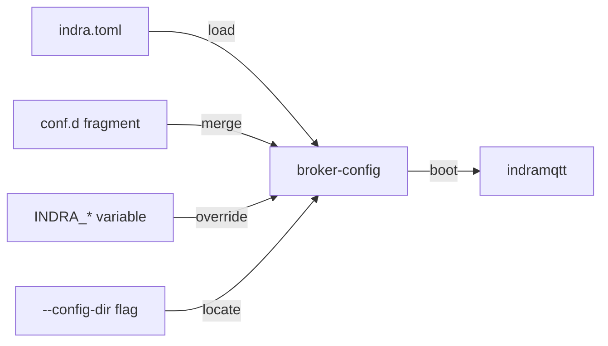

# Configuration reference

<!-- GENERATED by `python3 tools/gen_reference_docs.py`. Do not edit by hand. -->

The complete MQTT platform in one small binary: broker, SQL rules, data connectors and multi-tenancy in a single process.

Read every setting with its type, default and range. Use it when a file value looks wrong. You get one row per setting.



## Before you start

- Set a value in `indra.toml`, in a `conf.d` fragment, in an `INDRA_*` variable, or with a command-line flag.
- Validate a file with `indramqtt --check-config`.
- Each row comes from the configuration schema in the code.
  The drift test fails when this page differs from the schema.

> **Note:** The Restart column stays empty unless the code proves that a reload applies the setting. Deprecated settings are marked as such in the Description column and carry no restart value.

Each setting owns one entry below. An entry with a verified example shows the configuration, the action and the output. An entry with a failure record shows the not-verified callout. The verification runner writes each record from its run.

| Setting | Type | Default | Range | Description | Restart |
|---|---|---|---|---|---|
| **node** | | | | | |
| `node.id` | string | `"indra-node-1"` | 1..=64 chars, letters/digits/dots/dashes | Unique identifier for this broker node within the cluster. |  |
| `node.data_dir` | path string | `"./data"` | non-empty path | Directory holding kernel persistent state (state.toml). Created on boot when missing. |  |
| `node.brokerlink_bind` | socket address string | `"127.0.0.1:18883"` | any string, ignored | Deprecated. Ignored. The kernel serves clients directly. |  |
| **listeners** | | | | | |
| `listeners.tcp.enabled` | bool | `true` | true \| false | Whether the plaintext MQTT listener accepts connections. |  |
| `listeners.tcp.bind` | socket address string | `"0.0.0.0:1883"` | valid host:port, port 1..=65535 | Bind address for the plaintext MQTT listener. |  |
| `listeners.tcp.max_connections` | u32 | `1000000` | 1..=10000000 | Maximum concurrent connections on the plaintext MQTT listener. |  |
| `listeners.tcp.backlog` | u32 | `1024` | 1..=65536 | Listener accept backlog for the plaintext MQTT listener. |  |
| `listeners.tcp.native` | bool | `false` | true \| false | Deprecated. Ignored. The kernel always serves this listener. |  |
| `listeners.tls.enabled` | bool | `false` | true \| false | Whether the secure TLS MQTT listener accepts connections. |  |
| `listeners.tls.bind` | socket address string | `"0.0.0.0:8883"` | valid host:port, port 1..=65535 | Bind address for the secure TLS MQTT listener. |  |
| `listeners.tls.cert_file` | path string | `""` | PEM file path; required when TLS is enabled | Path to the PEM server certificate for the TLS listener. |  |
| `listeners.tls.key_file` | path string | `""` | PEM file path; required when TLS is enabled | Path to the PEM private key for the TLS listener. |  |
| `listeners.tls.native` | bool | `false` | true \| false | Deprecated. Ignored. The kernel always serves this listener. |  |
| `listeners.tls.psk_enabled` | bool | `false` | true \| false | Whether the kernel TLS listener accepts pre-shared-key handshakes. Off keeps certificate handshakes unchanged. On serves PSK suites from the identity store with no certificate. |  |
| `listeners.tls.psk_keys_file` | path string | `""` | file path; empty means no identities | Path to the PSK identity file of the kernel TLS listener. Use it only when PSK is on. Empty keeps the store empty, so every handshake fails closed. |  |
| `listeners.tls.verify_client_cert` | bool | `false` | true \| false | Whether the TLS listener requests and verifies a client certificate. |  |
| `listeners.tls.verify` | string | `"verify_none"` | verify_none \| verify_peer | Client certificate chain check mode of the TLS listener. |  |
| `listeners.tls.cacertfile` | path string | `""` | PEM file path; required when client verification is on | CA file for client certificate checks of the TLS listener. |  |
| `listeners.tls.fail_if_no_peer_cert` | bool | `false` | true \| false | Whether the TLS listener refuses a handshake without a certificate. |  |
| `listeners.tls.peer_cert_as_username` | string | `"disabled"` | disabled \| cn \| dn | Source for the bind username from the client certificate. |  |
| `listeners.tls.peer_cert_as_clientid` | string | `"disabled"` | disabled \| cn \| dn | Source for the bind client identifier from the client certificate. |  |
| `listeners.ws.enabled` | bool | `true` | true \| false | Whether the MQTT-over-WebSocket listener accepts connections. |  |
| `listeners.ws.bind` | socket address string | `"0.0.0.0:8083"` | valid host:port, port 1..=65535 | Bind address for the MQTT-over-WebSocket listener. |  |
| `listeners.ws.path` | string | `"/mqtt"` | must start with '/' | HTTP path serving MQTT-over-WebSocket traffic. |  |
| `listeners.ws.native` | bool | `false` | true \| false | Deprecated. Ignored. The kernel always serves this listener. |  |
| `listeners.wss.enabled` | bool | `false` | true \| false | Whether the secure WebSocket listener accepts connections. |  |
| `listeners.wss.bind` | socket address string | `"0.0.0.0:8084"` | valid host:port, port 1..=65535 | Bind address for the secure WebSocket listener. |  |
| `listeners.wss.path` | string | `"/mqtt"` | must start with '/' | HTTP path serving secure WebSocket traffic. |  |
| `listeners.wss.cert_file` | path string | `""` | PEM file path; required when secure WebSocket is enabled | Path to the PEM server certificate for the secure WebSocket listener. |  |
| `listeners.wss.key_file` | path string | `""` | PEM file path; required when secure WebSocket is enabled | Path to the PEM private key for the secure WebSocket listener. |  |
| `listeners.wss.verify_client_cert` | bool | `false` | true \| false | Whether the secure WebSocket listener requests and verifies a client certificate. |  |
| `listeners.wss.verify` | string | `"verify_none"` | verify_none \| verify_peer | Client certificate chain check mode of the secure WebSocket listener. |  |
| `listeners.wss.cacertfile` | path string | `""` | PEM file path; required when client verification is on | CA file for client certificate checks of the secure WebSocket listener. |  |
| `listeners.wss.fail_if_no_peer_cert` | bool | `false` | true \| false | Whether the secure WebSocket listener refuses a handshake without a certificate. |  |
| `listeners.wss.peer_cert_as_username` | string | `"disabled"` | disabled \| cn \| dn | Source for the bind username from the client certificate. |  |
| `listeners.wss.peer_cert_as_clientid` | string | `"disabled"` | disabled \| cn \| dn | Source for the bind client identifier from the client certificate. |  |
| `listeners.wss.native` | bool | `false` | true \| false | Deprecated. Ignored. The kernel always serves this listener. |  |
| `listeners.api.enabled` | bool | `true` | true \| false | Whether the management REST API and dashboard serve requests. |  |
| `listeners.api.bind` | socket address string | `"0.0.0.0:18083"` | valid host:port, port 1..=65535; empty disables the API | Bind address for the management REST API. Empty disables the API. |  |
| **quotas** | | | | | |
| `quotas.default_max_connections` | u32 | `10000` | 0..=1000000 (0 = unlimited opt-in) | Default max connections per authenticated username (0 = unlimited). |  |
| `quotas.max_connections_per_tenant` | u32 | `0` | 0..=1000000 (0 = unlimited opt-in) | Default max live connections per tenant (0 = unlimited). |  |
| `quotas.max_sessions_per_tenant` | u32 | `0` | 0..=100000 (0 = unlimited opt-in) | Default max sessions per tenant (0 = unlimited). |  |
| `quotas.max_retained_per_tenant` | u32 | `0` | 0..=100000 (0 = unlimited opt-in) | Default max retained topics per tenant (0 = unlimited). |  |
| `quotas.default_max_publish_rate` | u32 | `50000` | 0..=10000000 msg/s (0 = unlimited opt-in) | Default token-bucket publish rate limit in messages per second (0 = unlimited). |  |
| `quotas.burst_multiplier` | f64 | `2.0` | 1.0..=10.0 | Token bucket burst multiplier (allows bursts up to burst times rate). |  |
| **session** | | | | | |
| `session.max_session_expiry_secs` | u64 | `86400` | 0..=2592000 seconds (0 = unlimited opt-in) | Max session expiry interval in seconds. |  |
| `session.max_offline_queue` | u32 | `50000` | 1..=1000000 | Maximum queued offline messages per session. |  |
| `session.max_inflight_messages` | u32 | `65535` | 1..=65535 | Maximum inflight unacknowledged QoS 1 and QoS 2 messages. |  |
| `session.max_qos0_backlog` | usize | `1000` | 1..=100000 | Per-subscriber QoS 0 egress backlog bound; past it the oldest queued QoS 0 frame drops. |  |
| `session.keep_alive_grace` | f64 | `1.5` | 1.0..=5.0 | Keep-alive grace multiplier before disconnect. |  |
| `session.max_qos1_inflight` | usize | `100` | 1..=100000 | Per-session QoS 1 inflight window bound. |  |
| `session.max_qos1_spill` | usize | `1000` | 1..=100000 | Per-session QoS 1 spill bound past the window. |  |
| `session.topic_alias_maximum` | u16 | `10` | 0..=65535 | Inbound topic-alias maximum advertised in CONNACK. |  |
| `session.max_packet_size` | u32 | `1048576` | 1..=268435455 | Largest MQTT packet in bytes. Sets the read limit and the WS frame cap. Advertised in CONNACK. |  |
| **logging** | | | | | |
| `logging.level` | enum string | `"info"` | trace \| debug \| info \| warn \| error | Logging verbosity for the kernel (trace, debug, info, warn, error). |  |
| **rules_engine** | | | | | |
| `rules_engine.window_channel_depth` | u32 | `65536` | 1..=1000000 | Ingress ring buffer channel depth for stateful window worker tasks. |  |
| `rules_engine.backpressure_policy` | enum string | `"DropOldest"` | Block \| DropNewest \| DropOldest \| SpillToDisk \| RejectPublisher | Default memory backpressure policy when the rule buffer is full. |  |
| `rules_engine.spill_dir` | string | `""` | empty or directory path | Rule ingress spill directory. |  |
| **auth** | | | | | |
| `auth.enabled` | bool | `true` | true \| false | Whether authentication checks apply to client connects. |  |
| `auth.password_hash` | enum string | `"sha256"` | sha256 \| bcrypt | Password hashing algorithm for stored credentials. |  |
| `auth.allow_anonymous` | bool | `false` | true \| false | Whether anonymous connections are accepted while no users are configured. |  |
| `auth.superusers` | string list | `["admin", "root"]` | 0..=100 entries | Superuser usernames bypassing ACL rules. |  |
| **cluster** | | | | | |
| `cluster.enabled` | bool | `false` | false only | Refused clustering switch. The broker fails boot when true. |  |
| `cluster.bind` | socket address string | `"127.0.0.1:19883"` | valid host:port, port 1..=65535 | Cluster SWIM UDP bind address for peer discovery and membership. |  |
| `cluster.gossip_bind` | socket address string | `"0.0.0.0:7946"` | valid host:port, port 1..=65535 | Accepted gossip bind. The broker stores it. It binds clustering from --cluster-bind only. |  |
| `cluster.quic_bind` | socket address string | `"0.0.0.0:9092"` | valid host:port, port 1..=65535 | Accepted data plane bind. The broker stores it. It binds clustering from --cluster-bind only. |  |
| `cluster.seed_nodes` | string list | `[]` | must stay empty | Refused seed list. The broker fails boot when not empty. |  |
| **licence** | | | | | |
| `licence.license_file` | path string | `"/etc/indramqtt/license.key"` | any path; empty means none installed | Path to the enterprise cryptographic license key file. |  |
| `licence.license_key` | string | `""` | any string; empty means use stored token or environment | Enterprise commercial license key for multi-node clustering. |  |
| `licence.trusted_keys_path` | path string | `""` | JSON file or directory; empty trusts nothing | Trusted licence-signing keys: a JSON file or directory of JSON files. |  |
| `licence.request_out` | path string | `""` | any path; empty disables request generation | Write the installation licence request to this path and exit. |  |
| `licence.install_file` | path string | `""` | any path; empty disables licence installation | Install the licence token read from this path and exit. |  |
| `licence.expiry_warn_days` | u64 | `30` | 0..=365 days | Days before expiry that the approaching-expiry alarm and log warning start. |  |
| **mcp** | | | | | |
| `mcp.enabled` | bool | `true` | true \| false | Whether the MCP endpoint on the management listener serves tool calls. |  |
| `mcp.read_only` | bool | `false` | true \| false | Whether the MCP endpoint refuses mutating tool calls; only read-only tools stay available. |  |
| **gateway** | | | | | |
| `gateway.coap_bind` | socket address string | `""` | empty disables the gateway, else valid host:port | CoAP gateway UDP listen address. Empty disables the gateway. |  |
| **persistence** | | | | | |
| `persistence.stream_dir` | path string | `""` | any directory; empty disables journaling | Durable stream journal directory. Empty disables journaling. |  |
| **ldap** | | | | | |
| `ldap.server_url` | string | `""` | empty disables LDAP, else ldap:// or ldaps:// URL | Directory server URL for LDAP authentication. Empty disables LDAP. |  |
| `ldap.base_dn` | string | `""` | any DN; required when LDAP is enabled | Base DN under which directory users are searched. |  |
| `ldap.bind_dn` | string | `""` | any DN | Service account DN used for the initial bind plus search. |  |
| `ldap.bind_password` | string | `""` | any string | Service account password for the initial bind. |  |
| `ldap.user_filter` | string | `"(uid={username})"` | must contain {username} when LDAP is enabled | User search filter with a {username} placeholder, escaped per RFC 4515. |  |
| `ldap.group_attribute` | string | `"memberOf"` | non-empty when LDAP is enabled | User-entry attribute listing directory groups. |  |
| `ldap.required_group` | string | `""` | any DN; empty disables the group check | Required group DN: the entry must list this DN to connect. |  |
| `ldap.ca_cert_path` | path string | `""` | PEM file path; empty uses system roots | Path to a PEM CA certificate for private directories. |  |
| `ldap.pool_size` | usize | `8` | 1..=32 | Bound on concurrent directory authentications. |  |
| `ldap.connect_timeout_ms` | u64 | `5000` | 100..=60000 ms | Timeout covering TCP connect plus TLS handshake. |  |
| `ldap.read_timeout_ms` | u64 | `5000` | 100..=60000 ms | Timeout covering each directory bind/search round-trip. |  |
| **kerberos** | | | | | |
| `kerberos.keytab_path` | path string | `""` | keytab v2 file; empty disables Kerberos | Keytab file for Kerberos authentication. Empty disables Kerberos. |  |
| `kerberos.service_principal` | string | `""` | required when Kerberos is enabled | Service principal name held in the keytab. |  |
| `kerberos.realm` | string | `""` | any realm; empty disables the realm check | Expected service realm. Empty disables the realm check on the service name. |  |
| `kerberos.allowed_realms` | string list | `[]` | 0..=32 entries | Trusted client realms. Empty allows any realm that verifies. |  |
| `kerberos.clock_skew_secs` | u64 | `300` | 1..=3600 seconds | Clock-skew allowance in seconds for ticket validity and authenticator timestamps. |  |
| `kerberos.role_map` | string | `""` | comma-separated principal=role pairs; empty leaves every principal at user | Comma-separated principal=role mappings for verified client principals. |  |
| `kerberos.replay_max_entries` | usize | `1024` | 16..=8192 | Replay-cache bound for Kerberos authenticators. |  |
| **delayed** | | | | | |
| `delayed.max_secs` | u64 | `86400` | 1..=86400 | Upper bound for delayed deferrals in seconds. |  |
| **observability** | | | | | |
| `observability.monitor_sample_secs` | u64 | `10` | 0..=3600 | Monitor sampling interval in seconds. |  |
| **jwks** | | | | | |
| `jwks.url` | string | `""` | empty or https URL | JWKS endpoint URL for JWT authentication. |  |
| `jwks.issuer` | string | `""` | any string | Expected JWT issuer. |  |
| `jwks.audience` | string | `""` | any string | Expected JWT audience. |  |
| `jwks.refresh_period_secs` | u64 | `300` | 1..=86400 | Seconds between background JWKS refreshes. |  |
| `jwks.fetch_timeout_ms` | u64 | `5000` | 100..=60000 | Timeout for one JWKS fetch in milliseconds. |  |
| `jwks.refresh_timeout_ms` | u64 | `5000` | 100..=60000 | Longest a CONNECT waits for a JWKS refresh in milliseconds. |  |
| `jwks.cache_max_keys` | usize | `32` | 1..=256 | Most JWKS keys held in the cache. |  |
| `jwks.cache_ttl_secs` | u64 | `300` | 1..=86400 | Seconds a cached JWKS key stays valid. |  |
| `jwks.clock_skew_secs` | u64 | `60` | 0..=3600 | Clock skew tolerated when checking token times, in seconds. |  |
| `jwks.ca_cert` | string | `""` | empty or path to a PEM file | Extra CA certificate trusted for the JWKS endpoint. |  |
| **dbauth** | | | | | |
| `dbauth.postgres_url` | string | `""` | empty or URL | PostgreSQL URL for database authentication. |  |
| `dbauth.mysql_url` | string | `""` | empty or URL | MySQL URL for database authentication. |  |
| `dbauth.redis_url` | string | `""` | empty or URL | Redis URL for database authentication. |  |
| `dbauth.mongodb_url` | string | `""` | empty or URL | MongoDB URL for database authentication. |  |
| `dbauth.pool_size` | usize | `8` | 1..=32 | Connections kept per authentication database. |  |
| `dbauth.connect_timeout_ms` | u64 | `3000` | 100..=60000 | Timeout for connecting to an authentication database in milliseconds. |  |
| `dbauth.read_timeout_ms` | u64 | `3000` | 100..=60000 | Timeout for one authentication lookup in milliseconds. |  |
| `dbauth.cache_size` | usize | `1024` | 0..=100000 | Cached database verdicts per source; 0 disables the cache. |  |
| `dbauth.cache_ttl_secs` | u64 | `60` | 0..=3600 | Seconds a cached database verdict stays valid. |  |
| **webhook** | | | | | |
| `webhook.url` | string | `""` | empty or URL | HTTP webhook verdict endpoint. |  |
| `webhook.pool_size` | usize | `8` | 1..=32 | Concurrent requests allowed to the webhook endpoint. |  |
| `webhook.timeout_ms` | u64 | `2000` | 100..=60000 | Timeout for one webhook request in milliseconds. |  |
| `webhook.breaker_threshold` | u32 | `5` | 1..=100 | Consecutive webhook failures that open the circuit breaker. |  |
| `webhook.breaker_reset_ms` | u64 | `30000` | 1000..=600000 | Milliseconds an open circuit breaker waits before retrying the webhook. |  |
| `webhook.cache_size` | usize | `1024` | 0..=100000 | Cached webhook verdicts; 0 disables the cache. |  |
| `webhook.cache_ttl_secs` | u64 | `60` | 0..=3600 | Seconds a cached webhook verdict stays valid. |  |
| **prometheus** | | | | | |
| `prometheus.enable_basic_auth` | bool | `true` | true \| false | Require credentials on the scrape endpoints. |  |
| `prometheus.latency_buckets` | string | `"10ms, 100ms, 1s, 5s, 30s"` | comma-separated durations | Latency histogram buckets for the exposition. |  |
| `prometheus.push_gateway.enable` | bool | `false` | true \| false | Stored push intent. The broker runs no push client. |  |
| `prometheus.push_gateway.url` | string | `"http://127.0.0.1:9091"` | http(s) URL | Push target URL for the exposition. |  |
| `prometheus.push_gateway.interval` | string | `"15s"` | duration text | Push interval for the exposition. |  |
| `prometheus.push_gateway.job_name` | string | `"${name}/instance/${name}~${host}"` | template text | Job name template for each push. |  |
| `prometheus.push_gateway.method` | string | `"put"` | put \| post | Push method for the exposition. |  |
| `prometheus.collectors.mnesia` | enum string | `"disabled"` | enabled \| disabled | Stored collector name. The broker keeps it and shows it. No sampler reads it. |  |
| `prometheus.collectors.vm_dist` | enum string | `"disabled"` | enabled \| disabled | Stored collector name. The broker keeps it and shows it. No sampler reads it. |  |
| `prometheus.collectors.vm_memory` | enum string | `"disabled"` | enabled \| disabled | Stored collector name. The broker keeps it and shows it. No sampler reads it. |  |
| `prometheus.collectors.vm_msacc` | enum string | `"disabled"` | enabled \| disabled | Stored collector name. The broker keeps it and shows it. No sampler reads it. |  |
| `prometheus.collectors.vm_statistics` | enum string | `"disabled"` | enabled \| disabled | Stored collector name. The broker keeps it and shows it. No sampler reads it. |  |
| `prometheus.collectors.vm_system_info` | enum string | `"disabled"` | enabled \| disabled | Stored collector name. The broker keeps it and shows it. No sampler reads it. |  |

## Settings in detail

Each entry names one setting. A verified entry carries an example.

## `node`

Name the node. Point state at a directory.

### `node.id`

> [!WARNING]
> Not verified: see the failure record in [Verification failures](../_verification/failures.md).

### `node.data_dir`

> [!WARNING]
> Not verified: see the failure record in [Verification failures](../_verification/failures.md).

### `node.brokerlink_bind`

> [!WARNING]
> Not verified: see the failure record in [Verification failures](../_verification/failures.md).

Group file. The docs run boots this file.
Boot fails on a bad value.

```toml test
[node]
id = "doc-node-1"
brokerlink_bind = "127.0.0.1:18883"

```

## `listeners`

Open the MQTT, WebSocket and API sockets.

### `listeners.tcp.enabled`

Whether the plaintext MQTT listener accepts connections.

Type: `bool`. Default: `true`. Range: `true | false`. Restart: `not proven`.

Notes:

- A wrong type fails validation.
- Related settings sit in the same group.

### `listeners.tcp.bind`

Bind address for the plaintext MQTT listener.

Type: `socket address string`. Default: `"0.0.0.0:1883"`. Range: `valid host:port, port 1..=65535`. Restart: `not proven`.

Notes:

- A wrong type fails validation.
- Related settings sit in the same group.

### `listeners.tcp.max_connections`

Maximum concurrent connections on the plaintext MQTT listener.

Type: `u32`. Default: `1000000`. Range: `1..=10000000`. Restart: `not proven`.

Notes:

- A wrong type fails validation.
- Related settings sit in the same group.

### `listeners.tcp.backlog`

Listener accept backlog for the plaintext MQTT listener.

Type: `u32`. Default: `1024`. Range: `1..=65536`. Restart: `not proven`.

Notes:

- A wrong type fails validation.
- Related settings sit in the same group.

### `listeners.tcp.native`

Deprecated. Ignored. The kernel always serves this listener.

Type: `bool`. Default: `false`. Range: `true | false`. Restart: `not proven`.

Notes:

- A wrong type fails validation.
- Related settings sit in the same group.

### `listeners.tls.enabled`

Whether the secure TLS MQTT listener accepts connections.

Type: `bool`. Default: `false`. Range: `true | false`. Restart: `not proven`.

Notes:

- A wrong type fails validation.
- Related settings sit in the same group.

### `listeners.tls.bind`

Bind address for the secure TLS MQTT listener.

Type: `socket address string`. Default: `"0.0.0.0:8883"`. Range: `valid host:port, port 1..=65535`. Restart: `not proven`.

Notes:

- A wrong type fails validation.
- Related settings sit in the same group.

### `listeners.tls.cert_file`

Path to the PEM server certificate for the TLS listener.

Type: `path string`. Default: `""`. Range: `PEM file path; required when TLS is enabled`. Restart: `not proven`.

Notes:

- A wrong type fails validation.
- Related settings sit in the same group.

### `listeners.tls.key_file`

Path to the PEM private key for the TLS listener.

Type: `path string`. Default: `""`. Range: `PEM file path; required when TLS is enabled`. Restart: `not proven`.

Notes:

- A wrong type fails validation.
- Related settings sit in the same group.

### `listeners.tls.native`

Deprecated. Ignored. The kernel always serves this listener.

Type: `bool`. Default: `false`. Range: `true | false`. Restart: `not proven`.

Notes:

- A wrong type fails validation.
- Related settings sit in the same group.

### `listeners.tls.psk_enabled`

Whether the kernel TLS listener accepts pre-shared-key handshakes. Off keeps certificate handshakes unchanged. On serves PSK suites from the identity store with no certificate.

Type: `bool`. Default: `false`. Range: `true | false`. Restart: `not proven`.

Notes:

- A wrong type fails validation.
- Related settings sit in the same group.

### `listeners.tls.psk_keys_file`

Path to the PSK identity file of the kernel TLS listener. Use it only when PSK is on. Empty keeps the store empty, so every handshake fails closed.

Type: `path string`. Default: `""`. Range: `file path; empty means no identities`. Restart: `not proven`.

Notes:

- A wrong type fails validation.
- Related settings sit in the same group.

### `listeners.tls.verify_client_cert`

Whether the TLS listener requests and verifies a client certificate.

Type: `bool`. Default: `false`. Range: `true | false`. Restart: `not proven`.

Notes:

- A wrong type fails validation.
- Related settings sit in the same group.

### `listeners.tls.verify`

Client certificate chain check mode of the TLS listener.

Type: `string`. Default: `"verify_none"`. Range: `verify_none | verify_peer`. Restart: `not proven`.

Notes:

- A wrong type fails validation.
- Related settings sit in the same group.

### `listeners.tls.cacertfile`

CA file for client certificate checks of the TLS listener.

Type: `path string`. Default: `""`. Range: `PEM file path; required when client verification is on`. Restart: `not proven`.

Notes:

- A wrong type fails validation.
- Related settings sit in the same group.

### `listeners.tls.fail_if_no_peer_cert`

Whether the TLS listener refuses a handshake without a certificate.

Type: `bool`. Default: `false`. Range: `true | false`. Restart: `not proven`.

Notes:

- A wrong type fails validation.
- Related settings sit in the same group.

### `listeners.tls.peer_cert_as_username`

Source for the bind username from the client certificate.

Type: `string`. Default: `"disabled"`. Range: `disabled | cn | dn`. Restart: `not proven`.

Notes:

- A wrong type fails validation.
- Related settings sit in the same group.

### `listeners.tls.peer_cert_as_clientid`

Source for the bind client identifier from the client certificate.

Type: `string`. Default: `"disabled"`. Range: `disabled | cn | dn`. Restart: `not proven`.

Notes:

- A wrong type fails validation.
- Related settings sit in the same group.

### `listeners.ws.enabled`

Whether the MQTT-over-WebSocket listener accepts connections.

Type: `bool`. Default: `true`. Range: `true | false`. Restart: `not proven`.

Notes:

- A wrong type fails validation.
- Related settings sit in the same group.

### `listeners.ws.bind`

Bind address for the MQTT-over-WebSocket listener.

Type: `socket address string`. Default: `"0.0.0.0:8083"`. Range: `valid host:port, port 1..=65535`. Restart: `not proven`.

Notes:

- A wrong type fails validation.
- Related settings sit in the same group.

### `listeners.ws.path`

HTTP path serving MQTT-over-WebSocket traffic.

Type: `string`. Default: `"/mqtt"`. Range: `must start with '/'`. Restart: `not proven`.

Notes:

- A wrong type fails validation.
- Related settings sit in the same group.

### `listeners.ws.native`

Deprecated. Ignored. The kernel always serves this listener.

Type: `bool`. Default: `false`. Range: `true | false`. Restart: `not proven`.

Notes:

- A wrong type fails validation.
- Related settings sit in the same group.

### `listeners.wss.enabled`

Whether the secure WebSocket listener accepts connections.

Type: `bool`. Default: `false`. Range: `true | false`. Restart: `not proven`.

Notes:

- A wrong type fails validation.
- Related settings sit in the same group.

### `listeners.wss.bind`

Bind address for the secure WebSocket listener.

Type: `socket address string`. Default: `"0.0.0.0:8084"`. Range: `valid host:port, port 1..=65535`. Restart: `not proven`.

Notes:

- A wrong type fails validation.
- Related settings sit in the same group.

### `listeners.wss.path`

HTTP path serving secure WebSocket traffic.

Type: `string`. Default: `"/mqtt"`. Range: `must start with '/'`. Restart: `not proven`.

Notes:

- A wrong type fails validation.
- Related settings sit in the same group.

### `listeners.wss.cert_file`

Path to the PEM server certificate for the secure WebSocket listener.

Type: `path string`. Default: `""`. Range: `PEM file path; required when secure WebSocket is enabled`. Restart: `not proven`.

Notes:

- A wrong type fails validation.
- Related settings sit in the same group.

### `listeners.wss.key_file`

Path to the PEM private key for the secure WebSocket listener.

Type: `path string`. Default: `""`. Range: `PEM file path; required when secure WebSocket is enabled`. Restart: `not proven`.

Notes:

- A wrong type fails validation.
- Related settings sit in the same group.

### `listeners.wss.verify_client_cert`

Whether the secure WebSocket listener requests and verifies a client certificate.

Type: `bool`. Default: `false`. Range: `true | false`. Restart: `not proven`.

Notes:

- A wrong type fails validation.
- Related settings sit in the same group.

### `listeners.wss.verify`

Client certificate chain check mode of the secure WebSocket listener.

Type: `string`. Default: `"verify_none"`. Range: `verify_none | verify_peer`. Restart: `not proven`.

Notes:

- A wrong type fails validation.
- Related settings sit in the same group.

### `listeners.wss.cacertfile`

CA file for client certificate checks of the secure WebSocket listener.

Type: `path string`. Default: `""`. Range: `PEM file path; required when client verification is on`. Restart: `not proven`.

Notes:

- A wrong type fails validation.
- Related settings sit in the same group.

### `listeners.wss.fail_if_no_peer_cert`

Whether the secure WebSocket listener refuses a handshake without a certificate.

Type: `bool`. Default: `false`. Range: `true | false`. Restart: `not proven`.

Notes:

- A wrong type fails validation.
- Related settings sit in the same group.

### `listeners.wss.peer_cert_as_username`

Source for the bind username from the client certificate.

Type: `string`. Default: `"disabled"`. Range: `disabled | cn | dn`. Restart: `not proven`.

Notes:

- A wrong type fails validation.
- Related settings sit in the same group.

### `listeners.wss.peer_cert_as_clientid`

Source for the bind client identifier from the client certificate.

Type: `string`. Default: `"disabled"`. Range: `disabled | cn | dn`. Restart: `not proven`.

Notes:

- A wrong type fails validation.
- Related settings sit in the same group.

### `listeners.wss.native`

Deprecated. Ignored. The kernel always serves this listener.

Type: `bool`. Default: `false`. Range: `true | false`. Restart: `not proven`.

Notes:

- A wrong type fails validation.
- Related settings sit in the same group.

### `listeners.api.enabled`

Whether the management REST API and dashboard serve requests.

Type: `bool`. Default: `true`. Range: `true | false`. Restart: `not proven`.

Notes:

- A wrong type fails validation.
- Related settings sit in the same group.

### `listeners.api.bind`

Bind address for the management REST API. Empty disables the API.

Type: `socket address string`. Default: `"0.0.0.0:18083"`. Range: `valid host:port, port 1..=65535; empty disables the API`. Restart: `not proven`.

Notes:

- A wrong type fails validation.
- Related settings sit in the same group.

Group file. The docs run boots this file.
Boot fails on a bad value.

```toml test
[listeners.api]
enabled = true
bind = "0.0.0.0:18083"

[listeners.tcp]
enabled = true
bind = "0.0.0.0:1883"
max_connections = 500000
backlog = 2048
native = false

[listeners.tls]
enabled = false
bind = "0.0.0.0:8883"
cert_file = ""
key_file = ""
native = false
psk_enabled = false
psk_keys_file = ""
verify_client_cert = false
verify = "verify_none"
cacertfile = ""
fail_if_no_peer_cert = false
peer_cert_as_username = "disabled"
peer_cert_as_clientid = "disabled"

[listeners.ws]
enabled = true
bind = "0.0.0.0:8083"
path = "/mqtt"
native = false

[listeners.wss]
enabled = false
bind = "0.0.0.0:8084"
path = "/mqtt"
cert_file = ""
key_file = ""
verify_client_cert = false
verify = "verify_none"
cacertfile = ""
fail_if_no_peer_cert = false
peer_cert_as_username = "disabled"
peer_cert_as_clientid = "disabled"
native = false

```

## `quotas`

Cap connections, sessions and publish rates.

### `quotas.default_max_connections`

Default max connections per authenticated username (0 = unlimited).

Type: `u32`. Default: `10000`. Range: `0..=1000000 (0 = unlimited opt-in)`. Restart: `not proven`.

Notes:

- A wrong type fails validation.
- Related settings sit in the same group.

### `quotas.max_connections_per_tenant`

Default max live connections per tenant (0 = unlimited).

Type: `u32`. Default: `0`. Range: `0..=1000000 (0 = unlimited opt-in)`. Restart: `not proven`.

Notes:

- A wrong type fails validation.
- Related settings sit in the same group.

### `quotas.max_sessions_per_tenant`

Default max sessions per tenant (0 = unlimited).

Type: `u32`. Default: `0`. Range: `0..=100000 (0 = unlimited opt-in)`. Restart: `not proven`.

Notes:

- A wrong type fails validation.
- Related settings sit in the same group.

### `quotas.max_retained_per_tenant`

Default max retained topics per tenant (0 = unlimited).

Type: `u32`. Default: `0`. Range: `0..=100000 (0 = unlimited opt-in)`. Restart: `not proven`.

Notes:

- A wrong type fails validation.
- Related settings sit in the same group.

### `quotas.default_max_publish_rate`

Default token-bucket publish rate limit in messages per second (0 = unlimited).

Type: `u32`. Default: `50000`. Range: `0..=10000000 msg/s (0 = unlimited opt-in)`. Restart: `not proven`.

Notes:

- A wrong type fails validation.
- Related settings sit in the same group.

### `quotas.burst_multiplier`

Token bucket burst multiplier (allows bursts up to burst times rate).

Type: `f64`. Default: `2.0`. Range: `1.0..=10.0`. Restart: `not proven`.

Notes:

- A wrong type fails validation.
- Related settings sit in the same group.

Group file. The docs run boots this file.
Boot fails on a bad value.

```toml test
[quotas]
default_max_connections = 5000
max_connections_per_tenant = 100
max_sessions_per_tenant = 100
max_retained_per_tenant = 100
default_max_publish_rate = 10000
burst_multiplier = 3.0

```

## `session`

Bound queues, windows and packet sizes.

### `session.max_session_expiry_secs`

> [!WARNING]
> Not verified: see the failure record in [Verification failures](../_verification/failures.md).

### `session.max_offline_queue`

> [!WARNING]
> Not verified: see the failure record in [Verification failures](../_verification/failures.md).

### `session.max_inflight_messages`

> [!WARNING]
> Not verified: see the failure record in [Verification failures](../_verification/failures.md).

### `session.max_qos0_backlog`

> [!WARNING]
> Not verified: see the failure record in [Verification failures](../_verification/failures.md).

### `session.keep_alive_grace`

> [!WARNING]
> Not verified: see the failure record in [Verification failures](../_verification/failures.md).

### `session.max_qos1_inflight`

> [!WARNING]
> Not verified: see the failure record in [Verification failures](../_verification/failures.md).

### `session.max_qos1_spill`

> [!WARNING]
> Not verified: see the failure record in [Verification failures](../_verification/failures.md).

### `session.topic_alias_maximum`

> [!WARNING]
> Not verified: see the failure record in [Verification failures](../_verification/failures.md).

### `session.max_packet_size`

> [!WARNING]
> Not verified: see the failure record in [Verification failures](../_verification/failures.md).

Group file. The docs run boots this file.
Boot fails on a bad value.

```toml test
[session]
max_session_expiry_secs = 3600
max_offline_queue = 10000
max_inflight_messages = 10000
max_qos0_backlog = 2000
keep_alive_grace = 2.0
max_qos1_inflight = 50
max_qos1_spill = 500
topic_alias_maximum = 5
max_packet_size = 1048576

```

## `logging`

Set kernel log verbosity.

### `logging.level`

> [!WARNING]
> Not verified: see the failure record in [Verification failures](../_verification/failures.md).

Group file. The docs run boots this file.
Boot fails on a bad value.

```toml test
[logging]
level = "warn"

```

## `rules_engine`

Size the rule ingress buffer.

### `rules_engine.window_channel_depth`

Ingress ring buffer channel depth for stateful window worker tasks.

Type: `u32`. Default: `65536`. Range: `1..=1000000`. Restart: `not proven`.

Notes:

- A wrong type fails validation.
- Related settings sit in the same group.

### `rules_engine.backpressure_policy`

Default memory backpressure policy when the rule buffer is full.

Type: `enum string`. Default: `"DropOldest"`. Range: `Block | DropNewest | DropOldest | SpillToDisk | RejectPublisher`. Restart: `not proven`.

Notes:

- A wrong type fails validation.
- Related settings sit in the same group.

### `rules_engine.spill_dir`

Rule ingress spill directory.

Type: `string`. Default: `""`. Range: `empty or directory path`. Restart: `not proven`.

Notes:

- A wrong type fails validation.
- Related settings sit in the same group.

Group file. The docs run boots this file.
Boot fails on a bad value.

```toml test
[rules_engine]
window_channel_depth = 32768
backpressure_policy = "DropOldest"
spill_dir = ""

```

## `auth`

Switch authentication checks on or off.

### `auth.enabled`

Whether authentication checks apply to client connects.

Type: `bool`. Default: `true`. Range: `true | false`. Restart: `not proven`.

Notes:

- A wrong type fails validation.
- Related settings sit in the same group.

### `auth.password_hash`

Password hashing algorithm for stored credentials.

Type: `enum string`. Default: `"sha256"`. Range: `sha256 | bcrypt`. Restart: `not proven`.

Notes:

- A wrong type fails validation.
- Related settings sit in the same group.

### `auth.allow_anonymous`

Whether anonymous connections are accepted while no users are configured.

Type: `bool`. Default: `false`. Range: `true | false`. Restart: `not proven`.

Notes:

- A wrong type fails validation.
- Related settings sit in the same group.

### `auth.superusers`

Superuser usernames bypassing ACL rules.

Type: `string list`. Default: `["admin", "root"]`. Range: `0..=100 entries`. Restart: `not proven`.

Notes:

- A wrong type fails validation.
- Related settings sit in the same group.

Group file. The docs run boots this file.
Boot fails on a bad value.

```toml test
[auth]
enabled = true
password_hash = "sha256"
allow_anonymous = false
superusers = ["admin", "root"]

```

## `cluster`

Join nodes into one cluster.

### `cluster.enabled`

Refused clustering switch. The broker fails boot when true.

Type: `bool`. Default: `false`. Range: `false only`. Restart: `not proven`.

Notes:

- A wrong type fails validation.
- Related settings sit in the same group.

### `cluster.bind`

Cluster SWIM UDP bind address for peer discovery and membership.

Type: `socket address string`. Default: `"127.0.0.1:19883"`. Range: `valid host:port, port 1..=65535`. Restart: `not proven`.

Notes:

- A wrong type fails validation.
- Related settings sit in the same group.

### `cluster.gossip_bind`

Accepted gossip bind. The broker stores it. It binds clustering from --cluster-bind only.

Type: `socket address string`. Default: `"0.0.0.0:7946"`. Range: `valid host:port, port 1..=65535`. Restart: `not proven`.

Notes:

- A wrong type fails validation.
- The broker stores this value. It does not apply it.
- Related settings sit in the same group.

### `cluster.quic_bind`

Accepted data plane bind. The broker stores it. It binds clustering from --cluster-bind only.

Type: `socket address string`. Default: `"0.0.0.0:9092"`. Range: `valid host:port, port 1..=65535`. Restart: `not proven`.

Notes:

- A wrong type fails validation.
- The broker stores this value. It does not apply it.
- Related settings sit in the same group.

### `cluster.seed_nodes`

Refused seed list. The broker fails boot when not empty.

Type: `string list`. Default: `[]`. Range: `must stay empty`. Restart: `not proven`.

Notes:

- A wrong type fails validation.
- Related settings sit in the same group.

Group file. The docs run boots this file.
Boot fails on a bad value.

```toml test
[cluster]
enabled = false
bind = "127.0.0.1:19883"
gossip_bind = "0.0.0.0:7946"
quic_bind = "0.0.0.0:9092"
seed_nodes = []

```

## `licence`

Install and monitor the commercial licence.

### `licence.license_file`

Path to the enterprise cryptographic license key file.

Type: `path string`. Default: `"/etc/indramqtt/license.key"`. Range: `any path; empty means none installed`. Restart: `not proven`.

Notes:

- A wrong type fails validation.
- Related settings sit in the same group.

### `licence.license_key`

Enterprise commercial license key for multi-node clustering.

Type: `string`. Default: `""`. Range: `any string; empty means use stored token or environment`. Restart: `not proven`.

Notes:

- A wrong type fails validation.
- Related settings sit in the same group.

### `licence.trusted_keys_path`

Trusted licence-signing keys: a JSON file or directory of JSON files.

Type: `path string`. Default: `""`. Range: `JSON file or directory; empty trusts nothing`. Restart: `not proven`.

Notes:

- A wrong type fails validation.
- Related settings sit in the same group.

### `licence.request_out`

Write the installation licence request to this path and exit.

Type: `path string`. Default: `""`. Range: `any path; empty disables request generation`. Restart: `not proven`.

Notes:

- A wrong type fails validation.
- Related settings sit in the same group.

### `licence.install_file`

Install the licence token read from this path and exit.

Type: `path string`. Default: `""`. Range: `any path; empty disables licence installation`. Restart: `not proven`.

Notes:

- A wrong type fails validation.
- Related settings sit in the same group.

### `licence.expiry_warn_days`

Days before expiry that the approaching-expiry alarm and log warning start.

Type: `u64`. Default: `30`. Range: `0..=365 days`. Restart: `not proven`.

Notes:

- A wrong type fails validation.
- Related settings sit in the same group.

Group file. The docs run boots this file.
Boot fails on a bad value.

```toml test
[licence]
license_file = "/etc/indramqtt/license.key"
license_key = ""
trusted_keys_path = ""
request_out = ""
install_file = ""
expiry_warn_days = 7

```

## `mcp`

Settings of this group.

### `mcp.enabled`

Whether the MCP endpoint on the management listener serves tool calls.

Type: `bool`. Default: `true`. Range: `true | false`. Restart: `not proven`.

Notes:

- A wrong type fails validation.
- Related settings sit in the same group.

### `mcp.read_only`

Whether the MCP endpoint refuses mutating tool calls; only read-only tools stay available.

Type: `bool`. Default: `false`. Range: `true | false`. Restart: `not proven`.

Notes:

- A wrong type fails validation.
- Related settings sit in the same group.

Group file. The docs run boots this file.
Boot fails on a bad value.

```toml test
[mcp]
enabled = true
read_only = false

```

## `gateway`

Expose the CoAP gateway.

### `gateway.coap_bind`

> [!WARNING]
> Not verified: see the failure record in [Verification failures](../_verification/failures.md).

Group file. The docs run boots this file.
Boot fails on a bad value.

```toml test
[gateway]
coap_bind = ""

```

## `persistence`

Journal publishes to disk.

### `persistence.stream_dir`

> [!WARNING]
> Not verified: see the failure record in [Verification failures](../_verification/failures.md).

Group file. The docs run boots this file.
Boot fails on a bad value.

```toml test
[persistence]
stream_dir = ""

```

## `ldap`

Check passwords against a directory.

### `ldap.server_url`

Directory server URL for LDAP authentication. Empty disables LDAP.

Type: `string`. Default: `""`. Range: `empty disables LDAP, else ldap:// or ldaps:// URL`. Restart: `not proven`.

Notes:

- A wrong type fails validation.
- Related settings sit in the same group.

### `ldap.base_dn`

Base DN under which directory users are searched.

Type: `string`. Default: `""`. Range: `any DN; required when LDAP is enabled`. Restart: `not proven`.

Notes:

- A wrong type fails validation.
- Related settings sit in the same group.

### `ldap.bind_dn`

Service account DN used for the initial bind plus search.

Type: `string`. Default: `""`. Range: `any DN`. Restart: `not proven`.

Notes:

- A wrong type fails validation.
- Related settings sit in the same group.

### `ldap.bind_password`

Service account password for the initial bind.

Type: `string`. Default: `""`. Range: `any string`. Restart: `not proven`.

Notes:

- A wrong type fails validation.
- Related settings sit in the same group.

### `ldap.user_filter`

User search filter with a {username} placeholder, escaped per RFC 4515.

Type: `string`. Default: `"(uid={username})"`. Range: `must contain {username} when LDAP is enabled`. Restart: `not proven`.

Notes:

- A wrong type fails validation.
- Related settings sit in the same group.

### `ldap.group_attribute`

User-entry attribute listing directory groups.

Type: `string`. Default: `"memberOf"`. Range: `non-empty when LDAP is enabled`. Restart: `not proven`.

Notes:

- A wrong type fails validation.
- Related settings sit in the same group.

### `ldap.required_group`

Required group DN: the entry must list this DN to connect.

Type: `string`. Default: `""`. Range: `any DN; empty disables the group check`. Restart: `not proven`.

Notes:

- A wrong type fails validation.
- Related settings sit in the same group.

### `ldap.ca_cert_path`

Path to a PEM CA certificate for private directories.

Type: `path string`. Default: `""`. Range: `PEM file path; empty uses system roots`. Restart: `not proven`.

Notes:

- A wrong type fails validation.
- Related settings sit in the same group.

### `ldap.pool_size`

Bound on concurrent directory authentications.

Type: `usize`. Default: `8`. Range: `1..=32`. Restart: `not proven`.

Notes:

- A wrong type fails validation.
- Related settings sit in the same group.

### `ldap.connect_timeout_ms`

Timeout covering TCP connect plus TLS handshake.

Type: `u64`. Default: `5000`. Range: `100..=60000 ms`. Restart: `not proven`.

Notes:

- A wrong type fails validation.
- Related settings sit in the same group.

### `ldap.read_timeout_ms`

Timeout covering each directory bind/search round-trip.

Type: `u64`. Default: `5000`. Range: `100..=60000 ms`. Restart: `not proven`.

Notes:

- A wrong type fails validation.
- Related settings sit in the same group.

Group file. The docs run boots this file.
Boot fails on a bad value.

```toml test
[ldap]
server_url = ""
base_dn = ""
bind_dn = ""
bind_password = ""
user_filter = "(uid={username})"
group_attribute = "memberOf"
required_group = ""
ca_cert_path = ""
pool_size = 4
connect_timeout_ms = 3000
read_timeout_ms = 3000

```

## `kerberos`

Check tickets against a keytab.

### `kerberos.keytab_path`

Keytab file for Kerberos authentication. Empty disables Kerberos.

Type: `path string`. Default: `""`. Range: `keytab v2 file; empty disables Kerberos`. Restart: `not proven`.

Notes:

- A wrong type fails validation.
- Related settings sit in the same group.

### `kerberos.service_principal`

Service principal name held in the keytab.

Type: `string`. Default: `""`. Range: `required when Kerberos is enabled`. Restart: `not proven`.

Notes:

- A wrong type fails validation.
- Related settings sit in the same group.

### `kerberos.realm`

Expected service realm. Empty disables the realm check on the service name.

Type: `string`. Default: `""`. Range: `any realm; empty disables the realm check`. Restart: `not proven`.

Notes:

- A wrong type fails validation.
- Related settings sit in the same group.

### `kerberos.allowed_realms`

Trusted client realms. Empty allows any realm that verifies.

Type: `string list`. Default: `[]`. Range: `0..=32 entries`. Restart: `not proven`.

Notes:

- A wrong type fails validation.
- Related settings sit in the same group.

### `kerberos.clock_skew_secs`

Clock-skew allowance in seconds for ticket validity and authenticator timestamps.

Type: `u64`. Default: `300`. Range: `1..=3600 seconds`. Restart: `not proven`.

Notes:

- A wrong type fails validation.
- Related settings sit in the same group.

### `kerberos.role_map`

Comma-separated principal=role mappings for verified client principals.

Type: `string`. Default: `""`. Range: `comma-separated principal=role pairs; empty leaves every principal at user`. Restart: `not proven`.

Notes:

- A wrong type fails validation.
- Related settings sit in the same group.

### `kerberos.replay_max_entries`

Replay-cache bound for Kerberos authenticators.

Type: `usize`. Default: `1024`. Range: `16..=8192`. Restart: `not proven`.

Notes:

- A wrong type fails validation.
- Related settings sit in the same group.

Group file. The docs run boots this file.
Boot fails on a bad value.

```toml test
[kerberos]
keytab_path = ""
service_principal = ""
realm = ""
allowed_realms = []
clock_skew_secs = 120
role_map = ""
replay_max_entries = 512

```

## `delayed`

Bound delayed message deferrals.

### `delayed.max_secs`

> [!WARNING]
> Not verified: see the failure record in [Verification failures](../_verification/failures.md).

Group file. The docs run boots this file.
Boot fails on a bad value.

```toml test
[delayed]
max_secs = 3600

```

## `observability`

Set the monitor sampling interval.

### `observability.monitor_sample_secs`

> [!WARNING]
> Not verified: see the failure record in [Verification failures](../_verification/failures.md).

Group file. The docs run boots this file.
Boot fails on a bad value.

```toml test
[observability]
monitor_sample_secs = 5

```

## `jwks`

Check JWT clients against an endpoint.

### `jwks.url`

JWKS endpoint URL for JWT authentication.

Type: `string`. Default: `""`. Range: `empty or https URL`. Restart: `not proven`.

Notes:

- A wrong type fails validation.
- Related settings sit in the same group.

### `jwks.issuer`

Expected JWT issuer.

Type: `string`. Default: `""`. Range: `any string`. Restart: `not proven`.

Notes:

- A wrong type fails validation.
- Related settings sit in the same group.

### `jwks.audience`

Expected JWT audience.

Type: `string`. Default: `""`. Range: `any string`. Restart: `not proven`.

Notes:

- A wrong type fails validation.
- Related settings sit in the same group.

### `jwks.refresh_period_secs`

Seconds between background JWKS refreshes.

Type: `u64`. Default: `300`. Range: `1..=86400`. Restart: `not proven`.

Notes:

- A wrong type fails validation.
- Related settings sit in the same group.

### `jwks.fetch_timeout_ms`

Timeout for one JWKS fetch in milliseconds.

Type: `u64`. Default: `5000`. Range: `100..=60000`. Restart: `not proven`.

Notes:

- A wrong type fails validation.
- Related settings sit in the same group.

### `jwks.refresh_timeout_ms`

Longest a CONNECT waits for a JWKS refresh in milliseconds.

Type: `u64`. Default: `5000`. Range: `100..=60000`. Restart: `not proven`.

Notes:

- A wrong type fails validation.
- Related settings sit in the same group.

### `jwks.cache_max_keys`

Most JWKS keys held in the cache.

Type: `usize`. Default: `32`. Range: `1..=256`. Restart: `not proven`.

Notes:

- A wrong type fails validation.
- Related settings sit in the same group.

### `jwks.cache_ttl_secs`

Seconds a cached JWKS key stays valid.

Type: `u64`. Default: `300`. Range: `1..=86400`. Restart: `not proven`.

Notes:

- A wrong type fails validation.
- Related settings sit in the same group.

### `jwks.clock_skew_secs`

Clock skew tolerated when checking token times, in seconds.

Type: `u64`. Default: `60`. Range: `0..=3600`. Restart: `not proven`.

Notes:

- A wrong type fails validation.
- Related settings sit in the same group.

### `jwks.ca_cert`

Extra CA certificate trusted for the JWKS endpoint.

Type: `string`. Default: `""`. Range: `empty or path to a PEM file`. Restart: `not proven`.

Notes:

- A wrong type fails validation.
- Related settings sit in the same group.

Group file. The docs run boots this file.
Boot fails on a bad value.

```toml test
[jwks]
url = ""
issuer = ""
audience = ""
refresh_period_secs = 120
fetch_timeout_ms = 3000
refresh_timeout_ms = 3000
cache_max_keys = 16
cache_ttl_secs = 120
clock_skew_secs = 30
ca_cert = ""

```

## `dbauth`

Check passwords against a database.

### `dbauth.postgres_url`

PostgreSQL URL for database authentication.

Type: `string`. Default: `""`. Range: `empty or URL`. Restart: `not proven`.

Notes:

- A wrong type fails validation.
- Related settings sit in the same group.

### `dbauth.mysql_url`

MySQL URL for database authentication.

Type: `string`. Default: `""`. Range: `empty or URL`. Restart: `not proven`.

Notes:

- A wrong type fails validation.
- Related settings sit in the same group.

### `dbauth.redis_url`

Redis URL for database authentication.

Type: `string`. Default: `""`. Range: `empty or URL`. Restart: `not proven`.

Notes:

- A wrong type fails validation.
- Related settings sit in the same group.

### `dbauth.mongodb_url`

MongoDB URL for database authentication.

Type: `string`. Default: `""`. Range: `empty or URL`. Restart: `not proven`.

Notes:

- A wrong type fails validation.
- Related settings sit in the same group.

### `dbauth.pool_size`

Connections kept per authentication database.

Type: `usize`. Default: `8`. Range: `1..=32`. Restart: `not proven`.

Notes:

- A wrong type fails validation.
- Related settings sit in the same group.

### `dbauth.connect_timeout_ms`

Timeout for connecting to an authentication database in milliseconds.

Type: `u64`. Default: `3000`. Range: `100..=60000`. Restart: `not proven`.

Notes:

- A wrong type fails validation.
- Related settings sit in the same group.

### `dbauth.read_timeout_ms`

Timeout for one authentication lookup in milliseconds.

Type: `u64`. Default: `3000`. Range: `100..=60000`. Restart: `not proven`.

Notes:

- A wrong type fails validation.
- Related settings sit in the same group.

### `dbauth.cache_size`

Cached database verdicts per source; 0 disables the cache.

Type: `usize`. Default: `1024`. Range: `0..=100000`. Restart: `not proven`.

Notes:

- A wrong type fails validation.
- Related settings sit in the same group.

### `dbauth.cache_ttl_secs`

Seconds a cached database verdict stays valid.

Type: `u64`. Default: `60`. Range: `0..=3600`. Restart: `not proven`.

Notes:

- A wrong type fails validation.
- Related settings sit in the same group.

Group file. The docs run boots this file.
Boot fails on a bad value.

```toml test
[dbauth]
postgres_url = ""
mysql_url = ""
redis_url = ""
mongodb_url = ""
pool_size = 4
connect_timeout_ms = 2000
read_timeout_ms = 2000
cache_size = 512
cache_ttl_secs = 30

```

## `webhook`

Ask a webhook for verdicts.

### `webhook.url`

HTTP webhook verdict endpoint.

Type: `string`. Default: `""`. Range: `empty or URL`. Restart: `not proven`.

Notes:

- A wrong type fails validation.
- Related settings sit in the same group.

### `webhook.pool_size`

Concurrent requests allowed to the webhook endpoint.

Type: `usize`. Default: `8`. Range: `1..=32`. Restart: `not proven`.

Notes:

- A wrong type fails validation.
- Related settings sit in the same group.

### `webhook.timeout_ms`

Timeout for one webhook request in milliseconds.

Type: `u64`. Default: `2000`. Range: `100..=60000`. Restart: `not proven`.

Notes:

- A wrong type fails validation.
- Related settings sit in the same group.

### `webhook.breaker_threshold`

Consecutive webhook failures that open the circuit breaker.

Type: `u32`. Default: `5`. Range: `1..=100`. Restart: `not proven`.

Notes:

- A wrong type fails validation.
- Related settings sit in the same group.

### `webhook.breaker_reset_ms`

Milliseconds an open circuit breaker waits before retrying the webhook.

Type: `u64`. Default: `30000`. Range: `1000..=600000`. Restart: `not proven`.

Notes:

- A wrong type fails validation.
- Related settings sit in the same group.

### `webhook.cache_size`

Cached webhook verdicts; 0 disables the cache.

Type: `usize`. Default: `1024`. Range: `0..=100000`. Restart: `not proven`.

Notes:

- A wrong type fails validation.
- Related settings sit in the same group.

### `webhook.cache_ttl_secs`

Seconds a cached webhook verdict stays valid.

Type: `u64`. Default: `60`. Range: `0..=3600`. Restart: `not proven`.

Notes:

- A wrong type fails validation.
- Related settings sit in the same group.

Group file. The docs run boots this file.
Boot fails on a bad value.

```toml test
[webhook]
url = ""
pool_size = 4
timeout_ms = 3000
breaker_threshold = 3
breaker_reset_ms = 15000
cache_size = 512
cache_ttl_secs = 30

```

## `prometheus`

Shape the metrics exposition.

### `prometheus.enable_basic_auth`

Require credentials on the scrape endpoints.

Type: `bool`. Default: `true`. Range: `true | false`. Restart: `not proven`.

Notes:

- A wrong type fails validation.
- Related settings sit in the same group.

### `prometheus.latency_buckets`

Latency histogram buckets for the exposition.

Type: `string`. Default: `"10ms, 100ms, 1s, 5s, 30s"`. Range: `comma-separated durations`. Restart: `not proven`.

Notes:

- A wrong type fails validation.
- Related settings sit in the same group.

### `prometheus.push_gateway.enable`

Stored push intent. The broker runs no push client.

Type: `bool`. Default: `false`. Range: `true | false`. Restart: `not proven`.

Notes:

- A wrong type fails validation.
- Related settings sit in the same group.

### `prometheus.push_gateway.url`

Push target URL for the exposition.

Type: `string`. Default: `"http://127.0.0.1:9091"`. Range: `http(s) URL`. Restart: `not proven`.

Notes:

- A wrong type fails validation.
- Related settings sit in the same group.

### `prometheus.push_gateway.interval`

Push interval for the exposition.

Type: `string`. Default: `"15s"`. Range: `duration text`. Restart: `not proven`.

Notes:

- A wrong type fails validation.
- Related settings sit in the same group.

### `prometheus.push_gateway.job_name`

Job name template for each push.

Type: `string`. Default: `"${name}/instance/${name}~${host}"`. Range: `template text`. Restart: `not proven`.

Notes:

- A wrong type fails validation.
- Related settings sit in the same group.

### `prometheus.push_gateway.method`

Push method for the exposition.

Type: `string`. Default: `"put"`. Range: `put | post`. Restart: `not proven`.

Notes:

- A wrong type fails validation.
- Related settings sit in the same group.

### `prometheus.collectors.mnesia`

Stored collector name. The broker keeps it and shows it. No sampler reads it.

Type: `enum string`. Default: `"disabled"`. Range: `enabled | disabled`. Restart: `not proven`.

Notes:

- A wrong type fails validation.
- Related settings sit in the same group.

### `prometheus.collectors.vm_dist`

Stored collector name. The broker keeps it and shows it. No sampler reads it.

Type: `enum string`. Default: `"disabled"`. Range: `enabled | disabled`. Restart: `not proven`.

Notes:

- A wrong type fails validation.
- Related settings sit in the same group.

### `prometheus.collectors.vm_memory`

Stored collector name. The broker keeps it and shows it. No sampler reads it.

Type: `enum string`. Default: `"disabled"`. Range: `enabled | disabled`. Restart: `not proven`.

Notes:

- A wrong type fails validation.
- Related settings sit in the same group.

### `prometheus.collectors.vm_msacc`

Stored collector name. The broker keeps it and shows it. No sampler reads it.

Type: `enum string`. Default: `"disabled"`. Range: `enabled | disabled`. Restart: `not proven`.

Notes:

- A wrong type fails validation.
- Related settings sit in the same group.

### `prometheus.collectors.vm_statistics`

Stored collector name. The broker keeps it and shows it. No sampler reads it.

Type: `enum string`. Default: `"disabled"`. Range: `enabled | disabled`. Restart: `not proven`.

Notes:

- A wrong type fails validation.
- Related settings sit in the same group.

### `prometheus.collectors.vm_system_info`

Stored collector name. The broker keeps it and shows it. No sampler reads it.

Type: `enum string`. Default: `"disabled"`. Range: `enabled | disabled`. Restart: `not proven`.

Notes:

- A wrong type fails validation.
- Related settings sit in the same group.

Group file. The docs run boots this file.
Boot fails on a bad value.

```toml test
[prometheus]
enable_basic_auth = true
latency_buckets = "10ms, 100ms, 1s, 5s, 30s"

[prometheus.collectors]
mnesia = "disabled"
vm_dist = "disabled"
vm_memory = "disabled"
vm_msacc = "disabled"
vm_statistics = "disabled"
vm_system_info = "disabled"

[prometheus.push_gateway]
enable = false
url = "http://127.0.0.1:9091"
interval = "15s"
job_name = "${name}/instance/${name}~${host}"
method = "put"

```

## Check that it works

Start the broker with this file. The health endpoint returns `OK`.

```toml test
[node]
id = "doc-ref"

[listeners.tcp]
bind = "0.0.0.0:1883"

[listeners.tls]
bind = "0.0.0.0:8883"

[listeners.ws]
bind = "0.0.0.0:8083"

[listeners.wss]
bind = "0.0.0.0:8084"

[listeners.api]
bind = "0.0.0.0:18083"

[logging]
level = "warn"
```

```sh test
python3 - <<'PY'
import os, socket
port = int(os.environ.get("API_PORT", "18083"))
sock = socket.create_connection(("127.0.0.1", port), timeout=5)
sock.sendall(b"GET /healthz HTTP/1.0\r\nHost: docs\r\n\r\n")
print(sock.makefile().read().strip().splitlines()[-1])
PY
```

```output
OK
```

Check one documented call. `GET /api/v1/config/history` answers 200 with its rows. It prints `OK`.

```sh test
python3 - <<'PY'
import os, urllib.request
port = os.environ.get("API_PORT", "18083")
key = os.environ.get("API_KEY", "")
base = f"http://127.0.0.1:{port}"
req = urllib.request.Request(base + "/api/v1/config/history", method="GET")
req.add_header("Authorization", f"Bearer {key}")
with urllib.request.urlopen(req, timeout=5) as r:
    body = r.read().decode()
    assert r.status == 200, body
assert "versions" in body, body
print("OK")
PY
```

```output
OK
```

## Next steps

- [Command line reference](cli.md): the flags that set the same values.
- [Configuration](../../operations/configuration.md): the layers behind the file.
- [First start](../../getting-started/first-start.md): boot the broker.
