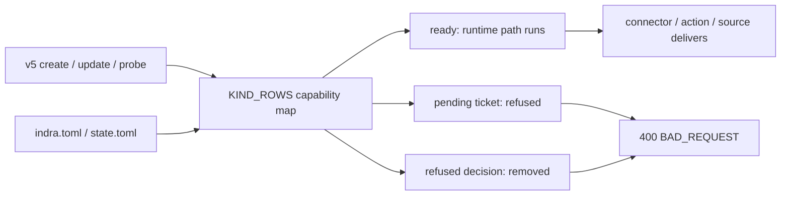

# Connector, action and source kinds

Generated from the KC-00 capability map (`broker_config::capability`).

| kind | aliases | family | owner | state | connector | action | source | probe | SQL INTO | feature |
| --- | --- | --- | --- | --- | --- | --- | --- | --- | --- | --- |
| alloydb |  | relational | MV-02a | ready | yes | yes | yes | yes | yes | - |
| aws_iot | aws_iot_core | cloud-iot | MV-03b | ready | yes | yes | yes | yes | yes | aws_iot |
| azure_blob | azure_blob_storage, azureblob, azblob | object-store | MV-02d | ready | yes | yes | yes | yes | yes | azure_blob |
| azure_eventhubs | azure_event_hubs, azure, eventhubs, azure_event_hub_producer | cloud-messaging | MV-03b | ready | yes | yes | yes | yes | yes | azure_eventhubs |
| azure_iot | azure_iot_hub, azure_iothub, iothub | cloud-iot | MV-03b | ready | yes | yes | yes | yes | yes | azure_iot |
| bigquery | bq, gbq | object-store | MV-02d | ready | yes | yes | yes | yes | yes | bigquery |
| cassandra | scylla, scylladb, cql | time-series | MV-02b | ready | yes | yes | yes | yes | yes | cassandra |
| clickhouse | ch | time-series | MV-02b | ready | yes | yes | yes | yes | yes | clickhouse |
| cockroachdb |  | relational | MV-02a | ready | yes | yes | yes | yes | yes | - |
| confluent | confluent_kafka, confluent_cloud, confluent_producer | message-broker | MV-03a | ready | yes | yes | yes | yes | yes | confluent |
| console | logger | local | KC-00/D9 | ready | yes | yes | yes | yes | yes | - |
| couchbase | couch, cb | document-store | MV-02c | ready | yes | yes | yes | yes | yes | couchbase |
| databricks | delta_lake | object-store | MV-02d | ready | yes | yes | yes | yes | yes | - |
| datalayers |  | time-series | MV-02b | ready | yes | yes | yes | yes | yes | - |
| disk_log |  | object-store | MV-02d | ready | yes | yes | yes | yes | yes | - |
| doris |  | time-series | MV-02b | ready | yes | yes | yes | yes | yes | - |
| dynamodb | dynamo, ddb | object-store | MV-02d | ready | yes | yes | yes | yes | yes | dynamodb |
| elasticsearch | elastic, es, opensearch | document-store | MV-02c | ready | yes | yes | yes | yes | yes | elasticsearch |
| gcp_iot | gcp_iot_core, cloud_iot | cloud-iot | MV-03b | ready | yes | yes | yes | yes | yes | gcp_iot |
| gcp_pubsub | gcp, pubsub, gcp_pubsub_consumer, gcp_pubsub_producer | cloud-messaging | MV-03b | ready | yes | yes | yes | yes | yes | gcp_pubsub |
| greptimedb |  | time-series | MV-02b | ready | yes | yes | yes | yes | yes | - |
| http | rest | http | MV-03c | ready | yes | yes | yes | yes | yes | - |
| influxdb |  | time-series | MV-02b | ready | yes | yes | yes | yes | yes | - |
| iotdb |  | time-series | MV-02b | ready | yes | yes | yes | yes | yes | - |
| kafka | kafka_producer, kafka_consumer | message-broker | MV-03a | ready | yes | yes | yes | yes | yes | kafka |
| kinesis | aws_kinesis | cloud-messaging | MV-03b | ready | yes | yes | yes | yes | yes | kinesis |
| mongodb | mongo, documentdb | document-store | MV-02c | ready | yes | yes | yes | yes | yes | mongodb |
| mqtt_bridge | mqtt, mqtt-bridge, bridge | message-broker | MV-03a | ready | yes | yes | yes | yes | yes | - |
| mssql | sqlserver | relational | MV-02a | ready | yes | yes | yes | yes | yes | - |
| mysql | mariadb | relational | MV-02a | ready | yes | yes | yes | yes | yes | - |
| oci_streaming | oci | cloud-messaging | MV-03b | ready | yes | yes | yes | yes | yes | - |
| opc_ua | opcua | device | MV-03c | ready | yes | yes | yes | yes | yes | - |
| opentsdb | opents | time-series | MV-02b | ready | yes | yes | yes | yes | yes | - |
| oracle |  | relational | MV-02a | ready | yes | yes | yes | yes | yes | - |
| pgsql | postgres, postgresql | relational | MV-01 | ready | yes | yes | yes | yes | yes | - |
| pulsar |  | message-broker | MV-03a | ready | yes | yes | yes | yes | yes | - |
| rabbitmq | rabbit, amqp | message-broker | MV-03a | ready | yes | yes | yes | yes | yes | rabbitmq |
| redis |  | message-broker | MV-03a | ready | yes | yes | yes | yes | yes | - |
| redshift |  | relational | MV-02a | ready | yes | yes | yes | yes | yes | - |
| rocketmq |  | message-broker | MV-03a | ready | yes | yes | yes | yes | yes | - |
| s3 | minio | object-store | MV-02d | ready | yes | yes | yes | yes | yes | s3 |
| snowflake | snowflake_streaming, snowflake_aggregated | object-store | MV-02d | ready | yes | yes | yes | yes | yes | - |
| sparkplug_b | sparkplug, spb | device | MV-03c | ready | yes | yes | yes | yes | yes | - |
| tablestore | ots | object-store | MV-02d | ready | yes | yes | yes | yes | yes | - |
| tdengine |  | time-series | MV-02b | ready | yes | yes | yes | yes | yes | - |
| test |  | local | MV-03c | test-only | yes | no | no | yes | yes | - |
| timescaledb | timescale | time-series | MV-02b | ready | yes | yes | yes | yes | yes | - |
| timestream | aws_timestream | time-series | MV-02b | ready | yes | yes | yes | yes | yes | - |
| webhook |  | http | MV-01 | ready | yes | yes | yes | yes | yes | - |
| azure_event_grid |  | cloud-messaging | D3 | refused D3 | no | yes | yes | yes | no | - |
| s3_tables | s3tables, iceberg | object-store | MV-04 | refused MV-04 | no | no | no | no | no | - |

## States

- `ready`: implemented with no invented target value and proved by tests. Only these kinds may deliver.
- `pending <ticket>`: refused until the named family ticket sets the kind `ready`.
- `refused <decision>`: not kept for compatibility; D3 closed services and the MV-04 S3 Tables removal.
- `test-only`: the local `test` helper, present only in a test build (decision D9).

## Behaviour of a kind that is not ready

Connector and action create, update and probe answer `400 BAD_REQUEST` with `connector type <kind> is not available in this broker`. Nothing is stored; a refused update keeps the old record. A strict config file load fails naming the file, key and kind. A stored record from an earlier version is kept and visible, reports `disconnected` with a `status_reason` and raises `connector_unavailable:<id>` / `action_unavailable:<id>`; a rule that uses it stays enabled and counts the forward as failed. The schema, action-type and source-type listings show only ready kinds.
