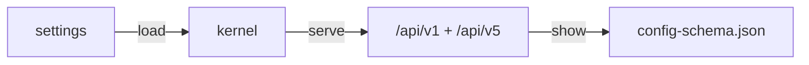

# Reference



- [Settings reference](./settings.md): each startup setting with its type, default and valid range. The file is generated. Do not edit it by hand.
- [Sources](./sources.md): the MQTT ingress source, its connector binding, status and lifecycle.
- Configuration layers: [Configuration](../operations/configuration.md).
- Native API (`/api/v1`): users, access rules, tenants, metrics and the console.
- Reference management API (`/api/v5`): the compatible surface for nodes, clients, rules and metrics. It follows the reference management API.
- [API deviations](./api-deviations.md): deliberate deviations for connector aliases permitted by CTO ruling.
- `schemas/config-schema.json`: the machine-readable schema.

## Check that it works

Start the broker with this file. The health endpoint returns `OK`.

```toml test
[node]
id = "docs-reference"

[listeners.tcp]
bind = "0.0.0.0:1883"

[listeners.api]
bind = "0.0.0.0:18083"

[logging]
level = "warn"
```

```sh test
python3 - <<'PY'
import os, socket
port = int(os.environ.get("API_PORT", "18083"))
sock = socket.create_connection(("127.0.0.1", port), timeout=5)
sock.sendall(b"GET /healthz HTTP/1.0\r\nHost: docs\r\n\r\n")
print(sock.makefile().read().strip().splitlines()[-1])
PY
```

```output
OK
```
