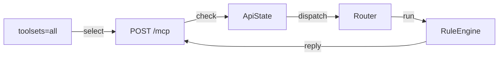

# MCP tools catalogue

This page lists each MCP tool. Use it when an agent must call the broker. You get one entry per tool with its toolset, its input schema and its example where available.



The full tool list comes from `tools/list` with `toolsets=all` and a full-access key. The list below holds each tool once. Schemas match the server output. Verified examples ran through `POST /mcp` `tools/call` with a full-access key. Entries without a live example need a path value or a body, or were not run in this task. See [MCP](../mcp.md) for auth, limits and toolsets.

The catalogue holds 370 tools: 368 routed tools plus `list_toolsets` and `subscribe_collect`.

### `list_toolsets`

- Toolset: `status`
- Route: `GET /api/v5/status`
- Description: List the MCP toolsets with their tool counts.

**inputSchema**
```json
{
  "type": "object",
  "properties": {},
  "required": [],
  "additionalProperties": false
}
```

**Verified `tools/call`**
```json
{
 "jsonrpc": "2.0",
 "method": "tools/call",
 "params": {
  "name": "list_toolsets",
  "arguments": {}
 },
 "id": 9
}
```

**Output**
```
{"toolsets":[{"name":"status","description":"Node status and version.","tool_count":3,"tools":["broker_status","get_api_v5_status","get_status"]},{"name":"clients","description":"Connected clients, bans and session counts.","tool_count":22,"tools":["get_api_v1_clients","get_api_v1_clients_by_id","delete_api_v5_banned","get_api_v5_banned","post_api_v5_banned","delete_api_v5_banned_by_as_by_who","get_api_v5_clients","delete_api_v5_clients_by_clientid","get_api_v5_clients_by_clientid","delete_api_v5_clients_by_clientid_authorization_cache","get_api_v5_clients_by_clientid_authorization_cache","get_api_v5_clients_by_clientid_inflight_messages","put_api_v5_clients_by_clientid_keepalive","get_api_v5_clients_by_clientid_mqueue_messages","post_api_v5_clients_by_clientid_subscribe","post_api_v5_clients_by_clientid_subscribe_bulk","get_api_v5_clients_by_clientid_subscriptions","post_api_v5_clients_by_clientid_unsubscribe","post_api_v5_clients_by_clientid_unsubscribe_bulk","post_api_v5_clients_kickout_bulk","get_api_v5_clients_v2","get_api_v5_sessions_count"]},{"name":"subscriptions","description":"Subscription listing.","tool_count":1,"tools":["get_api_v5_subscriptions"]},{"name":"topics","description":"Topic listing and retained topics.","tool_count":2,"tools":["get_api_v5_topics","get_api_v5_topics_by_topic"]},{"name":"publish","description":"Publish messages through the broker.","tool_count":3,"tools":["post_api_v5_publish","post_api_v5_publish_bulk","subscribe_collect"]},{"name":"metrics","description":"Metrics, alarms, traces and monitor history.","tool_count":37,"tools":["get_api_v1_metrics","delete_api_v5_alarms","get_api_v5_alarms","post_api_v5_alarms_force_deactivate","get_api_v5_metrics","delete_api_v5_monitor","get_api_v5_monitor","get_api_v5_monitor_nodes_by_node","get_api_v5_monitor_current","get_api_v5_monitor_current_nodes_by_node","get_api_v5_prometheus","put_api_v5_prometheus","get_api_v5_prometheus_auth","get_api_v5_prometheus_data_integration","get_api_v5_prometheus_message_transformation","get_api_v5_prometheus_namespaced_stats","get_api_v5_prometheus_schema_validation","get_api_v5_prometheus_stats","get_api_v5_prometheus_topic_metrics","delete_api_v5_slow_subscriptions","get_api_v5_slow_subscriptions","get_api_v5_slow_subscriptions_settings","put_api_v5_slow_subscriptions_settings","get_api_v5_stats","get_api_v5_telemetry_data","get_api_v5_telemetry_status","put_api_v5_telemetry_status","delete_api_v5_trace","get_api_v5_trace","post_api_v5_trace","delete_api_v5_trace_by_name","get_api_v5_trace_by_name_download","get_api_v5_trace_by_name_log","get_api_v5_trace_by_name_log_detail","put_api_v5_trace_by_name_stop","get_api_v5_tracing","put_api_v5_tracing"]},{"name":"rules","description":"Rules, actions, sources, schemas and transformations.","tool_count":73,"tools":["get_api_v1_connectors","post_api_v1_connectors","get_api_v1_rules","post_api_v1_rules","delete_api_v1_rules_by_id","get_api_v1_rules_by_id","get_api_v1_rules_functions","get_api_v1_rules_sources","post_api_v1_rules_test","get_api_v5_action_types","get_api_v5_actions","post_api_v5_actions","delete_api_v5_actions_by_id","get_api_v5_actions_by_id","put_api_v5_actions_by_id","post_api_v5_actions_by_id_by_operation","put_api_v5_actions_by_id_enable_by_enable","get_api_v5_actions_by_id_metrics","put_api_v5_actions_by_id_metrics_reset","post_api_v5_actions_probe","get_api_v5_actions_summary","get_api_v5_ai_completion_profiles","post_api_v5_ai_completion_profiles","delete_api_v5_ai_completion_profiles_by_name","get_api_v5_ai_completion_profiles_by_name","put_api_v5_ai_completion_profiles_by_name","post_api_v5_ai_models","get_api_v5_ai_providers","post_api_v5_ai_providers","delete_api_v5_ai_providers_by_name","get_api_v5_ai_providers_by_name","put_api_v5_ai_providers_by_name","get_api_v5_ai_providers_by_name_models","get_api_v5_message_transformations","post_api_v5_message_transformations","put_api_v5_message_transformations","post_api_v5_message_transformations_dryrun","post_api_v5_message_transformations_reorder","delete_api_v5_message_transformations_transformation_by_name","get_api_v5_message_transformations_transformation_by_name","post_api_v5_message_transformations_transformation_by_name_enable_by_enable","get_api_v5_message_transformations_transformation_by_name_metrics","post_api_v5_message_transformations_transformation_by_name_metrics_reset","get_api_v5_rule_engine","put_api_v5_rule_engine","get_api_v5_rule_events","post_api_v5_rule_test","get_api_v5_rules","post_api_v5_rules","delete_api_v5_rules_by_id","get_api_v5_rules_by_id","put_api_v5_rules_by_id","get_api_v5_rules_by_id_metrics","put_api_v5_rules_by_id_metrics_reset","post_api_v5_rules_by_id_test","get_api_v5_schema_registry","post_api_v5_schema_registry","delete_api_v5_schema_registry_by_name","get_api_v5_schema_registry_by_name","get_api_v5_schemas","get_api_v5_schemas_by_name","get_api_v5_source_types","get_api_v5_sources","post_api_v5_sources","delete_api_v5_sources_by_id","get_api_v5_sources_by_id","put_api_v5_sources_by_id","post_api_v5_sources_by_id_by_operation","put_api_v5_sources_by_id_enable_by_enable","get_api_v5_sources_by_id_metrics","put_api_v5_sources_by_id_metrics_reset","post_api_v5_sources_probe","get_api_v5_sources_summary"]},{"name":"connectors","description":"Connector instances and probes.","tool_count":8,"tools":["get_api_v5_connectors","post_api_v5_connectors","delete_api_v5_connectors_by_id","get_api_v5_connectors_by_id","put_api_v5_connectors_by_id","post_api_v5_connectors_by_id_by_operation","put_api_v5_connectors_by_id_enable_by_enable","post_api_v5_connectors_probe"]},{"name":"authentication","description":"Users, authenticators and single sign-on.","tool_count":38,"tools":["get_api_v1_auth_acls","post_api_v1_auth_acls","delete_api_v1_auth_acls_by_id","get_api_v1_auth_users","post_api_v1_auth_users","delete_api_v1_auth_users_by_username","get_api_v1_auth_verify_stats","get_api_v5_authentication","post_api_v5_authentication","delete_api_v5_authentication_by_id","get_api_v5_authentication_by_id","put_api_v5_authentication_by_id","post_api_v5_authentication_by_id_import_users","post_api_v5_authentication_by_id_metrics_reset","put_api_v5_authentication_by_id_position_by_position","get_api_v5_authentication_by_id_status","get_api_v5_authentication_by_id_users","post_api_v5_authentication_by_id_users","delete_api_v5_authentication_by_id_users_by_user_id","get_api_v5_authentication_by_id_users_by_user_id","put_api_v5_authentication_by_id_users_by_user_id","post_api_v5_authentication_node_cache_reset","get_api_v5_authentication_node_cache_status","put_api_v5_authentication_order","get_api_v5_authentication_settings","put_api_v5_authentication_settings","get_api_v5_current_user","get_api_v5_sso","delete_api_v5_sso_by_backend","get_api_v5_sso_by_backend","put_api_v5_sso_by_backend","get_api_v5_user_scopes","get_api_v5_users","post_api_v5_users","delete_api_v5_users_by_username","put_api_v5_users_by_username","post_api_v5_users_by_username_change_pwd","put_api_v5_users_by_username_change_pwd"]},{"name":"authorization","description":"Authorization sources, rules and caches.","tool_count":35,"tools":["delete_api_v5_authorization_cache","get_api_v5_authorization_node_cache","put_api_v5_authorization_node_cache","post_api_v5_authorization_node_cache_reset","get_api_v5_authorization_node_cache_status","get_api_v5_authorization_settings","put_api_v5_authorization_settings","get_api_v5_authorization_sources","post_api_v5_authorization_sources","delete_api_v5_authorization_sources_by_type","get_api_v5_authorization_sources_by_type","put_api_v5_authorization_sources_by_type","post_api_v5_authorization_sources_by_type_metrics_reset","post_api_v5_authorization_sources_by_type_move","get_api_v5_authorization_sources_by_type_rules","post_api_v5_authorization_sources_by_type_rules","delete_api_v5_authorization_sources_by_type_rules_by_index","get_api_v5_authorization_sources_by_type_status","delete_api_v5_authorization_sources_built_in_database_rules","get_api_v5_authorization_sources_built_in_database_rules","post_api_v5_authorization_sources_built_in_database_rules","delete_api_v5_authorization_sources_built_in_database_rules_all","get_api_v5_authorization_sources_built_in_database_rules_all","post_api_v5_authorization_sources_built_in_database_rules_all","get_api_v5_authorization_sources_built_in_database_rules_clients","post_api_v5_authorization_sources_built_in_database_rules_clients","delete_api_v5_authorization_sources_built_in_database_rules_clients_by_clientid","get_api_v5_authorization_sources_built_in_database_rules_clients_by_clientid","put_api_v5_authorization_sources_built_in_database_rules_clients_by_clientid","get_api_v5_authorization_sources_built_in_database_rules_users","post_api_v5_authorization_sources_built_in_database_rules_users","delete_api_v5_authorization_sources_built_in_database_rules_users_by_username","get_api_v5_authorization_sources_built_in_database_rules_users_by_username","put_api_v5_authorization_sources_built_in_database_rules_users_by_username","put_api_v5_authorization_sources_order"]},{"name":"tenants","description":"Managed tenant namespaces.","tool_count":16,"tools":["delete_api_v5_mt_bulk_delete_ns","post_api_v5_mt_bulk_export_ns_configs","post_api_v5_mt_bulk_import_configs","post_api_v5_mt_bulk_import_ns_configs","get_api_v5_mt_managed_ns_list","get_api_v5_mt_managed_ns_list_details","delete_api_v5_mt_ns_by_ns","post_api_v5_mt_ns_by_ns","get_api_v5_mt_ns_by_ns_client_count","get_api_v5_mt_ns_by_ns_client_list","get_api_v5_mt_ns_by_ns_config","put_api_v5_mt_ns_by_ns_config","post_api_v5_mt_ns_by_ns_kick_all_clients","get_api_v5_mt_ns_by_ns_metrics","get_api_v5_mt_ns_list","get_api_v5_mt_ns_list_details"]},{"name":"listeners","description":"Network listeners and their status.","tool_count":10,"tools":["get_api_v5_listeners","post_api_v5_listeners","delete_api_v5_listeners_by_id","get_api_v5_listeners_by_id","post_api_v5_listeners_by_id","put_api_v5_listeners_by_id","post_api_v5_listeners_by_id_restart","post_api_v5_listeners_by_id_start","post_api_v5_listeners_by_id_stop","get_api_v5_listeners_status"]},{"name":"configuration","description":"Broker configuration, certificates and data files.","tool_count":86,"tools":["post_api_v1_config_diff","get_api_v1_config_explain","get_api_v1_config_history","get_api_v1_config_history_by_id","post_api_v1_config_history_by_id_restore","post_api_v1_config_reload","post_api_v1_config_validate","get_api_v5_certs_global_list","delete_api_v5_certs_global_name_by_name","get_api_v5_certs_global_name_by_name","post_api_v5_certs_global_name_by_name","get_api_v5_certs_ns_by_namespace_list","delete_api_v5_certs_ns_by_namespace_name_by_name","get_api_v5_certs_ns_by_namespace_name_by_name","post_api_v5_certs_ns_by_namespace_name_by_name","get_api_v5_configs","put_api_v5_configs","get_api_v5_configs_alarm","put_api_v5_configs_alarm","get_api_v5_configs_broker","put_api_v5_configs_broker","get_api_v5_configs_dashboard","put_api_v5_configs_dashboard","get_api_v5_configs_global_zone","put_api_v5_configs_global_zone","get_api_v5_configs_log","put_api_v5_configs_log","get_api_v5_configs_sys_topics","put_api_v5_configs_sys_topics","get_api_v5_configs_sysmon","put_api_v5_configs_sysmon","post_api_v5_configs_reset_by_rootname","post_api_v5_data_export","get_api_v5_data_files","post_api_v5_data_files","delete_api_v5_data_files_by_filename","get_api_v5_data_files_by_filename","post_api_v5_data_import","get_api_v5_error_codes","get_api_v5_error_codes_by_code","get_api_v5_features","get_api_v5_mqtt_auto_subscribe","put_api_v5_mqtt_auto_subscribe","get_api_v5_mqtt_delayed","put_api_v5_mqtt_delayed","get_api_v5_mqtt_delayed_messages","delete_api_v5_mqtt_delayed_messages_by_node_by_msgid","get_api_v5_mqtt_delayed_messages_by_node_by_msgid","delete_api_v5_mqtt_delayed_messages_by_topic","get_api_v5_mqtt_retainer","put_api_v5_mqtt_retainer","delete_api_v5_mqtt_retainer_message_by_topic","get_api_v5_mqtt_retainer_message_by_topic","delete_api_v5_mqtt_retainer_messages","get_api_v5_mqtt_retainer_messages","delete_api_v5_mqtt_topic_metrics2","get_api_v5_mqtt_topic_metrics2","post_api_v5_mqtt_topic_metrics2","delete_api_v5_mqtt_topic_metrics2_by_name","get_api_v5_mqtt_topic_metrics2_by_name","put_api_v5_mqtt_topic_metrics2_by_name_reset","get_api_v5_mqtt_topic_rewrite","put_api_v5_mqtt_topic_rewrite","get_api_v5_opentelemetry","put_api_v5_opentelemetry","delete_api_v5_queue_by_name","get_api_v5_queue_by_name","put_api_v5_queue_by_name","get_api_v5_queues","post_api_v5_queues","get_api_v5_queues_config","put_api_v5_queues_config","get_api_v5_schema_validations","post_api_v5_schema_validations","put_api_v5_schema_validations","delete_api_v5_schema_validations_validation_by_name","get_api_v5_schema_validations_validation_by_name","delete_api_v5_stream_by_name","get_api_v5_stream_by_name","put_api_v5_stream_by_name","get_api_v5_streams","post_api_v5_streams","get_api_v5_streams_config","put_api_v5_streams_config","get_schemas","get_schemas_by_name"]},{"name":"cluster","description":"Cluster topology and nodes.","tool_count":22,"tools":["get_api_v1_nodes","get_api_v5_cluster","put_api_v5_cluster","get_api_v5_cluster_links","post_api_v5_cluster_links","get_api_v5_cluster_topology","post_api_v5_load_rebalance_by_node_evacuation_start","post_api_v5_load_rebalance_by_node_evacuation_stop","post_api_v5_load_rebalance_by_node_start","post_api_v5_load_rebalance_by_node_stop","get_api_v5_load_rebalance_availability_check","get_api_v5_load_rebalance_global_status","get_api_v5_load_rebalance_status","get_api_v5_node_eviction_status","get_api_v5_nodes","get_api_v5_nodes_by_node","post_api_v5_nodes_by_node_actions_by_id_by_operation","get_api_v5_nodes_by_node_clients_by_clientid","post_api_v5_nodes_by_node_connectors_by_id_by_operation","get_api_v5_nodes_by_node_metrics","post_api_v5_nodes_by_node_sources_by_id_by_operation","get_api_v5_nodes_by_node_stats"]},{"name":"gateways","description":"Protocol gateways.","tool_count":4,"tools":["get_api_v5_gateways","get_api_v5_gateways_by_name","put_api_v5_gateways_by_name","put_api_v5_gateways_by_name_enable_by_enable"]},{"name":"license","description":"Licence document and settings.","tool_count":5,"tools":["get_api_v5_license","post_api_v5_license","get_api_v5_license_session_hwm_history","get_api_v5_license_setting","put_api_v5_license_setting"]},{"name":"audit","description":"Management audit log.","tool_count":1,"tools":["get_api_v5_audit"]}]}
```

### `get_api_v5_status`

- Toolset: `status`
- Route: `GET /api/v5/status`
- Description: `GET /api/v5/status`: node status read. It needs no token, as the (GET /api/v5/status)

**inputSchema**
```json
{
  "type": "object",
  "properties": {
    "query": {
      "type": "object",
      "description": "Query keys of the operation. Omit keys the call does not need.",
      "additionalProperties": true
    }
  },
  "required": [],
  "additionalProperties": false
}
```

**Verified `tools/call`**
```json
{
 "jsonrpc": "2.0",
 "method": "tools/call",
 "params": {
  "name": "get_api_v5_status",
  "arguments": {
   "query": {
    "format": "json"
   }
  }
 },
 "id": 9
}
```

**Output**
```
{"rel_vsn":"v0.1.0","node_name":"indra-node-1@bfe554c525c5","broker_status":"started","app_status":"running"}
```

### `broker_status`

- Toolset: `status`
- Route: `GET /api/v5/status`
- Description: Read the version, uptime and node name of this node. (GET /api/v5/status)

**inputSchema**
```json
{
  "type": "object",
  "properties": {
    "query": {
      "type": "object",
      "description": "Query keys of the operation. Omit keys the call does not need.",
      "additionalProperties": true
    }
  },
  "required": [],
  "additionalProperties": false
}
```

**Verified `tools/call`**
```json
{
 "jsonrpc": "2.0",
 "method": "tools/call",
 "params": {
  "name": "broker_status",
  "arguments": {
   "query": {
    "format": "json"
   }
  }
 },
 "id": 9
}
```

**Output**
```
{"version":"0.1.0","uptime_ms":112883,"node":"indra-node-1@bfe554c525c5"}
```

### `get_status`

- Toolset: `status`
- Route: `GET /status`
- Description: `GET /api/v5/status`: node status read. It needs no token, as the (GET /status)

**inputSchema**
```json
{
  "type": "object",
  "properties": {
    "query": {
      "type": "object",
      "description": "Query keys of the operation. Omit keys the call does not need.",
      "additionalProperties": true
    }
  },
  "required": [],
  "additionalProperties": false
}
```

**Verified `tools/call`**
```json
{
 "jsonrpc": "2.0",
 "method": "tools/call",
 "params": {
  "name": "get_status",
  "arguments": {
   "query": {
    "format": "json"
   }
  }
 },
 "id": 9
}
```

**Output**
```
{"rel_vsn":"v0.1.0","node_name":"indra-node-1@bfe554c525c5","broker_status":"started","app_status":"running"}
```

### `get_api_v1_clients`

- Toolset: `clients`
- Route: `GET /api/v1/clients`
- Description: Sorted ids of currently connected clients. (GET /api/v1/clients)

**inputSchema**
```json
{
  "type": "object",
  "properties": {
    "query": {
      "type": "object",
      "description": "Query keys of the operation. Omit keys the call does not need.",
      "additionalProperties": true
    }
  },
  "required": [],
  "additionalProperties": false
}
```

**Verified `tools/call`**
```json
{
 "jsonrpc": "2.0",
 "method": "tools/call",
 "params": {
  "name": "get_api_v1_clients",
  "arguments": {}
 },
 "id": 9
}
```

**Output**
```
[]
```

### `get_api_v1_clients_by_id`

- Toolset: `clients`
- Route: `GET /api/v1/clients/:id`
- Description: Full detail row for one client session. (GET /api/v1/clients/:id)

**inputSchema**
```json
{
  "type": "object",
  "properties": {
    "id": {
      "type": "string",
      "description": "Value for the :id path segment."
    },
    "query": {
      "type": "object",
      "description": "Query keys of the operation. Omit keys the call does not need.",
      "additionalProperties": true
    }
  },
  "required": [
    "id"
  ],
  "additionalProperties": false
}
```

_No live example captured: this operation requires a path-segment value or a request body (see `inputSchema` above)._

### `delete_api_v5_banned`

- Toolset: `clients`
- Route: `DELETE /api/v5/banned`
- Description: `DELETE /banned`: drop every entry and report success with 204. (DELETE /api/v5/banned)

**inputSchema**
```json
{
  "type": "object",
  "properties": {
    "query": {
      "type": "object",
      "description": "Query keys of the operation. Omit keys the call does not need.",
      "additionalProperties": true
    }
  },
  "required": [],
  "additionalProperties": false
}
```

**Verified `tools/call`**
```json
{
 "jsonrpc": "2.0",
 "method": "tools/call",
 "params": {
  "name": "delete_api_v5_banned",
  "arguments": {}
 },
 "id": 9
}
```

**Output**
```

```

### `get_api_v5_banned`

- Toolset: `clients`
- Route: `GET /api/v5/banned`
- Description: `GET /banned`: wrapped page (`data` plus `meta`). An empty store reads (GET /api/v5/banned)

**inputSchema**
```json
{
  "type": "object",
  "properties": {
    "query": {
      "type": "object",
      "description": "Query keys of the operation. Omit keys the call does not need.",
      "additionalProperties": true
    }
  },
  "required": [],
  "additionalProperties": false
}
```

**Verified `tools/call`**
```json
{
 "jsonrpc": "2.0",
 "method": "tools/call",
 "params": {
  "name": "get_api_v5_banned",
  "arguments": {}
 },
 "id": 9
}
```

**Output**
```
{"data":[],"meta":{"page":1,"limit":100,"count":0,"hasnext":false}}
```

### `post_api_v5_banned`

- Toolset: `clients`
- Route: `POST /api/v5/banned`
- Description: `POST /banned`: create one entry from a who-value plus what-kind and (POST /api/v5/banned)

**inputSchema**
```json
{
  "type": "object",
  "properties": {
    "query": {
      "type": "object",
      "description": "Query keys of the operation. Omit keys the call does not need.",
      "additionalProperties": true
    },
    "body": {
      "description": "JSON body of the operation, exactly as the HTTP route takes it."
    },
    "body_base64": {
      "type": "string",
      "description": "Raw body bytes in base64 for file operations. Use either body or body_base64, never both."
    }
  },
  "required": [],
  "additionalProperties": false
}
```

_No live example captured: this operation requires a path-segment value or a request body (see `inputSchema` above)._

### `delete_api_v5_banned_by_as_by_who`

- Toolset: `clients`
- Route: `DELETE /api/v5/banned/:as/:who`
- Description: `DELETE /banned/{as}/{who}`: drop one entry addressed by its kind plus (DELETE /api/v5/banned/:as/:who)

**inputSchema**
```json
{
  "type": "object",
  "properties": {
    "as": {
      "type": "string",
      "description": "Value for the :as path segment."
    },
    "who": {
      "type": "string",
      "description": "Value for the :who path segment."
    },
    "query": {
      "type": "object",
      "description": "Query keys of the operation. Omit keys the call does not need.",
      "additionalProperties": true
    }
  },
  "required": [
    "as",
    "who"
  ],
  "additionalProperties": false
}
```

_No live example captured: this operation requires a path-segment value or a request body (see `inputSchema` above)._

### `get_api_v5_clients`

- Toolset: `clients`
- Route: `GET /api/v5/clients`
- Description: GET /api/v5/clients

**inputSchema**
```json
{
  "type": "object",
  "properties": {
    "query": {
      "type": "object",
      "description": "Query keys of the operation. Omit keys the call does not need.",
      "additionalProperties": true
    }
  },
  "required": [],
  "additionalProperties": false
}
```

**Verified `tools/call`**
```json
{
 "jsonrpc": "2.0",
 "method": "tools/call",
 "params": {
  "name": "get_api_v5_clients",
  "arguments": {}
 },
 "id": 9
}
```

**Output**
```
{"data":[],"meta":{"page":1,"limit":100,"count":0,"hasnext":false}}
```

### `delete_api_v5_clients_by_clientid`

- Toolset: `clients`
- Route: `DELETE /api/v5/clients/:clientid`
- Description: DELETE /api/v5/clients/:clientid

**inputSchema**
```json
{
  "type": "object",
  "properties": {
    "clientid": {
      "type": "string",
      "description": "Value for the :clientid path segment."
    },
    "query": {
      "type": "object",
      "description": "Query keys of the operation. Omit keys the call does not need.",
      "additionalProperties": true
    }
  },
  "required": [
    "clientid"
  ],
  "additionalProperties": false
}
```

_No live example captured: this operation requires a path-segment value or a request body (see `inputSchema` above)._

### `get_api_v5_clients_by_clientid`

- Toolset: `clients`
- Route: `GET /api/v5/clients/:clientid`
- Description: GET /api/v5/clients/:clientid

**inputSchema**
```json
{
  "type": "object",
  "properties": {
    "clientid": {
      "type": "string",
      "description": "Value for the :clientid path segment."
    },
    "query": {
      "type": "object",
      "description": "Query keys of the operation. Omit keys the call does not need.",
      "additionalProperties": true
    }
  },
  "required": [
    "clientid"
  ],
  "additionalProperties": false
}
```

_No live example captured: this operation requires a path-segment value or a request body (see `inputSchema` above)._

### `delete_api_v5_clients_by_clientid_authorization_cache`

- Toolset: `clients`
- Route: `DELETE /api/v5/clients/:clientid/authorization/cache`
- Description: Per-client authorization decision cache clear. (DELETE /api/v5/clients/:clientid/authorization/cache)

**inputSchema**
```json
{
  "type": "object",
  "properties": {
    "clientid": {
      "type": "string",
      "description": "Value for the :clientid path segment."
    },
    "query": {
      "type": "object",
      "description": "Query keys of the operation. Omit keys the call does not need.",
      "additionalProperties": true
    }
  },
  "required": [
    "clientid"
  ],
  "additionalProperties": false
}
```

_No live example captured: this operation requires a path-segment value or a request body (see `inputSchema` above)._

### `get_api_v5_clients_by_clientid_authorization_cache`

- Toolset: `clients`
- Route: `GET /api/v5/clients/:clientid/authorization/cache`
- Description: Per-client authorization decision cache read. (GET /api/v5/clients/:clientid/authorization/cache)

**inputSchema**
```json
{
  "type": "object",
  "properties": {
    "clientid": {
      "type": "string",
      "description": "Value for the :clientid path segment."
    },
    "query": {
      "type": "object",
      "description": "Query keys of the operation. Omit keys the call does not need.",
      "additionalProperties": true
    }
  },
  "required": [
    "clientid"
  ],
  "additionalProperties": false
}
```

_No live example captured: this operation requires a path-segment value or a request body (see `inputSchema` above)._

### `get_api_v5_clients_by_clientid_inflight_messages`

- Toolset: `clients`
- Route: `GET /api/v5/clients/:clientid/inflight_messages`
- Description: GET /api/v5/clients/:clientid/inflight_messages

**inputSchema**
```json
{
  "type": "object",
  "properties": {
    "clientid": {
      "type": "string",
      "description": "Value for the :clientid path segment."
    },
    "query": {
      "type": "object",
      "description": "Query keys of the operation. Omit keys the call does not need.",
      "additionalProperties": true
    }
  },
  "required": [
    "clientid"
  ],
  "additionalProperties": false
}
```

_No live example captured: this operation requires a path-segment value or a request body (see `inputSchema` above)._

### `put_api_v5_clients_by_clientid_keepalive`

- Toolset: `clients`
- Route: `PUT /api/v5/clients/:clientid/keepalive`
- Description: Update the keepalive of one connected client. (PUT /api/v5/clients/:clientid/keepalive)

**inputSchema**
```json
{
  "type": "object",
  "properties": {
    "clientid": {
      "type": "string",
      "description": "Value for the :clientid path segment."
    },
    "query": {
      "type": "object",
      "description": "Query keys of the operation. Omit keys the call does not need.",
      "additionalProperties": true
    },
    "body": {
      "description": "JSON body of the operation, exactly as the HTTP route takes it."
    },
    "body_base64": {
      "type": "string",
      "description": "Raw body bytes in base64 for file operations. Use either body or body_base64, never both."
    }
  },
  "required": [
    "clientid"
  ],
  "additionalProperties": false
}
```

_No live example captured: this operation requires a path-segment value or a request body (see `inputSchema` above)._

### `get_api_v5_clients_by_clientid_mqueue_messages`

- Toolset: `clients`
- Route: `GET /api/v5/clients/:clientid/mqueue_messages`
- Description: GET /api/v5/clients/:clientid/mqueue_messages

**inputSchema**
```json
{
  "type": "object",
  "properties": {
    "clientid": {
      "type": "string",
      "description": "Value for the :clientid path segment."
    },
    "query": {
      "type": "object",
      "description": "Query keys of the operation. Omit keys the call does not need.",
      "additionalProperties": true
    }
  },
  "required": [
    "clientid"
  ],
  "additionalProperties": false
}
```

_No live example captured: this operation requires a path-segment value or a request body (see `inputSchema` above)._

### `post_api_v5_clients_by_clientid_subscribe`

- Toolset: `clients`
- Route: `POST /api/v5/clients/:clientid/subscribe`
- Description: POST /api/v5/clients/:clientid/subscribe

**inputSchema**
```json
{
  "type": "object",
  "properties": {
    "clientid": {
      "type": "string",
      "description": "Value for the :clientid path segment."
    },
    "query": {
      "type": "object",
      "description": "Query keys of the operation. Omit keys the call does not need.",
      "additionalProperties": true
    },
    "body": {
      "description": "JSON body of the operation, exactly as the HTTP route takes it."
    },
    "body_base64": {
      "type": "string",
      "description": "Raw body bytes in base64 for file operations. Use either body or body_base64, never both."
    }
  },
  "required": [
    "clientid"
  ],
  "additionalProperties": false
}
```

_No live example captured: this operation requires a path-segment value or a request body (see `inputSchema` above)._

### `post_api_v5_clients_by_clientid_subscribe_bulk`

- Toolset: `clients`
- Route: `POST /api/v5/clients/:clientid/subscribe/bulk`
- Description: POST /api/v5/clients/:clientid/subscribe/bulk

**inputSchema**
```json
{
  "type": "object",
  "properties": {
    "clientid": {
      "type": "string",
      "description": "Value for the :clientid path segment."
    },
    "query": {
      "type": "object",
      "description": "Query keys of the operation. Omit keys the call does not need.",
      "additionalProperties": true
    },
    "body": {
      "description": "JSON body of the operation, exactly as the HTTP route takes it."
    },
    "body_base64": {
      "type": "string",
      "description": "Raw body bytes in base64 for file operations. Use either body or body_base64, never both."
    }
  },
  "required": [
    "clientid"
  ],
  "additionalProperties": false
}
```

_No live example captured: this operation requires a path-segment value or a request body (see `inputSchema` above)._

### `get_api_v5_clients_by_clientid_subscriptions`

- Toolset: `clients`
- Route: `GET /api/v5/clients/:clientid/subscriptions`
- Description: GET /api/v5/clients/:clientid/subscriptions

**inputSchema**
```json
{
  "type": "object",
  "properties": {
    "clientid": {
      "type": "string",
      "description": "Value for the :clientid path segment."
    },
    "query": {
      "type": "object",
      "description": "Query keys of the operation. Omit keys the call does not need.",
      "additionalProperties": true
    }
  },
  "required": [
    "clientid"
  ],
  "additionalProperties": false
}
```

_No live example captured: this operation requires a path-segment value or a request body (see `inputSchema` above)._

### `post_api_v5_clients_by_clientid_unsubscribe`

- Toolset: `clients`
- Route: `POST /api/v5/clients/:clientid/unsubscribe`
- Description: POST /api/v5/clients/:clientid/unsubscribe

**inputSchema**
```json
{
  "type": "object",
  "properties": {
    "clientid": {
      "type": "string",
      "description": "Value for the :clientid path segment."
    },
    "query": {
      "type": "object",
      "description": "Query keys of the operation. Omit keys the call does not need.",
      "additionalProperties": true
    },
    "body": {
      "description": "JSON body of the operation, exactly as the HTTP route takes it."
    },
    "body_base64": {
      "type": "string",
      "description": "Raw body bytes in base64 for file operations. Use either body or body_base64, never both."
    }
  },
  "required": [
    "clientid"
  ],
  "additionalProperties": false
}
```

_No live example captured: this operation requires a path-segment value or a request body (see `inputSchema` above)._

### `post_api_v5_clients_by_clientid_unsubscribe_bulk`

- Toolset: `clients`
- Route: `POST /api/v5/clients/:clientid/unsubscribe/bulk`
- Description: POST /api/v5/clients/:clientid/unsubscribe/bulk

**inputSchema**
```json
{
  "type": "object",
  "properties": {
    "clientid": {
      "type": "string",
      "description": "Value for the :clientid path segment."
    },
    "query": {
      "type": "object",
      "description": "Query keys of the operation. Omit keys the call does not need.",
      "additionalProperties": true
    },
    "body": {
      "description": "JSON body of the operation, exactly as the HTTP route takes it."
    },
    "body_base64": {
      "type": "string",
      "description": "Raw body bytes in base64 for file operations. Use either body or body_base64, never both."
    }
  },
  "required": [
    "clientid"
  ],
  "additionalProperties": false
}
```

_No live example captured: this operation requires a path-segment value or a request body (see `inputSchema` above)._

### `post_api_v5_clients_kickout_bulk`

- Toolset: `clients`
- Route: `POST /api/v5/clients/kickout/bulk`
- Description: `POST /clients/kickout/bulk`: disconnect many clients. The reference (POST /api/v5/clients/kickout/bulk)

**inputSchema**
```json
{
  "type": "object",
  "properties": {
    "query": {
      "type": "object",
      "description": "Query keys of the operation. Omit keys the call does not need.",
      "additionalProperties": true
    },
    "body": {
      "description": "JSON body of the operation, exactly as the HTTP route takes it."
    },
    "body_base64": {
      "type": "string",
      "description": "Raw body bytes in base64 for file operations. Use either body or body_base64, never both."
    }
  },
  "required": [],
  "additionalProperties": false
}
```

_No live example captured: this operation requires a path-segment value or a request body (see `inputSchema` above)._

### `get_api_v5_clients_v2`

- Toolset: `clients`
- Route: `GET /api/v5/clients_v2`
- Description: GET /api/v5/clients_v2

**inputSchema**
```json
{
  "type": "object",
  "properties": {
    "query": {
      "type": "object",
      "description": "Query keys of the operation. Omit keys the call does not need.",
      "additionalProperties": true
    }
  },
  "required": [],
  "additionalProperties": false
}
```

**Verified `tools/call`**
```json
{
 "jsonrpc": "2.0",
 "method": "tools/call",
 "params": {
  "name": "get_api_v5_clients_v2",
  "arguments": {}
 },
 "id": 9
}
```

**Output**
```
{"data":[],"meta":{"page":1,"limit":100,"count":0,"hasnext":false}}
```

### `get_api_v5_sessions_count`

- Toolset: `clients`
- Route: `GET /api/v5/sessions_count`
- Description: `GET /sessions_count`: the number of sessions that have not expired. (GET /api/v5/sessions_count)

**inputSchema**
```json
{
  "type": "object",
  "properties": {
    "query": {
      "type": "object",
      "description": "Query keys of the operation. Omit keys the call does not need.",
      "additionalProperties": true
    }
  },
  "required": [],
  "additionalProperties": false
}
```

**Verified `tools/call`**
```json
{
 "jsonrpc": "2.0",
 "method": "tools/call",
 "params": {
  "name": "get_api_v5_sessions_count",
  "arguments": {}
 },
 "id": 9
}
```

**Output**
```
"0"
```

### `get_api_v5_subscriptions`

- Toolset: `subscriptions`
- Route: `GET /api/v5/subscriptions`
- Description: GET /api/v5/subscriptions

**inputSchema**
```json
{
  "type": "object",
  "properties": {
    "query": {
      "type": "object",
      "description": "Query keys of the operation. Omit keys the call does not need.",
      "additionalProperties": true
    }
  },
  "required": [],
  "additionalProperties": false
}
```

**Verified `tools/call`**
```json
{
 "jsonrpc": "2.0",
 "method": "tools/call",
 "params": {
  "name": "get_api_v5_subscriptions",
  "arguments": {}
 },
 "id": 9
}
```

**Output**
```
[]
```

### `get_api_v5_topics`

- Toolset: `topics`
- Route: `GET /api/v5/topics`
- Description: Topic list as a paged collection (W1-15). (GET /api/v5/topics)

**inputSchema**
```json
{
  "type": "object",
  "properties": {
    "query": {
      "type": "object",
      "description": "Query keys of the operation. Omit keys the call does not need.",
      "additionalProperties": true
    }
  },
  "required": [],
  "additionalProperties": false
}
```

**Verified `tools/call`**
```json
{
 "jsonrpc": "2.0",
 "method": "tools/call",
 "params": {
  "name": "get_api_v5_topics",
  "arguments": {}
 },
 "id": 9
}
```

**Output**
```
{"data":[],"meta":{"page":1,"limit":100,"count":0,"hasnext":false}}
```

### `get_api_v5_topics_by_topic`

- Toolset: `topics`
- Route: `GET /api/v5/topics/:topic`
- Description: Topic detail for one exact topic name (W1-15). (GET /api/v5/topics/:topic)

**inputSchema**
```json
{
  "type": "object",
  "properties": {
    "topic": {
      "type": "string",
      "description": "Value for the :topic path segment."
    },
    "query": {
      "type": "object",
      "description": "Query keys of the operation. Omit keys the call does not need.",
      "additionalProperties": true
    }
  },
  "required": [
    "topic"
  ],
  "additionalProperties": false
}
```

_No live example captured: this operation requires a path-segment value or a request body (see `inputSchema` above)._

### `post_api_v5_publish`

- Toolset: `publish`
- Route: `POST /api/v5/publish`
- Description: POST /api/v5/publish

**inputSchema**
```json
{
  "type": "object",
  "properties": {
    "query": {
      "type": "object",
      "description": "Query keys of the operation. Omit keys the call does not need.",
      "additionalProperties": true
    },
    "body": {
      "description": "JSON body of the operation, exactly as the HTTP route takes it."
    },
    "body_base64": {
      "type": "string",
      "description": "Raw body bytes in base64 for file operations. Use either body or body_base64, never both."
    }
  },
  "required": [],
  "additionalProperties": false
}
```

_No live example captured: this operation requires a path-segment value or a request body (see `inputSchema` above)._

### `post_api_v5_publish_bulk`

- Toolset: `publish`
- Route: `POST /api/v5/publish/bulk`
- Description: Bulk management publish through the single-entry injection routine. (POST /api/v5/publish/bulk)

**inputSchema**
```json
{
  "type": "object",
  "properties": {
    "query": {
      "type": "object",
      "description": "Query keys of the operation. Omit keys the call does not need.",
      "additionalProperties": true
    },
    "body": {
      "description": "JSON body of the operation, exactly as the HTTP route takes it."
    },
    "body_base64": {
      "type": "string",
      "description": "Raw body bytes in base64 for file operations. Use either body or body_base64, never both."
    }
  },
  "required": [],
  "additionalProperties": false
}
```

_No live example captured: this operation requires a path-segment value or a request body (see `inputSchema` above)._

### `get_api_v1_metrics`

- Toolset: `metrics`
- Route: `GET /api/v1/metrics`
- Description: Prometheus text exposition of node counters and gauges. (GET /api/v1/metrics)

**inputSchema**
```json
{
  "type": "object",
  "properties": {
    "query": {
      "type": "object",
      "description": "Query keys of the operation. Omit keys the call does not need.",
      "additionalProperties": true
    }
  },
  "required": [],
  "additionalProperties": false
}
```

**Verified `tools/call`**
```json
{
 "jsonrpc": "2.0",
 "method": "tools/call",
 "params": {
  "name": "get_api_v1_metrics",
  "arguments": {}
 },
 "id": 9
}
```

**Output**
```
# HELP indramqtt_messages_received_total Total MQTT ingress messages accepted over BrokerLink.
# TYPE indramqtt_messages_received_total counter
indramqtt_messages_received_total 1
# HELP indramqtt_messages_forwarded_total Total PublishOut frames admitted into the shard transport mailbox (transport enqueue, not edge arrival; compare with transport_sent).
# TYPE indramqtt_messages_forwarded_total counter
indramqtt_messages_forwarded_total 0
# HELP indramqtt_messages_dropped_total Total ingress messages dropped by quota/rate policing.
# TYPE indramqtt_messages_dropped_total counter
indramqtt_messages_dropped_total 0
# HELP indramqtt_rules_executed_total Total ingress rules whose filter matched.
# TYPE indramqtt_rules_executed_total counter
indramqtt_rules_executed_total 0
# HELP indramqtt_connections_active Currently bound edge connections.
# TYPE indramqtt_connections_active gauge
indramqtt_connections_active 0
# HELP indramqtt_unknown_conn_dropped_total Frames routed to a conn_id with no registered mailbox.
# TYPE indramqtt_unknown_conn_dropped_total counter
indramqtt_unknown_conn_dropped_total 0
# HELP indramqtt_dead_mailbox_dropped_total Frames sent into a dead mailbox whose receiver is gone.
# TYPE indramqtt_dead_mailbox_dropped_total counter
indramqtt_dead_mailbox_dropped_total 0
# HELP indramqtt_detached_clean_dropped_total Frames dropped for detached clean sessions.
# TYPE indramqtt_detached_clean_dropped_total counter
indramqtt_detached_clean_dropped_total 0
# HELP indramqtt_offline_queue_evicted_total Offline-queue entries evicted for detached durable sessions.
# TYPE indramqtt_offline_queue_evicted_total counter
indramqtt_offline_queue_evicted_total 0
# HELP indramqtt_inflight_dropped_total QoS 1 downlinks delivered live but untracked for redelivery (per-session inflight window full).
# TYPE indramqtt_inflight_dropped_total counter
indramqtt_inflight_dropped_total 0
# HELP indramqtt_inflight_spilled_total QoS 1 downlinks spilled past the window into the bounded overflow buffer (still tracked for DUP redelivery).
# TYPE indramqtt_inflight_spilled_total counter
indramqtt_inflight_spilled_total 0
# HELP indramqtt_inflight_spill_replayed_total Spilled QoS 1 entries redelivered with DUP set on reconnect replay.
# TYPE indramqtt_inflight_spill_replayed_total counter
indramqtt_inflight_spill_replayed_total 0
# HELP indramqtt_inflight_spill_evicted_total Live QoS 1 deliveries past both window and spill bounds, left untracked.
# TYPE indramqtt_inflight_spill_evicted_total counter
indramqtt_inflight_spill_evicted_total 0
# HELP indramqtt_rule_spill_spilled_total Rule-ingress events appended to the on-disk spill buffer instead of erroring.
# TYPE indramqtt_rule_spill_spilled_total counter
indramqtt_rule_spill_spilled_total 0
# HELP indramqtt_rule_spill_replayed_total Spilled rule-ingress events replayed to the consumer in order.
# TYPE indramqtt_rule_spill_replayed_total counter
indramqtt_rule_spill_replayed_total 0
# HELP indramqtt_rule_spill_dropped_total Rule-ingress overflow events refused (no spill directory, oversize event, disk cap, I/O error).
# TYPE indramqtt_rule_spill_dropped_total counter
indramqtt_rule_spill_dropped_total 0
# HELP indramqtt_rule_spill_torn_total Torn spill tails truncated (plus later segments discarded) on recovery or replay.
# TYPE indramqtt_rule_spill_torn_total counter
indramqtt_rule_spill_torn_total 0
# HELP indramqtt_rule_spill_recovered_total Rule-ingress events found on disk when a spill directory opened.
# TYPE indramqtt_rule_spill_recovered_total counter
indramqtt_rule_spill_recovered_total 0
# HELP indramqtt_tenant_mismatch_dropped_total Fan-out matches excluded by tenant scope.
# TYPE indramqtt_tenant_mismatch_dropped_total counter
indramqtt_tenant_mismatch_dropped_total 0
# HELP indramqtt_transport_sent_total Frames actually written toward the edge by successful transport batch writes.
# TYPE indramqtt_transport_sent_total counter
indramqtt_transport_sent_total 0
# HELP indramqtt_transport_send_failed_total Failed transport batch writes toward the edge.
# TYPE indramqtt_transport_send_failed_total counter
indramqtt_transport_send_failed_total 0
# HELP indramqtt_egress_qos0_shed_total QoS 0 frames shed at route time by the per-connection egress bound.
# TYPE indramqtt_egress_qos0_shed_total counter
indramqtt_egress_qos0_shed_total 0
# HELP indramqtt_puback_deferred_total QoS 1 publishes whose PUBACK is deferred for credit.
# TYPE indramqtt_puback_deferred_total counter
indramqtt_puback_deferred_total 0
# HELP indramqtt_puback_deferred_released_total Deferred PUBACKs released after credit arrived.
# TYPE indramqtt_puback_deferred_released_total counter
indramqtt_puback_deferred_released_total 0

```

### `delete_api_v5_alarms`

- Toolset: `metrics`
- Route: `DELETE /api/v5/alarms`
- Description: `DELETE /alarms`: deactivate every alarm (active entries move to the (DELETE /api/v5/alarms)

**inputSchema**
```json
{
  "type": "object",
  "properties": {
    "query": {
      "type": "object",
      "description": "Query keys of the operation. Omit keys the call does not need.",
      "additionalProperties": true
    }
  },
  "required": [],
  "additionalProperties": false
}
```

**Verified `tools/call`**
```json
{
 "jsonrpc": "2.0",
 "method": "tools/call",
 "params": {
  "name": "delete_api_v5_alarms",
  "arguments": {}
 },
 "id": 9
}
```

**Output**
```

```

### `get_api_v5_alarms`

- Toolset: `metrics`
- Route: `GET /api/v5/alarms`
- Description: `GET /alarms`: wrapped page (`data` plus `meta`). An empty store reads (GET /api/v5/alarms)

**inputSchema**
```json
{
  "type": "object",
  "properties": {
    "query": {
      "type": "object",
      "description": "Query keys of the operation. Omit keys the call does not need.",
      "additionalProperties": true
    }
  },
  "required": [],
  "additionalProperties": false
}
```

**Verified `tools/call`**
```json
{
 "jsonrpc": "2.0",
 "method": "tools/call",
 "params": {
  "name": "get_api_v5_alarms",
  "arguments": {}
 },
 "id": 9
}
```

**Output**
```
{"data":[],"meta":{"page":1,"limit":100,"count":0,"hasnext":false}}
```

### `post_api_v5_alarms_force_deactivate`

- Toolset: `metrics`
- Route: `POST /api/v5/alarms/force_deactivate`
- Description: `POST /alarms/force_deactivate`: deactivate one named active alarm. (POST /api/v5/alarms/force_deactivate)

**inputSchema**
```json
{
  "type": "object",
  "properties": {
    "query": {
      "type": "object",
      "description": "Query keys of the operation. Omit keys the call does not need.",
      "additionalProperties": true
    },
    "body": {
      "description": "JSON body of the operation, exactly as the HTTP route takes it."
    },
    "body_base64": {
      "type": "string",
      "description": "Raw body bytes in base64 for file operations. Use either body or body_base64, never both."
    }
  },
  "required": [],
  "additionalProperties": false
}
```

_No live example captured: this operation requires a path-segment value or a request body (see `inputSchema` above)._

### `get_api_v5_metrics`

- Toolset: `metrics`
- Route: `GET /api/v5/metrics`
- Description: Documented `GET /metrics` snapshot: a flat object of named counters. (GET /api/v5/metrics)

**inputSchema**
```json
{
  "type": "object",
  "properties": {
    "query": {
      "type": "object",
      "description": "Query keys of the operation. Omit keys the call does not need.",
      "additionalProperties": true
    }
  },
  "required": [],
  "additionalProperties": false
}
```

**Verified `tools/call`**
```json
{
 "jsonrpc": "2.0",
 "method": "tools/call",
 "params": {
  "name": "get_api_v5_metrics",
  "arguments": {}
 },
 "id": 9
}
```

**Output**
```
{"bytes.received":0,"bytes.sent":0,"packets.received":1,"packets.sent":0,"packets.connect.received":0,"packets.connack.sent":0,"packets.connack.error":0,"packets.connack.auth_error":0,"packets.publish.received":1,"packets.publish.sent":0,"packets.subscribe.received":0,"packets.suback.sent":0,"packets.pingreq.received":0,"packets.pingresp.sent":0,"messages.received":1,"messages.sent":0,"messages.dropped":0,"messages.delivered":0,"messages.delayed":0,"messages.qos0.received":1,"messages.qos1.received":0,"messages.qos2.received":0,"delivery.dropped":0,"delivery.dropped.no_subscribers":0,"delivery.dropped.qos0_msg":0,"delivery.dropped.queue_full":0,"client.connect":0,"client.connack":0,"client.connected":0,"client.subscribe":0,"rules.matched":0,"actions.executed":0,"messages.transformation_succeeded":0,"messages.transformation_failed":0}
```

### `delete_api_v5_monitor`

- Toolset: `metrics`
- Route: `DELETE /api/v5/monitor`
- Description: `DELETE /monitor`: drop every history point and report success with (DELETE /api/v5/monitor)

**inputSchema**
```json
{
  "type": "object",
  "properties": {
    "query": {
      "type": "object",
      "description": "Query keys of the operation. Omit keys the call does not need.",
      "additionalProperties": true
    }
  },
  "required": [],
  "additionalProperties": false
}
```

**Verified `tools/call`**
```json
{
 "jsonrpc": "2.0",
 "method": "tools/call",
 "params": {
  "name": "delete_api_v5_monitor",
  "arguments": {}
 },
 "id": 9
}
```

**Output**
```

```

### `get_api_v5_monitor`

- Toolset: `metrics`
- Route: `GET /api/v5/monitor`
- Description: `GET /monitor`: ordered history array (oldest first). An empty store (GET /api/v5/monitor)

**inputSchema**
```json
{
  "type": "object",
  "properties": {
    "query": {
      "type": "object",
      "description": "Query keys of the operation. Omit keys the call does not need.",
      "additionalProperties": true
    }
  },
  "required": [],
  "additionalProperties": false
}
```

**Verified `tools/call`**
```json
{
 "jsonrpc": "2.0",
 "method": "tools/call",
 "params": {
  "name": "get_api_v5_monitor",
  "arguments": {}
 },
 "id": 9
}
```

**Output**
```
[{"time_stamp":1794834153,"connections":0,"live_connections":0,"topics":0,"subscriptions":0,"received":0,"sent":0,"dropped":0,"rules_matched":0,"tenant":"default"},{"time_stamp":1794834163,"connections":0,"live_connections":0,"topics":0,"subscriptions":0,"received":0,"sent":0,"dropped":0,"rules_matched":0,"tenant":"default"},{"time_stamp":1794834173,"connections":0,"live_connections":0,"topics":0,"subscriptions":0,"received":1,"sent":0,"dropped":0,"rules_matched":0,"tenant":"default"},{"time_stamp":1794834183,"connections":0,"live_connections":0,"topics":0,"subscriptions":0,"received":1,"sent":0,"dropped":0,"rules_matched":0,"tenant":"default"},{"time_stamp":1794834193,"connections":0,"live_connections":0,"topics":0,"subscriptions":0,"received":1,"sent":0,"dropped":0,"rules_matched":0,"tenant":"default"}]
```

### `get_api_v5_monitor_nodes_by_node`

- Toolset: `metrics`
- Route: `GET /api/v5/monitor/nodes/:node`
- Description: `GET /monitor/nodes/{node}`: node-scoped read over the same bounded (GET /api/v5/monitor/nodes/:node)

**inputSchema**
```json
{
  "type": "object",
  "properties": {
    "node": {
      "type": "string",
      "description": "Value for the :node path segment."
    },
    "query": {
      "type": "object",
      "description": "Query keys of the operation. Omit keys the call does not need.",
      "additionalProperties": true
    }
  },
  "required": [
    "node"
  ],
  "additionalProperties": false
}
```

_No live example captured: this operation requires a path-segment value or a request body (see `inputSchema` above)._

### `get_api_v5_monitor_current`

- Toolset: `metrics`
- Route: `GET /api/v5/monitor_current`
- Description: Documented `GET /monitor_current` snapshot: one object with the (GET /api/v5/monitor_current)

**inputSchema**
```json
{
  "type": "object",
  "properties": {
    "query": {
      "type": "object",
      "description": "Query keys of the operation. Omit keys the call does not need.",
      "additionalProperties": true
    }
  },
  "required": [],
  "additionalProperties": false
}
```

**Verified `tools/call`**
```json
{
 "jsonrpc": "2.0",
 "method": "tools/call",
 "params": {
  "name": "get_api_v5_monitor_current",
  "arguments": {}
 },
 "id": 9
}
```

**Output**
```
{"connections":0,"live_connections":0,"topics":0,"subscriptions":0,"cluster_sessions":0,"retained_msg_count":0,"received_msg_rate":0,"sent_msg_rate":0,"dropped_msg_rate":0,"rules_matched_rate":0}
```

### `get_api_v5_monitor_current_nodes_by_node`

- Toolset: `metrics`
- Route: `GET /api/v5/monitor_current/nodes/:node`
- Description: `GET /monitor_current/nodes/{node}`: node-scoped read of the same (GET /api/v5/monitor_current/nodes/:node)

**inputSchema**
```json
{
  "type": "object",
  "properties": {
    "node": {
      "type": "string",
      "description": "Value for the :node path segment."
    },
    "query": {
      "type": "object",
      "description": "Query keys of the operation. Omit keys the call does not need.",
      "additionalProperties": true
    }
  },
  "required": [
    "node"
  ],
  "additionalProperties": false
}
```

_No live example captured: this operation requires a path-segment value or a request body (see `inputSchema` above)._

### `get_api_v5_prometheus`

- Toolset: `metrics`
- Route: `GET /api/v5/prometheus`
- Description: `GET /prometheus`: the stored exporter settings in the documented (GET /api/v5/prometheus)

**inputSchema**
```json
{
  "type": "object",
  "properties": {
    "query": {
      "type": "object",
      "description": "Query keys of the operation. Omit keys the call does not need.",
      "additionalProperties": true
    }
  },
  "required": [],
  "additionalProperties": false
}
```

**Verified `tools/call`**
```json
{
 "jsonrpc": "2.0",
 "method": "tools/call",
 "params": {
  "name": "get_api_v5_prometheus",
  "arguments": {}
 },
 "id": 9
}
```

**Output**
```
{"collectors":{"mnesia":"disabled","vm_dist":"disabled","vm_memory":"disabled","vm_msacc":"disabled","vm_statistics":"disabled","vm_system_info":"disabled"},"enable_basic_auth":true,"latency_buckets":"10ms, 100ms, 1s, 5s, 30s","push_gateway":{"enable":false,"headers":{},"interval":"15s","job_name":"${name}/instance/${name}~${host}","method":"put","url":"http://127.0.0.1:9091"}}
```

### `put_api_v5_prometheus`

- Toolset: `metrics`
- Route: `PUT /api/v5/prometheus`
- Description: `PUT /prometheus`: validated settings replace, answered in the (PUT /api/v5/prometheus)

**inputSchema**
```json
{
  "type": "object",
  "properties": {
    "query": {
      "type": "object",
      "description": "Query keys of the operation. Omit keys the call does not need.",
      "additionalProperties": true
    },
    "body": {
      "description": "JSON body of the operation, exactly as the HTTP route takes it."
    },
    "body_base64": {
      "type": "string",
      "description": "Raw body bytes in base64 for file operations. Use either body or body_base64, never both."
    }
  },
  "required": [],
  "additionalProperties": false
}
```

_No live example captured: this operation requires a path-segment value or a request body (see `inputSchema` above)._

### `get_api_v5_prometheus_auth`

- Toolset: `metrics`
- Route: `GET /api/v5/prometheus/auth`
- Description: `GET /prometheus/auth`: same exposition as `/prometheus/stats`. One (GET /api/v5/prometheus/auth)

**inputSchema**
```json
{
  "type": "object",
  "properties": {
    "query": {
      "type": "object",
      "description": "Query keys of the operation. Omit keys the call does not need.",
      "additionalProperties": true
    }
  },
  "required": [],
  "additionalProperties": false
}
```

**Verified `tools/call`**
```json
{
 "jsonrpc": "2.0",
 "method": "tools/call",
 "params": {
  "name": "get_api_v5_prometheus_auth",
  "arguments": {}
 },
 "id": 9
}
```

**Output**
```
# Same true counters as GET /metrics and GET /stats, one line per key.
# TYPE indramqtt_actions_executed_total counter
indramqtt_actions_executed_total 0
# TYPE indramqtt_bytes_received_total counter
indramqtt_bytes_received_total 0
# TYPE indramqtt_bytes_sent_total counter
indramqtt_bytes_sent_total 0
# TYPE indramqtt_client_connack_total counter
indramqtt_client_connack_total 0
# TYPE indramqtt_client_connect_total counter
indramqtt_client_connect_total 0
# TYPE indramqtt_client_connected_total counter
indramqtt_client_connected_total 0
# TYPE indramqtt_client_subscribe_total counter
indramqtt_client_subscribe_total 0
# TYPE indramqtt_delivery_dropped_total counter
indramqtt_delivery_dropped_total 0
# TYPE indramqtt_delivery_dropped_no_subscribers_total counter
indramqtt_delivery_dropped_no_subscribers_total 0
# TYPE indramqtt_delivery_dropped_qos0_msg_total counter
indramqtt_delivery_dropped_qos0_msg_total 0
# TYPE indramqtt_delivery_dropped_queue_full_total counter
indramqtt_delivery_dropped_queue_full_total 0
# TYPE indramqtt_messages_delayed_total counter
indramqtt_messages_delayed_total 0
# TYPE indramqtt_messages_delivered_total counter
indramqtt_messages_delivered_total 0
# TYPE indramqtt_messages_dropped_total counter
indramqtt_messages_dropped_total 0
# TYPE indramqtt_messages_qos0_received_total counter
indramqtt_messages_qos0_received_total 1
# TYPE indramqtt_messages_qos1_received_total counter
indramqtt_messages_qos1_received_total 0
# TYPE indramqtt_messages_qos2_received_total counter
indramqtt_messages_qos2_received_total 0
# TYPE indramqtt_messages_received_total counter
indramqtt_messages_received_total 1
# TYPE indramqtt_messages_sent_total counter
indramqtt_messages_sent_total 0
# TYPE indramqtt_messages_transformation_failed_total counter
indramqtt_messages_transformation_failed_total 0
# TYPE indramqtt_messages_transformation_succeeded_total counter
indramqtt_messages_transformation_succeeded_total 0
# TYPE indramqtt_packets_connack_auth_error_total counter
indramqtt_packets_connack_auth_error_total 0
# TYPE indramqtt_packets_connack_error_total counter
indramqtt_packets_connack_error_total 0
# TYPE indramqtt_packets_connack_sent_total counter
indramqtt_packets_connack_sent_total 0
# TYPE indramqtt_packets_connect_received_total counter
indramqtt_packets_connect_received_total 0
# TYPE indramqtt_packets_pingreq_received_total counter
indramqtt_packets_pingreq_received_total 0
# TYPE indramqtt_packets_pingresp_sent_total counter
indramqtt_packets_pingresp_sent_total 0
# TYPE indramqtt_packets_publish_received_total counter
indramqtt_packets_publish_received_total 1
# TYPE indramqtt_packets_publish_sent_total counter
indramqtt_packets_publish_sent_total 0
# TYPE indramqtt_packets_received_total counter
indramqtt_packets_received_total 1
# TYPE indramqtt_packets_sent_total counter
indramqtt_packets_sent_total 0
# TYPE indramqtt_packets_suback_sent_total counter
indramqtt_packets_suback_sent_total 0
# TYPE indramqtt_packets_subscribe_received_total counter
indramqtt_packets_subscribe_received_total 0
# TYPE indramqtt_rules_matched_total counter
indramqtt_rules_matched_total 0
# TYPE indramqtt_channels_count gauge
indramqtt_channels_count 0
# TYPE indramqtt_channels_max gauge
indramqtt_channels_max 0
# TYPE indramqtt_cluster_sessions_count gauge
indramqtt_cluster_sessions_count 0
# TYPE indramqtt_cluster_sessions_max gauge
indramqtt_cluster_sessions_max 0
# TYPE indramqtt_connections_count gauge
indramqtt_connections_count 0
# TYPE indramqtt_connections_max gauge
indramqtt_connections_max 0
# TYPE indramqtt_delayed_count gauge
indramqtt_delayed_count 0
# TYPE indramqtt_live_connections_count gauge
indramqtt_live_connections_count 0
# TYPE indramqtt_live_connections_max gauge
indramqtt_live_connections_max 0
# TYPE indramqtt_retained_count gauge
indramqtt_retained_count 1
# TYPE indramqtt_retained_max gauge
indramqtt_retained_max 1
# TYPE indramqtt_sessions_count gauge
indramqtt_sessions_count 0
# TYPE indramqtt_sessions_max gauge
indramqtt_sessions_max 0
# TYPE indramqtt_suboptions_count gauge
indramqtt_suboptions_count 0
# TYPE indramqtt_suboptions_max gauge
indramqtt_suboptions_max 0
# TYPE indramqtt_subscriptions_count gauge
indramqtt_subscriptions_count 0
# TYPE indramqtt_subscriptions_max gauge
indramqtt_subscriptions_max 0
# TYPE indramqtt_topics_count gauge
indramqtt_topics_count 0
# TYPE indramqtt_topics_max gauge
indramqtt_topics_max 0

```

### `get_api_v5_prometheus_data_integration`

- Toolset: `metrics`
- Route: `GET /api/v5/prometheus/data_integration`
- Description: `GET /prometheus/data_integration`: same exposition as (GET /api/v5/prometheus/data_integration)

**inputSchema**
```json
{
  "type": "object",
  "properties": {
    "query": {
      "type": "object",
      "description": "Query keys of the operation. Omit keys the call does not need.",
      "additionalProperties": true
    }
  },
  "required": [],
  "additionalProperties": false
}
```

**Verified `tools/call`**
```json
{
 "jsonrpc": "2.0",
 "method": "tools/call",
 "params": {
  "name": "get_api_v5_prometheus_data_integration",
  "arguments": {}
 },
 "id": 9
}
```

**Output**
```
# Same true counters as GET /metrics and GET /stats, one line per key.
# TYPE indramqtt_actions_executed_total counter
indramqtt_actions_executed_total 0
# TYPE indramqtt_bytes_received_total counter
indramqtt_bytes_received_total 0
# TYPE indramqtt_bytes_sent_total counter
indramqtt_bytes_sent_total 0
# TYPE indramqtt_client_connack_total counter
indramqtt_client_connack_total 0
# TYPE indramqtt_client_connect_total counter
indramqtt_client_connect_total 0
# TYPE indramqtt_client_connected_total counter
indramqtt_client_connected_total 0
# TYPE indramqtt_client_subscribe_total counter
indramqtt_client_subscribe_total 0
# TYPE indramqtt_delivery_dropped_total counter
indramqtt_delivery_dropped_total 0
# TYPE indramqtt_delivery_dropped_no_subscribers_total counter
indramqtt_delivery_dropped_no_subscribers_total 0
# TYPE indramqtt_delivery_dropped_qos0_msg_total counter
indramqtt_delivery_dropped_qos0_msg_total 0
# TYPE indramqtt_delivery_dropped_queue_full_total counter
indramqtt_delivery_dropped_queue_full_total 0
# TYPE indramqtt_messages_delayed_total counter
indramqtt_messages_delayed_total 0
# TYPE indramqtt_messages_delivered_total counter
indramqtt_messages_delivered_total 0
# TYPE indramqtt_messages_dropped_total counter
indramqtt_messages_dropped_total 0
# TYPE indramqtt_messages_qos0_received_total counter
indramqtt_messages_qos0_received_total 1
# TYPE indramqtt_messages_qos1_received_total counter
indramqtt_messages_qos1_received_total 0
# TYPE indramqtt_messages_qos2_received_total counter
indramqtt_messages_qos2_received_total 0
# TYPE indramqtt_messages_received_total counter
indramqtt_messages_received_total 1
# TYPE indramqtt_messages_sent_total counter
indramqtt_messages_sent_total 0
# TYPE indramqtt_messages_transformation_failed_total counter
indramqtt_messages_transformation_failed_total 0
# TYPE indramqtt_messages_transformation_succeeded_total counter
indramqtt_messages_transformation_succeeded_total 0
# TYPE indramqtt_packets_connack_auth_error_total counter
indramqtt_packets_connack_auth_error_total 0
# TYPE indramqtt_packets_connack_error_total counter
indramqtt_packets_connack_error_total 0
# TYPE indramqtt_packets_connack_sent_total counter
indramqtt_packets_connack_sent_total 0
# TYPE indramqtt_packets_connect_received_total counter
indramqtt_packets_connect_received_total 0
# TYPE indramqtt_packets_pingreq_received_total counter
indramqtt_packets_pingreq_received_total 0
# TYPE indramqtt_packets_pingresp_sent_total counter
indramqtt_packets_pingresp_sent_total 0
# TYPE indramqtt_packets_publish_received_total counter
indramqtt_packets_publish_received_total 1
# TYPE indramqtt_packets_publish_sent_total counter
indramqtt_packets_publish_sent_total 0
# TYPE indramqtt_packets_received_total counter
indramqtt_packets_received_total 1
# TYPE indramqtt_packets_sent_total counter
indramqtt_packets_sent_total 0
# TYPE indramqtt_packets_suback_sent_total counter
indramqtt_packets_suback_sent_total 0
# TYPE indramqtt_packets_subscribe_received_total counter
indramqtt_packets_subscribe_received_total 0
# TYPE indramqtt_rules_matched_total counter
indramqtt_rules_matched_total 0
# TYPE indramqtt_channels_count gauge
indramqtt_channels_count 0
# TYPE indramqtt_channels_max gauge
indramqtt_channels_max 0
# TYPE indramqtt_cluster_sessions_count gauge
indramqtt_cluster_sessions_count 0
# TYPE indramqtt_cluster_sessions_max gauge
indramqtt_cluster_sessions_max 0
# TYPE indramqtt_connections_count gauge
indramqtt_connections_count 0
# TYPE indramqtt_connections_max gauge
indramqtt_connections_max 0
# TYPE indramqtt_delayed_count gauge
indramqtt_delayed_count 0
# TYPE indramqtt_live_connections_count gauge
indramqtt_live_connections_count 0
# TYPE indramqtt_live_connections_max gauge
indramqtt_live_connections_max 0
# TYPE indramqtt_retained_count gauge
indramqtt_retained_count 1
# TYPE indramqtt_retained_max gauge
indramqtt_retained_max 1
# TYPE indramqtt_sessions_count gauge
indramqtt_sessions_count 0
# TYPE indramqtt_sessions_max gauge
indramqtt_sessions_max 0
# TYPE indramqtt_suboptions_count gauge
indramqtt_suboptions_count 0
# TYPE indramqtt_suboptions_max gauge
indramqtt_suboptions_max 0
# TYPE indramqtt_subscriptions_count gauge
indramqtt_subscriptions_count 0
# TYPE indramqtt_subscriptions_max gauge
indramqtt_subscriptions_max 0
# TYPE indramqtt_topics_count gauge
indramqtt_topics_count 0
# TYPE indramqtt_topics_max gauge
indramqtt_topics_max 0

```

### `get_api_v5_prometheus_message_transformation`

- Toolset: `metrics`
- Route: `GET /api/v5/prometheus/message_transformation`
- Description: `GET /prometheus/message_transformation`: same exposition as (GET /api/v5/prometheus/message_transformation)

**inputSchema**
```json
{
  "type": "object",
  "properties": {
    "query": {
      "type": "object",
      "description": "Query keys of the operation. Omit keys the call does not need.",
      "additionalProperties": true
    }
  },
  "required": [],
  "additionalProperties": false
}
```

**Verified `tools/call`**
```json
{
 "jsonrpc": "2.0",
 "method": "tools/call",
 "params": {
  "name": "get_api_v5_prometheus_message_transformation",
  "arguments": {}
 },
 "id": 9
}
```

**Output**
```
# Same true counters as GET /metrics and GET /stats, one line per key.
# TYPE indramqtt_actions_executed_total counter
indramqtt_actions_executed_total 0
# TYPE indramqtt_bytes_received_total counter
indramqtt_bytes_received_total 0
# TYPE indramqtt_bytes_sent_total counter
indramqtt_bytes_sent_total 0
# TYPE indramqtt_client_connack_total counter
indramqtt_client_connack_total 0
# TYPE indramqtt_client_connect_total counter
indramqtt_client_connect_total 0
# TYPE indramqtt_client_connected_total counter
indramqtt_client_connected_total 0
# TYPE indramqtt_client_subscribe_total counter
indramqtt_client_subscribe_total 0
# TYPE indramqtt_delivery_dropped_total counter
indramqtt_delivery_dropped_total 0
# TYPE indramqtt_delivery_dropped_no_subscribers_total counter
indramqtt_delivery_dropped_no_subscribers_total 0
# TYPE indramqtt_delivery_dropped_qos0_msg_total counter
indramqtt_delivery_dropped_qos0_msg_total 0
# TYPE indramqtt_delivery_dropped_queue_full_total counter
indramqtt_delivery_dropped_queue_full_total 0
# TYPE indramqtt_messages_delayed_total counter
indramqtt_messages_delayed_total 0
# TYPE indramqtt_messages_delivered_total counter
indramqtt_messages_delivered_total 0
# TYPE indramqtt_messages_dropped_total counter
indramqtt_messages_dropped_total 0
# TYPE indramqtt_messages_qos0_received_total counter
indramqtt_messages_qos0_received_total 1
# TYPE indramqtt_messages_qos1_received_total counter
indramqtt_messages_qos1_received_total 0
# TYPE indramqtt_messages_qos2_received_total counter
indramqtt_messages_qos2_received_total 0
# TYPE indramqtt_messages_received_total counter
indramqtt_messages_received_total 1
# TYPE indramqtt_messages_sent_total counter
indramqtt_messages_sent_total 0
# TYPE indramqtt_messages_transformation_failed_total counter
indramqtt_messages_transformation_failed_total 0
# TYPE indramqtt_messages_transformation_succeeded_total counter
indramqtt_messages_transformation_succeeded_total 0
# TYPE indramqtt_packets_connack_auth_error_total counter
indramqtt_packets_connack_auth_error_total 0
# TYPE indramqtt_packets_connack_error_total counter
indramqtt_packets_connack_error_total 0
# TYPE indramqtt_packets_connack_sent_total counter
indramqtt_packets_connack_sent_total 0
# TYPE indramqtt_packets_connect_received_total counter
indramqtt_packets_connect_received_total 0
# TYPE indramqtt_packets_pingreq_received_total counter
indramqtt_packets_pingreq_received_total 0
# TYPE indramqtt_packets_pingresp_sent_total counter
indramqtt_packets_pingresp_sent_total 0
# TYPE indramqtt_packets_publish_received_total counter
indramqtt_packets_publish_received_total 1
# TYPE indramqtt_packets_publish_sent_total counter
indramqtt_packets_publish_sent_total 0
# TYPE indramqtt_packets_received_total counter
indramqtt_packets_received_total 1
# TYPE indramqtt_packets_sent_total counter
indramqtt_packets_sent_total 0
# TYPE indramqtt_packets_suback_sent_total counter
indramqtt_packets_suback_sent_total 0
# TYPE indramqtt_packets_subscribe_received_total counter
indramqtt_packets_subscribe_received_total 0
# TYPE indramqtt_rules_matched_total counter
indramqtt_rules_matched_total 0
# TYPE indramqtt_channels_count gauge
indramqtt_channels_count 0
# TYPE indramqtt_channels_max gauge
indramqtt_channels_max 0
# TYPE indramqtt_cluster_sessions_count gauge
indramqtt_cluster_sessions_count 0
# TYPE indramqtt_cluster_sessions_max gauge
indramqtt_cluster_sessions_max 0
# TYPE indramqtt_connections_count gauge
indramqtt_connections_count 0
# TYPE indramqtt_connections_max gauge
indramqtt_connections_max 0
# TYPE indramqtt_delayed_count gauge
indramqtt_delayed_count 0
# TYPE indramqtt_live_connections_count gauge
indramqtt_live_connections_count 0
# TYPE indramqtt_live_connections_max gauge
indramqtt_live_connections_max 0
# TYPE indramqtt_retained_count gauge
indramqtt_retained_count 1
# TYPE indramqtt_retained_max gauge
indramqtt_retained_max 1
# TYPE indramqtt_sessions_count gauge
indramqtt_sessions_count 0
# TYPE indramqtt_sessions_max gauge
indramqtt_sessions_max 0
# TYPE indramqtt_suboptions_count gauge
indramqtt_suboptions_count 0
# TYPE indramqtt_suboptions_max gauge
indramqtt_suboptions_max 0
# TYPE indramqtt_subscriptions_count gauge
indramqtt_subscriptions_count 0
# TYPE indramqtt_subscriptions_max gauge
indramqtt_subscriptions_max 0
# TYPE indramqtt_topics_count gauge
indramqtt_topics_count 0
# TYPE indramqtt_topics_max gauge
indramqtt_topics_max 0

```

### `get_api_v5_prometheus_namespaced_stats`

- Toolset: `metrics`
- Route: `GET /api/v5/prometheus/namespaced_stats`
- Description: `GET /prometheus/namespaced_stats`: same exposition as (GET /api/v5/prometheus/namespaced_stats)

**inputSchema**
```json
{
  "type": "object",
  "properties": {
    "query": {
      "type": "object",
      "description": "Query keys of the operation. Omit keys the call does not need.",
      "additionalProperties": true
    }
  },
  "required": [],
  "additionalProperties": false
}
```

**Verified `tools/call`**
```json
{
 "jsonrpc": "2.0",
 "method": "tools/call",
 "params": {
  "name": "get_api_v5_prometheus_namespaced_stats",
  "arguments": {}
 },
 "id": 9
}
```

**Output**
```
# Same true counters as GET /metrics and GET /stats, one line per key.
# TYPE indramqtt_actions_executed_total counter
indramqtt_actions_executed_total 0
# TYPE indramqtt_bytes_received_total counter
indramqtt_bytes_received_total 0
# TYPE indramqtt_bytes_sent_total counter
indramqtt_bytes_sent_total 0
# TYPE indramqtt_client_connack_total counter
indramqtt_client_connack_total 0
# TYPE indramqtt_client_connect_total counter
indramqtt_client_connect_total 0
# TYPE indramqtt_client_connected_total counter
indramqtt_client_connected_total 0
# TYPE indramqtt_client_subscribe_total counter
indramqtt_client_subscribe_total 0
# TYPE indramqtt_delivery_dropped_total counter
indramqtt_delivery_dropped_total 0
# TYPE indramqtt_delivery_dropped_no_subscribers_total counter
indramqtt_delivery_dropped_no_subscribers_total 0
# TYPE indramqtt_delivery_dropped_qos0_msg_total counter
indramqtt_delivery_dropped_qos0_msg_total 0
# TYPE indramqtt_delivery_dropped_queue_full_total counter
indramqtt_delivery_dropped_queue_full_total 0
# TYPE indramqtt_messages_delayed_total counter
indramqtt_messages_delayed_total 0
# TYPE indramqtt_messages_delivered_total counter
indramqtt_messages_delivered_total 0
# TYPE indramqtt_messages_dropped_total counter
indramqtt_messages_dropped_total 0
# TYPE indramqtt_messages_qos0_received_total counter
indramqtt_messages_qos0_received_total 1
# TYPE indramqtt_messages_qos1_received_total counter
indramqtt_messages_qos1_received_total 0
# TYPE indramqtt_messages_qos2_received_total counter
indramqtt_messages_qos2_received_total 0
# TYPE indramqtt_messages_received_total counter
indramqtt_messages_received_total 1
# TYPE indramqtt_messages_sent_total counter
indramqtt_messages_sent_total 0
# TYPE indramqtt_messages_transformation_failed_total counter
indramqtt_messages_transformation_failed_total 0
# TYPE indramqtt_messages_transformation_succeeded_total counter
indramqtt_messages_transformation_succeeded_total 0
# TYPE indramqtt_packets_connack_auth_error_total counter
indramqtt_packets_connack_auth_error_total 0
# TYPE indramqtt_packets_connack_error_total counter
indramqtt_packets_connack_error_total 0
# TYPE indramqtt_packets_connack_sent_total counter
indramqtt_packets_connack_sent_total 0
# TYPE indramqtt_packets_connect_received_total counter
indramqtt_packets_connect_received_total 0
# TYPE indramqtt_packets_pingreq_received_total counter
indramqtt_packets_pingreq_received_total 0
# TYPE indramqtt_packets_pingresp_sent_total counter
indramqtt_packets_pingresp_sent_total 0
# TYPE indramqtt_packets_publish_received_total counter
indramqtt_packets_publish_received_total 1
# TYPE indramqtt_packets_publish_sent_total counter
indramqtt_packets_publish_sent_total 0
# TYPE indramqtt_packets_received_total counter
indramqtt_packets_received_total 1
# TYPE indramqtt_packets_sent_total counter
indramqtt_packets_sent_total 0
# TYPE indramqtt_packets_suback_sent_total counter
indramqtt_packets_suback_sent_total 0
# TYPE indramqtt_packets_subscribe_received_total counter
indramqtt_packets_subscribe_received_total 0
# TYPE indramqtt_rules_matched_total counter
indramqtt_rules_matched_total 0
# TYPE indramqtt_channels_count gauge
indramqtt_channels_count 0
# TYPE indramqtt_channels_max gauge
indramqtt_channels_max 0
# TYPE indramqtt_cluster_sessions_count gauge
indramqtt_cluster_sessions_count 0
# TYPE indramqtt_cluster_sessions_max gauge
indramqtt_cluster_sessions_max 0
# TYPE indramqtt_connections_count gauge
indramqtt_connections_count 0
# TYPE indramqtt_connections_max gauge
indramqtt_connections_max 0
# TYPE indramqtt_delayed_count gauge
indramqtt_delayed_count 0
# TYPE indramqtt_live_connections_count gauge
indramqtt_live_connections_count 0
# TYPE indramqtt_live_connections_max gauge
indramqtt_live_connections_max 0
# TYPE indramqtt_retained_count gauge
indramqtt_retained_count 1
# TYPE indramqtt_retained_max gauge
indramqtt_retained_max 1
# TYPE indramqtt_sessions_count gauge
indramqtt_sessions_count 0
# TYPE indramqtt_sessions_max gauge
indramqtt_sessions_max 0
# TYPE indramqtt_suboptions_count gauge
indramqtt_suboptions_count 0
# TYPE indramqtt_suboptions_max gauge
indramqtt_suboptions_max 0
# TYPE indramqtt_subscriptions_count gauge
indramqtt_subscriptions_count 0
# TYPE indramqtt_subscriptions_max gauge
indramqtt_subscriptions_max 0
# TYPE indramqtt_topics_count gauge
indramqtt_topics_count 0
# TYPE indramqtt_topics_max gauge
indramqtt_topics_max 0

```

### `get_api_v5_prometheus_schema_validation`

- Toolset: `metrics`
- Route: `GET /api/v5/prometheus/schema_validation`
- Description: `GET /prometheus/schema_validation`: same exposition as (GET /api/v5/prometheus/schema_validation)

**inputSchema**
```json
{
  "type": "object",
  "properties": {
    "query": {
      "type": "object",
      "description": "Query keys of the operation. Omit keys the call does not need.",
      "additionalProperties": true
    }
  },
  "required": [],
  "additionalProperties": false
}
```

**Verified `tools/call`**
```json
{
 "jsonrpc": "2.0",
 "method": "tools/call",
 "params": {
  "name": "get_api_v5_prometheus_schema_validation",
  "arguments": {}
 },
 "id": 9
}
```

**Output**
```
# Same true counters as GET /metrics and GET /stats, one line per key.
# TYPE indramqtt_actions_executed_total counter
indramqtt_actions_executed_total 0
# TYPE indramqtt_bytes_received_total counter
indramqtt_bytes_received_total 0
# TYPE indramqtt_bytes_sent_total counter
indramqtt_bytes_sent_total 0
# TYPE indramqtt_client_connack_total counter
indramqtt_client_connack_total 0
# TYPE indramqtt_client_connect_total counter
indramqtt_client_connect_total 0
# TYPE indramqtt_client_connected_total counter
indramqtt_client_connected_total 0
# TYPE indramqtt_client_subscribe_total counter
indramqtt_client_subscribe_total 0
# TYPE indramqtt_delivery_dropped_total counter
indramqtt_delivery_dropped_total 0
# TYPE indramqtt_delivery_dropped_no_subscribers_total counter
indramqtt_delivery_dropped_no_subscribers_total 0
# TYPE indramqtt_delivery_dropped_qos0_msg_total counter
indramqtt_delivery_dropped_qos0_msg_total 0
# TYPE indramqtt_delivery_dropped_queue_full_total counter
indramqtt_delivery_dropped_queue_full_total 0
# TYPE indramqtt_messages_delayed_total counter
indramqtt_messages_delayed_total 0
# TYPE indramqtt_messages_delivered_total counter
indramqtt_messages_delivered_total 0
# TYPE indramqtt_messages_dropped_total counter
indramqtt_messages_dropped_total 0
# TYPE indramqtt_messages_qos0_received_total counter
indramqtt_messages_qos0_received_total 1
# TYPE indramqtt_messages_qos1_received_total counter
indramqtt_messages_qos1_received_total 0
# TYPE indramqtt_messages_qos2_received_total counter
indramqtt_messages_qos2_received_total 0
# TYPE indramqtt_messages_received_total counter
indramqtt_messages_received_total 1
# TYPE indramqtt_messages_sent_total counter
indramqtt_messages_sent_total 0
# TYPE indramqtt_messages_transformation_failed_total counter
indramqtt_messages_transformation_failed_total 0
# TYPE indramqtt_messages_transformation_succeeded_total counter
indramqtt_messages_transformation_succeeded_total 0
# TYPE indramqtt_packets_connack_auth_error_total counter
indramqtt_packets_connack_auth_error_total 0
# TYPE indramqtt_packets_connack_error_total counter
indramqtt_packets_connack_error_total 0
# TYPE indramqtt_packets_connack_sent_total counter
indramqtt_packets_connack_sent_total 0
# TYPE indramqtt_packets_connect_received_total counter
indramqtt_packets_connect_received_total 0
# TYPE indramqtt_packets_pingreq_received_total counter
indramqtt_packets_pingreq_received_total 0
# TYPE indramqtt_packets_pingresp_sent_total counter
indramqtt_packets_pingresp_sent_total 0
# TYPE indramqtt_packets_publish_received_total counter
indramqtt_packets_publish_received_total 1
# TYPE indramqtt_packets_publish_sent_total counter
indramqtt_packets_publish_sent_total 0
# TYPE indramqtt_packets_received_total counter
indramqtt_packets_received_total 1
# TYPE indramqtt_packets_sent_total counter
indramqtt_packets_sent_total 0
# TYPE indramqtt_packets_suback_sent_total counter
indramqtt_packets_suback_sent_total 0
# TYPE indramqtt_packets_subscribe_received_total counter
indramqtt_packets_subscribe_received_total 0
# TYPE indramqtt_rules_matched_total counter
indramqtt_rules_matched_total 0
# TYPE indramqtt_channels_count gauge
indramqtt_channels_count 0
# TYPE indramqtt_channels_max gauge
indramqtt_channels_max 0
# TYPE indramqtt_cluster_sessions_count gauge
indramqtt_cluster_sessions_count 0
# TYPE indramqtt_cluster_sessions_max gauge
indramqtt_cluster_sessions_max 0
# TYPE indramqtt_connections_count gauge
indramqtt_connections_count 0
# TYPE indramqtt_connections_max gauge
indramqtt_connections_max 0
# TYPE indramqtt_delayed_count gauge
indramqtt_delayed_count 0
# TYPE indramqtt_live_connections_count gauge
indramqtt_live_connections_count 0
# TYPE indramqtt_live_connections_max gauge
indramqtt_live_connections_max 0
# TYPE indramqtt_retained_count gauge
indramqtt_retained_count 1
# TYPE indramqtt_retained_max gauge
indramqtt_retained_max 1
# TYPE indramqtt_sessions_count gauge
indramqtt_sessions_count 0
# TYPE indramqtt_sessions_max gauge
indramqtt_sessions_max 0
# TYPE indramqtt_suboptions_count gauge
indramqtt_suboptions_count 0
# TYPE indramqtt_suboptions_max gauge
indramqtt_suboptions_max 0
# TYPE indramqtt_subscriptions_count gauge
indramqtt_subscriptions_count 0
# TYPE indramqtt_subscriptions_max gauge
indramqtt_subscriptions_max 0
# TYPE indramqtt_topics_count gauge
indramqtt_topics_count 0
# TYPE indramqtt_topics_max gauge
indramqtt_topics_max 0

```

### `get_api_v5_prometheus_stats`

- Toolset: `metrics`
- Route: `GET /api/v5/prometheus/stats`
- Description: `GET /prometheus/stats`: text exposition of the node counters and (GET /api/v5/prometheus/stats)

**inputSchema**
```json
{
  "type": "object",
  "properties": {
    "query": {
      "type": "object",
      "description": "Query keys of the operation. Omit keys the call does not need.",
      "additionalProperties": true
    }
  },
  "required": [],
  "additionalProperties": false
}
```

**Verified `tools/call`**
```json
{
 "jsonrpc": "2.0",
 "method": "tools/call",
 "params": {
  "name": "get_api_v5_prometheus_stats",
  "arguments": {}
 },
 "id": 9
}
```

**Output**
```
# Same true counters as GET /metrics and GET /stats, one line per key.
# TYPE indramqtt_actions_executed_total counter
indramqtt_actions_executed_total 0
# TYPE indramqtt_bytes_received_total counter
indramqtt_bytes_received_total 0
# TYPE indramqtt_bytes_sent_total counter
indramqtt_bytes_sent_total 0
# TYPE indramqtt_client_connack_total counter
indramqtt_client_connack_total 0
# TYPE indramqtt_client_connect_total counter
indramqtt_client_connect_total 0
# TYPE indramqtt_client_connected_total counter
indramqtt_client_connected_total 0
# TYPE indramqtt_client_subscribe_total counter
indramqtt_client_subscribe_total 0
# TYPE indramqtt_delivery_dropped_total counter
indramqtt_delivery_dropped_total 0
# TYPE indramqtt_delivery_dropped_no_subscribers_total counter
indramqtt_delivery_dropped_no_subscribers_total 0
# TYPE indramqtt_delivery_dropped_qos0_msg_total counter
indramqtt_delivery_dropped_qos0_msg_total 0
# TYPE indramqtt_delivery_dropped_queue_full_total counter
indramqtt_delivery_dropped_queue_full_total 0
# TYPE indramqtt_messages_delayed_total counter
indramqtt_messages_delayed_total 0
# TYPE indramqtt_messages_delivered_total counter
indramqtt_messages_delivered_total 0
# TYPE indramqtt_messages_dropped_total counter
indramqtt_messages_dropped_total 0
# TYPE indramqtt_messages_qos0_received_total counter
indramqtt_messages_qos0_received_total 1
# TYPE indramqtt_messages_qos1_received_total counter
indramqtt_messages_qos1_received_total 0
# TYPE indramqtt_messages_qos2_received_total counter
indramqtt_messages_qos2_received_total 0
# TYPE indramqtt_messages_received_total counter
indramqtt_messages_received_total 1
# TYPE indramqtt_messages_sent_total counter
indramqtt_messages_sent_total 0
# TYPE indramqtt_messages_transformation_failed_total counter
indramqtt_messages_transformation_failed_total 0
# TYPE indramqtt_messages_transformation_succeeded_total counter
indramqtt_messages_transformation_succeeded_total 0
# TYPE indramqtt_packets_connack_auth_error_total counter
indramqtt_packets_connack_auth_error_total 0
# TYPE indramqtt_packets_connack_error_total counter
indramqtt_packets_connack_error_total 0
# TYPE indramqtt_packets_connack_sent_total counter
indramqtt_packets_connack_sent_total 0
# TYPE indramqtt_packets_connect_received_total counter
indramqtt_packets_connect_received_total 0
# TYPE indramqtt_packets_pingreq_received_total counter
indramqtt_packets_pingreq_received_total 0
# TYPE indramqtt_packets_pingresp_sent_total counter
indramqtt_packets_pingresp_sent_total 0
# TYPE indramqtt_packets_publish_received_total counter
indramqtt_packets_publish_received_total 1
# TYPE indramqtt_packets_publish_sent_total counter
indramqtt_packets_publish_sent_total 0
# TYPE indramqtt_packets_received_total counter
indramqtt_packets_received_total 1
# TYPE indramqtt_packets_sent_total counter
indramqtt_packets_sent_total 0
# TYPE indramqtt_packets_suback_sent_total counter
indramqtt_packets_suback_sent_total 0
# TYPE indramqtt_packets_subscribe_received_total counter
indramqtt_packets_subscribe_received_total 0
# TYPE indramqtt_rules_matched_total counter
indramqtt_rules_matched_total 0
# TYPE indramqtt_channels_count gauge
indramqtt_channels_count 0
# TYPE indramqtt_channels_max gauge
indramqtt_channels_max 0
# TYPE indramqtt_cluster_sessions_count gauge
indramqtt_cluster_sessions_count 0
# TYPE indramqtt_cluster_sessions_max gauge
indramqtt_cluster_sessions_max 0
# TYPE indramqtt_connections_count gauge
indramqtt_connections_count 0
# TYPE indramqtt_connections_max gauge
indramqtt_connections_max 0
# TYPE indramqtt_delayed_count gauge
indramqtt_delayed_count 0
# TYPE indramqtt_live_connections_count gauge
indramqtt_live_connections_count 0
# TYPE indramqtt_live_connections_max gauge
indramqtt_live_connections_max 0
# TYPE indramqtt_retained_count gauge
indramqtt_retained_count 1
# TYPE indramqtt_retained_max gauge
indramqtt_retained_max 1
# TYPE indramqtt_sessions_count gauge
indramqtt_sessions_count 0
# TYPE indramqtt_sessions_max gauge
indramqtt_sessions_max 0
# TYPE indramqtt_suboptions_count gauge
indramqtt_suboptions_count 0
# TYPE indramqtt_suboptions_max gauge
indramqtt_suboptions_max 0
# TYPE indramqtt_subscriptions_count gauge
indramqtt_subscriptions_count 0
# TYPE indramqtt_subscriptions_max gauge
indramqtt_subscriptions_max 0
# TYPE indramqtt_topics_count gauge
indramqtt_topics_count 0
# TYPE indramqtt_topics_max gauge
indramqtt_topics_max 0

```

### `get_api_v5_prometheus_topic_metrics`

- Toolset: `metrics`
- Route: `GET /api/v5/prometheus/topic_metrics`
- Description: `GET /prometheus/topic_metrics`: same exposition as (GET /api/v5/prometheus/topic_metrics)

**inputSchema**
```json
{
  "type": "object",
  "properties": {
    "query": {
      "type": "object",
      "description": "Query keys of the operation. Omit keys the call does not need.",
      "additionalProperties": true
    }
  },
  "required": [],
  "additionalProperties": false
}
```

**Verified `tools/call`**
```json
{
 "jsonrpc": "2.0",
 "method": "tools/call",
 "params": {
  "name": "get_api_v5_prometheus_topic_metrics",
  "arguments": {}
 },
 "id": 9
}
```

**Output**
```
# Same true counters as GET /metrics and GET /stats, one line per key.
# TYPE indramqtt_actions_executed_total counter
indramqtt_actions_executed_total 0
# TYPE indramqtt_bytes_received_total counter
indramqtt_bytes_received_total 0
# TYPE indramqtt_bytes_sent_total counter
indramqtt_bytes_sent_total 0
# TYPE indramqtt_client_connack_total counter
indramqtt_client_connack_total 0
# TYPE indramqtt_client_connect_total counter
indramqtt_client_connect_total 0
# TYPE indramqtt_client_connected_total counter
indramqtt_client_connected_total 0
# TYPE indramqtt_client_subscribe_total counter
indramqtt_client_subscribe_total 0
# TYPE indramqtt_delivery_dropped_total counter
indramqtt_delivery_dropped_total 0
# TYPE indramqtt_delivery_dropped_no_subscribers_total counter
indramqtt_delivery_dropped_no_subscribers_total 0
# TYPE indramqtt_delivery_dropped_qos0_msg_total counter
indramqtt_delivery_dropped_qos0_msg_total 0
# TYPE indramqtt_delivery_dropped_queue_full_total counter
indramqtt_delivery_dropped_queue_full_total 0
# TYPE indramqtt_messages_delayed_total counter
indramqtt_messages_delayed_total 0
# TYPE indramqtt_messages_delivered_total counter
indramqtt_messages_delivered_total 0
# TYPE indramqtt_messages_dropped_total counter
indramqtt_messages_dropped_total 0
# TYPE indramqtt_messages_qos0_received_total counter
indramqtt_messages_qos0_received_total 1
# TYPE indramqtt_messages_qos1_received_total counter
indramqtt_messages_qos1_received_total 0
# TYPE indramqtt_messages_qos2_received_total counter
indramqtt_messages_qos2_received_total 0
# TYPE indramqtt_messages_received_total counter
indramqtt_messages_received_total 1
# TYPE indramqtt_messages_sent_total counter
indramqtt_messages_sent_total 0
# TYPE indramqtt_messages_transformation_failed_total counter
indramqtt_messages_transformation_failed_total 0
# TYPE indramqtt_messages_transformation_succeeded_total counter
indramqtt_messages_transformation_succeeded_total 0
# TYPE indramqtt_packets_connack_auth_error_total counter
indramqtt_packets_connack_auth_error_total 0
# TYPE indramqtt_packets_connack_error_total counter
indramqtt_packets_connack_error_total 0
# TYPE indramqtt_packets_connack_sent_total counter
indramqtt_packets_connack_sent_total 0
# TYPE indramqtt_packets_connect_received_total counter
indramqtt_packets_connect_received_total 0
# TYPE indramqtt_packets_pingreq_received_total counter
indramqtt_packets_pingreq_received_total 0
# TYPE indramqtt_packets_pingresp_sent_total counter
indramqtt_packets_pingresp_sent_total 0
# TYPE indramqtt_packets_publish_received_total counter
indramqtt_packets_publish_received_total 1
# TYPE indramqtt_packets_publish_sent_total counter
indramqtt_packets_publish_sent_total 0
# TYPE indramqtt_packets_received_total counter
indramqtt_packets_received_total 1
# TYPE indramqtt_packets_sent_total counter
indramqtt_packets_sent_total 0
# TYPE indramqtt_packets_suback_sent_total counter
indramqtt_packets_suback_sent_total 0
# TYPE indramqtt_packets_subscribe_received_total counter
indramqtt_packets_subscribe_received_total 0
# TYPE indramqtt_rules_matched_total counter
indramqtt_rules_matched_total 0
# TYPE indramqtt_channels_count gauge
indramqtt_channels_count 0
# TYPE indramqtt_channels_max gauge
indramqtt_channels_max 0
# TYPE indramqtt_cluster_sessions_count gauge
indramqtt_cluster_sessions_count 0
# TYPE indramqtt_cluster_sessions_max gauge
indramqtt_cluster_sessions_max 0
# TYPE indramqtt_connections_count gauge
indramqtt_connections_count 0
# TYPE indramqtt_connections_max gauge
indramqtt_connections_max 0
# TYPE indramqtt_delayed_count gauge
indramqtt_delayed_count 0
# TYPE indramqtt_live_connections_count gauge
indramqtt_live_connections_count 0
# TYPE indramqtt_live_connections_max gauge
indramqtt_live_connections_max 0
# TYPE indramqtt_retained_count gauge
indramqtt_retained_count 1
# TYPE indramqtt_retained_max gauge
indramqtt_retained_max 1
# TYPE indramqtt_sessions_count gauge
indramqtt_sessions_count 0
# TYPE indramqtt_sessions_max gauge
indramqtt_sessions_max 0
# TYPE indramqtt_suboptions_count gauge
indramqtt_suboptions_count 0
# TYPE indramqtt_suboptions_max gauge
indramqtt_suboptions_max 0
# TYPE indramqtt_subscriptions_count gauge
indramqtt_subscriptions_count 0
# TYPE indramqtt_subscriptions_max gauge
indramqtt_subscriptions_max 0
# TYPE indramqtt_topics_count gauge
indramqtt_topics_count 0
# TYPE indramqtt_topics_max gauge
indramqtt_topics_max 0

```

### `delete_api_v5_slow_subscriptions`

- Toolset: `metrics`
- Route: `DELETE /api/v5/slow_subscriptions`
- Description: `DELETE /slow_subscriptions`: drop every recorded slow delivery and (DELETE /api/v5/slow_subscriptions)

**inputSchema**
```json
{
  "type": "object",
  "properties": {
    "query": {
      "type": "object",
      "description": "Query keys of the operation. Omit keys the call does not need.",
      "additionalProperties": true
    }
  },
  "required": [],
  "additionalProperties": false
}
```

**Verified `tools/call`**
```json
{
 "jsonrpc": "2.0",
 "method": "tools/call",
 "params": {
  "name": "delete_api_v5_slow_subscriptions",
  "arguments": {}
 },
 "id": 9
}
```

**Output**
```

```

### `get_api_v5_slow_subscriptions`

- Toolset: `metrics`
- Route: `GET /api/v5/slow_subscriptions`
- Description: `GET /slow_subscriptions`: paged list of recorded slow deliveries. (GET /api/v5/slow_subscriptions)

**inputSchema**
```json
{
  "type": "object",
  "properties": {
    "query": {
      "type": "object",
      "description": "Query keys of the operation. Omit keys the call does not need.",
      "additionalProperties": true
    }
  },
  "required": [],
  "additionalProperties": false
}
```

**Verified `tools/call`**
```json
{
 "jsonrpc": "2.0",
 "method": "tools/call",
 "params": {
  "name": "get_api_v5_slow_subscriptions",
  "arguments": {}
 },
 "id": 9
}
```

**Output**
```
{"data":[],"meta":{"page":1,"limit":100,"count":0,"hasnext":false}}
```

### `get_api_v5_slow_subscriptions_settings`

- Toolset: `metrics`
- Route: `GET /api/v5/slow_subscriptions/settings`
- Description: `GET /slow_subscriptions/settings`: current thresholds. (GET /api/v5/slow_subscriptions/settings)

**inputSchema**
```json
{
  "type": "object",
  "properties": {
    "query": {
      "type": "object",
      "description": "Query keys of the operation. Omit keys the call does not need.",
      "additionalProperties": true
    }
  },
  "required": [],
  "additionalProperties": false
}
```

**Verified `tools/call`**
```json
{
 "jsonrpc": "2.0",
 "method": "tools/call",
 "params": {
  "name": "get_api_v5_slow_subscriptions_settings",
  "arguments": {}
 },
 "id": 9
}
```

**Output**
```
{"enable":true,"threshold":"500ms","top_k_num":10,"expire_interval":"300s","stats_type":"whole"}
```

### `put_api_v5_slow_subscriptions_settings`

- Toolset: `metrics`
- Route: `PUT /api/v5/slow_subscriptions/settings`
- Description: `PUT /slow_subscriptions/settings`: validated update. (PUT /api/v5/slow_subscriptions/settings)

**inputSchema**
```json
{
  "type": "object",
  "properties": {
    "query": {
      "type": "object",
      "description": "Query keys of the operation. Omit keys the call does not need.",
      "additionalProperties": true
    },
    "body": {
      "description": "JSON body of the operation, exactly as the HTTP route takes it."
    },
    "body_base64": {
      "type": "string",
      "description": "Raw body bytes in base64 for file operations. Use either body or body_base64, never both."
    }
  },
  "required": [],
  "additionalProperties": false
}
```

_No live example captured: this operation requires a path-segment value or a request body (see `inputSchema` above)._

### `get_api_v5_stats`

- Toolset: `metrics`
- Route: `GET /api/v5/stats`
- Description: Documented `GET /stats` snapshot: aggregated resource and session statistics. (GET /api/v5/stats)

**inputSchema**
```json
{
  "type": "object",
  "properties": {
    "query": {
      "type": "object",
      "description": "Query keys of the operation. Omit keys the call does not need.",
      "additionalProperties": true
    }
  },
  "required": [],
  "additionalProperties": false
}
```

**Verified `tools/call`**
```json
{
 "jsonrpc": "2.0",
 "method": "tools/call",
 "params": {
  "name": "get_api_v5_stats",
  "arguments": {}
 },
 "id": 9
}
```

**Output**
```
[{"channels.count":0,"channels.max":0,"connections.count":0,"connections.max":0,"delayed.count":0,"live_connections.count":0,"live_connections.max":0,"cluster_sessions.count":0,"cluster_sessions.max":0,"retained.count":0,"retained.max":0,"sessions.count":0,"sessions.max":0,"suboptions.count":0,"suboptions.max":0,"subscriptions.count":0,"subscriptions.max":0,"topics.count":0,"topics.max":0,"node":"indra-node-1@bfe554c525c5"}]
```

### `get_api_v5_telemetry_data`

- Toolset: `metrics`
- Route: `GET /api/v5/telemetry/data`
- Description: `GET /telemetry/data`: miss. Telemetry is disabled, and the documented (GET /api/v5/telemetry/data)

**inputSchema**
```json
{
  "type": "object",
  "properties": {
    "query": {
      "type": "object",
      "description": "Query keys of the operation. Omit keys the call does not need.",
      "additionalProperties": true
    }
  },
  "required": [],
  "additionalProperties": false
}
```

**Verified `tools/call`**
```json
{
 "jsonrpc": "2.0",
 "method": "tools/call",
 "params": {
  "name": "get_api_v5_telemetry_data",
  "arguments": {}
 },
 "id": 9
}
```

**Output**
```
NOT_FOUND: telemetry is currently not enabled
```

### `get_api_v5_telemetry_status`

- Toolset: `metrics`
- Route: `GET /api/v5/telemetry/status`
- Description: `GET /telemetry/status`: disabled. The broker collects no telemetry. (GET /api/v5/telemetry/status)

**inputSchema**
```json
{
  "type": "object",
  "properties": {
    "query": {
      "type": "object",
      "description": "Query keys of the operation. Omit keys the call does not need.",
      "additionalProperties": true
    }
  },
  "required": [],
  "additionalProperties": false
}
```

**Verified `tools/call`**
```json
{
 "jsonrpc": "2.0",
 "method": "tools/call",
 "params": {
  "name": "get_api_v5_telemetry_status",
  "arguments": {}
 },
 "id": 9
}
```

**Output**
```
{"enable":false}
```

### `put_api_v5_telemetry_status`

- Toolset: `metrics`
- Route: `PUT /api/v5/telemetry/status`
- Description: `PUT /telemetry/status`: refused. The broker collects no telemetry. (PUT /api/v5/telemetry/status)

**inputSchema**
```json
{
  "type": "object",
  "properties": {
    "query": {
      "type": "object",
      "description": "Query keys of the operation. Omit keys the call does not need.",
      "additionalProperties": true
    },
    "body": {
      "description": "JSON body of the operation, exactly as the HTTP route takes it."
    },
    "body_base64": {
      "type": "string",
      "description": "Raw body bytes in base64 for file operations. Use either body or body_base64, never both."
    }
  },
  "required": [],
  "additionalProperties": false
}
```

_No live example captured: this operation requires a path-segment value or a request body (see `inputSchema` above)._

### `delete_api_v5_trace`

- Toolset: `metrics`
- Route: `DELETE /api/v5/trace`
- Description: `DELETE /trace`: drop every session and report success with 204. (DELETE /api/v5/trace)

**inputSchema**
```json
{
  "type": "object",
  "properties": {
    "query": {
      "type": "object",
      "description": "Query keys of the operation. Omit keys the call does not need.",
      "additionalProperties": true
    }
  },
  "required": [],
  "additionalProperties": false
}
```

**Verified `tools/call`**
```json
{
 "jsonrpc": "2.0",
 "method": "tools/call",
 "params": {
  "name": "delete_api_v5_trace",
  "arguments": {}
 },
 "id": 9
}
```

**Output**
```

```

### `get_api_v5_trace`

- Toolset: `metrics`
- Route: `GET /api/v5/trace`
- Description: `GET /trace`: list sessions as a bare JSON array (newest first). (GET /api/v5/trace)

**inputSchema**
```json
{
  "type": "object",
  "properties": {
    "query": {
      "type": "object",
      "description": "Query keys of the operation. Omit keys the call does not need.",
      "additionalProperties": true
    }
  },
  "required": [],
  "additionalProperties": false
}
```

**Verified `tools/call`**
```json
{
 "jsonrpc": "2.0",
 "method": "tools/call",
 "params": {
  "name": "get_api_v5_trace",
  "arguments": {}
 },
 "id": 9
}
```

**Output**
```
[]
```

### `post_api_v5_trace`

- Toolset: `metrics`
- Route: `POST /api/v5/trace`
- Description: `POST /trace`: create one session from a filter plus name. (POST /api/v5/trace)

**inputSchema**
```json
{
  "type": "object",
  "properties": {
    "query": {
      "type": "object",
      "description": "Query keys of the operation. Omit keys the call does not need.",
      "additionalProperties": true
    },
    "body": {
      "description": "JSON body of the operation, exactly as the HTTP route takes it."
    },
    "body_base64": {
      "type": "string",
      "description": "Raw body bytes in base64 for file operations. Use either body or body_base64, never both."
    }
  },
  "required": [],
  "additionalProperties": false
}
```

_No live example captured: this operation requires a path-segment value or a request body (see `inputSchema` above)._

### `delete_api_v5_trace_by_name`

- Toolset: `metrics`
- Route: `DELETE /api/v5/trace/:name`
- Description: `DELETE /trace/{name}`: drop one session and report success with 204. (DELETE /api/v5/trace/:name)

**inputSchema**
```json
{
  "type": "object",
  "properties": {
    "name": {
      "type": "string",
      "description": "Value for the :name path segment."
    },
    "query": {
      "type": "object",
      "description": "Query keys of the operation. Omit keys the call does not need.",
      "additionalProperties": true
    }
  },
  "required": [
    "name"
  ],
  "additionalProperties": false
}
```

_No live example captured: this operation requires a path-segment value or a request body (see `inputSchema` above)._

### `get_api_v5_trace_by_name_download`

- Toolset: `metrics`
- Route: `GET /api/v5/trace/:name/download`
- Description: `GET /trace/{name}/download`: serve one session's captured log as a (GET /api/v5/trace/:name/download)

**inputSchema**
```json
{
  "type": "object",
  "properties": {
    "name": {
      "type": "string",
      "description": "Value for the :name path segment."
    },
    "query": {
      "type": "object",
      "description": "Query keys of the operation. Omit keys the call does not need.",
      "additionalProperties": true
    }
  },
  "required": [
    "name"
  ],
  "additionalProperties": false
}
```

_No live example captured: this operation requires a path-segment value or a request body (see `inputSchema` above)._

### `get_api_v5_trace_by_name_log`

- Toolset: `metrics`
- Route: `GET /api/v5/trace/:name/log`
- Description: `GET /trace/{name}/log`: paged inline read over one session's captured (GET /api/v5/trace/:name/log)

**inputSchema**
```json
{
  "type": "object",
  "properties": {
    "name": {
      "type": "string",
      "description": "Value for the :name path segment."
    },
    "query": {
      "type": "object",
      "description": "Query keys of the operation. Omit keys the call does not need.",
      "additionalProperties": true
    }
  },
  "required": [
    "name"
  ],
  "additionalProperties": false
}
```

_No live example captured: this operation requires a path-segment value or a request body (see `inputSchema` above)._

### `get_api_v5_trace_by_name_log_detail`

- Toolset: `metrics`
- Route: `GET /api/v5/trace/:name/log_detail`
- Description: `GET /trace/{name}/log_detail`: file facts for one session. (GET /api/v5/trace/:name/log_detail)

**inputSchema**
```json
{
  "type": "object",
  "properties": {
    "name": {
      "type": "string",
      "description": "Value for the :name path segment."
    },
    "query": {
      "type": "object",
      "description": "Query keys of the operation. Omit keys the call does not need.",
      "additionalProperties": true
    }
  },
  "required": [
    "name"
  ],
  "additionalProperties": false
}
```

_No live example captured: this operation requires a path-segment value or a request body (see `inputSchema` above)._

### `put_api_v5_trace_by_name_stop`

- Toolset: `metrics`
- Route: `PUT /api/v5/trace/:name/stop`
- Description: `PUT /trace/{name}/stop`: halt capture for one session, keeping it listed. (PUT /api/v5/trace/:name/stop)

**inputSchema**
```json
{
  "type": "object",
  "properties": {
    "name": {
      "type": "string",
      "description": "Value for the :name path segment."
    },
    "query": {
      "type": "object",
      "description": "Query keys of the operation. Omit keys the call does not need.",
      "additionalProperties": true
    },
    "body": {
      "description": "JSON body of the operation, exactly as the HTTP route takes it."
    },
    "body_base64": {
      "type": "string",
      "description": "Raw body bytes in base64 for file operations. Use either body or body_base64, never both."
    }
  },
  "required": [
    "name"
  ],
  "additionalProperties": false
}
```

_No live example captured: this operation requires a path-segment value or a request body (see `inputSchema` above)._

### `get_api_v5_tracing`

- Toolset: `metrics`
- Route: `GET /api/v5/tracing`
- Description: `GET /tracing`: whether packet tracing is active. (GET /api/v5/tracing)

**inputSchema**
```json
{
  "type": "object",
  "properties": {
    "query": {
      "type": "object",
      "description": "Query keys of the operation. Omit keys the call does not need.",
      "additionalProperties": true
    }
  },
  "required": [],
  "additionalProperties": false
}
```

**Verified `tools/call`**
```json
{
 "jsonrpc": "2.0",
 "method": "tools/call",
 "params": {
  "name": "get_api_v5_tracing",
  "arguments": {}
 },
 "id": 9
}
```

**Output**
```
{"enable":false}
```

### `put_api_v5_tracing`

- Toolset: `metrics`
- Route: `PUT /api/v5/tracing`
- Description: `PUT /tracing`: flip the packet-tracing flag. (PUT /api/v5/tracing)

**inputSchema**
```json
{
  "type": "object",
  "properties": {
    "query": {
      "type": "object",
      "description": "Query keys of the operation. Omit keys the call does not need.",
      "additionalProperties": true
    },
    "body": {
      "description": "JSON body of the operation, exactly as the HTTP route takes it."
    },
    "body_base64": {
      "type": "string",
      "description": "Raw body bytes in base64 for file operations. Use either body or body_base64, never both."
    }
  },
  "required": [],
  "additionalProperties": false
}
```

_No live example captured: this operation requires a path-segment value or a request body (see `inputSchema` above)._

### `get_api_v1_connectors`

- Toolset: `rules`
- Route: `GET /api/v1/connectors`
- Description: GET /api/v1/connectors

**inputSchema**
```json
{
  "type": "object",
  "properties": {
    "query": {
      "type": "object",
      "description": "Query keys of the operation. Omit keys the call does not need.",
      "additionalProperties": true
    }
  },
  "required": [],
  "additionalProperties": false
}
```

**Verified `tools/call`**
```json
{
 "jsonrpc": "2.0",
 "method": "tools/call",
 "params": {
  "name": "get_api_v1_connectors",
  "arguments": {}
 },
 "id": 9
}
```

**Output**
```
[]
```

### `post_api_v1_connectors`

- Toolset: `rules`
- Route: `POST /api/v1/connectors`
- Description: POST /api/v1/connectors

**inputSchema**
```json
{
  "type": "object",
  "properties": {
    "query": {
      "type": "object",
      "description": "Query keys of the operation. Omit keys the call does not need.",
      "additionalProperties": true
    },
    "body": {
      "description": "JSON body of the operation, exactly as the HTTP route takes it."
    },
    "body_base64": {
      "type": "string",
      "description": "Raw body bytes in base64 for file operations. Use either body or body_base64, never both."
    }
  },
  "required": [],
  "additionalProperties": false
}
```

_No live example captured: this operation requires a path-segment value or a request body (see `inputSchema` above)._

### `get_api_v1_rules`

- Toolset: `rules`
- Route: `GET /api/v1/rules`
- Description: GET /api/v1/rules

**inputSchema**
```json
{
  "type": "object",
  "properties": {
    "query": {
      "type": "object",
      "description": "Query keys of the operation. Omit keys the call does not need.",
      "additionalProperties": true
    }
  },
  "required": [],
  "additionalProperties": false
}
```

**Verified `tools/call`**
```json
{
 "jsonrpc": "2.0",
 "method": "tools/call",
 "params": {
  "name": "get_api_v1_rules",
  "arguments": {}
 },
 "id": 9
}
```

**Output**
```
[]
```

### `post_api_v1_rules`

- Toolset: `rules`
- Route: `POST /api/v1/rules`
- Description: POST /api/v1/rules

**inputSchema**
```json
{
  "type": "object",
  "properties": {
    "query": {
      "type": "object",
      "description": "Query keys of the operation. Omit keys the call does not need.",
      "additionalProperties": true
    },
    "body": {
      "description": "JSON body of the operation, exactly as the HTTP route takes it."
    },
    "body_base64": {
      "type": "string",
      "description": "Raw body bytes in base64 for file operations. Use either body or body_base64, never both."
    }
  },
  "required": [],
  "additionalProperties": false
}
```

_No live example captured: this operation requires a path-segment value or a request body (see `inputSchema` above)._

### `delete_api_v1_rules_by_id`

- Toolset: `rules`
- Route: `DELETE /api/v1/rules/:id`
- Description: DELETE /api/v1/rules/:id

**inputSchema**
```json
{
  "type": "object",
  "properties": {
    "id": {
      "type": "string",
      "description": "Value for the :id path segment."
    },
    "query": {
      "type": "object",
      "description": "Query keys of the operation. Omit keys the call does not need.",
      "additionalProperties": true
    }
  },
  "required": [
    "id"
  ],
  "additionalProperties": false
}
```

_No live example captured: this operation requires a path-segment value or a request body (see `inputSchema` above)._

### `get_api_v1_rules_by_id`

- Toolset: `rules`
- Route: `GET /api/v1/rules/:id`
- Description: GET /api/v1/rules/:id

**inputSchema**
```json
{
  "type": "object",
  "properties": {
    "id": {
      "type": "string",
      "description": "Value for the :id path segment."
    },
    "query": {
      "type": "object",
      "description": "Query keys of the operation. Omit keys the call does not need.",
      "additionalProperties": true
    }
  },
  "required": [
    "id"
  ],
  "additionalProperties": false
}
```

_No live example captured: this operation requires a path-segment value or a request body (see `inputSchema` above)._

### `get_api_v1_rules_functions`

- Toolset: `rules`
- Route: `GET /api/v1/rules/functions`
- Description: GET /api/v1/rules/functions

**inputSchema**
```json
{
  "type": "object",
  "properties": {
    "query": {
      "type": "object",
      "description": "Query keys of the operation. Omit keys the call does not need.",
      "additionalProperties": true
    }
  },
  "required": [],
  "additionalProperties": false
}
```

**Verified `tools/call`**
```json
{
 "jsonrpc": "2.0",
 "method": "tools/call",
 "params": {
  "name": "get_api_v1_rules_functions",
  "arguments": {}
 },
 "id": 9
}
```

**Output**
```
[{"name":"abs","category":"math","description":"Absolute value of a number.","aggregate":false,"arity":"1","example":"abs(-3)"},{"name":"ceil","category":"math","description":"Smallest integer not less than the value.","aggregate":false,"arity":"1","example":"ceil(1.2)"},{"name":"ceiling","category":"math","description":"Alias of ceil.","aggregate":false,"arity":"1","example":"ceiling(1.2)"},{"name":"floor","category":"math","description":"Largest integer not greater than the value.","aggregate":false,"arity":"1","example":"floor(1.8)"},{"name":"round","category":"math","description":"Round to the given decimals (default 0).","aggregate":false,"arity":"1-2","example":"round(1.235, 2)"},{"name":"sqrt","category":"math","description":"Square root; Null for negatives.","aggregate":false,"arity":"1","example":"sqrt(9)"},{"name":"power","category":"math","description":"Raise x to the power y.","aggregate":false,"arity":"2","example":"power(2, 10)"},{"name":"pow","category":"math","description":"Alias of power.","aggregate":false,"arity":"2","example":"pow(2, 10)"},{"name":"sin","category":"math","description":"Sine of radians.","aggregate":false,"arity":"1","example":"sin(0)"},{"name":"cos","category":"math","description":"Cosine of radians.","aggregate":false,"arity":"1","example":"cos(0)"},{"name":"tan","category":"math","description":"Tangent of radians.","aggregate":false,"arity":"1","example":"tan(0)"},{"name":"asin","category":"math","description":"Arc sine; Null outside [-1, 1].","aggregate":false,"arity":"1","example":"asin(1)"},{"name":"acos","category":"math","description":"Arc cosine; Null outside [-1, 1].","aggregate":false,"arity":"1","example":"acos(1)"},{"name":"atan","category":"math","description":"Arc tangent.","aggregate":false,"arity":"1","example":"atan(1)"},{"name":"atan2","category":"math","description":"Arc tangent of y/x with quadrant correction.","aggregate":false,"arity":"2","example":"atan2(1, 1)"},{"name":"exp","category":"math","description":"e raised to the value.","aggregate":false,"arity":"1","example":"exp(1)"},{"name":"ln","category":"math","description":"Natural or base-b logarithm.","aggregate":false,"arity":"1-2","example":"ln(10)"},{"name":"log","category":"math","description":"Natural or base-b logarithm.","aggregate":false,"arity":"1-2","example":"log(8, 2)"},{"name":"log2","category":"math","description":"Base-2 logarithm.","aggregate":false,"arity":"1","example":"log2(8)"},{"name":"log10","category":"math","description":"Base-10 logarithm.","aggregate":false,"arity":"1","example":"log10(100)"},{"name":"sign","category":"math","description":"Sign of the value: -1, 0 or 1.","aggregate":false,"arity":"1","example":"sign(-5)"},{"name":"mod","category":"math","description":"Remainder of x divided by y.","aggregate":false,"arity":"2","example":"mod(7, 3)"},{"name":"cosh","category":"math","description":"Hyperbolic cosine.","aggregate":false,"arity":"1","example":"cosh(0)"},{"name":"sinh","category":"math","description":"Hyperbolic sine.","aggregate":false,"arity":"1","example":"sinh(0)"},{"name":"tanh","category":"math","description":"Hyperbolic tangent.","aggregate":false,"arity":"1","example":"tanh(0)"},{"name":"cot","category":"math","description":"Cotangent of radians.","aggregate":false,"arity":"1","example":"cot(1)"},{"name":"radians","category":"math","description":"Convert degrees to radians.","aggregate":false,"arity":"1","example":"radians(180)"},{"name":"degrees","category":"math","description":"Convert radians to degrees.","aggregate":false,"arity":"1","example":"degrees(3.14159)"},{"name":"bitand","category":"math","description":"Bitwise AND of two integers.","aggregate":false,"arity":"2","example":"bitand(6, 3)"},{"name":"bitor","category":"math","description":"Bitwise OR of two integers.","aggregate":false,"arity":"2","example":"bitor(6, 3)"},{"name":"bitxor","category":"math","description":"Bitwise XOR of two integers.","aggregate":false,"arity":"2","example":"bitxor(6, 3)"},{"name":"bitnot","category":"math","description":"Bitwise NOT of an integer.","aggregate":false,"arity":"1","example":"bitnot(6)"},{"name":"pi","category":"math","description":"The constant pi.","aggregate":false,"arity":"0","example":"pi()"},{"name":"rand","category":"math","description":"Random float in [0, 1).","aggregate":false,"arity":"0","example":"rand()"},{"name":"conv","category":"math","description":"Convert a number string between radix 2-36 bases.","aggregate":false,"arity":"3","example":"conv('ff', 16, 10)"},{"name":"concat","category":"string","description":"Concatenate all arguments into one string.","aggregate":false,"arity":"1+","example":"concat('a', 'b')"},{"name":"lower","category":"string","description":"Lowercase the string.","aggregate":false,"arity":"1","example":"lower('AB')"},{"name":"upper","category":"string","description":"Uppercase the string.","aggregate":false,"arity":"1","example":"upper('ab')"},{"name":"length","category":"string","description":"Character length of the string.","aggregate":false,"arity":"1","example":"length('abc')"},{"name":"trim","category":"string","description":"Strip leading and trailing whitespace.","aggregate":false,"arity":"1","example":"trim(' a ')"},{"name":"ltrim","category":"string","description":"Strip leading whitespace.","aggregate":false,"arity":"1","example":"ltrim(' a ')"},{"name":"rtrim","category":"string","description":"Strip trailing whitespace.","aggregate":false,"arity":"1","example":"rtrim(' a ')"},{"name":"lpad","category":"string","description":"Left-pad to length with an optional pad string.","aggregate":false,"arity":"2-3","example":"lpad('ab', 5, '0')"},{"name":"rpad","category":"string","description":"Right-pad to length with an optional pad string.","aggregate":false,"arity":"2-3","example":"rpad('ab', 5, '0')"},{"name":"replace","category":"string","description":"Replace all occurrences of a substring.","aggregate":false,"arity":"3","example":"replace('aaa', 'a', 'b')"},{"name":"split","category":"string","description":"Split a string on a separator into an array.","aggregate":false,"arity":"2","example":"split('a,b', ',')"},{"name":"reverse","category":"string","description":"Reverse the characters of a string.","aggregate":false,"arity":"1","example":"reverse('abc')"},{"name":"substr","category":"string","description":"Substring with 1-based start and optional length.","aggregate":false,"arity":"2-3","example":"substr('abcdef', 2, 3)"},{"name":"substring","category":"string","description":"Alias of substr.","aggregate":false,"arity":"2-3","example":"substring('abcdef', 2, 3)"},{"name":"startswith","category":"string","description":"Whether the string starts with the prefix.","aggregate":false,"arity":"2","example":"startswith('abc', 'a')"},{"name":"endswith","category":"string","description":"Whether the string ends with the suffix.","aggregate":false,"arity":"2","example":"endswith('abc', 'c')"},{"name":"format_time","category":"string","description":"Format a datetime or epoch millis with a pattern.","aggregate":false,"arity":"2","example":"format_time(now(), 'yyyy-MM-dd HH:mm:ss')"},{"name":"indexof","category":"string","description":"0-based index of first substring occurrence; -1 if not found.","aggregate":false,"arity":"2","example":"indexof('hello', 'll')"},{"name":"format","category":"string","description":"Format number with decimal places and thousands grouping.","aggregate":false,"arity":"2-3","example":"format(1234.567, 2)"},{"name":"array_contains","category":"array","description":"Whether the array contains the value.","aggregate":false,"arity":"2","example":"array_contains([1, 2], 2)"},{"name":"array_join","category":"array","description":"Join array elements with an optional separator.","aggregate":false,"arity":"1-2","example":"array_join([1, 2], ',')"},{"name":"keys","category":"array","description":"Keys of an object as an array.","aggregate":false,"arity":"1","example":"keys(obj)"},{"name":"values","category":"array","description":"Values of an object as an array.","aggregate":false,"arity":"1","example":"values(obj)"},{"name":"object","category":"array","description":"Construct an object from an array of keys and an array of values.","aggregate":false,"arity":"2","example":"object(['a', 'b'], [1, 2])"},{"name":"zip","category":"array","description":"Construct an object from an array of key-value pairs.","aggregate":false,"arity":"1","example":"zip([['a', 1], ['b', 2]])"},{"name":"items","category":"array","description":"Return an array of key-value pair arrays from an object.","aggregate":false,"arity":"1","example":"items(obj)"},{"name":"object_construct","category":"array","description":"Build an object from key/value pairs.","aggregate":false,"arity":"0+","example":"object_construct('a', 1)"},{"name":"object_concat","category":"array","description":"Merge objects left to right.","aggregate":false,"arity":"2+","example":"object_concat(o1, o2)"},{"name":"erase","category":"array","description":"Remove keys from an object.","aggregate":false,"arity":"2+","example":"erase(obj, 'a')"},{"name":"object_erase","category":"array","description":"Alias of erase.","aggregate":false,"arity":"2+","example":"object_erase(obj, 'a')"},{"name":"object_pick","category":"array","description":"Keep only the listed keys of an object.","aggregate":false,"arity":"2+","example":"object_pick(obj, 'a')"},{"name":"obj_to_kvpair_array","category":"array","description":"Object to an array of {key, value} pairs.","aggregate":false,"arity":"1","example":"obj_to_kvpair_array(obj)"},{"name":"object_to_kvpair_array","category":"array","description":"Alias of obj_to_kvpair_array.","aggregate":false,"arity":"1","example":"object_to_kvpair_array(obj)"},{"name":"to_json","category":"array","description":"Serialize a value to a JSON string.","aggregate":false,"arity":"1","example":"to_json(obj)"},{"name":"tojson","category":"array","description":"Alias of to_json.","aggregate":false,"arity":"1","example":"tojson(obj)"},{"name":"parse_json","category":"array","description":"Parse a JSON string into a value.","aggregate":false,"arity":"1","example":"parse_json('{\"a\":1}')"},{"name":"parsejson","category":"array","description":"Alias of parse_json.","aggregate":false,"arity":"1","example":"parsejson('{\"a\":1}')"},{"name":"json_parse","category":"array","description":"Alias of parse_json.","aggregate":false,"arity":"1","example":"json_parse('{\"a\":1}')"},{"name":"array_create","category":"array","description":"Create an array from the arguments.","aggregate":false,"arity":"0+","example":"array_create(1, 2)"},{"name":"array_position","category":"array","description":"1-based position of a value, or Null.","aggregate":false,"arity":"2","example":"array_position([1, 2], 2)"},{"name":"array_positions","category":"array","description":"All 0-based index positions of a value in an array.","aggregate":false,"arity":"2","example":"array_positions([1, 2, 2, 3, 2], 2)"},{"name":"array_length","category":"array","description":"Number of elements in the array.","aggregate":false,"arity":"1","example":"array_length([1, 2])"},{"name":"array_slice","category":"array","description":"Slice with 1-based inclusive bounds.","aggregate":false,"arity":"3","example":"array_slice([1, 2, 3], 1, 2)"},{"name":"array_concat","category":"array","description":"Concatenate two arrays.","aggregate":false,"arity":"2","example":"array_concat([1], [2])"},{"name":"deduplicate","category":"array","description":"Remove duplicate array elements.","aggregate":false,"arity":"1","example":"deduplicate([1, 1, 2])"},{"name":"cardinality","category":"array","description":"Number of elements in an array.","aggregate":false,"arity":"1","example":"cardinality([1, 2])"},{"name":"array_cardinality","category":"array","description":"Alias of cardinality.","aggregate":false,"arity":"1","example":"array_cardinality([1, 2])"},{"name":"element_at","category":"array","description":"Element at 1-based index (negatives from end).","aggregate":false,"arity":"2","example":"element_at([1, 2], -1)"},{"name":"array_contains_any","category":"array","description":"Whether the array holds any listed value.","aggregate":false,"arity":"2","example":"array_contains_any([1, 2], [2, 3])"},{"name":"array_remove","category":"array","description":"Remove all occurrences of a value.","aggregate":false,"arity":"2","example":"array_remove([1, 2, 1], 1)"},{"name":"array_distinct","category":"array","description":"Distinct array elements.","aggregate":false,"arity":"1","example":"array_distinct([1, 1, 2])"},{"name":"array_intersect","category":"array","description":"Elements present in both arrays.","aggregate":false,"arity":"2","example":"array_intersect([1, 2], [2, 3])"},{"name":"array_union","category":"array","description":"Distinct union of two arrays.","aggregate":false,"arity":"2","example":"array_union([1, 2], [2, 3])"},{"name":"array_except","category":"array","description":"Elements of the first array missing from the second.","aggregate":false,"arity":"2","example":"array_except([1, 2], [2])"},{"name":"array_max","category":"array","description":"Maximum array element.","aggregate":false,"arity":"1","example":"array_max([1, 2])"},{"name":"array_min","category":"array","description":"Minimum array element.","aggregate":false,"arity":"1","example":"array_min([1, 2])"},{"name":"array_avg","category":"array","description":"Average of numeric array elements.","aggregate":false,"arity":"1","example":"array_avg([1, 2])"},{"name":"array_flatten","category":"array","description":"Flatten one level of nesting.","aggregate":false,"arity":"1","example":"array_flatten([[1], [2]])"},{"name":"array_sort","category":"array","description":"Sort array elements ascending.","aggregate":false,"arity":"1","example":"array_sort([2, 1])"},{"name":"repeat","category":"array","description":"Repeat a value n times into an array.","aggregate":false,"arity":"2","example":"repeat('a', 3)"},{"name":"sequence","category":"array","description":"Integer sequence from start to stop with optional step.","aggregate":false,"arity":"2-3","example":"sequence(1, 5)"},{"name":"kvpair_array_to_obj","category":"array","description":"Array of {key, value} pairs back to an object.","aggregate":false,"arity":"1","example":"kvpair_array_to_obj(pairs)"},{"name":"array_last_position","category":"array","description":"1-based index of last occurrence of value; 0 if absent.","aggregate":false,"arity":"2","example":"array_last_position([1, 2, 1], 1)"},{"name":"array_shuffle","category":"array","description":"Randomly permute the elements of an array.","aggregate":false,"arity":"1","example":"array_shuffle([1, 2, 3])"},{"name":"array_map","category":"array","description":"Apply a scalar function to each array element.","aggregate":false,"arity":"2","example":"array_map('abs', [-1, 2])"},{"name":"now","category":"datetime","description":"Current UTC timestamp with optional format or precision.","aggregate":false,"arity":"0-1","example":"now()"},{"name":"current_timestamp","category":"datetime","description":"Current timestamp with optional format or precision.","aggregate":false,"arity":"0-1","example":"current_timestamp()"},{"name":"local_timestamp","category":"datetime","description":"Current local timestamp with optional format or precision.","aggregate":false,"arity":"0-1","example":"local_timestamp()"},{"name":"current_date","category":"datetime","description":"Current date.","aggregate":false,"arity":"0","example":"current_date()"},{"name":"cur_date","category":"datetime","description":"Alias of current_date.","aggregate":false,"arity":"0","example":"cur_date()"},{"name":"current_time","category":"datetime","description":"Current time.","aggregate":false,"arity":"0","example":"current_time()"},{"name":"cur_time","category":"datetime","description":"Alias of current_time.","aggregate":false,"arity":"0","example":"cur_time()"},{"name":"local_time","category":"datetime","description":"Current local time.","aggregate":false,"arity":"0","example":"local_time()"},{"name":"format_date","category":"datetime","description":"Format epoch millis or RFC3339 with a pattern.","aggregate":false,"arity":"2","example":"format_date(ts, 'yyyy-MM-dd')"},{"name":"from_unix_time","category":"datetime","description":"Epoch seconds to timestamp with optional format.","aggregate":false,"arity":"1-2","example":"from_unix_time(1700000000)"},{"name":"date_parse","category":"datetime","description":"Parse a date string with a format pattern.","aggregate":false,"arity":"2","example":"date_parse('2024-01-02', 'yyyy-MM-dd')"},{"name":"date_add","category":"datetime","description":"Add n units to a timestamp.","aggregate":false,"arity":"3","example":"date_add('day', 1, ts)"},{"name":"date_diff","category":"datetime","description":"Difference of two timestamps in units.","aggregate":false,"arity":"2-3","example":"date_diff('day', t1, t2)"},{"name":"date_calc","category":"datetime","description":"Calculates date based on date and duration string.","aggregate":false,"arity":"2","example":"date_calc('2019-01-01', '1h30m')"},{"name":"convert_tz","category":"datetime","description":"Converts a timestamp to target timezone.","aggregate":false,"arity":"2-3","example":"convert_tz(ts, 'Asia/Shanghai')"},{"name":"year","category":"datetime","description":"Year of a timestamp.","aggregate":false,"arity":"1","example":"year(ts)"},{"name":"month","category":"datetime","description":"Month of a timestamp (1-12).","aggregate":false,"arity":"1","example":"month(ts)"},{"name":"day","category":"datetime","description":"Day of month of a timestamp.","aggregate":false,"arity":"1","example":"day(ts)"},{"name":"day_of_week","category":"datetime","description":"Weekday 1=Sunday through 7=Saturday.","aggregate":false,"arity":"1","example":"day_of_week(ts)"},{"name":"day_of_month","category":"datetime","description":"Day of month of a timestamp.","aggregate":false,"arity":"1","example":"day_of_month(ts)"},{"name":"day_of_year","category":"datetime","description":"Day of year of a timestamp.","aggregate":false,"arity":"1","example":"day_of_year(ts)"},{"name":"day_name","category":"datetime","description":"Weekday name of a timestamp.","aggregate":false,"arity":"1","example":"day_name(ts)"},{"name":"month_name","category":"datetime","description":"Month name of a timestamp.","aggregate":false,"arity":"1","example":"month_name(ts)"},{"name":"microsecond","category":"datetime","description":"Microsecond part of a timestamp.","aggregate":false,"arity":"1","example":"microsecond(ts)"},{"name":"last_day","category":"datetime","description":"Last day of the timestamp month.","aggregate":false,"arity":"1","example":"last_day(ts)"},{"name":"to_seconds","category":"datetime","description":"Days since year 0 as seconds.","aggregate":false,"arity":"1","example":"to_seconds(ts)"},{"name":"from_days","category":"datetime","description":"Days since year 0 back to a date.","aggregate":false,"arity":"1","example":"from_days(739000)"},{"name":"hour","category":"datetime","description":"Hour of a timestamp.","aggregate":false,"arity":"1","example":"hour(ts)"},{"name":"minute","category":"datetime","description":"Minute of a timestamp.","aggregate":false,"arity":"1","example":"minute(ts)"},{"name":"second","category":"datetime","description":"Second of a timestamp.","aggregate":false,"arity":"1","example":"second(ts)"},{"name":"json_path_query","category":"json","description":"All values matching a JSON path.","aggregate":false,"arity":"2","example":"json_path_query(doc, '$.a')"},{"name":"json_path_query_first","category":"json","description":"First value matching a JSON path.","aggregate":false,"arity":"2","example":"json_path_query_first(doc, '$.a')"},{"name":"json_path_exists","category":"json","description":"Whether a JSON path matches anything.","aggregate":false,"arity":"2","example":"json_path_exists(doc, '$.a')"},{"name":"json_map","category":"json","description":"Build an object from key/value pairs.","aggregate":false,"arity":"0+","example":"json_map('a', 1)"},{"name":"md5","category":"crypto","description":"MD5 hex digest of a string.","aggregate":false,"arity":"1","example":"md5('abc')"},{"name":"sha256","category":"crypto","description":"SHA-256 hex digest of a string.","aggregate":false,"arity":"1","example":"sha256('abc')"},{"name":"sha512","category":"crypto","description":"SHA-512 hex digest of a string.","aggregate":false,"arity":"1","example":"sha512('abc')"},{"name":"sha1","category":"crypto","description":"SHA-1 hex digest of a string.","aggregate":false,"arity":"1","example":"sha1('abc')"},{"name":"sha384","category":"crypto","description":"SHA-384 hex digest of a string.","aggregate":false,"arity":"1","example":"sha384('abc')"},{"name":"crc32","category":"crypto","description":"IEEE CRC-32 checksum of a string.","aggregate":false,"arity":"1","example":"crc32('abc')"},{"name":"regexp_matches","category":"crypto","description":"Whether the text matches the regex.","aggregate":false,"arity":"2","example":"regexp_matches('abc', '^a')"},{"name":"regexp_replace","category":"crypto","description":"Replace regex matches in text.","aggregate":false,"arity":"3","example":"regexp_replace('abc', 'b', 'x')"},{"name":"regexp_substring","category":"crypto","description":"First regex match (group 1 preferred).","aggregate":false,"arity":"2","example":"regexp_substring('abc123', '[0-9]+')"},{"name":"regexp_substr","category":"crypto","description":"First regex match (group 1 preferred).","aggregate":false,"arity":"2","example":"regexp_substr('abc123', '[0-9]+')"},{"name":"split_value","category":"crypto","description":"0-based split segment at an index.","aggregate":false,"arity":"3","example":"split_value('a,b', ',', 0)"},{"name":"numbytes","category":"crypto","description":"UTF-8 byte length of a string.","aggregate":false,"arity":"1","example":"numbytes('abc')"},{"name":"chr","category":"crypto","description":"Unicode character for a code point.","aggregate":false,"arity":"1","example":"chr(65)"},{"name":"trunc","category":"crypto","description":"Truncate toward zero with optional decimals.","aggregate":false,"arity":"1-2","example":"trunc(1.99)"},{"name":"hex2dec","category":"crypto","description":"Hexadecimal string to decimal.","aggregate":false,"arity":"1","example":"hex2dec('ff')"},{"name":"dec2hex","category":"crypto","description":"Decimal to 0x-prefixed lowercase hex.","aggregate":false,"arity":"1","example":"dec2hex(255)"},{"name":"encode","category":"crypto","description":"Encode a value with the named method.","aggregate":false,"arity":"2","example":"encode('abc', 'base64')"},{"name":"base64_encode","category":"crypto","description":"Base64-encode a value.","aggregate":false,"arity":"1","example":"base64_encode('abc')"},{"name":"decode","category":"crypto","description":"Decode text with the named method.","aggregate":false,"arity":"2","example":"decode('YWJj', 'base64')"},{"name":"base64_decode","category":"crypto","description":"Base64-decode text.","aggregate":false,"arity":"1","example":"base64_decode('YWJj')"},{"name":"compress","category":"crypto","description":"Compress input with zlib, gzip, flate, or zstd.","aggregate":false,"arity":"2","example":"compress('abc', 'zlib')"},{"name":"decompress","category":"crypto","description":"Decompress input with zlib, gzip, flate, or zstd.","aggregate":false,"arity":"2","example":"decompress('eJzT0yMAAGUAAM8=', 'zlib')"},{"name":"cast","category":"conversion","description":"Convert a value to the target type.","aggregate":false,"arity":"1-2","example":"cast(x, 'bigint')"},{"name":"delay","category":"conversion","description":"Delay rule execution for the specified milliseconds and return value.","aggregate":false,"arity":"2","example":"delay(10, 'ok')"},{"name":"unnest","category":"conversion","description":"Expands an array into multiple rows.","aggregate":false,"arity":"1","example":"unnest(arr)"},{"name":"extract","category":"conversion","description":"Expands a map object onto the current row.","aggregate":false,"arity":"1","example":"extract(obj)"},{"name":"coalesce","category":"conversion","description":"First non-null argument.","aggregate":false,"arity":"1+","example":"coalesce(a, b, 0)"},{"name":"isnan","category":"conversion","description":"Whether the value is NaN.","aggregate":false,"arity":"1","example":"isnan(x)"},{"name":"isnumeric","category":"conversion","description":"Whether the value is numeric.","aggregate":false,"arity":"1","example":"isnumeric(x)"},{"name":"nvl","category":"conversion","description":"The value, or a default when null.","aggregate":false,"arity":"2","example":"nvl(a, 0)"},{"name":"isnull","category":"conversion","description":"Whether the value is null.","aggregate":false,"arity":"1","example":"isnull(a)"},{"name":"tstamp","category":"conversion","description":"Current epoch milliseconds.","aggregate":false,"arity":"0","example":"tstamp()"},{"name":"uuid","category":"conversion","description":"New random UUID string.","aggregate":false,"arity":"0","example":"uuid()"},{"name":"newuuid","category":"conversion","description":"Alias of uuid.","aggregate":false,"arity":"0","example":"newuuid()"},{"name":"avg","category":"aggregate","description":"Average of column values.","aggregate":true,"arity":"1","example":"avg(temp)"},{"name":"collect","category":"aggregate","description":"Collect column values into an array.","aggregate":true,"arity":"1","example":"collect(*)"},{"name":"count","category":"aggregate","description":"Row or non-null value count.","aggregate":true,"arity":"1","example":"count(*)"},{"name":"last_value","category":"aggregate","description":"Last non-null value with optional null skipping.","aggregate":true,"arity":"1-2","example":"last_value(temp)"},{"name":"latest","category":"aggregate","description":"Most recent column value with optional default.","aggregate":true,"arity":"1-2","example":"latest(temp)"},{"name":"lead","category":"aggregate","description":"Value n rows ahead with optional default and ignoreNull.","aggregate":true,"arity":"1-4","example":"lead(temp, 1)"},{"name":"max","category":"aggregate","description":"Maximum column value.","aggregate":true,"arity":"1","example":"max(temp)"},{"name":"median","category":"aggregate","description":"Median of column values.","aggregate":true,"arity":"1","example":"median(temp)"},{"name":"merge_agg","category":"aggregate","description":"Merge object values left to right.","aggregate":true,"arity":"1","example":"merge_agg(obj)"},{"name":"min","category":"aggregate","description":"Minimum column value.","aggregate":true,"arity":"1","example":"min(temp)"},{"name":"percentile","category":"aggregate","description":"Continuous percentile by interpolation.","aggregate":true,"arity":"2","example":"percentile(temp, 0.9)"},{"name":"percentile_cont","category":"aggregate","description":"Continuous percentile by interpolation.","aggregate":true,"arity":"2","example":"percentile_cont(temp, 0.9)"},{"name":"percentile_disc","category":"aggregate","description":"Discrete percentile value.","aggregate":true,"arity":"2","example":"percentile_disc(temp, 0.9)"},{"name":"row_number","category":"aggregate","description":"1-based row number in the batch.","aggregate":true,"arity":"0","example":"row_number()"},{"name":"stddev","category":"aggregate","description":"Population standard deviation.","aggregate":true,"arity":"1","example":"stddev(temp)"},{"name":"stddevs","category":"aggregate","description":"Sample standard deviation.","aggregate":true,"arity":"1","example":"stddevs(temp)"},{"name":"sum","category":"aggregate","description":"Sum of column values.","aggregate":true,"arity":"1","example":"sum(temp)"},{"name":"var","category":"aggregate","description":"Population variance.","aggregate":true,"arity":"1","example":"var(temp)"},{"name":"vars","category":"aggregate","description":"Sample variance.","aggregate":true,"arity":"1","example":"vars(temp)"},{"name":"last_agg_hit_count","category":"aggregate","description":"Accumulated trigger count of aggregate rule.","aggregate":true,"arity":"0","example":"last_agg_hit_count()"},{"name":"last_agg_hit_time","category":"aggregate","description":"Timestamp of last aggregate rule hit.","aggregate":true,"arity":"0","example":"last_agg_hit_time()"},{"name":"acc_avg","category":"analytic","description":"Running average over the stream.","aggregate":false,"arity":"1","example":"acc_avg(temp)"},{"name":"acc_count","category":"analytic","description":"Running count of non-null values.","aggregate":false,"arity":"1","example":"acc_count(temp)"},{"name":"acc_map_agg","category":"analytic","description":"Running map keyed by the first argument.","aggregate":false,"arity":"2","example":"acc_map_agg(k, v)"},{"name":"acc_max","category":"analytic","description":"Running maximum over the stream.","aggregate":false,"arity":"1","example":"acc_max(temp)"},{"name":"acc_max_by","category":"analytic","description":"Running value with the maximum key.","aggregate":false,"arity":"2","example":"acc_max_by(ts, temp)"},{"name":"acc_min","category":"analytic","description":"Running minimum over the stream.","aggregate":false,"arity":"1","example":"acc_min(temp)"},{"name":"acc_min_by","category":"analytic","description":"Running value with the minimum key.","aggregate":false,"arity":"2","example":"acc_min_by(ts, temp)"},{"name":"acc_sum","category":"analytic","description":"Running sum over the stream.","aggregate":false,"arity":"1","example":"acc_sum(temp)"},{"name":"changed_col","category":"analytic","description":"Current value when it changed, else Null.","aggregate":false,"arity":"1","example":"changed_col(temp)"},{"name":"had_changed","category":"analytic","description":"Whether the column value changed.","aggregate":false,"arity":"1","example":"had_changed(temp)"},{"name":"lag","category":"analytic","description":"Value n rows behind with optional default and ignoreNull.","aggregate":false,"arity":"1-4","example":"lag(temp, 1)"},{"name":"changed_cols","category":"analytic","description":"Columns that changed compared to previous emit.","aggregate":false,"arity":"2+","example":"changed_cols('', true, col1)"},{"name":"acc_collect","category":"analytic","description":"Collects non-nil expression results into an array.","aggregate":false,"arity":"1","example":"acc_collect(val)"},{"name":"acc_distinct_collect","category":"analytic","description":"Collects unique non-nil expression results into an array preserving order.","aggregate":false,"arity":"1","example":"acc_distinct_collect(val)"},{"name":"distinct_acc","category":"analytic","description":"Alias of acc_distinct_collect.","aggregate":false,"arity":"1","example":"distinct_acc(val)"},{"name":"event_time","category":"system","description":"Event timestamp of the current record.","aggregate":false,"arity":"0","example":"event_time()"},{"name":"meta","category":"system","description":"Message metadata by key.","aggregate":false,"arity":"1","example":"meta('topic')"},{"name":"mqtt","category":"system","description":"MQTT message field by key.","aggregate":false,"arity":"1","example":"mqtt('topic')"},{"name":"rule_id","category":"system","description":"Id of the executing rule.","aggregate":false,"arity":"0","example":"rule_id()"},{"name":"window_end","category":"system","description":"End bound of the current window.","aggregate":false,"arity":"0","example":"window_end()"},{"name":"window_start","category":"system","description":"Start bound of the current window.","aggregate":false,"arity":"0","example":"window_start()"},{"name":"rule_start","category":"system","description":"Rule start timestamp in int64 format.","aggregate":false,"arity":"0","example":"rule_start()"},{"name":"last_hit_count","category":"system","description":"Accumulated trigger count of continuous rule.","aggregate":false,"arity":"0","example":"last_hit_count()"},{"name":"last_hit_time","category":"system","description":"Timestamp of last continuous rule hit.","aggregate":false,"arity":"0","example":"last_hit_time()"},{"name":"get_keyed_state","category":"system","description":"Keyed state value from database with type casting and default.","aggregate":false,"arity":"3","example":"get_keyed_state('k', 'string', '')"},{"name":"cosine_similarity","category":"vector","description":"Cosine similarity between two numerical vectors [-1.0, 1.0].","aggregate":false,"arity":"2","example":"cosine_similarity([1.0, 0.0], [0.0, 1.0])"},{"name":"vector_l2","category":"vector","description":"Euclidean L2 distance between two numerical vectors.","aggregate":false,"arity":"2","example":"vector_l2([1.0, 2.0], [4.0, 6.0])"},{"name":"vector_dot","category":"vector","description":"Dot product between two numerical vectors.","aggregate":false,"arity":"2","example":"vector_dot([1.0, 2.0], [3.0, 4.0])"},{"name":"vector_match","category":"vector","description":"Find top K nearest candidate vectors or objects by cosine similarity.","aggregate":false,"arity":"2-3","example":"vector_match([1.0, 0.0], [[1.0, 0.0], [0.0, 1.0]], 1)"},{"name":"wasm_run","category":"plugin","description":"Execute an exported scalar function from a loaded WebAssembly module.","aggregate":false,"arity":"2+","example":"wasm_run('math', 'add', 10, 20)"}]
```

### `get_api_v1_rules_sources`

- Toolset: `rules`
- Route: `GET /api/v1/rules/sources`
- Description: GET /api/v1/rules/sources

**inputSchema**
```json
{
  "type": "object",
  "properties": {
    "query": {
      "type": "object",
      "description": "Query keys of the operation. Omit keys the call does not need.",
      "additionalProperties": true
    }
  },
  "required": [],
  "additionalProperties": false
}
```

**Verified `tools/call`**
```json
{
 "jsonrpc": "2.0",
 "method": "tools/call",
 "params": {
  "name": "get_api_v1_rules_sources",
  "arguments": {}
 },
 "id": 9
}
```

**Output**
```
[{"name":"$events/client_connected","fields":["clientid","username","peerhost","keepalive","proto_ver","clean_start","conn_ack_code"]},{"name":"$events/client_disconnected","fields":["clientid","username","peerhost","reason","disconnect_code"]},{"name":"$events/client_connack","fields":["clientid","username","peerhost","return_code","session_present"]},{"name":"$events/client_check_authz_complete","fields":["clientid","username","peerhost","action","topic","qos","retain","allow","source"]},{"name":"$events/session_subscribed","fields":["clientid","username","peerhost","topic","qos","nl","rap","rh"]},{"name":"$events/session_unsubscribed","fields":["clientid","username","peerhost","topic"]},{"name":"$events/message_delivered","fields":["clientid","username","peerhost","topic","qos","retain","payload","msg_id"]},{"name":"$events/message_acked","fields":["clientid","username","peerhost","topic","qos","msg_id"]},{"name":"$events/message_dropped","fields":["clientid","username","peerhost","topic","qos","reason"]},{"name":"$events/delivery_dropped","fields":["clientid","username","peerhost","topic","qos","reason"]}]
```

### `post_api_v1_rules_test`

- Toolset: `rules`
- Route: `POST /api/v1/rules/test`
- Description: POST /api/v1/rules/test

**inputSchema**
```json
{
  "type": "object",
  "properties": {
    "query": {
      "type": "object",
      "description": "Query keys of the operation. Omit keys the call does not need.",
      "additionalProperties": true
    },
    "body": {
      "description": "JSON body of the operation, exactly as the HTTP route takes it."
    },
    "body_base64": {
      "type": "string",
      "description": "Raw body bytes in base64 for file operations. Use either body or body_base64, never both."
    }
  },
  "required": [],
  "additionalProperties": false
}
```

_No live example captured: this operation requires a path-segment value or a request body (see `inputSchema` above)._

### `get_api_v5_action_types`

- Toolset: `rules`
- Route: `GET /api/v5/action_types`
- Description: GET /api/v5/action_types

**inputSchema**
```json
{
  "type": "object",
  "properties": {
    "query": {
      "type": "object",
      "description": "Query keys of the operation. Omit keys the call does not need.",
      "additionalProperties": true
    }
  },
  "required": [],
  "additionalProperties": false
}
```

**Verified `tools/call`**
```json
{
 "jsonrpc": "2.0",
 "method": "tools/call",
 "params": {
  "name": "get_api_v5_action_types",
  "arguments": {}
 },
 "id": 9
}
```

**Output**
```
["opents","mongodb","gcp_pubsub_producer","oracle","pulsar","tdengine","azure_blob_storage","snowflake_streaming","elasticsearch","influxdb","pgsql","cockroachdb","kinesis","iotdb","mysql","rabbitmq","greptimedb","confluent_producer","disk_log","datalayers","sqlserver","http","kafka_producer","redis","redshift","clickhouse","mqtt","tablestore","alloydb","aws_timestream","bigquery","snowflake","rocketmq","s3","doris","couchbase","dynamo","azure_event_hub_producer"]
```

### `get_api_v5_actions`

- Toolset: `rules`
- Route: `GET /api/v5/actions`
- Description: GET /api/v5/actions

**inputSchema**
```json
{
  "type": "object",
  "properties": {
    "query": {
      "type": "object",
      "description": "Query keys of the operation. Omit keys the call does not need.",
      "additionalProperties": true
    }
  },
  "required": [],
  "additionalProperties": false
}
```

**Verified `tools/call`**
```json
{
 "jsonrpc": "2.0",
 "method": "tools/call",
 "params": {
  "name": "get_api_v5_actions",
  "arguments": {}
 },
 "id": 9
}
```

**Output**
```
[]
```

### `post_api_v5_actions`

- Toolset: `rules`
- Route: `POST /api/v5/actions`
- Description: POST /api/v5/actions

**inputSchema**
```json
{
  "type": "object",
  "properties": {
    "query": {
      "type": "object",
      "description": "Query keys of the operation. Omit keys the call does not need.",
      "additionalProperties": true
    },
    "body": {
      "description": "JSON body of the operation, exactly as the HTTP route takes it."
    },
    "body_base64": {
      "type": "string",
      "description": "Raw body bytes in base64 for file operations. Use either body or body_base64, never both."
    }
  },
  "required": [],
  "additionalProperties": false
}
```

_No live example captured: this operation requires a path-segment value or a request body (see `inputSchema` above)._

### `delete_api_v5_actions_by_id`

- Toolset: `rules`
- Route: `DELETE /api/v5/actions/:id`
- Description: DELETE /api/v5/actions/:id

**inputSchema**
```json
{
  "type": "object",
  "properties": {
    "id": {
      "type": "string",
      "description": "Value for the :id path segment."
    },
    "query": {
      "type": "object",
      "description": "Query keys of the operation. Omit keys the call does not need.",
      "additionalProperties": true
    }
  },
  "required": [
    "id"
  ],
  "additionalProperties": false
}
```

_No live example captured: this operation requires a path-segment value or a request body (see `inputSchema` above)._

### `get_api_v5_actions_by_id`

- Toolset: `rules`
- Route: `GET /api/v5/actions/:id`
- Description: GET /api/v5/actions/:id

**inputSchema**
```json
{
  "type": "object",
  "properties": {
    "id": {
      "type": "string",
      "description": "Value for the :id path segment."
    },
    "query": {
      "type": "object",
      "description": "Query keys of the operation. Omit keys the call does not need.",
      "additionalProperties": true
    }
  },
  "required": [
    "id"
  ],
  "additionalProperties": false
}
```

_No live example captured: this operation requires a path-segment value or a request body (see `inputSchema` above)._

### `put_api_v5_actions_by_id`

- Toolset: `rules`
- Route: `PUT /api/v5/actions/:id`
- Description: PUT /api/v5/actions/:id

**inputSchema**
```json
{
  "type": "object",
  "properties": {
    "id": {
      "type": "string",
      "description": "Value for the :id path segment."
    },
    "query": {
      "type": "object",
      "description": "Query keys of the operation. Omit keys the call does not need.",
      "additionalProperties": true
    },
    "body": {
      "description": "JSON body of the operation, exactly as the HTTP route takes it."
    },
    "body_base64": {
      "type": "string",
      "description": "Raw body bytes in base64 for file operations. Use either body or body_base64, never both."
    }
  },
  "required": [
    "id"
  ],
  "additionalProperties": false
}
```

_No live example captured: this operation requires a path-segment value or a request body (see `inputSchema` above)._

### `post_api_v5_actions_by_id_by_operation`

- Toolset: `rules`
- Route: `POST /api/v5/actions/:id/:operation`
- Description: POST /api/v5/actions/:id/:operation

**inputSchema**
```json
{
  "type": "object",
  "properties": {
    "id": {
      "type": "string",
      "description": "Value for the :id path segment."
    },
    "operation": {
      "type": "string",
      "description": "Value for the :operation path segment."
    },
    "query": {
      "type": "object",
      "description": "Query keys of the operation. Omit keys the call does not need.",
      "additionalProperties": true
    },
    "body": {
      "description": "JSON body of the operation, exactly as the HTTP route takes it."
    },
    "body_base64": {
      "type": "string",
      "description": "Raw body bytes in base64 for file operations. Use either body or body_base64, never both."
    }
  },
  "required": [
    "id",
    "operation"
  ],
  "additionalProperties": false
}
```

_No live example captured: this operation requires a path-segment value or a request body (see `inputSchema` above)._

### `put_api_v5_actions_by_id_enable_by_enable`

- Toolset: `rules`
- Route: `PUT /api/v5/actions/:id/enable/:enable`
- Description: PUT /api/v5/actions/:id/enable/:enable

**inputSchema**
```json
{
  "type": "object",
  "properties": {
    "id": {
      "type": "string",
      "description": "Value for the :id path segment."
    },
    "enable": {
      "type": "string",
      "description": "Value for the :enable path segment."
    },
    "query": {
      "type": "object",
      "description": "Query keys of the operation. Omit keys the call does not need.",
      "additionalProperties": true
    },
    "body": {
      "description": "JSON body of the operation, exactly as the HTTP route takes it."
    },
    "body_base64": {
      "type": "string",
      "description": "Raw body bytes in base64 for file operations. Use either body or body_base64, never both."
    }
  },
  "required": [
    "id",
    "enable"
  ],
  "additionalProperties": false
}
```

_No live example captured: this operation requires a path-segment value or a request body (see `inputSchema` above)._

### `get_api_v5_actions_by_id_metrics`

- Toolset: `rules`
- Route: `GET /api/v5/actions/:id/metrics`
- Description: GET /api/v5/actions/:id/metrics

**inputSchema**
```json
{
  "type": "object",
  "properties": {
    "id": {
      "type": "string",
      "description": "Value for the :id path segment."
    },
    "query": {
      "type": "object",
      "description": "Query keys of the operation. Omit keys the call does not need.",
      "additionalProperties": true
    }
  },
  "required": [
    "id"
  ],
  "additionalProperties": false
}
```

_No live example captured: this operation requires a path-segment value or a request body (see `inputSchema` above)._

### `put_api_v5_actions_by_id_metrics_reset`

- Toolset: `rules`
- Route: `PUT /api/v5/actions/:id/metrics/reset`
- Description: PUT /api/v5/actions/:id/metrics/reset

**inputSchema**
```json
{
  "type": "object",
  "properties": {
    "id": {
      "type": "string",
      "description": "Value for the :id path segment."
    },
    "query": {
      "type": "object",
      "description": "Query keys of the operation. Omit keys the call does not need.",
      "additionalProperties": true
    },
    "body": {
      "description": "JSON body of the operation, exactly as the HTTP route takes it."
    },
    "body_base64": {
      "type": "string",
      "description": "Raw body bytes in base64 for file operations. Use either body or body_base64, never both."
    }
  },
  "required": [
    "id"
  ],
  "additionalProperties": false
}
```

_No live example captured: this operation requires a path-segment value or a request body (see `inputSchema` above)._

### `post_api_v5_actions_probe`

- Toolset: `rules`
- Route: `POST /api/v5/actions_probe`
- Description: POST /api/v5/actions_probe

**inputSchema**
```json
{
  "type": "object",
  "properties": {
    "query": {
      "type": "object",
      "description": "Query keys of the operation. Omit keys the call does not need.",
      "additionalProperties": true
    },
    "body": {
      "description": "JSON body of the operation, exactly as the HTTP route takes it."
    },
    "body_base64": {
      "type": "string",
      "description": "Raw body bytes in base64 for file operations. Use either body or body_base64, never both."
    }
  },
  "required": [],
  "additionalProperties": false
}
```

_No live example captured: this operation requires a path-segment value or a request body (see `inputSchema` above)._

### `get_api_v5_actions_summary`

- Toolset: `rules`
- Route: `GET /api/v5/actions_summary`
- Description: GET /api/v5/actions_summary

**inputSchema**
```json
{
  "type": "object",
  "properties": {
    "query": {
      "type": "object",
      "description": "Query keys of the operation. Omit keys the call does not need.",
      "additionalProperties": true
    }
  },
  "required": [],
  "additionalProperties": false
}
```

**Verified `tools/call`**
```json
{
 "jsonrpc": "2.0",
 "method": "tools/call",
 "params": {
  "name": "get_api_v5_actions_summary",
  "arguments": {}
 },
 "id": 9
}
```

**Output**
```
[]
```

### `get_api_v5_ai_completion_profiles`

- Toolset: `rules`
- Route: `GET /api/v5/ai/completion_profiles`
- Description: GET /api/v5/ai/completion_profiles

**inputSchema**
```json
{
  "type": "object",
  "properties": {
    "query": {
      "type": "object",
      "description": "Query keys of the operation. Omit keys the call does not need.",
      "additionalProperties": true
    }
  },
  "required": [],
  "additionalProperties": false
}
```

**Verified `tools/call`**
```json
{
 "jsonrpc": "2.0",
 "method": "tools/call",
 "params": {
  "name": "get_api_v5_ai_completion_profiles",
  "arguments": {}
 },
 "id": 9
}
```

**Output**
```
[]
```

### `post_api_v5_ai_completion_profiles`

- Toolset: `rules`
- Route: `POST /api/v5/ai/completion_profiles`
- Description: POST /api/v5/ai/completion_profiles

**inputSchema**
```json
{
  "type": "object",
  "properties": {
    "query": {
      "type": "object",
      "description": "Query keys of the operation. Omit keys the call does not need.",
      "additionalProperties": true
    },
    "body": {
      "description": "JSON body of the operation, exactly as the HTTP route takes it."
    },
    "body_base64": {
      "type": "string",
      "description": "Raw body bytes in base64 for file operations. Use either body or body_base64, never both."
    }
  },
  "required": [],
  "additionalProperties": false
}
```

_No live example captured: this operation requires a path-segment value or a request body (see `inputSchema` above)._

### `delete_api_v5_ai_completion_profiles_by_name`

- Toolset: `rules`
- Route: `DELETE /api/v5/ai/completion_profiles/:name`
- Description: DELETE /api/v5/ai/completion_profiles/:name

**inputSchema**
```json
{
  "type": "object",
  "properties": {
    "name": {
      "type": "string",
      "description": "Value for the :name path segment."
    },
    "query": {
      "type": "object",
      "description": "Query keys of the operation. Omit keys the call does not need.",
      "additionalProperties": true
    }
  },
  "required": [
    "name"
  ],
  "additionalProperties": false
}
```

_No live example captured: this operation requires a path-segment value or a request body (see `inputSchema` above)._

### `get_api_v5_ai_completion_profiles_by_name`

- Toolset: `rules`
- Route: `GET /api/v5/ai/completion_profiles/:name`
- Description: GET /api/v5/ai/completion_profiles/:name

**inputSchema**
```json
{
  "type": "object",
  "properties": {
    "name": {
      "type": "string",
      "description": "Value for the :name path segment."
    },
    "query": {
      "type": "object",
      "description": "Query keys of the operation. Omit keys the call does not need.",
      "additionalProperties": true
    }
  },
  "required": [
    "name"
  ],
  "additionalProperties": false
}
```

_No live example captured: this operation requires a path-segment value or a request body (see `inputSchema` above)._

### `put_api_v5_ai_completion_profiles_by_name`

- Toolset: `rules`
- Route: `PUT /api/v5/ai/completion_profiles/:name`
- Description: PUT /api/v5/ai/completion_profiles/:name

**inputSchema**
```json
{
  "type": "object",
  "properties": {
    "name": {
      "type": "string",
      "description": "Value for the :name path segment."
    },
    "query": {
      "type": "object",
      "description": "Query keys of the operation. Omit keys the call does not need.",
      "additionalProperties": true
    },
    "body": {
      "description": "JSON body of the operation, exactly as the HTTP route takes it."
    },
    "body_base64": {
      "type": "string",
      "description": "Raw body bytes in base64 for file operations. Use either body or body_base64, never both."
    }
  },
  "required": [
    "name"
  ],
  "additionalProperties": false
}
```

_No live example captured: this operation requires a path-segment value or a request body (see `inputSchema` above)._

### `post_api_v5_ai_models`

- Toolset: `rules`
- Route: `POST /api/v5/ai/models`
- Description: POST /api/v5/ai/models

**inputSchema**
```json
{
  "type": "object",
  "properties": {
    "query": {
      "type": "object",
      "description": "Query keys of the operation. Omit keys the call does not need.",
      "additionalProperties": true
    },
    "body": {
      "description": "JSON body of the operation, exactly as the HTTP route takes it."
    },
    "body_base64": {
      "type": "string",
      "description": "Raw body bytes in base64 for file operations. Use either body or body_base64, never both."
    }
  },
  "required": [],
  "additionalProperties": false
}
```

_No live example captured: this operation requires a path-segment value or a request body (see `inputSchema` above)._

### `get_api_v5_ai_providers`

- Toolset: `rules`
- Route: `GET /api/v5/ai/providers`
- Description: GET /api/v5/ai/providers

**inputSchema**
```json
{
  "type": "object",
  "properties": {
    "query": {
      "type": "object",
      "description": "Query keys of the operation. Omit keys the call does not need.",
      "additionalProperties": true
    }
  },
  "required": [],
  "additionalProperties": false
}
```

**Verified `tools/call`**
```json
{
 "jsonrpc": "2.0",
 "method": "tools/call",
 "params": {
  "name": "get_api_v5_ai_providers",
  "arguments": {}
 },
 "id": 9
}
```

**Output**
```
[]
```

### `post_api_v5_ai_providers`

- Toolset: `rules`
- Route: `POST /api/v5/ai/providers`
- Description: POST /api/v5/ai/providers

**inputSchema**
```json
{
  "type": "object",
  "properties": {
    "query": {
      "type": "object",
      "description": "Query keys of the operation. Omit keys the call does not need.",
      "additionalProperties": true
    },
    "body": {
      "description": "JSON body of the operation, exactly as the HTTP route takes it."
    },
    "body_base64": {
      "type": "string",
      "description": "Raw body bytes in base64 for file operations. Use either body or body_base64, never both."
    }
  },
  "required": [],
  "additionalProperties": false
}
```

_No live example captured: this operation requires a path-segment value or a request body (see `inputSchema` above)._

### `delete_api_v5_ai_providers_by_name`

- Toolset: `rules`
- Route: `DELETE /api/v5/ai/providers/:name`
- Description: DELETE /api/v5/ai/providers/:name

**inputSchema**
```json
{
  "type": "object",
  "properties": {
    "name": {
      "type": "string",
      "description": "Value for the :name path segment."
    },
    "query": {
      "type": "object",
      "description": "Query keys of the operation. Omit keys the call does not need.",
      "additionalProperties": true
    }
  },
  "required": [
    "name"
  ],
  "additionalProperties": false
}
```

_No live example captured: this operation requires a path-segment value or a request body (see `inputSchema` above)._

### `get_api_v5_ai_providers_by_name`

- Toolset: `rules`
- Route: `GET /api/v5/ai/providers/:name`
- Description: GET /api/v5/ai/providers/:name

**inputSchema**
```json
{
  "type": "object",
  "properties": {
    "name": {
      "type": "string",
      "description": "Value for the :name path segment."
    },
    "query": {
      "type": "object",
      "description": "Query keys of the operation. Omit keys the call does not need.",
      "additionalProperties": true
    }
  },
  "required": [
    "name"
  ],
  "additionalProperties": false
}
```

_No live example captured: this operation requires a path-segment value or a request body (see `inputSchema` above)._

### `put_api_v5_ai_providers_by_name`

- Toolset: `rules`
- Route: `PUT /api/v5/ai/providers/:name`
- Description: PUT /api/v5/ai/providers/:name

**inputSchema**
```json
{
  "type": "object",
  "properties": {
    "name": {
      "type": "string",
      "description": "Value for the :name path segment."
    },
    "query": {
      "type": "object",
      "description": "Query keys of the operation. Omit keys the call does not need.",
      "additionalProperties": true
    },
    "body": {
      "description": "JSON body of the operation, exactly as the HTTP route takes it."
    },
    "body_base64": {
      "type": "string",
      "description": "Raw body bytes in base64 for file operations. Use either body or body_base64, never both."
    }
  },
  "required": [
    "name"
  ],
  "additionalProperties": false
}
```

_No live example captured: this operation requires a path-segment value or a request body (see `inputSchema` above)._

### `get_api_v5_ai_providers_by_name_models`

- Toolset: `rules`
- Route: `GET /api/v5/ai/providers/:name/models`
- Description: GET /api/v5/ai/providers/:name/models

**inputSchema**
```json
{
  "type": "object",
  "properties": {
    "name": {
      "type": "string",
      "description": "Value for the :name path segment."
    },
    "query": {
      "type": "object",
      "description": "Query keys of the operation. Omit keys the call does not need.",
      "additionalProperties": true
    }
  },
  "required": [
    "name"
  ],
  "additionalProperties": false
}
```

_No live example captured: this operation requires a path-segment value or a request body (see `inputSchema` above)._

### `get_api_v5_message_transformations`

- Toolset: `rules`
- Route: `GET /api/v5/message_transformations`
- Description: GET /api/v5/message_transformations

**inputSchema**
```json
{
  "type": "object",
  "properties": {
    "query": {
      "type": "object",
      "description": "Query keys of the operation. Omit keys the call does not need.",
      "additionalProperties": true
    }
  },
  "required": [],
  "additionalProperties": false
}
```

**Verified `tools/call`**
```json
{
 "jsonrpc": "2.0",
 "method": "tools/call",
 "params": {
  "name": "get_api_v5_message_transformations",
  "arguments": {}
 },
 "id": 9
}
```

**Output**
```
[]
```

### `post_api_v5_message_transformations`

- Toolset: `rules`
- Route: `POST /api/v5/message_transformations`
- Description: POST /api/v5/message_transformations

**inputSchema**
```json
{
  "type": "object",
  "properties": {
    "query": {
      "type": "object",
      "description": "Query keys of the operation. Omit keys the call does not need.",
      "additionalProperties": true
    },
    "body": {
      "description": "JSON body of the operation, exactly as the HTTP route takes it."
    },
    "body_base64": {
      "type": "string",
      "description": "Raw body bytes in base64 for file operations. Use either body or body_base64, never both."
    }
  },
  "required": [],
  "additionalProperties": false
}
```

_No live example captured: this operation requires a path-segment value or a request body (see `inputSchema` above)._

### `put_api_v5_message_transformations`

- Toolset: `rules`
- Route: `PUT /api/v5/message_transformations`
- Description: PUT /api/v5/message_transformations

**inputSchema**
```json
{
  "type": "object",
  "properties": {
    "query": {
      "type": "object",
      "description": "Query keys of the operation. Omit keys the call does not need.",
      "additionalProperties": true
    },
    "body": {
      "description": "JSON body of the operation, exactly as the HTTP route takes it."
    },
    "body_base64": {
      "type": "string",
      "description": "Raw body bytes in base64 for file operations. Use either body or body_base64, never both."
    }
  },
  "required": [],
  "additionalProperties": false
}
```

_No live example captured: this operation requires a path-segment value or a request body (see `inputSchema` above)._

### `post_api_v5_message_transformations_dryrun`

- Toolset: `rules`
- Route: `POST /api/v5/message_transformations/dryrun`
- Description: POST /api/v5/message_transformations/dryrun

**inputSchema**
```json
{
  "type": "object",
  "properties": {
    "query": {
      "type": "object",
      "description": "Query keys of the operation. Omit keys the call does not need.",
      "additionalProperties": true
    },
    "body": {
      "description": "JSON body of the operation, exactly as the HTTP route takes it."
    },
    "body_base64": {
      "type": "string",
      "description": "Raw body bytes in base64 for file operations. Use either body or body_base64, never both."
    }
  },
  "required": [],
  "additionalProperties": false
}
```

_No live example captured: this operation requires a path-segment value or a request body (see `inputSchema` above)._

### `post_api_v5_message_transformations_reorder`

- Toolset: `rules`
- Route: `POST /api/v5/message_transformations/reorder`
- Description: POST /api/v5/message_transformations/reorder

**inputSchema**
```json
{
  "type": "object",
  "properties": {
    "query": {
      "type": "object",
      "description": "Query keys of the operation. Omit keys the call does not need.",
      "additionalProperties": true
    },
    "body": {
      "description": "JSON body of the operation, exactly as the HTTP route takes it."
    },
    "body_base64": {
      "type": "string",
      "description": "Raw body bytes in base64 for file operations. Use either body or body_base64, never both."
    }
  },
  "required": [],
  "additionalProperties": false
}
```

_No live example captured: this operation requires a path-segment value or a request body (see `inputSchema` above)._

### `delete_api_v5_message_transformations_transformation_by_name`

- Toolset: `rules`
- Route: `DELETE /api/v5/message_transformations/transformation/:name`
- Description: DELETE /api/v5/message_transformations/transformation/:name

**inputSchema**
```json
{
  "type": "object",
  "properties": {
    "name": {
      "type": "string",
      "description": "Value for the :name path segment."
    },
    "query": {
      "type": "object",
      "description": "Query keys of the operation. Omit keys the call does not need.",
      "additionalProperties": true
    }
  },
  "required": [
    "name"
  ],
  "additionalProperties": false
}
```

_No live example captured: this operation requires a path-segment value or a request body (see `inputSchema` above)._

### `get_api_v5_message_transformations_transformation_by_name`

- Toolset: `rules`
- Route: `GET /api/v5/message_transformations/transformation/:name`
- Description: GET /api/v5/message_transformations/transformation/:name

**inputSchema**
```json
{
  "type": "object",
  "properties": {
    "name": {
      "type": "string",
      "description": "Value for the :name path segment."
    },
    "query": {
      "type": "object",
      "description": "Query keys of the operation. Omit keys the call does not need.",
      "additionalProperties": true
    }
  },
  "required": [
    "name"
  ],
  "additionalProperties": false
}
```

_No live example captured: this operation requires a path-segment value or a request body (see `inputSchema` above)._

### `post_api_v5_message_transformations_transformation_by_name_enable_by_enable`

- Toolset: `rules`
- Route: `POST /api/v5/message_transformations/transformation/:name/enable/:enable`
- Description: POST /api/v5/message_transformations/transformation/:name/enable/:enable

**inputSchema**
```json
{
  "type": "object",
  "properties": {
    "name": {
      "type": "string",
      "description": "Value for the :name path segment."
    },
    "enable": {
      "type": "string",
      "description": "Value for the :enable path segment."
    },
    "query": {
      "type": "object",
      "description": "Query keys of the operation. Omit keys the call does not need.",
      "additionalProperties": true
    },
    "body": {
      "description": "JSON body of the operation, exactly as the HTTP route takes it."
    },
    "body_base64": {
      "type": "string",
      "description": "Raw body bytes in base64 for file operations. Use either body or body_base64, never both."
    }
  },
  "required": [
    "name",
    "enable"
  ],
  "additionalProperties": false
}
```

_No live example captured: this operation requires a path-segment value or a request body (see `inputSchema` above)._

### `get_api_v5_message_transformations_transformation_by_name_metrics`

- Toolset: `rules`
- Route: `GET /api/v5/message_transformations/transformation/:name/metrics`
- Description: GET /api/v5/message_transformations/transformation/:name/metrics

**inputSchema**
```json
{
  "type": "object",
  "properties": {
    "name": {
      "type": "string",
      "description": "Value for the :name path segment."
    },
    "query": {
      "type": "object",
      "description": "Query keys of the operation. Omit keys the call does not need.",
      "additionalProperties": true
    }
  },
  "required": [
    "name"
  ],
  "additionalProperties": false
}
```

_No live example captured: this operation requires a path-segment value or a request body (see `inputSchema` above)._

### `post_api_v5_message_transformations_transformation_by_name_metrics_reset`

- Toolset: `rules`
- Route: `POST /api/v5/message_transformations/transformation/:name/metrics/reset`
- Description: POST /api/v5/message_transformations/transformation/:name/metrics/reset

**inputSchema**
```json
{
  "type": "object",
  "properties": {
    "name": {
      "type": "string",
      "description": "Value for the :name path segment."
    },
    "query": {
      "type": "object",
      "description": "Query keys of the operation. Omit keys the call does not need.",
      "additionalProperties": true
    },
    "body": {
      "description": "JSON body of the operation, exactly as the HTTP route takes it."
    },
    "body_base64": {
      "type": "string",
      "description": "Raw body bytes in base64 for file operations. Use either body or body_base64, never both."
    }
  },
  "required": [
    "name"
  ],
  "additionalProperties": false
}
```

_No live example captured: this operation requires a path-segment value or a request body (see `inputSchema` above)._

### `get_api_v5_rule_engine`

- Toolset: `rules`
- Route: `GET /api/v5/rule_engine`
- Description: GET /api/v5/rule_engine

**inputSchema**
```json
{
  "type": "object",
  "properties": {
    "query": {
      "type": "object",
      "description": "Query keys of the operation. Omit keys the call does not need.",
      "additionalProperties": true
    }
  },
  "required": [],
  "additionalProperties": false
}
```

**Verified `tools/call`**
```json
{
 "jsonrpc": "2.0",
 "method": "tools/call",
 "params": {
  "name": "get_api_v5_rule_engine",
  "arguments": {}
 },
 "id": 9
}
```

**Output**
```
{"ignore_sys_message":true,"jq_function_default_timeout":"10s","jq_implementation_module":"jq_nif","ssrf":{"enable":false,"allow_cidrs":[],"deny_cidrs":["127.0.0.0/8","::1/128","fe80::/10","10.0.0.0/8","172.16.0.0/12","192.168.0.0/16","fc00::/7","0.0.0.0/32","224.0.0.0/4","ff00::/8","100.100.100.200/32","169.254.0.0/16"],"deny_hosts":["metadata.tencentyun.com","metadata.google.internal","metadata.azure.internal"]},"limit_selects_in_namespace":true}
```

### `put_api_v5_rule_engine`

- Toolset: `rules`
- Route: `PUT /api/v5/rule_engine`
- Description: PUT /api/v5/rule_engine

**inputSchema**
```json
{
  "type": "object",
  "properties": {
    "query": {
      "type": "object",
      "description": "Query keys of the operation. Omit keys the call does not need.",
      "additionalProperties": true
    },
    "body": {
      "description": "JSON body of the operation, exactly as the HTTP route takes it."
    },
    "body_base64": {
      "type": "string",
      "description": "Raw body bytes in base64 for file operations. Use either body or body_base64, never both."
    }
  },
  "required": [],
  "additionalProperties": false
}
```

_No live example captured: this operation requires a path-segment value or a request body (see `inputSchema` above)._

### `get_api_v5_rule_events`

- Toolset: `rules`
- Route: `GET /api/v5/rule_events`
- Description: GET /api/v5/rule_events

**inputSchema**
```json
{
  "type": "object",
  "properties": {
    "query": {
      "type": "object",
      "description": "Query keys of the operation. Omit keys the call does not need.",
      "additionalProperties": true
    }
  },
  "required": [],
  "additionalProperties": false
}
```

**Verified `tools/call`**
```json
{
 "jsonrpc": "2.0",
 "method": "tools/call",
 "params": {
  "name": "get_api_v5_rule_events",
  "arguments": {}
 },
 "id": 9
}
```

**Output**
```
[{"event":"$events/client_connected","description":"A client connected; fired at bind when the broker accepts the connection"},{"event":"$events/client_disconnected","description":"A client disconnected; fired at unbind on clean close and at disconnect on TCP close"},{"event":"$events/client_connack","description":"The broker answered a connect; fired at bind with the return code"},{"event":"$events/client_check_authz_complete","description":"An authorization check finished; fired at subscribe and publish with the verdict"},{"event":"$events/session_subscribed","description":"A session subscribed; fired at subscribe with the filter and options"},{"event":"$events/session_unsubscribed","description":"A session unsubscribed; fired at unsubscribe with the filter"},{"event":"$events/message_delivered","description":"A message reached a subscriber mailbox; fired at fan-out per delivery"},{"event":"$events/message_acked","description":"A client acknowledged a message; fired at PUBACK with the packet id"},{"event":"$events/message_dropped","description":"A message was dropped; fired at quota shed and at detached clean sessions"},{"event":"$events/delivery_dropped","description":"A delivery missed its mailbox; fired at route failure for dead connections"}]
```

### `post_api_v5_rule_test`

- Toolset: `rules`
- Route: `POST /api/v5/rule_test`
- Description: POST /api/v5/rule_test

**inputSchema**
```json
{
  "type": "object",
  "properties": {
    "query": {
      "type": "object",
      "description": "Query keys of the operation. Omit keys the call does not need.",
      "additionalProperties": true
    },
    "body": {
      "description": "JSON body of the operation, exactly as the HTTP route takes it."
    },
    "body_base64": {
      "type": "string",
      "description": "Raw body bytes in base64 for file operations. Use either body or body_base64, never both."
    }
  },
  "required": [],
  "additionalProperties": false
}
```

_No live example captured: this operation requires a path-segment value or a request body (see `inputSchema` above)._

### `get_api_v5_rules`

- Toolset: `rules`
- Route: `GET /api/v5/rules`
- Description: GET /api/v5/rules

**inputSchema**
```json
{
  "type": "object",
  "properties": {
    "query": {
      "type": "object",
      "description": "Query keys of the operation. Omit keys the call does not need.",
      "additionalProperties": true
    }
  },
  "required": [],
  "additionalProperties": false
}
```

**Verified `tools/call`**
```json
{
 "jsonrpc": "2.0",
 "method": "tools/call",
 "params": {
  "name": "get_api_v5_rules",
  "arguments": {}
 },
 "id": 9
}
```

**Output**
```
{"data":[],"meta":{"page":1,"limit":100,"count":0,"hasnext":false}}
```

### `post_api_v5_rules`

- Toolset: `rules`
- Route: `POST /api/v5/rules`
- Description: POST /api/v5/rules

**inputSchema**
```json
{
  "type": "object",
  "properties": {
    "query": {
      "type": "object",
      "description": "Query keys of the operation. Omit keys the call does not need.",
      "additionalProperties": true
    },
    "body": {
      "description": "JSON body of the operation, exactly as the HTTP route takes it."
    },
    "body_base64": {
      "type": "string",
      "description": "Raw body bytes in base64 for file operations. Use either body or body_base64, never both."
    }
  },
  "required": [],
  "additionalProperties": false
}
```

_No live example captured: this operation requires a path-segment value or a request body (see `inputSchema` above)._

### `delete_api_v5_rules_by_id`

- Toolset: `rules`
- Route: `DELETE /api/v5/rules/:id`
- Description: DELETE /api/v5/rules/:id

**inputSchema**
```json
{
  "type": "object",
  "properties": {
    "id": {
      "type": "string",
      "description": "Value for the :id path segment."
    },
    "query": {
      "type": "object",
      "description": "Query keys of the operation. Omit keys the call does not need.",
      "additionalProperties": true
    }
  },
  "required": [
    "id"
  ],
  "additionalProperties": false
}
```

_No live example captured: this operation requires a path-segment value or a request body (see `inputSchema` above)._

### `get_api_v5_rules_by_id`

- Toolset: `rules`
- Route: `GET /api/v5/rules/:id`
- Description: GET /api/v5/rules/:id

**inputSchema**
```json
{
  "type": "object",
  "properties": {
    "id": {
      "type": "string",
      "description": "Value for the :id path segment."
    },
    "query": {
      "type": "object",
      "description": "Query keys of the operation. Omit keys the call does not need.",
      "additionalProperties": true
    }
  },
  "required": [
    "id"
  ],
  "additionalProperties": false
}
```

_No live example captured: this operation requires a path-segment value or a request body (see `inputSchema` above)._

### `put_api_v5_rules_by_id`

- Toolset: `rules`
- Route: `PUT /api/v5/rules/:id`
- Description: PUT /api/v5/rules/:id

**inputSchema**
```json
{
  "type": "object",
  "properties": {
    "id": {
      "type": "string",
      "description": "Value for the :id path segment."
    },
    "query": {
      "type": "object",
      "description": "Query keys of the operation. Omit keys the call does not need.",
      "additionalProperties": true
    },
    "body": {
      "description": "JSON body of the operation, exactly as the HTTP route takes it."
    },
    "body_base64": {
      "type": "string",
      "description": "Raw body bytes in base64 for file operations. Use either body or body_base64, never both."
    }
  },
  "required": [
    "id"
  ],
  "additionalProperties": false
}
```

_No live example captured: this operation requires a path-segment value or a request body (see `inputSchema` above)._

### `get_api_v5_rules_by_id_metrics`

- Toolset: `rules`
- Route: `GET /api/v5/rules/:id/metrics`
- Description: GET /api/v5/rules/:id/metrics

**inputSchema**
```json
{
  "type": "object",
  "properties": {
    "id": {
      "type": "string",
      "description": "Value for the :id path segment."
    },
    "query": {
      "type": "object",
      "description": "Query keys of the operation. Omit keys the call does not need.",
      "additionalProperties": true
    }
  },
  "required": [
    "id"
  ],
  "additionalProperties": false
}
```

_No live example captured: this operation requires a path-segment value or a request body (see `inputSchema` above)._

### `put_api_v5_rules_by_id_metrics_reset`

- Toolset: `rules`
- Route: `PUT /api/v5/rules/:id/metrics/reset`
- Description: PUT /api/v5/rules/:id/metrics/reset

**inputSchema**
```json
{
  "type": "object",
  "properties": {
    "id": {
      "type": "string",
      "description": "Value for the :id path segment."
    },
    "query": {
      "type": "object",
      "description": "Query keys of the operation. Omit keys the call does not need.",
      "additionalProperties": true
    },
    "body": {
      "description": "JSON body of the operation, exactly as the HTTP route takes it."
    },
    "body_base64": {
      "type": "string",
      "description": "Raw body bytes in base64 for file operations. Use either body or body_base64, never both."
    }
  },
  "required": [
    "id"
  ],
  "additionalProperties": false
}
```

_No live example captured: this operation requires a path-segment value or a request body (see `inputSchema` above)._

### `post_api_v5_rules_by_id_test`

- Toolset: `rules`
- Route: `POST /api/v5/rules/:id/test`
- Description: POST /api/v5/rules/:id/test

**inputSchema**
```json
{
  "type": "object",
  "properties": {
    "id": {
      "type": "string",
      "description": "Value for the :id path segment."
    },
    "query": {
      "type": "object",
      "description": "Query keys of the operation. Omit keys the call does not need.",
      "additionalProperties": true
    },
    "body": {
      "description": "JSON body of the operation, exactly as the HTTP route takes it."
    },
    "body_base64": {
      "type": "string",
      "description": "Raw body bytes in base64 for file operations. Use either body or body_base64, never both."
    }
  },
  "required": [
    "id"
  ],
  "additionalProperties": false
}
```

_No live example captured: this operation requires a path-segment value or a request body (see `inputSchema` above)._

### `get_api_v5_schema_registry`

- Toolset: `rules`
- Route: `GET /api/v5/schema_registry`
- Description: GET /api/v5/schema_registry

**inputSchema**
```json
{
  "type": "object",
  "properties": {
    "query": {
      "type": "object",
      "description": "Query keys of the operation. Omit keys the call does not need.",
      "additionalProperties": true
    }
  },
  "required": [],
  "additionalProperties": false
}
```

**Verified `tools/call`**
```json
{
 "jsonrpc": "2.0",
 "method": "tools/call",
 "params": {
  "name": "get_api_v5_schema_registry",
  "arguments": {}
 },
 "id": 9
}
```

**Output**
```
[]
```

### `post_api_v5_schema_registry`

- Toolset: `rules`
- Route: `POST /api/v5/schema_registry`
- Description: POST /api/v5/schema_registry

**inputSchema**
```json
{
  "type": "object",
  "properties": {
    "query": {
      "type": "object",
      "description": "Query keys of the operation. Omit keys the call does not need.",
      "additionalProperties": true
    },
    "body": {
      "description": "JSON body of the operation, exactly as the HTTP route takes it."
    },
    "body_base64": {
      "type": "string",
      "description": "Raw body bytes in base64 for file operations. Use either body or body_base64, never both."
    }
  },
  "required": [],
  "additionalProperties": false
}
```

_No live example captured: this operation requires a path-segment value or a request body (see `inputSchema` above)._

### `delete_api_v5_schema_registry_by_name`

- Toolset: `rules`
- Route: `DELETE /api/v5/schema_registry/:name`
- Description: DELETE /api/v5/schema_registry/:name

**inputSchema**
```json
{
  "type": "object",
  "properties": {
    "name": {
      "type": "string",
      "description": "Value for the :name path segment."
    },
    "query": {
      "type": "object",
      "description": "Query keys of the operation. Omit keys the call does not need.",
      "additionalProperties": true
    }
  },
  "required": [
    "name"
  ],
  "additionalProperties": false
}
```

_No live example captured: this operation requires a path-segment value or a request body (see `inputSchema` above)._

### `get_api_v5_schema_registry_by_name`

- Toolset: `rules`
- Route: `GET /api/v5/schema_registry/:name`
- Description: GET /api/v5/schema_registry/:name

**inputSchema**
```json
{
  "type": "object",
  "properties": {
    "name": {
      "type": "string",
      "description": "Value for the :name path segment."
    },
    "query": {
      "type": "object",
      "description": "Query keys of the operation. Omit keys the call does not need.",
      "additionalProperties": true
    }
  },
  "required": [
    "name"
  ],
  "additionalProperties": false
}
```

_No live example captured: this operation requires a path-segment value or a request body (see `inputSchema` above)._

### `get_api_v5_schemas`

- Toolset: `rules`
- Route: `GET /api/v5/schemas`
- Description: GET /api/v5/schemas

**inputSchema**
```json
{
  "type": "object",
  "properties": {
    "query": {
      "type": "object",
      "description": "Query keys of the operation. Omit keys the call does not need.",
      "additionalProperties": true
    }
  },
  "required": [],
  "additionalProperties": false
}
```

**Verified `tools/call`**
```json
{
 "jsonrpc": "2.0",
 "method": "tools/call",
 "params": {
  "name": "get_api_v5_schemas",
  "arguments": {}
 },
 "id": 9
}
```

**Output**
```
["hotconf","actions","connectors"]
```

### `get_api_v5_schemas_by_name`

- Toolset: `rules`
- Route: `GET /api/v5/schemas/:name`
- Description: GET /api/v5/schemas/:name

**inputSchema**
```json
{
  "type": "object",
  "properties": {
    "name": {
      "type": "string",
      "description": "Value for the :name path segment."
    },
    "query": {
      "type": "object",
      "description": "Query keys of the operation. Omit keys the call does not need.",
      "additionalProperties": true
    }
  },
  "required": [
    "name"
  ],
  "additionalProperties": false
}
```

_No live example captured: this operation requires a path-segment value or a request body (see `inputSchema` above)._

### `get_api_v5_source_types`

- Toolset: `rules`
- Route: `GET /api/v5/source_types`
- Description: GET /api/v5/source_types

**inputSchema**
```json
{
  "type": "object",
  "properties": {
    "query": {
      "type": "object",
      "description": "Query keys of the operation. Omit keys the call does not need.",
      "additionalProperties": true
    }
  },
  "required": [],
  "additionalProperties": false
}
```

**Verified `tools/call`**
```json
{
 "jsonrpc": "2.0",
 "method": "tools/call",
 "params": {
  "name": "get_api_v5_source_types",
  "arguments": {}
 },
 "id": 9
}
```

**Output**
```
["mqtt"]
```

### `get_api_v5_sources`

- Toolset: `rules`
- Route: `GET /api/v5/sources`
- Description: GET /api/v5/sources

**inputSchema**
```json
{
  "type": "object",
  "properties": {
    "query": {
      "type": "object",
      "description": "Query keys of the operation. Omit keys the call does not need.",
      "additionalProperties": true
    }
  },
  "required": [],
  "additionalProperties": false
}
```

**Verified `tools/call`**
```json
{
 "jsonrpc": "2.0",
 "method": "tools/call",
 "params": {
  "name": "get_api_v5_sources",
  "arguments": {}
 },
 "id": 9
}
```

**Output**
```
[]
```

### `post_api_v5_sources`

- Toolset: `rules`
- Route: `POST /api/v5/sources`
- Description: POST /api/v5/sources

**inputSchema**
```json
{
  "type": "object",
  "properties": {
    "query": {
      "type": "object",
      "description": "Query keys of the operation. Omit keys the call does not need.",
      "additionalProperties": true
    },
    "body": {
      "description": "JSON body of the operation, exactly as the HTTP route takes it."
    },
    "body_base64": {
      "type": "string",
      "description": "Raw body bytes in base64 for file operations. Use either body or body_base64, never both."
    }
  },
  "required": [],
  "additionalProperties": false
}
```

_No live example captured: this operation requires a path-segment value or a request body (see `inputSchema` above)._

### `delete_api_v5_sources_by_id`

- Toolset: `rules`
- Route: `DELETE /api/v5/sources/:id`
- Description: DELETE /api/v5/sources/:id

**inputSchema**
```json
{
  "type": "object",
  "properties": {
    "id": {
      "type": "string",
      "description": "Value for the :id path segment."
    },
    "query": {
      "type": "object",
      "description": "Query keys of the operation. Omit keys the call does not need.",
      "additionalProperties": true
    }
  },
  "required": [
    "id"
  ],
  "additionalProperties": false
}
```

_No live example captured: this operation requires a path-segment value or a request body (see `inputSchema` above)._

### `get_api_v5_sources_by_id`

- Toolset: `rules`
- Route: `GET /api/v5/sources/:id`
- Description: GET /api/v5/sources/:id

**inputSchema**
```json
{
  "type": "object",
  "properties": {
    "id": {
      "type": "string",
      "description": "Value for the :id path segment."
    },
    "query": {
      "type": "object",
      "description": "Query keys of the operation. Omit keys the call does not need.",
      "additionalProperties": true
    }
  },
  "required": [
    "id"
  ],
  "additionalProperties": false
}
```

_No live example captured: this operation requires a path-segment value or a request body (see `inputSchema` above)._

### `put_api_v5_sources_by_id`

- Toolset: `rules`
- Route: `PUT /api/v5/sources/:id`
- Description: PUT /api/v5/sources/:id

**inputSchema**
```json
{
  "type": "object",
  "properties": {
    "id": {
      "type": "string",
      "description": "Value for the :id path segment."
    },
    "query": {
      "type": "object",
      "description": "Query keys of the operation. Omit keys the call does not need.",
      "additionalProperties": true
    },
    "body": {
      "description": "JSON body of the operation, exactly as the HTTP route takes it."
    },
    "body_base64": {
      "type": "string",
      "description": "Raw body bytes in base64 for file operations. Use either body or body_base64, never both."
    }
  },
  "required": [
    "id"
  ],
  "additionalProperties": false
}
```

_No live example captured: this operation requires a path-segment value or a request body (see `inputSchema` above)._

### `post_api_v5_sources_by_id_by_operation`

- Toolset: `rules`
- Route: `POST /api/v5/sources/:id/:operation`
- Description: POST /api/v5/sources/:id/:operation

**inputSchema**
```json
{
  "type": "object",
  "properties": {
    "id": {
      "type": "string",
      "description": "Value for the :id path segment."
    },
    "operation": {
      "type": "string",
      "description": "Value for the :operation path segment."
    },
    "query": {
      "type": "object",
      "description": "Query keys of the operation. Omit keys the call does not need.",
      "additionalProperties": true
    },
    "body": {
      "description": "JSON body of the operation, exactly as the HTTP route takes it."
    },
    "body_base64": {
      "type": "string",
      "description": "Raw body bytes in base64 for file operations. Use either body or body_base64, never both."
    }
  },
  "required": [
    "id",
    "operation"
  ],
  "additionalProperties": false
}
```

_No live example captured: this operation requires a path-segment value or a request body (see `inputSchema` above)._

### `put_api_v5_sources_by_id_enable_by_enable`

- Toolset: `rules`
- Route: `PUT /api/v5/sources/:id/enable/:enable`
- Description: PUT /api/v5/sources/:id/enable/:enable

**inputSchema**
```json
{
  "type": "object",
  "properties": {
    "id": {
      "type": "string",
      "description": "Value for the :id path segment."
    },
    "enable": {
      "type": "string",
      "description": "Value for the :enable path segment."
    },
    "query": {
      "type": "object",
      "description": "Query keys of the operation. Omit keys the call does not need.",
      "additionalProperties": true
    },
    "body": {
      "description": "JSON body of the operation, exactly as the HTTP route takes it."
    },
    "body_base64": {
      "type": "string",
      "description": "Raw body bytes in base64 for file operations. Use either body or body_base64, never both."
    }
  },
  "required": [
    "id",
    "enable"
  ],
  "additionalProperties": false
}
```

_No live example captured: this operation requires a path-segment value or a request body (see `inputSchema` above)._

### `get_api_v5_sources_by_id_metrics`

- Toolset: `rules`
- Route: `GET /api/v5/sources/:id/metrics`
- Description: GET /api/v5/sources/:id/metrics

**inputSchema**
```json
{
  "type": "object",
  "properties": {
    "id": {
      "type": "string",
      "description": "Value for the :id path segment."
    },
    "query": {
      "type": "object",
      "description": "Query keys of the operation. Omit keys the call does not need.",
      "additionalProperties": true
    }
  },
  "required": [
    "id"
  ],
  "additionalProperties": false
}
```

_No live example captured: this operation requires a path-segment value or a request body (see `inputSchema` above)._

### `put_api_v5_sources_by_id_metrics_reset`

- Toolset: `rules`
- Route: `PUT /api/v5/sources/:id/metrics/reset`
- Description: PUT /api/v5/sources/:id/metrics/reset

**inputSchema**
```json
{
  "type": "object",
  "properties": {
    "id": {
      "type": "string",
      "description": "Value for the :id path segment."
    },
    "query": {
      "type": "object",
      "description": "Query keys of the operation. Omit keys the call does not need.",
      "additionalProperties": true
    },
    "body": {
      "description": "JSON body of the operation, exactly as the HTTP route takes it."
    },
    "body_base64": {
      "type": "string",
      "description": "Raw body bytes in base64 for file operations. Use either body or body_base64, never both."
    }
  },
  "required": [
    "id"
  ],
  "additionalProperties": false
}
```

_No live example captured: this operation requires a path-segment value or a request body (see `inputSchema` above)._

### `post_api_v5_sources_probe`

- Toolset: `rules`
- Route: `POST /api/v5/sources_probe`
- Description: POST /api/v5/sources_probe

**inputSchema**
```json
{
  "type": "object",
  "properties": {
    "query": {
      "type": "object",
      "description": "Query keys of the operation. Omit keys the call does not need.",
      "additionalProperties": true
    },
    "body": {
      "description": "JSON body of the operation, exactly as the HTTP route takes it."
    },
    "body_base64": {
      "type": "string",
      "description": "Raw body bytes in base64 for file operations. Use either body or body_base64, never both."
    }
  },
  "required": [],
  "additionalProperties": false
}
```

_No live example captured: this operation requires a path-segment value or a request body (see `inputSchema` above)._

### `get_api_v5_sources_summary`

- Toolset: `rules`
- Route: `GET /api/v5/sources_summary`
- Description: GET /api/v5/sources_summary

**inputSchema**
```json
{
  "type": "object",
  "properties": {
    "query": {
      "type": "object",
      "description": "Query keys of the operation. Omit keys the call does not need.",
      "additionalProperties": true
    }
  },
  "required": [],
  "additionalProperties": false
}
```

**Verified `tools/call`**
```json
{
 "jsonrpc": "2.0",
 "method": "tools/call",
 "params": {
  "name": "get_api_v5_sources_summary",
  "arguments": {}
 },
 "id": 9
}
```

**Output**
```
[]
```

### `get_api_v5_connectors`

- Toolset: `connectors`
- Route: `GET /api/v5/connectors`
- Description: GET /api/v5/connectors

**inputSchema**
```json
{
  "type": "object",
  "properties": {
    "query": {
      "type": "object",
      "description": "Query keys of the operation. Omit keys the call does not need.",
      "additionalProperties": true
    }
  },
  "required": [],
  "additionalProperties": false
}
```

**Verified `tools/call`**
```json
{
 "jsonrpc": "2.0",
 "method": "tools/call",
 "params": {
  "name": "get_api_v5_connectors",
  "arguments": {}
 },
 "id": 9
}
```

**Output**
```
[]
```

### `post_api_v5_connectors`

- Toolset: `connectors`
- Route: `POST /api/v5/connectors`
- Description: POST /api/v5/connectors

**inputSchema**
```json
{
  "type": "object",
  "properties": {
    "query": {
      "type": "object",
      "description": "Query keys of the operation. Omit keys the call does not need.",
      "additionalProperties": true
    },
    "body": {
      "description": "JSON body of the operation, exactly as the HTTP route takes it."
    },
    "body_base64": {
      "type": "string",
      "description": "Raw body bytes in base64 for file operations. Use either body or body_base64, never both."
    }
  },
  "required": [],
  "additionalProperties": false
}
```

_No live example captured: this operation requires a path-segment value or a request body (see `inputSchema` above)._

### `delete_api_v5_connectors_by_id`

- Toolset: `connectors`
- Route: `DELETE /api/v5/connectors/:id`
- Description: DELETE /api/v5/connectors/:id

**inputSchema**
```json
{
  "type": "object",
  "properties": {
    "id": {
      "type": "string",
      "description": "Value for the :id path segment."
    },
    "query": {
      "type": "object",
      "description": "Query keys of the operation. Omit keys the call does not need.",
      "additionalProperties": true
    }
  },
  "required": [
    "id"
  ],
  "additionalProperties": false
}
```

_No live example captured: this operation requires a path-segment value or a request body (see `inputSchema` above)._

### `get_api_v5_connectors_by_id`

- Toolset: `connectors`
- Route: `GET /api/v5/connectors/:id`
- Description: GET /api/v5/connectors/:id

**inputSchema**
```json
{
  "type": "object",
  "properties": {
    "id": {
      "type": "string",
      "description": "Value for the :id path segment."
    },
    "query": {
      "type": "object",
      "description": "Query keys of the operation. Omit keys the call does not need.",
      "additionalProperties": true
    }
  },
  "required": [
    "id"
  ],
  "additionalProperties": false
}
```

_No live example captured: this operation requires a path-segment value or a request body (see `inputSchema` above)._

### `put_api_v5_connectors_by_id`

- Toolset: `connectors`
- Route: `PUT /api/v5/connectors/:id`
- Description: PUT /api/v5/connectors/:id

**inputSchema**
```json
{
  "type": "object",
  "properties": {
    "id": {
      "type": "string",
      "description": "Value for the :id path segment."
    },
    "query": {
      "type": "object",
      "description": "Query keys of the operation. Omit keys the call does not need.",
      "additionalProperties": true
    },
    "body": {
      "description": "JSON body of the operation, exactly as the HTTP route takes it."
    },
    "body_base64": {
      "type": "string",
      "description": "Raw body bytes in base64 for file operations. Use either body or body_base64, never both."
    }
  },
  "required": [
    "id"
  ],
  "additionalProperties": false
}
```

_No live example captured: this operation requires a path-segment value or a request body (see `inputSchema` above)._

### `post_api_v5_connectors_by_id_by_operation`

- Toolset: `connectors`
- Route: `POST /api/v5/connectors/:id/:operation`
- Description: POST /api/v5/connectors/:id/:operation

**inputSchema**
```json
{
  "type": "object",
  "properties": {
    "id": {
      "type": "string",
      "description": "Value for the :id path segment."
    },
    "operation": {
      "type": "string",
      "description": "Value for the :operation path segment."
    },
    "query": {
      "type": "object",
      "description": "Query keys of the operation. Omit keys the call does not need.",
      "additionalProperties": true
    },
    "body": {
      "description": "JSON body of the operation, exactly as the HTTP route takes it."
    },
    "body_base64": {
      "type": "string",
      "description": "Raw body bytes in base64 for file operations. Use either body or body_base64, never both."
    }
  },
  "required": [
    "id",
    "operation"
  ],
  "additionalProperties": false
}
```

_No live example captured: this operation requires a path-segment value or a request body (see `inputSchema` above)._

### `put_api_v5_connectors_by_id_enable_by_enable`

- Toolset: `connectors`
- Route: `PUT /api/v5/connectors/:id/enable/:enable`
- Description: PUT /api/v5/connectors/:id/enable/:enable

**inputSchema**
```json
{
  "type": "object",
  "properties": {
    "id": {
      "type": "string",
      "description": "Value for the :id path segment."
    },
    "enable": {
      "type": "string",
      "description": "Value for the :enable path segment."
    },
    "query": {
      "type": "object",
      "description": "Query keys of the operation. Omit keys the call does not need.",
      "additionalProperties": true
    },
    "body": {
      "description": "JSON body of the operation, exactly as the HTTP route takes it."
    },
    "body_base64": {
      "type": "string",
      "description": "Raw body bytes in base64 for file operations. Use either body or body_base64, never both."
    }
  },
  "required": [
    "id",
    "enable"
  ],
  "additionalProperties": false
}
```

_No live example captured: this operation requires a path-segment value or a request body (see `inputSchema` above)._

### `post_api_v5_connectors_probe`

- Toolset: `connectors`
- Route: `POST /api/v5/connectors_probe`
- Description: POST /api/v5/connectors_probe

**inputSchema**
```json
{
  "type": "object",
  "properties": {
    "query": {
      "type": "object",
      "description": "Query keys of the operation. Omit keys the call does not need.",
      "additionalProperties": true
    },
    "body": {
      "description": "JSON body of the operation, exactly as the HTTP route takes it."
    },
    "body_base64": {
      "type": "string",
      "description": "Raw body bytes in base64 for file operations. Use either body or body_base64, never both."
    }
  },
  "required": [],
  "additionalProperties": false
}
```

_No live example captured: this operation requires a path-segment value or a request body (see `inputSchema` above)._

### `get_api_v1_auth_acls`

- Toolset: `authentication`
- Route: `GET /api/v1/auth/acls`
- Description: GET /api/v1/auth/acls

**inputSchema**
```json
{
  "type": "object",
  "properties": {
    "query": {
      "type": "object",
      "description": "Query keys of the operation. Omit keys the call does not need.",
      "additionalProperties": true
    }
  },
  "required": [],
  "additionalProperties": false
}
```

**Verified `tools/call`**
```json
{
 "jsonrpc": "2.0",
 "method": "tools/call",
 "params": {
  "name": "get_api_v1_auth_acls",
  "arguments": {}
 },
 "id": 9
}
```

**Output**
```
[]
```

### `post_api_v1_auth_acls`

- Toolset: `authentication`
- Route: `POST /api/v1/auth/acls`
- Description: POST /api/v1/auth/acls

**inputSchema**
```json
{
  "type": "object",
  "properties": {
    "query": {
      "type": "object",
      "description": "Query keys of the operation. Omit keys the call does not need.",
      "additionalProperties": true
    },
    "body": {
      "description": "JSON body of the operation, exactly as the HTTP route takes it."
    },
    "body_base64": {
      "type": "string",
      "description": "Raw body bytes in base64 for file operations. Use either body or body_base64, never both."
    }
  },
  "required": [],
  "additionalProperties": false
}
```

_No live example captured: this operation requires a path-segment value or a request body (see `inputSchema` above)._

### `delete_api_v1_auth_acls_by_id`

- Toolset: `authentication`
- Route: `DELETE /api/v1/auth/acls/:id`
- Description: DELETE /api/v1/auth/acls/:id

**inputSchema**
```json
{
  "type": "object",
  "properties": {
    "id": {
      "type": "string",
      "description": "Value for the :id path segment."
    },
    "query": {
      "type": "object",
      "description": "Query keys of the operation. Omit keys the call does not need.",
      "additionalProperties": true
    }
  },
  "required": [
    "id"
  ],
  "additionalProperties": false
}
```

_No live example captured: this operation requires a path-segment value or a request body (see `inputSchema` above)._

### `get_api_v1_auth_users`

- Toolset: `authentication`
- Route: `GET /api/v1/auth/users`
- Description: GET /api/v1/auth/users

**inputSchema**
```json
{
  "type": "object",
  "properties": {
    "query": {
      "type": "object",
      "description": "Query keys of the operation. Omit keys the call does not need.",
      "additionalProperties": true
    }
  },
  "required": [],
  "additionalProperties": false
}
```

**Verified `tools/call`**
```json
{
 "jsonrpc": "2.0",
 "method": "tools/call",
 "params": {
  "name": "get_api_v1_auth_users",
  "arguments": {}
 },
 "id": 9
}
```

**Output**
```
[]
```

### `post_api_v1_auth_users`

- Toolset: `authentication`
- Route: `POST /api/v1/auth/users`
- Description: POST /api/v1/auth/users

**inputSchema**
```json
{
  "type": "object",
  "properties": {
    "query": {
      "type": "object",
      "description": "Query keys of the operation. Omit keys the call does not need.",
      "additionalProperties": true
    },
    "body": {
      "description": "JSON body of the operation, exactly as the HTTP route takes it."
    },
    "body_base64": {
      "type": "string",
      "description": "Raw body bytes in base64 for file operations. Use either body or body_base64, never both."
    }
  },
  "required": [],
  "additionalProperties": false
}
```

_No live example captured: this operation requires a path-segment value or a request body (see `inputSchema` above)._

### `delete_api_v1_auth_users_by_username`

- Toolset: `authentication`
- Route: `DELETE /api/v1/auth/users/:username`
- Description: DELETE /api/v1/auth/users/:username

**inputSchema**
```json
{
  "type": "object",
  "properties": {
    "username": {
      "type": "string",
      "description": "Value for the :username path segment."
    },
    "query": {
      "type": "object",
      "description": "Query keys of the operation. Omit keys the call does not need.",
      "additionalProperties": true
    }
  },
  "required": [
    "username"
  ],
  "additionalProperties": false
}
```

_No live example captured: this operation requires a path-segment value or a request body (see `inputSchema` above)._

### `get_api_v1_auth_verify_stats`

- Toolset: `authentication`
- Route: `GET /api/v1/auth/verify_stats`
- Description: GET /api/v1/auth/verify_stats

**inputSchema**
```json
{
  "type": "object",
  "properties": {
    "query": {
      "type": "object",
      "description": "Query keys of the operation. Omit keys the call does not need.",
      "additionalProperties": true
    }
  },
  "required": [],
  "additionalProperties": false
}
```

**Verified `tools/call`**
```json
{
 "jsonrpc": "2.0",
 "method": "tools/call",
 "params": {
  "name": "get_api_v1_auth_verify_stats",
  "arguments": {}
 },
 "id": 9
}
```

**Output**
```
{"verifications":0,"dedup_joins":0}
```

### `get_api_v5_authentication`

- Toolset: `authentication`
- Route: `GET /api/v5/authentication`
- Description: GET /api/v5/authentication

**inputSchema**
```json
{
  "type": "object",
  "properties": {
    "query": {
      "type": "object",
      "description": "Query keys of the operation. Omit keys the call does not need.",
      "additionalProperties": true
    }
  },
  "required": [],
  "additionalProperties": false
}
```

**Verified `tools/call`**
```json
{
 "jsonrpc": "2.0",
 "method": "tools/call",
 "params": {
  "name": "get_api_v5_authentication",
  "arguments": {}
 },
 "id": 9
}
```

**Output**
```
[]
```

### `post_api_v5_authentication`

- Toolset: `authentication`
- Route: `POST /api/v5/authentication`
- Description: POST /api/v5/authentication

**inputSchema**
```json
{
  "type": "object",
  "properties": {
    "query": {
      "type": "object",
      "description": "Query keys of the operation. Omit keys the call does not need.",
      "additionalProperties": true
    },
    "body": {
      "description": "JSON body of the operation, exactly as the HTTP route takes it."
    },
    "body_base64": {
      "type": "string",
      "description": "Raw body bytes in base64 for file operations. Use either body or body_base64, never both."
    }
  },
  "required": [],
  "additionalProperties": false
}
```

_No live example captured: this operation requires a path-segment value or a request body (see `inputSchema` above)._

### `delete_api_v5_authentication_by_id`

- Toolset: `authentication`
- Route: `DELETE /api/v5/authentication/:id`
- Description: DELETE /api/v5/authentication/:id

**inputSchema**
```json
{
  "type": "object",
  "properties": {
    "id": {
      "type": "string",
      "description": "Value for the :id path segment."
    },
    "query": {
      "type": "object",
      "description": "Query keys of the operation. Omit keys the call does not need.",
      "additionalProperties": true
    }
  },
  "required": [
    "id"
  ],
  "additionalProperties": false
}
```

_No live example captured: this operation requires a path-segment value or a request body (see `inputSchema` above)._

### `get_api_v5_authentication_by_id`

- Toolset: `authentication`
- Route: `GET /api/v5/authentication/:id`
- Description: GET /api/v5/authentication/:id

**inputSchema**
```json
{
  "type": "object",
  "properties": {
    "id": {
      "type": "string",
      "description": "Value for the :id path segment."
    },
    "query": {
      "type": "object",
      "description": "Query keys of the operation. Omit keys the call does not need.",
      "additionalProperties": true
    }
  },
  "required": [
    "id"
  ],
  "additionalProperties": false
}
```

_No live example captured: this operation requires a path-segment value or a request body (see `inputSchema` above)._

### `put_api_v5_authentication_by_id`

- Toolset: `authentication`
- Route: `PUT /api/v5/authentication/:id`
- Description: PUT /api/v5/authentication/:id

**inputSchema**
```json
{
  "type": "object",
  "properties": {
    "id": {
      "type": "string",
      "description": "Value for the :id path segment."
    },
    "query": {
      "type": "object",
      "description": "Query keys of the operation. Omit keys the call does not need.",
      "additionalProperties": true
    },
    "body": {
      "description": "JSON body of the operation, exactly as the HTTP route takes it."
    },
    "body_base64": {
      "type": "string",
      "description": "Raw body bytes in base64 for file operations. Use either body or body_base64, never both."
    }
  },
  "required": [
    "id"
  ],
  "additionalProperties": false
}
```

_No live example captured: this operation requires a path-segment value or a request body (see `inputSchema` above)._

### `post_api_v5_authentication_by_id_import_users`

- Toolset: `authentication`
- Route: `POST /api/v5/authentication/:id/import_users`
- Description: POST /api/v5/authentication/:id/import_users

**inputSchema**
```json
{
  "type": "object",
  "properties": {
    "id": {
      "type": "string",
      "description": "Value for the :id path segment."
    },
    "query": {
      "type": "object",
      "description": "Query keys of the operation. Omit keys the call does not need.",
      "additionalProperties": true
    },
    "body": {
      "description": "JSON body of the operation, exactly as the HTTP route takes it."
    },
    "body_base64": {
      "type": "string",
      "description": "Raw body bytes in base64 for file operations. Use either body or body_base64, never both."
    }
  },
  "required": [
    "id"
  ],
  "additionalProperties": false
}
```

_No live example captured: this operation requires a path-segment value or a request body (see `inputSchema` above)._

### `post_api_v5_authentication_by_id_metrics_reset`

- Toolset: `authentication`
- Route: `POST /api/v5/authentication/:id/metrics/reset`
- Description: POST /api/v5/authentication/:id/metrics/reset

**inputSchema**
```json
{
  "type": "object",
  "properties": {
    "id": {
      "type": "string",
      "description": "Value for the :id path segment."
    },
    "query": {
      "type": "object",
      "description": "Query keys of the operation. Omit keys the call does not need.",
      "additionalProperties": true
    },
    "body": {
      "description": "JSON body of the operation, exactly as the HTTP route takes it."
    },
    "body_base64": {
      "type": "string",
      "description": "Raw body bytes in base64 for file operations. Use either body or body_base64, never both."
    }
  },
  "required": [
    "id"
  ],
  "additionalProperties": false
}
```

_No live example captured: this operation requires a path-segment value or a request body (see `inputSchema` above)._

### `put_api_v5_authentication_by_id_position_by_position`

- Toolset: `authentication`
- Route: `PUT /api/v5/authentication/:id/position/:position`
- Description: PUT /api/v5/authentication/:id/position/:position

**inputSchema**
```json
{
  "type": "object",
  "properties": {
    "id": {
      "type": "string",
      "description": "Value for the :id path segment."
    },
    "position": {
      "type": "string",
      "description": "Value for the :position path segment."
    },
    "query": {
      "type": "object",
      "description": "Query keys of the operation. Omit keys the call does not need.",
      "additionalProperties": true
    },
    "body": {
      "description": "JSON body of the operation, exactly as the HTTP route takes it."
    },
    "body_base64": {
      "type": "string",
      "description": "Raw body bytes in base64 for file operations. Use either body or body_base64, never both."
    }
  },
  "required": [
    "id",
    "position"
  ],
  "additionalProperties": false
}
```

_No live example captured: this operation requires a path-segment value or a request body (see `inputSchema` above)._

### `get_api_v5_authentication_by_id_status`

- Toolset: `authentication`
- Route: `GET /api/v5/authentication/:id/status`
- Description: GET /api/v5/authentication/:id/status

**inputSchema**
```json
{
  "type": "object",
  "properties": {
    "id": {
      "type": "string",
      "description": "Value for the :id path segment."
    },
    "query": {
      "type": "object",
      "description": "Query keys of the operation. Omit keys the call does not need.",
      "additionalProperties": true
    }
  },
  "required": [
    "id"
  ],
  "additionalProperties": false
}
```

_No live example captured: this operation requires a path-segment value or a request body (see `inputSchema` above)._

### `get_api_v5_authentication_by_id_users`

- Toolset: `authentication`
- Route: `GET /api/v5/authentication/:id/users`
- Description: GET /api/v5/authentication/:id/users

**inputSchema**
```json
{
  "type": "object",
  "properties": {
    "id": {
      "type": "string",
      "description": "Value for the :id path segment."
    },
    "query": {
      "type": "object",
      "description": "Query keys of the operation. Omit keys the call does not need.",
      "additionalProperties": true
    }
  },
  "required": [
    "id"
  ],
  "additionalProperties": false
}
```

_No live example captured: this operation requires a path-segment value or a request body (see `inputSchema` above)._

### `post_api_v5_authentication_by_id_users`

- Toolset: `authentication`
- Route: `POST /api/v5/authentication/:id/users`
- Description: POST /api/v5/authentication/:id/users

**inputSchema**
```json
{
  "type": "object",
  "properties": {
    "id": {
      "type": "string",
      "description": "Value for the :id path segment."
    },
    "query": {
      "type": "object",
      "description": "Query keys of the operation. Omit keys the call does not need.",
      "additionalProperties": true
    },
    "body": {
      "description": "JSON body of the operation, exactly as the HTTP route takes it."
    },
    "body_base64": {
      "type": "string",
      "description": "Raw body bytes in base64 for file operations. Use either body or body_base64, never both."
    }
  },
  "required": [
    "id"
  ],
  "additionalProperties": false
}
```

_No live example captured: this operation requires a path-segment value or a request body (see `inputSchema` above)._

### `delete_api_v5_authentication_by_id_users_by_user_id`

- Toolset: `authentication`
- Route: `DELETE /api/v5/authentication/:id/users/:user_id`
- Description: DELETE /api/v5/authentication/:id/users/:user_id

**inputSchema**
```json
{
  "type": "object",
  "properties": {
    "id": {
      "type": "string",
      "description": "Value for the :id path segment."
    },
    "user_id": {
      "type": "string",
      "description": "Value for the :user_id path segment."
    },
    "query": {
      "type": "object",
      "description": "Query keys of the operation. Omit keys the call does not need.",
      "additionalProperties": true
    }
  },
  "required": [
    "id",
    "user_id"
  ],
  "additionalProperties": false
}
```

_No live example captured: this operation requires a path-segment value or a request body (see `inputSchema` above)._

### `get_api_v5_authentication_by_id_users_by_user_id`

- Toolset: `authentication`
- Route: `GET /api/v5/authentication/:id/users/:user_id`
- Description: GET /api/v5/authentication/:id/users/:user_id

**inputSchema**
```json
{
  "type": "object",
  "properties": {
    "id": {
      "type": "string",
      "description": "Value for the :id path segment."
    },
    "user_id": {
      "type": "string",
      "description": "Value for the :user_id path segment."
    },
    "query": {
      "type": "object",
      "description": "Query keys of the operation. Omit keys the call does not need.",
      "additionalProperties": true
    }
  },
  "required": [
    "id",
    "user_id"
  ],
  "additionalProperties": false
}
```

_No live example captured: this operation requires a path-segment value or a request body (see `inputSchema` above)._

### `put_api_v5_authentication_by_id_users_by_user_id`

- Toolset: `authentication`
- Route: `PUT /api/v5/authentication/:id/users/:user_id`
- Description: PUT /api/v5/authentication/:id/users/:user_id

**inputSchema**
```json
{
  "type": "object",
  "properties": {
    "id": {
      "type": "string",
      "description": "Value for the :id path segment."
    },
    "user_id": {
      "type": "string",
      "description": "Value for the :user_id path segment."
    },
    "query": {
      "type": "object",
      "description": "Query keys of the operation. Omit keys the call does not need.",
      "additionalProperties": true
    },
    "body": {
      "description": "JSON body of the operation, exactly as the HTTP route takes it."
    },
    "body_base64": {
      "type": "string",
      "description": "Raw body bytes in base64 for file operations. Use either body or body_base64, never both."
    }
  },
  "required": [
    "id",
    "user_id"
  ],
  "additionalProperties": false
}
```

_No live example captured: this operation requires a path-segment value or a request body (see `inputSchema` above)._

### `post_api_v5_authentication_node_cache_reset`

- Toolset: `authentication`
- Route: `POST /api/v5/authentication/node_cache/reset`
- Description: POST /api/v5/authentication/node_cache/reset

**inputSchema**
```json
{
  "type": "object",
  "properties": {
    "query": {
      "type": "object",
      "description": "Query keys of the operation. Omit keys the call does not need.",
      "additionalProperties": true
    },
    "body": {
      "description": "JSON body of the operation, exactly as the HTTP route takes it."
    },
    "body_base64": {
      "type": "string",
      "description": "Raw body bytes in base64 for file operations. Use either body or body_base64, never both."
    }
  },
  "required": [],
  "additionalProperties": false
}
```

_No live example captured: this operation requires a path-segment value or a request body (see `inputSchema` above)._

### `get_api_v5_authentication_node_cache_status`

- Toolset: `authentication`
- Route: `GET /api/v5/authentication/node_cache/status`
- Description: GET /api/v5/authentication/node_cache/status

**inputSchema**
```json
{
  "type": "object",
  "properties": {
    "query": {
      "type": "object",
      "description": "Query keys of the operation. Omit keys the call does not need.",
      "additionalProperties": true
    }
  },
  "required": [],
  "additionalProperties": false
}
```

**Verified `tools/call`**
```json
{
 "jsonrpc": "2.0",
 "method": "tools/call",
 "params": {
  "name": "get_api_v5_authentication_node_cache_status",
  "arguments": {}
 },
 "id": 9
}
```

**Output**
```
{"enabled":true,"size":0,"count":0,"max_size":10000,"max_count":10000}
```

### `put_api_v5_authentication_order`

- Toolset: `authentication`
- Route: `PUT /api/v5/authentication/order`
- Description: PUT /api/v5/authentication/order

**inputSchema**
```json
{
  "type": "object",
  "properties": {
    "query": {
      "type": "object",
      "description": "Query keys of the operation. Omit keys the call does not need.",
      "additionalProperties": true
    },
    "body": {
      "description": "JSON body of the operation, exactly as the HTTP route takes it."
    },
    "body_base64": {
      "type": "string",
      "description": "Raw body bytes in base64 for file operations. Use either body or body_base64, never both."
    }
  },
  "required": [],
  "additionalProperties": false
}
```

_No live example captured: this operation requires a path-segment value or a request body (see `inputSchema` above)._

### `get_api_v5_authentication_settings`

- Toolset: `authentication`
- Route: `GET /api/v5/authentication/settings`
- Description: GET /api/v5/authentication/settings

**inputSchema**
```json
{
  "type": "object",
  "properties": {
    "query": {
      "type": "object",
      "description": "Query keys of the operation. Omit keys the call does not need.",
      "additionalProperties": true
    }
  },
  "required": [],
  "additionalProperties": false
}
```

**Verified `tools/call`**
```json
{
 "jsonrpc": "2.0",
 "method": "tools/call",
 "params": {
  "name": "get_api_v5_authentication_settings",
  "arguments": {}
 },
 "id": 9
}
```

**Output**
```
{"ignore_backend_failures":false,"node_cache":{"enable":true,"cache_ttl":"1m","cleanup_interval":"1m","stat_update_interval":"5s","max_count":10000,"max_memory":"100MB"},"builtin_record_count_refresh_interval":"1h"}
```

### `put_api_v5_authentication_settings`

- Toolset: `authentication`
- Route: `PUT /api/v5/authentication/settings`
- Description: PUT /api/v5/authentication/settings

**inputSchema**
```json
{
  "type": "object",
  "properties": {
    "query": {
      "type": "object",
      "description": "Query keys of the operation. Omit keys the call does not need.",
      "additionalProperties": true
    },
    "body": {
      "description": "JSON body of the operation, exactly as the HTTP route takes it."
    },
    "body_base64": {
      "type": "string",
      "description": "Raw body bytes in base64 for file operations. Use either body or body_base64, never both."
    }
  },
  "required": [],
  "additionalProperties": false
}
```

_No live example captured: this operation requires a path-segment value or a request body (see `inputSchema` above)._

### `get_api_v5_current_user`

- Toolset: `authentication`
- Route: `GET /api/v5/current_user`
- Description: GET /api/v5/current_user

**inputSchema**
```json
{
  "type": "object",
  "properties": {
    "query": {
      "type": "object",
      "description": "Query keys of the operation. Omit keys the call does not need.",
      "additionalProperties": true
    }
  },
  "required": [],
  "additionalProperties": false
}
```

**Verified `tools/call`**
```json
{
 "jsonrpc": "2.0",
 "method": "tools/call",
 "params": {
  "name": "get_api_v5_current_user",
  "arguments": {}
 },
 "id": 9
}
```

**Output**
```
UNAUTHORIZED:
```

### `get_api_v5_sso`

- Toolset: `authentication`
- Route: `GET /api/v5/sso`
- Description: GET /api/v5/sso

**inputSchema**
```json
{
  "type": "object",
  "properties": {
    "query": {
      "type": "object",
      "description": "Query keys of the operation. Omit keys the call does not need.",
      "additionalProperties": true
    }
  },
  "required": [],
  "additionalProperties": false
}
```

**Verified `tools/call`**
```json
{
 "jsonrpc": "2.0",
 "method": "tools/call",
 "params": {
  "name": "get_api_v5_sso",
  "arguments": {}
 },
 "id": 9
}
```

**Output**
```
[]
```

### `delete_api_v5_sso_by_backend`

- Toolset: `authentication`
- Route: `DELETE /api/v5/sso/:backend`
- Description: DELETE /api/v5/sso/:backend

**inputSchema**
```json
{
  "type": "object",
  "properties": {
    "backend": {
      "type": "string",
      "description": "Value for the :backend path segment."
    },
    "query": {
      "type": "object",
      "description": "Query keys of the operation. Omit keys the call does not need.",
      "additionalProperties": true
    }
  },
  "required": [
    "backend"
  ],
  "additionalProperties": false
}
```

_No live example captured: this operation requires a path-segment value or a request body (see `inputSchema` above)._

### `get_api_v5_sso_by_backend`

- Toolset: `authentication`
- Route: `GET /api/v5/sso/:backend`
- Description: GET /api/v5/sso/:backend

**inputSchema**
```json
{
  "type": "object",
  "properties": {
    "backend": {
      "type": "string",
      "description": "Value for the :backend path segment."
    },
    "query": {
      "type": "object",
      "description": "Query keys of the operation. Omit keys the call does not need.",
      "additionalProperties": true
    }
  },
  "required": [
    "backend"
  ],
  "additionalProperties": false
}
```

_No live example captured: this operation requires a path-segment value or a request body (see `inputSchema` above)._

### `put_api_v5_sso_by_backend`

- Toolset: `authentication`
- Route: `PUT /api/v5/sso/:backend`
- Description: PUT /api/v5/sso/:backend

**inputSchema**
```json
{
  "type": "object",
  "properties": {
    "backend": {
      "type": "string",
      "description": "Value for the :backend path segment."
    },
    "query": {
      "type": "object",
      "description": "Query keys of the operation. Omit keys the call does not need.",
      "additionalProperties": true
    },
    "body": {
      "description": "JSON body of the operation, exactly as the HTTP route takes it."
    },
    "body_base64": {
      "type": "string",
      "description": "Raw body bytes in base64 for file operations. Use either body or body_base64, never both."
    }
  },
  "required": [
    "backend"
  ],
  "additionalProperties": false
}
```

_No live example captured: this operation requires a path-segment value or a request body (see `inputSchema` above)._

### `post_api_v5_sso_mfa_setup`

- Toolset: `authentication`
- Route: `POST /api/v5/sso/mfa/setup`
- Description: POST /api/v5/sso/mfa/setup

**inputSchema**
```json
{
  "type": "object",
  "properties": {
    "query": {
      "type": "object",
      "description": "Query keys of the operation. Omit keys the call does not need.",
      "additionalProperties": true
    },
    "body": {
      "description": "JSON body of the operation, exactly as the HTTP route takes it."
    },
    "body_base64": {
      "type": "string",
      "description": "Raw body bytes in base64 for file operations. Use either body or body_base64, never both."
    }
  },
  "required": [],
  "additionalProperties": false
}
```

_No live example captured: this operation requires a path-segment value or a request body (see `inputSchema` above)._

### `post_api_v5_sso_mfa_setup_info`

- Toolset: `authentication`
- Route: `POST /api/v5/sso/mfa/setup_info`
- Description: POST /api/v5/sso/mfa/setup_info

**inputSchema**
```json
{
  "type": "object",
  "properties": {
    "query": {
      "type": "object",
      "description": "Query keys of the operation. Omit keys the call does not need.",
      "additionalProperties": true
    },
    "body": {
      "description": "JSON body of the operation, exactly as the HTTP route takes it."
    },
    "body_base64": {
      "type": "string",
      "description": "Raw body bytes in base64 for file operations. Use either body or body_base64, never both."
    }
  },
  "required": [],
  "additionalProperties": false
}
```

_No live example captured: this operation requires a path-segment value or a request body (see `inputSchema` above)._

### `post_api_v5_sso_mfa_verify`

- Toolset: `authentication`
- Route: `POST /api/v5/sso/mfa/verify`
- Description: POST /api/v5/sso/mfa/verify

**inputSchema**
```json
{
  "type": "object",
  "properties": {
    "query": {
      "type": "object",
      "description": "Query keys of the operation. Omit keys the call does not need.",
      "additionalProperties": true
    },
    "body": {
      "description": "JSON body of the operation, exactly as the HTTP route takes it."
    },
    "body_base64": {
      "type": "string",
      "description": "Raw body bytes in base64 for file operations. Use either body or body_base64, never both."
    }
  },
  "required": [],
  "additionalProperties": false
}
```

_No live example captured: this operation requires a path-segment value or a request body (see `inputSchema` above)._

### `get_api_v5_user_scopes`

- Toolset: `authentication`
- Route: `GET /api/v5/user_scopes`
- Description: GET /api/v5/user_scopes

**inputSchema**
```json
{
  "type": "object",
  "properties": {
    "query": {
      "type": "object",
      "description": "Query keys of the operation. Omit keys the call does not need.",
      "additionalProperties": true
    }
  },
  "required": [],
  "additionalProperties": false
}
```

**Verified `tools/call`**
```json
{
 "jsonrpc": "2.0",
 "method": "tools/call",
 "params": {
  "name": "get_api_v5_user_scopes",
  "arguments": {}
 },
 "id": 9
}
```

**Output**
```
{"scopes":[{"name":"connections","desc":"View and manage client connections, subscriptions and topics","admin_only":false},{"name":"publish","desc":"Publish messages through the management API","admin_only":false},{"name":"data_integration","desc":"Manage rules, connectors and data integrations","admin_only":false},{"name":"access_control","desc":"Manage client authentication and authorization settings","admin_only":false},{"name":"gateways","desc":"Manage protocol gateways and their clients","admin_only":false},{"name":"monitoring","desc":"Read metrics, alarms, traces and monitoring data","admin_only":false},{"name":"cluster_operations","desc":"Manage cluster membership and node operations","admin_only":false},{"name":"system","desc":"Manage core configuration, listeners and system settings","admin_only":false},{"name":"audit","desc":"Query the audit log","admin_only":false},{"name":"license","desc":"Read the licence document and manage the licence settings","admin_only":false},{"name":"user_management","desc":"Manage dashboard users and their scopes","admin_only":true},{"name":"mfa_management","desc":"Exempt the user's own MFA from the administrator policy locks","admin_only":false},{"name":"sso_management","desc":"Manage single sign-on backends and settings","admin_only":true},{"name":"api_key_management","desc":"Manage API keys and their scopes","admin_only":true}]}
```

### `get_api_v5_users`

- Toolset: `authentication`
- Route: `GET /api/v5/users`
- Description: GET /api/v5/users

**inputSchema**
```json
{
  "type": "object",
  "properties": {
    "query": {
      "type": "object",
      "description": "Query keys of the operation. Omit keys the call does not need.",
      "additionalProperties": true
    }
  },
  "required": [],
  "additionalProperties": false
}
```

**Verified `tools/call`**
```json
{
 "jsonrpc": "2.0",
 "method": "tools/call",
 "params": {
  "name": "get_api_v5_users",
  "arguments": {}
 },
 "id": 9
}
```

**Output**
```
[{"username":"admin","role":"administrator","description":"Default administrator","backend":"local","mfa":"none","scopes":"unset"}]
```

### `post_api_v5_users`

- Toolset: `authentication`
- Route: `POST /api/v5/users`
- Description: POST /api/v5/users

**inputSchema**
```json
{
  "type": "object",
  "properties": {
    "query": {
      "type": "object",
      "description": "Query keys of the operation. Omit keys the call does not need.",
      "additionalProperties": true
    },
    "body": {
      "description": "JSON body of the operation, exactly as the HTTP route takes it."
    },
    "body_base64": {
      "type": "string",
      "description": "Raw body bytes in base64 for file operations. Use either body or body_base64, never both."
    }
  },
  "required": [],
  "additionalProperties": false
}
```

_No live example captured: this operation requires a path-segment value or a request body (see `inputSchema` above)._

### `delete_api_v5_users_by_username`

- Toolset: `authentication`
- Route: `DELETE /api/v5/users/:username`
- Description: DELETE /api/v5/users/:username

**inputSchema**
```json
{
  "type": "object",
  "properties": {
    "username": {
      "type": "string",
      "description": "Value for the :username path segment."
    },
    "query": {
      "type": "object",
      "description": "Query keys of the operation. Omit keys the call does not need.",
      "additionalProperties": true
    }
  },
  "required": [
    "username"
  ],
  "additionalProperties": false
}
```

_No live example captured: this operation requires a path-segment value or a request body (see `inputSchema` above)._

### `put_api_v5_users_by_username`

- Toolset: `authentication`
- Route: `PUT /api/v5/users/:username`
- Description: PUT /api/v5/users/:username

**inputSchema**
```json
{
  "type": "object",
  "properties": {
    "username": {
      "type": "string",
      "description": "Value for the :username path segment."
    },
    "query": {
      "type": "object",
      "description": "Query keys of the operation. Omit keys the call does not need.",
      "additionalProperties": true
    },
    "body": {
      "description": "JSON body of the operation, exactly as the HTTP route takes it."
    },
    "body_base64": {
      "type": "string",
      "description": "Raw body bytes in base64 for file operations. Use either body or body_base64, never both."
    }
  },
  "required": [
    "username"
  ],
  "additionalProperties": false
}
```

_No live example captured: this operation requires a path-segment value or a request body (see `inputSchema` above)._

### `post_api_v5_users_by_username_change_pwd`

- Toolset: `authentication`
- Route: `POST /api/v5/users/:username/change_pwd`
- Description: POST /api/v5/users/:username/change_pwd

**inputSchema**
```json
{
  "type": "object",
  "properties": {
    "username": {
      "type": "string",
      "description": "Value for the :username path segment."
    },
    "query": {
      "type": "object",
      "description": "Query keys of the operation. Omit keys the call does not need.",
      "additionalProperties": true
    },
    "body": {
      "description": "JSON body of the operation, exactly as the HTTP route takes it."
    },
    "body_base64": {
      "type": "string",
      "description": "Raw body bytes in base64 for file operations. Use either body or body_base64, never both."
    }
  },
  "required": [
    "username"
  ],
  "additionalProperties": false
}
```

_No live example captured: this operation requires a path-segment value or a request body (see `inputSchema` above)._

### `put_api_v5_users_by_username_change_pwd`

- Toolset: `authentication`
- Route: `PUT /api/v5/users/:username/change_pwd`
- Description: PUT /api/v5/users/:username/change_pwd

**inputSchema**
```json
{
  "type": "object",
  "properties": {
    "username": {
      "type": "string",
      "description": "Value for the :username path segment."
    },
    "query": {
      "type": "object",
      "description": "Query keys of the operation. Omit keys the call does not need.",
      "additionalProperties": true
    },
    "body": {
      "description": "JSON body of the operation, exactly as the HTTP route takes it."
    },
    "body_base64": {
      "type": "string",
      "description": "Raw body bytes in base64 for file operations. Use either body or body_base64, never both."
    }
  },
  "required": [
    "username"
  ],
  "additionalProperties": false
}
```

_No live example captured: this operation requires a path-segment value or a request body (see `inputSchema` above)._

### `delete_api_v5_authorization_cache`

- Toolset: `authorization`
- Route: `DELETE /api/v5/authorization/cache`
- Description: DELETE /api/v5/authorization/cache

**inputSchema**
```json
{
  "type": "object",
  "properties": {
    "query": {
      "type": "object",
      "description": "Query keys of the operation. Omit keys the call does not need.",
      "additionalProperties": true
    }
  },
  "required": [],
  "additionalProperties": false
}
```

**Verified `tools/call`**
```json
{
 "jsonrpc": "2.0",
 "method": "tools/call",
 "params": {
  "name": "delete_api_v5_authorization_cache",
  "arguments": {}
 },
 "id": 9
}
```

**Output**
```

```

### `get_api_v5_authorization_node_cache`

- Toolset: `authorization`
- Route: `GET /api/v5/authorization/node_cache`
- Description: GET /api/v5/authorization/node_cache

**inputSchema**
```json
{
  "type": "object",
  "properties": {
    "query": {
      "type": "object",
      "description": "Query keys of the operation. Omit keys the call does not need.",
      "additionalProperties": true
    }
  },
  "required": [],
  "additionalProperties": false
}
```

**Verified `tools/call`**
```json
{
 "jsonrpc": "2.0",
 "method": "tools/call",
 "params": {
  "name": "get_api_v5_authorization_node_cache",
  "arguments": {}
 },
 "id": 9
}
```

**Output**
```
{"enable":true,"cache_ttl":"60s","cleanup_interval":"60s","stat_update_interval":"5s","max_count":50000,"max_memory":"100MB"}
```

### `put_api_v5_authorization_node_cache`

- Toolset: `authorization`
- Route: `PUT /api/v5/authorization/node_cache`
- Description: PUT /api/v5/authorization/node_cache

**inputSchema**
```json
{
  "type": "object",
  "properties": {
    "query": {
      "type": "object",
      "description": "Query keys of the operation. Omit keys the call does not need.",
      "additionalProperties": true
    },
    "body": {
      "description": "JSON body of the operation, exactly as the HTTP route takes it."
    },
    "body_base64": {
      "type": "string",
      "description": "Raw body bytes in base64 for file operations. Use either body or body_base64, never both."
    }
  },
  "required": [],
  "additionalProperties": false
}
```

_No live example captured: this operation requires a path-segment value or a request body (see `inputSchema` above)._

### `post_api_v5_authorization_node_cache_reset`

- Toolset: `authorization`
- Route: `POST /api/v5/authorization/node_cache/reset`
- Description: POST /api/v5/authorization/node_cache/reset

**inputSchema**
```json
{
  "type": "object",
  "properties": {
    "query": {
      "type": "object",
      "description": "Query keys of the operation. Omit keys the call does not need.",
      "additionalProperties": true
    },
    "body": {
      "description": "JSON body of the operation, exactly as the HTTP route takes it."
    },
    "body_base64": {
      "type": "string",
      "description": "Raw body bytes in base64 for file operations. Use either body or body_base64, never both."
    }
  },
  "required": [],
  "additionalProperties": false
}
```

_No live example captured: this operation requires a path-segment value or a request body (see `inputSchema` above)._

### `get_api_v5_authorization_node_cache_status`

- Toolset: `authorization`
- Route: `GET /api/v5/authorization/node_cache/status`
- Description: GET /api/v5/authorization/node_cache/status

**inputSchema**
```json
{
  "type": "object",
  "properties": {
    "query": {
      "type": "object",
      "description": "Query keys of the operation. Omit keys the call does not need.",
      "additionalProperties": true
    }
  },
  "required": [],
  "additionalProperties": false
}
```

**Verified `tools/call`**
```json
{
 "jsonrpc": "2.0",
 "method": "tools/call",
 "params": {
  "name": "get_api_v5_authorization_node_cache_status",
  "arguments": {}
 },
 "id": 9
}
```

**Output**
```
{"enabled":true,"metrics":{"hits":{"value":0},"misses":{"value":0},"inserts":{"value":0},"count":0,"max_count":50000},"node_metrics":[{"node":"mn03-check","metrics":{"hits":{"value":0},"misses":{"value":0},"inserts":{"value":0},"count":0,"max_count":50000}}]}
```

### `get_api_v5_authorization_settings`

- Toolset: `authorization`
- Route: `GET /api/v5/authorization/settings`
- Description: GET /api/v5/authorization/settings

**inputSchema**
```json
{
  "type": "object",
  "properties": {
    "query": {
      "type": "object",
      "description": "Query keys of the operation. Omit keys the call does not need.",
      "additionalProperties": true
    }
  },
  "required": [],
  "additionalProperties": false
}
```

**Verified `tools/call`**
```json
{
 "jsonrpc": "2.0",
 "method": "tools/call",
 "params": {
  "name": "get_api_v5_authorization_settings",
  "arguments": {}
 },
 "id": 9
}
```

**Output**
```
{"no_match":"deny","deny_action":"ignore","cache":{"enable":true,"max_size":32,"ttl":"1m","excludes":[]},"include_mountpoint":false,"ignore_backend_failures":false}
```

### `put_api_v5_authorization_settings`

- Toolset: `authorization`
- Route: `PUT /api/v5/authorization/settings`
- Description: PUT /api/v5/authorization/settings

**inputSchema**
```json
{
  "type": "object",
  "properties": {
    "query": {
      "type": "object",
      "description": "Query keys of the operation. Omit keys the call does not need.",
      "additionalProperties": true
    },
    "body": {
      "description": "JSON body of the operation, exactly as the HTTP route takes it."
    },
    "body_base64": {
      "type": "string",
      "description": "Raw body bytes in base64 for file operations. Use either body or body_base64, never both."
    }
  },
  "required": [],
  "additionalProperties": false
}
```

_No live example captured: this operation requires a path-segment value or a request body (see `inputSchema` above)._

### `get_api_v5_authorization_sources`

- Toolset: `authorization`
- Route: `GET /api/v5/authorization/sources`
- Description: GET /api/v5/authorization/sources

**inputSchema**
```json
{
  "type": "object",
  "properties": {
    "query": {
      "type": "object",
      "description": "Query keys of the operation. Omit keys the call does not need.",
      "additionalProperties": true
    }
  },
  "required": [],
  "additionalProperties": false
}
```

**Verified `tools/call`**
```json
{
 "jsonrpc": "2.0",
 "method": "tools/call",
 "params": {
  "name": "get_api_v5_authorization_sources",
  "arguments": {}
 },
 "id": 9
}
```

**Output**
```
{"sources":[{"type":"built_in_database","enable":true}]}
```

### `post_api_v5_authorization_sources`

- Toolset: `authorization`
- Route: `POST /api/v5/authorization/sources`
- Description: POST /api/v5/authorization/sources

**inputSchema**
```json
{
  "type": "object",
  "properties": {
    "query": {
      "type": "object",
      "description": "Query keys of the operation. Omit keys the call does not need.",
      "additionalProperties": true
    },
    "body": {
      "description": "JSON body of the operation, exactly as the HTTP route takes it."
    },
    "body_base64": {
      "type": "string",
      "description": "Raw body bytes in base64 for file operations. Use either body or body_base64, never both."
    }
  },
  "required": [],
  "additionalProperties": false
}
```

_No live example captured: this operation requires a path-segment value or a request body (see `inputSchema` above)._

### `delete_api_v5_authorization_sources_by_type`

- Toolset: `authorization`
- Route: `DELETE /api/v5/authorization/sources/:type`
- Description: DELETE /api/v5/authorization/sources/:type

**inputSchema**
```json
{
  "type": "object",
  "properties": {
    "type": {
      "type": "string",
      "description": "Value for the :type path segment."
    },
    "query": {
      "type": "object",
      "description": "Query keys of the operation. Omit keys the call does not need.",
      "additionalProperties": true
    }
  },
  "required": [
    "type"
  ],
  "additionalProperties": false
}
```

_No live example captured: this operation requires a path-segment value or a request body (see `inputSchema` above)._

### `get_api_v5_authorization_sources_by_type`

- Toolset: `authorization`
- Route: `GET /api/v5/authorization/sources/:type`
- Description: GET /api/v5/authorization/sources/:type

**inputSchema**
```json
{
  "type": "object",
  "properties": {
    "type": {
      "type": "string",
      "description": "Value for the :type path segment."
    },
    "query": {
      "type": "object",
      "description": "Query keys of the operation. Omit keys the call does not need.",
      "additionalProperties": true
    }
  },
  "required": [
    "type"
  ],
  "additionalProperties": false
}
```

_No live example captured: this operation requires a path-segment value or a request body (see `inputSchema` above)._

### `put_api_v5_authorization_sources_by_type`

- Toolset: `authorization`
- Route: `PUT /api/v5/authorization/sources/:type`
- Description: PUT /api/v5/authorization/sources/:type

**inputSchema**
```json
{
  "type": "object",
  "properties": {
    "type": {
      "type": "string",
      "description": "Value for the :type path segment."
    },
    "query": {
      "type": "object",
      "description": "Query keys of the operation. Omit keys the call does not need.",
      "additionalProperties": true
    },
    "body": {
      "description": "JSON body of the operation, exactly as the HTTP route takes it."
    },
    "body_base64": {
      "type": "string",
      "description": "Raw body bytes in base64 for file operations. Use either body or body_base64, never both."
    }
  },
  "required": [
    "type"
  ],
  "additionalProperties": false
}
```

_No live example captured: this operation requires a path-segment value or a request body (see `inputSchema` above)._

### `post_api_v5_authorization_sources_by_type_metrics_reset`

- Toolset: `authorization`
- Route: `POST /api/v5/authorization/sources/:type/metrics/reset`
- Description: POST /api/v5/authorization/sources/:type/metrics/reset

**inputSchema**
```json
{
  "type": "object",
  "properties": {
    "type": {
      "type": "string",
      "description": "Value for the :type path segment."
    },
    "query": {
      "type": "object",
      "description": "Query keys of the operation. Omit keys the call does not need.",
      "additionalProperties": true
    },
    "body": {
      "description": "JSON body of the operation, exactly as the HTTP route takes it."
    },
    "body_base64": {
      "type": "string",
      "description": "Raw body bytes in base64 for file operations. Use either body or body_base64, never both."
    }
  },
  "required": [
    "type"
  ],
  "additionalProperties": false
}
```

_No live example captured: this operation requires a path-segment value or a request body (see `inputSchema` above)._

### `post_api_v5_authorization_sources_by_type_move`

- Toolset: `authorization`
- Route: `POST /api/v5/authorization/sources/:type/move`
- Description: POST /api/v5/authorization/sources/:type/move

**inputSchema**
```json
{
  "type": "object",
  "properties": {
    "type": {
      "type": "string",
      "description": "Value for the :type path segment."
    },
    "query": {
      "type": "object",
      "description": "Query keys of the operation. Omit keys the call does not need.",
      "additionalProperties": true
    },
    "body": {
      "description": "JSON body of the operation, exactly as the HTTP route takes it."
    },
    "body_base64": {
      "type": "string",
      "description": "Raw body bytes in base64 for file operations. Use either body or body_base64, never both."
    }
  },
  "required": [
    "type"
  ],
  "additionalProperties": false
}
```

_No live example captured: this operation requires a path-segment value or a request body (see `inputSchema` above)._

### `get_api_v5_authorization_sources_by_type_rules`

- Toolset: `authorization`
- Route: `GET /api/v5/authorization/sources/:type/rules`
- Description: GET /api/v5/authorization/sources/:type/rules

**inputSchema**
```json
{
  "type": "object",
  "properties": {
    "type": {
      "type": "string",
      "description": "Value for the :type path segment."
    },
    "query": {
      "type": "object",
      "description": "Query keys of the operation. Omit keys the call does not need.",
      "additionalProperties": true
    }
  },
  "required": [
    "type"
  ],
  "additionalProperties": false
}
```

_No live example captured: this operation requires a path-segment value or a request body (see `inputSchema` above)._

### `post_api_v5_authorization_sources_by_type_rules`

- Toolset: `authorization`
- Route: `POST /api/v5/authorization/sources/:type/rules`
- Description: POST /api/v5/authorization/sources/:type/rules

**inputSchema**
```json
{
  "type": "object",
  "properties": {
    "type": {
      "type": "string",
      "description": "Value for the :type path segment."
    },
    "query": {
      "type": "object",
      "description": "Query keys of the operation. Omit keys the call does not need.",
      "additionalProperties": true
    },
    "body": {
      "description": "JSON body of the operation, exactly as the HTTP route takes it."
    },
    "body_base64": {
      "type": "string",
      "description": "Raw body bytes in base64 for file operations. Use either body or body_base64, never both."
    }
  },
  "required": [
    "type"
  ],
  "additionalProperties": false
}
```

_No live example captured: this operation requires a path-segment value or a request body (see `inputSchema` above)._

### `delete_api_v5_authorization_sources_by_type_rules_by_index`

- Toolset: `authorization`
- Route: `DELETE /api/v5/authorization/sources/:type/rules/:index`
- Description: DELETE /api/v5/authorization/sources/:type/rules/:index

**inputSchema**
```json
{
  "type": "object",
  "properties": {
    "type": {
      "type": "string",
      "description": "Value for the :type path segment."
    },
    "index": {
      "type": "string",
      "description": "Value for the :index path segment."
    },
    "query": {
      "type": "object",
      "description": "Query keys of the operation. Omit keys the call does not need.",
      "additionalProperties": true
    }
  },
  "required": [
    "type",
    "index"
  ],
  "additionalProperties": false
}
```

_No live example captured: this operation requires a path-segment value or a request body (see `inputSchema` above)._

### `get_api_v5_authorization_sources_by_type_status`

- Toolset: `authorization`
- Route: `GET /api/v5/authorization/sources/:type/status`
- Description: GET /api/v5/authorization/sources/:type/status

**inputSchema**
```json
{
  "type": "object",
  "properties": {
    "type": {
      "type": "string",
      "description": "Value for the :type path segment."
    },
    "query": {
      "type": "object",
      "description": "Query keys of the operation. Omit keys the call does not need.",
      "additionalProperties": true
    }
  },
  "required": [
    "type"
  ],
  "additionalProperties": false
}
```

_No live example captured: this operation requires a path-segment value or a request body (see `inputSchema` above)._

### `delete_api_v5_authorization_sources_built_in_database_rules`

- Toolset: `authorization`
- Route: `DELETE /api/v5/authorization/sources/built_in_database/rules`
- Description: DELETE /api/v5/authorization/sources/built_in_database/rules

**inputSchema**
```json
{
  "type": "object",
  "properties": {
    "query": {
      "type": "object",
      "description": "Query keys of the operation. Omit keys the call does not need.",
      "additionalProperties": true
    }
  },
  "required": [],
  "additionalProperties": false
}
```

**Verified `tools/call`**
```json
{
 "jsonrpc": "2.0",
 "method": "tools/call",
 "params": {
  "name": "delete_api_v5_authorization_sources_built_in_database_rules",
  "arguments": {}
 },
 "id": 9
}
```

**Output**
```

```

### `get_api_v5_authorization_sources_built_in_database_rules`

- Toolset: `authorization`
- Route: `GET /api/v5/authorization/sources/built_in_database/rules`
- Description: GET /api/v5/authorization/sources/built_in_database/rules

**inputSchema**
```json
{
  "type": "object",
  "properties": {
    "query": {
      "type": "object",
      "description": "Query keys of the operation. Omit keys the call does not need.",
      "additionalProperties": true
    }
  },
  "required": [],
  "additionalProperties": false
}
```

**Verified `tools/call`**
```json
{
 "jsonrpc": "2.0",
 "method": "tools/call",
 "params": {
  "name": "get_api_v5_authorization_sources_built_in_database_rules",
  "arguments": {}
 },
 "id": 9
}
```

**Output**
```
{"data":[],"meta":{"page":1,"limit":100,"count":0,"hasnext":false}}
```

### `post_api_v5_authorization_sources_built_in_database_rules`

- Toolset: `authorization`
- Route: `POST /api/v5/authorization/sources/built_in_database/rules`
- Description: POST /api/v5/authorization/sources/built_in_database/rules

**inputSchema**
```json
{
  "type": "object",
  "properties": {
    "query": {
      "type": "object",
      "description": "Query keys of the operation. Omit keys the call does not need.",
      "additionalProperties": true
    },
    "body": {
      "description": "JSON body of the operation, exactly as the HTTP route takes it."
    },
    "body_base64": {
      "type": "string",
      "description": "Raw body bytes in base64 for file operations. Use either body or body_base64, never both."
    }
  },
  "required": [],
  "additionalProperties": false
}
```

_No live example captured: this operation requires a path-segment value or a request body (see `inputSchema` above)._

### `delete_api_v5_authorization_sources_built_in_database_rules_all`

- Toolset: `authorization`
- Route: `DELETE /api/v5/authorization/sources/built_in_database/rules/all`
- Description: DELETE /api/v5/authorization/sources/built_in_database/rules/all

**inputSchema**
```json
{
  "type": "object",
  "properties": {
    "query": {
      "type": "object",
      "description": "Query keys of the operation. Omit keys the call does not need.",
      "additionalProperties": true
    }
  },
  "required": [],
  "additionalProperties": false
}
```

**Verified `tools/call`**
```json
{
 "jsonrpc": "2.0",
 "method": "tools/call",
 "params": {
  "name": "delete_api_v5_authorization_sources_built_in_database_rules_all",
  "arguments": {}
 },
 "id": 9
}
```

**Output**
```

```

### `get_api_v5_authorization_sources_built_in_database_rules_all`

- Toolset: `authorization`
- Route: `GET /api/v5/authorization/sources/built_in_database/rules/all`
- Description: GET /api/v5/authorization/sources/built_in_database/rules/all

**inputSchema**
```json
{
  "type": "object",
  "properties": {
    "query": {
      "type": "object",
      "description": "Query keys of the operation. Omit keys the call does not need.",
      "additionalProperties": true
    }
  },
  "required": [],
  "additionalProperties": false
}
```

**Verified `tools/call`**
```json
{
 "jsonrpc": "2.0",
 "method": "tools/call",
 "params": {
  "name": "get_api_v5_authorization_sources_built_in_database_rules_all",
  "arguments": {}
 },
 "id": 9
}
```

**Output**
```
{"rules":[]}
```

### `post_api_v5_authorization_sources_built_in_database_rules_all`

- Toolset: `authorization`
- Route: `POST /api/v5/authorization/sources/built_in_database/rules/all`
- Description: POST /api/v5/authorization/sources/built_in_database/rules/all

**inputSchema**
```json
{
  "type": "object",
  "properties": {
    "query": {
      "type": "object",
      "description": "Query keys of the operation. Omit keys the call does not need.",
      "additionalProperties": true
    },
    "body": {
      "description": "JSON body of the operation, exactly as the HTTP route takes it."
    },
    "body_base64": {
      "type": "string",
      "description": "Raw body bytes in base64 for file operations. Use either body or body_base64, never both."
    }
  },
  "required": [],
  "additionalProperties": false
}
```

_No live example captured: this operation requires a path-segment value or a request body (see `inputSchema` above)._

### `get_api_v5_authorization_sources_built_in_database_rules_clients`

- Toolset: `authorization`
- Route: `GET /api/v5/authorization/sources/built_in_database/rules/clients`
- Description: GET /api/v5/authorization/sources/built_in_database/rules/clients

**inputSchema**
```json
{
  "type": "object",
  "properties": {
    "query": {
      "type": "object",
      "description": "Query keys of the operation. Omit keys the call does not need.",
      "additionalProperties": true
    }
  },
  "required": [],
  "additionalProperties": false
}
```

**Verified `tools/call`**
```json
{
 "jsonrpc": "2.0",
 "method": "tools/call",
 "params": {
  "name": "get_api_v5_authorization_sources_built_in_database_rules_clients",
  "arguments": {}
 },
 "id": 9
}
```

**Output**
```
{"data":[],"meta":{"page":1,"limit":100,"count":0,"hasnext":false}}
```

### `post_api_v5_authorization_sources_built_in_database_rules_clients`

- Toolset: `authorization`
- Route: `POST /api/v5/authorization/sources/built_in_database/rules/clients`
- Description: POST /api/v5/authorization/sources/built_in_database/rules/clients

**inputSchema**
```json
{
  "type": "object",
  "properties": {
    "query": {
      "type": "object",
      "description": "Query keys of the operation. Omit keys the call does not need.",
      "additionalProperties": true
    },
    "body": {
      "description": "JSON body of the operation, exactly as the HTTP route takes it."
    },
    "body_base64": {
      "type": "string",
      "description": "Raw body bytes in base64 for file operations. Use either body or body_base64, never both."
    }
  },
  "required": [],
  "additionalProperties": false
}
```

_No live example captured: this operation requires a path-segment value or a request body (see `inputSchema` above)._

### `delete_api_v5_authorization_sources_built_in_database_rules_clients_by_clientid`

- Toolset: `authorization`
- Route: `DELETE /api/v5/authorization/sources/built_in_database/rules/clients/:clientid`
- Description: DELETE /api/v5/authorization/sources/built_in_database/rules/clients/:clientid

**inputSchema**
```json
{
  "type": "object",
  "properties": {
    "clientid": {
      "type": "string",
      "description": "Value for the :clientid path segment."
    },
    "query": {
      "type": "object",
      "description": "Query keys of the operation. Omit keys the call does not need.",
      "additionalProperties": true
    }
  },
  "required": [
    "clientid"
  ],
  "additionalProperties": false
}
```

_No live example captured: this operation requires a path-segment value or a request body (see `inputSchema` above)._

### `get_api_v5_authorization_sources_built_in_database_rules_clients_by_clientid`

- Toolset: `authorization`
- Route: `GET /api/v5/authorization/sources/built_in_database/rules/clients/:clientid`
- Description: GET /api/v5/authorization/sources/built_in_database/rules/clients/:clientid

**inputSchema**
```json
{
  "type": "object",
  "properties": {
    "clientid": {
      "type": "string",
      "description": "Value for the :clientid path segment."
    },
    "query": {
      "type": "object",
      "description": "Query keys of the operation. Omit keys the call does not need.",
      "additionalProperties": true
    }
  },
  "required": [
    "clientid"
  ],
  "additionalProperties": false
}
```

_No live example captured: this operation requires a path-segment value or a request body (see `inputSchema` above)._

### `put_api_v5_authorization_sources_built_in_database_rules_clients_by_clientid`

- Toolset: `authorization`
- Route: `PUT /api/v5/authorization/sources/built_in_database/rules/clients/:clientid`
- Description: PUT /api/v5/authorization/sources/built_in_database/rules/clients/:clientid

**inputSchema**
```json
{
  "type": "object",
  "properties": {
    "clientid": {
      "type": "string",
      "description": "Value for the :clientid path segment."
    },
    "query": {
      "type": "object",
      "description": "Query keys of the operation. Omit keys the call does not need.",
      "additionalProperties": true
    },
    "body": {
      "description": "JSON body of the operation, exactly as the HTTP route takes it."
    },
    "body_base64": {
      "type": "string",
      "description": "Raw body bytes in base64 for file operations. Use either body or body_base64, never both."
    }
  },
  "required": [
    "clientid"
  ],
  "additionalProperties": false
}
```

_No live example captured: this operation requires a path-segment value or a request body (see `inputSchema` above)._

### `get_api_v5_authorization_sources_built_in_database_rules_users`

- Toolset: `authorization`
- Route: `GET /api/v5/authorization/sources/built_in_database/rules/users`
- Description: GET /api/v5/authorization/sources/built_in_database/rules/users

**inputSchema**
```json
{
  "type": "object",
  "properties": {
    "query": {
      "type": "object",
      "description": "Query keys of the operation. Omit keys the call does not need.",
      "additionalProperties": true
    }
  },
  "required": [],
  "additionalProperties": false
}
```

**Verified `tools/call`**
```json
{
 "jsonrpc": "2.0",
 "method": "tools/call",
 "params": {
  "name": "get_api_v5_authorization_sources_built_in_database_rules_users",
  "arguments": {}
 },
 "id": 9
}
```

**Output**
```
{"data":[],"meta":{"page":1,"limit":100,"count":0,"hasnext":false}}
```

### `post_api_v5_authorization_sources_built_in_database_rules_users`

- Toolset: `authorization`
- Route: `POST /api/v5/authorization/sources/built_in_database/rules/users`
- Description: POST /api/v5/authorization/sources/built_in_database/rules/users

**inputSchema**
```json
{
  "type": "object",
  "properties": {
    "query": {
      "type": "object",
      "description": "Query keys of the operation. Omit keys the call does not need.",
      "additionalProperties": true
    },
    "body": {
      "description": "JSON body of the operation, exactly as the HTTP route takes it."
    },
    "body_base64": {
      "type": "string",
      "description": "Raw body bytes in base64 for file operations. Use either body or body_base64, never both."
    }
  },
  "required": [],
  "additionalProperties": false
}
```

_No live example captured: this operation requires a path-segment value or a request body (see `inputSchema` above)._

### `delete_api_v5_authorization_sources_built_in_database_rules_users_by_username`

- Toolset: `authorization`
- Route: `DELETE /api/v5/authorization/sources/built_in_database/rules/users/:username`
- Description: DELETE /api/v5/authorization/sources/built_in_database/rules/users/:username

**inputSchema**
```json
{
  "type": "object",
  "properties": {
    "username": {
      "type": "string",
      "description": "Value for the :username path segment."
    },
    "query": {
      "type": "object",
      "description": "Query keys of the operation. Omit keys the call does not need.",
      "additionalProperties": true
    }
  },
  "required": [
    "username"
  ],
  "additionalProperties": false
}
```

_No live example captured: this operation requires a path-segment value or a request body (see `inputSchema` above)._

### `get_api_v5_authorization_sources_built_in_database_rules_users_by_username`

- Toolset: `authorization`
- Route: `GET /api/v5/authorization/sources/built_in_database/rules/users/:username`
- Description: GET /api/v5/authorization/sources/built_in_database/rules/users/:username

**inputSchema**
```json
{
  "type": "object",
  "properties": {
    "username": {
      "type": "string",
      "description": "Value for the :username path segment."
    },
    "query": {
      "type": "object",
      "description": "Query keys of the operation. Omit keys the call does not need.",
      "additionalProperties": true
    }
  },
  "required": [
    "username"
  ],
  "additionalProperties": false
}
```

_No live example captured: this operation requires a path-segment value or a request body (see `inputSchema` above)._

### `put_api_v5_authorization_sources_built_in_database_rules_users_by_username`

- Toolset: `authorization`
- Route: `PUT /api/v5/authorization/sources/built_in_database/rules/users/:username`
- Description: PUT /api/v5/authorization/sources/built_in_database/rules/users/:username

**inputSchema**
```json
{
  "type": "object",
  "properties": {
    "username": {
      "type": "string",
      "description": "Value for the :username path segment."
    },
    "query": {
      "type": "object",
      "description": "Query keys of the operation. Omit keys the call does not need.",
      "additionalProperties": true
    },
    "body": {
      "description": "JSON body of the operation, exactly as the HTTP route takes it."
    },
    "body_base64": {
      "type": "string",
      "description": "Raw body bytes in base64 for file operations. Use either body or body_base64, never both."
    }
  },
  "required": [
    "username"
  ],
  "additionalProperties": false
}
```

_No live example captured: this operation requires a path-segment value or a request body (see `inputSchema` above)._

### `put_api_v5_authorization_sources_order`

- Toolset: `authorization`
- Route: `PUT /api/v5/authorization/sources/order`
- Description: PUT /api/v5/authorization/sources/order

**inputSchema**
```json
{
  "type": "object",
  "properties": {
    "query": {
      "type": "object",
      "description": "Query keys of the operation. Omit keys the call does not need.",
      "additionalProperties": true
    },
    "body": {
      "description": "JSON body of the operation, exactly as the HTTP route takes it."
    },
    "body_base64": {
      "type": "string",
      "description": "Raw body bytes in base64 for file operations. Use either body or body_base64, never both."
    }
  },
  "required": [],
  "additionalProperties": false
}
```

_No live example captured: this operation requires a path-segment value or a request body (see `inputSchema` above)._

### `delete_api_v5_mt_bulk_delete_ns`

- Toolset: `tenants`
- Route: `DELETE /api/v5/mt/bulk_delete_ns`
- Description: DELETE /api/v5/mt/bulk_delete_ns

**inputSchema**
```json
{
  "type": "object",
  "properties": {
    "query": {
      "type": "object",
      "description": "Query keys of the operation. Omit keys the call does not need.",
      "additionalProperties": true
    }
  },
  "required": [],
  "additionalProperties": false
}
```

**Verified `tools/call`**
```json
{
 "jsonrpc": "2.0",
 "method": "tools/call",
 "params": {
  "name": "delete_api_v5_mt_bulk_delete_ns",
  "arguments": {}
 },
 "id": 9
}
```

**Output**
```
BAD_REQUEST: invalid bulk delete body: EOF while parsing a value at line 1 column 0
```

### `post_api_v5_mt_bulk_export_ns_configs`

- Toolset: `tenants`
- Route: `POST /api/v5/mt/bulk_export_ns_configs`
- Description: POST /api/v5/mt/bulk_export_ns_configs

**inputSchema**
```json
{
  "type": "object",
  "properties": {
    "query": {
      "type": "object",
      "description": "Query keys of the operation. Omit keys the call does not need.",
      "additionalProperties": true
    },
    "body": {
      "description": "JSON body of the operation, exactly as the HTTP route takes it."
    },
    "body_base64": {
      "type": "string",
      "description": "Raw body bytes in base64 for file operations. Use either body or body_base64, never both."
    }
  },
  "required": [],
  "additionalProperties": false
}
```

_No live example captured: this operation requires a path-segment value or a request body (see `inputSchema` above)._

### `post_api_v5_mt_bulk_import_configs`

- Toolset: `tenants`
- Route: `POST /api/v5/mt/bulk_import_configs`
- Description: POST /api/v5/mt/bulk_import_configs

**inputSchema**
```json
{
  "type": "object",
  "properties": {
    "query": {
      "type": "object",
      "description": "Query keys of the operation. Omit keys the call does not need.",
      "additionalProperties": true
    },
    "body": {
      "description": "JSON body of the operation, exactly as the HTTP route takes it."
    },
    "body_base64": {
      "type": "string",
      "description": "Raw body bytes in base64 for file operations. Use either body or body_base64, never both."
    }
  },
  "required": [],
  "additionalProperties": false
}
```

_No live example captured: this operation requires a path-segment value or a request body (see `inputSchema` above)._

### `post_api_v5_mt_bulk_import_ns_configs`

- Toolset: `tenants`
- Route: `POST /api/v5/mt/bulk_import_ns_configs`
- Description: POST /api/v5/mt/bulk_import_ns_configs

**inputSchema**
```json
{
  "type": "object",
  "properties": {
    "query": {
      "type": "object",
      "description": "Query keys of the operation. Omit keys the call does not need.",
      "additionalProperties": true
    },
    "body": {
      "description": "JSON body of the operation, exactly as the HTTP route takes it."
    },
    "body_base64": {
      "type": "string",
      "description": "Raw body bytes in base64 for file operations. Use either body or body_base64, never both."
    }
  },
  "required": [],
  "additionalProperties": false
}
```

_No live example captured: this operation requires a path-segment value or a request body (see `inputSchema` above)._

### `get_api_v5_mt_managed_ns_list`

- Toolset: `tenants`
- Route: `GET /api/v5/mt/managed_ns_list`
- Description: GET /api/v5/mt/managed_ns_list

**inputSchema**
```json
{
  "type": "object",
  "properties": {
    "query": {
      "type": "object",
      "description": "Query keys of the operation. Omit keys the call does not need.",
      "additionalProperties": true
    }
  },
  "required": [],
  "additionalProperties": false
}
```

**Verified `tools/call`**
```json
{
 "jsonrpc": "2.0",
 "method": "tools/call",
 "params": {
  "name": "get_api_v5_mt_managed_ns_list",
  "arguments": {}
 },
 "id": 9
}
```

**Output**
```
[]
```

### `get_api_v5_mt_managed_ns_list_details`

- Toolset: `tenants`
- Route: `GET /api/v5/mt/managed_ns_list_details`
- Description: GET /api/v5/mt/managed_ns_list_details

**inputSchema**
```json
{
  "type": "object",
  "properties": {
    "query": {
      "type": "object",
      "description": "Query keys of the operation. Omit keys the call does not need.",
      "additionalProperties": true
    }
  },
  "required": [],
  "additionalProperties": false
}
```

**Verified `tools/call`**
```json
{
 "jsonrpc": "2.0",
 "method": "tools/call",
 "params": {
  "name": "get_api_v5_mt_managed_ns_list_details",
  "arguments": {}
 },
 "id": 9
}
```

**Output**
```
[]
```

### `delete_api_v5_mt_ns_by_ns`

- Toolset: `tenants`
- Route: `DELETE /api/v5/mt/ns/:ns`
- Description: DELETE /api/v5/mt/ns/:ns

**inputSchema**
```json
{
  "type": "object",
  "properties": {
    "ns": {
      "type": "string",
      "description": "Value for the :ns path segment."
    },
    "query": {
      "type": "object",
      "description": "Query keys of the operation. Omit keys the call does not need.",
      "additionalProperties": true
    }
  },
  "required": [
    "ns"
  ],
  "additionalProperties": false
}
```

_No live example captured: this operation requires a path-segment value or a request body (see `inputSchema` above)._

### `post_api_v5_mt_ns_by_ns`

- Toolset: `tenants`
- Route: `POST /api/v5/mt/ns/:ns`
- Description: POST /api/v5/mt/ns/:ns

**inputSchema**
```json
{
  "type": "object",
  "properties": {
    "ns": {
      "type": "string",
      "description": "Value for the :ns path segment."
    },
    "query": {
      "type": "object",
      "description": "Query keys of the operation. Omit keys the call does not need.",
      "additionalProperties": true
    },
    "body": {
      "description": "JSON body of the operation, exactly as the HTTP route takes it."
    },
    "body_base64": {
      "type": "string",
      "description": "Raw body bytes in base64 for file operations. Use either body or body_base64, never both."
    }
  },
  "required": [
    "ns"
  ],
  "additionalProperties": false
}
```

_No live example captured: this operation requires a path-segment value or a request body (see `inputSchema` above)._

### `get_api_v5_mt_ns_by_ns_client_count`

- Toolset: `tenants`
- Route: `GET /api/v5/mt/ns/:ns/client_count`
- Description: GET /api/v5/mt/ns/:ns/client_count

**inputSchema**
```json
{
  "type": "object",
  "properties": {
    "ns": {
      "type": "string",
      "description": "Value for the :ns path segment."
    },
    "query": {
      "type": "object",
      "description": "Query keys of the operation. Omit keys the call does not need.",
      "additionalProperties": true
    }
  },
  "required": [
    "ns"
  ],
  "additionalProperties": false
}
```

_No live example captured: this operation requires a path-segment value or a request body (see `inputSchema` above)._

### `get_api_v5_mt_ns_by_ns_client_list`

- Toolset: `tenants`
- Route: `GET /api/v5/mt/ns/:ns/client_list`
- Description: GET /api/v5/mt/ns/:ns/client_list

**inputSchema**
```json
{
  "type": "object",
  "properties": {
    "ns": {
      "type": "string",
      "description": "Value for the :ns path segment."
    },
    "query": {
      "type": "object",
      "description": "Query keys of the operation. Omit keys the call does not need.",
      "additionalProperties": true
    }
  },
  "required": [
    "ns"
  ],
  "additionalProperties": false
}
```

_No live example captured: this operation requires a path-segment value or a request body (see `inputSchema` above)._

### `get_api_v5_mt_ns_by_ns_config`

- Toolset: `tenants`
- Route: `GET /api/v5/mt/ns/:ns/config`
- Description: GET /api/v5/mt/ns/:ns/config

**inputSchema**
```json
{
  "type": "object",
  "properties": {
    "ns": {
      "type": "string",
      "description": "Value for the :ns path segment."
    },
    "query": {
      "type": "object",
      "description": "Query keys of the operation. Omit keys the call does not need.",
      "additionalProperties": true
    }
  },
  "required": [
    "ns"
  ],
  "additionalProperties": false
}
```

_No live example captured: this operation requires a path-segment value or a request body (see `inputSchema` above)._

### `put_api_v5_mt_ns_by_ns_config`

- Toolset: `tenants`
- Route: `PUT /api/v5/mt/ns/:ns/config`
- Description: PUT /api/v5/mt/ns/:ns/config

**inputSchema**
```json
{
  "type": "object",
  "properties": {
    "ns": {
      "type": "string",
      "description": "Value for the :ns path segment."
    },
    "query": {
      "type": "object",
      "description": "Query keys of the operation. Omit keys the call does not need.",
      "additionalProperties": true
    },
    "body": {
      "description": "JSON body of the operation, exactly as the HTTP route takes it."
    },
    "body_base64": {
      "type": "string",
      "description": "Raw body bytes in base64 for file operations. Use either body or body_base64, never both."
    }
  },
  "required": [
    "ns"
  ],
  "additionalProperties": false
}
```

_No live example captured: this operation requires a path-segment value or a request body (see `inputSchema` above)._

### `post_api_v5_mt_ns_by_ns_kick_all_clients`

- Toolset: `tenants`
- Route: `POST /api/v5/mt/ns/:ns/kick_all_clients`
- Description: POST /api/v5/mt/ns/:ns/kick_all_clients

**inputSchema**
```json
{
  "type": "object",
  "properties": {
    "ns": {
      "type": "string",
      "description": "Value for the :ns path segment."
    },
    "query": {
      "type": "object",
      "description": "Query keys of the operation. Omit keys the call does not need.",
      "additionalProperties": true
    },
    "body": {
      "description": "JSON body of the operation, exactly as the HTTP route takes it."
    },
    "body_base64": {
      "type": "string",
      "description": "Raw body bytes in base64 for file operations. Use either body or body_base64, never both."
    }
  },
  "required": [
    "ns"
  ],
  "additionalProperties": false
}
```

_No live example captured: this operation requires a path-segment value or a request body (see `inputSchema` above)._

### `get_api_v5_mt_ns_by_ns_metrics`

- Toolset: `tenants`
- Route: `GET /api/v5/mt/ns/:ns/metrics`
- Description: GET /api/v5/mt/ns/:ns/metrics

**inputSchema**
```json
{
  "type": "object",
  "properties": {
    "ns": {
      "type": "string",
      "description": "Value for the :ns path segment."
    },
    "query": {
      "type": "object",
      "description": "Query keys of the operation. Omit keys the call does not need.",
      "additionalProperties": true
    }
  },
  "required": [
    "ns"
  ],
  "additionalProperties": false
}
```

_No live example captured: this operation requires a path-segment value or a request body (see `inputSchema` above)._

### `get_api_v5_mt_ns_list`

- Toolset: `tenants`
- Route: `GET /api/v5/mt/ns_list`
- Description: GET /api/v5/mt/ns_list

**inputSchema**
```json
{
  "type": "object",
  "properties": {
    "query": {
      "type": "object",
      "description": "Query keys of the operation. Omit keys the call does not need.",
      "additionalProperties": true
    }
  },
  "required": [],
  "additionalProperties": false
}
```

**Verified `tools/call`**
```json
{
 "jsonrpc": "2.0",
 "method": "tools/call",
 "params": {
  "name": "get_api_v5_mt_ns_list",
  "arguments": {}
 },
 "id": 9
}
```

**Output**
```
["default"]
```

### `get_api_v5_mt_ns_list_details`

- Toolset: `tenants`
- Route: `GET /api/v5/mt/ns_list_details`
- Description: GET /api/v5/mt/ns_list_details

**inputSchema**
```json
{
  "type": "object",
  "properties": {
    "query": {
      "type": "object",
      "description": "Query keys of the operation. Omit keys the call does not need.",
      "additionalProperties": true
    }
  },
  "required": [],
  "additionalProperties": false
}
```

**Verified `tools/call`**
```json
{
 "jsonrpc": "2.0",
 "method": "tools/call",
 "params": {
  "name": "get_api_v5_mt_ns_list_details",
  "arguments": {}
 },
 "id": 9
}
```

**Output**
```
[{"name":"default","created_at":1794834093}]
```

### `get_api_v5_listeners`

- Toolset: `listeners`
- Route: `GET /api/v5/listeners`
- Description: GET /api/v5/listeners

**inputSchema**
```json
{
  "type": "object",
  "properties": {
    "query": {
      "type": "object",
      "description": "Query keys of the operation. Omit keys the call does not need.",
      "additionalProperties": true
    }
  },
  "required": [],
  "additionalProperties": false
}
```

**Verified `tools/call`**
```json
{
 "jsonrpc": "2.0",
 "method": "tools/call",
 "params": {
  "name": "get_api_v5_listeners",
  "arguments": {}
 },
 "id": 9
}
```

**Output**
```
[{"id":"tcp:default","name":"default","type":"tcp","bind":"127.0.0.1:39041","enable":true,"running":true,"current_connections":0,"max_connections":1000000,"zone":"default","mountpoint":"","number":1,"status":{"running":true,"current_connections":0,"max_connections":1000000,"resolved_address":"127.0.0.1","resolved_address_from":"bind"},"node_status":[{"node":"mn03-check@bfe554c525c5","status":{"running":true,"current_connections":0,"max_connections":1000000,"resolved_address":"127.0.0.1","resolved_address_from":"bind"}}]},{"id":"ssl:default","name":"default","type":"ssl","bind":"127.0.0.1:49741","enable":false,"running":false,"current_connections":0,"max_connections":1000000,"zone":"default","mountpoint":"","status":{"running":false,"current_connections":0,"max_connections":1000000,"resolved_address":"127.0.0.1","resolved_address_from":"bind"},"node_status":[{"node":"mn03-check@bfe554c525c5","status":{"running":false,"current_connections":0,"max_connections":1000000,"resolved_address":"127.0.0.1","resolved_address_from":"bind"}}]},{"id":"ws:default","name":"default","type":"ws","bind":"127.0.0.1:37957","enable":true,"running":true,"current_connections":0,"max_connections":1000000,"zone":"default","mountpoint":"","number":1,"status":{"running":true,"current_connections":0,"max_connections":1000000,"resolved_address":"127.0.0.1","resolved_address_from":"bind"},"node_status":[{"node":"mn03-check@bfe554c525c5","status":{"running":true,"current_connections":0,"max_connections":1000000,"resolved_address":"127.0.0.1","resolved_address_from":"bind"}}]},{"id":"wss:default","name":"default","type":"wss","bind":"127.0.0.1:47525","enable":false,"running":false,"current_connections":0,"max_connections":1000000,"zone":"default","mountpoint":"","status":{"running":false,"current_connections":0,"max_connections":1000000,"resolved_address":"127.0.0.1","resolved_address_from":"bind"},"node_status":[{"node":"mn03-check@bfe554c525c5","status":{"running":false,"current_connections":0,"max_connections":1000000,"resolved_address":"127.0.0.1","resolved_address_from":"bind"}}]}]
```

### `post_api_v5_listeners`

- Toolset: `listeners`
- Route: `POST /api/v5/listeners`
- Description: POST /api/v5/listeners

**inputSchema**
```json
{
  "type": "object",
  "properties": {
    "query": {
      "type": "object",
      "description": "Query keys of the operation. Omit keys the call does not need.",
      "additionalProperties": true
    },
    "body": {
      "description": "JSON body of the operation, exactly as the HTTP route takes it."
    },
    "body_base64": {
      "type": "string",
      "description": "Raw body bytes in base64 for file operations. Use either body or body_base64, never both."
    }
  },
  "required": [],
  "additionalProperties": false
}
```

_No live example captured: this operation requires a path-segment value or a request body (see `inputSchema` above)._

### `delete_api_v5_listeners_by_id`

- Toolset: `listeners`
- Route: `DELETE /api/v5/listeners/:id`
- Description: DELETE /api/v5/listeners/:id

**inputSchema**
```json
{
  "type": "object",
  "properties": {
    "id": {
      "type": "string",
      "description": "Value for the :id path segment."
    },
    "query": {
      "type": "object",
      "description": "Query keys of the operation. Omit keys the call does not need.",
      "additionalProperties": true
    }
  },
  "required": [
    "id"
  ],
  "additionalProperties": false
}
```

_No live example captured: this operation requires a path-segment value or a request body (see `inputSchema` above)._

### `get_api_v5_listeners_by_id`

- Toolset: `listeners`
- Route: `GET /api/v5/listeners/:id`
- Description: GET /api/v5/listeners/:id

**inputSchema**
```json
{
  "type": "object",
  "properties": {
    "id": {
      "type": "string",
      "description": "Value for the :id path segment."
    },
    "query": {
      "type": "object",
      "description": "Query keys of the operation. Omit keys the call does not need.",
      "additionalProperties": true
    }
  },
  "required": [
    "id"
  ],
  "additionalProperties": false
}
```

_No live example captured: this operation requires a path-segment value or a request body (see `inputSchema` above)._

### `post_api_v5_listeners_by_id`

- Toolset: `listeners`
- Route: `POST /api/v5/listeners/:id`
- Description: POST /api/v5/listeners/:id

**inputSchema**
```json
{
  "type": "object",
  "properties": {
    "id": {
      "type": "string",
      "description": "Value for the :id path segment."
    },
    "query": {
      "type": "object",
      "description": "Query keys of the operation. Omit keys the call does not need.",
      "additionalProperties": true
    },
    "body": {
      "description": "JSON body of the operation, exactly as the HTTP route takes it."
    },
    "body_base64": {
      "type": "string",
      "description": "Raw body bytes in base64 for file operations. Use either body or body_base64, never both."
    }
  },
  "required": [
    "id"
  ],
  "additionalProperties": false
}
```

_No live example captured: this operation requires a path-segment value or a request body (see `inputSchema` above)._

### `put_api_v5_listeners_by_id`

- Toolset: `listeners`
- Route: `PUT /api/v5/listeners/:id`
- Description: PUT /api/v5/listeners/:id

**inputSchema**
```json
{
  "type": "object",
  "properties": {
    "id": {
      "type": "string",
      "description": "Value for the :id path segment."
    },
    "query": {
      "type": "object",
      "description": "Query keys of the operation. Omit keys the call does not need.",
      "additionalProperties": true
    },
    "body": {
      "description": "JSON body of the operation, exactly as the HTTP route takes it."
    },
    "body_base64": {
      "type": "string",
      "description": "Raw body bytes in base64 for file operations. Use either body or body_base64, never both."
    }
  },
  "required": [
    "id"
  ],
  "additionalProperties": false
}
```

_No live example captured: this operation requires a path-segment value or a request body (see `inputSchema` above)._

### `post_api_v5_listeners_by_id_restart`

- Toolset: `listeners`
- Route: `POST /api/v5/listeners/:id/restart`
- Description: POST /api/v5/listeners/:id/restart

**inputSchema**
```json
{
  "type": "object",
  "properties": {
    "id": {
      "type": "string",
      "description": "Value for the :id path segment."
    },
    "query": {
      "type": "object",
      "description": "Query keys of the operation. Omit keys the call does not need.",
      "additionalProperties": true
    },
    "body": {
      "description": "JSON body of the operation, exactly as the HTTP route takes it."
    },
    "body_base64": {
      "type": "string",
      "description": "Raw body bytes in base64 for file operations. Use either body or body_base64, never both."
    }
  },
  "required": [
    "id"
  ],
  "additionalProperties": false
}
```

_No live example captured: this operation requires a path-segment value or a request body (see `inputSchema` above)._

### `post_api_v5_listeners_by_id_start`

- Toolset: `listeners`
- Route: `POST /api/v5/listeners/:id/start`
- Description: POST /api/v5/listeners/:id/start

**inputSchema**
```json
{
  "type": "object",
  "properties": {
    "id": {
      "type": "string",
      "description": "Value for the :id path segment."
    },
    "query": {
      "type": "object",
      "description": "Query keys of the operation. Omit keys the call does not need.",
      "additionalProperties": true
    },
    "body": {
      "description": "JSON body of the operation, exactly as the HTTP route takes it."
    },
    "body_base64": {
      "type": "string",
      "description": "Raw body bytes in base64 for file operations. Use either body or body_base64, never both."
    }
  },
  "required": [
    "id"
  ],
  "additionalProperties": false
}
```

_No live example captured: this operation requires a path-segment value or a request body (see `inputSchema` above)._

### `post_api_v5_listeners_by_id_stop`

- Toolset: `listeners`
- Route: `POST /api/v5/listeners/:id/stop`
- Description: POST /api/v5/listeners/:id/stop

**inputSchema**
```json
{
  "type": "object",
  "properties": {
    "id": {
      "type": "string",
      "description": "Value for the :id path segment."
    },
    "query": {
      "type": "object",
      "description": "Query keys of the operation. Omit keys the call does not need.",
      "additionalProperties": true
    },
    "body": {
      "description": "JSON body of the operation, exactly as the HTTP route takes it."
    },
    "body_base64": {
      "type": "string",
      "description": "Raw body bytes in base64 for file operations. Use either body or body_base64, never both."
    }
  },
  "required": [
    "id"
  ],
  "additionalProperties": false
}
```

_No live example captured: this operation requires a path-segment value or a request body (see `inputSchema` above)._

### `get_api_v5_listeners_status`

- Toolset: `listeners`
- Route: `GET /api/v5/listeners_status`
- Description: GET /api/v5/listeners_status

**inputSchema**
```json
{
  "type": "object",
  "properties": {
    "query": {
      "type": "object",
      "description": "Query keys of the operation. Omit keys the call does not need.",
      "additionalProperties": true
    }
  },
  "required": [],
  "additionalProperties": false
}
```

**Verified `tools/call`**
```json
{
 "jsonrpc": "2.0",
 "method": "tools/call",
 "params": {
  "name": "get_api_v5_listeners_status",
  "arguments": {}
 },
 "id": 9
}
```

**Output**
```
[{"type":"tcp","ids":["tcp:default"],"enable":true,"status":{"running":true,"current_connections":0,"max_connections":1000000},"node_status":[{"node":"mn03-check@bfe554c525c5","status":{"running":true,"current_connections":0,"max_connections":1000000}}]},{"type":"ssl","ids":["ssl:default"],"enable":false,"status":{"running":false,"current_connections":0,"max_connections":1000000},"node_status":[{"node":"mn03-check@bfe554c525c5","status":{"running":false,"current_connections":0,"max_connections":1000000}}]},{"type":"ws","ids":["ws:default"],"enable":true,"status":{"running":true,"current_connections":0,"max_connections":1000000},"node_status":[{"node":"mn03-check@bfe554c525c5","status":{"running":true,"current_connections":0,"max_connections":1000000}}]},{"type":"wss","ids":["wss:default"],"enable":false,"status":{"running":false,"current_connections":0,"max_connections":1000000},"node_status":[{"node":"mn03-check@bfe554c525c5","status":{"running":false,"current_connections":0,"max_connections":1000000}}]}]
```

### `post_api_v1_config_diff`

- Toolset: `configuration`
- Route: `POST /api/v1/config/diff`
- Description: POST /api/v1/config/diff

**inputSchema**
```json
{
  "type": "object",
  "properties": {
    "query": {
      "type": "object",
      "description": "Query keys of the operation. Omit keys the call does not need.",
      "additionalProperties": true
    },
    "body": {
      "description": "JSON body of the operation, exactly as the HTTP route takes it."
    },
    "body_base64": {
      "type": "string",
      "description": "Raw body bytes in base64 for file operations. Use either body or body_base64, never both."
    }
  },
  "required": [],
  "additionalProperties": false
}
```

_No live example captured: this operation requires a path-segment value or a request body (see `inputSchema` above)._

### `get_api_v1_config_explain`

- Toolset: `configuration`
- Route: `GET /api/v1/config/explain`
- Description: GET /api/v1/config/explain

**inputSchema**
```json
{
  "type": "object",
  "properties": {
    "query": {
      "type": "object",
      "description": "Query keys of the operation. Omit keys the call does not need.",
      "additionalProperties": true
    }
  },
  "required": [],
  "additionalProperties": false
}
```

**Verified `tools/call`**
```json
{
 "jsonrpc": "2.0",
 "method": "tools/call",
 "params": {
  "name": "get_api_v1_config_explain",
  "arguments": {}
 },
 "id": 9
}
```

**Output**
```
Bad Request: {"error":"missing required query parameter `key`"}
```

### `get_api_v1_config_history`

- Toolset: `configuration`
- Route: `GET /api/v1/config/history`
- Description: GET /api/v1/config/history

**inputSchema**
```json
{
  "type": "object",
  "properties": {
    "query": {
      "type": "object",
      "description": "Query keys of the operation. Omit keys the call does not need.",
      "additionalProperties": true
    }
  },
  "required": [],
  "additionalProperties": false
}
```

**Verified `tools/call`**
```json
{
 "jsonrpc": "2.0",
 "method": "tools/call",
 "params": {
  "name": "get_api_v1_config_history",
  "arguments": {}
 },
 "id": 9
}
```

**Output**
```
{"versions":[{"id":0,"actor":"boot","timestamp_secs":1794834093,"summary":"boot snapshot","changes":[]}]}
```

### `get_api_v1_config_history_by_id`

- Toolset: `configuration`
- Route: `GET /api/v1/config/history/:id`
- Description: GET /api/v1/config/history/:id

**inputSchema**
```json
{
  "type": "object",
  "properties": {
    "id": {
      "type": "string",
      "description": "Value for the :id path segment."
    },
    "query": {
      "type": "object",
      "description": "Query keys of the operation. Omit keys the call does not need.",
      "additionalProperties": true
    }
  },
  "required": [
    "id"
  ],
  "additionalProperties": false
}
```

_No live example captured: this operation requires a path-segment value or a request body (see `inputSchema` above)._

### `post_api_v1_config_history_by_id_restore`

- Toolset: `configuration`
- Route: `POST /api/v1/config/history/:id/restore`
- Description: POST /api/v1/config/history/:id/restore

**inputSchema**
```json
{
  "type": "object",
  "properties": {
    "id": {
      "type": "string",
      "description": "Value for the :id path segment."
    },
    "query": {
      "type": "object",
      "description": "Query keys of the operation. Omit keys the call does not need.",
      "additionalProperties": true
    },
    "body": {
      "description": "JSON body of the operation, exactly as the HTTP route takes it."
    },
    "body_base64": {
      "type": "string",
      "description": "Raw body bytes in base64 for file operations. Use either body or body_base64, never both."
    }
  },
  "required": [
    "id"
  ],
  "additionalProperties": false
}
```

_No live example captured: this operation requires a path-segment value or a request body (see `inputSchema` above)._

### `post_api_v1_config_reload`

- Toolset: `configuration`
- Route: `POST /api/v1/config/reload`
- Description: POST /api/v1/config/reload

**inputSchema**
```json
{
  "type": "object",
  "properties": {
    "query": {
      "type": "object",
      "description": "Query keys of the operation. Omit keys the call does not need.",
      "additionalProperties": true
    },
    "body": {
      "description": "JSON body of the operation, exactly as the HTTP route takes it."
    },
    "body_base64": {
      "type": "string",
      "description": "Raw body bytes in base64 for file operations. Use either body or body_base64, never both."
    }
  },
  "required": [],
  "additionalProperties": false
}
```

_No live example captured: this operation requires a path-segment value or a request body (see `inputSchema` above)._

### `post_api_v1_config_validate`

- Toolset: `configuration`
- Route: `POST /api/v1/config/validate`
- Description: POST /api/v1/config/validate

**inputSchema**
```json
{
  "type": "object",
  "properties": {
    "query": {
      "type": "object",
      "description": "Query keys of the operation. Omit keys the call does not need.",
      "additionalProperties": true
    },
    "body": {
      "description": "JSON body of the operation, exactly as the HTTP route takes it."
    },
    "body_base64": {
      "type": "string",
      "description": "Raw body bytes in base64 for file operations. Use either body or body_base64, never both."
    }
  },
  "required": [],
  "additionalProperties": false
}
```

_No live example captured: this operation requires a path-segment value or a request body (see `inputSchema` above)._

### `get_api_v5_certs_global_list`

- Toolset: `configuration`
- Route: `GET /api/v5/certs/global/list`
- Description: GET /api/v5/certs/global/list

**inputSchema**
```json
{
  "type": "object",
  "properties": {
    "query": {
      "type": "object",
      "description": "Query keys of the operation. Omit keys the call does not need.",
      "additionalProperties": true
    }
  },
  "required": [],
  "additionalProperties": false
}
```

**Verified `tools/call`**
```json
{
 "jsonrpc": "2.0",
 "method": "tools/call",
 "params": {
  "name": "get_api_v5_certs_global_list",
  "arguments": {}
 },
 "id": 9
}
```

**Output**
```
[]
```

### `delete_api_v5_certs_global_name_by_name`

- Toolset: `configuration`
- Route: `DELETE /api/v5/certs/global/name/:name`
- Description: DELETE /api/v5/certs/global/name/:name

**inputSchema**
```json
{
  "type": "object",
  "properties": {
    "name": {
      "type": "string",
      "description": "Value for the :name path segment."
    },
    "query": {
      "type": "object",
      "description": "Query keys of the operation. Omit keys the call does not need.",
      "additionalProperties": true
    }
  },
  "required": [
    "name"
  ],
  "additionalProperties": false
}
```

_No live example captured: this operation requires a path-segment value or a request body (see `inputSchema` above)._

### `get_api_v5_certs_global_name_by_name`

- Toolset: `configuration`
- Route: `GET /api/v5/certs/global/name/:name`
- Description: GET /api/v5/certs/global/name/:name

**inputSchema**
```json
{
  "type": "object",
  "properties": {
    "name": {
      "type": "string",
      "description": "Value for the :name path segment."
    },
    "query": {
      "type": "object",
      "description": "Query keys of the operation. Omit keys the call does not need.",
      "additionalProperties": true
    }
  },
  "required": [
    "name"
  ],
  "additionalProperties": false
}
```

_No live example captured: this operation requires a path-segment value or a request body (see `inputSchema` above)._

### `post_api_v5_certs_global_name_by_name`

- Toolset: `configuration`
- Route: `POST /api/v5/certs/global/name/:name`
- Description: POST /api/v5/certs/global/name/:name

**inputSchema**
```json
{
  "type": "object",
  "properties": {
    "name": {
      "type": "string",
      "description": "Value for the :name path segment."
    },
    "query": {
      "type": "object",
      "description": "Query keys of the operation. Omit keys the call does not need.",
      "additionalProperties": true
    },
    "body": {
      "description": "JSON body of the operation, exactly as the HTTP route takes it."
    },
    "body_base64": {
      "type": "string",
      "description": "Raw body bytes in base64 for file operations. Use either body or body_base64, never both."
    }
  },
  "required": [
    "name"
  ],
  "additionalProperties": false
}
```

_No live example captured: this operation requires a path-segment value or a request body (see `inputSchema` above)._

### `get_api_v5_certs_ns_by_namespace_list`

- Toolset: `configuration`
- Route: `GET /api/v5/certs/ns/:namespace/list`
- Description: GET /api/v5/certs/ns/:namespace/list

**inputSchema**
```json
{
  "type": "object",
  "properties": {
    "namespace": {
      "type": "string",
      "description": "Value for the :namespace path segment."
    },
    "query": {
      "type": "object",
      "description": "Query keys of the operation. Omit keys the call does not need.",
      "additionalProperties": true
    }
  },
  "required": [
    "namespace"
  ],
  "additionalProperties": false
}
```

_No live example captured: this operation requires a path-segment value or a request body (see `inputSchema` above)._

### `delete_api_v5_certs_ns_by_namespace_name_by_name`

- Toolset: `configuration`
- Route: `DELETE /api/v5/certs/ns/:namespace/name/:name`
- Description: DELETE /api/v5/certs/ns/:namespace/name/:name

**inputSchema**
```json
{
  "type": "object",
  "properties": {
    "namespace": {
      "type": "string",
      "description": "Value for the :namespace path segment."
    },
    "name": {
      "type": "string",
      "description": "Value for the :name path segment."
    },
    "query": {
      "type": "object",
      "description": "Query keys of the operation. Omit keys the call does not need.",
      "additionalProperties": true
    }
  },
  "required": [
    "namespace",
    "name"
  ],
  "additionalProperties": false
}
```

_No live example captured: this operation requires a path-segment value or a request body (see `inputSchema` above)._

### `get_api_v5_certs_ns_by_namespace_name_by_name`

- Toolset: `configuration`
- Route: `GET /api/v5/certs/ns/:namespace/name/:name`
- Description: GET /api/v5/certs/ns/:namespace/name/:name

**inputSchema**
```json
{
  "type": "object",
  "properties": {
    "namespace": {
      "type": "string",
      "description": "Value for the :namespace path segment."
    },
    "name": {
      "type": "string",
      "description": "Value for the :name path segment."
    },
    "query": {
      "type": "object",
      "description": "Query keys of the operation. Omit keys the call does not need.",
      "additionalProperties": true
    }
  },
  "required": [
    "namespace",
    "name"
  ],
  "additionalProperties": false
}
```

_No live example captured: this operation requires a path-segment value or a request body (see `inputSchema` above)._

### `post_api_v5_certs_ns_by_namespace_name_by_name`

- Toolset: `configuration`
- Route: `POST /api/v5/certs/ns/:namespace/name/:name`
- Description: POST /api/v5/certs/ns/:namespace/name/:name

**inputSchema**
```json
{
  "type": "object",
  "properties": {
    "namespace": {
      "type": "string",
      "description": "Value for the :namespace path segment."
    },
    "name": {
      "type": "string",
      "description": "Value for the :name path segment."
    },
    "query": {
      "type": "object",
      "description": "Query keys of the operation. Omit keys the call does not need.",
      "additionalProperties": true
    },
    "body": {
      "description": "JSON body of the operation, exactly as the HTTP route takes it."
    },
    "body_base64": {
      "type": "string",
      "description": "Raw body bytes in base64 for file operations. Use either body or body_base64, never both."
    }
  },
  "required": [
    "namespace",
    "name"
  ],
  "additionalProperties": false
}
```

_No live example captured: this operation requires a path-segment value or a request body (see `inputSchema` above)._

### `get_api_v5_configs`

- Toolset: `configuration`
- Route: `GET /api/v5/configs`
- Description: GET /api/v5/configs

**inputSchema**
```json
{
  "type": "object",
  "properties": {
    "query": {
      "type": "object",
      "description": "Query keys of the operation. Omit keys the call does not need.",
      "additionalProperties": true
    }
  },
  "required": [],
  "additionalProperties": false
}
```

**Verified `tools/call`**
```json
{
 "jsonrpc": "2.0",
 "method": "tools/call",
 "params": {
  "name": "get_api_v5_configs",
  "arguments": {}
 },
 "id": 9
}
```

**Output**
```
{"broker":{},"log":{},"sysmon":{},"sys_topics":{},"alarm":{"size_limit":1000},"dashboard":{"default_password":"public"},"global_zone":{"mqtt":{"max_inflight":100,"max_mqueue_len":50000,"max_topic_alias":10,"keepalive_multiplier":1.5},"force_gc":{"enable":false},"force_shutdown":{"enable":false},"durable_sessions":{"enable":false}}}
```

### `put_api_v5_configs`

- Toolset: `configuration`
- Route: `PUT /api/v5/configs`
- Description: PUT /api/v5/configs

**inputSchema**
```json
{
  "type": "object",
  "properties": {
    "query": {
      "type": "object",
      "description": "Query keys of the operation. Omit keys the call does not need.",
      "additionalProperties": true
    },
    "body": {
      "description": "JSON body of the operation, exactly as the HTTP route takes it."
    },
    "body_base64": {
      "type": "string",
      "description": "Raw body bytes in base64 for file operations. Use either body or body_base64, never both."
    }
  },
  "required": [],
  "additionalProperties": false
}
```

_No live example captured: this operation requires a path-segment value or a request body (see `inputSchema` above)._

### `get_api_v5_configs_alarm`

- Toolset: `configuration`
- Route: `GET /api/v5/configs/alarm`
- Description: GET /api/v5/configs/alarm

**inputSchema**
```json
{
  "type": "object",
  "properties": {
    "query": {
      "type": "object",
      "description": "Query keys of the operation. Omit keys the call does not need.",
      "additionalProperties": true
    }
  },
  "required": [],
  "additionalProperties": false
}
```

**Verified `tools/call`**
```json
{
 "jsonrpc": "2.0",
 "method": "tools/call",
 "params": {
  "name": "get_api_v5_configs_alarm",
  "arguments": {}
 },
 "id": 9
}
```

**Output**
```
{"size_limit":1000}
```

### `put_api_v5_configs_alarm`

- Toolset: `configuration`
- Route: `PUT /api/v5/configs/alarm`
- Description: PUT /api/v5/configs/alarm

**inputSchema**
```json
{
  "type": "object",
  "properties": {
    "query": {
      "type": "object",
      "description": "Query keys of the operation. Omit keys the call does not need.",
      "additionalProperties": true
    },
    "body": {
      "description": "JSON body of the operation, exactly as the HTTP route takes it."
    },
    "body_base64": {
      "type": "string",
      "description": "Raw body bytes in base64 for file operations. Use either body or body_base64, never both."
    }
  },
  "required": [],
  "additionalProperties": false
}
```

_No live example captured: this operation requires a path-segment value or a request body (see `inputSchema` above)._

### `get_api_v5_configs_broker`

- Toolset: `configuration`
- Route: `GET /api/v5/configs/broker`
- Description: GET /api/v5/configs/broker

**inputSchema**
```json
{
  "type": "object",
  "properties": {
    "query": {
      "type": "object",
      "description": "Query keys of the operation. Omit keys the call does not need.",
      "additionalProperties": true
    }
  },
  "required": [],
  "additionalProperties": false
}
```

**Verified `tools/call`**
```json
{
 "jsonrpc": "2.0",
 "method": "tools/call",
 "params": {
  "name": "get_api_v5_configs_broker",
  "arguments": {}
 },
 "id": 9
}
```

**Output**
```
{}
```

### `put_api_v5_configs_broker`

- Toolset: `configuration`
- Route: `PUT /api/v5/configs/broker`
- Description: PUT /api/v5/configs/broker

**inputSchema**
```json
{
  "type": "object",
  "properties": {
    "query": {
      "type": "object",
      "description": "Query keys of the operation. Omit keys the call does not need.",
      "additionalProperties": true
    },
    "body": {
      "description": "JSON body of the operation, exactly as the HTTP route takes it."
    },
    "body_base64": {
      "type": "string",
      "description": "Raw body bytes in base64 for file operations. Use either body or body_base64, never both."
    }
  },
  "required": [],
  "additionalProperties": false
}
```

_No live example captured: this operation requires a path-segment value or a request body (see `inputSchema` above)._

### `get_api_v5_configs_dashboard`

- Toolset: `configuration`
- Route: `GET /api/v5/configs/dashboard`
- Description: GET /api/v5/configs/dashboard

**inputSchema**
```json
{
  "type": "object",
  "properties": {
    "query": {
      "type": "object",
      "description": "Query keys of the operation. Omit keys the call does not need.",
      "additionalProperties": true
    }
  },
  "required": [],
  "additionalProperties": false
}
```

**Verified `tools/call`**
```json
{
 "jsonrpc": "2.0",
 "method": "tools/call",
 "params": {
  "name": "get_api_v5_configs_dashboard",
  "arguments": {}
 },
 "id": 9
}
```

**Output**
```
{"default_password":"public"}
```

### `put_api_v5_configs_dashboard`

- Toolset: `configuration`
- Route: `PUT /api/v5/configs/dashboard`
- Description: PUT /api/v5/configs/dashboard

**inputSchema**
```json
{
  "type": "object",
  "properties": {
    "query": {
      "type": "object",
      "description": "Query keys of the operation. Omit keys the call does not need.",
      "additionalProperties": true
    },
    "body": {
      "description": "JSON body of the operation, exactly as the HTTP route takes it."
    },
    "body_base64": {
      "type": "string",
      "description": "Raw body bytes in base64 for file operations. Use either body or body_base64, never both."
    }
  },
  "required": [],
  "additionalProperties": false
}
```

_No live example captured: this operation requires a path-segment value or a request body (see `inputSchema` above)._

### `get_api_v5_configs_global_zone`

- Toolset: `configuration`
- Route: `GET /api/v5/configs/global_zone`
- Description: GET /api/v5/configs/global_zone

**inputSchema**
```json
{
  "type": "object",
  "properties": {
    "query": {
      "type": "object",
      "description": "Query keys of the operation. Omit keys the call does not need.",
      "additionalProperties": true
    }
  },
  "required": [],
  "additionalProperties": false
}
```

**Verified `tools/call`**
```json
{
 "jsonrpc": "2.0",
 "method": "tools/call",
 "params": {
  "name": "get_api_v5_configs_global_zone",
  "arguments": {}
 },
 "id": 9
}
```

**Output**
```
{"mqtt":{"max_inflight":100,"max_mqueue_len":50000,"max_topic_alias":10,"keepalive_multiplier":1.5},"force_gc":{"enable":false},"force_shutdown":{"enable":false},"durable_sessions":{"enable":false}}
```

### `put_api_v5_configs_global_zone`

- Toolset: `configuration`
- Route: `PUT /api/v5/configs/global_zone`
- Description: PUT /api/v5/configs/global_zone

**inputSchema**
```json
{
  "type": "object",
  "properties": {
    "query": {
      "type": "object",
      "description": "Query keys of the operation. Omit keys the call does not need.",
      "additionalProperties": true
    },
    "body": {
      "description": "JSON body of the operation, exactly as the HTTP route takes it."
    },
    "body_base64": {
      "type": "string",
      "description": "Raw body bytes in base64 for file operations. Use either body or body_base64, never both."
    }
  },
  "required": [],
  "additionalProperties": false
}
```

_No live example captured: this operation requires a path-segment value or a request body (see `inputSchema` above)._

### `get_api_v5_configs_log`

- Toolset: `configuration`
- Route: `GET /api/v5/configs/log`
- Description: GET /api/v5/configs/log

**inputSchema**
```json
{
  "type": "object",
  "properties": {
    "query": {
      "type": "object",
      "description": "Query keys of the operation. Omit keys the call does not need.",
      "additionalProperties": true
    }
  },
  "required": [],
  "additionalProperties": false
}
```

**Verified `tools/call`**
```json
{
 "jsonrpc": "2.0",
 "method": "tools/call",
 "params": {
  "name": "get_api_v5_configs_log",
  "arguments": {}
 },
 "id": 9
}
```

**Output**
```
{}
```

### `put_api_v5_configs_log`

- Toolset: `configuration`
- Route: `PUT /api/v5/configs/log`
- Description: PUT /api/v5/configs/log

**inputSchema**
```json
{
  "type": "object",
  "properties": {
    "query": {
      "type": "object",
      "description": "Query keys of the operation. Omit keys the call does not need.",
      "additionalProperties": true
    },
    "body": {
      "description": "JSON body of the operation, exactly as the HTTP route takes it."
    },
    "body_base64": {
      "type": "string",
      "description": "Raw body bytes in base64 for file operations. Use either body or body_base64, never both."
    }
  },
  "required": [],
  "additionalProperties": false
}
```

_No live example captured: this operation requires a path-segment value or a request body (see `inputSchema` above)._

### `get_api_v5_configs_sys_topics`

- Toolset: `configuration`
- Route: `GET /api/v5/configs/sys_topics`
- Description: GET /api/v5/configs/sys_topics

**inputSchema**
```json
{
  "type": "object",
  "properties": {
    "query": {
      "type": "object",
      "description": "Query keys of the operation. Omit keys the call does not need.",
      "additionalProperties": true
    }
  },
  "required": [],
  "additionalProperties": false
}
```

**Verified `tools/call`**
```json
{
 "jsonrpc": "2.0",
 "method": "tools/call",
 "params": {
  "name": "get_api_v5_configs_sys_topics",
  "arguments": {}
 },
 "id": 9
}
```

**Output**
```
{}
```

### `put_api_v5_configs_sys_topics`

- Toolset: `configuration`
- Route: `PUT /api/v5/configs/sys_topics`
- Description: PUT /api/v5/configs/sys_topics

**inputSchema**
```json
{
  "type": "object",
  "properties": {
    "query": {
      "type": "object",
      "description": "Query keys of the operation. Omit keys the call does not need.",
      "additionalProperties": true
    },
    "body": {
      "description": "JSON body of the operation, exactly as the HTTP route takes it."
    },
    "body_base64": {
      "type": "string",
      "description": "Raw body bytes in base64 for file operations. Use either body or body_base64, never both."
    }
  },
  "required": [],
  "additionalProperties": false
}
```

_No live example captured: this operation requires a path-segment value or a request body (see `inputSchema` above)._

### `get_api_v5_configs_sysmon`

- Toolset: `configuration`
- Route: `GET /api/v5/configs/sysmon`
- Description: GET /api/v5/configs/sysmon

**inputSchema**
```json
{
  "type": "object",
  "properties": {
    "query": {
      "type": "object",
      "description": "Query keys of the operation. Omit keys the call does not need.",
      "additionalProperties": true
    }
  },
  "required": [],
  "additionalProperties": false
}
```

**Verified `tools/call`**
```json
{
 "jsonrpc": "2.0",
 "method": "tools/call",
 "params": {
  "name": "get_api_v5_configs_sysmon",
  "arguments": {}
 },
 "id": 9
}
```

**Output**
```
{}
```

### `put_api_v5_configs_sysmon`

- Toolset: `configuration`
- Route: `PUT /api/v5/configs/sysmon`
- Description: PUT /api/v5/configs/sysmon

**inputSchema**
```json
{
  "type": "object",
  "properties": {
    "query": {
      "type": "object",
      "description": "Query keys of the operation. Omit keys the call does not need.",
      "additionalProperties": true
    },
    "body": {
      "description": "JSON body of the operation, exactly as the HTTP route takes it."
    },
    "body_base64": {
      "type": "string",
      "description": "Raw body bytes in base64 for file operations. Use either body or body_base64, never both."
    }
  },
  "required": [],
  "additionalProperties": false
}
```

_No live example captured: this operation requires a path-segment value or a request body (see `inputSchema` above)._

### `post_api_v5_configs_reset_by_rootname`

- Toolset: `configuration`
- Route: `POST /api/v5/configs_reset/:rootname`
- Description: POST /api/v5/configs_reset/:rootname

**inputSchema**
```json
{
  "type": "object",
  "properties": {
    "rootname": {
      "type": "string",
      "description": "Value for the :rootname path segment."
    },
    "query": {
      "type": "object",
      "description": "Query keys of the operation. Omit keys the call does not need.",
      "additionalProperties": true
    },
    "body": {
      "description": "JSON body of the operation, exactly as the HTTP route takes it."
    },
    "body_base64": {
      "type": "string",
      "description": "Raw body bytes in base64 for file operations. Use either body or body_base64, never both."
    }
  },
  "required": [
    "rootname"
  ],
  "additionalProperties": false
}
```

_No live example captured: this operation requires a path-segment value or a request body (see `inputSchema` above)._

### `post_api_v5_data_export`

- Toolset: `configuration`
- Route: `POST /api/v5/data/export`
- Description: POST /api/v5/data/export

**inputSchema**
```json
{
  "type": "object",
  "properties": {
    "query": {
      "type": "object",
      "description": "Query keys of the operation. Omit keys the call does not need.",
      "additionalProperties": true
    },
    "body": {
      "description": "JSON body of the operation, exactly as the HTTP route takes it."
    },
    "body_base64": {
      "type": "string",
      "description": "Raw body bytes in base64 for file operations. Use either body or body_base64, never both."
    }
  },
  "required": [],
  "additionalProperties": false
}
```

_No live example captured: this operation requires a path-segment value or a request body (see `inputSchema` above)._

### `get_api_v5_data_files`

- Toolset: `configuration`
- Route: `GET /api/v5/data/files`
- Description: GET /api/v5/data/files

**inputSchema**
```json
{
  "type": "object",
  "properties": {
    "query": {
      "type": "object",
      "description": "Query keys of the operation. Omit keys the call does not need.",
      "additionalProperties": true
    }
  },
  "required": [],
  "additionalProperties": false
}
```

**Verified `tools/call`**
```json
{
 "jsonrpc": "2.0",
 "method": "tools/call",
 "params": {
  "name": "get_api_v5_data_files",
  "arguments": {}
 },
 "id": 9
}
```

**Output**
```
{"data":[],"meta":{"page":1,"limit":100,"count":0,"hasnext":false}}
```

### `post_api_v5_data_files`

- Toolset: `configuration`
- Route: `POST /api/v5/data/files`
- Description: POST /api/v5/data/files

**inputSchema**
```json
{
  "type": "object",
  "properties": {
    "query": {
      "type": "object",
      "description": "Query keys of the operation. Omit keys the call does not need.",
      "additionalProperties": true
    },
    "body": {
      "description": "JSON body of the operation, exactly as the HTTP route takes it."
    },
    "body_base64": {
      "type": "string",
      "description": "Raw body bytes in base64 for file operations. Use either body or body_base64, never both."
    }
  },
  "required": [],
  "additionalProperties": false
}
```

_No live example captured: this operation requires a path-segment value or a request body (see `inputSchema` above)._

### `delete_api_v5_data_files_by_filename`

- Toolset: `configuration`
- Route: `DELETE /api/v5/data/files/:filename`
- Description: DELETE /api/v5/data/files/:filename

**inputSchema**
```json
{
  "type": "object",
  "properties": {
    "filename": {
      "type": "string",
      "description": "Value for the :filename path segment."
    },
    "query": {
      "type": "object",
      "description": "Query keys of the operation. Omit keys the call does not need.",
      "additionalProperties": true
    }
  },
  "required": [
    "filename"
  ],
  "additionalProperties": false
}
```

_No live example captured: this operation requires a path-segment value or a request body (see `inputSchema` above)._

### `get_api_v5_data_files_by_filename`

- Toolset: `configuration`
- Route: `GET /api/v5/data/files/:filename`
- Description: GET /api/v5/data/files/:filename

**inputSchema**
```json
{
  "type": "object",
  "properties": {
    "filename": {
      "type": "string",
      "description": "Value for the :filename path segment."
    },
    "query": {
      "type": "object",
      "description": "Query keys of the operation. Omit keys the call does not need.",
      "additionalProperties": true
    }
  },
  "required": [
    "filename"
  ],
  "additionalProperties": false
}
```

_No live example captured: this operation requires a path-segment value or a request body (see `inputSchema` above)._

### `post_api_v5_data_import`

- Toolset: `configuration`
- Route: `POST /api/v5/data/import`
- Description: POST /api/v5/data/import

**inputSchema**
```json
{
  "type": "object",
  "properties": {
    "query": {
      "type": "object",
      "description": "Query keys of the operation. Omit keys the call does not need.",
      "additionalProperties": true
    },
    "body": {
      "description": "JSON body of the operation, exactly as the HTTP route takes it."
    },
    "body_base64": {
      "type": "string",
      "description": "Raw body bytes in base64 for file operations. Use either body or body_base64, never both."
    }
  },
  "required": [],
  "additionalProperties": false
}
```

_No live example captured: this operation requires a path-segment value or a request body (see `inputSchema` above)._

### `get_api_v5_error_codes`

- Toolset: `configuration`
- Route: `GET /api/v5/error_codes`
- Description: GET /api/v5/error_codes

**inputSchema**
```json
{
  "type": "object",
  "properties": {
    "query": {
      "type": "object",
      "description": "Query keys of the operation. Omit keys the call does not need.",
      "additionalProperties": true
    }
  },
  "required": [],
  "additionalProperties": false
}
```

**Verified `tools/call`**
```json
{
 "jsonrpc": "2.0",
 "method": "tools/call",
 "params": {
  "name": "get_api_v5_error_codes",
  "arguments": {}
 },
 "id": 9
}
```

**Output**
```
[{"code":"NOT_FOUND","status":404,"desc":"Requested management object does not exist"},{"code":"BAD_REQUEST","status":400,"desc":"Request body, query, or filter is malformed"},{"code":"CLIENTID_NOT_FOUND","status":404,"desc":"No connected client holds that client id"},{"code":"BAD_USERNAME_OR_PWD","status":401,"desc":"Dashboard login used a wrong username or password"},{"code":"NAME_PWD_ERROR","status":401,"desc":"Legacy login failure kept for older login endpoints"},{"code":"TOO_MANY_REQUESTS","status":429,"desc":"Login or challenge rate limit reached; retry later"},{"code":"ALREADY_EXISTS","status":400,"desc":"A user, rule, or connector with that name already exists"},{"code":"NOT_AUTHORIZED","status":403,"desc":"Caller lacks the scope or role for this operation"},{"code":"FORBIDDEN","status":403,"desc":"Operation denied under the current licence or node role"},{"code":"BAD_LISTENER_ID","status":404,"desc":"No listener holds that id"},{"code":"BAD_NODE","status":404,"desc":"No cluster node holds that name"},{"code":"TEST_FAILED","status":400,"desc":"Rule dry-run did not match the supplied input"},{"code":"CONNECTION_FAILED","status":400,"desc":"Connector or action probe could not reach its target"},{"code":"UNAUTHORIZED","status":401,"desc":"Bearer token or key is missing, expired, or malformed"},{"code":"USER_NOT_FOUND","status":404,"desc":"No dashboard user holds that name"},{"code":"ERROR_PWD_NOT_MATCH","status":400,"desc":"The old password of a password change does not match"},{"code":"NOT_ALLOWED","status":400,"desc":"The broker does not allow this change of a dashboard user"},{"code":"VALIDATION_FAILED","status":400,"desc":"Backup import validation failed"},{"code":"INTERNAL_ERROR","status":500,"desc":"Backup import apply or persist failed"},{"code":"STORE_NOT_READY","status":400,"desc":"Backup import rejected because a store is not yet initialised"},{"code":"INVALID_PARAMETER","status":400,"desc":"Request query or paging input is malformed"},{"code":"BAD_RPC","status":400,"desc":"Monitor query failed on the node"}]
```

### `get_api_v5_error_codes_by_code`

- Toolset: `configuration`
- Route: `GET /api/v5/error_codes/:code`
- Description: GET /api/v5/error_codes/:code

**inputSchema**
```json
{
  "type": "object",
  "properties": {
    "code": {
      "type": "string",
      "description": "Value for the :code path segment."
    },
    "query": {
      "type": "object",
      "description": "Query keys of the operation. Omit keys the call does not need.",
      "additionalProperties": true
    }
  },
  "required": [
    "code"
  ],
  "additionalProperties": false
}
```

_No live example captured: this operation requires a path-segment value or a request body (see `inputSchema` above)._

### `get_api_v5_features`

- Toolset: `configuration`
- Route: `GET /api/v5/features`
- Description: GET /api/v5/features

**inputSchema**
```json
{
  "type": "object",
  "properties": {
    "query": {
      "type": "object",
      "description": "Query keys of the operation. Omit keys the call does not need.",
      "additionalProperties": true
    }
  },
  "required": [],
  "additionalProperties": false
}
```

**Verified `tools/call`**
```json
{
 "jsonrpc": "2.0",
 "method": "tools/call",
 "params": {
  "name": "get_api_v5_features",
  "arguments": {}
 },
 "id": 9
}
```

**Output**
```
{"preset":"custom","enabled":["dashboard","data_integration","message_transformation","mqtt_extensions","schema_registry"],"disabled":["ai","cluster_link","exhook","file_transfer","gateways","metrics","multi_tenancy","opentelemetry","plugins","schema_validation"]}
```

### `get_api_v5_mqtt_auto_subscribe`

- Toolset: `configuration`
- Route: `GET /api/v5/mqtt/auto_subscribe`
- Description: GET /api/v5/mqtt/auto_subscribe

**inputSchema**
```json
{
  "type": "object",
  "properties": {
    "query": {
      "type": "object",
      "description": "Query keys of the operation. Omit keys the call does not need.",
      "additionalProperties": true
    }
  },
  "required": [],
  "additionalProperties": false
}
```

**Verified `tools/call`**
```json
{
 "jsonrpc": "2.0",
 "method": "tools/call",
 "params": {
  "name": "get_api_v5_mqtt_auto_subscribe",
  "arguments": {}
 },
 "id": 9
}
```

**Output**
```
[]
```

### `put_api_v5_mqtt_auto_subscribe`

- Toolset: `configuration`
- Route: `PUT /api/v5/mqtt/auto_subscribe`
- Description: PUT /api/v5/mqtt/auto_subscribe

**inputSchema**
```json
{
  "type": "object",
  "properties": {
    "query": {
      "type": "object",
      "description": "Query keys of the operation. Omit keys the call does not need.",
      "additionalProperties": true
    },
    "body": {
      "description": "JSON body of the operation, exactly as the HTTP route takes it."
    },
    "body_base64": {
      "type": "string",
      "description": "Raw body bytes in base64 for file operations. Use either body or body_base64, never both."
    }
  },
  "required": [],
  "additionalProperties": false
}
```

_No live example captured: this operation requires a path-segment value or a request body (see `inputSchema` above)._

### `get_api_v5_mqtt_delayed`

- Toolset: `configuration`
- Route: `GET /api/v5/mqtt/delayed`
- Description: GET /api/v5/mqtt/delayed

**inputSchema**
```json
{
  "type": "object",
  "properties": {
    "query": {
      "type": "object",
      "description": "Query keys of the operation. Omit keys the call does not need.",
      "additionalProperties": true
    }
  },
  "required": [],
  "additionalProperties": false
}
```

**Verified `tools/call`**
```json
{
 "jsonrpc": "2.0",
 "method": "tools/call",
 "params": {
  "name": "get_api_v5_mqtt_delayed",
  "arguments": {}
 },
 "id": 9
}
```

**Output**
```
{"enable":true,"max_delayed_messages":10000}
```

### `put_api_v5_mqtt_delayed`

- Toolset: `configuration`
- Route: `PUT /api/v5/mqtt/delayed`
- Description: PUT /api/v5/mqtt/delayed

**inputSchema**
```json
{
  "type": "object",
  "properties": {
    "query": {
      "type": "object",
      "description": "Query keys of the operation. Omit keys the call does not need.",
      "additionalProperties": true
    },
    "body": {
      "description": "JSON body of the operation, exactly as the HTTP route takes it."
    },
    "body_base64": {
      "type": "string",
      "description": "Raw body bytes in base64 for file operations. Use either body or body_base64, never both."
    }
  },
  "required": [],
  "additionalProperties": false
}
```

_No live example captured: this operation requires a path-segment value or a request body (see `inputSchema` above)._

### `get_api_v5_mqtt_delayed_messages`

- Toolset: `configuration`
- Route: `GET /api/v5/mqtt/delayed/messages`
- Description: GET /api/v5/mqtt/delayed/messages

**inputSchema**
```json
{
  "type": "object",
  "properties": {
    "query": {
      "type": "object",
      "description": "Query keys of the operation. Omit keys the call does not need.",
      "additionalProperties": true
    }
  },
  "required": [],
  "additionalProperties": false
}
```

**Verified `tools/call`**
```json
{
 "jsonrpc": "2.0",
 "method": "tools/call",
 "params": {
  "name": "get_api_v5_mqtt_delayed_messages",
  "arguments": {}
 },
 "id": 9
}
```

**Output**
```
{"data":[],"meta":{"page":1,"limit":100,"count":0,"hasnext":false}}
```

### `delete_api_v5_mqtt_delayed_messages_by_node_by_msgid`

- Toolset: `configuration`
- Route: `DELETE /api/v5/mqtt/delayed/messages/:node/:msgid`
- Description: DELETE /api/v5/mqtt/delayed/messages/:node/:msgid

**inputSchema**
```json
{
  "type": "object",
  "properties": {
    "node": {
      "type": "string",
      "description": "Value for the :node path segment."
    },
    "msgid": {
      "type": "string",
      "description": "Value for the :msgid path segment."
    },
    "query": {
      "type": "object",
      "description": "Query keys of the operation. Omit keys the call does not need.",
      "additionalProperties": true
    }
  },
  "required": [
    "node",
    "msgid"
  ],
  "additionalProperties": false
}
```

_No live example captured: this operation requires a path-segment value or a request body (see `inputSchema` above)._

### `get_api_v5_mqtt_delayed_messages_by_node_by_msgid`

- Toolset: `configuration`
- Route: `GET /api/v5/mqtt/delayed/messages/:node/:msgid`
- Description: GET /api/v5/mqtt/delayed/messages/:node/:msgid

**inputSchema**
```json
{
  "type": "object",
  "properties": {
    "node": {
      "type": "string",
      "description": "Value for the :node path segment."
    },
    "msgid": {
      "type": "string",
      "description": "Value for the :msgid path segment."
    },
    "query": {
      "type": "object",
      "description": "Query keys of the operation. Omit keys the call does not need.",
      "additionalProperties": true
    }
  },
  "required": [
    "node",
    "msgid"
  ],
  "additionalProperties": false
}
```

_No live example captured: this operation requires a path-segment value or a request body (see `inputSchema` above)._

### `delete_api_v5_mqtt_delayed_messages_by_topic`

- Toolset: `configuration`
- Route: `DELETE /api/v5/mqtt/delayed/messages/:topic`
- Description: DELETE /api/v5/mqtt/delayed/messages/:topic

**inputSchema**
```json
{
  "type": "object",
  "properties": {
    "topic": {
      "type": "string",
      "description": "Value for the :topic path segment."
    },
    "query": {
      "type": "object",
      "description": "Query keys of the operation. Omit keys the call does not need.",
      "additionalProperties": true
    }
  },
  "required": [
    "topic"
  ],
  "additionalProperties": false
}
```

_No live example captured: this operation requires a path-segment value or a request body (see `inputSchema` above)._

### `get_api_v5_mqtt_retainer`

- Toolset: `configuration`
- Route: `GET /api/v5/mqtt/retainer`
- Description: GET /api/v5/mqtt/retainer

**inputSchema**
```json
{
  "type": "object",
  "properties": {
    "query": {
      "type": "object",
      "description": "Query keys of the operation. Omit keys the call does not need.",
      "additionalProperties": true
    }
  },
  "required": [],
  "additionalProperties": false
}
```

**Verified `tools/call`**
```json
{
 "jsonrpc": "2.0",
 "method": "tools/call",
 "params": {
  "name": "get_api_v5_mqtt_retainer",
  "arguments": {}
 },
 "id": 9
}
```

**Output**
```
{"enable":true,"msg_expiry_interval":"0s","msg_expiry_interval_override":"disabled","allow_never_expire":true,"msg_clear_interval":"0s","msg_clear_limit":50000,"flow_control":{"batch_read_number":0,"batch_deliver_number":0,"batch_deliver_limiter":"1000/s"},"max_payload_size":"1MB","stop_publish_clear_msg":false,"delivery_rate":"1000/s","max_publish_rate":"1000/s","backend":{"type":"built_in_database","storage_type":"ram","max_retained_messages":0}}
```

### `put_api_v5_mqtt_retainer`

- Toolset: `configuration`
- Route: `PUT /api/v5/mqtt/retainer`
- Description: PUT /api/v5/mqtt/retainer

**inputSchema**
```json
{
  "type": "object",
  "properties": {
    "query": {
      "type": "object",
      "description": "Query keys of the operation. Omit keys the call does not need.",
      "additionalProperties": true
    },
    "body": {
      "description": "JSON body of the operation, exactly as the HTTP route takes it."
    },
    "body_base64": {
      "type": "string",
      "description": "Raw body bytes in base64 for file operations. Use either body or body_base64, never both."
    }
  },
  "required": [],
  "additionalProperties": false
}
```

_No live example captured: this operation requires a path-segment value or a request body (see `inputSchema` above)._

### `delete_api_v5_mqtt_retainer_message_by_topic`

- Toolset: `configuration`
- Route: `DELETE /api/v5/mqtt/retainer/message/:topic`
- Description: DELETE /api/v5/mqtt/retainer/message/:topic

**inputSchema**
```json
{
  "type": "object",
  "properties": {
    "topic": {
      "type": "string",
      "description": "Value for the :topic path segment."
    },
    "query": {
      "type": "object",
      "description": "Query keys of the operation. Omit keys the call does not need.",
      "additionalProperties": true
    }
  },
  "required": [
    "topic"
  ],
  "additionalProperties": false
}
```

_No live example captured: this operation requires a path-segment value or a request body (see `inputSchema` above)._

### `get_api_v5_mqtt_retainer_message_by_topic`

- Toolset: `configuration`
- Route: `GET /api/v5/mqtt/retainer/message/:topic`
- Description: GET /api/v5/mqtt/retainer/message/:topic

**inputSchema**
```json
{
  "type": "object",
  "properties": {
    "topic": {
      "type": "string",
      "description": "Value for the :topic path segment."
    },
    "query": {
      "type": "object",
      "description": "Query keys of the operation. Omit keys the call does not need.",
      "additionalProperties": true
    }
  },
  "required": [
    "topic"
  ],
  "additionalProperties": false
}
```

_No live example captured: this operation requires a path-segment value or a request body (see `inputSchema` above)._

### `delete_api_v5_mqtt_retainer_messages`

- Toolset: `configuration`
- Route: `DELETE /api/v5/mqtt/retainer/messages`
- Description: DELETE /api/v5/mqtt/retainer/messages

**inputSchema**
```json
{
  "type": "object",
  "properties": {
    "query": {
      "type": "object",
      "description": "Query keys of the operation. Omit keys the call does not need.",
      "additionalProperties": true
    }
  },
  "required": [],
  "additionalProperties": false
}
```

**Verified `tools/call`**
```json
{
 "jsonrpc": "2.0",
 "method": "tools/call",
 "params": {
  "name": "delete_api_v5_mqtt_retainer_messages",
  "arguments": {}
 },
 "id": 9
}
```

**Output**
```

```

### `get_api_v5_mqtt_retainer_messages`

- Toolset: `configuration`
- Route: `GET /api/v5/mqtt/retainer/messages`
- Description: GET /api/v5/mqtt/retainer/messages

**inputSchema**
```json
{
  "type": "object",
  "properties": {
    "query": {
      "type": "object",
      "description": "Query keys of the operation. Omit keys the call does not need.",
      "additionalProperties": true
    }
  },
  "required": [],
  "additionalProperties": false
}
```

**Verified `tools/call`**
```json
{
 "jsonrpc": "2.0",
 "method": "tools/call",
 "params": {
  "name": "get_api_v5_mqtt_retainer_messages",
  "arguments": {}
 },
 "id": 9
}
```

**Output**
```
{"data":[],"meta":{"page":1,"limit":100,"count":0,"hasnext":false}}
```

### `delete_api_v5_mqtt_topic_metrics2`

- Toolset: `configuration`
- Route: `DELETE /api/v5/mqtt/topic_metrics2`
- Description: DELETE /api/v5/mqtt/topic_metrics2

**inputSchema**
```json
{
  "type": "object",
  "properties": {
    "query": {
      "type": "object",
      "description": "Query keys of the operation. Omit keys the call does not need.",
      "additionalProperties": true
    }
  },
  "required": [],
  "additionalProperties": false
}
```

**Verified `tools/call`**
```json
{
 "jsonrpc": "2.0",
 "method": "tools/call",
 "params": {
  "name": "delete_api_v5_mqtt_topic_metrics2",
  "arguments": {}
 },
 "id": 9
}
```

**Output**
```

```

### `get_api_v5_mqtt_topic_metrics2`

- Toolset: `configuration`
- Route: `GET /api/v5/mqtt/topic_metrics2`
- Description: GET /api/v5/mqtt/topic_metrics2

**inputSchema**
```json
{
  "type": "object",
  "properties": {
    "query": {
      "type": "object",
      "description": "Query keys of the operation. Omit keys the call does not need.",
      "additionalProperties": true
    }
  },
  "required": [],
  "additionalProperties": false
}
```

**Verified `tools/call`**
```json
{
 "jsonrpc": "2.0",
 "method": "tools/call",
 "params": {
  "name": "get_api_v5_mqtt_topic_metrics2",
  "arguments": {}
 },
 "id": 9
}
```

**Output**
```
[]
```

### `post_api_v5_mqtt_topic_metrics2`

- Toolset: `configuration`
- Route: `POST /api/v5/mqtt/topic_metrics2`
- Description: POST /api/v5/mqtt/topic_metrics2

**inputSchema**
```json
{
  "type": "object",
  "properties": {
    "query": {
      "type": "object",
      "description": "Query keys of the operation. Omit keys the call does not need.",
      "additionalProperties": true
    },
    "body": {
      "description": "JSON body of the operation, exactly as the HTTP route takes it."
    },
    "body_base64": {
      "type": "string",
      "description": "Raw body bytes in base64 for file operations. Use either body or body_base64, never both."
    }
  },
  "required": [],
  "additionalProperties": false
}
```

_No live example captured: this operation requires a path-segment value or a request body (see `inputSchema` above)._

### `delete_api_v5_mqtt_topic_metrics2_by_name`

- Toolset: `configuration`
- Route: `DELETE /api/v5/mqtt/topic_metrics2/:name`
- Description: DELETE /api/v5/mqtt/topic_metrics2/:name

**inputSchema**
```json
{
  "type": "object",
  "properties": {
    "name": {
      "type": "string",
      "description": "Value for the :name path segment."
    },
    "query": {
      "type": "object",
      "description": "Query keys of the operation. Omit keys the call does not need.",
      "additionalProperties": true
    }
  },
  "required": [
    "name"
  ],
  "additionalProperties": false
}
```

_No live example captured: this operation requires a path-segment value or a request body (see `inputSchema` above)._

### `get_api_v5_mqtt_topic_metrics2_by_name`

- Toolset: `configuration`
- Route: `GET /api/v5/mqtt/topic_metrics2/:name`
- Description: GET /api/v5/mqtt/topic_metrics2/:name

**inputSchema**
```json
{
  "type": "object",
  "properties": {
    "name": {
      "type": "string",
      "description": "Value for the :name path segment."
    },
    "query": {
      "type": "object",
      "description": "Query keys of the operation. Omit keys the call does not need.",
      "additionalProperties": true
    }
  },
  "required": [
    "name"
  ],
  "additionalProperties": false
}
```

_No live example captured: this operation requires a path-segment value or a request body (see `inputSchema` above)._

### `put_api_v5_mqtt_topic_metrics2_by_name_reset`

- Toolset: `configuration`
- Route: `PUT /api/v5/mqtt/topic_metrics2/:name/reset`
- Description: PUT /api/v5/mqtt/topic_metrics2/:name/reset

**inputSchema**
```json
{
  "type": "object",
  "properties": {
    "name": {
      "type": "string",
      "description": "Value for the :name path segment."
    },
    "query": {
      "type": "object",
      "description": "Query keys of the operation. Omit keys the call does not need.",
      "additionalProperties": true
    },
    "body": {
      "description": "JSON body of the operation, exactly as the HTTP route takes it."
    },
    "body_base64": {
      "type": "string",
      "description": "Raw body bytes in base64 for file operations. Use either body or body_base64, never both."
    }
  },
  "required": [
    "name"
  ],
  "additionalProperties": false
}
```

_No live example captured: this operation requires a path-segment value or a request body (see `inputSchema` above)._

### `get_api_v5_mqtt_topic_rewrite`

- Toolset: `configuration`
- Route: `GET /api/v5/mqtt/topic_rewrite`
- Description: GET /api/v5/mqtt/topic_rewrite

**inputSchema**
```json
{
  "type": "object",
  "properties": {
    "query": {
      "type": "object",
      "description": "Query keys of the operation. Omit keys the call does not need.",
      "additionalProperties": true
    }
  },
  "required": [],
  "additionalProperties": false
}
```

**Verified `tools/call`**
```json
{
 "jsonrpc": "2.0",
 "method": "tools/call",
 "params": {
  "name": "get_api_v5_mqtt_topic_rewrite",
  "arguments": {}
 },
 "id": 9
}
```

**Output**
```
[]
```

### `put_api_v5_mqtt_topic_rewrite`

- Toolset: `configuration`
- Route: `PUT /api/v5/mqtt/topic_rewrite`
- Description: PUT /api/v5/mqtt/topic_rewrite

**inputSchema**
```json
{
  "type": "object",
  "properties": {
    "query": {
      "type": "object",
      "description": "Query keys of the operation. Omit keys the call does not need.",
      "additionalProperties": true
    },
    "body": {
      "description": "JSON body of the operation, exactly as the HTTP route takes it."
    },
    "body_base64": {
      "type": "string",
      "description": "Raw body bytes in base64 for file operations. Use either body or body_base64, never both."
    }
  },
  "required": [],
  "additionalProperties": false
}
```

_No live example captured: this operation requires a path-segment value or a request body (see `inputSchema` above)._

### `get_api_v5_opentelemetry`

- Toolset: `configuration`
- Route: `GET /api/v5/opentelemetry`
- Description: GET /api/v5/opentelemetry

**inputSchema**
```json
{
  "type": "object",
  "properties": {
    "query": {
      "type": "object",
      "description": "Query keys of the operation. Omit keys the call does not need.",
      "additionalProperties": true
    }
  },
  "required": [],
  "additionalProperties": false
}
```

**Verified `tools/call`**
```json
{
 "jsonrpc": "2.0",
 "method": "tools/call",
 "params": {
  "name": "get_api_v5_opentelemetry",
  "arguments": {}
 },
 "id": 9
}
```

**Output**
```
{"type":"generic","exporter":{"endpoint":"http://localhost:4317","protocol":"grpc","headers":{}},"logs":{"enable":false},"metrics":{"enable":false},"traces":{"enable":false}}
```

### `put_api_v5_opentelemetry`

- Toolset: `configuration`
- Route: `PUT /api/v5/opentelemetry`
- Description: PUT /api/v5/opentelemetry

**inputSchema**
```json
{
  "type": "object",
  "properties": {
    "query": {
      "type": "object",
      "description": "Query keys of the operation. Omit keys the call does not need.",
      "additionalProperties": true
    },
    "body": {
      "description": "JSON body of the operation, exactly as the HTTP route takes it."
    },
    "body_base64": {
      "type": "string",
      "description": "Raw body bytes in base64 for file operations. Use either body or body_base64, never both."
    }
  },
  "required": [],
  "additionalProperties": false
}
```

_No live example captured: this operation requires a path-segment value or a request body (see `inputSchema` above)._

### `delete_api_v5_queue_by_name`

- Toolset: `configuration`
- Route: `DELETE /api/v5/queue/:name`
- Description: DELETE /api/v5/queue/:name

**inputSchema**
```json
{
  "type": "object",
  "properties": {
    "name": {
      "type": "string",
      "description": "Value for the :name path segment."
    },
    "query": {
      "type": "object",
      "description": "Query keys of the operation. Omit keys the call does not need.",
      "additionalProperties": true
    }
  },
  "required": [
    "name"
  ],
  "additionalProperties": false
}
```

_No live example captured: this operation requires a path-segment value or a request body (see `inputSchema` above)._

### `get_api_v5_queue_by_name`

- Toolset: `configuration`
- Route: `GET /api/v5/queue/:name`
- Description: GET /api/v5/queue/:name

**inputSchema**
```json
{
  "type": "object",
  "properties": {
    "name": {
      "type": "string",
      "description": "Value for the :name path segment."
    },
    "query": {
      "type": "object",
      "description": "Query keys of the operation. Omit keys the call does not need.",
      "additionalProperties": true
    }
  },
  "required": [
    "name"
  ],
  "additionalProperties": false
}
```

_No live example captured: this operation requires a path-segment value or a request body (see `inputSchema` above)._

### `put_api_v5_queue_by_name`

- Toolset: `configuration`
- Route: `PUT /api/v5/queue/:name`
- Description: PUT /api/v5/queue/:name

**inputSchema**
```json
{
  "type": "object",
  "properties": {
    "name": {
      "type": "string",
      "description": "Value for the :name path segment."
    },
    "query": {
      "type": "object",
      "description": "Query keys of the operation. Omit keys the call does not need.",
      "additionalProperties": true
    },
    "body": {
      "description": "JSON body of the operation, exactly as the HTTP route takes it."
    },
    "body_base64": {
      "type": "string",
      "description": "Raw body bytes in base64 for file operations. Use either body or body_base64, never both."
    }
  },
  "required": [
    "name"
  ],
  "additionalProperties": false
}
```

_No live example captured: this operation requires a path-segment value or a request body (see `inputSchema` above)._

### `get_api_v5_queues`

- Toolset: `configuration`
- Route: `GET /api/v5/queues`
- Description: GET /api/v5/queues

**inputSchema**
```json
{
  "type": "object",
  "properties": {
    "query": {
      "type": "object",
      "description": "Query keys of the operation. Omit keys the call does not need.",
      "additionalProperties": true
    }
  },
  "required": [],
  "additionalProperties": false
}
```

**Verified `tools/call`**
```json
{
 "jsonrpc": "2.0",
 "method": "tools/call",
 "params": {
  "name": "get_api_v5_queues",
  "arguments": {}
 },
 "id": 9
}
```

**Output**
```
[]
```

### `post_api_v5_queues`

- Toolset: `configuration`
- Route: `POST /api/v5/queues`
- Description: POST /api/v5/queues

**inputSchema**
```json
{
  "type": "object",
  "properties": {
    "query": {
      "type": "object",
      "description": "Query keys of the operation. Omit keys the call does not need.",
      "additionalProperties": true
    },
    "body": {
      "description": "JSON body of the operation, exactly as the HTTP route takes it."
    },
    "body_base64": {
      "type": "string",
      "description": "Raw body bytes in base64 for file operations. Use either body or body_base64, never both."
    }
  },
  "required": [],
  "additionalProperties": false
}
```

_No live example captured: this operation requires a path-segment value or a request body (see `inputSchema` above)._

### `get_api_v5_queues_config`

- Toolset: `configuration`
- Route: `GET /api/v5/queues/config`
- Description: GET /api/v5/queues/config

**inputSchema**
```json
{
  "type": "object",
  "properties": {
    "query": {
      "type": "object",
      "description": "Query keys of the operation. Omit keys the call does not need.",
      "additionalProperties": true
    }
  },
  "required": [],
  "additionalProperties": false
}
```

**Verified `tools/call`**
```json
{
 "jsonrpc": "2.0",
 "method": "tools/call",
 "params": {
  "name": "get_api_v5_queues_config",
  "arguments": {}
 },
 "id": 9
}
```

**Output**
```
{"auto_create":{"lastvalue":{"key_expression":"message.from","dispatch_strategy":"random","data_retention_period":"7d","limits":{"max_shard_message_bytes":"infinity","max_shard_message_count":"infinity"}},"regular":{"dispatch_strategy":"random","data_retention_period":"7d","limits":{"max_shard_message_bytes":"infinity","max_shard_message_count":"infinity"}}},"enable":false,"find_queue_retry_interval":"10s","gc_interval":"1h","max_queue_count":100,"regular_queue_retention_period":"7d"}
```

### `put_api_v5_queues_config`

- Toolset: `configuration`
- Route: `PUT /api/v5/queues/config`
- Description: PUT /api/v5/queues/config

**inputSchema**
```json
{
  "type": "object",
  "properties": {
    "query": {
      "type": "object",
      "description": "Query keys of the operation. Omit keys the call does not need.",
      "additionalProperties": true
    },
    "body": {
      "description": "JSON body of the operation, exactly as the HTTP route takes it."
    },
    "body_base64": {
      "type": "string",
      "description": "Raw body bytes in base64 for file operations. Use either body or body_base64, never both."
    }
  },
  "required": [],
  "additionalProperties": false
}
```

_No live example captured: this operation requires a path-segment value or a request body (see `inputSchema` above)._

### `get_api_v5_schema_validations`

- Toolset: `configuration`
- Route: `GET /api/v5/schema_validations`
- Description: GET /api/v5/schema_validations

**inputSchema**
```json
{
  "type": "object",
  "properties": {
    "query": {
      "type": "object",
      "description": "Query keys of the operation. Omit keys the call does not need.",
      "additionalProperties": true
    }
  },
  "required": [],
  "additionalProperties": false
}
```

**Verified `tools/call`**
```json
{
 "jsonrpc": "2.0",
 "method": "tools/call",
 "params": {
  "name": "get_api_v5_schema_validations",
  "arguments": {}
 },
 "id": 9
}
```

**Output**
```
[]
```

### `post_api_v5_schema_validations`

- Toolset: `configuration`
- Route: `POST /api/v5/schema_validations`
- Description: POST /api/v5/schema_validations

**inputSchema**
```json
{
  "type": "object",
  "properties": {
    "query": {
      "type": "object",
      "description": "Query keys of the operation. Omit keys the call does not need.",
      "additionalProperties": true
    },
    "body": {
      "description": "JSON body of the operation, exactly as the HTTP route takes it."
    },
    "body_base64": {
      "type": "string",
      "description": "Raw body bytes in base64 for file operations. Use either body or body_base64, never both."
    }
  },
  "required": [],
  "additionalProperties": false
}
```

_No live example captured: this operation requires a path-segment value or a request body (see `inputSchema` above)._

### `put_api_v5_schema_validations`

- Toolset: `configuration`
- Route: `PUT /api/v5/schema_validations`
- Description: PUT /api/v5/schema_validations

**inputSchema**
```json
{
  "type": "object",
  "properties": {
    "query": {
      "type": "object",
      "description": "Query keys of the operation. Omit keys the call does not need.",
      "additionalProperties": true
    },
    "body": {
      "description": "JSON body of the operation, exactly as the HTTP route takes it."
    },
    "body_base64": {
      "type": "string",
      "description": "Raw body bytes in base64 for file operations. Use either body or body_base64, never both."
    }
  },
  "required": [],
  "additionalProperties": false
}
```

_No live example captured: this operation requires a path-segment value or a request body (see `inputSchema` above)._

### `delete_api_v5_schema_validations_validation_by_name`

- Toolset: `configuration`
- Route: `DELETE /api/v5/schema_validations/validation/:name`
- Description: DELETE /api/v5/schema_validations/validation/:name

**inputSchema**
```json
{
  "type": "object",
  "properties": {
    "name": {
      "type": "string",
      "description": "Value for the :name path segment."
    },
    "query": {
      "type": "object",
      "description": "Query keys of the operation. Omit keys the call does not need.",
      "additionalProperties": true
    }
  },
  "required": [
    "name"
  ],
  "additionalProperties": false
}
```

_No live example captured: this operation requires a path-segment value or a request body (see `inputSchema` above)._

### `get_api_v5_schema_validations_validation_by_name`

- Toolset: `configuration`
- Route: `GET /api/v5/schema_validations/validation/:name`
- Description: GET /api/v5/schema_validations/validation/:name

**inputSchema**
```json
{
  "type": "object",
  "properties": {
    "name": {
      "type": "string",
      "description": "Value for the :name path segment."
    },
    "query": {
      "type": "object",
      "description": "Query keys of the operation. Omit keys the call does not need.",
      "additionalProperties": true
    }
  },
  "required": [
    "name"
  ],
  "additionalProperties": false
}
```

_No live example captured: this operation requires a path-segment value or a request body (see `inputSchema` above)._

### `delete_api_v5_stream_by_name`

- Toolset: `configuration`
- Route: `DELETE /api/v5/stream/:name`
- Description: DELETE /api/v5/stream/:name

**inputSchema**
```json
{
  "type": "object",
  "properties": {
    "name": {
      "type": "string",
      "description": "Value for the :name path segment."
    },
    "query": {
      "type": "object",
      "description": "Query keys of the operation. Omit keys the call does not need.",
      "additionalProperties": true
    }
  },
  "required": [
    "name"
  ],
  "additionalProperties": false
}
```

_No live example captured: this operation requires a path-segment value or a request body (see `inputSchema` above)._

### `get_api_v5_stream_by_name`

- Toolset: `configuration`
- Route: `GET /api/v5/stream/:name`
- Description: GET /api/v5/stream/:name

**inputSchema**
```json
{
  "type": "object",
  "properties": {
    "name": {
      "type": "string",
      "description": "Value for the :name path segment."
    },
    "query": {
      "type": "object",
      "description": "Query keys of the operation. Omit keys the call does not need.",
      "additionalProperties": true
    }
  },
  "required": [
    "name"
  ],
  "additionalProperties": false
}
```

_No live example captured: this operation requires a path-segment value or a request body (see `inputSchema` above)._

### `put_api_v5_stream_by_name`

- Toolset: `configuration`
- Route: `PUT /api/v5/stream/:name`
- Description: PUT /api/v5/stream/:name

**inputSchema**
```json
{
  "type": "object",
  "properties": {
    "name": {
      "type": "string",
      "description": "Value for the :name path segment."
    },
    "query": {
      "type": "object",
      "description": "Query keys of the operation. Omit keys the call does not need.",
      "additionalProperties": true
    },
    "body": {
      "description": "JSON body of the operation, exactly as the HTTP route takes it."
    },
    "body_base64": {
      "type": "string",
      "description": "Raw body bytes in base64 for file operations. Use either body or body_base64, never both."
    }
  },
  "required": [
    "name"
  ],
  "additionalProperties": false
}
```

_No live example captured: this operation requires a path-segment value or a request body (see `inputSchema` above)._

### `get_api_v5_streams`

- Toolset: `configuration`
- Route: `GET /api/v5/streams`
- Description: GET /api/v5/streams

**inputSchema**
```json
{
  "type": "object",
  "properties": {
    "query": {
      "type": "object",
      "description": "Query keys of the operation. Omit keys the call does not need.",
      "additionalProperties": true
    }
  },
  "required": [],
  "additionalProperties": false
}
```

**Verified `tools/call`**
```json
{
 "jsonrpc": "2.0",
 "method": "tools/call",
 "params": {
  "name": "get_api_v5_streams",
  "arguments": {}
 },
 "id": 9
}
```

**Output**
```
[]
```

### `post_api_v5_streams`

- Toolset: `configuration`
- Route: `POST /api/v5/streams`
- Description: POST /api/v5/streams

**inputSchema**
```json
{
  "type": "object",
  "properties": {
    "query": {
      "type": "object",
      "description": "Query keys of the operation. Omit keys the call does not need.",
      "additionalProperties": true
    },
    "body": {
      "description": "JSON body of the operation, exactly as the HTTP route takes it."
    },
    "body_base64": {
      "type": "string",
      "description": "Raw body bytes in base64 for file operations. Use either body or body_base64, never both."
    }
  },
  "required": [],
  "additionalProperties": false
}
```

_No live example captured: this operation requires a path-segment value or a request body (see `inputSchema` above)._

### `get_api_v5_streams_config`

- Toolset: `configuration`
- Route: `GET /api/v5/streams/config`
- Description: GET /api/v5/streams/config

**inputSchema**
```json
{
  "type": "object",
  "properties": {
    "query": {
      "type": "object",
      "description": "Query keys of the operation. Omit keys the call does not need.",
      "additionalProperties": true
    }
  },
  "required": [],
  "additionalProperties": false
}
```

**Verified `tools/call`**
```json
{
 "jsonrpc": "2.0",
 "method": "tools/call",
 "params": {
  "name": "get_api_v5_streams_config",
  "arguments": {}
 },
 "id": 9
}
```

**Output**
```
{"auto_create":{"lastvalue":{"key_expression":"message.from","data_retention_period":"7d","limits":{"max_shard_message_bytes":"infinity","max_shard_message_count":"infinity"}},"regular":{"key_expression":"message.from","data_retention_period":"7d","limits":{"max_shard_message_bytes":"infinity","max_shard_message_count":"infinity"}}},"enable":false,"gc_interval":"1h","max_stream_count":1000,"regular_stream_retention_period":"7d"}
```

### `put_api_v5_streams_config`

- Toolset: `configuration`
- Route: `PUT /api/v5/streams/config`
- Description: PUT /api/v5/streams/config

**inputSchema**
```json
{
  "type": "object",
  "properties": {
    "query": {
      "type": "object",
      "description": "Query keys of the operation. Omit keys the call does not need.",
      "additionalProperties": true
    },
    "body": {
      "description": "JSON body of the operation, exactly as the HTTP route takes it."
    },
    "body_base64": {
      "type": "string",
      "description": "Raw body bytes in base64 for file operations. Use either body or body_base64, never both."
    }
  },
  "required": [],
  "additionalProperties": false
}
```

_No live example captured: this operation requires a path-segment value or a request body (see `inputSchema` above)._

### `get_schemas`

- Toolset: `configuration`
- Route: `GET /schemas`
- Description: GET /schemas

**inputSchema**
```json
{
  "type": "object",
  "properties": {
    "query": {
      "type": "object",
      "description": "Query keys of the operation. Omit keys the call does not need.",
      "additionalProperties": true
    }
  },
  "required": [],
  "additionalProperties": false
}
```

**Verified `tools/call`**
```json
{
 "jsonrpc": "2.0",
 "method": "tools/call",
 "params": {
  "name": "get_schemas",
  "arguments": {}
 },
 "id": 9
}
```

**Output**
```
["hotconf","actions","connectors"]
```

### `get_schemas_by_name`

- Toolset: `configuration`
- Route: `GET /schemas/:name`
- Description: GET /schemas/:name

**inputSchema**
```json
{
  "type": "object",
  "properties": {
    "name": {
      "type": "string",
      "description": "Value for the :name path segment."
    },
    "query": {
      "type": "object",
      "description": "Query keys of the operation. Omit keys the call does not need.",
      "additionalProperties": true
    }
  },
  "required": [
    "name"
  ],
  "additionalProperties": false
}
```

_No live example captured: this operation requires a path-segment value or a request body (see `inputSchema` above)._

### `get_api_v1_nodes`

- Toolset: `cluster`
- Route: `GET /api/v1/nodes`
- Description: GET /api/v1/nodes

**inputSchema**
```json
{
  "type": "object",
  "properties": {
    "query": {
      "type": "object",
      "description": "Query keys of the operation. Omit keys the call does not need.",
      "additionalProperties": true
    }
  },
  "required": [],
  "additionalProperties": false
}
```

**Verified `tools/call`**
```json
{
 "jsonrpc": "2.0",
 "method": "tools/call",
 "params": {
  "name": "get_api_v1_nodes",
  "arguments": {}
 },
 "id": 9
}
```

**Output**
```
{"node_id":"bfe554c525c5","status":"running","version":"0.1.0","connections":0,"rules":0,"window_channel_depth":65536,"backpressure_policy":"DropOldest"}
```

### `get_api_v5_cluster`

- Toolset: `cluster`
- Route: `GET /api/v5/cluster`
- Description: GET /api/v5/cluster

**inputSchema**
```json
{
  "type": "object",
  "properties": {
    "query": {
      "type": "object",
      "description": "Query keys of the operation. Omit keys the call does not need.",
      "additionalProperties": true
    }
  },
  "required": [],
  "additionalProperties": false
}
```

**Verified `tools/call`**
```json
{
 "jsonrpc": "2.0",
 "method": "tools/call",
 "params": {
  "name": "get_api_v5_cluster",
  "arguments": {}
 },
 "id": 9
}
```

**Output**
```
{"name":"mn03-check@bfe554c525c5","nodes":["mn03-check@bfe554c525c5"],"self":"mn03-check@bfe554c525c5","description":""}
```

### `put_api_v5_cluster`

- Toolset: `cluster`
- Route: `PUT /api/v5/cluster`
- Description: PUT /api/v5/cluster

**inputSchema**
```json
{
  "type": "object",
  "properties": {
    "query": {
      "type": "object",
      "description": "Query keys of the operation. Omit keys the call does not need.",
      "additionalProperties": true
    },
    "body": {
      "description": "JSON body of the operation, exactly as the HTTP route takes it."
    },
    "body_base64": {
      "type": "string",
      "description": "Raw body bytes in base64 for file operations. Use either body or body_base64, never both."
    }
  },
  "required": [],
  "additionalProperties": false
}
```

_No live example captured: this operation requires a path-segment value or a request body (see `inputSchema` above)._

### `get_api_v5_cluster_links`

- Toolset: `cluster`
- Route: `GET /api/v5/cluster/links`
- Description: GET /api/v5/cluster/links

**inputSchema**
```json
{
  "type": "object",
  "properties": {
    "query": {
      "type": "object",
      "description": "Query keys of the operation. Omit keys the call does not need.",
      "additionalProperties": true
    }
  },
  "required": [],
  "additionalProperties": false
}
```

**Verified `tools/call`**
```json
{
 "jsonrpc": "2.0",
 "method": "tools/call",
 "params": {
  "name": "get_api_v5_cluster_links",
  "arguments": {}
 },
 "id": 9
}
```

**Output**
```
[]
```

### `post_api_v5_cluster_links`

- Toolset: `cluster`
- Route: `POST /api/v5/cluster/links`
- Description: POST /api/v5/cluster/links

**inputSchema**
```json
{
  "type": "object",
  "properties": {
    "query": {
      "type": "object",
      "description": "Query keys of the operation. Omit keys the call does not need.",
      "additionalProperties": true
    },
    "body": {
      "description": "JSON body of the operation, exactly as the HTTP route takes it."
    },
    "body_base64": {
      "type": "string",
      "description": "Raw body bytes in base64 for file operations. Use either body or body_base64, never both."
    }
  },
  "required": [],
  "additionalProperties": false
}
```

_No live example captured: this operation requires a path-segment value or a request body (see `inputSchema` above)._

### `get_api_v5_cluster_topology`

- Toolset: `cluster`
- Route: `GET /api/v5/cluster/topology`
- Description: GET /api/v5/cluster/topology

**inputSchema**
```json
{
  "type": "object",
  "properties": {
    "query": {
      "type": "object",
      "description": "Query keys of the operation. Omit keys the call does not need.",
      "additionalProperties": true
    }
  },
  "required": [],
  "additionalProperties": false
}
```

**Verified `tools/call`**
```json
{
 "jsonrpc": "2.0",
 "method": "tools/call",
 "params": {
  "name": "get_api_v5_cluster_topology",
  "arguments": {}
 },
 "id": 9
}
```

**Output**
```
[{"core_node":"mn03-check@bfe554c525c5","replicant_nodes":[]}]
```

### `post_api_v5_load_rebalance_by_node_evacuation_start`

- Toolset: `cluster`
- Route: `POST /api/v5/load_rebalance/:node/evacuation/start`
- Description: POST /api/v5/load_rebalance/:node/evacuation/start

**inputSchema**
```json
{
  "type": "object",
  "properties": {
    "node": {
      "type": "string",
      "description": "Value for the :node path segment."
    },
    "query": {
      "type": "object",
      "description": "Query keys of the operation. Omit keys the call does not need.",
      "additionalProperties": true
    },
    "body": {
      "description": "JSON body of the operation, exactly as the HTTP route takes it."
    },
    "body_base64": {
      "type": "string",
      "description": "Raw body bytes in base64 for file operations. Use either body or body_base64, never both."
    }
  },
  "required": [
    "node"
  ],
  "additionalProperties": false
}
```

_No live example captured: this operation requires a path-segment value or a request body (see `inputSchema` above)._

### `post_api_v5_load_rebalance_by_node_evacuation_stop`

- Toolset: `cluster`
- Route: `POST /api/v5/load_rebalance/:node/evacuation/stop`
- Description: POST /api/v5/load_rebalance/:node/evacuation/stop

**inputSchema**
```json
{
  "type": "object",
  "properties": {
    "node": {
      "type": "string",
      "description": "Value for the :node path segment."
    },
    "query": {
      "type": "object",
      "description": "Query keys of the operation. Omit keys the call does not need.",
      "additionalProperties": true
    },
    "body": {
      "description": "JSON body of the operation, exactly as the HTTP route takes it."
    },
    "body_base64": {
      "type": "string",
      "description": "Raw body bytes in base64 for file operations. Use either body or body_base64, never both."
    }
  },
  "required": [
    "node"
  ],
  "additionalProperties": false
}
```

_No live example captured: this operation requires a path-segment value or a request body (see `inputSchema` above)._

### `post_api_v5_load_rebalance_by_node_start`

- Toolset: `cluster`
- Route: `POST /api/v5/load_rebalance/:node/start`
- Description: POST /api/v5/load_rebalance/:node/start

**inputSchema**
```json
{
  "type": "object",
  "properties": {
    "node": {
      "type": "string",
      "description": "Value for the :node path segment."
    },
    "query": {
      "type": "object",
      "description": "Query keys of the operation. Omit keys the call does not need.",
      "additionalProperties": true
    },
    "body": {
      "description": "JSON body of the operation, exactly as the HTTP route takes it."
    },
    "body_base64": {
      "type": "string",
      "description": "Raw body bytes in base64 for file operations. Use either body or body_base64, never both."
    }
  },
  "required": [
    "node"
  ],
  "additionalProperties": false
}
```

_No live example captured: this operation requires a path-segment value or a request body (see `inputSchema` above)._

### `post_api_v5_load_rebalance_by_node_stop`

- Toolset: `cluster`
- Route: `POST /api/v5/load_rebalance/:node/stop`
- Description: POST /api/v5/load_rebalance/:node/stop

**inputSchema**
```json
{
  "type": "object",
  "properties": {
    "node": {
      "type": "string",
      "description": "Value for the :node path segment."
    },
    "query": {
      "type": "object",
      "description": "Query keys of the operation. Omit keys the call does not need.",
      "additionalProperties": true
    },
    "body": {
      "description": "JSON body of the operation, exactly as the HTTP route takes it."
    },
    "body_base64": {
      "type": "string",
      "description": "Raw body bytes in base64 for file operations. Use either body or body_base64, never both."
    }
  },
  "required": [
    "node"
  ],
  "additionalProperties": false
}
```

_No live example captured: this operation requires a path-segment value or a request body (see `inputSchema` above)._

### `get_api_v5_load_rebalance_availability_check`

- Toolset: `cluster`
- Route: `GET /api/v5/load_rebalance/availability_check`
- Description: GET /api/v5/load_rebalance/availability_check

**inputSchema**
```json
{
  "type": "object",
  "properties": {
    "query": {
      "type": "object",
      "description": "Query keys of the operation. Omit keys the call does not need.",
      "additionalProperties": true
    }
  },
  "required": [],
  "additionalProperties": false
}
```

**Verified `tools/call`**
```json
{
 "jsonrpc": "2.0",
 "method": "tools/call",
 "params": {
  "name": "get_api_v5_load_rebalance_availability_check",
  "arguments": {}
 },
 "id": 9
}
```

**Output**
```
{}
```

### `get_api_v5_load_rebalance_global_status`

- Toolset: `cluster`
- Route: `GET /api/v5/load_rebalance/global_status`
- Description: GET /api/v5/load_rebalance/global_status

**inputSchema**
```json
{
  "type": "object",
  "properties": {
    "query": {
      "type": "object",
      "description": "Query keys of the operation. Omit keys the call does not need.",
      "additionalProperties": true
    }
  },
  "required": [],
  "additionalProperties": false
}
```

**Verified `tools/call`**
```json
{
 "jsonrpc": "2.0",
 "method": "tools/call",
 "params": {
  "name": "get_api_v5_load_rebalance_global_status",
  "arguments": {}
 },
 "id": 9
}
```

**Output**
```
{"evacuations":[],"purges":[],"rebalances":[]}
```

### `get_api_v5_load_rebalance_status`

- Toolset: `cluster`
- Route: `GET /api/v5/load_rebalance/status`
- Description: GET /api/v5/load_rebalance/status

**inputSchema**
```json
{
  "type": "object",
  "properties": {
    "query": {
      "type": "object",
      "description": "Query keys of the operation. Omit keys the call does not need.",
      "additionalProperties": true
    }
  },
  "required": [],
  "additionalProperties": false
}
```

**Verified `tools/call`**
```json
{
 "jsonrpc": "2.0",
 "method": "tools/call",
 "params": {
  "name": "get_api_v5_load_rebalance_status",
  "arguments": {}
 },
 "id": 9
}
```

**Output**
```
{"status":"disabled"}
```

### `get_api_v5_node_eviction_status`

- Toolset: `cluster`
- Route: `GET /api/v5/node_eviction/status`
- Description: GET /api/v5/node_eviction/status

**inputSchema**
```json
{
  "type": "object",
  "properties": {
    "query": {
      "type": "object",
      "description": "Query keys of the operation. Omit keys the call does not need.",
      "additionalProperties": true
    }
  },
  "required": [],
  "additionalProperties": false
}
```

**Verified `tools/call`**
```json
{
 "jsonrpc": "2.0",
 "method": "tools/call",
 "params": {
  "name": "get_api_v5_node_eviction_status",
  "arguments": {}
 },
 "id": 9
}
```

**Output**
```
{"status":"disabled"}
```

### `get_api_v5_nodes`

- Toolset: `cluster`
- Route: `GET /api/v5/nodes`
- Description: GET /api/v5/nodes

**inputSchema**
```json
{
  "type": "object",
  "properties": {
    "query": {
      "type": "object",
      "description": "Query keys of the operation. Omit keys the call does not need.",
      "additionalProperties": true
    }
  },
  "required": [],
  "additionalProperties": false
}
```

**Verified `tools/call`**
```json
{
 "jsonrpc": "2.0",
 "method": "tools/call",
 "params": {
  "name": "get_api_v5_nodes",
  "arguments": {}
 },
 "id": 9
}
```

**Output**
```
[{"node":"mn03-check@bfe554c525c5","node_status":"running","role":"core","version":"0.1.0","otp_release":"1.99.1/x86_64-unknown-linux-gnu","uptime":125061,"connections":0,"live_connections":0,"cluster_sessions":0,"memory_total":"5.00G","memory_used":"71.95M","load1":4.95,"load5":4.49,"load15":4.95,"max_fds":524288,"process_used":9,"sys_path":"/work/target/tmp-mn03/data","log_path":"The log path is not yet set"}]
```

### `get_api_v5_nodes_by_node`

- Toolset: `cluster`
- Route: `GET /api/v5/nodes/:node`
- Description: GET /api/v5/nodes/:node

**inputSchema**
```json
{
  "type": "object",
  "properties": {
    "node": {
      "type": "string",
      "description": "Value for the :node path segment."
    },
    "query": {
      "type": "object",
      "description": "Query keys of the operation. Omit keys the call does not need.",
      "additionalProperties": true
    }
  },
  "required": [
    "node"
  ],
  "additionalProperties": false
}
```

_No live example captured: this operation requires a path-segment value or a request body (see `inputSchema` above)._

### `post_api_v5_nodes_by_node_actions_by_id_by_operation`

- Toolset: `cluster`
- Route: `POST /api/v5/nodes/:node/actions/:id/:operation`
- Description: POST /api/v5/nodes/:node/actions/:id/:operation

**inputSchema**
```json
{
  "type": "object",
  "properties": {
    "node": {
      "type": "string",
      "description": "Value for the :node path segment."
    },
    "id": {
      "type": "string",
      "description": "Value for the :id path segment."
    },
    "operation": {
      "type": "string",
      "description": "Value for the :operation path segment."
    },
    "query": {
      "type": "object",
      "description": "Query keys of the operation. Omit keys the call does not need.",
      "additionalProperties": true
    },
    "body": {
      "description": "JSON body of the operation, exactly as the HTTP route takes it."
    },
    "body_base64": {
      "type": "string",
      "description": "Raw body bytes in base64 for file operations. Use either body or body_base64, never both."
    }
  },
  "required": [
    "node",
    "id",
    "operation"
  ],
  "additionalProperties": false
}
```

_No live example captured: this operation requires a path-segment value or a request body (see `inputSchema` above)._

### `get_api_v5_nodes_by_node_clients_by_clientid`

- Toolset: `cluster`
- Route: `GET /api/v5/nodes/:node/clients/:clientid`
- Description: GET /api/v5/nodes/:node/clients/:clientid

**inputSchema**
```json
{
  "type": "object",
  "properties": {
    "node": {
      "type": "string",
      "description": "Value for the :node path segment."
    },
    "clientid": {
      "type": "string",
      "description": "Value for the :clientid path segment."
    },
    "query": {
      "type": "object",
      "description": "Query keys of the operation. Omit keys the call does not need.",
      "additionalProperties": true
    }
  },
  "required": [
    "node",
    "clientid"
  ],
  "additionalProperties": false
}
```

_No live example captured: this operation requires a path-segment value or a request body (see `inputSchema` above)._

### `post_api_v5_nodes_by_node_connectors_by_id_by_operation`

- Toolset: `cluster`
- Route: `POST /api/v5/nodes/:node/connectors/:id/:operation`
- Description: POST /api/v5/nodes/:node/connectors/:id/:operation

**inputSchema**
```json
{
  "type": "object",
  "properties": {
    "node": {
      "type": "string",
      "description": "Value for the :node path segment."
    },
    "id": {
      "type": "string",
      "description": "Value for the :id path segment."
    },
    "operation": {
      "type": "string",
      "description": "Value for the :operation path segment."
    },
    "query": {
      "type": "object",
      "description": "Query keys of the operation. Omit keys the call does not need.",
      "additionalProperties": true
    },
    "body": {
      "description": "JSON body of the operation, exactly as the HTTP route takes it."
    },
    "body_base64": {
      "type": "string",
      "description": "Raw body bytes in base64 for file operations. Use either body or body_base64, never both."
    }
  },
  "required": [
    "node",
    "id",
    "operation"
  ],
  "additionalProperties": false
}
```

_No live example captured: this operation requires a path-segment value or a request body (see `inputSchema` above)._

### `get_api_v5_nodes_by_node_metrics`

- Toolset: `cluster`
- Route: `GET /api/v5/nodes/:node/metrics`
- Description: GET /api/v5/nodes/:node/metrics

**inputSchema**
```json
{
  "type": "object",
  "properties": {
    "node": {
      "type": "string",
      "description": "Value for the :node path segment."
    },
    "query": {
      "type": "object",
      "description": "Query keys of the operation. Omit keys the call does not need.",
      "additionalProperties": true
    }
  },
  "required": [
    "node"
  ],
  "additionalProperties": false
}
```

_No live example captured: this operation requires a path-segment value or a request body (see `inputSchema` above)._

### `post_api_v5_nodes_by_node_sources_by_id_by_operation`

- Toolset: `cluster`
- Route: `POST /api/v5/nodes/:node/sources/:id/:operation`
- Description: POST /api/v5/nodes/:node/sources/:id/:operation

**inputSchema**
```json
{
  "type": "object",
  "properties": {
    "node": {
      "type": "string",
      "description": "Value for the :node path segment."
    },
    "id": {
      "type": "string",
      "description": "Value for the :id path segment."
    },
    "operation": {
      "type": "string",
      "description": "Value for the :operation path segment."
    },
    "query": {
      "type": "object",
      "description": "Query keys of the operation. Omit keys the call does not need.",
      "additionalProperties": true
    },
    "body": {
      "description": "JSON body of the operation, exactly as the HTTP route takes it."
    },
    "body_base64": {
      "type": "string",
      "description": "Raw body bytes in base64 for file operations. Use either body or body_base64, never both."
    }
  },
  "required": [
    "node",
    "id",
    "operation"
  ],
  "additionalProperties": false
}
```

_No live example captured: this operation requires a path-segment value or a request body (see `inputSchema` above)._

### `get_api_v5_nodes_by_node_stats`

- Toolset: `cluster`
- Route: `GET /api/v5/nodes/:node/stats`
- Description: GET /api/v5/nodes/:node/stats

**inputSchema**
```json
{
  "type": "object",
  "properties": {
    "node": {
      "type": "string",
      "description": "Value for the :node path segment."
    },
    "query": {
      "type": "object",
      "description": "Query keys of the operation. Omit keys the call does not need.",
      "additionalProperties": true
    }
  },
  "required": [
    "node"
  ],
  "additionalProperties": false
}
```

_No live example captured: this operation requires a path-segment value or a request body (see `inputSchema` above)._

### `get_api_v5_gateways`

- Toolset: `gateways`
- Route: `GET /api/v5/gateways`
- Description: GET /api/v5/gateways

**inputSchema**
```json
{
  "type": "object",
  "properties": {
    "query": {
      "type": "object",
      "description": "Query keys of the operation. Omit keys the call does not need.",
      "additionalProperties": true
    }
  },
  "required": [],
  "additionalProperties": false
}
```

**Verified `tools/call`**
```json
{
 "jsonrpc": "2.0",
 "method": "tools/call",
 "params": {
  "name": "get_api_v5_gateways",
  "arguments": {}
 },
 "id": 9
}
```

**Output**
```
[]
```

### `get_api_v5_gateways_by_name`

- Toolset: `gateways`
- Route: `GET /api/v5/gateways/:name`
- Description: GET /api/v5/gateways/:name

**inputSchema**
```json
{
  "type": "object",
  "properties": {
    "name": {
      "type": "string",
      "description": "Value for the :name path segment."
    },
    "query": {
      "type": "object",
      "description": "Query keys of the operation. Omit keys the call does not need.",
      "additionalProperties": true
    }
  },
  "required": [
    "name"
  ],
  "additionalProperties": false
}
```

_No live example captured: this operation requires a path-segment value or a request body (see `inputSchema` above)._

### `put_api_v5_gateways_by_name`

- Toolset: `gateways`
- Route: `PUT /api/v5/gateways/:name`
- Description: PUT /api/v5/gateways/:name

**inputSchema**
```json
{
  "type": "object",
  "properties": {
    "name": {
      "type": "string",
      "description": "Value for the :name path segment."
    },
    "query": {
      "type": "object",
      "description": "Query keys of the operation. Omit keys the call does not need.",
      "additionalProperties": true
    },
    "body": {
      "description": "JSON body of the operation, exactly as the HTTP route takes it."
    },
    "body_base64": {
      "type": "string",
      "description": "Raw body bytes in base64 for file operations. Use either body or body_base64, never both."
    }
  },
  "required": [
    "name"
  ],
  "additionalProperties": false
}
```

_No live example captured: this operation requires a path-segment value or a request body (see `inputSchema` above)._

### `put_api_v5_gateways_by_name_enable_by_enable`

- Toolset: `gateways`
- Route: `PUT /api/v5/gateways/:name/enable/:enable`
- Description: PUT /api/v5/gateways/:name/enable/:enable

**inputSchema**
```json
{
  "type": "object",
  "properties": {
    "name": {
      "type": "string",
      "description": "Value for the :name path segment."
    },
    "enable": {
      "type": "string",
      "description": "Value for the :enable path segment."
    },
    "query": {
      "type": "object",
      "description": "Query keys of the operation. Omit keys the call does not need.",
      "additionalProperties": true
    },
    "body": {
      "description": "JSON body of the operation, exactly as the HTTP route takes it."
    },
    "body_base64": {
      "type": "string",
      "description": "Raw body bytes in base64 for file operations. Use either body or body_base64, never both."
    }
  },
  "required": [
    "name",
    "enable"
  ],
  "additionalProperties": false
}
```

_No live example captured: this operation requires a path-segment value or a request body (see `inputSchema` above)._

### `get_api_v5_license`

- Toolset: `license`
- Route: `GET /api/v5/license`
- Description: GET /api/v5/license

**inputSchema**
```json
{
  "type": "object",
  "properties": {
    "query": {
      "type": "object",
      "description": "Query keys of the operation. Omit keys the call does not need.",
      "additionalProperties": true
    }
  },
  "required": [],
  "additionalProperties": false
}
```

**Verified `tools/call`**
```json
{
 "jsonrpc": "2.0",
 "method": "tools/call",
 "params": {
  "name": "get_api_v5_license",
  "arguments": {}
 },
 "id": 9
}
```

**Output**
```
{"customer":"Open Source","customer_type":0,"deployment":"open-source","email":"","expiry":false,"expiry_at":"9999-12-31","max_sessions":10000000000,"max_connections":10000000000,"max_tps":10000000000,"start_at":"2026-10-05","type":"official"}
```

### `post_api_v5_license`

- Toolset: `license`
- Route: `POST /api/v5/license`
- Description: POST /api/v5/license

**inputSchema**
```json
{
  "type": "object",
  "properties": {
    "query": {
      "type": "object",
      "description": "Query keys of the operation. Omit keys the call does not need.",
      "additionalProperties": true
    },
    "body": {
      "description": "JSON body of the operation, exactly as the HTTP route takes it."
    },
    "body_base64": {
      "type": "string",
      "description": "Raw body bytes in base64 for file operations. Use either body or body_base64, never both."
    }
  },
  "required": [],
  "additionalProperties": false
}
```

_No live example captured: this operation requires a path-segment value or a request body (see `inputSchema` above)._

### `get_api_v5_license_session_hwm_history`

- Toolset: `license`
- Route: `GET /api/v5/license/session_hwm_history`
- Description: GET /api/v5/license/session_hwm_history

**inputSchema**
```json
{
  "type": "object",
  "properties": {
    "query": {
      "type": "object",
      "description": "Query keys of the operation. Omit keys the call does not need.",
      "additionalProperties": true
    }
  },
  "required": [],
  "additionalProperties": false
}
```

**Verified `tools/call`**
```json
{
 "jsonrpc": "2.0",
 "method": "tools/call",
 "params": {
  "name": "get_api_v5_license_session_hwm_history",
  "arguments": {}
 },
 "id": 9
}
```

**Output**
```
{"period":"monthly","count":1,"data":[{"period":"2026-11","high_watermark":0,"observed_at":"2026-11-16T13:01:33+00:00"}]}
```

### `get_api_v5_license_setting`

- Toolset: `license`
- Route: `GET /api/v5/license/setting`
- Description: GET /api/v5/license/setting

**inputSchema**
```json
{
  "type": "object",
  "properties": {
    "query": {
      "type": "object",
      "description": "Query keys of the operation. Omit keys the call does not need.",
      "additionalProperties": true
    }
  },
  "required": [],
  "additionalProperties": false
}
```

**Verified `tools/call`**
```json
{
 "jsonrpc": "2.0",
 "method": "tools/call",
 "params": {
  "name": "get_api_v5_license_setting",
  "arguments": {}
 },
 "id": 9
}
```

**Output**
```
{"connection_low_watermark":"75%","connection_high_watermark":"80%","high_watermark_timezone":"system"}
```

### `put_api_v5_license_setting`

- Toolset: `license`
- Route: `PUT /api/v5/license/setting`
- Description: PUT /api/v5/license/setting

**inputSchema**
```json
{
  "type": "object",
  "properties": {
    "query": {
      "type": "object",
      "description": "Query keys of the operation. Omit keys the call does not need.",
      "additionalProperties": true
    },
    "body": {
      "description": "JSON body of the operation, exactly as the HTTP route takes it."
    },
    "body_base64": {
      "type": "string",
      "description": "Raw body bytes in base64 for file operations. Use either body or body_base64, never both."
    }
  },
  "required": [],
  "additionalProperties": false
}
```

_No live example captured: this operation requires a path-segment value or a request body (see `inputSchema` above)._

### `get_api_v5_audit`

- Toolset: `audit`
- Route: `GET /api/v5/audit`
- Description: GET /api/v5/audit

**inputSchema**
```json
{
  "type": "object",
  "properties": {
    "query": {
      "type": "object",
      "description": "Query keys of the operation. Omit keys the call does not need.",
      "additionalProperties": true
    }
  },
  "required": [],
  "additionalProperties": false
}
```

**Verified `tools/call`**
```json
{
 "jsonrpc": "2.0",
 "method": "tools/call",
 "params": {
  "name": "get_api_v5_audit",
  "arguments": {}
 },
 "id": 9
}
```

**Output**
```
[{"data":[{"created_at":"2026-11-16T13:01:40.333906+00:00","node":"mn03-check","from":"mcp","source":"api-key","operation_id":"mcp:list_toolsets","operation_type":"mcp","operation_result":"success","http_method":"post","http_status_code":200,"duration_ms":44,"tenant":"default"},{"created_at":"2026-11-16T13:02:25.835827+00:00","node":"mn03-check","from":"rest_api","source":"api-key","operation_id":"/api/v5/banned","operation_type":"banned","operation_result":"success","http_method":"delete","http_status_code":204,"duration_ms":22,"tenant":"default"},{"created_at":"2026-11-16T13:02:25.835951+00:00","node":"mn03-check","from":"mcp","source":"api-key","operation_id":"mcp:delete_api_v5_banned","operation_type":"mcp","operation_result":"success","http_method":"post","http_status_code":204,"duration_ms":61,"tenant":"default"},{"created_at":"2026-11-16T13:02:25.850415+00:00","node":"mn03-check","from":"mcp","source":"api-key","operation_id":"mcp:get_api_v5_clients_v2","operation_type":"mcp","operation_result":"success","http_method":"post","http_status_code":200,"duration_ms":10,"tenant":"default"},{"created_at":"2026-11-16T13:02:25.879281+00:00","node":"mn03-check","from":"rest_api","source":"api-key","operation_id":"/api/v5/alarms","operation_type":"alarms","operation_result":"success","http_method":"delete","http_status_code":204,"duration_ms":0,"tenant":"default"},{"created_at":"2026-11-16T13:02:25.879390+00:00","node":"mn03-check","from":"mcp","source":"api-key","operation_id":"mcp:delete_api_v5_alarms","operation_type":"mcp","operation_result":"success","http_method":"post","http_status_code":204,"duration_ms":22,"tenant":"default"},{"created_at":"2026-11-16T13:02:25.895387+00:00","node":"mn03-check","from":"rest_api","source":"api-key","operation_id":"/api/v5/monitor","operation_type":"monitor","operation_result":"success","http_method":"delete","http_status_code":204,"duration_ms":0,"tenant":"default"},{"created_at":"2026-11-16T13:02:25.895447+00:00","node":"mn03-check","from":"mcp","source":"api-key","operation_id":"mcp:delete_api_v5_monitor","operation_type":"mcp","operation_result":"success","http_method":"post","http_status_code":204,"duration_ms":10,"tenant":"default"},{"created_at":"2026-11-16T13:02:25.922069+00:00","node":"mn03-check","from":"rest_api","source":"api-key","operation_id":"/api/v5/slow_subscriptions","operation_type":"slow_subscriptions","operation_result":"success","http_method":"delete","http_status_code":204,"duration_ms":0,"tenant":"default"},{"created_at":"2026-11-16T13:02:25.922177+00:00","node":"mn03-check","from":"mcp","source":"api-key","operation_id":"mcp:delete_api_v5_slow_subscriptions","operation_type":"mcp","operation_result":"success","http_method":"post","http_status_code":204,"duration_ms":20,"tenant":"default"},{"created_at":"2026-11-16T13:02:32.116235+00:00","node":"mn03-check","from":"rest_api","source":"api-key","operation_id":"/api/v5/banned","operation_type":"banned","operation_result":"success","http_method":"delete","http_status_code":204,"duration_ms":0,"tenant":"default"},{"created_at":"2026-11-16T13:02:32.116377+00:00","node":"mn03-check","from":"mcp","source":"api-key","operation_id":"mcp:delete_api_v5_banned","operation_type":"mcp","operation_result":"success","http_method":"post","http_status_code":204,"duration_ms":21,"tenant":"default"},{"created_at":"2026-11-16T13:02:32.143210+00:00","node":"mn03-check","from":"rest_api","source":"api-key","operation_id":"/api/v5/alarms","operation_type":"alarms","operation_result":"success","http_method":"delete","http_status_code":204,"duration_ms":0,"tenant":"default"},{"created_at":"2026-11-16T13:02:32.143290+00:00","node":"mn03-check","from":"mcp","source":"api-key","operation_id":"mcp:delete_api_v5_alarms","operation_type":"mcp","operation_result":"success","http_method":"post","http_status_code":204,"duration_ms":19,"tenant":"default"},{"created_at":"2026-11-16T13:02:32.171081+00:00","node":"mn03-check","from":"rest_api","source":"api-key","operation_id":"/api/v5/monitor","operation_type":"monitor","operation_result":"success","http_method":"delete","http_status_code":204,"duration_ms":0,"tenant":"default"},{"created_at":"2026-11-16T13:02:32.171183+00:00","node":"mn03-check","from":"mcp","source":"api-key","operation_id":"mcp:delete_api_v5_monitor","operation_type":"mcp","operation_result":"success","http_method":"post","http_status_code":204,"duration_ms":20,"tenant":"default"},{"created_at":"2026-11-16T13:02:37.113278+00:00","node":"mn03-check","from":"mcp","source":"api-key","operation_id":"mcp:get_api_v1_metrics","operation_type":"mcp","operation_result":"success","http_method":"post","http_status_code":200,"duration_ms":21,"tenant":"default"},{"created_at":"2026-11-16T13:02:37.141234+00:00","node":"mn03-check","from":"mcp","source":"api-key","operation_id":"mcp:get_api_v5_metrics","operation_type":"mcp","operation_result":"success","http_method":"post","http_status_code":200,"duration_ms":19,"tenant":"default"},{"created_at":"2026-11-16T13:02:37.169311+00:00","node":"mn03-check","from":"mcp","source":"api-key","operation_id":"mcp:get_api_v5_monitor","operation_type":"mcp","operation_result":"success","http_method":"post","http_status_code":200,"duration_ms":20,"tenant":"default"},{"created_at":"2026-11-16T13:02:37.195672+00:00","node":"mn03-check","from":"mcp","source":"api-key","operation_id":"mcp:get_api_v5_prometheus_auth","operation_type":"mcp","operation_result":"success","http_method":"post","http_status_code":200,"duration_ms":19,"tenant":"default"},{"created_at":"2026-11-16T13:02:51.980807+00:00","node":"mn03-check","from":"rest_api","source":"api-key","operation_id":"/api/v5/publish","operation_type":"publish","operation_result":"success","http_method":"post","http_status_code":202,"duration_ms":0,"tenant":"default"},{"created_at":"2026-11-16T13:02:51.980927+00:00","node":"mn03-check","from":"mcp","source":"api-key","operation_id":"mcp:post_api_v5_publish","operation_type":"mcp","operation_result":"success","http_method":"post","http_status_code":202,"duration_ms":26,"tenant":"default"},{"created_at":"2026-11-16T13:02:57.009140+00:00","node":"mn03-check","from":"mcp","source":"api-key","operation_id":"mcp:subscribe_collect","operation_type":"mcp","operation_result":"success","http_method":"post","http_status_code":200,"duration_ms":5023,"tenant":"default"},{"created_at":"2026-11-16T13:03:04.506134+00:00","node":"mn03-check","from":"mcp","source":"api-key","operation_id":"mcp:get_api_v5_status","operation_type":"mcp","operation_result":"success","http_method":"post","http_status_code":200,"duration_ms":15,"tenant":"default"},{"created_at":"2026-11-16T13:03:04.511703+00:00","node":"mn03-check","from":"mcp","source":"api-key","operation_id":"mcp:broker_status","operation_type":"mcp","operation_result":"success","http_method":"post","http_status_code":200,"duration_ms":0,"tenant":"default"},{"created_at":"2026-11-16T13:03:04.519507+00:00","node":"mn03-check","from":"mcp","source":"api-key","operation_id":"mcp:list_toolsets","operation_type":"mcp","operation_result":"success","http_method":"post","http_status_code":200,"duration_ms":2,"tenant":"default"},{"created_at":"2026-11-16T13:03:22.526062+00:00","node":"mn03-check","from":"mcp","source":"api-key","operation_id":"mcp:get_api_v1_metrics","operation_type":"mcp","operation_result":"success","http_method":"post","http_status_code":200,"duration_ms":20,"tenant":"default"},{"created_at":"2026-11-16T13:03:22.547379+00:00","node":"mn03-check","from":"mcp","source":"api-key","operation_id":"mcp:get_api_v5_metrics","operation_type":"mcp","operation_result":"success","http_method":"post","http_status_code":200,"duration_ms":14,"tenant":"default"},{"created_at":"2026-11-16T13:03:22.560886+00:00","node":"mn03-check","from":"mcp","source":"api-key","operation_id":"mcp:get_api_v5_monitor","operation_type":"mcp","operation_result":"success","http_method":"post","http_status_code":200,"duration_ms":9,"tenant":"default"},{"created_at":"2026-11-16T13:03:22.577312+00:00","node":"mn03-check","from":"mcp","source":"api-key","operation_id":"mcp:get_api_v5_prometheus_auth","operation_type":"mcp","operation_result":"success","http_method":"post","http_status_code":200,"duration_ms":11,"tenant":"default"},{"created_at":"2026-11-16T13:03:22.591583+00:00","node":"mn03-check","from":"mcp","source":"api-key","operation_id":"mcp:get_api_v5_prometheus_data_integration","operation_type":"mcp","operation_result":"success","http_method":"post","http_status_code":200,"duration_ms":9,"tenant":"default"},{"created_at":"2026-11-16T13:03:22.604362+00:00","node":"mn03-check","from":"mcp","source":"api-key","operation_id":"mcp:get_api_v5_prometheus_message_transformation","operation_type":"mcp","operation_result":"success","http_method":"post","http_status_code":200,"duration_ms":8,"tenant":"default"},{"created_at":"2026-11-16T13:03:22.617655+00:00","node":"mn03-check","from":"mcp","source":"api-key","operation_id":"mcp:get_api_v5_prometheus_namespaced_stats","operation_type":"mcp","operation_result":"success","http_method":"post","http_status_code":200,"duration_ms":9,"tenant":"default"},{"created_at":"2026-11-16T13:03:22.634323+00:00","node":"mn03-check","from":"mcp","source":"api-key","operation_id":"mcp:get_api_v5_prometheus_schema_validation","operation_type":"mcp","operation_result":"success","http_method":"post","http_status_code":200,"duration_ms":12,"tenant":"default"},{"created_at":"2026-11-16T13:03:22.652438+00:00","node":"mn03-check","from":"mcp","source":"api-key","operation_id":"mcp:get_api_v5_prometheus_stats","operation_type":"mcp","operation_result":"success","http_method":"post","http_status_code":200,"duration_ms":13,"tenant":"default"},{"created_at":"2026-11-16T13:03:22.671003+00:00","node":"mn03-check","from":"mcp","source":"api-key","operation_id":"mcp:get_api_v5_prometheus_topic_metrics","operation_type":"mcp","operation_result":"success","http_method":"post","http_status_code":200,"duration_ms":13,"tenant":"default"},{"created_at":"2026-11-16T13:03:31.679996+00:00","node":"mn03-check","from":"rest_api","source":"api-key","operation_id":"/api/v5/banned","operation_type":"banned","operation_result":"success","http_method":"delete","http_status_code":204,"duration_ms":0,"tenant":"default"},{"created_at":"2026-11-16T13:03:31.680119+00:00","node":"mn03-check","from":"mcp","source":"api-key","operation_id":"mcp:delete_api_v5_banned","operation_type":"mcp","operation_result":"success","http_method":"post","http_status_code":204,"duration_ms":21,"tenant":"default"},{"created_at":"2026-11-16T13:03:31.706947+00:00","node":"mn03-check","from":"mcp","source":"api-key","operation_id":"mcp:get_api_v5_clients_v2","operation_type":"mcp","operation_result":"success","http_method":"post","http_status_code":200,"duration_ms":18,"tenant":"default"},{"created_at":"2026-11-16T13:03:31.726421+00:00","node":"mn03-check","from":"rest_api","source":"api-key","operation_id":"/api/v5/alarms","operation_type":"alarms","operation_result":"success","http_method":"delete","http_status_code":204,"duration_ms":0,"tenant":"default"},{"created_at":"2026-11-16T13:03:31.726500+00:00","node":"mn03-check","from":"mcp","source":"api-key","operation_id":"mcp:delete_api_v5_alarms","operation_type":"mcp","operation_result":"success","http_method":"post","http_status_code":204,"duration_ms":13,"tenant":"default"},{"created_at":"2026-11-16T13:03:31.741665+00:00","node":"mn03-check","from":"rest_api","source":"api-key","operation_id":"/api/v5/monitor","operation_type":"monitor","operation_result":"success","http_method":"delete","http_status_code":204,"duration_ms":0,"tenant":"default"},{"created_at":"2026-11-16T13:03:31.741712+00:00","node":"mn03-check","from":"mcp","source":"api-key","operation_id":"mcp:delete_api_v5_monitor","operation_type":"mcp","operation_result":"success","http_method":"post","http_status_code":204,"duration_ms":9,"tenant":"default"},{"created_at":"2026-11-16T13:03:31.752897+00:00","node":"mn03-check","from":"rest_api","source":"api-key","operation_id":"/api/v5/slow_subscriptions","operation_type":"slow_subscriptions","operation_result":"success","http_method":"delete","http_status_code":204,"duration_ms":0,"tenant":"default"},{"created_at":"2026-11-16T13:03:31.752941+00:00","node":"mn03-check","from":"mcp","source":"api-key","operation_id":"mcp:delete_api_v5_slow_subscriptions","operation_type":"mcp","operation_result":"success","http_method":"post","http_status_code":204,"duration_ms":8,"tenant":"default"},{"created_at":"2026-11-16T13:03:31.764187+00:00","node":"mn03-check","from":"rest_api","source":"api-key","operation_id":"/api/v5/trace","operation_type":"trace","operation_result":"success","http_method":"delete","http_status_code":204,"duration_ms":0,"tenant":"default"},{"created_at":"2026-11-16T13:03:31.764231+00:00","node":"mn03-check","from":"mcp","source":"api-key","operation_id":"mcp:delete_api_v5_trace","operation_type":"mcp","operation_result":"success","http_method":"post","http_status_code":204,"duration_ms":8,"tenant":"default"},{"created_at":"2026-11-16T13:03:31.781914+00:00","node":"mn03-check","from":"mcp","source":"api-key","operation_id":"mcp:get_api_v1_connectors","operation_type":"mcp","operation_result":"success","http_method":"post","http_status_code":200,"duration_ms":13,"tenant":"default"},{"created_at":"2026-11-16T13:03:31.794925+00:00","node":"mn03-check","from":"mcp","source":"api-key","operation_id":"mcp:get_api_v1_rules","operation_type":"mcp","operation_result":"success","http_method":"post","http_status_code":200,"duration_ms":8,"tenant":"default"},{"created_at":"2026-11-16T13:03:31.817081+00:00","node":"mn03-check","from":"mcp","source":"api-key","operation_id":"mcp:get_api_v1_rules_functions","operation_type":"mcp","operation_result":"success","http_method":"post","http_status_code":200,"duration_ms":17,"tenant":"default"},{"created_at":"2026-11-16T13:03:31.839568+00:00","node":"mn03-check","from":"mcp","source":"api-key","operation_id":"mcp:get_api_v1_rules_sources","operation_type":"mcp","operation_result":"success","http_method":"post","http_status_code":200,"duration_ms":12,"tenant":"default"},{"created_at":"2026-11-16T13:03:33.278903+00:00","node":"mn03-check","from":"mcp","source":"api-key","operation_id":"mcp:get_api_v5_action_types","operation_type":"mcp","operation_result":"success","http_method":"post","http_status_code":200,"duration_ms":1433,"tenant":"default"},{"created_at":"2026-11-16T13:03:33.309553+00:00","node":"mn03-check","from":"mcp","source":"api-key","operation_id":"mcp:get_api_v5_actions","operation_type":"mcp","operation_result":"success","http_method":"post","http_status_code":200,"duration_ms":22,"tenant":"default"},{"created_at":"2026-11-16T13:03:33.332332+00:00","node":"mn03-check","from":"mcp","source":"api-key","operation_id":"mcp:get_api_v5_actions_summary","operation_type":"mcp","operation_result":"success","http_method":"post","http_status_code":200,"duration_ms":15,"tenant":"default"},{"created_at":"2026-11-16T13:03:33.360874+00:00","node":"mn03-check","from":"mcp","source":"api-key","operation_id":"mcp:get_api_v5_ai_completion_profiles","operation_type":"mcp","operation_result":"success","http_method":"post","http_status_code":200,"duration_ms":21,"tenant":"default"},{"created_at":"2026-11-16T13:03:33.389276+00:00","node":"mn03-check","from":"mcp","source":"api-key","operation_id":"mcp:get_api_v5_ai_providers","operation_type":"mcp","operation_result":"success","http_method":"post","http_status_code":200,"duration_ms":20,"tenant":"default"},{"created_at":"2026-11-16T13:03:33.418205+00:00","node":"mn03-check","from":"mcp","source":"api-key","operation_id":"mcp:get_api_v5_message_transformations","operation_type":"mcp","operation_result":"success","http_method":"post","http_status_code":200,"duration_ms":21,"tenant":"default"},{"created_at":"2026-11-16T13:03:33.448304+00:00","node":"mn03-check","from":"mcp","source":"api-key","operation_id":"mcp:get_api_v5_rule_engine","operation_type":"mcp","operation_result":"success","http_method":"post","http_status_code":200,"duration_ms":22,"tenant":"default"},{"created_at":"2026-11-16T13:03:33.797371+00:00","node":"mn03-check","from":"mcp","source":"api-key","operation_id":"mcp:get_api_v5_rule_events","operation_type":"mcp","operation_result":"success","http_method":"post","http_status_code":200,"duration_ms":340,"tenant":"default"},{"created_at":"2026-11-16T13:03:33.990037+00:00","node":"mn03-check","from":"mcp","source":"api-key","operation_id":"mcp:get_api_v5_rules","operation_type":"mcp","operation_result":"success","http_method":"post","http_status_code":200,"duration_ms":184,"tenant":"default"},{"created_at":"2026-11-16T13:03:34.025157+00:00","node":"mn03-check","from":"mcp","source":"api-key","operation_id":"mcp:get_api_v5_schema_registry","operation_type":"mcp","operation_result":"success","http_method":"post","http_status_code":200,"duration_ms":25,"tenant":"default"},{"created_at":"2026-11-16T13:03:34.319187+00:00","node":"mn03-check","from":"mcp","source":"api-key","operation_id":"mcp:get_api_v5_schemas","operation_type":"mcp","operation_result":"success","http_method":"post","http_status_code":200,"duration_ms":288,"tenant":"default"},{"created_at":"2026-11-16T13:03:34.351630+00:00","node":"mn03-check","from":"mcp","source":"api-key","operation_id":"mcp:get_api_v5_source_types","operation_type":"mcp","operation_result":"success","http_method":"post","http_status_code":200,"duration_ms":22,"tenant":"default"},{"created_at":"2026-11-16T13:03:34.393000+00:00","node":"mn03-check","from":"mcp","source":"api-key","operation_id":"mcp:get_api_v5_sources","operation_type":"mcp","operation_result":"success","http_method":"post","http_status_code":200,"duration_ms":30,"tenant":"default"},{"created_at":"2026-11-16T13:03:34.429841+00:00","node":"mn03-check","from":"mcp","source":"api-key","operation_id":"mcp:get_api_v5_sources_summary","operation_type":"mcp","operation_result":"success","http_method":"post","http_status_code":200,"duration_ms":28,"tenant":"default"},{"created_at":"2026-11-16T13:03:34.455148+00:00","node":"mn03-check","from":"mcp","source":"api-key","operation_id":"mcp:get_api_v5_connectors","operation_type":"mcp","operation_result":"success","http_method":"post","http_status_code":200,"duration_ms":18,"tenant":"default"},{"created_at":"2026-11-16T13:03:34.470759+00:00","node":"mn03-check","from":"mcp","source":"api-key","operation_id":"mcp:get_api_v1_auth_acls","operation_type":"mcp","operation_result":"success","http_method":"post","http_status_code":200,"duration_ms":10,"tenant":"default"},{"created_at":"2026-11-16T13:03:34.484324+00:00","node":"mn03-check","from":"mcp","source":"api-key","operation_id":"mcp:get_api_v1_auth_users","operation_type":"mcp","operation_result":"success","http_method":"post","http_status_code":200,"duration_ms":9,"tenant":"default"},{"created_at":"2026-11-16T13:03:34.497868+00:00","node":"mn03-check","from":"mcp","source":"api-key","operation_id":"mcp:get_api_v1_auth_verify_stats","operation_type":"mcp","operation_result":"success","http_method":"post","http_status_code":200,"duration_ms":9,"tenant":"default"},{"created_at":"2026-11-16T13:03:34.511511+00:00","node":"mn03-check","from":"mcp","source":"api-key","operation_id":"mcp:get_api_v5_authentication","operation_type":"mcp","operation_result":"success","http_method":"post","http_status_code":200,"duration_ms":9,"tenant":"default"},{"created_at":"2026-11-16T13:03:34.525291+00:00","node":"mn03-check","from":"mcp","source":"api-key","operation_id":"mcp:get_api_v5_authentication_node_cache_status","operation_type":"mcp","operation_result":"success","http_method":"post","http_status_code":200,"duration_ms":9,"tenant":"default"},{"created_at":"2026-11-16T13:03:34.538918+00:00","node":"mn03-check","from":"mcp","source":"api-key","operation_id":"mcp:get_api_v5_authentication_settings","operation_type":"mcp","operation_result":"success","http_method":"post","http_status_code":200,"duration_ms":9,"tenant":"default"},{"created_at":"2026-11-16T13:03:34.552343+00:00","node":"mn03-check","from":"mcp","source":"api-key","operation_id":"mcp:get_api_v5_current_user","operation_type":"mcp","operation_result":"failure","http_method":"post","http_status_code":401,"duration_ms":9,"tenant":"default"},{"created_at":"2026-11-16T13:03:34.565953+00:00","node":"mn03-check","from":"mcp","source":"api-key","operation_id":"mcp:get_api_v5_sso","operation_type":"mcp","operation_result":"success","http_method":"post","http_status_code":200,"duration_ms":9,"tenant":"default"},{"created_at":"2026-11-16T13:03:34.579671+00:00","node":"mn03-check","from":"mcp","source":"api-key","operation_id":"mcp:get_api_v5_user_scopes","operation_type":"mcp","operation_result":"success","http_method":"post","http_status_code":200,"duration_ms":9,"tenant":"default"},{"created_at":"2026-11-16T13:03:34.593140+00:00","node":"mn03-check","from":"mcp","source":"api-key","operation_id":"mcp:get_api_v5_users","operation_type":"mcp","operation_result":"success","http_method":"post","http_status_code":200,"duration_ms":9,"tenant":"default"},{"created_at":"2026-11-16T13:03:34.606469+00:00","node":"mn03-check","from":"rest_api","source":"api-key","operation_id":"/api/v5/authorization/cache","operation_type":"authorization","operation_result":"success","http_method":"delete","http_status_code":204,"duration_ms":0,"tenant":"default"},{"created_at":"2026-11-16T13:03:34.606536+00:00","node":"mn03-check","from":"mcp","source":"api-key","operation_id":"mcp:delete_api_v5_authorization_cache","operation_type":"mcp","operation_result":"success","http_method":"post","http_status_code":204,"duration_ms":9,"tenant":"default"},{"created_at":"2026-11-16T13:03:34.619748+00:00","node":"mn03-check","from":"mcp","source":"api-key","operation_id":"mcp:get_api_v5_authorization_node_cache","operation_type":"mcp","operation_result":"success","http_method":"post","http_status_code":200,"duration_ms":9,"tenant":"default"},{"created_at":"2026-11-16T13:03:34.635363+00:00","node":"mn03-check","from":"mcp","source":"api-key","operation_id":"mcp:get_api_v5_authorization_node_cache_status","operation_type":"mcp","operation_result":"success","http_method":"post","http_status_code":200,"duration_ms":11,"tenant":"default"},{"created_at":"2026-11-16T13:03:34.648933+00:00","node":"mn03-check","from":"mcp","source":"api-key","operation_id":"mcp:get_api_v5_authorization_settings","operation_type":"mcp","operation_result":"success","http_method":"post","http_status_code":200,"duration_ms":9,"tenant":"default"},{"created_at":"2026-11-16T13:03:34.664776+00:00","node":"mn03-check","from":"mcp","source":"api-key","operation_id":"mcp:get_api_v5_authorization_sources","operation_type":"mcp","operation_result":"success","http_method":"post","http_status_code":200,"duration_ms":11,"tenant":"default"},{"created_at":"2026-11-16T13:03:34.678213+00:00","node":"mn03-check","from":"rest_api","source":"api-key","operation_id":"/api/v5/authorization/sources/built_in_database/rules","operation_type":"authorization","operation_result":"success","http_method":"delete","http_status_code":204,"duration_ms":0,"tenant":"default"},{"created_at":"2026-11-16T13:03:34.678263+00:00","node":"mn03-check","from":"mcp","source":"api-key","operation_id":"mcp:delete_api_v5_authorization_sources_built_in_database_rules","operation_type":"mcp","operation_result":"success","http_method":"post","http_status_code":204,"duration_ms":9,"tenant":"default"},{"created_at":"2026-11-16T13:03:34.693477+00:00","node":"mn03-check","from":"mcp","source":"api-key","operation_id":"mcp:get_api_v5_authorization_sources_built_in_database_rules","operation_type":"mcp","operation_result":"success","http_method":"post","http_status_code":200,"duration_ms":11,"tenant":"default"},{"created_at":"2026-11-16T13:03:34.706846+00:00","node":"mn03-check","from":"rest_api","source":"api-key","operation_id":"/api/v5/authorization/sources/built_in_database/rules/all","operation_type":"authorization","operation_result":"success","http_method":"delete","http_status_code":204,"duration_ms":0,"tenant":"default"},{"created_at":"2026-11-16T13:03:34.706896+00:00","node":"mn03-check","from":"mcp","source":"api-key","operation_id":"mcp:delete_api_v5_authorization_sources_built_in_database_rules_all","operation_type":"mcp","operation_result":"success","http_method":"post","http_status_code":204,"duration_ms":9,"tenant":"default"},{"created_at":"2026-11-16T13:03:34.722094+00:00","node":"mn03-check","from":"mcp","source":"api-key","operation_id":"mcp:get_api_v5_authorization_sources_built_in_database_rules_all","operation_type":"mcp","operation_result":"success","http_method":"post","http_status_code":200,"duration_ms":11,"tenant":"default"},{"created_at":"2026-11-16T13:03:34.735642+00:00","node":"mn03-check","from":"mcp","source":"api-key","operation_id":"mcp:get_api_v5_authorization_sources_built_in_database_rules_clients","operation_type":"mcp","operation_result":"success","http_method":"post","http_status_code":200,"duration_ms":9,"tenant":"default"},{"created_at":"2026-11-16T13:03:34.750807+00:00","node":"mn03-check","from":"mcp","source":"api-key","operation_id":"mcp:get_api_v5_authorization_sources_built_in_database_rules_users","operation_type":"mcp","operation_result":"success","http_method":"post","http_status_code":200,"duration_ms":11,"tenant":"default"},{"created_at":"2026-11-16T13:03:34.764594+00:00","node":"mn03-check","from":"rest_api","source":"api-key","operation_id":"/api/v5/mt/bulk_delete_ns","operation_type":"mt","operation_result":"failure","http_method":"delete","http_status_code":400,"duration_ms":0,"tenant":"default"},{"created_at":"2026-11-16T13:03:34.764663+00:00","node":"mn03-check","from":"mcp","source":"api-key","operation_id":"mcp:delete_api_v5_mt_bulk_delete_ns","operation_type":"mcp","operation_result":"failure","http_method":"post","http_status_code":400,"duration_ms":9,"tenant":"default"},{"created_at":"2026-11-16T13:03:34.779953+00:00","node":"mn03-check","from":"mcp","source":"api-key","operation_id":"mcp:get_api_v5_mt_managed_ns_list","operation_type":"mcp","operation_result":"success","http_method":"post","http_status_code":200,"duration_ms":11,"tenant":"default"},{"created_at":"2026-11-16T13:03:34.796690+00:00","node":"mn03-check","from":"mcp","source":"api-key","operation_id":"mcp:get_api_v5_mt_managed_ns_list_details","operation_type":"mcp","operation_result":"success","http_method":"post","http_status_code":200,"duration_ms":12,"tenant":"default"},{"created_at":"2026-11-16T13:03:34.814384+00:00","node":"mn03-check","from":"mcp","source":"api-key","operation_id":"mcp:get_api_v5_mt_ns_list","operation_type":"mcp","operation_result":"success","http_method":"post","http_status_code":200,"duration_ms":13,"tenant":"default"},{"created_at":"2026-11-16T13:03:34.831664+00:00","node":"mn03-check","from":"mcp","source":"api-key","operation_id":"mcp:get_api_v5_mt_ns_list_details","operation_type":"mcp","operation_result":"success","http_method":"post","http_status_code":200,"duration_ms":12,"tenant":"default"},{"created_at":"2026-11-16T13:03:35.322289+00:00","node":"mn03-check","from":"mcp","source":"api-key","operation_id":"mcp:get_api_v5_listeners","operation_type":"mcp","operation_result":"success","http_method":"post","http_status_code":200,"duration_ms":485,"tenant":"default"},{"created_at":"2026-11-16T13:03:35.359456+00:00","node":"mn03-check","from":"mcp","source":"api-key","operation_id":"mcp:get_api_v5_listeners_status","operation_type":"mcp","operation_result":"success","http_method":"post","http_status_code":200,"duration_ms":28,"tenant":"default"},{"created_at":"2026-11-16T13:03:35.389431+00:00","node":"mn03-check","from":"mcp","source":"api-key","operation_id":"mcp:get_api_v1_config_explain","operation_type":"mcp","operation_result":"failure","http_method":"post","http_status_code":400,"duration_ms":21,"tenant":"default"},{"created_at":"2026-11-16T13:03:35.424580+00:00","node":"mn03-check","from":"mcp","source":"api-key","operation_id":"mcp:get_api_v1_config_history","operation_type":"mcp","operation_result":"success","http_method":"post","http_status_code":200,"duration_ms":26,"tenant":"default"}],"meta":{"page":1,"limit":100,"count":143,"hasnext":true}}]
```

### `subscribe_collect`

- Toolset: `publish`
- Route: `POST /api/v5/publish`
- Description: Subscribe briefly and collect matching messages.

**inputSchema**
```json
{
  "type": "object",
  "properties": {
    "topic_filter": {
      "type": "string"
    },
    "max_messages": {
      "type": "integer",
      "minimum": 1,
      "maximum": 100,
      "default": 10
    },
    "timeout_seconds": {
      "type": "integer",
      "minimum": 1,
      "maximum": 30,
      "default": 5
    },
    "qos": {
      "type": "integer",
      "enum": [
        0,
        1
      ]
    }
  },
  "required": [
    "topic_filter",
    "qos"
  ]
}
```

**Verified `tools/call`**
```json
{
 "jsonrpc": "2.0",
 "method": "tools/call",
 "params": {
  "name": "subscribe_collect",
  "arguments": {
   "topic_filter": "mcp/proof/#",
   "max_messages": 10,
   "timeout_seconds": 5,
   "qos": 0
  }
 },
 "id": 9
}
```

**Output**
```
{"messages":[{"topic":"mcp/proof/retained","qos":0,"retain":true,"payload":"hello-proof","payload_encoding":"plain","truncated":false}]}
```

## Next steps

- Read [MCP](../mcp.md) for auth, limits and toolsets.
- Read [Settings reference](./settings.md) for the `mcp` settings table.
