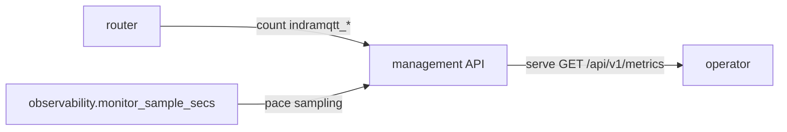

# Metrics reference

<!-- GENERATED by `python3 tools/gen_reference_docs.py`. Do not edit by hand. -->

The complete MQTT platform in one small binary: broker, SQL rules, data connectors and multi-tenancy in a single process.

Read every metric name with its meaning and unit. Use it when a dashboard needs a name. You get one row per metric.



## Before you start

- Start the broker from [First start](../getting-started/first-start.md).
- Each row comes from the code that registers the metric.
  The drift test fails when a name differs from the live endpoint.

> **Note:** Read the first table for exposition names. Read the second table for snapshot fields.

## Exposed counters

The text exposition serves these names.

| Metric | Kind | Unit | Meaning | Source |
|---|---|---|---|---|
| `indramqtt_connections_active` | gauge | connections | Currently bound edge connections. | HELP text |
| `indramqtt_dead_mailbox_dropped_total` | counter | count | Frames sent into a dead mailbox whose receiver is gone. | HELP text |
| `indramqtt_detached_clean_dropped_total` | counter | count | Frames dropped for detached clean sessions. | HELP text |
| `indramqtt_egress_qos0_shed_total` | counter | count | QoS 0 frames shed at route time by the per-connection egress bound. | HELP text |
| `indramqtt_inflight_dropped_total` | counter | count | QoS 1 downlinks delivered live but untracked for redelivery (per-session inflight window full). | HELP text |
| `indramqtt_inflight_spill_evicted_total` | counter | count | Live QoS 1 deliveries past both window and spill bounds, left untracked. | HELP text |
| `indramqtt_inflight_spill_replayed_total` | counter | count | Spilled QoS 1 entries redelivered with DUP set on reconnect replay. | HELP text |
| `indramqtt_inflight_spilled_total` | counter | count | QoS 1 downlinks spilled past the window into the bounded overflow buffer (still tracked for DUP redelivery). | HELP text |
| `indramqtt_messages_dropped_total` | counter | count | Total ingress messages dropped by quota/rate policing. | HELP text |
| `indramqtt_messages_forwarded_total` | counter | count | Total PublishOut frames admitted into the shard transport mailbox (transport enqueue, not edge arrival; compare with transport_sent). | HELP text |
| `indramqtt_messages_received_total` | counter | count | Total MQTT ingress messages accepted over BrokerLink. | HELP text |
| `indramqtt_offline_queue_evicted_total` | counter | count | Offline-queue entries evicted for detached durable sessions. | HELP text |
| `indramqtt_puback_deferred_released_total` | counter | count | Deferred PUBACKs released after credit arrived. | HELP text |
| `indramqtt_puback_deferred_total` | counter | count | QoS 1 publishes whose PUBACK is deferred for credit. | HELP text |
| `indramqtt_rule_spill_dropped_total` | counter | count | Rule-ingress overflow events refused (no spill directory, oversize event, disk cap, I/O error). | HELP text |
| `indramqtt_rule_spill_recovered_total` | counter | count | Rule-ingress events found on disk when a spill directory opened. | HELP text |
| `indramqtt_rule_spill_replayed_total` | counter | count | Spilled rule-ingress events replayed to the consumer in order. | HELP text |
| `indramqtt_rule_spill_spilled_total` | counter | count | Rule-ingress events appended to the on-disk spill buffer instead of erroring. | HELP text |
| `indramqtt_rule_spill_torn_total` | counter | count | Torn spill tails truncated (plus later segments discarded) on recovery or replay. | HELP text |
| `indramqtt_rules_executed_total` | counter | count | Total ingress rules whose filter matched. | HELP text |
| `indramqtt_tenant_mismatch_dropped_total` | counter | count | Fan-out matches excluded by tenant scope. | HELP text |
| `indramqtt_transport_send_failed_total` | counter | count | Failed transport batch writes toward the edge. | HELP text |
| `indramqtt_transport_sent_total` | counter | count | Frames actually written toward the edge by successful transport batch writes. | HELP text |
| `indramqtt_unknown_conn_dropped_total` | counter | count | Frames routed to a conn_id with no registered mailbox. | HELP text |

Notes:

- Read the Source column for the origin of each meaning.
- `HELP text` comes from the exposition. `counter docs` comes from the increment method. `unstated` has no source text.

## Snapshot counters

The snapshot struct carries these fields.

| Field | Kind | Unit | Meaning | Source |
|---|---|---|---|---|
| `connect_received` | counter | count | One CONNECT packet (`BindConnection`) received from the edge. | counter docs |
| `connack_sent` | counter | count | One CONNACK (`SessionBinding`) sent toward the edge, including rejections (bad password, anonymous denied): every bind is answered. | counter docs |
| `publish_received` | counter | count | One PUBLISH packet (`PublishIn`) received, before validation. | counter docs |
| `publish_sent` | counter | count | One `PublishOut` delivery fanned out toward a live edge connection. | counter docs |
| `subscribe_received` | counter | count | One SUBSCRIBE packet (`SubscribeIn`) received, before validation. | counter docs |
| `suback_sent` | counter | count | One SUBACK (`SubAckOut`) sent toward the edge. | counter docs |
| `pingreq_received` | counter | count | One PINGREQ (`Ping`) received from the edge. | counter docs |
| `pingresp_sent` | counter | count | One PINGRESP (`Pong`) sent toward the edge. | counter docs |
| `bytes_received` | counter | bytes | Ingress bytes measured from real BrokerLink frame lengths. | counter docs |
| `bytes_sent` | counter | bytes | Egress `PublishOut` bytes measured from real frame lengths. | counter docs |
| `qos0_received` | counter | count | One ingress publish with QoS 0 accepted for routing. | counter docs |
| `qos1_received` | counter | count | One ingress publish with QoS 1 accepted for routing. | counter docs |
| `qos2_received` | counter | count | One ingress publish with QoS 2 accepted for routing. | counter docs |
| `delivered` | counter | count | One live delivery toward an edge connection (mirrors `publish_sent` until per-ack tracking lands; offline buffering counts on replay). | counter docs |
| `overload_dropped` | counter | count | One ingress message dropped by overload/quota policing. | counter docs |
| `auth_failures` | counter | count | One bind rejected on credential verification (bad password or anonymous denied while users exist). | counter docs |
| `tenant_conn_refused` | counter | count | One CONNECT refused by the per-tenant connection bound. | counter docs |
| `tenant_sess_refused` | counter | count | One CONNECT refused by the per-tenant session bound. | counter docs |
| `tenant_retained_dropped` | counter | count | One retained write dropped by the per-tenant retained bound. | counter docs |

## Check that it works

Start the broker with this file. The health endpoint returns `OK`.

```toml test
[node]
id = "doc-ref"

[listeners.tcp]
bind = "0.0.0.0:1883"

[listeners.tls]
bind = "0.0.0.0:8883"

[listeners.ws]
bind = "0.0.0.0:8083"

[listeners.wss]
bind = "0.0.0.0:8084"

[listeners.api]
bind = "0.0.0.0:18083"

[logging]
level = "warn"
```

```sh test
python3 - <<'PY'
import os, socket
port = int(os.environ.get("API_PORT", "18083"))
sock = socket.create_connection(("127.0.0.1", port), timeout=5)
sock.sendall(b"GET /healthz HTTP/1.0\r\nHost: docs\r\n\r\n")
print(sock.makefile().read().strip().splitlines()[-1])
PY
```

```output
OK
```

Check one documented call. `GET /api/v1/metrics` answers 200 with its rows. It prints `OK`.

```sh test
python3 - <<'PY'
import os, urllib.request
port = os.environ.get("API_PORT", "18083")
key = os.environ.get("API_KEY", "")
base = f"http://127.0.0.1:{port}"
req = urllib.request.Request(base + "/api/v1/metrics", method="GET")
req.add_header("Authorization", f"Bearer {key}")
with urllib.request.urlopen(req, timeout=5) as r:
    body = r.read().decode()
    assert r.status == 200, body
assert "indramqtt_" in body, body
print("OK")
PY
```

```output
OK
```

## Next steps

- [API reference](api/observability.md): the metrics endpoint.
- [Configuration reference](configuration.md): the sampling interval.
