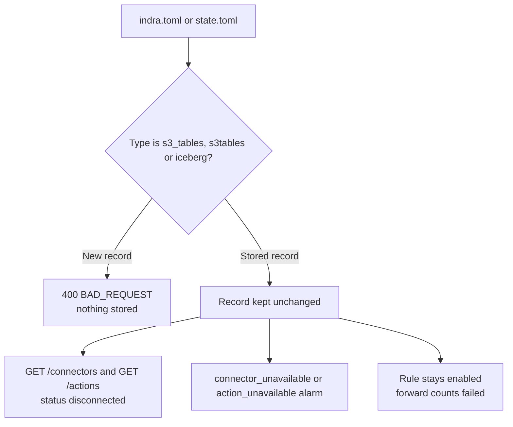

# Removed connectors

The S3 Tables connector is not part of the MVP. The broker refuses every spelling of its kind (`s3_tables`, `s3tables` and `iceberg`) on connector, action and source create, update and probe with `400` and the message `connector type s3_tables is not available in this broker`. Nothing is stored. A refused update leaves the existing record unchanged.

The kind is absent from the connector, action and schema listings. A direct request for its schema answers like any other unknown schema name.

## Stored state from an earlier version

A `state.toml` written by an earlier version still starts. The broker keeps the stored connector, action and rule unchanged so an operator can inspect and delete them.

- `GET /connectors` and `GET /actions` still show the stored records. The connector and action report `disconnected` with a `status_reason` naming the removal.
- The broker raises `connector_unavailable:<id>` and `action_unavailable:<id>`.
- Rules that use the removed connector stay enabled. A matching message runs the rule: a forward to the removed connector counts a failed action, and the other actions of the same rule still deliver.
- A new rule that names an unknown connector behaves as it does today.

## Delete old records

Deletion follows the existing dependency rules. An earlier delete is refused while a reference remains:

1. Delete the rule.
2. Delete the action.
3. Delete the connector.

The alarms are removed when the connector and action are deleted.

## Fresh configuration files

A configuration file that names the kind fails to load with a native error that names the file, the key and the kind. The broker does not panic and does not silently skip the record. The API refusal above applies to a new record.
