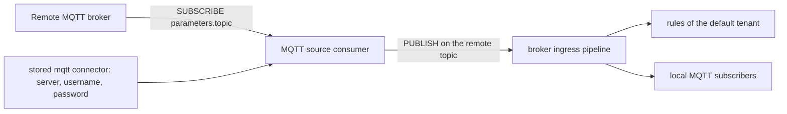

# Sources

A source receives messages from an external system and puts them into the
broker. Use it to bridge a remote MQTT topic into the local broker. You get
the same local delivery, retained write, and rule evaluation as a direct
client publish.



The source runtime reads the stored source and connector. It starts one
consumer, subscribes to the remote topic, and stops that consumer before an
update or a delete starts another one.

## Supported source kinds

`GET /api/v5/source_types` lists the source kinds with a working ingress.

| kind | ingress | reference path |
| --- | --- | --- |
| `mqtt` | remote MQTT PUBLISH becomes a local PUBLISH | MQTT subscriber source |
| `kafka_consumer` | refused until its consumer lands | rule event |
| `gcp_pubsub_consumer` | refused until its consumer lands | rule event |
| `rabbitmq` | refused until its consumer lands | rule event |

A create or update of a kind without a runtime answers `400` with the
message `source type <kind> has no ingress runtime in this broker`. Nothing
is stored. A stored record from an earlier version stays readable and
reports `disconnected` with the reason, so an operator can delete it.

## Create an MQTT source

Start the broker with this file:

```toml test
[node]
id = "docs-sources"

[listeners.tcp]
bind = "0.0.0.0:1883"

[listeners.api]
bind = "0.0.0.0:18083"

[logging]
level = "warn"

[auth]
allow_anonymous = true
```

Create the connector first, pointing it at a separate upstream MQTT broker
(never this broker's own listener, which is refused to prevent a publish
loop). The example starts a small local upstream MQTT stub on an ephemeral
port so it runs standalone.

```sh test
python3 - <<'PY'
import json, os, socket, threading, time, urllib.request

def recv_packet(conn):
    head = conn.recv(1)
    if not head:
        return None, b""
    rem, shift = 0, 0
    while True:
        b = conn.recv(1)[0]
        rem |= (b & 0x7F) << shift
        if not (b & 0x80):
            break
        shift += 7
    body = b""
    while len(body) < rem:
        chunk = conn.recv(rem - len(body))
        if not chunk:
            break
        body += chunk
    return head[0] >> 4, body

srv = socket.socket()
srv.bind(("127.0.0.1", 0))
srv.listen(4)
srv_port = srv.getsockname()[1]
stop_flag = False

def serve():
    while not stop_flag:
        srv.settimeout(0.2)
        try:
            conn, _ = srv.accept()
        except TimeoutError:
            continue
        conn.settimeout(2.0)
        try:
            while not stop_flag:
                ptype, body = recv_packet(conn)
                if ptype is None:
                    break
                if ptype == 1:
                    conn.sendall(b"\x20\x02\x00\x00")
                elif ptype == 8:
                    conn.sendall(bytes([0x90, 0x03, body[0], body[1], 0x01]))
                elif ptype == 12:
                    conn.sendall(b"\xd0\x00")
        except Exception:
            pass
        finally:
            conn.close()

t = threading.Thread(target=serve, daemon=True)
t.start()

base = f"http://127.0.0.1:{os.environ['API_PORT']}"
key = os.environ["API_KEY"]

def call(method, path, body=None):
    data = None if body is None else json.dumps(body).encode()
    request = urllib.request.Request(
        base + path, data=data, method=method,
        headers={"Authorization": f"Bearer {key}", "Content-Type": "application/json"})
    with urllib.request.urlopen(request, timeout=5) as response:
        raw = response.read().decode()
        return response.status, (json.loads(raw) if raw else None)

try:
    status, connector = call("POST", "/api/v5/connectors", {
        "name": "remote-mqtt", "type": "mqtt",
        "server": f"127.0.0.1:{srv_port}"})
    assert status == 201, (status, connector)
    status, source = call("POST", "/api/v5/sources", {
        "name": "remote-topic", "type": "mqtt", "connector": "remote-mqtt",
        "parameters": {"topic": "factory/+/state", "qos": 1}})
    assert status == 201, (status, source)
    deadline = time.time() + 20
    while time.time() < deadline:
        status, source = call("GET", "/api/v5/sources/remote-topic")
        assert status == 200, (status, source)
        if source["status"] == "connected":
            break
        time.sleep(0.1)
    assert source["status"] == "connected", source
    print("status=connected")
finally:
    stop_flag = True
    srv.close()
PY
```

```output
status=connected
```

A disconnected source also carries `status_reason`, for example
`connector "remote-mqtt" is not stored`.

## Lifecycle

- `PUT /api/v5/sources/{id}` replaces the source. The old consumer stops
  before the new one starts, so one remote message has one local delivery.
- `DELETE /api/v5/sources/{id}` stops the consumer and removes the record.
- `PUT /api/v5/sources/{id}/enable/{enable}` and
  `POST /api/v5/sources/{id}/{operation}` (`start`, `stop`) gate ingress.
- A broker restart keeps the stored source and connector. The runtime starts
  the consumer again and reports the real state.
- `POST /api/v5/sources_probe` validates the body and dials a supplied
  `server` target. It refuses a kind without a runtime.

## Limits

- At most 512 sources.
- One consumer per source. The driver reads at most 10 received packets
  per poll, and the task delivers them before it reads again.
- A failed remote connection retries after one second.
- MQTT v5 and TLS source connections fail closed with a status reason in
  this build. The test `sb17_mqtt_source_refuses_tls_and_v5_with_a_reason`
  observes both refusals.
