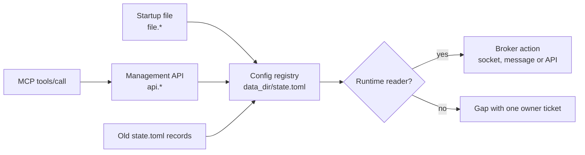

# Stored setting audit

This page lists the stored settings that this audit covers. Use it when a setting is accepted but its effect is not clear. Each row gives the runtime reader, the current behavior, the risk, the credential exposure and one owner ticket. This audit does not fix any defect.

`file.` identifies a startup setting. `state.` identifies a leaf in
`data_dir/state.toml`. `api.` identifies other accepted management input.
Arrays use `[]`; maps use `{key}`. The JSON ledger beside this file is the
source of this table. Source line numbers refer to base
`ec94cc0a6d7bad838e7b1e26ab89fc5b1db8759e`. Short source names are within `crates/`; `main.rs`
is `broker-node/src/main.rs`.

The entry cases are in `tests/settings_inventory/entry.py`. They start a real
broker process, write through its file or HTTP entry, then use MQTT sockets
or HTTP. Temporary defect assertions carry an owner marker. A passing case
records current behavior. Its owner must replace that assertion. Backend
construction traces and entry evidence are recorded separately.

The credential column records a separate security risk. It records the
exposure of a password, key or token, and its owner is the row owner. A
literal connector value is stored as plain text and returned by GET. A
`file:` or `env:` reference is stored as a reference and redacted on GET.
Password verifiers and API key hashes are stored as hashes and are not
returned by GET.

For old unsupported security state, D2 requires a denial at the affected
source, an alarm, preservation of the raw record and management read/delete.
A supported earlier decision remains valid. A later allow cannot bypass the
unsupported source. New unsupported values must be refused before storage.

## Coverage state

1254 rows. 973 rows have entry evidence; 274 are evidence pending; 7 have no runtime effect.

An evidence-pending row records current behavior from a source or unit test. It is not proof that the stored value is applied through the real entry. Its owner must add the entry case or record a no-runtime-effect reason.

| Audit state | Rows |
| --- | ---: |
| entry evidence | 973 |
| evidence pending | 274 |
| no runtime effect | 7 |

## Shared entry points

| Entry | Stored field family | Notes |
| --- | --- | --- |
| /api/v1/auth/users | state.mqtt_users.users[] | quotas object maps to three flat stored bounds; password becomes a verifier |
| /api/v1/auth/acls | state.mqtt_users.acls[] | client_pattern -> username; topic_pattern -> topic |
| /api/v1/rules and /api/v5/rules | state.rules.rules[] | v5 sql -> sql_query; enable -> enabled; action arguments have their own rows |
| MCP tools/call body | same store as its dispatched HTTP operation | path/query/body/body_base64 do not create independent persisted copies |
| old state.toml and config reload/import | all state.* rows | load validates snapshot; boot replay uses main.rs seed calls; cross-root atomicity has its own row state.reload_import.atomicity |
| /api/v5/users | state.admin_users.users[] | username/password/role/description stored; scopes are discarded by v5 and have their own row |
| /api/v5/listeners | api.v5.listeners[] | kind is wire type; cert/key flattened from ssl_options; only memory rows |
| /api/v5/certs/global/name/{name} and /certs/ns/{namespace}/name/{name} | api.v5.certs.bundles[] | File uploads are artifacts, not an automatic listener-setting update. Both forms use certs.rs::upload_bundle and render_bundle. |
| /api/v5/connectors: mqtt / mqtt_bridge / bridge | state.connectors.connectors[type=mqtt_bridge].config.* | Logical runtime field group. live_sink_kind maps mqtt to mqtt_bridge; the stored document keeps its original type. This maps field readers, not kind readiness. |
| /api/v5/connectors: postgres | state.connectors.connectors[type=pgsql].config.* | live_sink_kind maps postgres to the pgsql runtime; the stored document keeps connector_type postgres |
| /api/v5/connectors: timescale | state.connectors.connectors[type=timescaledb].config.* | timescale is the alias of the timescaledb kind; the v1 build path builds the same config for both names |
| /api/v5/connectors: console and test | state.connectors.connectors[type=console].config; state.connectors.connectors[type=test].config | name-only log sinks; no config key has a runtime reader |
| /api/v5/connectors: kafka_producer, kafka_consumer, confluent_producer, gcp_pubsub_producer, gcp_pubsub_consumer, azure_event_hub_producer, azure_blob_storage, aws_timestream, opents, sqlserver, dynamo, s3tables, snowflake_streaming, mqtt, scylla, scylladb, minio, bigquery bq/gbq, kinesis aws_kinesis, dynamodb ddb, opcua, sparkplug, greptime, pubsub, elastic, es, rest | the config rows of the base kind each name maps to | live_sink_kind and the register_live_sink arm patterns map each documented name to its base runtime; stored documents keep the posted type |

## Startup fields

| Field / definition | Store | Runtime reader | Build condition | Restart | User expectation | Current behavior | Evidence | Credential exposure | Risk | Proposal | Owner | Old state / safe startup | Audit |
| --- | --- | --- | --- | --- | --- | --- | --- | --- | --- | --- | --- | --- | --- |
| `file.node.id` (crates/broker-config/src/schema.rs:1064) | startup layers | broker-node/src/main.rs fixes the node name from the resolved config before any component reads it; serve_api keeps the runtime reader for node-scoped routes. | default and full builds | yes | Use the chosen node identity in management and node-scoped operations. | Every API read reports the chosen id, including node_status of a stored connector after a restart. Explain shows the requested id. | tests/settings_inventory/entry.py::test_stored_connector_boot_keeps_the_configured_node_identity | n/a | wrong behaviour | apply (keep runtime reader) | MV-10 | Keep and apply a valid old value. Refuse new unsupported values before boot; preserve unsupported old state and report the fault. | entry evidence |
| `file.node.data_dir` (crates/broker-config/src/schema.rs:1067) | startup layers | broker-node/src/main.rs:10822 opens registry; :10836 delayed store; :10865 offline store. | default and full builds | yes | Read and write broker state only in the chosen directory. | The boot path consumes the selected startup value. | tests/settings_inventory/entry.py::test_anonymous_flag_and_password_algorithm (writes and reads the chosen data_dir/state.toml) | n/a | wrong behaviour | apply (keep runtime reader) | MV-10 | Keep and apply a valid old value. Refuse new unsupported values before boot; preserve unsupported old state and report the fault. | entry evidence |
| `file.node.brokerlink_bind` (crates/broker-config/src/schema.rs:1070) | startup layers | broker-node/src/main.rs:10635 warns only; removed edge binding has no runtime reader. | default and full builds | yes | Warn for the deprecated edge bind; do not start a removed transport. | The real process emits deprecation warnings, accepts MQTT on the native listener, and leaves the deprecated edge socket closed. This matches the documented deprecation window. | tests/settings_inventory/entry.py::test_deprecated_edge_settings_warn_without_starting_edge_socket | n/a | cosmetic | keep warning for the documented window, then refuse | MV-14 | Keep and apply a valid old value. Refuse new unsupported values before boot; preserve unsupported old state and report the fault. | entry evidence |
| `file.listeners.tcp.enabled` (crates/broker-config/src/schema.rs:1132) | startup layers | broker-node/src/main.rs:11567 seeds listener rows; :11576 skips disabled rows; broker-node/src/native.rs:161 binds and serves each enabled record. | default and full builds | yes for file | Enable and bind the selected listener. | Boot uses configured listener state. | crates/broker-node/tests/listener_conformance.rs::lc_connect_levels_3_4_5_accept; lc_websocket_serves_mqtt_and_refusals (child broker, file-selected ports); tests/settings_inventory/entry.py process fixture | n/a | wrong behaviour | apply (keep runtime reader) | MV-10 | Keep the raw record. Apply a supported value. Refuse a new unsupported value; for an old unsupported security source, deny at that source, raise an alarm, keep management read/delete available (D2). | evidence pending |
| `file.listeners.tcp.bind` (crates/broker-config/src/schema.rs:1135) | startup layers | broker-node/src/main.rs:11567 seeds listener rows; :11576 skips disabled rows; broker-node/src/native.rs:161 binds and serves each enabled record. | default and full builds | yes for file | Enable and bind the selected listener. | Boot uses configured listener state. | crates/broker-node/tests/listener_conformance.rs::lc_connect_levels_3_4_5_accept; lc_websocket_serves_mqtt_and_refusals (child broker, file-selected ports); tests/settings_inventory/entry.py process fixture | n/a | wrong behaviour | apply (keep runtime reader) | MV-10 | Keep the raw record. Apply a supported value. Refuse a new unsupported value; for an old unsupported security source, deny at that source, raise an alarm, keep management read/delete available (D2). | evidence pending |
| `file.listeners.tcp.max_connections` (crates/broker-config/src/schema.rs:1138) | startup layers | broker-node/src/native.rs:173 reads backlog; :178 selects max_connections; :305 enforces live connection cap; :127 passes backlog to listen. | default and full builds | yes | Bound accepted connections and socket listen backlog. | Native listener uses the record bounds. | crates/broker-node/tests/listener_conformance.rs::lc_max_connections_refuses_beyond_limit (real child broker and TCP sockets) | n/a | wrong behaviour | apply (keep runtime reader) | MV-11c | Keep the raw record. Apply a supported value. Refuse a new unsupported value; for an old unsupported security source, deny at that source, raise an alarm, keep management read/delete available (D2). | evidence pending |
| `file.listeners.tcp.backlog` (crates/broker-config/src/schema.rs:1141) | startup layers | broker-node/src/native.rs:173 reads backlog; :178 selects max_connections; :305 enforces live connection cap; :127 passes backlog to listen. | default and full builds | yes | Bound accepted connections and socket listen backlog. | Native listener uses the record bounds. | crates/broker-node/tests/listener_conformance.rs::lc_connect_levels_3_4_5_accept; lc_max_connections_refuses_beyond_limit (native listen path). native.rs:173..177 and :216..217 pass the selected backlog into bind_listener/listen; OS queue saturation is not separately measured. | n/a | wrong behaviour | apply (keep runtime reader) | MV-11c | Keep the raw record. Apply a supported value. Refuse a new unsupported value; for an old unsupported security source, deny at that source, raise an alarm, keep management read/delete available (D2). | evidence pending |
| `file.listeners.tcp.native` (crates/broker-config/src/schema.rs:1144) | startup layers | broker-node/src/main.rs:10635 emits a deprecation warning. No transport selector remains. | default and full builds | yes | Deprecated selector warns; kernel serves every enabled listener. | The real process emits deprecation warnings, accepts MQTT on the native listener, and leaves the deprecated edge socket closed. This matches the documented deprecation window. | tests/settings_inventory/entry.py::test_deprecated_edge_settings_warn_without_starting_edge_socket | n/a | cosmetic | refuse after documented deprecation window; keep warning in this release | MV-14 | Preserve the value and warn. Do not enable a removed transport. | entry evidence |
| `file.listeners.tls.enabled` (crates/broker-config/src/schema.rs:1200) | startup layers | broker-node/src/main.rs:11567 seeds listener rows; :11576 skips disabled rows; broker-node/src/native.rs:161 binds and serves each enabled record. | default and full builds | yes for file | Enable and bind the selected listener. | Boot uses configured listener state. | tests/settings_inventory/entry.py::test_file_tls_policy_reaches_handshake_and_certificate_identity (file-selected port, certificate/key/CA, peer verification, modern and legacy required-client flags, CN identity, negative handshakes and exact MQTT delivery) | n/a | wrong behaviour | apply (keep runtime reader) | MV-10 | Keep the raw record. Apply a supported value. Refuse a new unsupported value; for an old unsupported security source, deny at that source, raise an alarm, keep management read/delete available (D2). | entry evidence |
| `file.listeners.tls.bind` (crates/broker-config/src/schema.rs:1203) | startup layers | broker-node/src/main.rs:11567 seeds listener rows; :11576 skips disabled rows; broker-node/src/native.rs:161 binds and serves each enabled record. | default and full builds | yes for file | Enable and bind the selected listener. | Boot uses configured listener state. | tests/settings_inventory/entry.py::test_file_tls_policy_reaches_handshake_and_certificate_identity (file-selected port, certificate/key/CA, peer verification, modern and legacy required-client flags, CN identity, negative handshakes and exact MQTT delivery) | n/a | wrong behaviour | apply (keep runtime reader) | MV-10 | Keep the raw record. Apply a supported value. Refuse a new unsupported value; for an old unsupported security source, deny at that source, raise an alarm, keep management read/delete available (D2). | entry evidence |
| `file.listeners.tls.cert_file` (crates/broker-config/src/schema.rs:1206) | startup layers | broker-node/src/native.rs:187 builds TLS (:202 for WSS) from certificate/key, verification and CA fields; main.rs:10773 installs certificate bind policy; native.rs:2452 derives verified identity. | default and full builds | yes | Use configured server certificate, peer verification and verified certificate identity on this listener. | The boot path consumes the selected startup value. | tests/settings_inventory/entry.py::test_file_tls_policy_reaches_handshake_and_certificate_identity (file-selected port, certificate/key/CA, peer verification, modern and legacy required-client flags, CN identity, negative handshakes and exact MQTT delivery) | Path value in the startup file. Key bytes stay in the referenced file. The seeded listener GET returns the path, not the bytes. | security | apply (keep runtime reader) | MV-09a | Keep and apply a valid old value. Refuse new unsupported values before boot; preserve unsupported old state and report the fault. | entry evidence |
| `file.listeners.tls.key_file` (crates/broker-config/src/schema.rs:1209) | startup layers | broker-node/src/native.rs:187 builds TLS (:202 for WSS) from certificate/key, verification and CA fields; main.rs:10773 installs certificate bind policy; native.rs:2452 derives verified identity. | default and full builds | yes | Use configured server certificate, peer verification and verified certificate identity on this listener. | The boot path consumes the selected startup value. | tests/settings_inventory/entry.py::test_file_tls_policy_reaches_handshake_and_certificate_identity (file-selected port, certificate/key/CA, peer verification, modern and legacy required-client flags, CN identity, negative handshakes and exact MQTT delivery) | Path value in the startup file. Key bytes stay in the referenced file. The seeded listener GET returns the path, not the bytes. | security | apply (keep runtime reader) | MV-09a | Keep and apply a valid old value. Refuse new unsupported values before boot; preserve unsupported old state and report the fault. | entry evidence |
| `file.listeners.tls.native` (crates/broker-config/src/schema.rs:1212) | startup layers | broker-node/src/main.rs:10635 emits a deprecation warning. No transport selector remains. | default and full builds | yes | Deprecated selector warns; kernel serves every enabled listener. | The real process emits deprecation warnings, accepts MQTT on the native listener, and leaves the deprecated edge socket closed. This matches the documented deprecation window. | tests/settings_inventory/entry.py::test_deprecated_edge_settings_warn_without_starting_edge_socket | n/a | cosmetic | refuse after documented deprecation window; keep warning in this release | MV-14 | Preserve the value and warn. Do not enable a removed transport. | entry evidence |
| `file.listeners.tls.psk_enabled` (crates/broker-config/src/schema.rs:1217) | startup layers | broker-node/src/main.rs:10801 loads PSK keys when enabled; native.rs:187 selects the PSK server and :864 sets PSK suites. | default and full builds | yes | Use the configured PSK identities; refuse unverified clients. | The boot path consumes the selected startup value. | crates/broker-node/src/native.rs::psk_keys_file_loads_and_connects_through_broker; psk_file_entry_same_alert_and_delivers_through_broker (load a key file then use the production native listener). Production file-enable/path adapter inspected at main.rs:10801..10809; fixture is not a full main-process boot. | n/a | security | apply (keep runtime reader) | MV-09a | Keep and apply a valid old value. Refuse new unsupported values before boot; preserve unsupported old state and report the fault. | evidence pending |
| `file.listeners.tls.psk_keys_file` (crates/broker-config/src/schema.rs:1222) | startup layers | broker-node/src/main.rs:10801 loads PSK keys when enabled; native.rs:187 selects the PSK server and :864 sets PSK suites. | default and full builds | yes | Use the configured PSK identities; refuse unverified clients. | The boot path consumes the selected startup value. | crates/broker-node/src/native.rs::psk_keys_file_loads_and_connects_through_broker; psk_file_entry_same_alert_and_delivers_through_broker (load a key file then use the production native listener). Production file-enable/path adapter inspected at main.rs:10801..10809; fixture is not a full main-process boot. | n/a | security | apply (keep runtime reader) | MV-09a | Keep and apply a valid old value. Refuse new unsupported values before boot; preserve unsupported old state and report the fault. | evidence pending |
| `file.listeners.tls.verify_client_cert` (crates/broker-config/src/schema.rs:1225) | startup layers | broker-node/src/native.rs:187 builds TLS (:202 for WSS) from certificate/key, verification and CA fields; main.rs:10773 installs certificate bind policy; native.rs:2452 derives verified identity. | default and full builds | yes | Use configured server certificate, peer verification and verified certificate identity on this listener. | The boot path consumes the selected startup value. | tests/settings_inventory/entry.py::test_file_tls_policy_reaches_handshake_and_certificate_identity (file-selected port, certificate/key/CA, peer verification, modern and legacy required-client flags, CN identity, negative handshakes and exact MQTT delivery) | n/a | security | apply (keep runtime reader) | MV-09a | Keep and apply a valid old value. Refuse new unsupported values before boot; preserve unsupported old state and report the fault. | entry evidence |
| `file.listeners.tls.verify` (crates/broker-config/src/schema.rs:1228) | startup layers | broker-node/src/native.rs:187 builds TLS (:202 for WSS) from certificate/key, verification and CA fields; main.rs:10773 installs certificate bind policy; native.rs:2452 derives verified identity. | default and full builds | yes | Use configured server certificate, peer verification and verified certificate identity on this listener. | The boot path consumes the selected startup value. | tests/settings_inventory/entry.py::test_file_tls_policy_reaches_handshake_and_certificate_identity (file-selected port, certificate/key/CA, peer verification, modern and legacy required-client flags, CN identity, negative handshakes and exact MQTT delivery) | n/a | security | apply (keep runtime reader) | MV-09a | Keep and apply a valid old value. Refuse new unsupported values before boot; preserve unsupported old state and report the fault. | entry evidence |
| `file.listeners.tls.cacertfile` (crates/broker-config/src/schema.rs:1231) | startup layers | broker-node/src/native.rs:187 builds TLS (:202 for WSS) from certificate/key, verification and CA fields; main.rs:10773 installs certificate bind policy; native.rs:2452 derives verified identity. | default and full builds | yes | Use configured server certificate, peer verification and verified certificate identity on this listener. | The boot path consumes the selected startup value. | tests/settings_inventory/entry.py::test_file_tls_policy_reaches_handshake_and_certificate_identity (file-selected port, certificate/key/CA, peer verification, modern and legacy required-client flags, CN identity, negative handshakes and exact MQTT delivery) | Path value in the startup file. Key bytes stay in the referenced file. The seeded listener GET returns the path, not the bytes. | security | apply (keep runtime reader) | MV-09a | Keep and apply a valid old value. Refuse new unsupported values before boot; preserve unsupported old state and report the fault. | entry evidence |
| `file.listeners.tls.fail_if_no_peer_cert` (crates/broker-config/src/schema.rs:1234) | startup layers | broker-node/src/native.rs:187 builds TLS (:202 for WSS) from certificate/key, verification and CA fields; main.rs:10773 installs certificate bind policy; native.rs:2452 derives verified identity. | default and full builds | yes | Use configured server certificate, peer verification and verified certificate identity on this listener. | The boot path consumes the selected startup value. | tests/settings_inventory/entry.py::test_file_tls_policy_reaches_handshake_and_certificate_identity (file-selected port, certificate/key/CA, peer verification, modern and legacy required-client flags, CN identity, negative handshakes and exact MQTT delivery) | n/a | security | apply (keep runtime reader) | MV-09a | Keep and apply a valid old value. Refuse new unsupported values before boot; preserve unsupported old state and report the fault. | entry evidence |
| `file.listeners.tls.peer_cert_as_username` (crates/broker-config/src/schema.rs:1237) | startup layers | broker-node/src/native.rs:187 builds TLS (:202 for WSS) from certificate/key, verification and CA fields; main.rs:10773 installs certificate bind policy; native.rs:2452 derives verified identity. | default and full builds | yes | Use configured server certificate, peer verification and verified certificate identity on this listener. | The boot path consumes the selected startup value. | tests/settings_inventory/entry.py::test_file_tls_policy_reaches_handshake_and_certificate_identity (file-selected port, certificate/key/CA, peer verification, modern and legacy required-client flags, CN identity, negative handshakes and exact MQTT delivery) | n/a | security | apply (keep runtime reader) | MV-09a | Keep and apply a valid old value. Refuse new unsupported values before boot; preserve unsupported old state and report the fault. | entry evidence |
| `file.listeners.tls.peer_cert_as_clientid` (crates/broker-config/src/schema.rs:1240) | startup layers | broker-node/src/native.rs:187 builds TLS (:202 for WSS) from certificate/key, verification and CA fields; main.rs:10773 installs certificate bind policy; native.rs:2452 derives verified identity. | default and full builds | yes | Use configured server certificate, peer verification and verified certificate identity on this listener. | The boot path consumes the selected startup value. | tests/settings_inventory/entry.py::test_file_tls_policy_reaches_handshake_and_certificate_identity (file-selected port, certificate/key/CA, peer verification, modern and legacy required-client flags, CN identity, negative handshakes and exact MQTT delivery) | n/a | security | apply (keep runtime reader) | MV-09a | Keep and apply a valid old value. Refuse new unsupported values before boot; preserve unsupported old state and report the fault. | entry evidence |
| `file.listeners.ws.enabled` (crates/broker-config/src/schema.rs:1393) | startup layers | broker-node/src/main.rs:11567 seeds listener rows; :11576 skips disabled rows; broker-node/src/native.rs:161 binds and serves each enabled record. | default and full builds | yes for file | Enable and bind the selected listener. | Boot uses configured listener state. | crates/broker-node/tests/listener_conformance.rs::lc_connect_levels_3_4_5_accept; lc_websocket_serves_mqtt_and_refusals (child broker, file-selected ports); tests/settings_inventory/entry.py process fixture | n/a | wrong behaviour | apply (keep runtime reader) | MV-10 | Keep the raw record. Apply a supported value. Refuse a new unsupported value; for an old unsupported security source, deny at that source, raise an alarm, keep management read/delete available (D2). | evidence pending |
| `file.listeners.ws.bind` (crates/broker-config/src/schema.rs:1396) | startup layers | broker-node/src/main.rs:11567 seeds listener rows; :11576 skips disabled rows; broker-node/src/native.rs:161 binds and serves each enabled record. | default and full builds | yes for file | Enable and bind the selected listener. | Boot uses configured listener state. | crates/broker-node/tests/listener_conformance.rs::lc_connect_levels_3_4_5_accept; lc_websocket_serves_mqtt_and_refusals (child broker, file-selected ports); tests/settings_inventory/entry.py process fixture | n/a | wrong behaviour | apply (keep runtime reader) | MV-10 | Keep the raw record. Apply a supported value. Refuse a new unsupported value; for an old unsupported security source, deny at that source, raise an alarm, keep management read/delete available (D2). | evidence pending |
| `file.listeners.ws.path` (crates/broker-config/src/schema.rs:1399) | startup layers | broker-node/src/native.rs:240 and :247 pass the configured handshake path to the WebSocket server. | default and full builds | yes | Only configured WebSocket path upgrades. | Configured path is used during handshake. | crates/broker-node/tests/listener_conformance.rs::lc_websocket_serves_mqtt_and_refusals (real child process and WebSocket upgrade path); native.rs:240..247 passes the configured path into the handshake server; source adapter inspected. | n/a | wrong behaviour | apply (keep runtime reader) | MV-10 | Keep the raw record. Apply a supported value. Refuse a new unsupported value; for an old unsupported security source, deny at that source, raise an alarm, keep management read/delete available (D2). | evidence pending |
| `file.listeners.ws.native` (crates/broker-config/src/schema.rs:1402) | startup layers | broker-node/src/main.rs:10635 emits a deprecation warning. No transport selector remains. | default and full builds | yes | Deprecated selector warns; kernel serves every enabled listener. | The real process emits deprecation warnings, accepts MQTT on the native listener, and leaves the deprecated edge socket closed. This matches the documented deprecation window. | tests/settings_inventory/entry.py::test_deprecated_edge_settings_warn_without_starting_edge_socket | n/a | cosmetic | refuse after documented deprecation window; keep warning in this release | MV-14 | Preserve the value and warn. Do not enable a removed transport. | entry evidence |
| `file.listeners.wss.enabled` (crates/broker-config/src/schema.rs:1445) | startup layers | broker-node/src/main.rs:11567 seeds listener rows; :11576 skips disabled rows; broker-node/src/native.rs:161 binds and serves each enabled record. | default and full builds | yes for file | Enable and bind the selected listener. | Boot uses configured listener state. | crates/broker-node/src/native.rs::k1_05_wss_require_mode_checks_client_certificate (native WSS listener, real TLS/WebSocket and MQTT); certificate identity uses the shared run_connection path also exercised by tests/settings_inventory/entry.py::test_file_tls_policy_reaches_handshake_and_certificate_identity. WSS file adapter at main.rs:10789..10796 and native.rs:200..240 inspected; not claimed as a separate full file-process WSS test. | n/a | wrong behaviour | apply (keep runtime reader) | MV-10 | Keep the raw record. Apply a supported value. Refuse a new unsupported value; for an old unsupported security source, deny at that source, raise an alarm, keep management read/delete available (D2). | evidence pending |
| `file.listeners.wss.bind` (crates/broker-config/src/schema.rs:1448) | startup layers | broker-node/src/main.rs:11567 seeds listener rows; :11576 skips disabled rows; broker-node/src/native.rs:161 binds and serves each enabled record. | default and full builds | yes for file | Enable and bind the selected listener. | Boot uses configured listener state. | crates/broker-node/src/native.rs::k1_05_wss_require_mode_checks_client_certificate (native WSS listener, real TLS/WebSocket and MQTT); certificate identity uses the shared run_connection path also exercised by tests/settings_inventory/entry.py::test_file_tls_policy_reaches_handshake_and_certificate_identity. WSS file adapter at main.rs:10789..10796 and native.rs:200..240 inspected; not claimed as a separate full file-process WSS test. | n/a | wrong behaviour | apply (keep runtime reader) | MV-10 | Keep the raw record. Apply a supported value. Refuse a new unsupported value; for an old unsupported security source, deny at that source, raise an alarm, keep management read/delete available (D2). | evidence pending |
| `file.listeners.wss.path` (crates/broker-config/src/schema.rs:1451) | startup layers | broker-node/src/native.rs:240 and :247 pass the configured handshake path to the WebSocket server. | default and full builds | yes | Only configured WebSocket path upgrades. | Configured path is used during handshake. | crates/broker-node/src/native.rs::k1_05_wss_require_mode_checks_client_certificate (native WSS listener, real TLS/WebSocket and MQTT); certificate identity uses the shared run_connection path also exercised by tests/settings_inventory/entry.py::test_file_tls_policy_reaches_handshake_and_certificate_identity. WSS file adapter at main.rs:10789..10796 and native.rs:200..240 inspected; not claimed as a separate full file-process WSS test. | n/a | wrong behaviour | apply (keep runtime reader) | MV-10 | Keep the raw record. Apply a supported value. Refuse a new unsupported value; for an old unsupported security source, deny at that source, raise an alarm, keep management read/delete available (D2). | evidence pending |
| `file.listeners.wss.cert_file` (crates/broker-config/src/schema.rs:1454) | startup layers | broker-node/src/native.rs:187 builds TLS (:202 for WSS) from certificate/key, verification and CA fields; main.rs:10773 installs certificate bind policy; native.rs:2452 derives verified identity. | default and full builds | yes | Use configured server certificate, peer verification and verified certificate identity on this listener. | The boot path consumes the selected startup value. | crates/broker-node/src/native.rs::k1_05_wss_require_mode_checks_client_certificate (native WSS listener, real TLS/WebSocket and MQTT); certificate identity uses the shared run_connection path also exercised by tests/settings_inventory/entry.py::test_file_tls_policy_reaches_handshake_and_certificate_identity. WSS file adapter at main.rs:10789..10796 and native.rs:200..240 inspected; not claimed as a separate full file-process WSS test. | Path value in the startup file. Key bytes stay in the referenced file. The seeded listener GET returns the path, not the bytes. | security | apply (keep runtime reader) | MV-09a | Keep and apply a valid old value. Refuse new unsupported values before boot; preserve unsupported old state and report the fault. | evidence pending |
| `file.listeners.wss.key_file` (crates/broker-config/src/schema.rs:1457) | startup layers | broker-node/src/native.rs:187 builds TLS (:202 for WSS) from certificate/key, verification and CA fields; main.rs:10773 installs certificate bind policy; native.rs:2452 derives verified identity. | default and full builds | yes | Use configured server certificate, peer verification and verified certificate identity on this listener. | The boot path consumes the selected startup value. | crates/broker-node/src/native.rs::k1_05_wss_require_mode_checks_client_certificate (native WSS listener, real TLS/WebSocket and MQTT); certificate identity uses the shared run_connection path also exercised by tests/settings_inventory/entry.py::test_file_tls_policy_reaches_handshake_and_certificate_identity. WSS file adapter at main.rs:10789..10796 and native.rs:200..240 inspected; not claimed as a separate full file-process WSS test. | Path value in the startup file. Key bytes stay in the referenced file. The seeded listener GET returns the path, not the bytes. | security | apply (keep runtime reader) | MV-09a | Keep and apply a valid old value. Refuse new unsupported values before boot; preserve unsupported old state and report the fault. | evidence pending |
| `file.listeners.wss.native` (crates/broker-config/src/schema.rs:1460) | startup layers | broker-node/src/main.rs:10635 emits a deprecation warning. No transport selector remains. | default and full builds | yes | Deprecated selector warns; kernel serves every enabled listener. | The real process emits deprecation warnings, accepts MQTT on the native listener, and leaves the deprecated edge socket closed. This matches the documented deprecation window. | tests/settings_inventory/entry.py::test_deprecated_edge_settings_warn_without_starting_edge_socket | n/a | cosmetic | refuse after documented deprecation window; keep warning in this release | MV-14 | Preserve the value and warn. Do not enable a removed transport. | entry evidence |
| `file.listeners.wss.verify_client_cert` (crates/broker-config/src/schema.rs:1463) | startup layers | broker-node/src/native.rs:187 builds TLS (:202 for WSS) from certificate/key, verification and CA fields; main.rs:10773 installs certificate bind policy; native.rs:2452 derives verified identity. | default and full builds | yes | Use configured server certificate, peer verification and verified certificate identity on this listener. | The boot path consumes the selected startup value. | crates/broker-node/src/native.rs::k1_05_wss_require_mode_checks_client_certificate (native WSS listener, real TLS/WebSocket and MQTT); certificate identity uses the shared run_connection path also exercised by tests/settings_inventory/entry.py::test_file_tls_policy_reaches_handshake_and_certificate_identity. WSS file adapter at main.rs:10789..10796 and native.rs:200..240 inspected; not claimed as a separate full file-process WSS test. | n/a | security | apply (keep runtime reader) | MV-09a | Keep and apply a valid old value. Refuse new unsupported values before boot; preserve unsupported old state and report the fault. | evidence pending |
| `file.listeners.wss.verify` (crates/broker-config/src/schema.rs:1466) | startup layers | broker-node/src/native.rs:187 builds TLS (:202 for WSS) from certificate/key, verification and CA fields; main.rs:10773 installs certificate bind policy; native.rs:2452 derives verified identity. | default and full builds | yes | Use configured server certificate, peer verification and verified certificate identity on this listener. | The boot path consumes the selected startup value. | crates/broker-node/src/native.rs::k1_05_wss_require_mode_checks_client_certificate (native WSS listener, real TLS/WebSocket and MQTT); certificate identity uses the shared run_connection path also exercised by tests/settings_inventory/entry.py::test_file_tls_policy_reaches_handshake_and_certificate_identity. WSS file adapter at main.rs:10789..10796 and native.rs:200..240 inspected; not claimed as a separate full file-process WSS test. | n/a | security | apply (keep runtime reader) | MV-09a | Keep and apply a valid old value. Refuse new unsupported values before boot; preserve unsupported old state and report the fault. | evidence pending |
| `file.listeners.wss.cacertfile` (crates/broker-config/src/schema.rs:1469) | startup layers | broker-node/src/native.rs:187 builds TLS (:202 for WSS) from certificate/key, verification and CA fields; main.rs:10773 installs certificate bind policy; native.rs:2452 derives verified identity. | default and full builds | yes | Use configured server certificate, peer verification and verified certificate identity on this listener. | The boot path consumes the selected startup value. | crates/broker-node/src/native.rs::k1_05_wss_require_mode_checks_client_certificate (native WSS listener, real TLS/WebSocket and MQTT); certificate identity uses the shared run_connection path also exercised by tests/settings_inventory/entry.py::test_file_tls_policy_reaches_handshake_and_certificate_identity. WSS file adapter at main.rs:10789..10796 and native.rs:200..240 inspected; not claimed as a separate full file-process WSS test. | Path value in the startup file. Key bytes stay in the referenced file. The seeded listener GET returns the path, not the bytes. | security | apply (keep runtime reader) | MV-09a | Keep and apply a valid old value. Refuse new unsupported values before boot; preserve unsupported old state and report the fault. | evidence pending |
| `file.listeners.wss.fail_if_no_peer_cert` (crates/broker-config/src/schema.rs:1472) | startup layers | broker-node/src/native.rs:187 builds TLS (:202 for WSS) from certificate/key, verification and CA fields; main.rs:10773 installs certificate bind policy; native.rs:2452 derives verified identity. | default and full builds | yes | Use configured server certificate, peer verification and verified certificate identity on this listener. | The boot path consumes the selected startup value. | crates/broker-node/src/native.rs::k1_05_wss_require_mode_checks_client_certificate (native WSS listener, real TLS/WebSocket and MQTT); certificate identity uses the shared run_connection path also exercised by tests/settings_inventory/entry.py::test_file_tls_policy_reaches_handshake_and_certificate_identity. WSS file adapter at main.rs:10789..10796 and native.rs:200..240 inspected; not claimed as a separate full file-process WSS test. | n/a | security | apply (keep runtime reader) | MV-09a | Keep and apply a valid old value. Refuse new unsupported values before boot; preserve unsupported old state and report the fault. | evidence pending |
| `file.listeners.wss.peer_cert_as_username` (crates/broker-config/src/schema.rs:1475) | startup layers | broker-node/src/native.rs:187 builds TLS (:202 for WSS) from certificate/key, verification and CA fields; main.rs:10773 installs certificate bind policy; native.rs:2452 derives verified identity. | default and full builds | yes | Use configured server certificate, peer verification and verified certificate identity on this listener. | The boot path consumes the selected startup value. | crates/broker-node/src/native.rs::k1_05_wss_require_mode_checks_client_certificate (native WSS listener, real TLS/WebSocket and MQTT); certificate identity uses the shared run_connection path also exercised by tests/settings_inventory/entry.py::test_file_tls_policy_reaches_handshake_and_certificate_identity. WSS file adapter at main.rs:10789..10796 and native.rs:200..240 inspected; not claimed as a separate full file-process WSS test. | n/a | security | apply (keep runtime reader) | MV-09a | Keep and apply a valid old value. Refuse new unsupported values before boot; preserve unsupported old state and report the fault. | evidence pending |
| `file.listeners.wss.peer_cert_as_clientid` (crates/broker-config/src/schema.rs:1478) | startup layers | broker-node/src/native.rs:187 builds TLS (:202 for WSS) from certificate/key, verification and CA fields; main.rs:10773 installs certificate bind policy; native.rs:2452 derives verified identity. | default and full builds | yes | Use configured server certificate, peer verification and verified certificate identity on this listener. | The boot path consumes the selected startup value. | crates/broker-node/src/native.rs::k1_05_wss_require_mode_checks_client_certificate (native WSS listener, real TLS/WebSocket and MQTT); certificate identity uses the shared run_connection path also exercised by tests/settings_inventory/entry.py::test_file_tls_policy_reaches_handshake_and_certificate_identity. WSS file adapter at main.rs:10789..10796 and native.rs:200..240 inspected; not claimed as a separate full file-process WSS test. | n/a | security | apply (keep runtime reader) | MV-09a | Keep and apply a valid old value. Refuse new unsupported values before boot; preserve unsupported old state and report the fault. | evidence pending |
| `file.listeners.api.enabled` (crates/broker-config/src/schema.rs:1551) | startup layers | broker-node/src/main.rs opens the API socket only when listeners.api.enabled is true and the bind is not empty. | default and full builds | yes | No API socket when disabled. | A disabled API listener opens no socket; MQTT still serves. HTTP is refused before and after restart. | tests/settings_inventory/entry.py::test_disabled_api_listener_serves_nothing | n/a | security | apply (done: gate the bind on the flag) | MV-10 | Keep the raw record. Apply a supported value. Refuse a new unsupported value; for an old unsupported security source, deny at that source, raise an alarm, keep management read/delete available (D2). | entry evidence |
| `file.listeners.api.bind` (crates/broker-config/src/schema.rs:1554) | startup layers | broker-node/src/main.rs:4912 copies to args; :11515 binds the real HTTP socket. | default and full builds | yes | Bind the API to the configured address. | The boot path consumes the selected startup value. | tests/settings_inventory/entry.py (all HTTP cases use an ephemeral file API bind) | n/a | wrong behaviour | apply (keep runtime reader) | MV-10 | Keep and apply a valid old value. Refuse new unsupported values before boot; preserve unsupported old state and report the fault. | entry evidence |
| `file.quotas.default_max_connections` (crates/broker-config/src/schema.rs:1619) | startup layers | Nobody when a user is added; broker-auth/src/lib.rs:1370 takes user quotas, not these file defaults. | default and full builds | yes | New users inherit documented connection, publish rate and burst defaults. | User quotas remain null and two sockets connect despite default limit 1. Adding an explicit quota does not count previous unlimited connections. | tests/settings_inventory/entry.py::test_file_default_quotas_are_not_inherited | n/a | wrong behaviour | apply defaults and count current usage when a limit changes | MV-11c | Keep the raw record. Apply a supported value. Refuse a new unsupported value; for an old unsupported security source, deny at that source, raise an alarm, keep management read/delete available (D2). | entry evidence |
| `file.quotas.default_max_publish_rate` (crates/broker-config/src/schema.rs:1622) | startup layers | Nobody when a user is added; broker-auth/src/lib.rs:1370 takes user quotas, not these file defaults. | default and full builds | yes | New users inherit documented connection, publish rate and burst defaults. | User quotas remain null and two sockets connect despite default limit 1. Adding an explicit quota does not count previous unlimited connections. | tests/settings_inventory/entry.py::test_file_default_quotas_are_not_inherited | n/a | wrong behaviour | apply defaults and count current usage when a limit changes | MV-11c | Keep the raw record. Apply a supported value. Refuse a new unsupported value; for an old unsupported security source, deny at that source, raise an alarm, keep management read/delete available (D2). | entry evidence |
| `file.quotas.burst_multiplier` (crates/broker-config/src/schema.rs:1625) | startup layers | Nobody when a user is added; broker-auth/src/lib.rs:1370 takes user quotas, not these file defaults. | default and full builds | yes | New users inherit documented connection, publish rate and burst defaults. | User quotas remain null and two sockets connect despite default limit 1. Adding an explicit quota does not count previous unlimited connections. | tests/settings_inventory/entry.py::test_file_default_quotas_are_not_inherited | n/a | wrong behaviour | apply defaults and count current usage when a limit changes | MV-11c | Keep the raw record. Apply a supported value. Refuse a new unsupported value; for an old unsupported security source, deny at that source, raise an alarm, keep management read/delete available (D2). | entry evidence |
| `file.quotas.max_connections_per_tenant` (crates/broker-config/src/schema.rs:1628) | startup layers | broker-node/src/main.rs:5072 installs tenant defaults; :8269 resolves overrides, :8311/:8328 gate new use; :5113 retains. | default and full builds; managed non-default tenants. main.rs::tm06_default_tenant_holds_no_bound_through_broker covers the current default-tenant exemption. | yes | Apply tenant connection/session/retained-topic limits. | The boot path consumes the selected startup value. | crates/broker-node/src/main.rs::tm06_limits_apply_from_file_and_env_and_api (configuration/override resolution); tm06_tenant_at_connection_limit_refuses_new_connection; tm06_tenant_at_session_limit_refuses_new_session; tm06_tenant_at_retained_limit_drops_new_topic (internal broker bind/ingress paths, not external socket qualification). | n/a | security | apply (keep runtime reader) | MV-11b | Keep and apply a valid old value. Refuse new unsupported values before boot; preserve unsupported old state and report the fault. | evidence pending |
| `file.quotas.max_sessions_per_tenant` (crates/broker-config/src/schema.rs:1631) | startup layers | broker-node/src/main.rs:5072 installs tenant defaults; :8269 resolves overrides, :8311/:8328 gate new use; :5113 retains. | default and full builds; managed non-default tenants. main.rs::tm06_default_tenant_holds_no_bound_through_broker covers the current default-tenant exemption. | yes | Apply tenant connection/session/retained-topic limits. | The boot path consumes the selected startup value. | crates/broker-node/src/main.rs::tm06_limits_apply_from_file_and_env_and_api (configuration/override resolution); tm06_tenant_at_connection_limit_refuses_new_connection; tm06_tenant_at_session_limit_refuses_new_session; tm06_tenant_at_retained_limit_drops_new_topic (internal broker bind/ingress paths, not external socket qualification). | n/a | security | apply (keep runtime reader) | MV-11b | Keep and apply a valid old value. Refuse new unsupported values before boot; preserve unsupported old state and report the fault. | evidence pending |
| `file.quotas.max_retained_per_tenant` (crates/broker-config/src/schema.rs:1634) | startup layers | broker-node/src/main.rs:5072 installs tenant defaults; :8269 resolves overrides, :8311/:8328 gate new use; :5113 retains. | default and full builds; managed non-default tenants. main.rs::tm06_default_tenant_holds_no_bound_through_broker covers the current default-tenant exemption. | yes | Apply tenant connection/session/retained-topic limits. | The boot path consumes the selected startup value. | crates/broker-node/src/main.rs::tm06_limits_apply_from_file_and_env_and_api (configuration/override resolution); tm06_tenant_at_connection_limit_refuses_new_connection; tm06_tenant_at_session_limit_refuses_new_session; tm06_tenant_at_retained_limit_drops_new_topic (internal broker bind/ingress paths, not external socket qualification). | n/a | security | apply (keep runtime reader) | MV-11b | Keep and apply a valid old value. Refuse new unsupported values before boot; preserve unsupported old state and report the fault. | evidence pending |
| `file.session.max_session_expiry_secs` (crates/broker-config/src/schema.rs:1730) | startup layers | broker-node/src/main.rs:10735, :10746, :10749, :10756, :10763, :10769 install bounds before listeners start. | default and full builds | yes | Enforce backlog, QoS window/spill, aliases, packet bytes and expiry seconds. | Boot installs the selected values into delivery/session/native limits. | crates/broker-node/src/main.rs::v5_session_expiry_caps_at_configured_maximum (internal protocol bind path); file adapter inspected at main.rs:10767..10769. | n/a | wrong behaviour | apply (keep runtime readers) | MV-11c | Keep the raw record. Apply a supported value. Refuse a new unsupported value; for an old unsupported security source, deny at that source, raise an alarm, keep management read/delete available (D2). | evidence pending |
| `file.session.max_offline_queue` (crates/broker-config/src/schema.rs:1733) | startup layers | broker-node/src/main.rs installs `session.max_offline_queue` into the session manager at boot; broker-api/src/v5/configs.rs:302 shows the live value. A kept zone value still wins when set. | default and full builds | yes | Apply offline queue length, total inflight messages and keepalive multiplier. | Boot installs the file value into the live offline cap. A file value of 1 keeps 1 message and evicts the rest with a counter. Restart replays the kept queue. | tests/settings_inventory/entry.py::test_file_session_limits_do_not_set_live_bounds (offline leg now asserts the applied value); crates/broker-node/tests/listener_conformance.rs::sa10_offline_cap_from_file_applies_and_counts, sa10_offline_survives_process_restart, sa10_torn_tail_truncates_and_replays_prefix (real child broker, file cap, TCP sockets, restart) | n/a | wrong behaviour | apply (keep runtime reader) | MV-11c | Keep the raw record. Apply a supported value. Refuse a new unsupported value; for an old unsupported security source, deny at that source, raise an alarm, keep management read/delete available (D2). | entry evidence |
| `file.session.max_inflight_messages` (crates/broker-config/src/schema.rs:1736) | startup layers | Nobody reads these file values. main.rs:10746 uses max_qos1_inflight instead; native listeners use a fixed keepalive multiplier. | default and full builds | yes | Apply offline queue length, total inflight messages and keepalive multiplier. | File explain shows the chosen value; runtime HTTP shows queue 10000, inflight 100 and grace 1.5. Socket idle-deadline observation is included. | tests/settings_inventory/entry.py::test_file_session_limits_do_not_set_live_bounds | n/a | wrong behaviour | apply a single unambiguous bound; refuse conflicting or unsupported values | MV-11c | Keep the raw record. Apply a supported value. Refuse a new unsupported value; for an old unsupported security source, deny at that source, raise an alarm, keep management read/delete available (D2). | entry evidence |
| `file.session.max_qos0_backlog` (crates/broker-config/src/schema.rs:1739) | startup layers | broker-node/src/main.rs:10735, :10746, :10749, :10756, :10763, :10769 install bounds before listeners start. | default and full builds | yes | Enforce backlog, QoS window/spill, aliases, packet bytes and expiry seconds. | Boot installs the selected values into delivery/session/native limits. | crates/broker-node/src/main.rs::qos0_bounded_backlog_sheds_oldest_fast_keeps_receiving; qos0_stalled_subscriber_never_blocks_publisher (real broker delivery harness; queue-reader proof). File adapter inspected at main.rs:10732..10735. | n/a | wrong behaviour | apply (keep runtime readers) | MV-11c | Keep the raw record. Apply a supported value. Refuse a new unsupported value; for an old unsupported security source, deny at that source, raise an alarm, keep management read/delete available (D2). | evidence pending |
| `file.session.max_qos1_inflight` (crates/broker-config/src/schema.rs:1744) | startup layers | broker-node/src/main.rs:10735, :10746, :10749, :10756, :10763, :10769 install bounds before listeners start. | default and full builds | yes | Enforce backlog, QoS window/spill, aliases, packet bytes and expiry seconds. | Boot installs the selected values into delivery/session/native limits. | crates/broker-node/src/main.rs::qos1_inflight_bound_spills_past_window_and_counts; qos1_inflight_spill_redelivers_everything_with_dup (internal bind/delivery harness). Production file install at main.rs:10744..10749 is inspected. Inflight and spill are distinct bounds; this does not promise a strict one-packet socket cap. | n/a | wrong behaviour | apply (keep runtime readers) | MV-11c | Keep the raw record. Apply a supported value. Refuse a new unsupported value; for an old unsupported security source, deny at that source, raise an alarm, keep management read/delete available (D2). | evidence pending |
| `file.session.max_qos1_spill` (crates/broker-config/src/schema.rs:1747) | startup layers | broker-node/src/main.rs:10735, :10746, :10749, :10756, :10763, :10769 install bounds before listeners start. | default and full builds | yes | Enforce backlog, QoS window/spill, aliases, packet bytes and expiry seconds. | Boot installs the selected values into delivery/session/native limits. | crates/broker-node/src/main.rs::qos1_inflight_bound_spills_past_window_and_counts; qos1_inflight_spill_redelivers_everything_with_dup (internal bind/delivery harness). Production file install at main.rs:10744..10749 is inspected. Inflight and spill are distinct bounds; this does not promise a strict one-packet socket cap. | n/a | wrong behaviour | apply (keep runtime readers) | MV-11c | Keep the raw record. Apply a supported value. Refuse a new unsupported value; for an old unsupported security source, deny at that source, raise an alarm, keep management read/delete available (D2). | evidence pending |
| `file.session.topic_alias_maximum` (crates/broker-config/src/schema.rs:1750) | startup layers | broker-node/src/main.rs:10735, :10746, :10749, :10756, :10763, :10769 install bounds before listeners start. | default and full builds | yes | Enforce backlog, QoS window/spill, aliases, packet bytes and expiry seconds. | Boot installs the selected values into delivery/session/native limits. | crates/broker-node/src/main.rs::topic_alias_conack_carries_configured_maximum; crates/broker-node/tests/listener_conformance.rs::lc_topic_alias_both_directions. File adapter main.rs:10754..10756 is inspected. | n/a | wrong behaviour | apply (keep runtime readers) | MV-11c | Keep the raw record. Apply a supported value. Refuse a new unsupported value; for an old unsupported security source, deny at that source, raise an alarm, keep management read/delete available (D2). | evidence pending |
| `file.session.max_packet_size` (crates/broker-config/src/schema.rs:1755) | startup layers | broker-node/src/main.rs:10735, :10746, :10749, :10756, :10763, :10769 install bounds before listeners start. | default and full builds | yes | Enforce backlog, QoS window/spill, aliases, packet bytes and expiry seconds. | Boot installs the selected values into delivery/session/native limits. | crates/broker-node/src/native.rs::max_packet_size_connack_advertises_configured_cap (real native socket); file adapter main.rs:10761..10763 is inspected. | n/a | wrong behaviour | apply (keep runtime readers) | MV-11c | Keep the raw record. Apply a supported value. Refuse a new unsupported value; for an old unsupported security source, deny at that source, raise an alarm, keep management read/delete available (D2). | evidence pending |
| `file.session.keep_alive_grace` (crates/broker-config/src/schema.rs:1758) | startup layers | Nobody reads these file values. main.rs:10746 uses max_qos1_inflight instead; native listeners use a fixed keepalive multiplier. | default and full builds | yes | Apply offline queue length, total inflight messages and keepalive multiplier. | File explain shows the chosen value; runtime HTTP shows queue 10000, inflight 100 and grace 1.5. Socket idle-deadline observation is included. | tests/settings_inventory/entry.py::test_file_session_limits_do_not_set_live_bounds | n/a | wrong behaviour | apply a single unambiguous bound; refuse conflicting or unsupported values | MV-11c | Keep the raw record. Apply a supported value. Refuse a new unsupported value; for an old unsupported security source, deny at that source, raise an alarm, keep management read/delete available (D2). | entry evidence |
| `file.logging.level` (crates/broker-config/src/schema.rs:1892) | startup layers | broker-node/src/main.rs:10712 initializes tracing with cfg.logging.level. | default and full builds | yes | Filter logs at the configured level. | The boot path consumes the selected startup value. | tests/settings_inventory/entry.py::test_deprecated_edge_settings_warn_without_starting_edge_socket (selected warn level emits real process warnings) | n/a | wrong behaviour | apply (keep runtime reader) | MV-10 | Keep and apply a valid old value. Refuse new unsupported values before boot; preserve unsupported old state and report the fault. | entry evidence |
| `file.rules_engine.window_channel_depth` (crates/broker-config/src/schema.rs:1930) | startup layers | Nobody installs these file values; broker-node/src/main.rs:11092 builds a spill engine with fixed depth. | default and full builds | yes | Use configured window channel capacity and overflow policy. | RuleEngine constructor defaults are used; spill replacement uses depth 1024. | tests/settings_inventory/entry.py::test_file_window_policy_is_accepted_while_window_entry_runs; boot call-site proof establishes no installation. Entry proves acceptance and live/restart window output, not saturation. | n/a | data loss | apply and measure overload, with no silent drops | MV-11c | Keep the raw record. Apply a supported value. Refuse a new unsupported value; for an old unsupported security source, deny at that source, raise an alarm, keep management read/delete available (D2). | entry evidence |
| `file.rules_engine.backpressure_policy` (crates/broker-config/src/schema.rs:1933) | startup layers | Nobody installs these file values; broker-node/src/main.rs:11092 builds a spill engine with fixed depth. | default and full builds | yes | Use configured window channel capacity and overflow policy. | RuleEngine constructor defaults are used; spill replacement uses depth 1024. | tests/settings_inventory/entry.py::test_file_window_policy_is_accepted_while_window_entry_runs; boot call-site proof establishes no installation. Entry proves acceptance and live/restart window output, not saturation. | n/a | data loss | apply and measure overload, with no silent drops | MV-11c | Keep the raw record. Apply a supported value. Refuse a new unsupported value; for an old unsupported security source, deny at that source, raise an alarm, keep management read/delete available (D2). | entry evidence |
| `file.rules_engine.spill_dir` (crates/broker-config/src/schema.rs:1937) | startup layers | broker-node/src/main.rs:11091 chooses disk spill engine and :11178 drains it. | default and full builds | yes | Spill window input to the selected path and replay after restart. | The boot path consumes the selected startup value. | crates/broker-node/src/main.rs::rule_spill_broker_path_spills_and_replays_in_order (internal ingress and durable replay, not a child-process file test). main.rs:11091..11149 passes the selected directory into the engine, stops on open failure, and :11178..11179 starts its drain; source adapter inspected. | n/a | data loss | apply (keep runtime reader) | MV-11c | Keep and apply a valid old value. Refuse new unsupported values before boot; preserve unsupported old state and report the fault. | evidence pending |
| `file.auth.enabled` (crates/broker-config/src/schema.rs:1999) | startup layers | Nobody at authentication or ACL bypass points in broker-node/src/main.rs:1411 and broker-auth/src/lib.rs:2981. | default and full builds | yes | Honor authentication enable and explicit superuser policy. | Disabled auth still refuses anonymous with users. A listed superuser is denied by ACL. | tests/settings_inventory/entry.py::test_disabled_auth_and_superuser_are_not_applied | n/a | security | apply supported policy or refuse before boot | MV-09a | Keep the raw record. Apply a supported value. Refuse a new unsupported value; for an old unsupported security source, deny at that source, raise an alarm, keep management read/delete available (D2). | entry evidence |
| `file.auth.password_hash` (crates/broker-config/src/schema.rs:2002) | startup layers | broker-node/src/main.rs applies auth.password_hash to the hashing policy at boot; broker-auth/src/lib.rs hashes new and changed verifiers with it. | default and full builds | yes | Anonymous flag controls empty-user login; hash selection controls each new verifier. | bcrypt stores $2b$ and sha256 stores 64-char hex. Old verifiers still verify. An unreadable verifier never grants access. An unsupported value fails the start with a clear error naming the setting. | tests/settings_inventory/entry.py::test_anonymous_flag_and_password_algorithm | Not a credential: this value selects the algorithm for new verifiers. | security | apply | new: SA-21 owns hash selection | Keep the raw record. Apply a supported value. Refuse a new unsupported value; for an old unsupported security source, deny at that source, raise an alarm, keep management read/delete available (D2). | entry evidence |
| `file.auth.allow_anonymous` (crates/broker-config/src/schema.rs:2005) | startup layers | broker-node/src/main.rs apply_bind_request_inner reads shared.allow_anonymous before session creation; boot sets it from auth.allow_anonymous. | default and full builds | yes | Anonymous flag controls empty-user login; hash selection controls each new verifier. | When false, an anonymous CONNECT is refused before a session exists. Version 3.1.1 returns code 5; version 5.0 returns 0x87. The management first-boot login is not affected. | tests/settings_inventory/entry.py::test_anonymous_flag_and_password_algorithm | n/a | security | apply | AZ-02 | Keep the raw record. Apply a supported value. Refuse a new unsupported value; for an old unsupported security source, deny at that source, raise an alarm, keep management read/delete available (D2). | entry evidence |
| `file.auth.superusers` (crates/broker-config/src/schema.rs:2008) | startup layers | Nobody at authentication or ACL bypass points in broker-node/src/main.rs:1411 and broker-auth/src/lib.rs:2981. | default and full builds | yes | Honor authentication enable and explicit superuser policy. | Disabled auth still refuses anonymous with users. A listed superuser is denied by ACL. | tests/settings_inventory/entry.py::test_disabled_auth_and_superuser_are_not_applied | n/a | security | apply supported policy or refuse before boot | MV-09a | Keep the raw record. Apply a supported value. Refuse a new unsupported value; for an old unsupported security source, deny at that source, raise an alarm, keep management read/delete available (D2). | entry evidence |
| `file.tenants.rules[].listener` (crates/broker-config/src/schema.rs:2084) | startup layers | broker-node/src/main.rs:5043 installs the ordered assignment rules; :8209 assigns a connecting client. | default and full builds | yes | Assign a tenant from the first matching listener-scoped expression. | The file tenant assignment selects the created namespace and its stored configuration survives restart. Its reference session and limiter paths are not enforced; separately inventoried local limits have distinct readers. | tests/settings_inventory/entry.py::test_namespace_reference_limits_are_stored_without_enforcement | n/a | security | apply (keep runtime reader) | MV-11b | Keep and apply a valid old value. Refuse new unsupported values before boot; preserve unsupported old state and report the fault. | entry evidence |
| `file.tenants.rules[].attribute` (crates/broker-config/src/schema.rs:2087) | startup layers | broker-node/src/main.rs:5043 installs the ordered assignment rules; :8209 assigns a connecting client. | default and full builds | yes | Assign a tenant from the first matching listener-scoped expression. | The file tenant assignment selects the created namespace and its stored configuration survives restart. Its reference session and limiter paths are not enforced; separately inventoried local limits have distinct readers. | tests/settings_inventory/entry.py::test_namespace_reference_limits_are_stored_without_enforcement | n/a | security | apply (keep runtime reader) | MV-11b | Keep and apply a valid old value. Refuse new unsupported values before boot; preserve unsupported old state and report the fault. | entry evidence |
| `file.tenants.rules[].expression` (crates/broker-config/src/schema.rs:2089) | startup layers | broker-node/src/main.rs:5043 installs the ordered assignment rules; :8209 assigns a connecting client. | default and full builds | yes | Assign a tenant from the first matching listener-scoped expression. | The file tenant assignment selects the created namespace and its stored configuration survives restart. Its reference session and limiter paths are not enforced; separately inventoried local limits have distinct readers. | tests/settings_inventory/entry.py::test_namespace_reference_limits_are_stored_without_enforcement | n/a | security | apply (keep runtime reader) | MV-11b | Keep and apply a valid old value. Refuse new unsupported values before boot; preserve unsupported old state and report the fault. | entry evidence |
| `file.cluster.enabled` (crates/broker-config/src/schema.rs:2150) | startup layers | Nobody; main.rs:11444 uses seed presence and cluster.bind only. | default and full builds | yes | Refuse clustering in this MVP (D8). | Nonempty file seeds cause actual UDP packets from cluster.bind even when enabled=false. Gossip and QUIC configured UDP addresses remain unbound. Clustering is excluded by D8 and must be refused by its owner. | tests/settings_inventory/entry.py::test_cluster_seeds_start_udp_even_when_enabled_is_false | n/a | wrong behaviour | refuse unsupported nondefault values before boot under D8 | MV-11b | Keep and apply a valid old value. Refuse new unsupported values before boot; preserve unsupported old state and report the fault. | entry evidence |
| `file.cluster.bind` (crates/broker-config/src/schema.rs:2153) | startup layers | broker-node/src/main.rs:11444 activates cluster from nonempty seed args; :11470 binds UDP, :11489 joins seeds. | default and full builds | yes | Refuse clustering in this MVP (D8). | Nonempty file seeds cause actual UDP packets from cluster.bind even when enabled=false. Gossip and QUIC configured UDP addresses remain unbound. Clustering is excluded by D8 and must be refused by its owner. | tests/settings_inventory/entry.py::test_cluster_seeds_start_udp_even_when_enabled_is_false | n/a | wrong behaviour | refuse before boot under D8; do not silently start excluded clustering | MV-11b | Keep and apply a valid old value. Refuse new unsupported values before boot; preserve unsupported old state and report the fault. | entry evidence |
| `file.cluster.gossip_bind` (crates/broker-config/src/schema.rs:2156) | startup layers | Nobody; main.rs:11444 uses seed presence and cluster.bind only. | default and full builds | yes | Refuse clustering in this MVP (D8). | Nonempty file seeds cause actual UDP packets from cluster.bind even when enabled=false. Gossip and QUIC configured UDP addresses remain unbound. Clustering is excluded by D8 and must be refused by its owner. | tests/settings_inventory/entry.py::test_cluster_seeds_start_udp_even_when_enabled_is_false | n/a | wrong behaviour | refuse unsupported nondefault values before boot under D8 | MV-11b | Keep and apply a valid old value. Refuse new unsupported values before boot; preserve unsupported old state and report the fault. | entry evidence |
| `file.cluster.quic_bind` (crates/broker-config/src/schema.rs:2159) | startup layers | Nobody; main.rs:11444 uses seed presence and cluster.bind only. | default and full builds | yes | Refuse clustering in this MVP (D8). | Nonempty file seeds cause actual UDP packets from cluster.bind even when enabled=false. Gossip and QUIC configured UDP addresses remain unbound. Clustering is excluded by D8 and must be refused by its owner. | tests/settings_inventory/entry.py::test_cluster_seeds_start_udp_even_when_enabled_is_false | n/a | wrong behaviour | refuse unsupported nondefault values before boot under D8 | MV-11b | Keep and apply a valid old value. Refuse new unsupported values before boot; preserve unsupported old state and report the fault. | entry evidence |
| `file.cluster.seed_nodes` (crates/broker-config/src/schema.rs:2162) | startup layers | broker-node/src/main.rs:11444 activates cluster from nonempty seed args; :11470 binds UDP, :11489 joins seeds. | default and full builds | yes | Refuse clustering in this MVP (D8). | Nonempty file seeds cause actual UDP packets from cluster.bind even when enabled=false. Gossip and QUIC configured UDP addresses remain unbound. Clustering is excluded by D8 and must be refused by its owner. | tests/settings_inventory/entry.py::test_cluster_seeds_start_udp_even_when_enabled_is_false | n/a | wrong behaviour | refuse before boot under D8; do not silently start excluded clustering | MV-11b | Keep and apply a valid old value. Refuse new unsupported values before boot; preserve unsupported old state and report the fault. | entry evidence |
| `file.licence.license_file` (crates/broker-config/src/schema.rs:2218) | startup layers | broker-config/src/layers.rs refuses an explicit non-default path at load; the broker keeps the stored licence and never reads this path. | default and full builds | yes | Read the licence file named by this setting. | An explicit non-default path is refused at load with a native error naming the file and the key. The default path keeps booting (D2). | tests/settings_inventory/entry.py::test_legacy_licence_file_is_not_read_at_startup | n/a | wrong behaviour | refuse explicit paths at load (done); the CEO decides whether a licence-owned ticket reads the file (SA-07-Q01) | MV-10 | Keep and apply a valid old value. Refuse new unsupported values before boot; preserve unsupported old state and report the fault. | entry evidence |
| `file.licence.license_key` (crates/broker-config/src/schema.rs:2221) | startup layers | broker-node/src/main.rs:11459..11465 chooses stored token, then configured key, then environment; :11478 passes it into SWIM membership. | default and full builds; consulted when cluster seeds are configured; a stored licence token takes precedence | yes | Apply the licence input, output path or warning interval without a paid connection limit. | The configured key is a fallback for cluster membership. It is not a paid MQTT connection cap and it does not replace an installed token. | tests/settings_inventory/entry.py::test_cluster_seeds_start_udp_even_when_enabled_is_false (second process proves configured fallback reaches cluster validation; no successful signed-license qualification is claimed) | n/a | wrong behaviour | apply (keep runtime reader) | MV-10 | Keep and apply a valid old value. Refuse new unsupported values before boot; preserve unsupported old state and report the fault. | entry evidence |
| `file.licence.trusted_keys_path` (crates/broker-config/src/schema.rs:2224) | startup layers | broker-node/src/main.rs:11367 uses the selected licence input or lifecycle bound. | default and full builds | yes | Apply the licence input, output path or warning interval without a paid connection limit. | The boot path consumes the selected startup value. | tests/settings_inventory/entry.py::test_legacy_licence_file_is_not_read_at_startup (selected warning interval appears through HTTP before/restart; request writes the selected file; bad output/trust/install inputs fail; original request and installation identity survive) | n/a | wrong behaviour | apply (keep runtime reader) | MV-10 | Keep and apply a valid old value. Refuse new unsupported values before boot; preserve unsupported old state and report the fault. | entry evidence |
| `file.licence.request_out` (crates/broker-config/src/schema.rs:2227) | startup layers | broker-node/src/main.rs:11401 uses the selected licence input or lifecycle bound. | default and full builds | yes | Apply the licence input, output path or warning interval without a paid connection limit. | The boot path consumes the selected startup value. | tests/settings_inventory/entry.py::test_legacy_licence_file_is_not_read_at_startup (selected warning interval appears through HTTP before/restart; request writes the selected file; bad output/trust/install inputs fail; original request and installation identity survive) | n/a | wrong behaviour | apply (keep runtime reader) | MV-10 | Keep and apply a valid old value. Refuse new unsupported values before boot; preserve unsupported old state and report the fault. | entry evidence |
| `file.licence.install_file` (crates/broker-config/src/schema.rs:2230) | startup layers | broker-node/src/main.rs:11421 uses the selected licence input or lifecycle bound. | default and full builds | yes | Apply the licence input, output path or warning interval without a paid connection limit. | The boot path consumes the selected startup value. | tests/settings_inventory/entry.py::test_legacy_licence_file_is_not_read_at_startup (selected warning interval appears through HTTP before/restart; request writes the selected file; bad output/trust/install inputs fail; original request and installation identity survive) | n/a | wrong behaviour | apply (keep runtime reader) | MV-10 | Keep and apply a valid old value. Refuse new unsupported values before boot; preserve unsupported old state and report the fault. | entry evidence |
| `file.licence.expiry_warn_days` (crates/broker-config/src/schema.rs:2233) | startup layers | broker-node/src/main.rs:11442 uses the selected licence input or lifecycle bound. | default and full builds | yes | Apply the licence input, output path or warning interval without a paid connection limit. | The boot path consumes the selected startup value. | tests/settings_inventory/entry.py::test_legacy_licence_file_is_not_read_at_startup (selected warning interval appears through HTTP before/restart; request writes the selected file; bad output/trust/install inputs fail; original request and installation identity survive) | n/a | wrong behaviour | apply (keep runtime reader) | MV-10 | Keep and apply a valid old value. Refuse new unsupported values before boot; preserve unsupported old state and report the fault. | entry evidence |
| `file.gateway.coap_bind` (crates/broker-config/src/schema.rs:2271) | startup layers | broker-node/src/main.rs:11544 binds the UDP gateway and spawns run_coap_gateway. | default and full builds | yes | Refuse excluded gateway configuration in the MVP (D8). | The file starts an actual UDP CoAP-to-MQTT path and a stream journal containing the MQTT payload, before and after restart. MV-15 must refuse these excluded startup entries. | tests/settings_inventory/entry.py::test_excluded_gateway_and_stream_start_from_file | n/a | wrong behaviour | refuse before opening an excluded gateway socket | MV-15 | Keep and apply a valid old value. Refuse new unsupported values before boot; preserve unsupported old state and report the fault. | entry evidence |
| `file.persistence.stream_dir` (crates/broker-config/src/schema.rs:2287) | startup layers | broker-node/src/main.rs:11185 opens StreamJournal when the path is set. | default and full builds | yes | Refuse excluded streams configuration in the MVP (D8). | The file starts an actual UDP CoAP-to-MQTT path and a stream journal containing the MQTT payload, before and after restart. MV-15 must refuse these excluded startup entries. | tests/settings_inventory/entry.py::test_excluded_gateway_and_stream_start_from_file | n/a | data loss | refuse excluded streams configuration; preserve existing files | MV-15 | Keep and apply a valid old value. Refuse new unsupported values before boot; preserve unsupported old state and report the fault. | entry evidence |
| `file.ldap.server_url` (crates/broker-config/src/schema.rs:2302) | startup layers | broker-node/src/main.rs:11201 builds LdapConfig; broker-auth/src/ldap.rs:236 consumes this field. | default and full builds; default tenant only for external login; only when the backend is configured; URL/credential fields do not qualify the service | yes for startup file | Apply the configured authentication source value and its bounds. | Startup copies the field into the backend configuration; the backend consumes it. | crates/broker-auth/src/ldap.rs::valid_bind_succeeds; user_in_wrong_group_is_denied; wrong_password_fails; directory_down_fails_closed (loopback LDAP peer). main.rs:11201..11220 maps the file fields; tests/settings_inventory/entry.py::test_ldap_file_deadlines_are_replaced_by_runtime_defaults proves the file entry separately. | n/a | security | apply supported default-tenant behavior; refuse unsupported tenant scope | MV-09a | Keep valid old settings and verifiers. An unsupported enabled source must deny at its position, raise an alarm and keep its raw record available for management read/delete (D2). | evidence pending |
| `file.ldap.base_dn` (crates/broker-config/src/schema.rs:2305) | startup layers | broker-node/src/main.rs:11201 builds LdapConfig; broker-auth/src/ldap.rs:333 consumes this field. | default and full builds; default tenant only for external login; only when the backend is configured; URL/credential fields do not qualify the service | yes for startup file | Apply the configured authentication source value and its bounds. | Startup copies the field into the backend configuration; the backend consumes it. | crates/broker-auth/src/ldap.rs::valid_bind_succeeds; user_in_wrong_group_is_denied; wrong_password_fails; directory_down_fails_closed (loopback LDAP peer). main.rs:11201..11220 maps the file fields; tests/settings_inventory/entry.py::test_ldap_file_deadlines_are_replaced_by_runtime_defaults proves the file entry separately. | n/a | security | apply supported default-tenant behavior; refuse unsupported tenant scope | MV-09a | Keep valid old settings and verifiers. An unsupported enabled source must deny at its position, raise an alarm and keep its raw record available for management read/delete (D2). | evidence pending |
| `file.ldap.bind_dn` (crates/broker-config/src/schema.rs:2308) | startup layers | broker-node/src/main.rs:11201 builds LdapConfig; broker-auth/src/ldap.rs:317 consumes this field. | default and full builds; default tenant only for external login; only when the backend is configured; URL/credential fields do not qualify the service | yes for startup file | Apply the configured authentication source value and its bounds. | Startup copies the field into the backend configuration; the backend consumes it. | crates/broker-auth/src/ldap.rs::valid_bind_succeeds; user_in_wrong_group_is_denied; wrong_password_fails; directory_down_fails_closed (loopback LDAP peer). main.rs:11201..11220 maps the file fields; tests/settings_inventory/entry.py::test_ldap_file_deadlines_are_replaced_by_runtime_defaults proves the file entry separately. | n/a | security | apply supported default-tenant behavior; refuse unsupported tenant scope | MV-09a | Keep valid old settings and verifiers. An unsupported enabled source must deny at its position, raise an alarm and keep its raw record available for management read/delete (D2). | evidence pending |
| `file.ldap.bind_password` (crates/broker-config/src/schema.rs:2311) | startup layers | broker-node/src/main.rs:11201 builds LdapConfig; broker-auth/src/ldap.rs:317 consumes this field. | default and full builds; default tenant only for external login; only when the backend is configured; URL/credential fields do not qualify the service | yes for startup file | Apply the configured authentication source value and its bounds. | Startup copies the field into the backend configuration; the backend consumes it. | crates/broker-auth/src/ldap.rs::valid_bind_succeeds; user_in_wrong_group_is_denied; wrong_password_fails; directory_down_fails_closed (loopback LDAP peer). main.rs:11201..11220 maps the file fields; tests/settings_inventory/entry.py::test_ldap_file_deadlines_are_replaced_by_runtime_defaults proves the file entry separately. | Plain text in the startup file. Not stored in state.toml. No management GET returns it. | security | apply supported default-tenant behavior; refuse unsupported tenant scope | MV-09a | Keep valid old settings and verifiers. An unsupported enabled source must deny at its position, raise an alarm and keep its raw record available for management read/delete (D2). | evidence pending |
| `file.ldap.user_filter` (crates/broker-config/src/schema.rs:2314) | startup layers | broker-node/src/main.rs:11201 builds LdapConfig; broker-auth/src/ldap.rs:305 consumes this field. | default and full builds; default tenant only for external login; only when the backend is configured; URL/credential fields do not qualify the service | yes for startup file | Apply the configured authentication source value and its bounds. | Startup copies the field into the backend configuration; the backend consumes it. | crates/broker-auth/src/ldap.rs::valid_bind_succeeds; user_in_wrong_group_is_denied; wrong_password_fails; directory_down_fails_closed (loopback LDAP peer). main.rs:11201..11220 maps the file fields; tests/settings_inventory/entry.py::test_ldap_file_deadlines_are_replaced_by_runtime_defaults proves the file entry separately. | n/a | security | apply supported default-tenant behavior; refuse unsupported tenant scope | MV-09a | Keep valid old settings and verifiers. An unsupported enabled source must deny at its position, raise an alarm and keep its raw record available for management read/delete (D2). | evidence pending |
| `file.ldap.group_attribute` (crates/broker-config/src/schema.rs:2317) | startup layers | broker-node/src/main.rs:11201 builds LdapConfig; broker-auth/src/ldap.rs:329 consumes this field. | default and full builds; default tenant only for external login; only when the backend is configured; URL/credential fields do not qualify the service | yes for startup file | Apply the configured authentication source value and its bounds. | Startup copies the field into the backend configuration; the backend consumes it. | crates/broker-auth/src/ldap.rs::valid_bind_succeeds; user_in_wrong_group_is_denied; wrong_password_fails; directory_down_fails_closed (loopback LDAP peer). main.rs:11201..11220 maps the file fields; tests/settings_inventory/entry.py::test_ldap_file_deadlines_are_replaced_by_runtime_defaults proves the file entry separately. | n/a | security | apply supported default-tenant behavior; refuse unsupported tenant scope | MV-09a | Keep valid old settings and verifiers. An unsupported enabled source must deny at its position, raise an alarm and keep its raw record available for management read/delete (D2). | evidence pending |
| `file.ldap.required_group` (crates/broker-config/src/schema.rs:2320) | startup layers | broker-node/src/main.rs:11201 builds LdapConfig; broker-auth/src/ldap.rs:382 consumes this field. | default and full builds; default tenant only for external login; only when the backend is configured; URL/credential fields do not qualify the service | yes for startup file | Apply the configured authentication source value and its bounds. | Startup copies the field into the backend configuration; the backend consumes it. | crates/broker-auth/src/ldap.rs::valid_bind_succeeds; user_in_wrong_group_is_denied; wrong_password_fails; directory_down_fails_closed (loopback LDAP peer). main.rs:11201..11220 maps the file fields; tests/settings_inventory/entry.py::test_ldap_file_deadlines_are_replaced_by_runtime_defaults proves the file entry separately. | n/a | security | apply supported default-tenant behavior; refuse unsupported tenant scope | MV-09a | Keep valid old settings and verifiers. An unsupported enabled source must deny at its position, raise an alarm and keep its raw record available for management read/delete (D2). | evidence pending |
| `file.ldap.ca_cert_path` (crates/broker-config/src/schema.rs:2323) | startup layers | broker-node/src/main.rs:11201 builds LdapConfig; broker-auth/src/ldap.rs:215 consumes this field. | default and full builds; default tenant only for external login; only when the backend is configured; URL/credential fields do not qualify the service | yes for startup file | Apply the configured authentication source value and its bounds. | Startup copies the field into the backend configuration; the backend consumes it. | crates/broker-auth/src/ldap.rs::valid_bind_succeeds; user_in_wrong_group_is_denied; wrong_password_fails; directory_down_fails_closed (loopback LDAP peer). main.rs:11201..11220 maps the file fields; tests/settings_inventory/entry.py::test_ldap_file_deadlines_are_replaced_by_runtime_defaults proves the file entry separately. | n/a | security | apply supported default-tenant behavior; refuse unsupported tenant scope | MV-09a | Keep valid old settings and verifiers. An unsupported enabled source must deny at its position, raise an alarm and keep its raw record available for management read/delete (D2). | evidence pending |
| `file.ldap.pool_size` (crates/broker-config/src/schema.rs:2326) | startup layers | Nobody copies these values into LdapConfig; broker-node/src/main.rs:11201 uses default tuning. | default and full builds | yes; default tenant only | Honor LDAP pool count and connection/read deadlines. | Three simultaneous credential CONNECT requests all reach a silent LDAP backend despite pool_size=1. The file tuning is not copied into the runtime backend config. | tests/settings_inventory/entry.py::test_ldap_file_pool_one_allows_three_simultaneous_backend_binds | n/a | security | apply supported default-tenant tuning or refuse it | MV-09a | Keep the raw record. Apply a supported value. Refuse a new unsupported value; for an old unsupported security source, deny at that source, raise an alarm, keep management read/delete available (D2). | entry evidence |
| `file.ldap.connect_timeout_ms` (crates/broker-config/src/schema.rs:2329) | startup layers | Nobody copies these values into LdapConfig; broker-node/src/main.rs:11201 uses default tuning. | default and full builds | yes; default tenant only | Honor LDAP pool count and connection/read deadlines. | LdapConfig defaults replace file tuning. | tests/settings_inventory/entry.py::test_ldap_file_deadlines_are_replaced_by_runtime_defaults (LDAP bind and TLS handshake); pool concurrency isolation still pending | n/a | security | apply supported default-tenant tuning or refuse it | MV-09a | Keep the raw record. Apply a supported value. Refuse a new unsupported value; for an old unsupported security source, deny at that source, raise an alarm, keep management read/delete available (D2). | entry evidence |
| `file.ldap.read_timeout_ms` (crates/broker-config/src/schema.rs:2332) | startup layers | Nobody copies these values into LdapConfig; broker-node/src/main.rs:11201 uses default tuning. | default and full builds | yes; default tenant only | Honor LDAP pool count and connection/read deadlines. | LdapConfig defaults replace file tuning. | tests/settings_inventory/entry.py::test_ldap_file_deadlines_are_replaced_by_runtime_defaults (LDAP bind and TLS handshake); pool concurrency isolation still pending | n/a | security | apply supported default-tenant tuning or refuse it | MV-09a | Keep the raw record. Apply a supported value. Refuse a new unsupported value; for an old unsupported security source, deny at that source, raise an alarm, keep management read/delete available (D2). | entry evidence |
| `file.kerberos.keytab_path` (crates/broker-config/src/schema.rs:2441) | startup layers | broker-node/src/main.rs:11255 builds KerberosConfig; broker-auth/src/kerberos.rs:257 consumes this field. | default and full builds; default tenant only for external login; only when the backend is configured; URL/credential fields do not qualify the service | yes for startup file | Apply the configured authentication source value and its bounds. | Startup copies the field into the backend configuration; the backend consumes it. | crates/broker-auth/src/kerberos.rs::valid_bare_ap_req_authenticates_with_real_session_key; ticket_for_another_service_is_refused; expired_ticket_is_refused; replayed_ticket_is_refused. These are backend token tests, not a file-process qualification; main.rs:11230..11268 is the inspected file adapter. | n/a | security | apply supported default-tenant behavior; refuse unsupported tenant scope | MV-09a | Keep valid old settings and verifiers. An unsupported enabled source must deny at its position, raise an alarm and keep its raw record available for management read/delete (D2). | evidence pending |
| `file.kerberos.service_principal` (crates/broker-config/src/schema.rs:2444) | startup layers | broker-node/src/main.rs:11255 builds KerberosConfig; broker-auth/src/kerberos.rs:373 consumes this field. | default and full builds; default tenant only for external login; only when the backend is configured; URL/credential fields do not qualify the service | yes for startup file | Apply the configured authentication source value and its bounds. | Startup copies the field into the backend configuration; the backend consumes it. | crates/broker-auth/src/kerberos.rs::valid_bare_ap_req_authenticates_with_real_session_key; ticket_for_another_service_is_refused; expired_ticket_is_refused; replayed_ticket_is_refused. These are backend token tests, not a file-process qualification; main.rs:11230..11268 is the inspected file adapter. | n/a | security | apply supported default-tenant behavior; refuse unsupported tenant scope | MV-09a | Keep valid old settings and verifiers. An unsupported enabled source must deny at its position, raise an alarm and keep its raw record available for management read/delete (D2). | evidence pending |
| `file.kerberos.realm` (crates/broker-config/src/schema.rs:2447) | startup layers | broker-node/src/main.rs:11255 builds KerberosConfig; broker-auth/src/kerberos.rs:379 consumes this field. | default and full builds; default tenant only for external login; only when the backend is configured; URL/credential fields do not qualify the service | yes for startup file | Apply the configured authentication source value and its bounds. | Startup copies the field into the backend configuration; the backend consumes it. | crates/broker-auth/src/kerberos.rs::valid_bare_ap_req_authenticates_with_real_session_key; ticket_for_another_service_is_refused; expired_ticket_is_refused; replayed_ticket_is_refused. These are backend token tests, not a file-process qualification; main.rs:11230..11268 is the inspected file adapter. | n/a | security | apply supported default-tenant behavior; refuse unsupported tenant scope | MV-09a | Keep valid old settings and verifiers. An unsupported enabled source must deny at its position, raise an alarm and keep its raw record available for management read/delete (D2). | evidence pending |
| `file.kerberos.allowed_realms` (crates/broker-config/src/schema.rs:2450) | startup layers | broker-node/src/main.rs:11255 builds KerberosConfig; broker-auth/src/kerberos.rs:410 consumes this field. | default and full builds; default tenant only for external login; only when the backend is configured; URL/credential fields do not qualify the service | yes for startup file | Apply the configured authentication source value and its bounds. | Startup copies the field into the backend configuration; the backend consumes it. | crates/broker-auth/src/kerberos.rs::valid_bare_ap_req_authenticates_with_real_session_key; ticket_for_another_service_is_refused; expired_ticket_is_refused; replayed_ticket_is_refused. These are backend token tests, not a file-process qualification; main.rs:11230..11268 is the inspected file adapter. | n/a | security | apply supported default-tenant behavior; refuse unsupported tenant scope | MV-09a | Keep valid old settings and verifiers. An unsupported enabled source must deny at its position, raise an alarm and keep its raw record available for management read/delete (D2). | evidence pending |
| `file.kerberos.clock_skew_secs` (crates/broker-config/src/schema.rs:2453) | startup layers | broker-node/src/main.rs:11255 builds KerberosConfig; broker-auth/src/kerberos.rs:401 consumes this field. | default and full builds; default tenant only for external login; only when the backend is configured; URL/credential fields do not qualify the service | yes for startup file | Apply the configured authentication source value and its bounds. | Startup copies the field into the backend configuration; the backend consumes it. | crates/broker-auth/src/kerberos.rs::valid_bare_ap_req_authenticates_with_real_session_key; ticket_for_another_service_is_refused; expired_ticket_is_refused; replayed_ticket_is_refused. These are backend token tests, not a file-process qualification; main.rs:11230..11268 is the inspected file adapter. | n/a | security | apply supported default-tenant behavior; refuse unsupported tenant scope | MV-09a | Keep valid old settings and verifiers. An unsupported enabled source must deny at its position, raise an alarm and keep its raw record available for management read/delete (D2). | evidence pending |
| `file.kerberos.role_map` (crates/broker-config/src/schema.rs:2456) | startup layers | broker-node/src/main.rs:11255 builds KerberosConfig; broker-auth/src/kerberos.rs:238 consumes this field. | default and full builds; default tenant only for external login; only when the backend is configured; URL/credential fields do not qualify the service | yes for startup file | Apply the configured authentication source value and its bounds. | Startup copies the field into the backend configuration; the backend consumes it. | crates/broker-auth/src/kerberos.rs::valid_bare_ap_req_authenticates_with_real_session_key; ticket_for_another_service_is_refused; expired_ticket_is_refused; replayed_ticket_is_refused. These are backend token tests, not a file-process qualification; main.rs:11230..11268 is the inspected file adapter. | n/a | security | apply supported default-tenant behavior; refuse unsupported tenant scope | MV-09a | Keep valid old settings and verifiers. An unsupported enabled source must deny at its position, raise an alarm and keep its raw record available for management read/delete (D2). | evidence pending |
| `file.kerberos.replay_max_entries` (crates/broker-config/src/schema.rs:2459) | startup layers | broker-node/src/main.rs:11255 builds KerberosConfig; broker-auth/src/kerberos.rs:186 consumes this field. | default and full builds; default tenant only for external login; only when the backend is configured; URL/credential fields do not qualify the service | yes for startup file | Apply the configured authentication source value and its bounds. | Startup copies the field into the backend configuration; the backend consumes it. | crates/broker-auth/src/kerberos.rs::valid_bare_ap_req_authenticates_with_real_session_key; ticket_for_another_service_is_refused; expired_ticket_is_refused; replayed_ticket_is_refused. These are backend token tests, not a file-process qualification; main.rs:11230..11268 is the inspected file adapter. | n/a | security | apply supported default-tenant behavior; refuse unsupported tenant scope | MV-09a | Keep valid old settings and verifiers. An unsupported enabled source must deny at its position, raise an alarm and keep its raw record available for management read/delete (D2). | evidence pending |
| `file.delayed.max_secs` (crates/broker-config/src/schema.rs:2608) | startup layers | broker-node/src/main.rs:10835 sets scheduler delay bound; broker-delayed validates each queued delay. | default and full builds | yes | Refuse a publish delay beyond the configured seconds. | The boot path consumes the selected startup value. | crates/broker-node/src/main.rs::delayed_publish_rejects_garbage (internal ingress bound rejection), delayed_publish_end_to_end_over_tcp (real TCP delivery); main.rs:10835 file-to-scheduler limit adapter inspected. | n/a | wrong behaviour | apply (keep runtime reader) | MV-11c | Keep and apply a valid old value. Refuse new unsupported values before boot; preserve unsupported old state and report the fault. | evidence pending |
| `file.jwks.url` (crates/broker-config/src/schema.rs:2637) | startup layers | broker-node/src/main.rs:11287 builds JwksConfig; broker-auth/src/jwks.rs:514 consumes this field. | default and full builds; default tenant only for external login; only when the backend is configured; URL/credential fields do not qualify the service | yes for startup file | Apply the configured authentication source value and its bounds. | Startup copies the field into the backend configuration; the backend consumes it. | crates/broker-auth/src/jwks.rs::valid_token_verifies_against_live_endpoint; expired_wrong_claims_and_bad_signature_refused; refresh_fetch_timeout_marks_unhealthy; cache_bound_and_non_jwt_shapes; rotated_keys_verify_without_restart_and_unknown_kid_refused (loopback HTTPS peer). File propagation at main.rs:11279..11308 is inspected; not an external service qualification. | n/a | security | apply supported default-tenant behavior; refuse unsupported tenant scope | MV-09a | Keep valid old settings and verifiers. An unsupported enabled source must deny at its position, raise an alarm and keep its raw record available for management read/delete (D2). | evidence pending |
| `file.jwks.issuer` (crates/broker-config/src/schema.rs:2639) | startup layers | broker-node/src/main.rs:11287 builds JwksConfig; broker-auth/src/jwks.rs:632 consumes this field. | default and full builds; default tenant only for external login; only when the backend is configured; URL/credential fields do not qualify the service | yes for startup file | Apply the configured authentication source value and its bounds. | Startup copies the field into the backend configuration; the backend consumes it. | crates/broker-auth/src/jwks.rs::valid_token_verifies_against_live_endpoint; expired_wrong_claims_and_bad_signature_refused; refresh_fetch_timeout_marks_unhealthy; cache_bound_and_non_jwt_shapes; rotated_keys_verify_without_restart_and_unknown_kid_refused (loopback HTTPS peer). File propagation at main.rs:11279..11308 is inspected; not an external service qualification. | n/a | security | apply supported default-tenant behavior; refuse unsupported tenant scope | MV-09a | Keep valid old settings and verifiers. An unsupported enabled source must deny at its position, raise an alarm and keep its raw record available for management read/delete (D2). | evidence pending |
| `file.jwks.audience` (crates/broker-config/src/schema.rs:2641) | startup layers | broker-node/src/main.rs:11287 builds JwksConfig; broker-auth/src/jwks.rs:635 consumes this field. | default and full builds; default tenant only for external login; only when the backend is configured; URL/credential fields do not qualify the service | yes for startup file | Apply the configured authentication source value and its bounds. | Startup copies the field into the backend configuration; the backend consumes it. | crates/broker-auth/src/jwks.rs::valid_token_verifies_against_live_endpoint; expired_wrong_claims_and_bad_signature_refused; refresh_fetch_timeout_marks_unhealthy; cache_bound_and_non_jwt_shapes; rotated_keys_verify_without_restart_and_unknown_kid_refused (loopback HTTPS peer). File propagation at main.rs:11279..11308 is inspected; not an external service qualification. | n/a | security | apply supported default-tenant behavior; refuse unsupported tenant scope | MV-09a | Keep valid old settings and verifiers. An unsupported enabled source must deny at its position, raise an alarm and keep its raw record available for management read/delete (D2). | evidence pending |
| `file.jwks.refresh_period_secs` (crates/broker-config/src/schema.rs:2643) | startup layers | broker-node/src/main.rs:11287 builds JwksConfig; broker-auth/src/jwks.rs:681 consumes this field. | default and full builds; default tenant only for external login; only when the backend is configured; URL/credential fields do not qualify the service | yes for startup file | Apply the configured authentication source value and its bounds. | Startup copies the field into the backend configuration; the backend consumes it. | crates/broker-auth/src/jwks.rs::valid_token_verifies_against_live_endpoint; expired_wrong_claims_and_bad_signature_refused; refresh_fetch_timeout_marks_unhealthy; cache_bound_and_non_jwt_shapes; rotated_keys_verify_without_restart_and_unknown_kid_refused (loopback HTTPS peer). File propagation at main.rs:11279..11308 is inspected; not an external service qualification. | n/a | security | apply supported default-tenant behavior; refuse unsupported tenant scope | MV-09a | Keep valid old settings and verifiers. An unsupported enabled source must deny at its position, raise an alarm and keep its raw record available for management read/delete (D2). | evidence pending |
| `file.jwks.fetch_timeout_ms` (crates/broker-config/src/schema.rs:2645) | startup layers | broker-node/src/main.rs:11287 builds JwksConfig; broker-auth/src/jwks.rs:521 consumes this field. | default and full builds; default tenant only for external login; only when the backend is configured; URL/credential fields do not qualify the service | yes for startup file | Apply the configured authentication source value and its bounds. | Startup copies the field into the backend configuration; the backend consumes it. | crates/broker-auth/src/jwks.rs::valid_token_verifies_against_live_endpoint; expired_wrong_claims_and_bad_signature_refused; refresh_fetch_timeout_marks_unhealthy; cache_bound_and_non_jwt_shapes; rotated_keys_verify_without_restart_and_unknown_kid_refused (loopback HTTPS peer). File propagation at main.rs:11279..11308 is inspected; not an external service qualification. | n/a | security | apply supported default-tenant behavior; refuse unsupported tenant scope | MV-09a | Keep valid old settings and verifiers. An unsupported enabled source must deny at its position, raise an alarm and keep its raw record available for management read/delete (D2). | evidence pending |
| `file.jwks.refresh_timeout_ms` (crates/broker-config/src/schema.rs:2647) | startup layers | broker-node/src/main.rs:11287 builds JwksConfig; broker-auth/src/jwks.rs:491 consumes this field. | default and full builds; default tenant only for external login; only when the backend is configured; URL/credential fields do not qualify the service | yes for startup file | Apply the configured authentication source value and its bounds. | Startup copies the field into the backend configuration; the backend consumes it. | crates/broker-auth/src/jwks.rs::valid_token_verifies_against_live_endpoint; expired_wrong_claims_and_bad_signature_refused; refresh_fetch_timeout_marks_unhealthy; cache_bound_and_non_jwt_shapes; rotated_keys_verify_without_restart_and_unknown_kid_refused (loopback HTTPS peer). File propagation at main.rs:11279..11308 is inspected; not an external service qualification. | n/a | security | apply supported default-tenant behavior; refuse unsupported tenant scope | MV-09a | Keep valid old settings and verifiers. An unsupported enabled source must deny at its position, raise an alarm and keep its raw record available for management read/delete (D2). | evidence pending |
| `file.jwks.cache_max_keys` (crates/broker-config/src/schema.rs:2649) | startup layers | broker-node/src/main.rs:11287 builds JwksConfig; broker-auth/src/jwks.rs:587 consumes this field. | default and full builds; default tenant only for external login; only when the backend is configured; URL/credential fields do not qualify the service | yes for startup file | Apply the configured authentication source value and its bounds. | Startup copies the field into the backend configuration; the backend consumes it. | crates/broker-auth/src/jwks.rs::valid_token_verifies_against_live_endpoint; expired_wrong_claims_and_bad_signature_refused; refresh_fetch_timeout_marks_unhealthy; cache_bound_and_non_jwt_shapes; rotated_keys_verify_without_restart_and_unknown_kid_refused (loopback HTTPS peer). File propagation at main.rs:11279..11308 is inspected; not an external service qualification. | n/a | security | apply supported default-tenant behavior; refuse unsupported tenant scope | MV-09a | Keep valid old settings and verifiers. An unsupported enabled source must deny at its position, raise an alarm and keep its raw record available for management read/delete (D2). | evidence pending |
| `file.jwks.cache_ttl_secs` (crates/broker-config/src/schema.rs:2651) | startup layers | broker-node/src/main.rs:11287 builds JwksConfig; broker-auth/src/jwks.rs:471 consumes this field. | default and full builds; default tenant only for external login; only when the backend is configured; URL/credential fields do not qualify the service | yes for startup file | Apply the configured authentication source value and its bounds. | Startup copies the field into the backend configuration; the backend consumes it. | crates/broker-auth/src/jwks.rs::valid_token_verifies_against_live_endpoint; expired_wrong_claims_and_bad_signature_refused; refresh_fetch_timeout_marks_unhealthy; cache_bound_and_non_jwt_shapes; rotated_keys_verify_without_restart_and_unknown_kid_refused (loopback HTTPS peer). File propagation at main.rs:11279..11308 is inspected; not an external service qualification. | n/a | security | apply supported default-tenant behavior; refuse unsupported tenant scope | MV-09a | Keep valid old settings and verifiers. An unsupported enabled source must deny at its position, raise an alarm and keep its raw record available for management read/delete (D2). | evidence pending |
| `file.jwks.clock_skew_secs` (crates/broker-config/src/schema.rs:2653) | startup layers | broker-node/src/main.rs:11287 builds JwksConfig; broker-auth/src/jwks.rs:628 consumes this field. | default and full builds; default tenant only for external login; only when the backend is configured; URL/credential fields do not qualify the service | yes for startup file | Apply the configured authentication source value and its bounds. | Startup copies the field into the backend configuration; the backend consumes it. | crates/broker-auth/src/jwks.rs::valid_token_verifies_against_live_endpoint; expired_wrong_claims_and_bad_signature_refused; refresh_fetch_timeout_marks_unhealthy; cache_bound_and_non_jwt_shapes; rotated_keys_verify_without_restart_and_unknown_kid_refused (loopback HTTPS peer). File propagation at main.rs:11279..11308 is inspected; not an external service qualification. | n/a | security | apply supported default-tenant behavior; refuse unsupported tenant scope | MV-09a | Keep valid old settings and verifiers. An unsupported enabled source must deny at its position, raise an alarm and keep its raw record available for management read/delete (D2). | evidence pending |
| `file.jwks.ca_cert` (crates/broker-config/src/schema.rs:2655) | startup layers | broker-node/src/main.rs:11287 builds JwksConfig; broker-auth/src/jwks.rs:731 consumes this field. | default and full builds; default tenant only for external login; only when the backend is configured; URL/credential fields do not qualify the service | yes for startup file | Apply the configured authentication source value and its bounds. | Startup copies the field into the backend configuration; the backend consumes it. | crates/broker-auth/src/jwks.rs::valid_token_verifies_against_live_endpoint; expired_wrong_claims_and_bad_signature_refused; refresh_fetch_timeout_marks_unhealthy; cache_bound_and_non_jwt_shapes; rotated_keys_verify_without_restart_and_unknown_kid_refused (loopback HTTPS peer). File propagation at main.rs:11279..11308 is inspected; not an external service qualification. | Public CA certificate in the startup file; not a secret. | security | apply supported default-tenant behavior; refuse unsupported tenant scope | MV-09a | Keep valid old settings and verifiers. An unsupported enabled source must deny at its position, raise an alarm and keep its raw record available for management read/delete (D2). | evidence pending |
| `file.dbauth.postgres_url` (crates/broker-config/src/schema.rs:2740) | startup layers | broker-node/src/main.rs:11320 builds DbAuthConfig; broker-auth/src/db.rs:1817 maps shared tuning; :425 consumes this field. | default and full builds; default tenant only for external login; only when the backend is configured; URL/credential fields do not qualify the service | yes for startup file | Apply the configured authentication source value and its bounds. | Startup copies the field into the backend configuration; the backend consumes it. | crates/broker-auth/src/db.rs::postgres_unreachable_fails_closed; mysql_unreachable_fails_closed; redis_unreachable_fails_closed; mongodb_unreachable_fails_closed; cache_expires_and_evicts_oldest (fault/unit coverage). File propagation at main.rs:11315..11336 and backend pool/deadline/cache construction are inspected; successful database qualification is not claimed. | n/a | security | apply supported default-tenant behavior; refuse unsupported tenant scope | MV-09a | Keep valid old settings and verifiers. An unsupported enabled source must deny at its position, raise an alarm and keep its raw record available for management read/delete (D2). | evidence pending |
| `file.dbauth.mysql_url` (crates/broker-config/src/schema.rs:2742) | startup layers | broker-node/src/main.rs:11320 builds DbAuthConfig; broker-auth/src/db.rs:1817 maps shared tuning; :769 consumes this field. | default and full builds; default tenant only for external login; only when the backend is configured; URL/credential fields do not qualify the service | yes for startup file | Apply the configured authentication source value and its bounds. | Startup copies the field into the backend configuration; the backend consumes it. | crates/broker-auth/src/db.rs::postgres_unreachable_fails_closed; mysql_unreachable_fails_closed; redis_unreachable_fails_closed; mongodb_unreachable_fails_closed; cache_expires_and_evicts_oldest (fault/unit coverage). File propagation at main.rs:11315..11336 and backend pool/deadline/cache construction are inspected; successful database qualification is not claimed. | n/a | security | apply supported default-tenant behavior; refuse unsupported tenant scope | MV-09a | Keep valid old settings and verifiers. An unsupported enabled source must deny at its position, raise an alarm and keep its raw record available for management read/delete (D2). | evidence pending |
| `file.dbauth.redis_url` (crates/broker-config/src/schema.rs:2744) | startup layers | broker-node/src/main.rs:11320 builds DbAuthConfig; broker-auth/src/db.rs:1817 maps shared tuning; :1134 consumes this field. | default and full builds; default tenant only for external login; only when the backend is configured; URL/credential fields do not qualify the service | yes for startup file | Apply the configured authentication source value and its bounds. | Startup copies the field into the backend configuration; the backend consumes it. | crates/broker-auth/src/db.rs::postgres_unreachable_fails_closed; mysql_unreachable_fails_closed; redis_unreachable_fails_closed; mongodb_unreachable_fails_closed; cache_expires_and_evicts_oldest (fault/unit coverage). File propagation at main.rs:11315..11336 and backend pool/deadline/cache construction are inspected; successful database qualification is not claimed. | n/a | security | apply supported default-tenant behavior; refuse unsupported tenant scope | MV-09a | Keep valid old settings and verifiers. An unsupported enabled source must deny at its position, raise an alarm and keep its raw record available for management read/delete (D2). | evidence pending |
| `file.dbauth.mongodb_url` (crates/broker-config/src/schema.rs:2746) | startup layers | broker-node/src/main.rs:11320 builds DbAuthConfig; broker-auth/src/db.rs:1817 maps shared tuning; :1484 consumes this field. | default and full builds; default tenant only for external login; only when the backend is configured; URL/credential fields do not qualify the service | yes for startup file | Apply the configured authentication source value and its bounds. | Startup copies the field into the backend configuration; the backend consumes it. | crates/broker-auth/src/db.rs::postgres_unreachable_fails_closed; mysql_unreachable_fails_closed; redis_unreachable_fails_closed; mongodb_unreachable_fails_closed; cache_expires_and_evicts_oldest (fault/unit coverage). File propagation at main.rs:11315..11336 and backend pool/deadline/cache construction are inspected; successful database qualification is not claimed. | n/a | security | apply supported default-tenant behavior; refuse unsupported tenant scope | MV-09a | Keep valid old settings and verifiers. An unsupported enabled source must deny at its position, raise an alarm and keep its raw record available for management read/delete (D2). | evidence pending |
| `file.dbauth.pool_size` (crates/broker-config/src/schema.rs:2748) | startup layers | broker-node/src/main.rs:11320 builds DbAuthConfig; broker-auth/src/db.rs:1817 maps shared tuning; :356 consumes this field. | default and full builds; default tenant only for external login; only when the backend is configured; URL/credential fields do not qualify the service | yes for startup file | Apply the configured authentication source value and its bounds. | Startup copies the field into the backend configuration; the backend consumes it. | crates/broker-auth/src/db.rs::postgres_unreachable_fails_closed; mysql_unreachable_fails_closed; redis_unreachable_fails_closed; mongodb_unreachable_fails_closed; cache_expires_and_evicts_oldest (fault/unit coverage). File propagation at main.rs:11315..11336 and backend pool/deadline/cache construction are inspected; successful database qualification is not claimed. | n/a | security | apply supported default-tenant behavior; refuse unsupported tenant scope | MV-09a | Keep valid old settings and verifiers. An unsupported enabled source must deny at its position, raise an alarm and keep its raw record available for management read/delete (D2). | evidence pending |
| `file.dbauth.connect_timeout_ms` (crates/broker-config/src/schema.rs:2750) | startup layers | broker-node/src/main.rs:11320 builds DbAuthConfig; broker-auth/src/db.rs:1817 maps shared tuning; :393 consumes this field. | default and full builds; default tenant only for external login; only when the backend is configured; URL/credential fields do not qualify the service | yes for startup file | Apply the configured authentication source value and its bounds. | Startup copies the field into the backend configuration; the backend consumes it. | crates/broker-auth/src/db.rs::postgres_unreachable_fails_closed; mysql_unreachable_fails_closed; redis_unreachable_fails_closed; mongodb_unreachable_fails_closed; cache_expires_and_evicts_oldest (fault/unit coverage). File propagation at main.rs:11315..11336 and backend pool/deadline/cache construction are inspected; successful database qualification is not claimed. | n/a | security | apply supported default-tenant behavior; refuse unsupported tenant scope | MV-09a | Keep valid old settings and verifiers. An unsupported enabled source must deny at its position, raise an alarm and keep its raw record available for management read/delete (D2). | evidence pending |
| `file.dbauth.read_timeout_ms` (crates/broker-config/src/schema.rs:2752) | startup layers | broker-node/src/main.rs:11320 builds DbAuthConfig; broker-auth/src/db.rs:1817 maps shared tuning; :441 consumes this field. | default and full builds; default tenant only for external login; only when the backend is configured; URL/credential fields do not qualify the service | yes for startup file | Apply the configured authentication source value and its bounds. | Startup copies the field into the backend configuration; the backend consumes it. | crates/broker-auth/src/db.rs::postgres_unreachable_fails_closed; mysql_unreachable_fails_closed; redis_unreachable_fails_closed; mongodb_unreachable_fails_closed; cache_expires_and_evicts_oldest (fault/unit coverage). File propagation at main.rs:11315..11336 and backend pool/deadline/cache construction are inspected; successful database qualification is not claimed. | n/a | security | apply supported default-tenant behavior; refuse unsupported tenant scope | MV-09a | Keep valid old settings and verifiers. An unsupported enabled source must deny at its position, raise an alarm and keep its raw record available for management read/delete (D2). | evidence pending |
| `file.dbauth.cache_size` (crates/broker-config/src/schema.rs:2754) | startup layers | broker-node/src/main.rs:11320 builds DbAuthConfig; broker-auth/src/db.rs:1817 maps shared tuning; :358 consumes this field. | default and full builds; default tenant only for external login; only when the backend is configured; URL/credential fields do not qualify the service | yes for startup file | Apply the configured authentication source value and its bounds. | Startup copies the field into the backend configuration; the backend consumes it. | crates/broker-auth/src/db.rs::postgres_unreachable_fails_closed; mysql_unreachable_fails_closed; redis_unreachable_fails_closed; mongodb_unreachable_fails_closed; cache_expires_and_evicts_oldest (fault/unit coverage). File propagation at main.rs:11315..11336 and backend pool/deadline/cache construction are inspected; successful database qualification is not claimed. | n/a | security | apply supported default-tenant behavior; refuse unsupported tenant scope | MV-09a | Keep valid old settings and verifiers. An unsupported enabled source must deny at its position, raise an alarm and keep its raw record available for management read/delete (D2). | evidence pending |
| `file.dbauth.cache_ttl_secs` (crates/broker-config/src/schema.rs:2756) | startup layers | broker-node/src/main.rs:11320 builds DbAuthConfig; broker-auth/src/db.rs:1817 maps shared tuning; :357 consumes this field. | default and full builds; default tenant only for external login; only when the backend is configured; URL/credential fields do not qualify the service | yes for startup file | Apply the configured authentication source value and its bounds. | Startup copies the field into the backend configuration; the backend consumes it. | crates/broker-auth/src/db.rs::postgres_unreachable_fails_closed; mysql_unreachable_fails_closed; redis_unreachable_fails_closed; mongodb_unreachable_fails_closed; cache_expires_and_evicts_oldest (fault/unit coverage). File propagation at main.rs:11315..11336 and backend pool/deadline/cache construction are inspected; successful database qualification is not claimed. | n/a | security | apply supported default-tenant behavior; refuse unsupported tenant scope | MV-09a | Keep valid old settings and verifiers. An unsupported enabled source must deny at its position, raise an alarm and keep its raw record available for management read/delete (D2). | evidence pending |
| `file.webhook.url` (crates/broker-config/src/schema.rs:2817) | startup layers | broker-node/src/main.rs:11346 builds WebhookConfig; broker-auth/src/webhook.rs:471 consumes this field. | default and full builds; default tenant only for external login; only when the backend is configured; URL/credential fields do not qualify the service | yes for startup file | Apply the configured authentication source value and its bounds. | Startup copies the field into the backend configuration; the backend consumes it. | crates/broker-auth/src/webhook.rs::webhook_allow_and_deny_verdicts; webhook_unreachable_fails_closed; webhook_breaker_trips_fast_and_recovers; webhook_cache_ttl_expiry_reasks. These use a loopback HTTP peer. File propagation at main.rs:11345..11359 is inspected. | n/a | security | apply supported default-tenant behavior; refuse unsupported tenant scope | MV-09a | Keep valid old settings and verifiers. An unsupported enabled source must deny at its position, raise an alarm and keep its raw record available for management read/delete (D2). | evidence pending |
| `file.webhook.pool_size` (crates/broker-config/src/schema.rs:2819) | startup layers | broker-node/src/main.rs:11346 builds WebhookConfig; broker-auth/src/webhook.rs:268 consumes this field. | default and full builds; default tenant only for external login; only when the backend is configured; URL/credential fields do not qualify the service | yes for startup file | Apply the configured authentication source value and its bounds. | Startup copies the field into the backend configuration; the backend consumes it. | crates/broker-auth/src/webhook.rs::webhook_allow_and_deny_verdicts; webhook_unreachable_fails_closed; webhook_breaker_trips_fast_and_recovers; webhook_cache_ttl_expiry_reasks. These use a loopback HTTP peer. File propagation at main.rs:11345..11359 is inspected. | n/a | security | apply supported default-tenant behavior; refuse unsupported tenant scope | MV-09a | Keep valid old settings and verifiers. An unsupported enabled source must deny at its position, raise an alarm and keep its raw record available for management read/delete (D2). | evidence pending |
| `file.webhook.timeout_ms` (crates/broker-config/src/schema.rs:2821) | startup layers | broker-node/src/main.rs:11346 builds WebhookConfig; broker-auth/src/webhook.rs:451 consumes this field. | default and full builds; default tenant only for external login; only when the backend is configured; URL/credential fields do not qualify the service | yes for startup file | Apply the configured authentication source value and its bounds. | Startup copies the field into the backend configuration; the backend consumes it. | crates/broker-auth/src/webhook.rs::webhook_allow_and_deny_verdicts; webhook_unreachable_fails_closed; webhook_breaker_trips_fast_and_recovers; webhook_cache_ttl_expiry_reasks. These use a loopback HTTP peer. File propagation at main.rs:11345..11359 is inspected. | n/a | security | apply supported default-tenant behavior; refuse unsupported tenant scope | MV-09a | Keep valid old settings and verifiers. An unsupported enabled source must deny at its position, raise an alarm and keep its raw record available for management read/delete (D2). | evidence pending |
| `file.webhook.breaker_threshold` (crates/broker-config/src/schema.rs:2823) | startup layers | broker-node/src/main.rs:11346 builds WebhookConfig; broker-auth/src/webhook.rs:370 consumes this field. | default and full builds; default tenant only for external login; only when the backend is configured; URL/credential fields do not qualify the service | yes for startup file | Apply the configured authentication source value and its bounds. | Startup copies the field into the backend configuration; the backend consumes it. | crates/broker-auth/src/webhook.rs::webhook_allow_and_deny_verdicts; webhook_unreachable_fails_closed; webhook_breaker_trips_fast_and_recovers; webhook_cache_ttl_expiry_reasks. These use a loopback HTTP peer. File propagation at main.rs:11345..11359 is inspected. | n/a | security | apply supported default-tenant behavior; refuse unsupported tenant scope | MV-09a | Keep valid old settings and verifiers. An unsupported enabled source must deny at its position, raise an alarm and keep its raw record available for management read/delete (D2). | evidence pending |
| `file.webhook.breaker_reset_ms` (crates/broker-config/src/schema.rs:2825) | startup layers | broker-node/src/main.rs:11346 builds WebhookConfig; broker-auth/src/webhook.rs:334 consumes this field. | default and full builds; default tenant only for external login; only when the backend is configured; URL/credential fields do not qualify the service | yes for startup file | Apply the configured authentication source value and its bounds. | Startup copies the field into the backend configuration; the backend consumes it. | crates/broker-auth/src/webhook.rs::webhook_allow_and_deny_verdicts; webhook_unreachable_fails_closed; webhook_breaker_trips_fast_and_recovers; webhook_cache_ttl_expiry_reasks. These use a loopback HTTP peer. File propagation at main.rs:11345..11359 is inspected. | n/a | security | apply supported default-tenant behavior; refuse unsupported tenant scope | MV-09a | Keep valid old settings and verifiers. An unsupported enabled source must deny at its position, raise an alarm and keep its raw record available for management read/delete (D2). | evidence pending |
| `file.webhook.cache_size` (crates/broker-config/src/schema.rs:2827) | startup layers | broker-node/src/main.rs:11346 builds WebhookConfig; broker-auth/src/webhook.rs:412 consumes this field. | default and full builds; default tenant only for external login; only when the backend is configured; URL/credential fields do not qualify the service | yes for startup file | Apply the configured authentication source value and its bounds. | Startup copies the field into the backend configuration; the backend consumes it. | crates/broker-auth/src/webhook.rs::webhook_allow_and_deny_verdicts; webhook_unreachable_fails_closed; webhook_breaker_trips_fast_and_recovers; webhook_cache_ttl_expiry_reasks. These use a loopback HTTP peer. File propagation at main.rs:11345..11359 is inspected. | n/a | security | apply supported default-tenant behavior; refuse unsupported tenant scope | MV-09a | Keep valid old settings and verifiers. An unsupported enabled source must deny at its position, raise an alarm and keep its raw record available for management read/delete (D2). | evidence pending |
| `file.webhook.cache_ttl_secs` (crates/broker-config/src/schema.rs:2829) | startup layers | broker-node/src/main.rs:11346 builds WebhookConfig; broker-auth/src/webhook.rs:393 consumes this field. | default and full builds; default tenant only for external login; only when the backend is configured; URL/credential fields do not qualify the service | yes for startup file | Apply the configured authentication source value and its bounds. | Startup copies the field into the backend configuration; the backend consumes it. | crates/broker-auth/src/webhook.rs::webhook_allow_and_deny_verdicts; webhook_unreachable_fails_closed; webhook_breaker_trips_fast_and_recovers; webhook_cache_ttl_expiry_reasks. These use a loopback HTTP peer. File propagation at main.rs:11345..11359 is inspected. | n/a | security | apply supported default-tenant behavior; refuse unsupported tenant scope | MV-09a | Keep valid old settings and verifiers. An unsupported enabled source must deny at its position, raise an alarm and keep its raw record available for management read/delete (D2). | evidence pending |
| `file.observability.monitor_sample_secs` (crates/broker-config/src/schema.rs:2899) | startup layers | broker-node/src/main.rs:10854 starts spawn_monitor_sampler with the selected interval. | default and full builds | yes | Sample live monitor values at the chosen seconds interval. | The boot path consumes the selected startup value. | crates/broker-node/src/main.rs::monitor_sample_secs_from_file_reaches_sampler_and_api (file/CLI resolution, sampler call and live HTTP history; not a full child-process boot) | n/a | wrong behaviour | apply (keep runtime reader) | MV-11c | Keep and apply a valid old value. Refuse new unsupported values before boot; preserve unsupported old state and report the fault. | evidence pending |
| `file.mcp.enabled` (crates/broker-config/src/schema.rs:2919) | startup layers | broker-node/src/main.rs:10788 seeds McpStore; broker-api/src/mcp/mod.rs:94 and :104 expose the request gates. | default and full builds | yes | Disable MCP or refuse mutating tools when read-only is selected. | The boot path consumes the selected startup value. | crates/broker-api/src/lib.rs::mcp_enabled_from_indra_toml_answers_404_through_socket; mcp_read_only_from_indra_toml_refuses_writes_through_socket (file-layer loader plus live HTTP router; explicit apply in fixture). Production boot adapter inspected at main.rs:10785..10788. | n/a | security | apply (keep runtime reader) | MV-13a | Keep and apply a valid old value. Refuse new unsupported values before boot; preserve unsupported old state and report the fault. | evidence pending |
| `file.mcp.read_only` (crates/broker-config/src/schema.rs:2922) | startup layers | broker-node/src/main.rs:10788 seeds McpStore; broker-api/src/mcp/mod.rs:94 and :104 expose the request gates. | default and full builds | yes | Disable MCP or refuse mutating tools when read-only is selected. | The boot path consumes the selected startup value. | crates/broker-api/src/lib.rs::mcp_enabled_from_indra_toml_answers_404_through_socket; mcp_read_only_from_indra_toml_refuses_writes_through_socket (file-layer loader plus live HTTP router; explicit apply in fixture). Production boot adapter inspected at main.rs:10785..10788. | n/a | security | apply (keep runtime reader) | MV-13a | Keep and apply a valid old value. Refuse new unsupported values before boot; preserve unsupported old state and report the fault. | evidence pending |
| `file.prometheus.collectors.mnesia` (crates/broker-config/src/lib.rs:3250) | startup layers | Nobody on scrape/push execution; broker-api/src/v5/prometheus.rs:496 reads monitoring snapshots only. main.rs:4672 copies file values into the store. | default and full builds | yes for file; no for API | Honor scrape authentication, selected collectors, latency buckets, push settings and namespace request rate. | Settings echo and persist; scrape requires credentials even after false. Disabling collectors does not remove exposition. Three requests pass a 1/30s limit. No histogram buckets are emitted. No push task is started. | tests/settings_inventory/entry.py::test_metrics_settings_do_not_change_scrape_policy; test_enabled_metrics_push_starts_no_request | n/a | wrong behaviour | apply supported fields; refuse others before storage | MV-11c | Keep the raw record. Apply a supported value. Refuse a new unsupported value; for an old unsupported security source, deny at that source, raise an alarm, keep management read/delete available (D2). | entry evidence |
| `file.prometheus.collectors.vm_dist` (crates/broker-config/src/lib.rs:3253) | startup layers | Nobody on scrape/push execution; broker-api/src/v5/prometheus.rs:496 reads monitoring snapshots only. main.rs:4672 copies file values into the store. | default and full builds | yes for file; no for API | Honor scrape authentication, selected collectors, latency buckets, push settings and namespace request rate. | Settings echo and persist; scrape requires credentials even after false. Disabling collectors does not remove exposition. Three requests pass a 1/30s limit. No histogram buckets are emitted. No push task is started. | tests/settings_inventory/entry.py::test_metrics_settings_do_not_change_scrape_policy; test_enabled_metrics_push_starts_no_request | n/a | wrong behaviour | apply supported fields; refuse others before storage | MV-11c | Keep the raw record. Apply a supported value. Refuse a new unsupported value; for an old unsupported security source, deny at that source, raise an alarm, keep management read/delete available (D2). | entry evidence |
| `file.prometheus.collectors.vm_memory` (crates/broker-config/src/lib.rs:3256) | startup layers | Nobody on scrape/push execution; broker-api/src/v5/prometheus.rs:496 reads monitoring snapshots only. main.rs:4672 copies file values into the store. | default and full builds | yes for file; no for API | Honor scrape authentication, selected collectors, latency buckets, push settings and namespace request rate. | Settings echo and persist; scrape requires credentials even after false. Disabling collectors does not remove exposition. Three requests pass a 1/30s limit. No histogram buckets are emitted. No push task is started. | tests/settings_inventory/entry.py::test_metrics_settings_do_not_change_scrape_policy; test_enabled_metrics_push_starts_no_request | n/a | wrong behaviour | apply supported fields; refuse others before storage | MV-11c | Keep the raw record. Apply a supported value. Refuse a new unsupported value; for an old unsupported security source, deny at that source, raise an alarm, keep management read/delete available (D2). | entry evidence |
| `file.prometheus.collectors.vm_msacc` (crates/broker-config/src/lib.rs:3259) | startup layers | Nobody on scrape/push execution; broker-api/src/v5/prometheus.rs:496 reads monitoring snapshots only. main.rs:4672 copies file values into the store. | default and full builds | yes for file; no for API | Honor scrape authentication, selected collectors, latency buckets, push settings and namespace request rate. | Settings echo and persist; scrape requires credentials even after false. Disabling collectors does not remove exposition. Three requests pass a 1/30s limit. No histogram buckets are emitted. No push task is started. | tests/settings_inventory/entry.py::test_metrics_settings_do_not_change_scrape_policy; test_enabled_metrics_push_starts_no_request | n/a | wrong behaviour | apply supported fields; refuse others before storage | MV-11c | Keep the raw record. Apply a supported value. Refuse a new unsupported value; for an old unsupported security source, deny at that source, raise an alarm, keep management read/delete available (D2). | entry evidence |
| `file.prometheus.collectors.vm_statistics` (crates/broker-config/src/lib.rs:3262) | startup layers | Nobody on scrape/push execution; broker-api/src/v5/prometheus.rs:496 reads monitoring snapshots only. main.rs:4672 copies file values into the store. | default and full builds | yes for file; no for API | Honor scrape authentication, selected collectors, latency buckets, push settings and namespace request rate. | Settings echo and persist; scrape requires credentials even after false. Disabling collectors does not remove exposition. Three requests pass a 1/30s limit. No histogram buckets are emitted. No push task is started. | tests/settings_inventory/entry.py::test_metrics_settings_do_not_change_scrape_policy; test_enabled_metrics_push_starts_no_request | n/a | wrong behaviour | apply supported fields; refuse others before storage | MV-11c | Keep the raw record. Apply a supported value. Refuse a new unsupported value; for an old unsupported security source, deny at that source, raise an alarm, keep management read/delete available (D2). | entry evidence |
| `file.prometheus.collectors.vm_system_info` (crates/broker-config/src/lib.rs:3265) | startup layers | Nobody on scrape/push execution; broker-api/src/v5/prometheus.rs:496 reads monitoring snapshots only. main.rs:4672 copies file values into the store. | default and full builds | yes for file; no for API | Honor scrape authentication, selected collectors, latency buckets, push settings and namespace request rate. | Settings echo and persist; scrape requires credentials even after false. Disabling collectors does not remove exposition. Three requests pass a 1/30s limit. No histogram buckets are emitted. No push task is started. | tests/settings_inventory/entry.py::test_metrics_settings_do_not_change_scrape_policy; test_enabled_metrics_push_starts_no_request | n/a | wrong behaviour | apply supported fields; refuse others before storage | MV-11c | Keep the raw record. Apply a supported value. Refuse a new unsupported value; for an old unsupported security source, deny at that source, raise an alarm, keep management read/delete available (D2). | entry evidence |
| `file.prometheus.enable_basic_auth` (crates/broker-config/src/lib.rs:3371) | startup layers | Nobody on scrape/push execution; broker-api/src/v5/prometheus.rs:496 reads monitoring snapshots only. main.rs:4672 copies file values into the store. | default and full builds | yes for file; no for API | Honor scrape authentication, selected collectors, latency buckets, push settings and namespace request rate. | Settings echo and persist; scrape requires credentials even after false. Disabling collectors does not remove exposition. Three requests pass a 1/30s limit. No histogram buckets are emitted. No push task is started. | tests/settings_inventory/entry.py::test_metrics_settings_do_not_change_scrape_policy; test_enabled_metrics_push_starts_no_request | n/a | wrong behaviour | apply supported fields; refuse others before storage | MV-11c | Keep the raw record. Apply a supported value. Refuse a new unsupported value; for an old unsupported security source, deny at that source, raise an alarm, keep management read/delete available (D2). | entry evidence |
| `file.prometheus.latency_buckets` (crates/broker-config/src/lib.rs:3374) | startup layers | Nobody on scrape/push execution; broker-api/src/v5/prometheus.rs:496 reads monitoring snapshots only. main.rs:4672 copies file values into the store. | default and full builds | yes for file; no for API | Honor scrape authentication, selected collectors, latency buckets, push settings and namespace request rate. | Settings echo and persist; scrape requires credentials even after false. Disabling collectors does not remove exposition. Three requests pass a 1/30s limit. No histogram buckets are emitted. No push task is started. | tests/settings_inventory/entry.py::test_metrics_settings_do_not_change_scrape_policy; test_enabled_metrics_push_starts_no_request | n/a | wrong behaviour | apply supported fields; refuse others before storage | MV-11c | Keep the raw record. Apply a supported value. Refuse a new unsupported value; for an old unsupported security source, deny at that source, raise an alarm, keep management read/delete available (D2). | entry evidence |
| `file.prometheus.push_gateway.enable` (crates/broker-config/src/lib.rs:3297) | startup layers | Nobody on scrape/push execution; broker-api/src/v5/prometheus.rs:496 reads monitoring snapshots only. main.rs:4672 copies file values into the store. | default and full builds | yes for file; no for API | Honor scrape authentication, selected collectors, latency buckets, push settings and namespace request rate. | Settings echo and persist; scrape requires credentials even after false. Disabling collectors does not remove exposition. Three requests pass a 1/30s limit. No histogram buckets are emitted. No push task is started. | tests/settings_inventory/entry.py::test_metrics_settings_do_not_change_scrape_policy; test_enabled_metrics_push_starts_no_request | n/a | wrong behaviour | apply supported fields; refuse others before storage | MV-11c | Keep the raw record. Apply a supported value. Refuse a new unsupported value; for an old unsupported security source, deny at that source, raise an alarm, keep management read/delete available (D2). | entry evidence |
| `file.prometheus.push_gateway.headers` (crates/broker-config/src/lib.rs:3300) | startup layers | broker-config/src/layers.rs:1189 refuses these file keys before boot. | default and full builds | not applicable: refused | API-only values cannot be applied through the file. | File check exits 2 with unknown setting; these are not accepted-unused file values. | tests/settings_inventory/entry.py::test_api_only_metrics_fields_are_refused_in_file | n/a | cosmetic | keep explicit refusal; document API-only home | MV-10 | No prior accepted startup value. Keep the API record under the state.prometheus row. | entry evidence |
| `file.prometheus.push_gateway.interval` (crates/broker-config/src/lib.rs:3303) | startup layers | Nobody on scrape/push execution; broker-api/src/v5/prometheus.rs:496 reads monitoring snapshots only. main.rs:4672 copies file values into the store. | default and full builds | yes for file; no for API | Honor scrape authentication, selected collectors, latency buckets, push settings and namespace request rate. | Settings echo and persist; scrape requires credentials even after false. Disabling collectors does not remove exposition. Three requests pass a 1/30s limit. No histogram buckets are emitted. No push task is started. | tests/settings_inventory/entry.py::test_metrics_settings_do_not_change_scrape_policy; test_enabled_metrics_push_starts_no_request | n/a | wrong behaviour | apply supported fields; refuse others before storage | MV-11c | Keep the raw record. Apply a supported value. Refuse a new unsupported value; for an old unsupported security source, deny at that source, raise an alarm, keep management read/delete available (D2). | entry evidence |
| `file.prometheus.push_gateway.job_name` (crates/broker-config/src/lib.rs:3306) | startup layers | Nobody on scrape/push execution; broker-api/src/v5/prometheus.rs:496 reads monitoring snapshots only. main.rs:4672 copies file values into the store. | default and full builds | yes for file; no for API | Honor scrape authentication, selected collectors, latency buckets, push settings and namespace request rate. | Settings echo and persist; scrape requires credentials even after false. Disabling collectors does not remove exposition. Three requests pass a 1/30s limit. No histogram buckets are emitted. No push task is started. | tests/settings_inventory/entry.py::test_metrics_settings_do_not_change_scrape_policy; test_enabled_metrics_push_starts_no_request | n/a | wrong behaviour | apply supported fields; refuse others before storage | MV-11c | Keep the raw record. Apply a supported value. Refuse a new unsupported value; for an old unsupported security source, deny at that source, raise an alarm, keep management read/delete available (D2). | entry evidence |
| `file.prometheus.push_gateway.method` (crates/broker-config/src/lib.rs:3309) | startup layers | Nobody on scrape/push execution; broker-api/src/v5/prometheus.rs:496 reads monitoring snapshots only. main.rs:4672 copies file values into the store. | default and full builds | yes for file; no for API | Honor scrape authentication, selected collectors, latency buckets, push settings and namespace request rate. | Settings echo and persist; scrape requires credentials even after false. Disabling collectors does not remove exposition. Three requests pass a 1/30s limit. No histogram buckets are emitted. No push task is started. | tests/settings_inventory/entry.py::test_metrics_settings_do_not_change_scrape_policy; test_enabled_metrics_push_starts_no_request | n/a | wrong behaviour | apply supported fields; refuse others before storage | MV-11c | Keep the raw record. Apply a supported value. Refuse a new unsupported value; for an old unsupported security source, deny at that source, raise an alarm, keep management read/delete available (D2). | entry evidence |
| `file.prometheus.push_gateway.url` (crates/broker-config/src/lib.rs:3312) | startup layers | Nobody on scrape/push execution; broker-api/src/v5/prometheus.rs:496 reads monitoring snapshots only. main.rs:4672 copies file values into the store. | default and full builds | yes for file; no for API | Honor scrape authentication, selected collectors, latency buckets, push settings and namespace request rate. | Settings echo and persist; scrape requires credentials even after false. Disabling collectors does not remove exposition. Three requests pass a 1/30s limit. No histogram buckets are emitted. No push task is started. | tests/settings_inventory/entry.py::test_metrics_settings_do_not_change_scrape_policy; test_enabled_metrics_push_starts_no_request | n/a | wrong behaviour | apply supported fields; refuse others before storage | MV-11c | Keep the raw record. Apply a supported value. Refuse a new unsupported value; for an old unsupported security source, deny at that source, raise an alarm, keep management read/delete available (D2). | entry evidence |
| `file.prometheus.namespaced_metrics_limiter.rate` (crates/broker-config/src/lib.rs:3335) | startup layers | broker-config/src/layers.rs:1189 refuses these file keys before boot. | default and full builds | not applicable: refused | API-only values cannot be applied through the file. | File check exits 2 with unknown setting; these are not accepted-unused file values. | tests/settings_inventory/entry.py::test_api_only_metrics_fields_are_refused_in_file | n/a | cosmetic | keep explicit refusal; document API-only home | MV-10 | No prior accepted startup value. Keep the API record under the state.prometheus row. | entry evidence |
| `file.authz_sources.sources[].source_type` (crates/broker-config/src/schema.rs:2605) | startup layers | broker-node/src/main.rs apply_authz_sources_file_settings commits the file list into the config registry before the boot replay. | default and full builds | yes | Apply the file source order or keep the stored order when the key is absent. | Boot applies the file source list. An absent key keeps the stored record. | tests/settings_inventory/entry.py::test_unsupported_authorization_source_is_refused_and_denies | n/a | security | apply | AZ-02 | Keep the raw record. Apply a supported value. Refuse a new unsupported value; for an old unsupported security source, deny at that source, raise an alarm, keep management read/delete available (D2). | entry evidence |
| `file.authz_sources.sources[].enable` (crates/broker-config/src/schema.rs:2605) | startup layers | broker-node/src/main.rs apply_authz_sources_file_settings commits the file list into the config registry before the boot replay. | default and full builds | yes | Apply the file source order or keep the stored order when the key is absent. | Boot applies the file source list. An absent key keeps the stored record. | tests/settings_inventory/entry.py::test_unsupported_authorization_source_is_refused_and_denies | n/a | security | apply | AZ-02 | Keep the raw record. Apply a supported value. Refuse a new unsupported value; for an old unsupported security source, deny at that source, raise an alarm, keep management read/delete available (D2). | entry evidence |
| `file.authz_sources.sources[].config` (crates/broker-config/src/schema.rs:2605) | startup layers | broker-node/src/main.rs apply_authz_sources_file_settings commits the file list into the config registry before the boot replay. | default and full builds | yes | Apply the file source order or keep the stored order when the key is absent. | Boot applies the file source list. An absent key keeps the stored record. | tests/settings_inventory/entry.py::test_unsupported_authorization_source_is_refused_and_denies | n/a | security | apply | AZ-02 | Keep the raw record. Apply a supported value. Refuse a new unsupported value; for an old unsupported security source, deny at that source, raise an alarm, keep management read/delete available (D2). | entry evidence |

## Persisted fields

| Field / definition | Store | Runtime reader | Build condition | Restart | User expectation | Current behavior | Evidence | Credential exposure | Risk | Proposal | Owner | Old state / safe startup | Audit |
| --- | --- | --- | --- | --- | --- | --- | --- | --- | --- | --- | --- | --- | --- |
| `state.admin_users.users[].username` (crates/broker-config/src/lib.rs:364) | data_dir/state.toml | broker-api/src/admin_users.rs:241 loads verifier/role/MFA; :634 verifies password; :917 verifies MFA and replay step; API middleware resolves the current user. | default and full builds | no for API; load old state at boot | Verify credentials, restrict roles and password-change state, and enforce MFA. | The runtime path reads the stored field. | tests/settings_inventory/entry.py::test_admin_password_role_and_mfa_state_control_login_after_restart | n/a | security | apply (keep runtime reader) | MV-09c | Keep supported old values. Refuse new unsupported values before storage. Retain raw unsupported old security state, deny affected access, raise an alarm, and permit management read/delete (D2). | entry evidence |
| `state.admin_users.users[].password_hash` (crates/broker-config/src/lib.rs:366) | data_dir/state.toml | broker-api/src/admin_users.rs:241 loads verifier/role/MFA; :634 verifies password; :917 verifies MFA and replay step; API middleware resolves the current user. | default and full builds | no for API; load old state at boot | Verify credentials, restrict roles and password-change state, and enforce MFA. | The runtime path reads the stored field. | tests/settings_inventory/entry.py::test_admin_password_role_and_mfa_state_control_login_after_restart | Stored as a verifier in state.toml. GET does not return it. | security | apply (keep runtime reader) | MV-09c | Keep supported old values. Refuse new unsupported values before storage. Retain raw unsupported old security state, deny affected access, raise an alarm, and permit management read/delete (D2). | entry evidence |
| `state.admin_users.users[].role` (crates/broker-config/src/lib.rs:369) | data_dir/state.toml | broker-api/src/admin_users.rs:241 loads verifier/role/MFA; :634 verifies password; :917 verifies MFA and replay step; API middleware resolves the current user. | default and full builds | no for API; load old state at boot | Verify credentials, restrict roles and password-change state, and enforce MFA. | The runtime path reads the stored field. | tests/settings_inventory/entry.py::test_admin_password_role_and_mfa_state_control_login_after_restart | n/a | security | apply (keep runtime reader) | MV-09c | Keep supported old values. Refuse new unsupported values before storage. Retain raw unsupported old security state, deny affected access, raise an alarm, and permit management read/delete (D2). | entry evidence |
| `state.admin_users.users[].description` (crates/broker-config/src/lib.rs:372) | data_dir/state.toml | Management render and export only. | default and full builds | no for API; load old state at boot | Keep the operator description. | Descriptive metadata; no MQTT runtime effect is intended. | tests/settings_inventory/entry.py::test_admin_password_role_and_mfa_state_control_login_after_restart | n/a | cosmetic | keep metadata round trip | MV-09c | Keep supported old values. Refuse new unsupported values before storage. Retain raw unsupported old security state, deny affected access, raise an alarm, and permit management read/delete (D2). | entry evidence |
| `state.admin_users.users[].must_change_password` (crates/broker-config/src/lib.rs:375) | data_dir/state.toml | broker-api/src/admin_users.rs:241 loads verifier/role/MFA; :634 verifies password; :917 verifies MFA and replay step; API middleware resolves the current user. | default and full builds | no for API; load old state at boot | Verify credentials, restrict roles and password-change state, and enforce MFA. | The runtime path reads the stored field. | tests/settings_inventory/entry.py::test_admin_password_role_and_mfa_state_control_login_after_restart | Not a secret: account policy flag. | security | apply (keep runtime reader) | MV-09c | Keep supported old values. Refuse new unsupported values before storage. Retain raw unsupported old security state, deny affected access, raise an alarm, and permit management read/delete (D2). | entry evidence |
| `state.admin_users.users[].mfa_secret` (crates/broker-config/src/lib.rs:379) | data_dir/state.toml | broker-api/src/admin_users.rs:241 loads verifier/role/MFA; :634 verifies password; :917 verifies MFA and replay step; API middleware resolves the current user. | default and full builds | no for API; load old state at boot | Verify credentials, restrict roles and password-change state, and enforce MFA. | The runtime path reads the stored field. | tests/settings_inventory/entry.py::test_admin_password_role_and_mfa_state_control_login_after_restart | Stored as base64 in state.toml. GET does not return it. | security | apply (keep runtime reader) | MV-09c | Keep supported old values. Refuse new unsupported values before storage. Retain raw unsupported old security state, deny affected access, raise an alarm, and permit management read/delete (D2). | entry evidence |
| `state.admin_users.users[].mfa_enabled` (crates/broker-config/src/lib.rs:382) | data_dir/state.toml | broker-api/src/admin_users.rs:241 loads verifier/role/MFA; :634 verifies password; :917 verifies MFA and replay step; API middleware resolves the current user. | default and full builds | no for API; load old state at boot | Verify credentials, restrict roles and password-change state, and enforce MFA. | The runtime path reads the stored field. | tests/settings_inventory/entry.py::test_admin_password_role_and_mfa_state_control_login_after_restart | n/a | security | apply (keep runtime reader) | MV-09c | Keep supported old values. Refuse new unsupported values before storage. Retain raw unsupported old security state, deny affected access, raise an alarm, and permit management read/delete (D2). | entry evidence |
| `state.admin_users.users[].mfa_last_step` (crates/broker-config/src/lib.rs:385) | data_dir/state.toml | broker-api/src/admin_users.rs:241 loads verifier/role/MFA; :634 verifies password; :917 verifies MFA and replay step; API middleware resolves the current user. | default and full builds | no for API; load old state at boot | Verify credentials, restrict roles and password-change state, and enforce MFA. | The runtime path reads the stored field. | tests/settings_inventory/entry.py::test_admin_password_role_and_mfa_state_control_login_after_restart | n/a | security | apply (keep runtime reader) | MV-09c | Keep supported old values. Refuse new unsupported values before storage. Retain raw unsupported old security state, deny affected access, raise an alarm, and permit management read/delete (D2). | entry evidence |
| `state.mqtt_users.users[].username` (crates/broker-config/src/lib.rs:477) | data_dir/state.toml | broker-auth/src/lib.rs:1212 seeds credentials and quotas; broker-node/src/main.rs:1445 verifies credentials in the resolved tenant. | default and full builds | no for API; load old state at boot | Resolve the stored username and verify the stored password verifier. | The runtime path reads the stored field. | tests/settings_inventory/entry.py::test_tenant_user_publish_quota_is_per_client_and_connection_cap_is_applied; test_default_user_publish_quota_is_per_client_and_connection_cap_is_applied (real credentials and explicit allow ACL before/restart); crates/broker-node/src/main.rs::mt06_auth_two_tenants_same_username_isolated_through_broker (internal bind-frame isolation coverage, not a socket test) | n/a | security | apply (keep runtime reader) | MV-09a | Keep supported old values. Refuse new unsupported values before storage. Retain raw unsupported old security state, deny affected access, raise an alarm, and permit management read/delete (D2). | entry evidence |
| `state.mqtt_users.users[].password_hash` (crates/broker-config/src/lib.rs:479) | data_dir/state.toml | broker-auth/src/lib.rs:1212 seeds credentials and quotas; broker-node/src/main.rs:1445 verifies credentials in the resolved tenant. | default and full builds | no for API; load old state at boot | Resolve the stored username and verify the stored password verifier. | The runtime path reads the stored field. | tests/settings_inventory/entry.py::test_tenant_user_publish_quota_is_per_client_and_connection_cap_is_applied; test_default_user_publish_quota_is_per_client_and_connection_cap_is_applied (real credentials and explicit allow ACL before/restart); crates/broker-node/src/main.rs::mt06_auth_two_tenants_same_username_isolated_through_broker (internal bind-frame isolation coverage, not a socket test) | Stored as a verifier in state.toml. GET does not return it. | security | apply (keep runtime reader) | MV-09a | Keep supported old values. Refuse new unsupported values before storage. Retain raw unsupported old security state, deny affected access, raise an alarm, and permit management read/delete (D2). | entry evidence |
| `state.mqtt_users.users[].max_connections` (crates/broker-config/src/lib.rs:482) | data_dir/state.toml | broker-node/src/main.rs:1957 reads connection quota; :8821 checks publish rate and burst; broker-session/src/lib.rs:3297 acquires connection slots. | default and full builds | no for API; load old state at boot | Apply explicit per-user live connections, messages/s and burst size. | Explicit connection caps apply across the user connections in both scopes. Rate/burst limits consume separate per-client buckets, not a shared user bucket. Invalid user replacement keeps the old password/quotas; explicit quotas survive restart. Adding a cap while old unlimited connections exist has separate counting evidence. | tests/settings_inventory/entry.py::test_default_user_publish_quota_is_per_client_and_connection_cap_is_applied; test_tenant_user_publish_quota_is_per_client_and_connection_cap_is_applied; test_file_default_quotas_are_not_inherited | n/a | security | apply (keep runtime reader) | MV-11c | Keep supported old values. Refuse new unsupported values before storage. Retain raw unsupported old security state, deny affected access, raise an alarm, and permit management read/delete (D2). | entry evidence |
| `state.mqtt_users.users[].max_publish_rate` (crates/broker-config/src/lib.rs:485) | data_dir/state.toml | broker-node/src/main.rs:1957 reads connection quota; :8821 checks publish rate and burst; broker-session/src/lib.rs:3297 acquires connection slots. | default and full builds | no for API; load old state at boot | Apply explicit per-user live connections, messages/s and burst size. | Explicit connection caps apply across the user connections in both scopes. Rate/burst limits consume separate per-client buckets, not a shared user bucket. Invalid user replacement keeps the old password/quotas; explicit quotas survive restart. Adding a cap while old unlimited connections exist has separate counting evidence. | tests/settings_inventory/entry.py::test_default_user_publish_quota_is_per_client_and_connection_cap_is_applied; test_tenant_user_publish_quota_is_per_client_and_connection_cap_is_applied; test_file_default_quotas_are_not_inherited | n/a | security | apply (keep runtime reader) | MV-11c | Keep supported old values. Refuse new unsupported values before storage. Retain raw unsupported old security state, deny affected access, raise an alarm, and permit management read/delete (D2). | entry evidence |
| `state.mqtt_users.users[].max_publish_burst` (crates/broker-config/src/lib.rs:488) | data_dir/state.toml | broker-node/src/main.rs:1957 reads connection quota; :8821 checks publish rate and burst; broker-session/src/lib.rs:3297 acquires connection slots. | default and full builds | no for API; load old state at boot | Apply explicit per-user live connections, messages/s and burst size. | Explicit connection caps apply across the user connections in both scopes. Rate/burst limits consume separate per-client buckets, not a shared user bucket. Invalid user replacement keeps the old password/quotas; explicit quotas survive restart. Adding a cap while old unlimited connections exist has separate counting evidence. | tests/settings_inventory/entry.py::test_default_user_publish_quota_is_per_client_and_connection_cap_is_applied; test_tenant_user_publish_quota_is_per_client_and_connection_cap_is_applied; test_file_default_quotas_are_not_inherited | n/a | security | apply (keep runtime reader) | MV-11c | Keep supported old values. Refuse new unsupported values before storage. Retain raw unsupported old security state, deny affected access, raise an alarm, and permit management read/delete (D2). | entry evidence |
| `state.mqtt_users.acls[].username` (crates/broker-config/src/lib.rs:503) | data_dir/state.toml | broker-auth/src/lib.rs:2981 and :3053 resolve tenant-scoped ACL publish/subscribe decisions; broker-node applies them on the MQTT path. | default and full builds | no for API; load old state at boot | Match the correct identity, topic, operation and allow/deny verdict. | The legacy ACL fields drive tenant-scoped client-pattern/topic/action/allow decisions. The snapshot username field carries the legacy client selector, matching the v1 client_pattern input; it is not the MQTT username selector of the separate v5 user-ACL store. | tests/settings_inventory/entry.py::test_failed_authorization_save_keeps_live_policy; test_disabled_auth_and_superuser_are_not_applied; test_tenant_user_publish_quota_is_per_client_and_connection_cap_is_applied (real MQTT ACL allow/deny and restored tenant state). main.rs::mt06_auth_two_tenants_same_username_isolated_through_broker adds internal bind/ingress isolation coverage. | n/a | security | apply (keep runtime reader) | AZ-02 | Keep supported old values. Refuse new unsupported values before storage. Retain raw unsupported old security state, deny affected access, raise an alarm, and permit management read/delete (D2). | entry evidence |
| `state.mqtt_users.acls[].topic` (crates/broker-config/src/lib.rs:505) | data_dir/state.toml | broker-auth/src/lib.rs:2981 and :3053 resolve tenant-scoped ACL publish/subscribe decisions; broker-node applies them on the MQTT path. | default and full builds | no for API; load old state at boot | Match the correct identity, topic, operation and allow/deny verdict. | The legacy ACL fields drive tenant-scoped client-pattern/topic/action/allow decisions. The snapshot username field carries the legacy client selector, matching the v1 client_pattern input; it is not the MQTT username selector of the separate v5 user-ACL store. | tests/settings_inventory/entry.py::test_failed_authorization_save_keeps_live_policy; test_disabled_auth_and_superuser_are_not_applied; test_tenant_user_publish_quota_is_per_client_and_connection_cap_is_applied (real MQTT ACL allow/deny and restored tenant state). main.rs::mt06_auth_two_tenants_same_username_isolated_through_broker adds internal bind/ingress isolation coverage. | n/a | security | apply (keep runtime reader) | AZ-02 | Keep supported old values. Refuse new unsupported values before storage. Retain raw unsupported old security state, deny affected access, raise an alarm, and permit management read/delete (D2). | entry evidence |
| `state.mqtt_users.acls[].action` (crates/broker-config/src/lib.rs:507) | data_dir/state.toml | broker-auth/src/lib.rs:2981 and :3053 resolve tenant-scoped ACL publish/subscribe decisions; broker-node applies them on the MQTT path. | default and full builds | no for API; load old state at boot | Match the correct identity, topic, operation and allow/deny verdict. | The legacy ACL fields drive tenant-scoped client-pattern/topic/action/allow decisions. The snapshot username field carries the legacy client selector, matching the v1 client_pattern input; it is not the MQTT username selector of the separate v5 user-ACL store. | tests/settings_inventory/entry.py::test_failed_authorization_save_keeps_live_policy; test_disabled_auth_and_superuser_are_not_applied; test_tenant_user_publish_quota_is_per_client_and_connection_cap_is_applied (real MQTT ACL allow/deny and restored tenant state). main.rs::mt06_auth_two_tenants_same_username_isolated_through_broker adds internal bind/ingress isolation coverage. | n/a | security | apply (keep runtime reader) | AZ-02 | Keep supported old values. Refuse new unsupported values before storage. Retain raw unsupported old security state, deny affected access, raise an alarm, and permit management read/delete (D2). | entry evidence |
| `state.mqtt_users.acls[].allow` (crates/broker-config/src/lib.rs:510) | data_dir/state.toml | broker-auth/src/lib.rs:2981 and :3053 resolve tenant-scoped ACL publish/subscribe decisions; broker-node applies them on the MQTT path. | default and full builds | no for API; load old state at boot | Match the correct identity, topic, operation and allow/deny verdict. | The legacy ACL fields drive tenant-scoped client-pattern/topic/action/allow decisions. The snapshot username field carries the legacy client selector, matching the v1 client_pattern input; it is not the MQTT username selector of the separate v5 user-ACL store. | tests/settings_inventory/entry.py::test_failed_authorization_save_keeps_live_policy; test_disabled_auth_and_superuser_are_not_applied; test_tenant_user_publish_quota_is_per_client_and_connection_cap_is_applied (real MQTT ACL allow/deny and restored tenant state). main.rs::mt06_auth_two_tenants_same_username_isolated_through_broker adds internal bind/ingress isolation coverage. | n/a | security | apply (keep runtime reader) | AZ-02 | Keep supported old values. Refuse new unsupported values before storage. Retain raw unsupported old security state, deny affected access, raise an alarm, and permit management read/delete (D2). | entry evidence |
| `state.mqtt_users.tenants[].tenant` (crates/broker-config/src/lib.rs:557) | data_dir/state.toml | broker-auth/src/lib.rs:1212 seeds each tenant map; main.rs:8209 resolves the session tenant before auth lookup. | default and full builds; external per-tenant login excluded | no | Isolate credentials and ACL state by tenant. | Runtime lookups use resolved tenant identifiers. | tests/settings_inventory/entry.py::test_tenant_user_publish_quota_is_per_client_and_connection_cap_is_applied; test_default_user_publish_quota_is_per_client_and_connection_cap_is_applied (real credentials and explicit allow ACL before/restart); crates/broker-node/src/main.rs::mt06_auth_two_tenants_same_username_isolated_through_broker (internal bind-frame isolation coverage, not a socket test) | n/a | security | apply and preserve tenant isolation | MV-11b | Keep valid tenant credentials. Do not let an unsupported external source fall through to another tenant (D2). | entry evidence |
| `state.mqtt_users.tenants[].users[].username` (crates/broker-config/src/lib.rs:477) | data_dir/state.toml | broker-auth/src/lib.rs:1212 seeds credentials and quotas; broker-node/src/main.rs:1445 verifies credentials in the resolved tenant. | default and full builds | no for API; load old state at boot | Resolve the stored username and verify the stored password verifier. | The runtime path reads the stored field. | tests/settings_inventory/entry.py::test_tenant_user_publish_quota_is_per_client_and_connection_cap_is_applied; test_default_user_publish_quota_is_per_client_and_connection_cap_is_applied (real credentials and explicit allow ACL before/restart); crates/broker-node/src/main.rs::mt06_auth_two_tenants_same_username_isolated_through_broker (internal bind-frame isolation coverage, not a socket test) | n/a | security | apply (keep runtime reader) | MV-09a | Keep supported old values. Refuse new unsupported values before storage. Retain raw unsupported old security state, deny affected access, raise an alarm, and permit management read/delete (D2). | entry evidence |
| `state.mqtt_users.tenants[].users[].password_hash` (crates/broker-config/src/lib.rs:479) | data_dir/state.toml | broker-auth/src/lib.rs:1212 seeds credentials and quotas; broker-node/src/main.rs:1445 verifies credentials in the resolved tenant. | default and full builds | no for API; load old state at boot | Resolve the stored username and verify the stored password verifier. | The runtime path reads the stored field. | tests/settings_inventory/entry.py::test_tenant_user_publish_quota_is_per_client_and_connection_cap_is_applied; test_default_user_publish_quota_is_per_client_and_connection_cap_is_applied (real credentials and explicit allow ACL before/restart); crates/broker-node/src/main.rs::mt06_auth_two_tenants_same_username_isolated_through_broker (internal bind-frame isolation coverage, not a socket test) | Stored as a verifier in state.toml. GET does not return it. | security | apply (keep runtime reader) | MV-09a | Keep supported old values. Refuse new unsupported values before storage. Retain raw unsupported old security state, deny affected access, raise an alarm, and permit management read/delete (D2). | entry evidence |
| `state.mqtt_users.tenants[].users[].max_connections` (crates/broker-config/src/lib.rs:482) | data_dir/state.toml | broker-node/src/main.rs:1957 reads connection quota; :8821 checks publish rate and burst; broker-session/src/lib.rs:3297 acquires connection slots. | default and full builds | no for API; load old state at boot | Apply explicit per-user live connections, messages/s and burst size. | Explicit connection caps apply across the user connections in both scopes. Rate/burst limits consume separate per-client buckets, not a shared user bucket. Invalid user replacement keeps the old password/quotas; explicit quotas survive restart. Adding a cap while old unlimited connections exist has separate counting evidence. | tests/settings_inventory/entry.py::test_default_user_publish_quota_is_per_client_and_connection_cap_is_applied; test_tenant_user_publish_quota_is_per_client_and_connection_cap_is_applied; test_file_default_quotas_are_not_inherited | n/a | security | apply (keep runtime reader) | MV-11c | Keep supported old values. Refuse new unsupported values before storage. Retain raw unsupported old security state, deny affected access, raise an alarm, and permit management read/delete (D2). | entry evidence |
| `state.mqtt_users.tenants[].users[].max_publish_rate` (crates/broker-config/src/lib.rs:485) | data_dir/state.toml | broker-node/src/main.rs:1957 reads connection quota; :8821 checks publish rate and burst; broker-session/src/lib.rs:3297 acquires connection slots. | default and full builds | no for API; load old state at boot | Apply explicit per-user live connections, messages/s and burst size. | Explicit connection caps apply across the user connections in both scopes. Rate/burst limits consume separate per-client buckets, not a shared user bucket. Invalid user replacement keeps the old password/quotas; explicit quotas survive restart. Adding a cap while old unlimited connections exist has separate counting evidence. | tests/settings_inventory/entry.py::test_default_user_publish_quota_is_per_client_and_connection_cap_is_applied; test_tenant_user_publish_quota_is_per_client_and_connection_cap_is_applied; test_file_default_quotas_are_not_inherited | n/a | security | apply (keep runtime reader) | MV-11c | Keep supported old values. Refuse new unsupported values before storage. Retain raw unsupported old security state, deny affected access, raise an alarm, and permit management read/delete (D2). | entry evidence |
| `state.mqtt_users.tenants[].users[].max_publish_burst` (crates/broker-config/src/lib.rs:488) | data_dir/state.toml | broker-node/src/main.rs:1957 reads connection quota; :8821 checks publish rate and burst; broker-session/src/lib.rs:3297 acquires connection slots. | default and full builds | no for API; load old state at boot | Apply explicit per-user live connections, messages/s and burst size. | Explicit connection caps apply across the user connections in both scopes. Rate/burst limits consume separate per-client buckets, not a shared user bucket. Invalid user replacement keeps the old password/quotas; explicit quotas survive restart. Adding a cap while old unlimited connections exist has separate counting evidence. | tests/settings_inventory/entry.py::test_default_user_publish_quota_is_per_client_and_connection_cap_is_applied; test_tenant_user_publish_quota_is_per_client_and_connection_cap_is_applied; test_file_default_quotas_are_not_inherited | n/a | security | apply (keep runtime reader) | MV-11c | Keep supported old values. Refuse new unsupported values before storage. Retain raw unsupported old security state, deny affected access, raise an alarm, and permit management read/delete (D2). | entry evidence |
| `state.mqtt_users.tenants[].acls[].username` (crates/broker-config/src/lib.rs:503) | data_dir/state.toml | broker-auth/src/lib.rs:2981 and :3053 resolve tenant-scoped ACL publish/subscribe decisions; broker-node applies them on the MQTT path. | default and full builds | no for API; load old state at boot | Match the correct identity, topic, operation and allow/deny verdict. | The legacy ACL fields drive tenant-scoped client-pattern/topic/action/allow decisions. The snapshot username field carries the legacy client selector, matching the v1 client_pattern input; it is not the MQTT username selector of the separate v5 user-ACL store. | tests/settings_inventory/entry.py::test_failed_authorization_save_keeps_live_policy; test_disabled_auth_and_superuser_are_not_applied; test_tenant_user_publish_quota_is_per_client_and_connection_cap_is_applied (real MQTT ACL allow/deny and restored tenant state). main.rs::mt06_auth_two_tenants_same_username_isolated_through_broker adds internal bind/ingress isolation coverage. | n/a | security | apply (keep runtime reader) | AZ-02 | Keep supported old values. Refuse new unsupported values before storage. Retain raw unsupported old security state, deny affected access, raise an alarm, and permit management read/delete (D2). | entry evidence |
| `state.mqtt_users.tenants[].acls[].topic` (crates/broker-config/src/lib.rs:505) | data_dir/state.toml | broker-auth/src/lib.rs:2981 and :3053 resolve tenant-scoped ACL publish/subscribe decisions; broker-node applies them on the MQTT path. | default and full builds | no for API; load old state at boot | Match the correct identity, topic, operation and allow/deny verdict. | The legacy ACL fields drive tenant-scoped client-pattern/topic/action/allow decisions. The snapshot username field carries the legacy client selector, matching the v1 client_pattern input; it is not the MQTT username selector of the separate v5 user-ACL store. | tests/settings_inventory/entry.py::test_failed_authorization_save_keeps_live_policy; test_disabled_auth_and_superuser_are_not_applied; test_tenant_user_publish_quota_is_per_client_and_connection_cap_is_applied (real MQTT ACL allow/deny and restored tenant state). main.rs::mt06_auth_two_tenants_same_username_isolated_through_broker adds internal bind/ingress isolation coverage. | n/a | security | apply (keep runtime reader) | AZ-02 | Keep supported old values. Refuse new unsupported values before storage. Retain raw unsupported old security state, deny affected access, raise an alarm, and permit management read/delete (D2). | entry evidence |
| `state.mqtt_users.tenants[].acls[].action` (crates/broker-config/src/lib.rs:507) | data_dir/state.toml | broker-auth/src/lib.rs:2981 and :3053 resolve tenant-scoped ACL publish/subscribe decisions; broker-node applies them on the MQTT path. | default and full builds | no for API; load old state at boot | Match the correct identity, topic, operation and allow/deny verdict. | The legacy ACL fields drive tenant-scoped client-pattern/topic/action/allow decisions. The snapshot username field carries the legacy client selector, matching the v1 client_pattern input; it is not the MQTT username selector of the separate v5 user-ACL store. | tests/settings_inventory/entry.py::test_failed_authorization_save_keeps_live_policy; test_disabled_auth_and_superuser_are_not_applied; test_tenant_user_publish_quota_is_per_client_and_connection_cap_is_applied (real MQTT ACL allow/deny and restored tenant state). main.rs::mt06_auth_two_tenants_same_username_isolated_through_broker adds internal bind/ingress isolation coverage. | n/a | security | apply (keep runtime reader) | AZ-02 | Keep supported old values. Refuse new unsupported values before storage. Retain raw unsupported old security state, deny affected access, raise an alarm, and permit management read/delete (D2). | entry evidence |
| `state.mqtt_users.tenants[].acls[].allow` (crates/broker-config/src/lib.rs:510) | data_dir/state.toml | broker-auth/src/lib.rs:2981 and :3053 resolve tenant-scoped ACL publish/subscribe decisions; broker-node applies them on the MQTT path. | default and full builds | no for API; load old state at boot | Match the correct identity, topic, operation and allow/deny verdict. | The legacy ACL fields drive tenant-scoped client-pattern/topic/action/allow decisions. The snapshot username field carries the legacy client selector, matching the v1 client_pattern input; it is not the MQTT username selector of the separate v5 user-ACL store. | tests/settings_inventory/entry.py::test_failed_authorization_save_keeps_live_policy; test_disabled_auth_and_superuser_are_not_applied; test_tenant_user_publish_quota_is_per_client_and_connection_cap_is_applied (real MQTT ACL allow/deny and restored tenant state). main.rs::mt06_auth_two_tenants_same_username_isolated_through_broker adds internal bind/ingress isolation coverage. | n/a | security | apply (keep runtime reader) | AZ-02 | Keep supported old values. Refuse new unsupported values before storage. Retain raw unsupported old security state, deny affected access, raise an alarm, and permit management read/delete (D2). | entry evidence |
| `state.rules.rules[].id` (crates/broker-config/src/lib.rs:855) | data_dir/state.toml | broker-rules/src/lib.rs dispatches the stored rule generation; main.rs:11157 seeds rules at boot. | default and full builds | no for API; load old state at boot | Keep a stable rule identity, tenant, compiled SQL, enable state and action list. | The runtime path reads the stored field. | tests/e2e_integration.rs::mv00_update_refusal_and_restart_keep_projection_order (real process, API and MQTT; accepted and refused updates plus restart) | n/a | wrong behaviour | apply (keep runtime reader) | MV-06a | Keep supported old values. Refuse new unsupported values before storage. Retain raw unsupported old security state, deny affected access, raise an alarm, and permit management read/delete (D2). | entry evidence |
| `state.rules.rules[].name` (crates/broker-config/src/lib.rs:858) | data_dir/state.toml | Management rendering only; it is a descriptive name distinct from the rule id. | default and full builds | no for API; load old state at boot | Show the stored name. | Preserved descriptive metadata. | Pure metadata; no traffic effect is intended. | n/a | cosmetic | keep name round trip | MV-06a | Keep supported old values. Refuse new unsupported values before storage. Retain raw unsupported old security state, deny affected access, raise an alarm, and permit management read/delete (D2). | no runtime effect |
| `state.rules.rules[].description` (crates/broker-config/src/lib.rs:1077) | data_dir/state.toml | crates/broker-api/src/v5/rules.rs returns it and serves the like_description filter; crates/broker-rules/src/lib.rs carries it into the runtime rule. | default and full builds | no for API; load old state at boot | Show the stored description and filter the list by it. | The API stores, returns and filters the value. | tests/e2e_integration.rs::sb14_rules_crud_topic_parsing_and_filters_through_api (real process and HTTP; create, read and like_description filter) | n/a | cosmetic | keep description round trip | MV-06a | Keep supported old values. Refuse new unsupported values before storage. Retain raw unsupported old security state, deny affected access, raise an alarm, and permit management read/delete (D2). | entry evidence |
| `state.rules.rules[].metadata` (crates/broker-config/src/lib.rs:1080) | data_dir/state.toml | crates/broker-api/src/v5/rules.rs returns it; crates/broker-rules/src/lib.rs carries it into the runtime rule. | default and full builds | no for API; load old state at boot | Round-trip the stored metadata object. | The API stores and returns the value. | tests/e2e_integration.rs::sb14_rules_crud_topic_parsing_and_filters_through_api (real process and HTTP; create and read with metadata) | n/a | cosmetic | keep metadata round trip | MV-06a | Keep supported old values. Refuse new unsupported values before storage. Retain raw unsupported old security state, deny affected access, raise an alarm, and permit management read/delete (D2). | entry evidence |
| `state.rules.rules[].tenant` (crates/broker-config/src/lib.rs:862) | data_dir/state.toml | broker-rules/src/lib.rs dispatches the stored rule generation; main.rs:11157 seeds rules at boot. | default and full builds | no for API; load old state at boot | Keep a stable rule identity, tenant, compiled SQL, enable state and action list. | The runtime path reads the stored field. | crates/broker-api/src/lib.rs::test_v5_rules_tenant_create_update_dispatch_through_api; crates/broker-node/src/main.rs::tm04_rule_in_tenant_fires_only_for_own_tenant_through_broker (HTTP plus internal dispatch/bind coverage). tests/settings_inventory/entry.py::test_jq_settings_store_without_runtime_selection_and_namespace_flag_has_no_hook adds real default/non-default MQTT selection. | n/a | security | apply (keep runtime reader) | MV-11b | Keep supported old values. Refuse new unsupported values before storage. Retain raw unsupported old security state, deny affected access, raise an alarm, and permit management read/delete (D2). | evidence pending |
| `state.rules.rules[].topic_filter` (crates/broker-config/src/lib.rs:864) | data_dir/state.toml | broker-rules/src/lib.rs dispatches the stored rule generation; main.rs:11157 seeds rules at boot. | default and full builds | no for API; load old state at boot | Keep a stable rule identity, tenant, compiled SQL, enable state and action list. | The runtime path reads the stored field. | tests/e2e_integration.rs::mv00_update_refusal_and_restart_keep_projection_order (real process, API and MQTT; accepted and refused updates plus restart) | n/a | wrong behaviour | apply (keep runtime reader) | MV-12a | Keep supported old values. Refuse new unsupported values before storage. Retain raw unsupported old security state, deny affected access, raise an alarm, and permit management read/delete (D2). | entry evidence |
| `state.rules.rules[].sql_query` (crates/broker-config/src/lib.rs:869) | data_dir/state.toml | broker-rules/src/lib.rs dispatches the stored rule generation; main.rs:11157 seeds rules at boot. | default and full builds | no for API; load old state at boot | Keep a stable rule identity, tenant, compiled SQL, enable state and action list. | The runtime path reads the stored field. | tests/e2e_integration.rs::mv00_update_refusal_and_restart_keep_projection_order (real process, API and MQTT; accepted and refused updates plus restart) | n/a | wrong behaviour | apply (keep runtime reader) | MV-12a | Keep supported old values. Refuse new unsupported values before storage. Retain raw unsupported old security state, deny affected access, raise an alarm, and permit management read/delete (D2). | entry evidence |
| `state.rules.rules[].enabled` (crates/broker-config/src/lib.rs:872) | data_dir/state.toml | broker-rules/src/lib.rs dispatches the stored rule generation; main.rs:11157 seeds rules at boot. | default and full builds | no for API; load old state at boot | Keep a stable rule identity, tenant, compiled SQL, enable state and action list. | The runtime path reads the stored field. | crates/broker-rules/src/lib.rs::test_rule_skips_disabled_and_non_matching (engine dispatch); crates/broker-api/src/lib.rs::rules_read_and_full_update_round_trip (real HTTP store adapter); main.rs:11157 boot restore and engine enabled guard inspected. | n/a | wrong behaviour | apply (keep runtime reader) | MV-06a | Keep supported old values. Refuse new unsupported values before storage. Retain raw unsupported old security state, deny affected access, raise an alarm, and permit management read/delete (D2). | evidence pending |
| `state.rules.rules[].actions` (crates/broker-config/src/lib.rs:875) | data_dir/state.toml | broker-rules/src/lib.rs dispatches the stored rule generation; main.rs:11157 seeds rules at boot. | default and full builds | no for API; load old state at boot | Keep a stable rule identity, tenant, compiled SQL, enable state and action list. | Built-in actions execute. Stored v5 action references use an id with no action-owned sink; enum arguments are expanded separately below. | tests/settings_inventory/entry.py::test_action_parameters_build_a_console_sink; real rule dispatch records success and the console sink is installed. All eleven resource fields and unknown extras are set and preserved. This proves the execution entry, not independent downstream policy semantics. | n/a | wrong behaviour | apply (keep runtime reader) | MV-01 | Keep supported old values. Refuse new unsupported values before storage. Retain raw unsupported old security state, deny affected access, raise an alarm, and permit management read/delete (D2). | entry evidence |
| `state.connectors.connectors[].id` (crates/broker-config/src/lib.rs:986) | data_dir/state.toml | broker-api/src/v5/rules.rs builds a connector-owned sink; config_runtime.rs:345 reads serialized body and boot rebuilds per connector. | default and full builds | no for API; load old state at boot | Keep connection configuration separate from per-action targets and rebuild atomically. | An HTTP connector sends real bytes; method and headers are not applied. An update that returns 500 replaces the live endpoint and reported config. Restart restores the old endpoint. | tests/settings_inventory/entry.py::test_failed_connector_save_switches_delivery_before_restart; lifecycle and HTTP builder only, other backend effects are audited in the variant rows. | n/a | wrong behaviour | apply atomic action-owned sink generations; driver field details stay with family owners | MV-01 | Keep supported old values. Refuse new unsupported values before storage. Retain raw unsupported old security state, deny affected access, raise an alarm, and permit management read/delete (D2). | entry evidence |
| `state.connectors.connectors[].connector_type` (crates/broker-config/src/lib.rs:988) | data_dir/state.toml | broker-api/src/v5/rules.rs builds a connector-owned sink; config_runtime.rs:345 reads serialized body and boot rebuilds per connector. | default and full builds | no for API; load old state at boot | Keep connection configuration separate from per-action targets and rebuild atomically. | An HTTP connector sends real bytes; method and headers are not applied. An update that returns 500 replaces the live endpoint and reported config. Restart restores the old endpoint. | tests/settings_inventory/entry.py::test_failed_connector_save_switches_delivery_before_restart; lifecycle and HTTP builder only, other backend effects are audited in the variant rows. | n/a | wrong behaviour | apply atomic action-owned sink generations; driver field details stay with family owners | MV-01 | Keep supported old values. Refuse new unsupported values before storage. Retain raw unsupported old security state, deny affected access, raise an alarm, and permit management read/delete (D2). | entry evidence |
| `state.connectors.connectors[].enable` (crates/broker-config/src/lib.rs:992) | data_dir/state.toml | broker-api/src/v5/rules.rs builds a connector-owned sink; config_runtime.rs:345 reads serialized body and boot rebuilds per connector. | default and full builds | no for API; load old state at boot | Keep connection configuration separate from per-action targets and rebuild atomically. | An HTTP connector sends real bytes; method and headers are not applied. An update that returns 500 replaces the live endpoint and reported config. Restart restores the old endpoint. | tests/settings_inventory/entry.py::test_failed_connector_save_switches_delivery_before_restart; lifecycle and HTTP builder only, other backend effects are audited in the variant rows. | n/a | wrong behaviour | apply atomic action-owned sink generations; driver field details stay with family owners | MV-01 | Keep supported old values. Refuse new unsupported values before storage. Retain raw unsupported old security state, deny affected access, raise an alarm, and permit management read/delete (D2). | entry evidence |
| `state.connectors.connectors[].config` (crates/broker-config/src/lib.rs:999) | data_dir/state.toml | broker-api/src/v5/rules.rs builds a connector-owned sink; config_runtime.rs:345 reads serialized body and boot rebuilds per connector. | default and full builds | no for API; load old state at boot | Keep connection configuration separate from per-action targets and rebuild atomically. | An HTTP connector sends real bytes; method and headers are not applied. An update that returns 500 replaces the live endpoint and reported config. Restart restores the old endpoint. | tests/settings_inventory/entry.py::test_failed_connector_save_switches_delivery_before_restart; lifecycle and HTTP builder only, other backend effects are audited in the variant rows. | n/a | wrong behaviour | apply atomic action-owned sink generations; driver field details stay with family owners | MV-01 | Keep supported old values. Refuse new unsupported values before storage. Retain raw unsupported old security state, deny affected access, raise an alarm, and permit management read/delete (D2). | entry evidence |
| `state.authn_chain.authenticators[].id` (crates/broker-config/src/lib.rs:1055) | data_dir/state.toml | broker-auth/src/chain.rs:291 checks whether any built-in slot is enabled; main.rs:1380 performs this availability check. No ordered backend execution reader exists. | default and full builds | no for API; load old state at boot | Evaluate enabled authenticators in stored order and enforce each backend configuration. | A lone unsupported backend refuses CONNECT; adding a later built-in backend admits it by skipping the first backend. | tests/settings_inventory/entry.py::test_authenticator_order_skips_unsupported_source_when_builtin_exists | n/a | security | apply supported ordered backends; refuse unsupported new entries; preserve and deny at old unsupported entries (D2) | MV-09a | Keep supported old values. Refuse new unsupported values before storage. Retain raw unsupported old security state, deny affected access, raise an alarm, and permit management read/delete (D2). | entry evidence |
| `state.authn_chain.authenticators[].mechanism` (crates/broker-config/src/lib.rs:1057) | data_dir/state.toml | broker-auth/src/chain.rs:291 checks whether any built-in slot is enabled; main.rs:1380 performs this availability check. No ordered backend execution reader exists. | default and full builds | no for API; load old state at boot | Evaluate enabled authenticators in stored order and enforce each backend configuration. | A lone unsupported backend refuses CONNECT; adding a later built-in backend admits it by skipping the first backend. | tests/settings_inventory/entry.py::test_authenticator_order_skips_unsupported_source_when_builtin_exists | n/a | security | apply supported ordered backends; refuse unsupported new entries; preserve and deny at old unsupported entries (D2) | MV-09a | Keep supported old values. Refuse new unsupported values before storage. Retain raw unsupported old security state, deny affected access, raise an alarm, and permit management read/delete (D2). | entry evidence |
| `state.authn_chain.authenticators[].backend` (crates/broker-config/src/lib.rs:1059) | data_dir/state.toml | broker-auth/src/chain.rs:291 checks whether any built-in slot is enabled; main.rs:1380 performs this availability check. No ordered backend execution reader exists. | default and full builds | no for API; load old state at boot | Evaluate enabled authenticators in stored order and enforce each backend configuration. | A lone unsupported backend refuses CONNECT; adding a later built-in backend admits it by skipping the first backend. | tests/settings_inventory/entry.py::test_authenticator_order_skips_unsupported_source_when_builtin_exists | n/a | security | apply supported ordered backends; refuse unsupported new entries; preserve and deny at old unsupported entries (D2) | MV-09a | Keep supported old values. Refuse new unsupported values before storage. Retain raw unsupported old security state, deny affected access, raise an alarm, and permit management read/delete (D2). | entry evidence |
| `state.authn_chain.authenticators[].enable` (crates/broker-config/src/lib.rs:1063) | data_dir/state.toml | broker-auth/src/chain.rs:291 checks whether any built-in slot is enabled; main.rs:1380 performs this availability check. No ordered backend execution reader exists. | default and full builds | no for API; load old state at boot | Evaluate enabled authenticators in stored order and enforce each backend configuration. | A lone unsupported backend refuses CONNECT; adding a later built-in backend admits it by skipping the first backend. | tests/settings_inventory/entry.py::test_authenticator_order_skips_unsupported_source_when_builtin_exists | n/a | security | apply supported ordered backends; refuse unsupported new entries; preserve and deny at old unsupported entries (D2) | MV-09a | Keep supported old values. Refuse new unsupported values before storage. Retain raw unsupported old security state, deny affected access, raise an alarm, and permit management read/delete (D2). | entry evidence |
| `state.authn_chain.authenticators[].config` (crates/broker-config/src/lib.rs:1066) | data_dir/state.toml | broker-auth/src/chain.rs:291 checks whether any built-in slot is enabled; main.rs:1380 performs this availability check. No ordered backend execution reader exists. | default and full builds | no for API; load old state at boot | Evaluate enabled authenticators in stored order and enforce each backend configuration. | A lone unsupported backend refuses CONNECT; adding a later built-in backend admits it by skipping the first backend. | tests/settings_inventory/entry.py::test_authenticator_order_skips_unsupported_source_when_builtin_exists | n/a | security | apply supported ordered backends; refuse unsupported new entries; preserve and deny at old unsupported entries (D2) | MV-09a | Keep supported old values. Refuse new unsupported values before storage. Retain raw unsupported old security state, deny affected access, raise an alarm, and permit management read/delete (D2). | entry evidence |
| `state.authn_node_cache.enabled` (crates/broker-config/src/lib.rs:1093) | data_dir/state.toml | broker-node/src/main.rs:10914 installs enable/max_count; authn cache records CONNECT verdicts under these bounds. | default and full builds | no | Enable cache recording and bound its entry count. | The count limit is installed; other cache policy fields are not. | tests/settings_inventory/entry.py::test_authentication_cache_ttl_and_memory_are_stored_only | n/a | security | apply and invalidate when credentials or chain change | MV-09a | Preserve limits but never trust stale cached credentials after policy changes. | entry evidence |
| `state.authn_node_cache.max_count` (crates/broker-config/src/lib.rs:1096) | data_dir/state.toml | broker-node/src/main.rs:10914 installs enable/max_count; authn cache records CONNECT verdicts under these bounds. | default and full builds | no | Enable cache recording and bound its entry count. | The count limit is installed; other cache policy fields are not. | tests/settings_inventory/entry.py::test_authentication_cache_ttl_and_memory_are_stored_only | n/a | security | apply and invalidate when credentials or chain change | MV-09a | Preserve limits but never trust stale cached credentials after policy changes. | entry evidence |
| `state.authn_settings.ignore_backend_failures` (crates/broker-config/src/lib.rs:1249) | data_dir/state.toml | Nobody applies these policies. broker-node/src/main.rs:1404 only logs backend-failure policy; :10914 applies enable/count only. | default and full builds | no | Apply cache time, memory and failure policy. | An authenticated entry remains after 1ms expiry and 1B cap. Settings survive restart. | tests/settings_inventory/entry.py::test_authentication_cache_ttl_and_memory_are_stored_only | n/a | security | apply supported fields or refuse each unsupported field | MV-09a | Keep the raw record. Apply a supported value. Refuse a new unsupported value; for an old unsupported security source, deny at that source, raise an alarm, keep management read/delete available (D2). | entry evidence |
| `state.authn_settings.node_cache.enable` (crates/broker-config/src/lib.rs:1186) | data_dir/state.toml | broker-node/src/main.rs:10914 installs enable/max_count; authn cache records CONNECT verdicts under these bounds. | default and full builds | no | Enable cache recording and bound its entry count. | The count limit is installed; other cache policy fields are not. | tests/settings_inventory/entry.py::test_authentication_cache_ttl_and_memory_are_stored_only | n/a | security | apply and invalidate when credentials or chain change | MV-09a | Preserve limits but never trust stale cached credentials after policy changes. | entry evidence |
| `state.authn_settings.node_cache.cache_ttl` (crates/broker-config/src/lib.rs:1189) | data_dir/state.toml | Nobody applies these policies. broker-node/src/main.rs:1404 only logs backend-failure policy; :10914 applies enable/count only. | default and full builds | no | Apply cache time, memory and failure policy. | An authenticated entry remains after 1ms expiry and 1B cap. Settings survive restart. | tests/settings_inventory/entry.py::test_authentication_cache_ttl_and_memory_are_stored_only | n/a | security | apply supported fields or refuse each unsupported field | MV-09a | Keep the raw record. Apply a supported value. Refuse a new unsupported value; for an old unsupported security source, deny at that source, raise an alarm, keep management read/delete available (D2). | entry evidence |
| `state.authn_settings.node_cache.cleanup_interval` (crates/broker-config/src/lib.rs:1192) | data_dir/state.toml | Nobody applies these policies. broker-node/src/main.rs:1404 only logs backend-failure policy; :10914 applies enable/count only. | default and full builds | no | Apply cache time, memory and failure policy. | An authenticated entry remains after 1ms expiry and 1B cap. Settings survive restart. | tests/settings_inventory/entry.py::test_authentication_cache_ttl_and_memory_are_stored_only | n/a | security | apply supported fields or refuse each unsupported field | MV-09a | Keep the raw record. Apply a supported value. Refuse a new unsupported value; for an old unsupported security source, deny at that source, raise an alarm, keep management read/delete available (D2). | entry evidence |
| `state.authn_settings.node_cache.stat_update_interval` (crates/broker-config/src/lib.rs:1195) | data_dir/state.toml | Nobody applies these policies. broker-node/src/main.rs:1404 only logs backend-failure policy; :10914 applies enable/count only. | default and full builds | no | Apply cache time, memory and failure policy. | An authenticated entry remains after 1ms expiry and 1B cap. Settings survive restart. | tests/settings_inventory/entry.py::test_authentication_cache_ttl_and_memory_are_stored_only | n/a | security | apply supported fields or refuse each unsupported field | MV-09a | Keep the raw record. Apply a supported value. Refuse a new unsupported value; for an old unsupported security source, deny at that source, raise an alarm, keep management read/delete available (D2). | entry evidence |
| `state.authn_settings.node_cache.max_count` (crates/broker-config/src/lib.rs:1198) | data_dir/state.toml | broker-node/src/main.rs:10914 installs enable/max_count; authn cache records CONNECT verdicts under these bounds. | default and full builds | no | Enable cache recording and bound its entry count. | The count limit is installed; other cache policy fields are not. | tests/settings_inventory/entry.py::test_authentication_cache_ttl_and_memory_are_stored_only | n/a | security | apply and invalidate when credentials or chain change | MV-09a | Preserve limits but never trust stale cached credentials after policy changes. | entry evidence |
| `state.authn_settings.node_cache.max_memory` (crates/broker-config/src/lib.rs:1201) | data_dir/state.toml | Nobody applies these policies. broker-node/src/main.rs:1404 only logs backend-failure policy; :10914 applies enable/count only. | default and full builds | no | Apply cache time, memory and failure policy. | An authenticated entry remains after 1ms expiry and 1B cap. Settings survive restart. | tests/settings_inventory/entry.py::test_authentication_cache_ttl_and_memory_are_stored_only | n/a | security | apply supported fields or refuse each unsupported field | MV-09a | Keep the raw record. Apply a supported value. Refuse a new unsupported value; for an old unsupported security source, deny at that source, raise an alarm, keep management read/delete available (D2). | entry evidence |
| `state.authn_settings.builtin_record_count_refresh_interval` (crates/broker-config/src/lib.rs:1255) | data_dir/state.toml | Nobody applies these policies. broker-node/src/main.rs:1404 only logs backend-failure policy; :10914 applies enable/count only. | default and full builds | no | Apply cache time, memory and failure policy. | An authenticated entry remains after 1ms expiry and 1B cap. Settings survive restart. | tests/settings_inventory/entry.py::test_authentication_cache_ttl_and_memory_are_stored_only | n/a | security | apply supported fields or refuse each unsupported field | MV-09a | Keep the raw record. Apply a supported value. Refuse a new unsupported value; for an old unsupported security source, deny at that source, raise an alarm, keep management read/delete available (D2). | entry evidence |
| `state.authz_node_cache.enable` (crates/broker-config/src/lib.rs:1340) | data_dir/state.toml | No reader consults this node policy on authorization decisions. broker-auth/src/authz_node_cache.rs:132 replaces the management snapshot. The per-client cache in state.authz_settings.cache is enforced in main.rs:10204. | default and full builds | no | Apply expiry, cleanup, count and byte limits to cached decisions. | This node policy is stored only. It does not limit authorize decisions. The per-client cache is enforced. Verdicts are memory-only. | tests/settings_inventory/entry.py::test_authorization_cache_policy_applies_and_invalidates | n/a | security | apply or refuse each unsupported field before storing it | AZ-02 | Keep the raw record. Apply a supported value. Refuse a new unsupported value; for an old unsupported security source, deny at that source, raise an alarm, keep management read/delete available (D2). | entry evidence |
| `state.authz_node_cache.cache_ttl` (crates/broker-config/src/lib.rs:1343) | data_dir/state.toml | No reader consults this node policy on authorization decisions. broker-auth/src/authz_node_cache.rs:132 replaces the management snapshot. The per-client cache in state.authz_settings.cache is enforced in main.rs:10204. | default and full builds | no | Apply expiry, cleanup, count and byte limits to cached decisions. | This node policy is stored only. It does not limit authorize decisions. The per-client cache is enforced. Verdicts are memory-only. | tests/settings_inventory/entry.py::test_authorization_cache_policy_applies_and_invalidates | n/a | security | apply or refuse each unsupported field before storing it | AZ-02 | Keep the raw record. Apply a supported value. Refuse a new unsupported value; for an old unsupported security source, deny at that source, raise an alarm, keep management read/delete available (D2). | entry evidence |
| `state.authz_node_cache.cleanup_interval` (crates/broker-config/src/lib.rs:1346) | data_dir/state.toml | No reader consults this node policy on authorization decisions. broker-auth/src/authz_node_cache.rs:132 replaces the management snapshot. The per-client cache in state.authz_settings.cache is enforced in main.rs:10204. | default and full builds | no | Apply expiry, cleanup, count and byte limits to cached decisions. | This node policy is stored only. It does not limit authorize decisions. The per-client cache is enforced. Verdicts are memory-only. | tests/settings_inventory/entry.py::test_authorization_cache_policy_applies_and_invalidates | n/a | security | apply or refuse each unsupported field before storing it | AZ-02 | Keep the raw record. Apply a supported value. Refuse a new unsupported value; for an old unsupported security source, deny at that source, raise an alarm, keep management read/delete available (D2). | entry evidence |
| `state.authz_node_cache.stat_update_interval` (crates/broker-config/src/lib.rs:1349) | data_dir/state.toml | No reader consults this node policy on authorization decisions. broker-auth/src/authz_node_cache.rs:132 replaces the management snapshot. The per-client cache in state.authz_settings.cache is enforced in main.rs:10204. | default and full builds | no | Apply expiry, cleanup, count and byte limits to cached decisions. | This node policy is stored only. It does not limit authorize decisions. The per-client cache is enforced. Verdicts are memory-only. | tests/settings_inventory/entry.py::test_authorization_cache_policy_applies_and_invalidates | n/a | security | apply or refuse each unsupported field before storing it | AZ-02 | Keep the raw record. Apply a supported value. Refuse a new unsupported value; for an old unsupported security source, deny at that source, raise an alarm, keep management read/delete available (D2). | entry evidence |
| `state.authz_node_cache.max_count` (crates/broker-config/src/lib.rs:1352) | data_dir/state.toml | No reader consults this node policy on authorization decisions. broker-auth/src/authz_node_cache.rs:132 replaces the management snapshot. The per-client cache in state.authz_settings.cache is enforced in main.rs:10204. | default and full builds | no | Apply expiry, cleanup, count and byte limits to cached decisions. | This node policy is stored only. It does not limit authorize decisions. The per-client cache is enforced. Verdicts are memory-only. | tests/settings_inventory/entry.py::test_authorization_cache_policy_applies_and_invalidates | n/a | security | apply or refuse each unsupported field before storing it | AZ-02 | Keep the raw record. Apply a supported value. Refuse a new unsupported value; for an old unsupported security source, deny at that source, raise an alarm, keep management read/delete available (D2). | entry evidence |
| `state.authz_node_cache.max_memory` (crates/broker-config/src/lib.rs:1355) | data_dir/state.toml | No reader consults this node policy on authorization decisions. broker-auth/src/authz_node_cache.rs:132 replaces the management snapshot. The per-client cache in state.authz_settings.cache is enforced in main.rs:10204. | default and full builds | no | Apply expiry, cleanup, count and byte limits to cached decisions. | This node policy is stored only. It does not limit authorize decisions. The per-client cache is enforced. Verdicts are memory-only. | tests/settings_inventory/entry.py::test_authorization_cache_policy_applies_and_invalidates | n/a | security | apply or refuse each unsupported field before storing it | AZ-02 | Keep the raw record. Apply a supported value. Refuse a new unsupported value; for an old unsupported security source, deny at that source, raise an alarm, keep management read/delete available (D2). | entry evidence |
| `state.authz_settings.no_match` (crates/broker-config/src/lib.rs:1516) | data_dir/state.toml | broker-auth/src/lib.rs:862 reads no_match. broker-auth/src/lib.rs:872 reads deny_action. Both run on publish and subscribe. broker-node/src/main.rs:10204 consults the cache on publish, subscribe and will. | default and full builds | no | Apply the stored authorization policy to each affected MQTT operation. | No-match decides when all sources abstain. Deny-action selects ignore or disconnect. The broker enforces the cache on publish, subscribe and will. Enable selects caching. Max size bounds entries per client. TTL bounds staleness. Excludes skip listed topics. Rule, source, user and client changes clear entries. A failed save keeps live and stored decisions. | tests/settings_inventory/entry.py::test_failed_authorization_save_keeps_live_policy; tests/settings_inventory/entry.py::test_authorization_cache_policy_applies_and_invalidates | n/a | security | apply supported policy; refuse a policy that cannot be applied | AZ-02 | Keep the raw record. Apply a supported value. Refuse a new unsupported value; for an old unsupported security source, deny at that source, raise an alarm, keep management read/delete available (D2). | entry evidence |
| `state.authz_settings.deny_action` (crates/broker-config/src/lib.rs:1520) | data_dir/state.toml | broker-auth/src/lib.rs:862 reads no_match. broker-auth/src/lib.rs:872 reads deny_action. Both run on publish and subscribe. broker-node/src/main.rs:10204 consults the cache on publish, subscribe and will. | default and full builds | no | Apply the stored authorization policy to each affected MQTT operation. | No-match decides when all sources abstain. Deny-action selects ignore or disconnect. The broker enforces the cache on publish, subscribe and will. Enable selects caching. Max size bounds entries per client. TTL bounds staleness. Excludes skip listed topics. Rule, source, user and client changes clear entries. A failed save keeps live and stored decisions. | tests/settings_inventory/entry.py::test_failed_authorization_save_keeps_live_policy; tests/settings_inventory/entry.py::test_authorization_cache_policy_applies_and_invalidates | n/a | security | apply supported policy; refuse a policy that cannot be applied | AZ-02 | Keep the raw record. Apply a supported value. Refuse a new unsupported value; for an old unsupported security source, deny at that source, raise an alarm, keep management read/delete available (D2). | entry evidence |
| `state.authz_settings.cache.enable` (crates/broker-config/src/lib.rs:1452) | data_dir/state.toml | broker-auth/src/lib.rs:862 reads no_match. broker-auth/src/lib.rs:872 reads deny_action. Both run on publish and subscribe. broker-node/src/main.rs:10204 consults the cache on publish, subscribe and will. | default and full builds | no | Apply the stored authorization policy to each affected MQTT operation. | No-match decides when all sources abstain. Deny-action selects ignore or disconnect. The broker enforces the cache on publish, subscribe and will. Enable selects caching. Max size bounds entries per client. TTL bounds staleness. Excludes skip listed topics. Rule, source, user and client changes clear entries. A failed save keeps live and stored decisions. | tests/settings_inventory/entry.py::test_failed_authorization_save_keeps_live_policy; tests/settings_inventory/entry.py::test_authorization_cache_policy_applies_and_invalidates | n/a | security | apply supported policy; refuse a policy that cannot be applied | AZ-02 | Keep the raw record. Apply a supported value. Refuse a new unsupported value; for an old unsupported security source, deny at that source, raise an alarm, keep management read/delete available (D2). | entry evidence |
| `state.authz_settings.cache.max_size` (crates/broker-config/src/lib.rs:1455) | data_dir/state.toml | broker-auth/src/lib.rs:862 reads no_match. broker-auth/src/lib.rs:872 reads deny_action. Both run on publish and subscribe. broker-node/src/main.rs:10204 consults the cache on publish, subscribe and will. | default and full builds | no | Apply the stored authorization policy to each affected MQTT operation. | No-match decides when all sources abstain. Deny-action selects ignore or disconnect. The broker enforces the cache on publish, subscribe and will. Enable selects caching. Max size bounds entries per client. TTL bounds staleness. Excludes skip listed topics. Rule, source, user and client changes clear entries. A failed save keeps live and stored decisions. | tests/settings_inventory/entry.py::test_failed_authorization_save_keeps_live_policy; tests/settings_inventory/entry.py::test_authorization_cache_policy_applies_and_invalidates | n/a | security | apply supported policy; refuse a policy that cannot be applied | AZ-02 | Keep the raw record. Apply a supported value. Refuse a new unsupported value; for an old unsupported security source, deny at that source, raise an alarm, keep management read/delete available (D2). | entry evidence |
| `state.authz_settings.cache.ttl` (crates/broker-config/src/lib.rs:1458) | data_dir/state.toml | broker-auth/src/lib.rs:862 reads no_match. broker-auth/src/lib.rs:872 reads deny_action. Both run on publish and subscribe. broker-node/src/main.rs:10204 consults the cache on publish, subscribe and will. | default and full builds | no | Apply the stored authorization policy to each affected MQTT operation. | No-match decides when all sources abstain. Deny-action selects ignore or disconnect. The broker enforces the cache on publish, subscribe and will. Enable selects caching. Max size bounds entries per client. TTL bounds staleness. Excludes skip listed topics. Rule, source, user and client changes clear entries. A failed save keeps live and stored decisions. | tests/settings_inventory/entry.py::test_failed_authorization_save_keeps_live_policy; tests/settings_inventory/entry.py::test_authorization_cache_policy_applies_and_invalidates | n/a | security | apply supported policy; refuse a policy that cannot be applied | AZ-02 | Keep the raw record. Apply a supported value. Refuse a new unsupported value; for an old unsupported security source, deny at that source, raise an alarm, keep management read/delete available (D2). | entry evidence |
| `state.authz_settings.cache.excludes` (crates/broker-config/src/lib.rs:1461) | data_dir/state.toml | broker-auth/src/lib.rs:862 reads no_match. broker-auth/src/lib.rs:872 reads deny_action. Both run on publish and subscribe. broker-node/src/main.rs:10204 consults the cache on publish, subscribe and will. | default and full builds | no | Apply the stored authorization policy to each affected MQTT operation. | No-match decides when all sources abstain. Deny-action selects ignore or disconnect. The broker enforces the cache on publish, subscribe and will. Enable selects caching. Max size bounds entries per client. TTL bounds staleness. Excludes skip listed topics. Rule, source, user and client changes clear entries. A failed save keeps live and stored decisions. | tests/settings_inventory/entry.py::test_failed_authorization_save_keeps_live_policy; tests/settings_inventory/entry.py::test_authorization_cache_policy_applies_and_invalidates | n/a | security | apply supported policy; refuse a policy that cannot be applied | AZ-02 | Keep the raw record. Apply a supported value. Refuse a new unsupported value; for an old unsupported security source, deny at that source, raise an alarm, keep management read/delete available (D2). | entry evidence |
| `state.authz_settings.include_mountpoint` (crates/broker-config/src/lib.rs:1526) | data_dir/state.toml | No reader applies these fields. broker-auth/src/lib.rs:862 reads no_match. broker-auth/src/lib.rs:872 reads deny_action. broker-node/src/main.rs:10204 consults the cache. | default and full builds | no | Apply the stored authorization policy to each affected MQTT operation. | These fields are stored, validated and shown only. The ticket does not name them. No-match, deny-action and cache are enforced. A failed save keeps live and stored decisions. | tests/settings_inventory/entry.py::test_failed_authorization_save_keeps_live_policy | n/a | security | apply supported policy; refuse a policy that cannot be applied | AZ-02 | Keep the raw record. Apply a supported value. Refuse a new unsupported value; for an old unsupported security source, deny at that source, raise an alarm, keep management read/delete available (D2). | entry evidence |
| `state.authz_settings.ignore_backend_failures` (crates/broker-config/src/lib.rs:1529) | data_dir/state.toml | No reader applies these fields. broker-auth/src/lib.rs:862 reads no_match. broker-auth/src/lib.rs:872 reads deny_action. broker-node/src/main.rs:10204 consults the cache. | default and full builds | no | Apply the stored authorization policy to each affected MQTT operation. | These fields are stored, validated and shown only. The ticket does not name them. No-match, deny-action and cache are enforced. A failed save keeps live and stored decisions. | tests/settings_inventory/entry.py::test_failed_authorization_save_keeps_live_policy | n/a | security | apply supported policy; refuse a policy that cannot be applied | AZ-02 | Keep the raw record. Apply a supported value. Refuse a new unsupported value; for an old unsupported security source, deny at that source, raise an alarm, keep management read/delete available (D2). | entry evidence |
| `state.authz_sources.sources[].source_type` (crates/broker-config/src/lib.rs:1770) | data_dir/state.toml | broker-auth/src/lib.rs:2964 walks the stored source order on publish and subscribe. An enabled unsupported source denies. It never falls through to a later allow. | default and full builds | no | Evaluate enabled sources in stored order; never bypass an unsupported security source. | An enabled HTTP source is refused at create and update. An old stored source denies decisions that reach it. The record stays. An alarm is raised. The empty table does not bypass. | tests/settings_inventory/entry.py::test_unsupported_authorization_source_is_refused_and_denies | n/a | security | apply supported sources; refuse unsupported new sources; use D2 for legacy state | AZ-02 | Keep the raw record. Apply a supported value. Refuse a new unsupported value; for an old unsupported security source, deny at that source, raise an alarm, keep management read/delete available (D2). | entry evidence |
| `state.authz_sources.sources[].enable` (crates/broker-config/src/lib.rs:1774) | data_dir/state.toml | broker-auth/src/lib.rs:2964 walks the stored source order on publish and subscribe. An enabled unsupported source denies. It never falls through to a later allow. | default and full builds | no | Evaluate enabled sources in stored order; never bypass an unsupported security source. | An enabled HTTP source is refused at create and update. An old stored source denies decisions that reach it. The record stays. An alarm is raised. The empty table does not bypass. | tests/settings_inventory/entry.py::test_unsupported_authorization_source_is_refused_and_denies | n/a | security | apply supported sources; refuse unsupported new sources; use D2 for legacy state | AZ-02 | Keep the raw record. Apply a supported value. Refuse a new unsupported value; for an old unsupported security source, deny at that source, raise an alarm, keep management read/delete available (D2). | entry evidence |
| `state.authz_sources.sources[].config` (crates/broker-config/src/lib.rs:1777) | data_dir/state.toml | broker-auth/src/lib.rs:2964 walks the stored source order on publish and subscribe. An enabled unsupported source denies. It never falls through to a later allow. | default and full builds | no | Evaluate enabled sources in stored order; never bypass an unsupported security source. | An enabled HTTP source is refused at create and update. An old stored source denies decisions that reach it. The record stays. An alarm is raised. The empty table does not bypass. | tests/settings_inventory/entry.py::test_unsupported_authorization_source_is_refused_and_denies | n/a | security | apply supported sources; refuse unsupported new sources; use D2 for legacy state | AZ-02 | Keep the raw record. Apply a supported value. Refuse a new unsupported value; for an old unsupported security source, deny at that source, raise an alarm, keep management read/delete available (D2). | entry evidence |
| `state.api_keys.keys[].name` (crates/broker-config/src/lib.rs:1904) | data_dir/state.toml | broker-api/src/v5/api_keys.rs:298 restores identifier/scopes; :385 checks hash, identifier, enable and expiry; :756 checks role/scopes on each request. | default and full builds | no for API; load old state at boot | Verify the secret and current key policy on each management call. | The runtime path reads the stored field. | tests/settings_inventory/entry.py::test_api_key_fields_control_real_requests_and_survive_restart | Not secret: key metadata in state.toml; GET returns it. | security | apply (keep runtime reader) | MV-09c | Keep supported old values. Refuse new unsupported values before storage. Retain raw unsupported old security state, deny affected access, raise an alarm, and permit management read/delete (D2). | entry evidence |
| `state.api_keys.keys[].key_hash` (crates/broker-config/src/lib.rs:1906) | data_dir/state.toml | broker-api/src/v5/api_keys.rs:298 restores identifier/scopes; :385 checks hash, identifier, enable and expiry; :756 checks role/scopes on each request. | default and full builds | no for API; load old state at boot | Verify the secret and current key policy on each management call. | The runtime path reads the stored field. | tests/settings_inventory/entry.py::test_api_key_fields_control_real_requests_and_survive_restart | Stored as a hash in state.toml. GET does not return it. | security | apply (keep runtime reader) | MV-09c | Keep supported old values. Refuse new unsupported values before storage. Retain raw unsupported old security state, deny affected access, raise an alarm, and permit management read/delete (D2). | entry evidence |
| `state.api_keys.keys[].key_id` (crates/broker-config/src/lib.rs:1909) | data_dir/state.toml | broker-api/src/v5/api_keys.rs:298 restores identifier/scopes; :385 checks hash, identifier, enable and expiry; :756 checks role/scopes on each request. | default and full builds | no for API; load old state at boot | Verify the secret and current key policy on each management call. | The runtime path reads the stored field. | tests/settings_inventory/entry.py::test_api_key_fields_control_real_requests_and_survive_restart | Not secret: key identifier metadata in state.toml; GET returns it. | security | apply (keep runtime reader) | MV-09c | Keep supported old values. Refuse new unsupported values before storage. Retain raw unsupported old security state, deny affected access, raise an alarm, and permit management read/delete (D2). | entry evidence |
| `state.api_keys.keys[].scopes` (crates/broker-config/src/lib.rs:1912) | data_dir/state.toml | broker-api/src/v5/api_keys.rs:298 restores identifier/scopes; :385 checks hash, identifier, enable and expiry; :756 checks role/scopes on each request. | default and full builds | no for API; load old state at boot | Verify the secret and current key policy on each management call. | The runtime path reads the stored field. | tests/settings_inventory/entry.py::test_api_key_fields_control_real_requests_and_survive_restart | Not secret: key metadata in state.toml; GET returns it. | security | apply (keep runtime reader) | MV-09c | Keep supported old values. Refuse new unsupported values before storage. Retain raw unsupported old security state, deny affected access, raise an alarm, and permit management read/delete (D2). | entry evidence |
| `state.api_keys.keys[].scopes_set` (crates/broker-config/src/lib.rs:1916) | data_dir/state.toml | broker-api/src/v5/api_keys.rs:298 restores identifier/scopes; :385 checks hash, identifier, enable and expiry; :756 checks role/scopes on each request. | default and full builds | no for API; load old state at boot | Verify the secret and current key policy on each management call. | The runtime path reads the stored field. | tests/settings_inventory/entry.py::test_api_key_fields_control_real_requests_and_survive_restart | Not secret: key metadata in state.toml; GET returns it. | security | apply (keep runtime reader) | MV-09c | Keep supported old values. Refuse new unsupported values before storage. Retain raw unsupported old security state, deny affected access, raise an alarm, and permit management read/delete (D2). | entry evidence |
| `state.api_keys.keys[].description` (crates/broker-config/src/lib.rs:1919) | data_dir/state.toml | Management render and export only. | default and full builds | no for API; load old state at boot | Show descriptive text or creation time. | Pure metadata. | tests/settings_inventory/entry.py::test_api_key_fields_control_real_requests_and_survive_restart | Not secret: key metadata in state.toml; GET returns it. | cosmetic | keep metadata round trip | MV-09c | Keep supported old values. Refuse new unsupported values before storage. Retain raw unsupported old security state, deny affected access, raise an alarm, and permit management read/delete (D2). | entry evidence |
| `state.api_keys.keys[].created_at` (crates/broker-config/src/lib.rs:1922) | data_dir/state.toml | Management render and export only. | default and full builds | no for API; load old state at boot | Show descriptive text or creation time. | Pure metadata. | tests/settings_inventory/entry.py::test_api_key_fields_control_real_requests_and_survive_restart | Not secret: key metadata in state.toml; GET returns it. | cosmetic | keep metadata round trip | MV-09c | Keep supported old values. Refuse new unsupported values before storage. Retain raw unsupported old security state, deny affected access, raise an alarm, and permit management read/delete (D2). | entry evidence |
| `state.api_keys.keys[].enable` (crates/broker-config/src/lib.rs:1925) | data_dir/state.toml | broker-api/src/v5/api_keys.rs:298 restores identifier/scopes; :385 checks hash, identifier, enable and expiry; :756 checks role/scopes on each request. | default and full builds | no for API; load old state at boot | Verify the secret and current key policy on each management call. | The runtime path reads the stored field. | tests/settings_inventory/entry.py::test_api_key_fields_control_real_requests_and_survive_restart | Not secret: key metadata in state.toml; GET returns it. | security | apply (keep runtime reader) | MV-09c | Keep supported old values. Refuse new unsupported values before storage. Retain raw unsupported old security state, deny affected access, raise an alarm, and permit management read/delete (D2). | entry evidence |
| `state.api_keys.keys[].expired_at` (crates/broker-config/src/lib.rs:1928) | data_dir/state.toml | broker-api/src/v5/api_keys.rs:298 restores identifier/scopes; :385 checks hash, identifier, enable and expiry; :756 checks role/scopes on each request. | default and full builds | no for API; load old state at boot | Verify the secret and current key policy on each management call. | The runtime path reads the stored field. | tests/settings_inventory/entry.py::test_api_key_fields_control_real_requests_and_survive_restart | Not secret: key metadata in state.toml; GET returns it. | security | apply (keep runtime reader) | MV-09c | Keep supported old values. Refuse new unsupported values before storage. Retain raw unsupported old security state, deny affected access, raise an alarm, and permit management read/delete (D2). | entry evidence |
| `state.api_keys.keys[].role` (crates/broker-config/src/lib.rs:1932) | data_dir/state.toml | broker-api/src/v5/api_keys.rs:298 restores identifier/scopes; :385 checks hash, identifier, enable and expiry; :756 checks role/scopes on each request. | default and full builds | no for API; load old state at boot | Verify the secret and current key policy on each management call. | The runtime path reads the stored field. | tests/settings_inventory/entry.py::test_api_key_fields_control_real_requests_and_survive_restart | Not secret: key metadata in state.toml; GET returns it. | security | apply (keep runtime reader) | MV-09c | Keep supported old values. Refuse new unsupported values before storage. Retain raw unsupported old security state, deny affected access, raise an alarm, and permit management read/delete (D2). | entry evidence |
| `state.sso_backends.backends[].backend` (crates/broker-config/src/lib.rs:2068) | data_dir/state.toml | broker-api/src/v5/sso.rs:706 accepts opaque backend records; flow handlers have a separate unstable-flow switch. | default and full builds | no for API; load old state at boot | Refuse SSO configuration in the MVP (D8). | The API accepts and persists enabled OIDC config while login correctly returns 404 BACKEND_NOT_FOUND for unavailable flows. Invalid replacement preserves the old record. MV-15 owns write refusal. | tests/settings_inventory/entry.py::test_excluded_sso_and_protobuf_configuration_is_stored | n/a | security | refuse new excluded state; deny old enabled flow, alarm and retain raw record (D2) | MV-15 | Keep supported old values. Refuse new unsupported values before storage. Retain raw unsupported old security state, deny affected access, raise an alarm, and permit management read/delete (D2). | entry evidence |
| `state.sso_backends.backends[].enable` (crates/broker-config/src/lib.rs:2072) | data_dir/state.toml | broker-api/src/v5/sso.rs:706 accepts opaque backend records; flow handlers have a separate unstable-flow switch. | default and full builds | no for API; load old state at boot | Refuse SSO configuration in the MVP (D8). | The API accepts and persists enabled OIDC config while login correctly returns 404 BACKEND_NOT_FOUND for unavailable flows. Invalid replacement preserves the old record. MV-15 owns write refusal. | tests/settings_inventory/entry.py::test_excluded_sso_and_protobuf_configuration_is_stored | n/a | security | refuse new excluded state; deny old enabled flow, alarm and retain raw record (D2) | MV-15 | Keep supported old values. Refuse new unsupported values before storage. Retain raw unsupported old security state, deny affected access, raise an alarm, and permit management read/delete (D2). | entry evidence |
| `state.sso_backends.backends[].config` (crates/broker-config/src/lib.rs:2075) | data_dir/state.toml | broker-api/src/v5/sso.rs:706 accepts opaque backend records; flow handlers have a separate unstable-flow switch. | default and full builds | no for API; load old state at boot | Refuse SSO configuration in the MVP (D8). | The API accepts and persists enabled OIDC config while login correctly returns 404 BACKEND_NOT_FOUND for unavailable flows. Invalid replacement preserves the old record. MV-15 owns write refusal. | tests/settings_inventory/entry.py::test_excluded_sso_and_protobuf_configuration_is_stored | n/a | security | refuse new excluded state; deny old enabled flow, alarm and retain raw record (D2) | MV-15 | Keep supported old values. Refuse new unsupported values before storage. Retain raw unsupported old security state, deny affected access, raise an alarm, and permit management read/delete (D2). | entry evidence |
| `state.actions.actions[].id` (crates/broker-config/src/lib.rs:2162) | data_dir/state.toml | broker-api/src/v5/actions.rs:610 stores record, mirrors enable and registers counters only. No action-owned sink is built there. | default and full builds | no for API; load old state at boot | Deliver each action to its own connector and parameters; keep updates atomic. | Parameters and connector reference are stored; action-owned sink is not built. | tests/settings_inventory/entry.py::test_action_parameters_build_a_console_sink; real rule dispatch records success and the console sink is installed. All eleven resource fields and unknown extras are set and preserved. This proves the execution entry, not independent downstream policy semantics. | n/a | wrong behaviour | apply action-owned lifecycle; expand connector, parameters and resource options below | MV-01 | Keep supported old values. Refuse new unsupported values before storage. Retain raw unsupported old security state, deny affected access, raise an alarm, and permit management read/delete (D2). | entry evidence |
| `state.actions.actions[].action_type` (crates/broker-config/src/lib.rs:2164) | data_dir/state.toml | broker-api/src/v5/actions.rs:610 stores record, mirrors enable and registers counters only. No action-owned sink is built there. | default and full builds | no for API; load old state at boot | Deliver each action to its own connector and parameters; keep updates atomic. | Parameters and connector reference are stored; action-owned sink is not built. | tests/settings_inventory/entry.py::test_action_parameters_build_a_console_sink; real rule dispatch records success and the console sink is installed. All eleven resource fields and unknown extras are set and preserved. This proves the execution entry, not independent downstream policy semantics. | n/a | wrong behaviour | apply action-owned lifecycle; expand connector, parameters and resource options below | MV-01 | Keep supported old values. Refuse new unsupported values before storage. Retain raw unsupported old security state, deny affected access, raise an alarm, and permit management read/delete (D2). | entry evidence |
| `state.actions.actions[].enable` (crates/broker-config/src/lib.rs:2168) | data_dir/state.toml | broker-api/src/v5/actions.rs:610 stores record, mirrors enable and registers counters only. No action-owned sink is built there. | default and full builds | no for API; load old state at boot | Deliver each action to its own connector and parameters; keep updates atomic. | Parameters and connector reference are stored; action-owned sink is not built. | tests/settings_inventory/entry.py::test_action_parameters_build_a_console_sink; real rule dispatch records success and the console sink is installed. All eleven resource fields and unknown extras are set and preserved. This proves the execution entry, not independent downstream policy semantics. | n/a | wrong behaviour | apply action-owned lifecycle; expand connector, parameters and resource options below | MV-01 | Keep supported old values. Refuse new unsupported values before storage. Retain raw unsupported old security state, deny affected access, raise an alarm, and permit management read/delete (D2). | entry evidence |
| `state.actions.actions[].config` (crates/broker-config/src/lib.rs:2171) | data_dir/state.toml | broker-api/src/v5/actions.rs:610 stores record, mirrors enable and registers counters only. No action-owned sink is built there. | default and full builds | no for API; load old state at boot | Deliver each action to its own connector and parameters; keep updates atomic. | Parameters and connector reference are stored; action-owned sink is not built. | tests/settings_inventory/entry.py::test_action_parameters_build_a_console_sink; real rule dispatch records success and the console sink is installed. All eleven resource fields and unknown extras are set and preserved. This proves the execution entry, not independent downstream policy semantics. | n/a | wrong behaviour | apply action-owned lifecycle; expand connector, parameters and resource options below | MV-01 | Keep supported old values. Refuse new unsupported values before storage. Retain raw unsupported old security state, deny affected access, raise an alarm, and permit management read/delete (D2). | entry evidence |
| `state.sources.sources[].id` (crates/broker-config/src/lib.rs:2263) | data_dir/state.toml | broker-api/src/v5/sources.rs stores and renders source records; no ingress task consumes source parameters. | default and full builds | no for API; load old state at boot | Start only valid configured ingress and report its measured state. | Missing connector and parameters are accepted; status reports connected without a source task. | tests/settings_inventory/entry.py::test_source_accepts_missing_connector_and_keeps_unused_parameters | n/a | wrong behaviour | apply supported ingress; refuse unsupported or invalid values before storage | MV-08 | Keep supported old values. Refuse new unsupported values before storage. Retain raw unsupported old security state, deny affected access, raise an alarm, and permit management read/delete (D2). | entry evidence |
| `state.sources.sources[].source_type` (crates/broker-config/src/lib.rs:2265) | data_dir/state.toml | broker-api/src/v5/sources.rs stores and renders source records; no ingress task consumes source parameters. | default and full builds | no for API; load old state at boot | Start only valid configured ingress and report its measured state. | Missing connector and parameters are accepted; status reports connected without a source task. | tests/settings_inventory/entry.py::test_source_accepts_missing_connector_and_keeps_unused_parameters | n/a | wrong behaviour | apply supported ingress; refuse unsupported or invalid values before storage | MV-08 | Keep supported old values. Refuse new unsupported values before storage. Retain raw unsupported old security state, deny affected access, raise an alarm, and permit management read/delete (D2). | entry evidence |
| `state.sources.sources[].enable` (crates/broker-config/src/lib.rs:2269) | data_dir/state.toml | broker-api/src/v5/sources.rs stores and renders source records; no ingress task consumes source parameters. | default and full builds | no for API; load old state at boot | Start only valid configured ingress and report its measured state. | Missing connector and parameters are accepted; status reports connected without a source task. | tests/settings_inventory/entry.py::test_source_accepts_missing_connector_and_keeps_unused_parameters | n/a | wrong behaviour | apply supported ingress; refuse unsupported or invalid values before storage | MV-08 | Keep supported old values. Refuse new unsupported values before storage. Retain raw unsupported old security state, deny affected access, raise an alarm, and permit management read/delete (D2). | entry evidence |
| `state.sources.sources[].config` (crates/broker-config/src/lib.rs:2272) | data_dir/state.toml | broker-api/src/v5/sources.rs stores and renders source records; no ingress task consumes source parameters. | default and full builds | no for API; load old state at boot | Start only valid configured ingress and report its measured state. | Missing connector and parameters are accepted; status reports connected without a source task. | tests/settings_inventory/entry.py::test_source_accepts_missing_connector_and_keeps_unused_parameters | n/a | wrong behaviour | apply supported ingress; refuse unsupported or invalid values before storage | MV-08 | Keep supported old values. Refuse new unsupported values before storage. Retain raw unsupported old security state, deny affected access, raise an alarm, and permit management read/delete (D2). | entry evidence |
| `state.rule_engine.ignore_sys_message` (crates/broker-config/src/lib.rs:2996) | data_dir/state.toml | broker-rules/src/lib.rs:3864 gates dispatch for system topics. | default and full builds | no | Skip or include system messages in rules. | The successful policy controls real system-topic dispatch. After a failed save GET reports the new flag while dispatch keeps the old flag; restart reloads disk. | tests/settings_inventory/entry.py::test_failed_engine_save_splits_reported_policy_from_rule_dispatch | n/a | wrong behaviour | apply atomically | MV-06a | Load supported old policy; preserve raw state on a refused update. | entry evidence |
| `state.rule_engine.jq_function_default_timeout` (crates/broker-config/src/lib.rs:2999) | data_dir/state.toml | Nobody at evaluation. broker-rules/src/engine_config.rs:132 stores the value; execution reads only ignore_sys_message. | default and full builds | no | Apply selected jq runtime/deadline or namespace selection boundary. | Both accepted module values and different timeout settings persist around real jq evaluation. A non-default publisher leaves the default rule unmatched even with namespace selection limiting false. Invalid timeout preserves old state; restart preserves config. AZ-Q03 reserves the cross-namespace policy. | tests/settings_inventory/entry.py::test_jq_settings_store_without_runtime_selection_and_namespace_flag_has_no_hook; accepted settings, real dot-path evaluation and restart are proved. No deadline stress result or backend-selection difference is claimed; source has no config reader. | n/a | wrong behaviour | apply or refuse before storage | MV-12b | Keep raw old value; refuse a new unsupported policy. Do not weaken tenant isolation for old unsupported state. | entry evidence |
| `state.rule_engine.jq_implementation_module` (crates/broker-config/src/lib.rs:3003) | data_dir/state.toml | Nobody at evaluation. broker-rules/src/engine_config.rs:132 stores the value; execution reads only ignore_sys_message. | default and full builds | no | Apply selected jq runtime/deadline or namespace selection boundary. | Both accepted module values and different timeout settings persist around real jq evaluation. A non-default publisher leaves the default rule unmatched even with namespace selection limiting false. Invalid timeout preserves old state; restart preserves config. AZ-Q03 reserves the cross-namespace policy. | tests/settings_inventory/entry.py::test_jq_settings_store_without_runtime_selection_and_namespace_flag_has_no_hook; accepted settings, real dot-path evaluation and restart are proved. No deadline stress result or backend-selection difference is claimed; source has no config reader. | n/a | wrong behaviour | apply or refuse before storage | MV-12b | Keep raw old value; refuse a new unsupported policy. Do not weaken tenant isolation for old unsupported state. | entry evidence |
| `state.rule_engine.ssrf.enable` (crates/broker-config/src/lib.rs:2908) | data_dir/state.toml | No target-policy validation in the inspected connector/action create/update or v1 webhook path. EngineConfigStore retains the policy. Contract enforcement belongs at config validation, not per-message DNS resolution. | default and full builds | no | Reject a target denied by the stored policy during configuration changes, before storing/activating it. The reference explicitly excludes post-validation DNS changes. | A rule sends a real request to a denied loopback endpoint; policy survives restart. | tests/settings_inventory/entry.py::test_rule_request_filter_does_not_block_loopback_delivery | n/a | security | apply target validation before create/update/probe/file activation, or refuse an enabled unsupported policy before storage; use D2 for old unchecked state | new: outbound rule request filter | Keep raw policy. An old enabled policy that cannot be enforced must prevent affected outbound sends and raise an alarm. Keep management read/delete available (D2). | entry evidence |
| `state.rule_engine.ssrf.allow_cidrs` (crates/broker-config/src/lib.rs:2911) | data_dir/state.toml | No target-policy validation in the inspected connector/action create/update or v1 webhook path. EngineConfigStore retains the policy. Contract enforcement belongs at config validation, not per-message DNS resolution. | default and full builds | no | Reject a target denied by the stored policy during configuration changes, before storing/activating it. The reference explicitly excludes post-validation DNS changes. | A rule sends a real request to a denied loopback endpoint; policy survives restart. | tests/settings_inventory/entry.py::test_rule_request_filter_does_not_block_loopback_delivery | n/a | security | apply target validation before create/update/probe/file activation, or refuse an enabled unsupported policy before storage; use D2 for old unchecked state | new: outbound rule request filter | Keep raw policy. An old enabled policy that cannot be enforced must prevent affected outbound sends and raise an alarm. Keep management read/delete available (D2). | entry evidence |
| `state.rule_engine.ssrf.deny_cidrs` (crates/broker-config/src/lib.rs:2914) | data_dir/state.toml | No target-policy validation in the inspected connector/action create/update or v1 webhook path. EngineConfigStore retains the policy. Contract enforcement belongs at config validation, not per-message DNS resolution. | default and full builds | no | Reject a target denied by the stored policy during configuration changes, before storing/activating it. The reference explicitly excludes post-validation DNS changes. | A rule sends a real request to a denied loopback endpoint; policy survives restart. | tests/settings_inventory/entry.py::test_rule_request_filter_does_not_block_loopback_delivery | n/a | security | apply target validation before create/update/probe/file activation, or refuse an enabled unsupported policy before storage; use D2 for old unchecked state | new: outbound rule request filter | Keep raw policy. An old enabled policy that cannot be enforced must prevent affected outbound sends and raise an alarm. Keep management read/delete available (D2). | entry evidence |
| `state.rule_engine.ssrf.deny_hosts` (crates/broker-config/src/lib.rs:2917) | data_dir/state.toml | No target-policy validation in the inspected connector/action create/update or v1 webhook path. EngineConfigStore retains the policy. Contract enforcement belongs at config validation, not per-message DNS resolution. | default and full builds | no | Reject a target denied by the stored policy during configuration changes, before storing/activating it. The reference explicitly excludes post-validation DNS changes. | A rule sends a real request to a denied loopback endpoint; policy survives restart. | tests/settings_inventory/entry.py::test_rule_request_filter_does_not_block_loopback_delivery | n/a | security | apply target validation before create/update/probe/file activation, or refuse an enabled unsupported policy before storage; use D2 for old unchecked state | new: outbound rule request filter | Keep raw policy. An old enabled policy that cannot be enforced must prevent affected outbound sends and raise an alarm. Keep management read/delete available (D2). | entry evidence |
| `state.rule_engine.limit_selects_in_namespace` (crates/broker-config/src/lib.rs:3010) | data_dir/state.toml | Nobody at evaluation. broker-rules/src/engine_config.rs:132 stores the value; execution reads only ignore_sys_message. | default and full builds | no | Apply selected jq runtime/deadline or namespace selection boundary. | Both accepted module values and different timeout settings persist around real jq evaluation. A non-default publisher leaves the default rule unmatched even with namespace selection limiting false. Invalid timeout preserves old state; restart preserves config. AZ-Q03 reserves the cross-namespace policy. | tests/settings_inventory/entry.py::test_jq_settings_store_without_runtime_selection_and_namespace_flag_has_no_hook; accepted settings, real dot-path evaluation and restart are proved. No deadline stress result or backend-selection difference is claimed; source has no config reader. | n/a | security | apply or refuse before storage | MV-12a | Keep raw old value; refuse a new unsupported policy. Do not weaken tenant isolation for old unsupported state. | entry evidence |
| `state.transformations.transformations[].name` (crates/broker-config/src/lib.rs:2406) | data_dir/state.toml | broker-api/src/v5/transformations.rs:179 builds TransformStep from name/topics/failure/enable/operations; main.rs:7741 executes the chain. Opaque config fields are not copied to the step. | default and full builds | no for API; load old state at boot | Apply the ordered chain before retained storage and rules. | Name, topic filters, enable, and payload/topic template operations affect real bytes; ignore/drop failure handling applies. Disconnect only drops the message and leaves the publisher alive. Codec/log opaque fields are stored without execution. Invalid replacement preserves old state; restart retains the chosen transform. | tests/settings_inventory/entry.py::test_transformation_fields_run_templates_but_disconnect_only_drops; test_transformation_decoder_and_encoder_are_only_stored | n/a | wrong behaviour | apply supported transformations or refuse unsupported fields before storage | MV-12a | Keep supported old values. Refuse new unsupported values before storage. Retain raw unsupported old security state, deny affected access, raise an alarm, and permit management read/delete (D2). | entry evidence |
| `state.transformations.transformations[].topics` (crates/broker-config/src/lib.rs:2409) | data_dir/state.toml | broker-api/src/v5/transformations.rs:179 builds TransformStep from name/topics/failure/enable/operations; main.rs:7741 executes the chain. Opaque config fields are not copied to the step. | default and full builds | no for API; load old state at boot | Apply the ordered chain before retained storage and rules. | Name, topic filters, enable, and payload/topic template operations affect real bytes; ignore/drop failure handling applies. Disconnect only drops the message and leaves the publisher alive. Codec/log opaque fields are stored without execution. Invalid replacement preserves old state; restart retains the chosen transform. | tests/settings_inventory/entry.py::test_transformation_fields_run_templates_but_disconnect_only_drops; test_transformation_decoder_and_encoder_are_only_stored | n/a | wrong behaviour | apply supported transformations or refuse unsupported fields before storage | MV-12a | Keep supported old values. Refuse new unsupported values before storage. Retain raw unsupported old security state, deny affected access, raise an alarm, and permit management read/delete (D2). | entry evidence |
| `state.transformations.transformations[].failure_action` (crates/broker-config/src/lib.rs:2412) | data_dir/state.toml | broker-api/src/v5/transformations.rs:179 builds TransformStep from name/topics/failure/enable/operations; main.rs:7741 executes the chain. Opaque config fields are not copied to the step. | default and full builds | no for API; load old state at boot | Apply the ordered chain before retained storage and rules. | Name, topic filters, enable, and payload/topic template operations affect real bytes; ignore/drop failure handling applies. Disconnect only drops the message and leaves the publisher alive. Codec/log opaque fields are stored without execution. Invalid replacement preserves old state; restart retains the chosen transform. | tests/settings_inventory/entry.py::test_transformation_fields_run_templates_but_disconnect_only_drops; test_transformation_decoder_and_encoder_are_only_stored | n/a | wrong behaviour | apply supported transformations or refuse unsupported fields before storage | MV-12a | Keep supported old values. Refuse new unsupported values before storage. Retain raw unsupported old security state, deny affected access, raise an alarm, and permit management read/delete (D2). | entry evidence |
| `state.transformations.transformations[].enable` (crates/broker-config/src/lib.rs:2416) | data_dir/state.toml | broker-api/src/v5/transformations.rs:179 builds TransformStep from name/topics/failure/enable/operations; main.rs:7741 executes the chain. Opaque config fields are not copied to the step. | default and full builds | no for API; load old state at boot | Apply the ordered chain before retained storage and rules. | Name, topic filters, enable, and payload/topic template operations affect real bytes; ignore/drop failure handling applies. Disconnect only drops the message and leaves the publisher alive. Codec/log opaque fields are stored without execution. Invalid replacement preserves old state; restart retains the chosen transform. | tests/settings_inventory/entry.py::test_transformation_fields_run_templates_but_disconnect_only_drops; test_transformation_decoder_and_encoder_are_only_stored | n/a | wrong behaviour | apply supported transformations or refuse unsupported fields before storage | MV-12a | Keep supported old values. Refuse new unsupported values before storage. Retain raw unsupported old security state, deny affected access, raise an alarm, and permit management read/delete (D2). | entry evidence |
| `state.transformations.transformations[].operations[].key` (crates/broker-config/src/lib.rs:2389) | data_dir/state.toml | broker-api/src/v5/transformations.rs:179 builds TransformStep from name/topics/failure/enable/operations; main.rs:7741 executes the chain. Opaque config fields are not copied to the step. | default and full builds | no for API; load old state at boot | Apply the ordered chain before retained storage and rules. | Name, topic filters, enable, and payload/topic template operations affect real bytes; ignore/drop failure handling applies. Disconnect only drops the message and leaves the publisher alive. Codec/log opaque fields are stored without execution. Invalid replacement preserves old state; restart retains the chosen transform. | tests/settings_inventory/entry.py::test_transformation_fields_run_templates_but_disconnect_only_drops; test_transformation_decoder_and_encoder_are_only_stored | Not a secret: transformation operation key name. | wrong behaviour | apply supported transformations or refuse unsupported fields before storage | MV-12a | Keep supported old values. Refuse new unsupported values before storage. Retain raw unsupported old security state, deny affected access, raise an alarm, and permit management read/delete (D2). | entry evidence |
| `state.transformations.transformations[].operations[].value` (crates/broker-config/src/lib.rs:2391) | data_dir/state.toml | broker-api/src/v5/transformations.rs:179 builds TransformStep from name/topics/failure/enable/operations; main.rs:7741 executes the chain. Opaque config fields are not copied to the step. | default and full builds | no for API; load old state at boot | Apply the ordered chain before retained storage and rules. | Name, topic filters, enable, and payload/topic template operations affect real bytes; ignore/drop failure handling applies. Disconnect only drops the message and leaves the publisher alive. Codec/log opaque fields are stored without execution. Invalid replacement preserves old state; restart retains the chosen transform. | tests/settings_inventory/entry.py::test_transformation_fields_run_templates_but_disconnect_only_drops; test_transformation_decoder_and_encoder_are_only_stored | n/a | wrong behaviour | apply supported transformations or refuse unsupported fields before storage | MV-12a | Keep supported old values. Refuse new unsupported values before storage. Retain raw unsupported old security state, deny affected access, raise an alarm, and permit management read/delete (D2). | entry evidence |
| `state.transformations.transformations[].config` (crates/broker-config/src/lib.rs:2422) | data_dir/state.toml | broker-api/src/v5/transformations.rs:179 builds TransformStep from name/topics/failure/enable/operations; main.rs:7741 executes the chain. Opaque config fields are not copied to the step. | default and full builds | no for API; load old state at boot | Apply the ordered chain before retained storage and rules. | Name, topic filters, enable, and payload/topic template operations affect real bytes; ignore/drop failure handling applies. Disconnect only drops the message and leaves the publisher alive. Codec/log opaque fields are stored without execution. Invalid replacement preserves old state; restart retains the chosen transform. | tests/settings_inventory/entry.py::test_transformation_fields_run_templates_but_disconnect_only_drops; test_transformation_decoder_and_encoder_are_only_stored | n/a | wrong behaviour | apply supported transformations or refuse unsupported fields before storage | MV-12a | Keep supported old values. Refuse new unsupported values before storage. Retain raw unsupported old security state, deny affected access, raise an alarm, and permit management read/delete (D2). | entry evidence |
| `state.schemas.schemas[].name` (crates/broker-config/src/lib.rs:2700) | data_dir/state.toml | broker-api/src/v5/schema_registry.rs:276 stores a schema document; :416 states only list/create/delete use it; main.rs:11069 restores it. | default and full builds | no for API; load old state at boot | Keep registry metadata; refuse excluded schema validation and protobuf behavior under D8. | The API accepts and persists excluded Protobuf configuration. Invalid kind creation leaves the old row. Retain supported JSON/Avro storage; do not infer that every registry type is excluded. | tests/settings_inventory/entry.py::test_json_and_avro_registry_documents_are_persisted_artifacts; test_excluded_sso_and_protobuf_configuration_is_stored (excluded Protobuf variant) | n/a | wrong behaviour | keep legitimate metadata storage; refuse excluded operational configurations | MV-15 | Keep supported old values. Refuse new unsupported values before storage. Retain raw unsupported old security state, deny affected access, raise an alarm, and permit management read/delete (D2). | entry evidence |
| `state.schemas.schemas[].schema_type` (crates/broker-config/src/lib.rs:2702) | data_dir/state.toml | broker-api/src/v5/schema_registry.rs:276 stores a schema document; :416 states only list/create/delete use it; main.rs:11069 restores it. | default and full builds | no for API; load old state at boot | Keep registry metadata; refuse excluded schema validation and protobuf behavior under D8. | The API accepts and persists excluded Protobuf configuration. Invalid kind creation leaves the old row. Retain supported JSON/Avro storage; do not infer that every registry type is excluded. | tests/settings_inventory/entry.py::test_json_and_avro_registry_documents_are_persisted_artifacts; test_excluded_sso_and_protobuf_configuration_is_stored (excluded Protobuf variant) | n/a | wrong behaviour | keep legitimate metadata storage; refuse excluded operational configurations | MV-15 | Keep supported old values. Refuse new unsupported values before storage. Retain raw unsupported old security state, deny affected access, raise an alarm, and permit management read/delete (D2). | entry evidence |
| `state.schemas.schemas[].description` (crates/broker-config/src/lib.rs:2705) | data_dir/state.toml | Management rendering only. | default and full builds | no for API; load old state at boot | Show schema description. | Pure metadata. | tests/settings_inventory/entry.py::test_json_and_avro_registry_documents_are_persisted_artifacts; test_excluded_sso_and_protobuf_configuration_is_stored (excluded Protobuf variant) | n/a | cosmetic | keep metadata round trip | MV-15 | Keep supported old values. Refuse new unsupported values before storage. Retain raw unsupported old security state, deny affected access, raise an alarm, and permit management read/delete (D2). | entry evidence |
| `state.schemas.schemas[].schema` (crates/broker-config/src/lib.rs:2708) | data_dir/state.toml | broker-api/src/v5/schema_registry.rs:276 stores a schema document; :416 states only list/create/delete use it; main.rs:11069 restores it. | default and full builds | no for API; load old state at boot | Keep registry metadata; refuse excluded schema validation and protobuf behavior under D8. | The API accepts and persists excluded Protobuf configuration. Invalid kind creation leaves the old row. Retain supported JSON/Avro storage; do not infer that every registry type is excluded. | tests/settings_inventory/entry.py::test_json_and_avro_registry_documents_are_persisted_artifacts; test_excluded_sso_and_protobuf_configuration_is_stored (excluded Protobuf variant) | n/a | wrong behaviour | keep legitimate metadata storage; refuse excluded operational configurations | MV-15 | Keep supported old values. Refuse new unsupported values before storage. Retain raw unsupported old security state, deny affected access, raise an alarm, and permit management read/delete (D2). | entry evidence |
| `state.cluster_meta.description` (crates/broker-config/src/lib.rs:3086) | data_dir/state.toml | Management render, export and lookup only; no MQTT policy reader is required for this descriptive field. | default and full builds | no | Keep the operator label or recorded creation time. | Stored metadata is shown by management reads; it does not change delivery. | Pure metadata; no runtime effect is intended. Field definition and store serializer preserve it. | n/a | cosmetic | apply metadata round trip; do not claim a traffic effect | MV-11b | Preserve the old label and timestamp; do not turn it into an access policy. | no runtime effect |
| `state.global_zone.max_inflight` (crates/broker-config/src/lib.rs:3189) | data_dir/state.toml | broker-api/src/v5/configs.rs:302 installs session bounds before saving; main.rs:11075 restores only a nondefault snapshot. | default and full builds | no for API; load old state at boot | Apply inflight, offline queue and alias limits and preserve them after restart. | With max_inflight=1, two actual unacknowledged QoS 1 downlinks are sent. The offline queue cap does keep only the latest message, survives restart, and replays it on reconnect. Invalid zone update preserves the old settings. | tests/settings_inventory/entry.py::test_global_window_one_sends_two_unacked_packets_and_queue_cap_persists | n/a | wrong behaviour | apply atomically with explicit precedence and durable intent | MV-11c | Keep supported old values. Refuse new unsupported values before storage. Retain raw unsupported old security state, deny affected access, raise an alarm, and permit management read/delete (D2). | entry evidence |
| `state.global_zone.max_mqueue_len` (crates/broker-config/src/lib.rs:3196) | data_dir/state.toml | broker-api/src/v5/configs.rs:302 installs session bounds before saving; main.rs:11075 restores only a nondefault snapshot. | default and full builds | no for API; load old state at boot | Apply inflight, offline queue and alias limits and preserve them after restart. | With max_inflight=1, two actual unacknowledged QoS 1 downlinks are sent. The offline queue cap does keep only the latest message, survives restart, and replays it on reconnect. Invalid zone update preserves the old settings. | tests/settings_inventory/entry.py::test_global_window_one_sends_two_unacked_packets_and_queue_cap_persists | n/a | wrong behaviour | apply atomically with explicit precedence and durable intent | MV-11c | Keep supported old values. Refuse new unsupported values before storage. Retain raw unsupported old security state, deny affected access, raise an alarm, and permit management read/delete (D2). | entry evidence |
| `state.global_zone.max_topic_alias` (crates/broker-config/src/lib.rs:3199) | data_dir/state.toml | broker-api/src/v5/configs.rs:302 installs session bounds before saving; main.rs:11075 restores only a nondefault snapshot. | default and full builds | no for API; load old state at boot | Apply inflight, offline queue and alias limits and preserve them after restart. | A valid update sets the actual v5 CONNACK alias bound. Invalid input leaves the old value. A failed disk save still changes the live bound; restart restores the prior disk value. | tests/settings_inventory/entry.py::test_global_zone_failed_save_changes_live_alias_then_reverts | n/a | wrong behaviour | apply atomically with explicit precedence and durable intent | MV-11c | Keep supported old values. Refuse new unsupported values before storage. Retain raw unsupported old security state, deny affected access, raise an alarm, and permit management read/delete (D2). | entry evidence |
| `state.prometheus.collectors.mnesia` (crates/broker-config/src/lib.rs:3250) | data_dir/state.toml | Nobody on scrape/push execution; broker-api/src/v5/prometheus.rs:496 reads monitoring snapshots only. main.rs:4672 copies file values into the store. | default and full builds | yes for file; no for API | Honor scrape authentication, selected collectors, latency buckets, push settings and namespace request rate. | Settings echo and persist; scrape requires credentials even after false. Disabling collectors does not remove exposition. Three requests pass a 1/30s limit. No histogram buckets are emitted. No push task is started. | tests/settings_inventory/entry.py::test_metrics_settings_do_not_change_scrape_policy; test_enabled_metrics_push_starts_no_request | n/a | wrong behaviour | apply supported fields; refuse others before storage | MV-11c | Keep the raw record. Apply a supported value. Refuse a new unsupported value; for an old unsupported security source, deny at that source, raise an alarm, keep management read/delete available (D2). | entry evidence |
| `state.prometheus.collectors.vm_dist` (crates/broker-config/src/lib.rs:3253) | data_dir/state.toml | Nobody on scrape/push execution; broker-api/src/v5/prometheus.rs:496 reads monitoring snapshots only. main.rs:4672 copies file values into the store. | default and full builds | yes for file; no for API | Honor scrape authentication, selected collectors, latency buckets, push settings and namespace request rate. | Settings echo and persist; scrape requires credentials even after false. Disabling collectors does not remove exposition. Three requests pass a 1/30s limit. No histogram buckets are emitted. No push task is started. | tests/settings_inventory/entry.py::test_metrics_settings_do_not_change_scrape_policy; test_enabled_metrics_push_starts_no_request | n/a | wrong behaviour | apply supported fields; refuse others before storage | MV-11c | Keep the raw record. Apply a supported value. Refuse a new unsupported value; for an old unsupported security source, deny at that source, raise an alarm, keep management read/delete available (D2). | entry evidence |
| `state.prometheus.collectors.vm_memory` (crates/broker-config/src/lib.rs:3256) | data_dir/state.toml | Nobody on scrape/push execution; broker-api/src/v5/prometheus.rs:496 reads monitoring snapshots only. main.rs:4672 copies file values into the store. | default and full builds | yes for file; no for API | Honor scrape authentication, selected collectors, latency buckets, push settings and namespace request rate. | Settings echo and persist; scrape requires credentials even after false. Disabling collectors does not remove exposition. Three requests pass a 1/30s limit. No histogram buckets are emitted. No push task is started. | tests/settings_inventory/entry.py::test_metrics_settings_do_not_change_scrape_policy; test_enabled_metrics_push_starts_no_request | n/a | wrong behaviour | apply supported fields; refuse others before storage | MV-11c | Keep the raw record. Apply a supported value. Refuse a new unsupported value; for an old unsupported security source, deny at that source, raise an alarm, keep management read/delete available (D2). | entry evidence |
| `state.prometheus.collectors.vm_msacc` (crates/broker-config/src/lib.rs:3259) | data_dir/state.toml | Nobody on scrape/push execution; broker-api/src/v5/prometheus.rs:496 reads monitoring snapshots only. main.rs:4672 copies file values into the store. | default and full builds | yes for file; no for API | Honor scrape authentication, selected collectors, latency buckets, push settings and namespace request rate. | Settings echo and persist; scrape requires credentials even after false. Disabling collectors does not remove exposition. Three requests pass a 1/30s limit. No histogram buckets are emitted. No push task is started. | tests/settings_inventory/entry.py::test_metrics_settings_do_not_change_scrape_policy; test_enabled_metrics_push_starts_no_request | n/a | wrong behaviour | apply supported fields; refuse others before storage | MV-11c | Keep the raw record. Apply a supported value. Refuse a new unsupported value; for an old unsupported security source, deny at that source, raise an alarm, keep management read/delete available (D2). | entry evidence |
| `state.prometheus.collectors.vm_statistics` (crates/broker-config/src/lib.rs:3262) | data_dir/state.toml | Nobody on scrape/push execution; broker-api/src/v5/prometheus.rs:496 reads monitoring snapshots only. main.rs:4672 copies file values into the store. | default and full builds | yes for file; no for API | Honor scrape authentication, selected collectors, latency buckets, push settings and namespace request rate. | Settings echo and persist; scrape requires credentials even after false. Disabling collectors does not remove exposition. Three requests pass a 1/30s limit. No histogram buckets are emitted. No push task is started. | tests/settings_inventory/entry.py::test_metrics_settings_do_not_change_scrape_policy; test_enabled_metrics_push_starts_no_request | n/a | wrong behaviour | apply supported fields; refuse others before storage | MV-11c | Keep the raw record. Apply a supported value. Refuse a new unsupported value; for an old unsupported security source, deny at that source, raise an alarm, keep management read/delete available (D2). | entry evidence |
| `state.prometheus.collectors.vm_system_info` (crates/broker-config/src/lib.rs:3265) | data_dir/state.toml | Nobody on scrape/push execution; broker-api/src/v5/prometheus.rs:496 reads monitoring snapshots only. main.rs:4672 copies file values into the store. | default and full builds | yes for file; no for API | Honor scrape authentication, selected collectors, latency buckets, push settings and namespace request rate. | Settings echo and persist; scrape requires credentials even after false. Disabling collectors does not remove exposition. Three requests pass a 1/30s limit. No histogram buckets are emitted. No push task is started. | tests/settings_inventory/entry.py::test_metrics_settings_do_not_change_scrape_policy; test_enabled_metrics_push_starts_no_request | n/a | wrong behaviour | apply supported fields; refuse others before storage | MV-11c | Keep the raw record. Apply a supported value. Refuse a new unsupported value; for an old unsupported security source, deny at that source, raise an alarm, keep management read/delete available (D2). | entry evidence |
| `state.prometheus.enable_basic_auth` (crates/broker-config/src/lib.rs:3371) | data_dir/state.toml | Nobody on scrape/push execution; broker-api/src/v5/prometheus.rs:496 reads monitoring snapshots only. main.rs:4672 copies file values into the store. | default and full builds | yes for file; no for API | Honor scrape authentication, selected collectors, latency buckets, push settings and namespace request rate. | Settings echo and persist; scrape requires credentials even after false. Disabling collectors does not remove exposition. Three requests pass a 1/30s limit. No histogram buckets are emitted. No push task is started. | tests/settings_inventory/entry.py::test_metrics_settings_do_not_change_scrape_policy; test_enabled_metrics_push_starts_no_request | n/a | wrong behaviour | apply supported fields; refuse others before storage | MV-11c | Keep the raw record. Apply a supported value. Refuse a new unsupported value; for an old unsupported security source, deny at that source, raise an alarm, keep management read/delete available (D2). | entry evidence |
| `state.prometheus.latency_buckets` (crates/broker-config/src/lib.rs:3374) | data_dir/state.toml | Nobody on scrape/push execution; broker-api/src/v5/prometheus.rs:496 reads monitoring snapshots only. main.rs:4672 copies file values into the store. | default and full builds | yes for file; no for API | Honor scrape authentication, selected collectors, latency buckets, push settings and namespace request rate. | Settings echo and persist; scrape requires credentials even after false. Disabling collectors does not remove exposition. Three requests pass a 1/30s limit. No histogram buckets are emitted. No push task is started. | tests/settings_inventory/entry.py::test_metrics_settings_do_not_change_scrape_policy; test_enabled_metrics_push_starts_no_request | n/a | wrong behaviour | apply supported fields; refuse others before storage | MV-11c | Keep the raw record. Apply a supported value. Refuse a new unsupported value; for an old unsupported security source, deny at that source, raise an alarm, keep management read/delete available (D2). | entry evidence |
| `state.prometheus.push_gateway.enable` (crates/broker-config/src/lib.rs:3297) | data_dir/state.toml | Nobody on scrape/push execution; broker-api/src/v5/prometheus.rs:496 reads monitoring snapshots only. main.rs:4672 copies file values into the store. | default and full builds | yes for file; no for API | Honor scrape authentication, selected collectors, latency buckets, push settings and namespace request rate. | Settings echo and persist; scrape requires credentials even after false. Disabling collectors does not remove exposition. Three requests pass a 1/30s limit. No histogram buckets are emitted. No push task is started. | tests/settings_inventory/entry.py::test_metrics_settings_do_not_change_scrape_policy; test_enabled_metrics_push_starts_no_request | n/a | wrong behaviour | apply supported fields; refuse others before storage | MV-11c | Keep the raw record. Apply a supported value. Refuse a new unsupported value; for an old unsupported security source, deny at that source, raise an alarm, keep management read/delete available (D2). | entry evidence |
| `state.prometheus.push_gateway.headers` (crates/broker-config/src/lib.rs:3300) | data_dir/state.toml | Nobody on scrape/push execution; broker-api/src/v5/prometheus.rs:496 reads monitoring snapshots only. main.rs:4672 copies file values into the store. | default and full builds | yes for file; no for API | Honor scrape authentication, selected collectors, latency buckets, push settings and namespace request rate. | Settings echo and persist; scrape requires credentials even after false. Disabling collectors does not remove exposition. Three requests pass a 1/30s limit. No histogram buckets are emitted. No push task is started. | tests/settings_inventory/entry.py::test_metrics_settings_do_not_change_scrape_policy; test_enabled_metrics_push_starts_no_request | n/a | wrong behaviour | apply supported fields; refuse others before storage | MV-11c | Keep the raw record. Apply a supported value. Refuse a new unsupported value; for an old unsupported security source, deny at that source, raise an alarm, keep management read/delete available (D2). | entry evidence |
| `state.prometheus.push_gateway.interval` (crates/broker-config/src/lib.rs:3303) | data_dir/state.toml | Nobody on scrape/push execution; broker-api/src/v5/prometheus.rs:496 reads monitoring snapshots only. main.rs:4672 copies file values into the store. | default and full builds | yes for file; no for API | Honor scrape authentication, selected collectors, latency buckets, push settings and namespace request rate. | Settings echo and persist; scrape requires credentials even after false. Disabling collectors does not remove exposition. Three requests pass a 1/30s limit. No histogram buckets are emitted. No push task is started. | tests/settings_inventory/entry.py::test_metrics_settings_do_not_change_scrape_policy; test_enabled_metrics_push_starts_no_request | n/a | wrong behaviour | apply supported fields; refuse others before storage | MV-11c | Keep the raw record. Apply a supported value. Refuse a new unsupported value; for an old unsupported security source, deny at that source, raise an alarm, keep management read/delete available (D2). | entry evidence |
| `state.prometheus.push_gateway.job_name` (crates/broker-config/src/lib.rs:3306) | data_dir/state.toml | Nobody on scrape/push execution; broker-api/src/v5/prometheus.rs:496 reads monitoring snapshots only. main.rs:4672 copies file values into the store. | default and full builds | yes for file; no for API | Honor scrape authentication, selected collectors, latency buckets, push settings and namespace request rate. | Settings echo and persist; scrape requires credentials even after false. Disabling collectors does not remove exposition. Three requests pass a 1/30s limit. No histogram buckets are emitted. No push task is started. | tests/settings_inventory/entry.py::test_metrics_settings_do_not_change_scrape_policy; test_enabled_metrics_push_starts_no_request | n/a | wrong behaviour | apply supported fields; refuse others before storage | MV-11c | Keep the raw record. Apply a supported value. Refuse a new unsupported value; for an old unsupported security source, deny at that source, raise an alarm, keep management read/delete available (D2). | entry evidence |
| `state.prometheus.push_gateway.method` (crates/broker-config/src/lib.rs:3309) | data_dir/state.toml | Nobody on scrape/push execution; broker-api/src/v5/prometheus.rs:496 reads monitoring snapshots only. main.rs:4672 copies file values into the store. | default and full builds | yes for file; no for API | Honor scrape authentication, selected collectors, latency buckets, push settings and namespace request rate. | Settings echo and persist; scrape requires credentials even after false. Disabling collectors does not remove exposition. Three requests pass a 1/30s limit. No histogram buckets are emitted. No push task is started. | tests/settings_inventory/entry.py::test_metrics_settings_do_not_change_scrape_policy; test_enabled_metrics_push_starts_no_request | n/a | wrong behaviour | apply supported fields; refuse others before storage | MV-11c | Keep the raw record. Apply a supported value. Refuse a new unsupported value; for an old unsupported security source, deny at that source, raise an alarm, keep management read/delete available (D2). | entry evidence |
| `state.prometheus.push_gateway.url` (crates/broker-config/src/lib.rs:3312) | data_dir/state.toml | Nobody on scrape/push execution; broker-api/src/v5/prometheus.rs:496 reads monitoring snapshots only. main.rs:4672 copies file values into the store. | default and full builds | yes for file; no for API | Honor scrape authentication, selected collectors, latency buckets, push settings and namespace request rate. | Settings echo and persist; scrape requires credentials even after false. Disabling collectors does not remove exposition. Three requests pass a 1/30s limit. No histogram buckets are emitted. No push task is started. | tests/settings_inventory/entry.py::test_metrics_settings_do_not_change_scrape_policy; test_enabled_metrics_push_starts_no_request | n/a | wrong behaviour | apply supported fields; refuse others before storage | MV-11c | Keep the raw record. Apply a supported value. Refuse a new unsupported value; for an old unsupported security source, deny at that source, raise an alarm, keep management read/delete available (D2). | entry evidence |
| `state.prometheus.namespaced_metrics_limiter.rate` (crates/broker-config/src/lib.rs:3335) | data_dir/state.toml | Nobody on scrape/push execution; broker-api/src/v5/prometheus.rs:496 reads monitoring snapshots only. main.rs:4672 copies file values into the store. | default and full builds | yes for file; no for API | Honor scrape authentication, selected collectors, latency buckets, push settings and namespace request rate. | Settings echo and persist; scrape requires credentials even after false. Disabling collectors does not remove exposition. Three requests pass a 1/30s limit. No histogram buckets are emitted. No push task is started. | tests/settings_inventory/entry.py::test_metrics_settings_do_not_change_scrape_policy; test_enabled_metrics_push_starts_no_request | n/a | wrong behaviour | apply supported fields; refuse others before storage | MV-11c | Keep the raw record. Apply a supported value. Refuse a new unsupported value; for an old unsupported security source, deny at that source, raise an alarm, keep management read/delete available (D2). | entry evidence |
| `state.namespaces.namespaces[].name` (crates/broker-config/src/lib.rs:3475) | data_dir/state.toml | broker-api/src/v5/mt.rs:415 validates object and :440 reads only three limits; main.rs:8269 resolves limits. Other config fields have no reader. | default and full builds | no for API; load old state at boot | Keep tenant identity and apply only supported namespace configuration. | The file tenant assignment selects the created namespace and its stored configuration survives restart. Its reference session and limiter paths are not enforced; separately inventoried local limits have distinct readers. | tests/settings_inventory/entry.py::test_namespace_reference_limits_are_stored_without_enforcement | n/a | security | apply supported limits; refuse unsupported operational keys; keep metadata separate | MV-11b | Keep supported old values. Refuse new unsupported values before storage. Retain raw unsupported old security state, deny affected access, raise an alarm, and permit management read/delete (D2). | entry evidence |
| `state.namespaces.namespaces[].created_at` (crates/broker-config/src/lib.rs:3478) | data_dir/state.toml | Management render/export only. | default and full builds | no for API; load old state at boot | Preserve creation timestamp. | Pure metadata. | Pure metadata; no traffic effect is intended. | n/a | cosmetic | keep metadata round trip | MV-11b | Keep supported old values. Refuse new unsupported values before storage. Retain raw unsupported old security state, deny affected access, raise an alarm, and permit management read/delete (D2). | no runtime effect |
| `state.namespaces.namespaces[].config_json` (crates/broker-config/src/lib.rs:3481) | data_dir/state.toml | broker-api/src/v5/mt.rs:415 validates object and :440 reads only three limits; main.rs:8269 resolves limits. Other config fields have no reader. | default and full builds | no for API; load old state at boot | Keep tenant identity and apply only supported namespace configuration. | The file tenant assignment selects the created namespace and its stored configuration survives restart. Its reference session and limiter paths are not enforced; separately inventoried local limits have distinct readers. | tests/settings_inventory/entry.py::test_namespace_reference_limits_are_stored_without_enforcement | n/a | security | apply supported limits; refuse unsupported operational keys; keep metadata separate | MV-11b | Keep supported old values. Refuse new unsupported values before storage. Retain raw unsupported old security state, deny affected access, raise an alarm, and permit management read/delete (D2). | entry evidence |
| `state.rules.rules[].actions[].republish.topic` (crates/broker-config/src/lib.rs:709) | data_dir/state.toml | broker-rules/src/functions.rs:571 resolves flags and :576 resolves MQTT properties; rule dispatch executes the resolved action. Legacy republish/forward variants use the rule action dispatch. | default and full builds | no | Apply the stored built-in action argument to exact destination, payload, QoS, retain and MQTT properties. | The supported arguments reach the action renderer and broker sink. Only payload-format and message-expiry MQTT properties are applied; nonempty content-type/correlation/response properties and unknown keys are explicitly refused on API validation. Direct-versus-normal processing is a separate partial row. | tests/e2e_integration.rs::rule_builtin_actions_republish_and_console_through_the_broker (full child process, HTTP and MQTT; fixed/template QoS, payload/topic templates, retained replay, tenant scope and selected MQTT properties); tests/settings_inventory/entry.py::test_failed_connector_save_switches_delivery_before_restart (legacy connector action); broker-rules/src/functions.rs:248..325 validates/refuses property arguments and :532..625 renders them. | n/a | wrong behaviour | apply supported arguments and refuse unsupported properties | MV-12b | Keep supported old action arguments; do not send an unsupported action to a default target. | entry evidence |
| `state.rules.rules[].actions[].republish.qos` (crates/broker-config/src/lib.rs:711) | data_dir/state.toml | broker-rules/src/functions.rs:571 resolves flags and :576 resolves MQTT properties; rule dispatch executes the resolved action. Legacy republish/forward variants use the rule action dispatch. | default and full builds | no | Apply the stored built-in action argument to exact destination, payload, QoS, retain and MQTT properties. | The supported arguments reach the action renderer and broker sink. Only payload-format and message-expiry MQTT properties are applied; nonempty content-type/correlation/response properties and unknown keys are explicitly refused on API validation. Direct-versus-normal processing is a separate partial row. | tests/e2e_integration.rs::rule_builtin_actions_republish_and_console_through_the_broker (full child process, HTTP and MQTT; fixed/template QoS, payload/topic templates, retained replay, tenant scope and selected MQTT properties); tests/settings_inventory/entry.py::test_failed_connector_save_switches_delivery_before_restart (legacy connector action); broker-rules/src/functions.rs:248..325 validates/refuses property arguments and :532..625 renders them. | n/a | wrong behaviour | apply supported arguments and refuse unsupported properties | MV-12b | Keep supported old action arguments; do not send an unsupported action to a default target. | entry evidence |
| `state.rules.rules[].actions[].forwardconnector.connector_id` (crates/broker-config/src/lib.rs:718) | data_dir/state.toml | broker-rules/src/functions.rs:571 resolves flags and :576 resolves MQTT properties; rule dispatch executes the resolved action. Legacy republish/forward variants use the rule action dispatch. | default and full builds | no | Apply the stored built-in action argument to exact destination, payload, QoS, retain and MQTT properties. | The supported arguments reach the action renderer and broker sink. Only payload-format and message-expiry MQTT properties are applied; nonempty content-type/correlation/response properties and unknown keys are explicitly refused on API validation. Direct-versus-normal processing is a separate partial row. | tests/e2e_integration.rs::rule_builtin_actions_republish_and_console_through_the_broker (full child process, HTTP and MQTT; fixed/template QoS, payload/topic templates, retained replay, tenant scope and selected MQTT properties); tests/settings_inventory/entry.py::test_failed_connector_save_switches_delivery_before_restart (legacy connector action); broker-rules/src/functions.rs:248..325 validates/refuses property arguments and :532..625 renders them. | n/a | wrong behaviour | apply supported arguments and refuse unsupported properties | MV-01 | Keep supported old action arguments; do not send an unsupported action to a default target. | entry evidence |
| `state.rules.rules[].actions[].republish_function.args.topic` (crates/broker-config/src/lib.rs:738) | data_dir/state.toml | broker-rules/src/functions.rs:571 resolves flags and :576 resolves MQTT properties; rule dispatch executes the resolved action. Legacy republish/forward variants use the rule action dispatch. | default and full builds | no | Apply the stored built-in action argument to exact destination, payload, QoS, retain and MQTT properties. | The supported arguments reach the action renderer and broker sink. Only payload-format and message-expiry MQTT properties are applied; nonempty content-type/correlation/response properties and unknown keys are explicitly refused on API validation. Direct-versus-normal processing is a separate partial row. | tests/e2e_integration.rs::rule_builtin_actions_republish_and_console_through_the_broker (full child process, HTTP and MQTT; fixed/template QoS, payload/topic templates, retained replay, tenant scope and selected MQTT properties); tests/settings_inventory/entry.py::test_failed_connector_save_switches_delivery_before_restart (legacy connector action); broker-rules/src/functions.rs:248..325 validates/refuses property arguments and :532..625 renders them. | n/a | wrong behaviour | apply supported arguments and refuse unsupported properties | MV-12b | Keep supported old action arguments; do not send an unsupported action to a default target. | entry evidence |
| `state.rules.rules[].actions[].republish_function.args.payload` (crates/broker-config/src/lib.rs:741) | data_dir/state.toml | broker-rules/src/functions.rs:571 resolves flags and :576 resolves MQTT properties; rule dispatch executes the resolved action. Legacy republish/forward variants use the rule action dispatch. | default and full builds | no | Apply the stored built-in action argument to exact destination, payload, QoS, retain and MQTT properties. | The supported arguments reach the action renderer and broker sink. Only payload-format and message-expiry MQTT properties are applied; nonempty content-type/correlation/response properties and unknown keys are explicitly refused on API validation. Direct-versus-normal processing is a separate partial row. | tests/e2e_integration.rs::rule_builtin_actions_republish_and_console_through_the_broker (full child process, HTTP and MQTT; fixed/template QoS, payload/topic templates, retained replay, tenant scope and selected MQTT properties); tests/settings_inventory/entry.py::test_failed_connector_save_switches_delivery_before_restart (legacy connector action); broker-rules/src/functions.rs:248..325 validates/refuses property arguments and :532..625 renders them. | n/a | wrong behaviour | apply supported arguments and refuse unsupported properties | MV-12b | Keep supported old action arguments; do not send an unsupported action to a default target. | entry evidence |
| `state.rules.rules[].actions[].republish_function.args.qos` (crates/broker-config/src/lib.rs:744) | data_dir/state.toml | broker-rules/src/functions.rs:571 resolves flags and :576 resolves MQTT properties; rule dispatch executes the resolved action. Legacy republish/forward variants use the rule action dispatch. | default and full builds | no | Apply the stored built-in action argument to exact destination, payload, QoS, retain and MQTT properties. | The supported arguments reach the action renderer and broker sink. Only payload-format and message-expiry MQTT properties are applied; nonempty content-type/correlation/response properties and unknown keys are explicitly refused on API validation. Direct-versus-normal processing is a separate partial row. | tests/e2e_integration.rs::rule_builtin_actions_republish_and_console_through_the_broker (full child process, HTTP and MQTT; fixed/template QoS, payload/topic templates, retained replay, tenant scope and selected MQTT properties); tests/settings_inventory/entry.py::test_failed_connector_save_switches_delivery_before_restart (legacy connector action); broker-rules/src/functions.rs:248..325 validates/refuses property arguments and :532..625 renders them. | n/a | wrong behaviour | apply supported arguments and refuse unsupported properties | MV-12b | Keep supported old action arguments; do not send an unsupported action to a default target. | entry evidence |
| `state.rules.rules[].actions[].republish_function.args.retain` (crates/broker-config/src/lib.rs:747) | data_dir/state.toml | broker-rules/src/functions.rs:571 resolves flags and :576 resolves MQTT properties; rule dispatch executes the resolved action. Legacy republish/forward variants use the rule action dispatch. | default and full builds | no | Apply the stored built-in action argument to exact destination, payload, QoS, retain and MQTT properties. | The supported arguments reach the action renderer and broker sink. Only payload-format and message-expiry MQTT properties are applied; nonempty content-type/correlation/response properties and unknown keys are explicitly refused on API validation. Direct-versus-normal processing is a separate partial row. | tests/e2e_integration.rs::rule_builtin_actions_republish_and_console_through_the_broker (full child process, HTTP and MQTT; fixed/template QoS, payload/topic templates, retained replay, tenant scope and selected MQTT properties); tests/settings_inventory/entry.py::test_failed_connector_save_switches_delivery_before_restart (legacy connector action); broker-rules/src/functions.rs:248..325 validates/refuses property arguments and :532..625 renders them. | n/a | wrong behaviour | apply supported arguments and refuse unsupported properties | MV-12b | Keep supported old action arguments; do not send an unsupported action to a default target. | entry evidence |
| `state.rules.rules[].actions[].republish_function.args.mqtt_properties.{key}` (crates/broker-config/src/lib.rs:751) | data_dir/state.toml | broker-rules/src/functions.rs:571 resolves flags and :576 resolves MQTT properties; rule dispatch executes the resolved action. Legacy republish/forward variants use the rule action dispatch. | default and full builds | no | Apply the stored built-in action argument to exact destination, payload, QoS, retain and MQTT properties. | The supported arguments reach the action renderer and broker sink. Only payload-format and message-expiry MQTT properties are applied; nonempty content-type/correlation/response properties and unknown keys are explicitly refused on API validation. Direct-versus-normal processing is a separate partial row. | tests/e2e_integration.rs::rule_builtin_actions_republish_and_console_through_the_broker (full child process, HTTP and MQTT; fixed/template QoS, payload/topic templates, retained replay, tenant scope and selected MQTT properties); tests/settings_inventory/entry.py::test_failed_connector_save_switches_delivery_before_restart (legacy connector action); broker-rules/src/functions.rs:248..325 validates/refuses property arguments and :532..625 renders them. | n/a | wrong behaviour | apply supported arguments and refuse unsupported properties | MV-12b | Keep supported old action arguments; do not send an unsupported action to a default target. | entry evidence |
| `state.rules.rules[].actions[].republish_function.args.user_properties` (crates/broker-config/src/lib.rs:755) | data_dir/state.toml | broker-rules/src/functions.rs:571 resolves flags and :576 resolves MQTT properties; rule dispatch executes the resolved action. Legacy republish/forward variants use the rule action dispatch. | default and full builds | no | Apply the stored built-in action argument to exact destination, payload, QoS, retain and MQTT properties. | The supported arguments reach the action renderer and broker sink. Only payload-format and message-expiry MQTT properties are applied; nonempty content-type/correlation/response properties and unknown keys are explicitly refused on API validation. Direct-versus-normal processing is a separate partial row. | tests/e2e_integration.rs::rule_builtin_actions_republish_and_console_through_the_broker (full child process, HTTP and MQTT; fixed/template QoS, payload/topic templates, retained replay, tenant scope and selected MQTT properties); tests/settings_inventory/entry.py::test_failed_connector_save_switches_delivery_before_restart (legacy connector action); broker-rules/src/functions.rs:248..325 validates/refuses property arguments and :532..625 renders them. | n/a | wrong behaviour | apply supported arguments and refuse unsupported properties | MV-12b | Keep supported old action arguments; do not send an unsupported action to a default target. | entry evidence |
| `state.rules.rules[].actions[].republish_function.args.direct_dispatch` (crates/broker-config/src/lib.rs:759) | data_dir/state.toml | broker-rules/src/functions.rs:571..573 reads the flag only to clear retention; broker-rules/src/lib.rs:4169..4185 sends both modes to publish_message_in_tenant; broker-node/src/main.rs:5249..5272 always fans out without rule ingress. | default and full builds | no | True bypasses new publish processing; false uses normal publish events, downstream rules, transforms and related processing as the pinned republish_args description specifies. | Both true and false produce the direct subscriber output but neither triggers the downstream rule. The flag only changes retain handling. A refused numeric flag preserves the prior row; accepted values persist across restart. | tests/settings_inventory/entry.py::test_republish_direct_flag_does_not_select_normal_rule_processing | n/a | wrong behaviour | Apply the documented direct-versus-normal processing choice; preserve tenant boundaries and prevent uncontrolled self-recursion. Do not silently change the false default into a direct-only policy. | MV-12b | Preserve old raw arguments. Apply a supported mode consistently at restore; refuse new unsupported behavior before storage and alarm/deny affected old actions under D2 rather than silently overriding their chosen mode. | entry evidence |
| `state.admin_users.users[].scopes` (crates/broker-config/src/lib.rs:494) | data_dir/state.toml | broker-api/src/admin_users.rs:290 loads scopes; :395 exports them; broker-api/src/v5/auth.rs:365 resolves the current list; broker-api/src/api_auth.rs:280 enforces it. | default and full builds | yes; the list persists and applies after restart | Limit each user token to the chosen scopes and current role. | Create, update and read store the list. Each request applies it. An empty list denies each management scope. | tests/settings_inventory/entry.py::test_dashboard_scopes_are_stored_and_limit_token | n/a | security | apply (keep runtime reader) | MV-05 | Unset legacy scopes retain role defaults; explicit empty scopes deny scope access. Never broaden explicit scope state during migration. | entry evidence |
| `state.actions.actions[].config.connector` (crates/broker-api/src/v5/actions.rs:137) | data_dir/state.toml | No action-owned sink is built at action create; no ingress task consumes source parameters. | default and full builds; variant feature conditions require audit | no for API; old state loads at boot | Use the referenced connector and each supported per-entry target/template. | Missing connector and arbitrary parameter fields can be stored. | tests/settings_inventory/entry.py::test_action_parameters_build_a_console_sink; real rule dispatch records success and the console sink is installed. All eleven resource fields and unknown extras are set and preserved. This proves the execution entry, not independent downstream policy semantics. | n/a | wrong behaviour | apply a supported operational value or refuse it before storage; keep true labels as metadata | MV-01 | Preserve the raw record. If an unsupported old security value affects access, deny at that source, raise an alarm and permit management read/delete (D2). Do not route to an invented target. | entry evidence |
| `state.actions.actions[].config.parameters.{key}` (crates/broker-api/src/v5/actions.rs:137) | data_dir/state.toml | No action-owned sink is built at action create; no ingress task consumes source parameters. | default and full builds; variant feature conditions require audit | no for API; old state loads at boot | Use the referenced connector and each supported per-entry target/template. | Missing connector and arbitrary parameter fields can be stored. | tests/settings_inventory/entry.py::test_action_parameters_build_a_console_sink; real rule dispatch records success and the console sink is installed. All eleven resource fields and unknown extras are set and preserved. This proves the execution entry, not independent downstream policy semantics. | n/a | wrong behaviour | apply a supported operational value or refuse it before storage; keep true labels as metadata | MV-01 | Preserve the raw record. If an unsupported old security value affects access, deny at that source, raise an alarm and permit management read/delete (D2). Do not route to an invented target. | entry evidence |
| `state.actions.actions[].config.description` (crates/broker-api/src/v5/actions.rs:137) | data_dir/state.toml | Management render/export only. | default and full builds; variant feature conditions require audit | no for API; old state loads at boot | Keep descriptive labels. | Opaque descriptive fields round trip. | tests/settings_inventory/entry.py::test_action_parameters_build_a_console_sink; resource policy effects are exercised while the console sink is installed. | n/a | cosmetic | apply a supported operational value or refuse it before storage; keep true labels as metadata | MV-07 | Preserve the raw record. If an unsupported old security value affects access, deny at that source, raise an alarm and permit management read/delete (D2). Do not route to an invented target. | entry evidence |
| `state.actions.actions[].config.tags[]` (crates/broker-api/src/v5/actions.rs:137) | data_dir/state.toml | Management render/export only. | default and full builds; variant feature conditions require audit | no for API; old state loads at boot | Keep descriptive labels. | Opaque descriptive fields round trip. | tests/settings_inventory/entry.py::test_action_parameters_build_a_console_sink; resource policy effects are exercised while the console sink is installed. | n/a | cosmetic | apply a supported operational value or refuse it before storage; keep true labels as metadata | MV-07 | Preserve the raw record. If an unsupported old security value affects access, deny at that source, raise an alarm and permit management read/delete (D2). Do not route to an invented target. | entry evidence |
| `state.actions.actions[].config.{other_key}` (crates/broker-api/src/v5/actions.rs:137) | data_dir/state.toml | Nobody for arbitrary unrecognized operational extras. | default and full builds; variant feature conditions require audit | no for API; old state loads at boot | Refuse unknown operational keys; do not invent meaning for arbitrary JSON. | Every other top-level key can be retained in the opaque map. | tests/settings_inventory/entry.py::test_action_parameters_build_a_console_sink; real rule dispatch records success and the console sink is installed. All eleven resource fields and unknown extras are set and preserved. This proves the execution entry, not independent downstream policy semantics. | n/a | wrong behaviour | apply a supported operational value or refuse it before storage; keep true labels as metadata | MV-07 | Preserve the raw record. If an unsupported old security value affects access, deny at that source, raise an alarm and permit management read/delete (D2). Do not route to an invented target. | entry evidence |
| `state.actions.actions[].config.fallback_actions[]` (crates/broker-api/src/v5/actions.rs:137) | data_dir/state.toml | No fallback action execution reader has been established. | default and full builds; variant feature conditions require audit | no for API; old state loads at boot | Apply the supported failure fallback chain or refuse it. | Fallback configuration is accepted opaquely. | tests/settings_inventory/entry.py::test_action_parameters_build_a_console_sink; real rule dispatch records success and the console sink is installed. All eleven resource fields and unknown extras are set and preserved. This proves the execution entry, not independent downstream policy semantics. | n/a | wrong behaviour | apply a supported operational value or refuse it before storage; keep true labels as metadata | MV-01 | Preserve the raw record. If an unsupported old security value affects access, deny at that source, raise an alarm and permit management read/delete (D2). Do not route to an invented target. | entry evidence |
| `state.sources.sources[].config.connector` (crates/broker-api/src/v5/sources.rs:150) | data_dir/state.toml | No action-owned sink is built at action create; no ingress task consumes source parameters. | default and full builds; variant feature conditions require audit | no for API; old state loads at boot | Use the referenced connector and each supported per-entry target/template. | Missing connector and arbitrary parameter fields can be stored. | tests/settings_inventory/entry.py::test_source_accepts_missing_connector_and_keeps_unused_parameters; all three shared options and unknown extras are set. Source reports connected with a nonexistent connector and has no ingress task; this is not backend readiness proof. | n/a | wrong behaviour | apply a supported operational value or refuse it before storage; keep true labels as metadata | MV-08 | Preserve the raw record. If an unsupported old security value affects access, deny at that source, raise an alarm and permit management read/delete (D2). Do not route to an invented target. | entry evidence |
| `state.sources.sources[].config.parameters.{key}` (crates/broker-api/src/v5/sources.rs:150) | data_dir/state.toml | No action-owned sink is built at action create; no ingress task consumes source parameters. | default and full builds; variant feature conditions require audit | no for API; old state loads at boot | Use the referenced connector and each supported per-entry target/template. | Missing connector and arbitrary parameter fields can be stored. | tests/settings_inventory/entry.py::test_source_accepts_missing_connector_and_keeps_unused_parameters; all three shared options and unknown extras are set. Source reports connected with a nonexistent connector and has no ingress task; this is not backend readiness proof. | n/a | wrong behaviour | apply a supported operational value or refuse it before storage; keep true labels as metadata | MV-08 | Preserve the raw record. If an unsupported old security value affects access, deny at that source, raise an alarm and permit management read/delete (D2). Do not route to an invented target. | entry evidence |
| `state.sources.sources[].config.description` (crates/broker-api/src/v5/sources.rs:150) | data_dir/state.toml | Management render/export only. | default and full builds; variant feature conditions require audit | no for API; old state loads at boot | Keep descriptive labels. | Opaque descriptive fields round trip. | tests/settings_inventory/entry.py::test_source_accepts_missing_connector_and_keeps_unused_parameters; all three shared options and unknown extras are set. Source reports connected with a nonexistent connector and has no ingress task; this is not backend readiness proof. | n/a | cosmetic | apply a supported operational value or refuse it before storage; keep true labels as metadata | MV-08 | Preserve the raw record. If an unsupported old security value affects access, deny at that source, raise an alarm and permit management read/delete (D2). Do not route to an invented target. | entry evidence |
| `state.sources.sources[].config.tags[]` (crates/broker-api/src/v5/sources.rs:150) | data_dir/state.toml | Management render/export only. | default and full builds; variant feature conditions require audit | no for API; old state loads at boot | Keep descriptive labels. | Opaque descriptive fields round trip. | tests/settings_inventory/entry.py::test_source_accepts_missing_connector_and_keeps_unused_parameters; all three shared options and unknown extras are set. Source reports connected with a nonexistent connector and has no ingress task; this is not backend readiness proof. | n/a | cosmetic | apply a supported operational value or refuse it before storage; keep true labels as metadata | MV-08 | Preserve the raw record. If an unsupported old security value affects access, deny at that source, raise an alarm and permit management read/delete (D2). Do not route to an invented target. | entry evidence |
| `state.sources.sources[].config.{other_key}` (crates/broker-api/src/v5/sources.rs:150) | data_dir/state.toml | Nobody for arbitrary unrecognized operational extras. | default and full builds; variant feature conditions require audit | no for API; old state loads at boot | Refuse unknown operational keys; do not invent meaning for arbitrary JSON. | Every other top-level key can be retained in the opaque map. | tests/settings_inventory/entry.py::test_source_accepts_missing_connector_and_keeps_unused_parameters; all three shared options and unknown extras are set. Source reports connected with a nonexistent connector and has no ingress task; this is not backend readiness proof. | n/a | wrong behaviour | apply a supported operational value or refuse it before storage; keep true labels as metadata | MV-08 | Preserve the raw record. If an unsupported old security value affects access, deny at that source, raise an alarm and permit management read/delete (D2). Do not route to an invented target. | entry evidence |
| `state.actions.actions[].config.resource_opts.batch_size` (reference actions_and_sources.action_resource_opts.batch_size) | data_dir/state.toml | Nobody executes this stored resource option on the affected sink/source path. | default and full builds; variant feature conditions require audit | no for API; old state loads at boot | Maximum batch count. If equal to 1, there's effectively no batching. | The JSON value is retained; there is no shared runtime policy owner yet. | tests/settings_inventory/entry.py::test_action_parameters_build_a_console_sink; real rule dispatch records success and the console sink is installed. All eleven resource fields and unknown extras are set and preserved. This proves the execution entry, not independent downstream policy semantics. | n/a | wrong behaviour | apply a supported operational value or refuse it before storage; keep true labels as metadata | RO-01 | Preserve the raw record. If an unsupported old security value affects access, deny at that source, raise an alarm and permit management read/delete (D2). Do not route to an invented target. | entry evidence |
| `state.actions.actions[].config.resource_opts.batch_time` (reference actions_and_sources.action_resource_opts.batch_time) | data_dir/state.toml | Nobody executes this stored resource option on the affected sink/source path. | default and full builds; variant feature conditions require audit | no for API; old state loads at boot | Maximum waiting interval when accumulating a batch at a low message rates for more efficient resource usage. | The JSON value is retained; there is no shared runtime policy owner yet. | tests/settings_inventory/entry.py::test_action_parameters_build_a_console_sink; real rule dispatch records success and the console sink is installed. All eleven resource fields and unknown extras are set and preserved. This proves the execution entry, not independent downstream policy semantics. | n/a | wrong behaviour | apply a supported operational value or refuse it before storage; keep true labels as metadata | RO-01 | Preserve the raw record. If an unsupported old security value affects access, deny at that source, raise an alarm and permit management read/delete (D2). Do not route to an invented target. | entry evidence |
| `state.actions.actions[].config.resource_opts.dispatch_strategy` (reference actions_and_sources.action_resource_opts.dispatch_strategy) | data_dir/state.toml | Nobody executes this stored resource option on the affected sink/source path. | default and full builds; variant feature conditions require audit | no for API; old state loads at boot | The strategy for dispatching queries when a query does not set an explicit pick key. The default value <code>per_clientid</code> preserves the existing behavior. Set to <code>random</code> to spread such queries across multiple workers. | The JSON value is retained; there is no shared runtime policy owner yet. | tests/settings_inventory/entry.py::test_action_parameters_build_a_console_sink; real rule dispatch records success and the console sink is installed. All eleven resource fields and unknown extras are set and preserved. This proves the execution entry, not independent downstream policy semantics. | n/a | wrong behaviour | apply a supported operational value or refuse it before storage; keep true labels as metadata | RO-01 | Preserve the raw record. If an unsupported old security value affects access, deny at that source, raise an alarm and permit management read/delete (D2). Do not route to an invented target. | entry evidence |
| `state.actions.actions[].config.resource_opts.health_check_interval` (reference actions_and_sources.action_resource_opts.health_check_interval) | data_dir/state.toml | Nobody executes this stored resource option on the affected sink/source path. | default and full builds; variant feature conditions require audit | no for API; old state loads at boot | Health check interval. | The JSON value is retained; there is no shared runtime policy owner yet. | tests/settings_inventory/entry.py::test_action_parameters_build_a_console_sink; real rule dispatch records success and the console sink is installed. All eleven resource fields and unknown extras are set and preserved. This proves the execution entry, not independent downstream policy semantics. | n/a | wrong behaviour | apply a supported operational value or refuse it before storage; keep true labels as metadata | RO-01 | Preserve the raw record. If an unsupported old security value affects access, deny at that source, raise an alarm and permit management read/delete (D2). Do not route to an invented target. | entry evidence |
| `state.actions.actions[].config.resource_opts.health_check_interval_jitter` (reference actions_and_sources.action_resource_opts.health_check_interval_jitter) | data_dir/state.toml | Nobody executes this stored resource option on the affected sink/source path. | default and full builds; variant feature conditions require audit | no for API; old state loads at boot | A uniform random delay to be added to health check interval, so that Actions and Sources from the same Connector start their health checks at different instants. | The JSON value is retained; there is no shared runtime policy owner yet. | tests/settings_inventory/entry.py::test_action_parameters_build_a_console_sink; real rule dispatch records success and the console sink is installed. All eleven resource fields and unknown extras are set and preserved. This proves the execution entry, not independent downstream policy semantics. | n/a | wrong behaviour | apply a supported operational value or refuse it before storage; keep true labels as metadata | RO-01 | Preserve the raw record. If an unsupported old security value affects access, deny at that source, raise an alarm and permit management read/delete (D2). Do not route to an invented target. | entry evidence |
| `state.actions.actions[].config.resource_opts.health_check_timeout` (reference actions_and_sources.action_resource_opts.health_check_timeout) | data_dir/state.toml | Nobody executes this stored resource option on the affected sink/source path. | default and full builds; variant feature conditions require audit | no for API; old state loads at boot | Health check timeout.  If a health check call takes more than this time to return a result, the resource is deemed disconnected. | The JSON value is retained; there is no shared runtime policy owner yet. | tests/settings_inventory/entry.py::test_action_parameters_build_a_console_sink; real rule dispatch records success and the console sink is installed. All eleven resource fields and unknown extras are set and preserved. This proves the execution entry, not independent downstream policy semantics. | n/a | wrong behaviour | apply a supported operational value or refuse it before storage; keep true labels as metadata | RO-01 | Preserve the raw record. If an unsupported old security value affects access, deny at that source, raise an alarm and permit management read/delete (D2). Do not route to an invented target. | entry evidence |
| `state.actions.actions[].config.resource_opts.inflight_window` (reference actions_and_sources.action_resource_opts.inflight_window) | data_dir/state.toml | Nobody executes this stored resource option on the affected sink/source path. | default and full builds; variant feature conditions require audit | no for API; old state loads at boot | Query inflight window. When query_mode is set to async, this config has to be set to 1 if messages from the same MQTT client have to be strictly ordered. | The JSON value is retained; there is no shared runtime policy owner yet. | tests/settings_inventory/entry.py::test_action_parameters_build_a_console_sink; real rule dispatch records success and the console sink is installed. All eleven resource fields and unknown extras are set and preserved. This proves the execution entry, not independent downstream policy semantics. | n/a | wrong behaviour | apply a supported operational value or refuse it before storage; keep true labels as metadata | RO-01 | Preserve the raw record. If an unsupported old security value affects access, deny at that source, raise an alarm and permit management read/delete (D2). Do not route to an invented target. | entry evidence |
| `state.actions.actions[].config.resource_opts.max_buffer_bytes` (reference actions_and_sources.action_resource_opts.max_buffer_bytes) | data_dir/state.toml | Nobody executes this stored resource option on the affected sink/source path. | default and full builds; variant feature conditions require audit | no for API; old state loads at boot | Maximum number of bytes to buffer for each buffer worker. | The JSON value is retained; there is no shared runtime policy owner yet. | tests/settings_inventory/entry.py::test_action_parameters_build_a_console_sink; real rule dispatch records success and the console sink is installed. All eleven resource fields and unknown extras are set and preserved. This proves the execution entry, not independent downstream policy semantics. | n/a | wrong behaviour | apply a supported operational value or refuse it before storage; keep true labels as metadata | RO-01 | Preserve the raw record. If an unsupported old security value affects access, deny at that source, raise an alarm and permit management read/delete (D2). Do not route to an invented target. | entry evidence |
| `state.actions.actions[].config.resource_opts.query_mode` (reference actions_and_sources.action_resource_opts.query_mode) | data_dir/state.toml | Nobody executes this stored resource option on the affected sink/source path. | default and full builds; variant feature conditions require audit | no for API; old state loads at boot | Query mode. Optional 'sync/async', default 'async'. | The JSON value is retained; there is no shared runtime policy owner yet. | tests/settings_inventory/entry.py::test_action_parameters_build_a_console_sink; real rule dispatch records success and the console sink is installed. All eleven resource fields and unknown extras are set and preserved. This proves the execution entry, not independent downstream policy semantics. | n/a | wrong behaviour | apply a supported operational value or refuse it before storage; keep true labels as metadata | RO-01 | Preserve the raw record. If an unsupported old security value affects access, deny at that source, raise an alarm and permit management read/delete (D2). Do not route to an invented target. | entry evidence |
| `state.actions.actions[].config.resource_opts.request_ttl` (reference actions_and_sources.action_resource_opts.request_ttl) | data_dir/state.toml | Nobody executes this stored resource option on the affected sink/source path. | default and full builds; variant feature conditions require audit | no for API; old state loads at boot | Starting from the moment when the request enters the buffer, if the request remains in the buffer for the specified time or is sent but does not receive a response or acknowledgement in time, the request is considered expired. | The JSON value is retained; there is no shared runtime policy owner yet. | tests/settings_inventory/entry.py::test_action_parameters_build_a_console_sink; real rule dispatch records success and the console sink is installed. All eleven resource fields and unknown extras are set and preserved. This proves the execution entry, not independent downstream policy semantics. | n/a | wrong behaviour | apply a supported operational value or refuse it before storage; keep true labels as metadata | RO-01 | Preserve the raw record. If an unsupported old security value affects access, deny at that source, raise an alarm and permit management read/delete (D2). Do not route to an invented target. | entry evidence |
| `state.actions.actions[].config.resource_opts.worker_pool_size` (reference actions_and_sources.action_resource_opts.worker_pool_size) | data_dir/state.toml | Nobody executes this stored resource option on the affected sink/source path. | default and full builds; variant feature conditions require audit | no for API; old state loads at boot | The number of buffer workers. Only applicable for egress type bridges. For bridges only have ingress direction data flow, it can be set to 0 otherwise must be greater than 0. | The JSON value is retained; there is no shared runtime policy owner yet. | tests/settings_inventory/entry.py::test_action_parameters_build_a_console_sink; real rule dispatch records success and the console sink is installed. All eleven resource fields and unknown extras are set and preserved. This proves the execution entry, not independent downstream policy semantics. | n/a | wrong behaviour | apply a supported operational value or refuse it before storage; keep true labels as metadata | RO-01 | Preserve the raw record. If an unsupported old security value affects access, deny at that source, raise an alarm and permit management read/delete (D2). Do not route to an invented target. | entry evidence |
| `state.actions.actions[].config.resource_opts.{other_key}` (crates/broker-api/src/v5/actions.rs) | data_dir/state.toml | Nobody for unrecognized resource option keys. | default and full builds; variant feature conditions require audit | no for API; old state loads at boot | Refuse an unknown operational resource option. | Arbitrary keys are retained in the JSON object. | tests/settings_inventory/entry.py::test_action_parameters_build_a_console_sink; real rule dispatch records success and the console sink is installed. All eleven resource fields and unknown extras are set and preserved. This proves the execution entry, not independent downstream policy semantics. | n/a | wrong behaviour | apply a supported operational value or refuse it before storage; keep true labels as metadata | RO-01 | Preserve the raw record. If an unsupported old security value affects access, deny at that source, raise an alarm and permit management read/delete (D2). Do not route to an invented target. | entry evidence |
| `state.sources.sources[].config.resource_opts.health_check_interval` (reference actions_and_sources.source_resource_opts.health_check_interval) | data_dir/state.toml | Nobody executes this stored resource option on the affected sink/source path. | default and full builds; variant feature conditions require audit | no for API; old state loads at boot | Health check interval. | The JSON value is retained; there is no shared runtime policy owner yet. | tests/settings_inventory/entry.py::test_source_accepts_missing_connector_and_keeps_unused_parameters; all three shared options and unknown extras are set. Source reports connected with a nonexistent connector and has no ingress task; this is not backend readiness proof. | n/a | wrong behaviour | apply a supported operational value or refuse it before storage; keep true labels as metadata | MV-08 | Preserve the raw record. If an unsupported old security value affects access, deny at that source, raise an alarm and permit management read/delete (D2). Do not route to an invented target. | entry evidence |
| `state.sources.sources[].config.resource_opts.health_check_interval_jitter` (reference actions_and_sources.source_resource_opts.health_check_interval_jitter) | data_dir/state.toml | Nobody executes this stored resource option on the affected sink/source path. | default and full builds; variant feature conditions require audit | no for API; old state loads at boot | A uniform random delay to be added to health check interval, so that Actions and Sources from the same Connector start their health checks at different instants. | The JSON value is retained; there is no shared runtime policy owner yet. | tests/settings_inventory/entry.py::test_source_accepts_missing_connector_and_keeps_unused_parameters; all three shared options and unknown extras are set. Source reports connected with a nonexistent connector and has no ingress task; this is not backend readiness proof. | n/a | wrong behaviour | apply a supported operational value or refuse it before storage; keep true labels as metadata | MV-08 | Preserve the raw record. If an unsupported old security value affects access, deny at that source, raise an alarm and permit management read/delete (D2). Do not route to an invented target. | entry evidence |
| `state.sources.sources[].config.resource_opts.health_check_timeout` (reference actions_and_sources.source_resource_opts.health_check_timeout) | data_dir/state.toml | Nobody executes this stored resource option on the affected sink/source path. | default and full builds; variant feature conditions require audit | no for API; old state loads at boot | Health check timeout.  If a health check call takes more than this time to return a result, the resource is deemed disconnected. | The JSON value is retained; there is no shared runtime policy owner yet. | tests/settings_inventory/entry.py::test_source_accepts_missing_connector_and_keeps_unused_parameters; all three shared options and unknown extras are set. Source reports connected with a nonexistent connector and has no ingress task; this is not backend readiness proof. | n/a | wrong behaviour | apply a supported operational value or refuse it before storage; keep true labels as metadata | MV-08 | Preserve the raw record. If an unsupported old security value affects access, deny at that source, raise an alarm and permit management read/delete (D2). Do not route to an invented target. | entry evidence |
| `state.sources.sources[].config.resource_opts.{other_key}` (crates/broker-api/src/v5/sources.rs) | data_dir/state.toml | Nobody for unrecognized resource option keys. | default and full builds; variant feature conditions require audit | no for API; old state loads at boot | Refuse an unknown operational resource option. | Arbitrary keys are retained in the JSON object. | tests/settings_inventory/entry.py::test_source_accepts_missing_connector_and_keeps_unused_parameters; all three shared options and unknown extras are set. Source reports connected with a nonexistent connector and has no ingress task; this is not backend readiness proof. | n/a | wrong behaviour | apply a supported operational value or refuse it before storage; keep true labels as metadata | MV-08 | Preserve the raw record. If an unsupported old security value affects access, deny at that source, raise an alarm and permit management read/delete (D2). Do not route to an invented target. | entry evidence |
| `state.transformations.transformations[].config.payload_decoder.type` (crates/broker-api/src/v5/transformations.rs:1405) | data_dir/state.toml | Nobody; to_step at transformations.rs:179 copies no opaque fields. | default and full builds; variant feature conditions require audit | no for API; old state loads at boot | Apply the declared decoder, encoder or failure logging; refuse unknown operational fields. | Invalid JSON payload is delivered unchanged despite JSON decoder and drop policy. | tests/settings_inventory/entry.py::test_transformation_decoder_and_encoder_are_only_stored | n/a | wrong behaviour | apply a supported operational value or refuse it before storage; keep true labels as metadata | MV-12a | Preserve the raw record. If an unsupported old security value affects access, deny at that source, raise an alarm and permit management read/delete (D2). Do not route to an invented target. | entry evidence |
| `state.transformations.transformations[].config.payload_encoder.type` (crates/broker-api/src/v5/transformations.rs:1405) | data_dir/state.toml | Nobody; to_step at transformations.rs:179 copies no opaque fields. | default and full builds; variant feature conditions require audit | no for API; old state loads at boot | Apply the declared decoder, encoder or failure logging; refuse unknown operational fields. | Invalid JSON payload is delivered unchanged despite JSON decoder and drop policy. | tests/settings_inventory/entry.py::test_transformation_decoder_and_encoder_are_only_stored | n/a | wrong behaviour | apply a supported operational value or refuse it before storage; keep true labels as metadata | MV-12a | Preserve the raw record. If an unsupported old security value affects access, deny at that source, raise an alarm and permit management read/delete (D2). Do not route to an invented target. | entry evidence |
| `state.transformations.transformations[].config.log_failure.level` (crates/broker-api/src/v5/transformations.rs:1405) | data_dir/state.toml | Nobody; to_step at transformations.rs:179 copies no opaque fields. | default and full builds; variant feature conditions require audit | no for API; old state loads at boot | Apply the declared decoder, encoder or failure logging; refuse unknown operational fields. | Name, topic filters, enable, and payload/topic template operations affect real bytes; ignore/drop failure handling applies. Disconnect only drops the message and leaves the publisher alive. Codec/log opaque fields are stored without execution. Invalid replacement preserves old state; restart retains the chosen transform. | tests/settings_inventory/entry.py::test_transformation_fields_run_templates_but_disconnect_only_drops; test_transformation_decoder_and_encoder_are_only_stored | n/a | wrong behaviour | apply a supported operational value or refuse it before storage; keep true labels as metadata | MV-12a | Preserve the raw record. If an unsupported old security value affects access, deny at that source, raise an alarm and permit management read/delete (D2). Do not route to an invented target. | entry evidence |
| `state.transformations.transformations[].config.description` (crates/broker-api/src/v5/transformations.rs:1405) | data_dir/state.toml | Management only. | default and full builds; variant feature conditions require audit | no for API; old state loads at boot | Preserve descriptive labels. | Labels round trip. | tests/settings_inventory/entry.py::test_transformation_decoder_and_encoder_are_only_stored | n/a | cosmetic | apply a supported operational value or refuse it before storage; keep true labels as metadata | MV-12a | Preserve the raw record. If an unsupported old security value affects access, deny at that source, raise an alarm and permit management read/delete (D2). Do not route to an invented target. | entry evidence |
| `state.transformations.transformations[].config.tags[]` (crates/broker-api/src/v5/transformations.rs:1405) | data_dir/state.toml | Management only. | default and full builds; variant feature conditions require audit | no for API; old state loads at boot | Preserve descriptive labels. | Labels round trip. | tests/settings_inventory/entry.py::test_transformation_decoder_and_encoder_are_only_stored | n/a | cosmetic | apply a supported operational value or refuse it before storage; keep true labels as metadata | MV-12a | Preserve the raw record. If an unsupported old security value affects access, deny at that source, raise an alarm and permit management read/delete (D2). Do not route to an invented target. | entry evidence |
| `state.transformations.transformations[].config.{other_key}` (crates/broker-api/src/v5/transformations.rs:1405) | data_dir/state.toml | Nobody; to_step at transformations.rs:179 copies no opaque fields. | default and full builds; variant feature conditions require audit | no for API; old state loads at boot | Apply the declared decoder, encoder or failure logging; refuse unknown operational fields. | Name, topic filters, enable, and payload/topic template operations affect real bytes; ignore/drop failure handling applies. Disconnect only drops the message and leaves the publisher alive. Codec/log opaque fields are stored without execution. Invalid replacement preserves old state; restart retains the chosen transform. | tests/settings_inventory/entry.py::test_transformation_fields_run_templates_but_disconnect_only_drops; test_transformation_decoder_and_encoder_are_only_stored | n/a | wrong behaviour | apply a supported operational value or refuse it before storage; keep true labels as metadata | MV-12a | Preserve the raw record. If an unsupported old security value affects access, deny at that source, raise an alarm and permit management read/delete (D2). Do not route to an invented target. | entry evidence |
| `state.authn_chain.authenticators[].config.url` (crates/broker-api/src/v5/authn_chain.rs:424) | data_dir/state.toml | Nobody for unsupported managed backends; built-in availability is checked without executing these fields. | All builds; key applicability belongs to its documented backend variant, but the current opaque parser does not enforce it. | no for API; old state loads at boot | Apply a supported ordered backend configuration; refuse unsupported new settings. | The opaque key is accepted and survives restart. Real credential/subscription traffic bypasses the configured HTTP source without calling its denying loopback endpoint. The parser also accepts keys outside the chosen variant. | tests/settings_inventory/entry.py::test_authenticator_order_skips_unsupported_source_when_builtin_exists; opaque keys are tested as currently accepted inputs, not asserted as valid for every documented backend variant. | n/a | security | apply a supported operational value or refuse it before storage; keep true labels as metadata | MV-09a | Preserve the raw record. If an unsupported old security value affects access, deny at that source, raise an alarm and permit management read/delete (D2). Do not route to an invented target. | entry evidence |
| `state.authn_chain.authenticators[].config.method` (crates/broker-api/src/v5/authn_chain.rs:424) | data_dir/state.toml | Nobody for unsupported managed backends; built-in availability is checked without executing these fields. | All builds; key applicability belongs to its documented backend variant, but the current opaque parser does not enforce it. | no for API; old state loads at boot | Apply a supported ordered backend configuration; refuse unsupported new settings. | The opaque key is accepted and survives restart. Real credential/subscription traffic bypasses the configured HTTP source without calling its denying loopback endpoint. The parser also accepts keys outside the chosen variant. | tests/settings_inventory/entry.py::test_authenticator_order_skips_unsupported_source_when_builtin_exists; opaque keys are tested as currently accepted inputs, not asserted as valid for every documented backend variant. | n/a | security | apply a supported operational value or refuse it before storage; keep true labels as metadata | MV-09a | Preserve the raw record. If an unsupported old security value affects access, deny at that source, raise an alarm and permit management read/delete (D2). Do not route to an invented target. | entry evidence |
| `state.authn_chain.authenticators[].config.headers.{key}` (crates/broker-api/src/v5/authn_chain.rs:424) | data_dir/state.toml | Nobody for unsupported managed backends; built-in availability is checked without executing these fields. | All builds; key applicability belongs to its documented backend variant, but the current opaque parser does not enforce it. | no for API; old state loads at boot | Apply a supported ordered backend configuration; refuse unsupported new settings. | The opaque key is accepted and survives restart. Real credential/subscription traffic bypasses the configured HTTP source without calling its denying loopback endpoint. The parser also accepts keys outside the chosen variant. | tests/settings_inventory/entry.py::test_authenticator_order_skips_unsupported_source_when_builtin_exists; opaque keys are tested as currently accepted inputs, not asserted as valid for every documented backend variant. | n/a | security | apply a supported operational value or refuse it before storage; keep true labels as metadata | MV-09a | Preserve the raw record. If an unsupported old security value affects access, deny at that source, raise an alarm and permit management read/delete (D2). Do not route to an invented target. | entry evidence |
| `state.authn_chain.authenticators[].config.request_timeout` (crates/broker-api/src/v5/authn_chain.rs:424) | data_dir/state.toml | Nobody for unsupported managed backends; built-in availability is checked without executing these fields. | All builds; key applicability belongs to its documented backend variant, but the current opaque parser does not enforce it. | no for API; old state loads at boot | Apply a supported ordered backend configuration; refuse unsupported new settings. | The opaque key is accepted and survives restart. Real credential/subscription traffic bypasses the configured HTTP source without calling its denying loopback endpoint. The parser also accepts keys outside the chosen variant. | tests/settings_inventory/entry.py::test_authenticator_order_skips_unsupported_source_when_builtin_exists; opaque keys are tested as currently accepted inputs, not asserted as valid for every documented backend variant. | n/a | security | apply a supported operational value or refuse it before storage; keep true labels as metadata | MV-09a | Preserve the raw record. If an unsupported old security value affects access, deny at that source, raise an alarm and permit management read/delete (D2). Do not route to an invented target. | entry evidence |
| `state.authn_chain.authenticators[].config.pool_size` (crates/broker-api/src/v5/authn_chain.rs:424) | data_dir/state.toml | Nobody for unsupported managed backends; built-in availability is checked without executing these fields. | All builds; key applicability belongs to its documented backend variant, but the current opaque parser does not enforce it. | no for API; old state loads at boot | Apply a supported ordered backend configuration; refuse unsupported new settings. | The opaque key is accepted and survives restart. Real credential/subscription traffic bypasses the configured HTTP source without calling its denying loopback endpoint. The parser also accepts keys outside the chosen variant. | tests/settings_inventory/entry.py::test_authenticator_order_skips_unsupported_source_when_builtin_exists; opaque keys are tested as currently accepted inputs, not asserted as valid for every documented backend variant. | n/a | security | apply a supported operational value or refuse it before storage; keep true labels as metadata | MV-09a | Preserve the raw record. If an unsupported old security value affects access, deny at that source, raise an alarm and permit management read/delete (D2). Do not route to an invented target. | entry evidence |
| `state.authn_chain.authenticators[].config.ssl.{key}` (crates/broker-api/src/v5/authn_chain.rs:424) | data_dir/state.toml | Nobody for unsupported managed backends; built-in availability is checked without executing these fields. | All builds; key applicability belongs to its documented backend variant, but the current opaque parser does not enforce it. | no for API; old state loads at boot | Apply a supported ordered backend configuration; refuse unsupported new settings. | The opaque key is accepted and survives restart. Real credential/subscription traffic bypasses the configured HTTP source without calling its denying loopback endpoint. The parser also accepts keys outside the chosen variant. | tests/settings_inventory/entry.py::test_authenticator_order_skips_unsupported_source_when_builtin_exists; opaque keys are tested as currently accepted inputs, not asserted as valid for every documented backend variant. | n/a | security | apply a supported operational value or refuse it before storage; keep true labels as metadata | MV-09a | Preserve the raw record. If an unsupported old security value affects access, deny at that source, raise an alarm and permit management read/delete (D2). Do not route to an invented target. | entry evidence |
| `state.authn_chain.authenticators[].config.query` (crates/broker-api/src/v5/authn_chain.rs:424) | data_dir/state.toml | Nobody for unsupported managed backends; built-in availability is checked without executing these fields. | All builds; key applicability belongs to its documented backend variant, but the current opaque parser does not enforce it. | no for API; old state loads at boot | Apply a supported ordered backend configuration; refuse unsupported new settings. | The opaque key is accepted and survives restart. Real credential/subscription traffic bypasses the configured HTTP source without calling its denying loopback endpoint. The parser also accepts keys outside the chosen variant. | tests/settings_inventory/entry.py::test_authenticator_order_skips_unsupported_source_when_builtin_exists; opaque keys are tested as currently accepted inputs, not asserted as valid for every documented backend variant. | n/a | security | apply a supported operational value or refuse it before storage; keep true labels as metadata | MV-09a | Preserve the raw record. If an unsupported old security value affects access, deny at that source, raise an alarm and permit management read/delete (D2). Do not route to an invented target. | entry evidence |
| `state.authn_chain.authenticators[].config.cmd` (crates/broker-api/src/v5/authn_chain.rs:424) | data_dir/state.toml | Nobody for unsupported managed backends; built-in availability is checked without executing these fields. | All builds; key applicability belongs to its documented backend variant, but the current opaque parser does not enforce it. | no for API; old state loads at boot | Apply a supported ordered backend configuration; refuse unsupported new settings. | The opaque key is accepted and survives restart. Real credential/subscription traffic bypasses the configured HTTP source without calling its denying loopback endpoint. The parser also accepts keys outside the chosen variant. | tests/settings_inventory/entry.py::test_authenticator_order_skips_unsupported_source_when_builtin_exists; opaque keys are tested as currently accepted inputs, not asserted as valid for every documented backend variant. | n/a | security | apply a supported operational value or refuse it before storage; keep true labels as metadata | MV-09a | Preserve the raw record. If an unsupported old security value affects access, deny at that source, raise an alarm and permit management read/delete (D2). Do not route to an invented target. | entry evidence |
| `state.authn_chain.authenticators[].config.server` (crates/broker-api/src/v5/authn_chain.rs:424) | data_dir/state.toml | Nobody for unsupported managed backends; built-in availability is checked without executing these fields. | All builds; key applicability belongs to its documented backend variant, but the current opaque parser does not enforce it. | no for API; old state loads at boot | Apply a supported ordered backend configuration; refuse unsupported new settings. | The opaque key is accepted and survives restart. Real credential/subscription traffic bypasses the configured HTTP source without calling its denying loopback endpoint. The parser also accepts keys outside the chosen variant. | tests/settings_inventory/entry.py::test_authenticator_order_skips_unsupported_source_when_builtin_exists; opaque keys are tested as currently accepted inputs, not asserted as valid for every documented backend variant. | n/a | security | apply a supported operational value or refuse it before storage; keep true labels as metadata | MV-09a | Preserve the raw record. If an unsupported old security value affects access, deny at that source, raise an alarm and permit management read/delete (D2). Do not route to an invented target. | entry evidence |
| `state.authn_chain.authenticators[].config.username` (crates/broker-api/src/v5/authn_chain.rs:424) | data_dir/state.toml | Nobody for unsupported managed backends; built-in availability is checked without executing these fields. | All builds; key applicability belongs to its documented backend variant, but the current opaque parser does not enforce it. | no for API; old state loads at boot | Apply a supported ordered backend configuration; refuse unsupported new settings. | The opaque key is accepted and survives restart. Real credential/subscription traffic bypasses the configured HTTP source without calling its denying loopback endpoint. The parser also accepts keys outside the chosen variant. | tests/settings_inventory/entry.py::test_authenticator_order_skips_unsupported_source_when_builtin_exists; opaque keys are tested as currently accepted inputs, not asserted as valid for every documented backend variant. | n/a | security | apply a supported operational value or refuse it before storage; keep true labels as metadata | MV-09a | Preserve the raw record. If an unsupported old security value affects access, deny at that source, raise an alarm and permit management read/delete (D2). Do not route to an invented target. | entry evidence |
| `state.authn_chain.authenticators[].config.password` (crates/broker-api/src/v5/authn_chain.rs:424) | data_dir/state.toml | Nobody for unsupported managed backends; built-in availability is checked without executing these fields. | All builds; key applicability belongs to its documented backend variant, but the current opaque parser does not enforce it. | no for API; old state loads at boot | Apply a supported ordered backend configuration; refuse unsupported new settings. | The opaque key is accepted and survives restart. Real credential/subscription traffic bypasses the configured HTTP source without calling its denying loopback endpoint. The parser also accepts keys outside the chosen variant. | tests/settings_inventory/entry.py::test_authenticator_order_skips_unsupported_source_when_builtin_exists; opaque keys are tested as currently accepted inputs, not asserted as valid for every documented backend variant. | A literal value is stored as plain text in state.toml and returned by GET. A file:/env: reference is returned as the reference string, not the secret. | security | apply a supported operational value or refuse it before storage; keep true labels as metadata | MV-09a | Preserve the raw record. If an unsupported old security value affects access, deny at that source, raise an alarm and permit management read/delete (D2). Do not route to an invented target. | entry evidence |
| `state.authn_chain.authenticators[].config.password_hash_algorithm.{key}` (crates/broker-api/src/v5/authn_chain.rs:424) | data_dir/state.toml | Nobody for unsupported managed backends; built-in availability is checked without executing these fields. | All builds; key applicability belongs to its documented backend variant, but the current opaque parser does not enforce it. | no for API; old state loads at boot | Apply a supported ordered backend configuration; refuse unsupported new settings. | The opaque key is accepted and survives restart. Real credential/subscription traffic bypasses the configured HTTP source without calling its denying loopback endpoint. The parser also accepts keys outside the chosen variant. | tests/settings_inventory/entry.py::test_authenticator_order_skips_unsupported_source_when_builtin_exists; opaque keys are tested as currently accepted inputs, not asserted as valid for every documented backend variant. | Not a credential: verifier algorithm metadata. | security | apply a supported operational value or refuse it before storage; keep true labels as metadata | MV-09a | Preserve the raw record. If an unsupported old security value affects access, deny at that source, raise an alarm and permit management read/delete (D2). Do not route to an invented target. | entry evidence |
| `state.authn_chain.authenticators[].config.{other_key}` (crates/broker-api/src/v5/authn_chain.rs:424) | data_dir/state.toml | Nobody for unsupported managed backends; built-in availability is checked without executing these fields. | All builds; key applicability belongs to its documented backend variant, but the current opaque parser does not enforce it. | no for API; old state loads at boot | Apply a supported ordered backend configuration; refuse unsupported new settings. | The opaque key is accepted and survives restart. Real credential/subscription traffic bypasses the configured HTTP source without calling its denying loopback endpoint. The parser also accepts keys outside the chosen variant. | tests/settings_inventory/entry.py::test_authenticator_order_skips_unsupported_source_when_builtin_exists; opaque keys are tested as currently accepted inputs, not asserted as valid for every documented backend variant. | n/a | security | apply a supported operational value or refuse it before storage; keep true labels as metadata | MV-09a | Preserve the raw record. If an unsupported old security value affects access, deny at that source, raise an alarm and permit management read/delete (D2). Do not route to an invented target. | entry evidence |
| `state.authz_sources.sources[].config.url` (crates/broker-api/src/v5/authz_sources.rs:154) | data_dir/state.toml | broker-auth/src/lib.rs:2964 denies at the unsupported source without executing these fields. Built-in availability is checked without executing these fields. | All builds; key applicability belongs to its documented backend variant, but the current opaque parser does not enforce it. | no for API; old state loads at boot | Apply a supported ordered backend configuration; refuse unsupported new settings. | The opaque key is accepted and survives restart. Decisions that reach the unsupported source are denied without calling its endpoint. The parser also accepts keys outside the chosen variant. | tests/settings_inventory/entry.py::test_unsupported_authorization_source_is_refused_and_denies; opaque keys are tested as currently accepted inputs, not asserted as valid for every documented backend variant. | n/a | security | apply a supported operational value or refuse it before storage; keep true labels as metadata | AZ-02 | Preserve the raw record. If an unsupported old security value affects access, deny at that source, raise an alarm and permit management read/delete (D2). Do not route to an invented target. | entry evidence |
| `state.authz_sources.sources[].config.method` (crates/broker-api/src/v5/authz_sources.rs:154) | data_dir/state.toml | broker-auth/src/lib.rs:2964 denies at the unsupported source without executing these fields. Built-in availability is checked without executing these fields. | All builds; key applicability belongs to its documented backend variant, but the current opaque parser does not enforce it. | no for API; old state loads at boot | Apply a supported ordered backend configuration; refuse unsupported new settings. | The opaque key is accepted and survives restart. Decisions that reach the unsupported source are denied without calling its endpoint. The parser also accepts keys outside the chosen variant. | tests/settings_inventory/entry.py::test_unsupported_authorization_source_is_refused_and_denies; opaque keys are tested as currently accepted inputs, not asserted as valid for every documented backend variant. | n/a | security | apply a supported operational value or refuse it before storage; keep true labels as metadata | AZ-02 | Preserve the raw record. If an unsupported old security value affects access, deny at that source, raise an alarm and permit management read/delete (D2). Do not route to an invented target. | entry evidence |
| `state.authz_sources.sources[].config.headers.{key}` (crates/broker-api/src/v5/authz_sources.rs:154) | data_dir/state.toml | broker-auth/src/lib.rs:2964 denies at the unsupported source without executing these fields. Built-in availability is checked without executing these fields. | All builds; key applicability belongs to its documented backend variant, but the current opaque parser does not enforce it. | no for API; old state loads at boot | Apply a supported ordered backend configuration; refuse unsupported new settings. | The opaque key is accepted and survives restart. Decisions that reach the unsupported source are denied without calling its endpoint. The parser also accepts keys outside the chosen variant. | tests/settings_inventory/entry.py::test_unsupported_authorization_source_is_refused_and_denies; opaque keys are tested as currently accepted inputs, not asserted as valid for every documented backend variant. | n/a | security | apply a supported operational value or refuse it before storage; keep true labels as metadata | AZ-02 | Preserve the raw record. If an unsupported old security value affects access, deny at that source, raise an alarm and permit management read/delete (D2). Do not route to an invented target. | entry evidence |
| `state.authz_sources.sources[].config.request_timeout` (crates/broker-api/src/v5/authz_sources.rs:154) | data_dir/state.toml | broker-auth/src/lib.rs:2964 denies at the unsupported source without executing these fields. Built-in availability is checked without executing these fields. | All builds; key applicability belongs to its documented backend variant, but the current opaque parser does not enforce it. | no for API; old state loads at boot | Apply a supported ordered backend configuration; refuse unsupported new settings. | The opaque key is accepted and survives restart. Decisions that reach the unsupported source are denied without calling its endpoint. The parser also accepts keys outside the chosen variant. | tests/settings_inventory/entry.py::test_unsupported_authorization_source_is_refused_and_denies; opaque keys are tested as currently accepted inputs, not asserted as valid for every documented backend variant. | n/a | security | apply a supported operational value or refuse it before storage; keep true labels as metadata | AZ-02 | Preserve the raw record. If an unsupported old security value affects access, deny at that source, raise an alarm and permit management read/delete (D2). Do not route to an invented target. | entry evidence |
| `state.authz_sources.sources[].config.pool_size` (crates/broker-api/src/v5/authz_sources.rs:154) | data_dir/state.toml | broker-auth/src/lib.rs:2964 denies at the unsupported source without executing these fields. Built-in availability is checked without executing these fields. | All builds; key applicability belongs to its documented backend variant, but the current opaque parser does not enforce it. | no for API; old state loads at boot | Apply a supported ordered backend configuration; refuse unsupported new settings. | The opaque key is accepted and survives restart. Decisions that reach the unsupported source are denied without calling its endpoint. The parser also accepts keys outside the chosen variant. | tests/settings_inventory/entry.py::test_unsupported_authorization_source_is_refused_and_denies; opaque keys are tested as currently accepted inputs, not asserted as valid for every documented backend variant. | n/a | security | apply a supported operational value or refuse it before storage; keep true labels as metadata | AZ-02 | Preserve the raw record. If an unsupported old security value affects access, deny at that source, raise an alarm and permit management read/delete (D2). Do not route to an invented target. | entry evidence |
| `state.authz_sources.sources[].config.ssl.{key}` (crates/broker-api/src/v5/authz_sources.rs:154) | data_dir/state.toml | broker-auth/src/lib.rs:2964 denies at the unsupported source without executing these fields. Built-in availability is checked without executing these fields. | All builds; key applicability belongs to its documented backend variant, but the current opaque parser does not enforce it. | no for API; old state loads at boot | Apply a supported ordered backend configuration; refuse unsupported new settings. | The opaque key is accepted and survives restart. Decisions that reach the unsupported source are denied without calling its endpoint. The parser also accepts keys outside the chosen variant. | tests/settings_inventory/entry.py::test_unsupported_authorization_source_is_refused_and_denies; opaque keys are tested as currently accepted inputs, not asserted as valid for every documented backend variant. | n/a | security | apply a supported operational value or refuse it before storage; keep true labels as metadata | AZ-02 | Preserve the raw record. If an unsupported old security value affects access, deny at that source, raise an alarm and permit management read/delete (D2). Do not route to an invented target. | entry evidence |
| `state.authz_sources.sources[].config.query` (crates/broker-api/src/v5/authz_sources.rs:154) | data_dir/state.toml | broker-auth/src/lib.rs:2964 denies at the unsupported source without executing these fields. Built-in availability is checked without executing these fields. | All builds; key applicability belongs to its documented backend variant, but the current opaque parser does not enforce it. | no for API; old state loads at boot | Apply a supported ordered backend configuration; refuse unsupported new settings. | The opaque key is accepted and survives restart. Decisions that reach the unsupported source are denied without calling its endpoint. The parser also accepts keys outside the chosen variant. | tests/settings_inventory/entry.py::test_unsupported_authorization_source_is_refused_and_denies; opaque keys are tested as currently accepted inputs, not asserted as valid for every documented backend variant. | n/a | security | apply a supported operational value or refuse it before storage; keep true labels as metadata | AZ-02 | Preserve the raw record. If an unsupported old security value affects access, deny at that source, raise an alarm and permit management read/delete (D2). Do not route to an invented target. | entry evidence |
| `state.authz_sources.sources[].config.cmd` (crates/broker-api/src/v5/authz_sources.rs:154) | data_dir/state.toml | broker-auth/src/lib.rs:2964 denies at the unsupported source without executing these fields. Built-in availability is checked without executing these fields. | All builds; key applicability belongs to its documented backend variant, but the current opaque parser does not enforce it. | no for API; old state loads at boot | Apply a supported ordered backend configuration; refuse unsupported new settings. | The opaque key is accepted and survives restart. Decisions that reach the unsupported source are denied without calling its endpoint. The parser also accepts keys outside the chosen variant. | tests/settings_inventory/entry.py::test_unsupported_authorization_source_is_refused_and_denies; opaque keys are tested as currently accepted inputs, not asserted as valid for every documented backend variant. | n/a | security | apply a supported operational value or refuse it before storage; keep true labels as metadata | AZ-02 | Preserve the raw record. If an unsupported old security value affects access, deny at that source, raise an alarm and permit management read/delete (D2). Do not route to an invented target. | entry evidence |
| `state.authz_sources.sources[].config.server` (crates/broker-api/src/v5/authz_sources.rs:154) | data_dir/state.toml | broker-auth/src/lib.rs:2964 denies at the unsupported source without executing these fields. Built-in availability is checked without executing these fields. | All builds; key applicability belongs to its documented backend variant, but the current opaque parser does not enforce it. | no for API; old state loads at boot | Apply a supported ordered backend configuration; refuse unsupported new settings. | The opaque key is accepted and survives restart. Decisions that reach the unsupported source are denied without calling its endpoint. The parser also accepts keys outside the chosen variant. | tests/settings_inventory/entry.py::test_unsupported_authorization_source_is_refused_and_denies; opaque keys are tested as currently accepted inputs, not asserted as valid for every documented backend variant. | n/a | security | apply a supported operational value or refuse it before storage; keep true labels as metadata | AZ-02 | Preserve the raw record. If an unsupported old security value affects access, deny at that source, raise an alarm and permit management read/delete (D2). Do not route to an invented target. | entry evidence |
| `state.authz_sources.sources[].config.username` (crates/broker-api/src/v5/authz_sources.rs:154) | data_dir/state.toml | broker-auth/src/lib.rs:2964 denies at the unsupported source without executing these fields. Built-in availability is checked without executing these fields. | All builds; key applicability belongs to its documented backend variant, but the current opaque parser does not enforce it. | no for API; old state loads at boot | Apply a supported ordered backend configuration; refuse unsupported new settings. | The opaque key is accepted and survives restart. Decisions that reach the unsupported source are denied without calling its endpoint. The parser also accepts keys outside the chosen variant. | tests/settings_inventory/entry.py::test_unsupported_authorization_source_is_refused_and_denies; opaque keys are tested as currently accepted inputs, not asserted as valid for every documented backend variant. | n/a | security | apply a supported operational value or refuse it before storage; keep true labels as metadata | AZ-02 | Preserve the raw record. If an unsupported old security value affects access, deny at that source, raise an alarm and permit management read/delete (D2). Do not route to an invented target. | entry evidence |
| `state.authz_sources.sources[].config.password` (crates/broker-api/src/v5/authz_sources.rs:154) | data_dir/state.toml | broker-auth/src/lib.rs:2964 denies at the unsupported source without executing these fields. Built-in availability is checked without executing these fields. | All builds; key applicability belongs to its documented backend variant, but the current opaque parser does not enforce it. | no for API; old state loads at boot | Apply a supported ordered backend configuration; refuse unsupported new settings. | The opaque key is accepted and survives restart. Decisions that reach the unsupported source are denied without calling its endpoint. The parser also accepts keys outside the chosen variant. | tests/settings_inventory/entry.py::test_unsupported_authorization_source_is_refused_and_denies; opaque keys are tested as currently accepted inputs, not asserted as valid for every documented backend variant. | A literal value is stored as plain text in state.toml and returned by GET. A file:/env: reference is returned as the reference string, not the secret. | security | apply a supported operational value or refuse it before storage; keep true labels as metadata | AZ-02 | Preserve the raw record. If an unsupported old security value affects access, deny at that source, raise an alarm and permit management read/delete (D2). Do not route to an invented target. | entry evidence |
| `state.authz_sources.sources[].config.password_hash_algorithm.{key}` (crates/broker-api/src/v5/authz_sources.rs:154) | data_dir/state.toml | broker-auth/src/lib.rs:2964 denies at the unsupported source without executing these fields. Built-in availability is checked without executing these fields. | All builds; key applicability belongs to its documented backend variant, but the current opaque parser does not enforce it. | no for API; old state loads at boot | Apply a supported ordered backend configuration; refuse unsupported new settings. | The opaque key is accepted and survives restart. Decisions that reach the unsupported source are denied without calling its endpoint. The parser also accepts keys outside the chosen variant. | tests/settings_inventory/entry.py::test_unsupported_authorization_source_is_refused_and_denies; opaque keys are tested as currently accepted inputs, not asserted as valid for every documented backend variant. | Not a credential: verifier algorithm metadata. | security | apply a supported operational value or refuse it before storage; keep true labels as metadata | AZ-02 | Preserve the raw record. If an unsupported old security value affects access, deny at that source, raise an alarm and permit management read/delete (D2). Do not route to an invented target. | entry evidence |
| `state.authz_sources.sources[].config.{other_key}` (crates/broker-api/src/v5/authz_sources.rs:154) | data_dir/state.toml | broker-auth/src/lib.rs:2964 denies at the unsupported source without executing these fields. Built-in availability is checked without executing these fields. | All builds; key applicability belongs to its documented backend variant, but the current opaque parser does not enforce it. | no for API; old state loads at boot | Apply a supported ordered backend configuration; refuse unsupported new settings. | The opaque key is accepted and survives restart. Decisions that reach the unsupported source are denied without calling its endpoint. The parser also accepts keys outside the chosen variant. | tests/settings_inventory/entry.py::test_unsupported_authorization_source_is_refused_and_denies; opaque keys are tested as currently accepted inputs, not asserted as valid for every documented backend variant. | n/a | security | apply a supported operational value or refuse it before storage; keep true labels as metadata | AZ-02 | Preserve the raw record. If an unsupported old security value affects access, deny at that source, raise an alarm and permit management read/delete (D2). Do not route to an invented target. | entry evidence |
| `state.namespaces.namespaces[].config_json.limits.max_connections` (crates/broker-api/src/v5/mt.rs:440) | data_dir/state.toml | mt.rs:440 reads three bounds; main.rs:8269 resolves each override before :8311/:8328 access checks; :5113 retains. | default and full builds; managed non-default tenants. main.rs::tm06_default_tenant_holds_no_bound_through_broker covers the current default-tenant exemption. | no; see current behavior for durability | Bound tenant live connections, sessions and retained-topic count. | Explicit zero means unlimited; absent value inherits file default. | crates/broker-node/src/main.rs::tm06_limits_apply_from_file_and_env_and_api (configuration/override resolution); tm06_tenant_at_connection_limit_refuses_new_connection; tm06_tenant_at_session_limit_refuses_new_session; tm06_tenant_at_retained_limit_drops_new_topic (internal broker bind/ingress paths, not external socket qualification). | n/a | security | apply supported behavior and persistence; refuse an unsupported operational value before storage | MV-11b | Keep the raw supported setting. Do not silently weaken a security restriction during replay. Retain unsupported old security records with a denial and alarm (D2). | evidence pending |
| `state.namespaces.namespaces[].config_json.limits.max_sessions` (crates/broker-api/src/v5/mt.rs:440) | data_dir/state.toml | mt.rs:440 reads three bounds; main.rs:8269 resolves each override before :8311/:8328 access checks; :5113 retains. | default and full builds; managed non-default tenants. main.rs::tm06_default_tenant_holds_no_bound_through_broker covers the current default-tenant exemption. | no; see current behavior for durability | Bound tenant live connections, sessions and retained-topic count. | Explicit zero means unlimited; absent value inherits file default. | crates/broker-node/src/main.rs::tm06_limits_apply_from_file_and_env_and_api (configuration/override resolution); tm06_tenant_at_connection_limit_refuses_new_connection; tm06_tenant_at_session_limit_refuses_new_session; tm06_tenant_at_retained_limit_drops_new_topic (internal broker bind/ingress paths, not external socket qualification). | n/a | security | apply supported behavior and persistence; refuse an unsupported operational value before storage | MV-11b | Keep the raw supported setting. Do not silently weaken a security restriction during replay. Retain unsupported old security records with a denial and alarm (D2). | evidence pending |
| `state.namespaces.namespaces[].config_json.limits.max_retained` (crates/broker-api/src/v5/mt.rs:440) | data_dir/state.toml | mt.rs:440 reads three bounds; main.rs:8269 resolves each override before :8311/:8328 access checks; :5113 retains. | default and full builds; managed non-default tenants. main.rs::tm06_default_tenant_holds_no_bound_through_broker covers the current default-tenant exemption. | no; see current behavior for durability | Bound tenant live connections, sessions and retained-topic count. | Explicit zero means unlimited; absent value inherits file default. | crates/broker-node/src/main.rs::tm06_limits_apply_from_file_and_env_and_api (configuration/override resolution); tm06_tenant_at_connection_limit_refuses_new_connection; tm06_tenant_at_session_limit_refuses_new_session; tm06_tenant_at_retained_limit_drops_new_topic (internal broker bind/ingress paths, not external socket qualification). | n/a | security | apply supported behavior and persistence; refuse an unsupported operational value before storage | MV-11b | Keep the raw supported setting. Do not silently weaken a security restriction during replay. Retain unsupported old security records with a denial and alarm (D2). | evidence pending |
| `state.namespaces.namespaces[].config_json.{other_key}` (crates/broker-api/src/v5/mt.rs:415) | data_dir/state.toml | Nobody for arbitrary keys outside limits; validate_ns_config accepts every JSON object. | default and full builds | no; see current behavior for durability | Apply supported namespace settings; refuse unsupported operational fields. | An explicit unrecognized policy object is kept exactly while real tenant traffic is accepted; invalid object replacement preserves it and restart retains it. Only recognized local limits have runtime readers. | tests/settings_inventory/entry.py::test_namespace_reference_limits_are_stored_without_enforcement | n/a | security | apply supported behavior and persistence; refuse an unsupported operational value before storage | MV-11b | Keep the raw supported setting. Do not silently weaken a security restriction during replay. Retain unsupported old security records with a denial and alarm (D2). | entry evidence |
| `state.connectors.connectors[type=webhook].config.url` (crates/broker-api/src/v5/rules.rs:1900) | JSON in data_dir/state.toml; discriminator is connector_type, not an extra object | broker-api/src/v5/rules.rs:1900 reads this key in register_live_sink. Constructor mapping is reviewed against the maintained driver path; this row does not qualify an external service. | default and full builds; aliases: webhook | no for API; constructor replay at boot | Apply the selected url at its documented connector or action home; refuse a value that cannot be applied. | Real HTTP bytes reach the chosen URL despite start_after_created=false. The failed update changes delivery before restart restores the old target. | tests/settings_inventory/entry.py::test_failed_connector_save_switches_delivery_before_restart | n/a | wrong behaviour | apply valid reference fields at the right home; refuse unsupported values before storage | MV-01 | Keep the raw record and report a rebuild error. Do not send to an invented destination. An unsupported old security policy must block the affected send, raise an alarm and remain readable/deletable (D2). | entry evidence |
| `state.connectors.connectors[type=webhook].config.endpoint` (crates/broker-api/src/v5/rules.rs:1901) | JSON in data_dir/state.toml; discriminator is connector_type, not an extra object | broker-api/src/v5/rules.rs:1899..1916 / :2034..2045 passes the selected URL to HttpWebhookSink; broker-connectors/src/lib.rs resolves and sends the POST using that URL. Endpoint is the webhook fallback only. | default and full builds; aliases: webhook | no for API; constructor replay at boot | Apply the selected endpoint at its documented connector or action home; refuse a value that cannot be applied. | Constructor reads the top-level connector key. Per-action parameters are not read here. Per-action parameters keep their own owners; this row does not qualify an external service. | tests/settings_inventory/entry.py::test_failed_connector_save_switches_delivery_before_restart (URL route and exact output); rules.rs:1899..1916 (endpoint is the same URL fallback), :2034..2045 (HTTP branch passes URL to the same sink). | n/a | wrong behaviour | apply valid reference fields at the right home; refuse unsupported values before storage | MV-01 | Keep the raw record and report a rebuild error. Do not send to an invented destination. An unsupported old security policy must block the affected send, raise an alarm and remain readable/deletable (D2). | entry evidence |
| `state.connectors.connectors[type=redis].config.servers` (crates/broker-api/src/v5/rules.rs:1924) | JSON in data_dir/state.toml; discriminator is connector_type, not an extra object | broker-api/src/v5/rules.rs:1924 reads this key in register_live_sink. Constructor mapping is reviewed against the maintained driver path; this row does not qualify an external service. Downstream: broker-connectors/src/redis.rs:605..629 validates the endpoint and creates the maintained driver connection; :633..643 executes the rendered command; :732..734 sends through that transport. | default and full builds; aliases: redis | no for API; constructor replay at boot | Apply the selected servers at its documented connector or action home; refuse a value that cannot be applied. | For the selected string value, the constructor mapping reaches the maintained driver configuration and its actual connection/send call. This row does not qualify service delivery or prove that every invalid value is refused. | crates/broker-connectors/src/redis.rs::test_endpoint_parsing; test_driver_transport_rejects_bad_endpoint; test_driver_cmd_and_reply_mapping (parser/driver-adapter tests; no service qualification is claimed) | n/a | wrong behaviour | apply valid reference fields at the right home; refuse unsupported values before storage | MV-03a | Keep the raw record and report a rebuild error. Do not send to an invented destination. An unsupported old security policy must block the affected send, raise an alarm and remain readable/deletable (D2). | evidence pending |
| `state.connectors.connectors[type=redis].config.server` (crates/broker-api/src/v5/rules.rs:1925) | JSON in data_dir/state.toml; discriminator is connector_type, not an extra object | broker-api/src/v5/rules.rs:1925 reads this key in register_live_sink. Constructor mapping is reviewed against the maintained driver path; this row does not qualify an external service. Downstream: broker-connectors/src/redis.rs:605..629 validates the endpoint and creates the maintained driver connection; :633..643 executes the rendered command; :732..734 sends through that transport. | default and full builds; aliases: redis | no for API; constructor replay at boot | Apply the selected server at its documented connector or action home; refuse a value that cannot be applied. | For the selected string value, the constructor mapping reaches the maintained driver configuration and its actual connection/send call. This row does not qualify service delivery or prove that every invalid value is refused. | crates/broker-connectors/src/redis.rs::test_endpoint_parsing; test_driver_transport_rejects_bad_endpoint; test_driver_cmd_and_reply_mapping (parser/driver-adapter tests; no service qualification is claimed) | n/a | wrong behaviour | apply valid reference fields at the right home; refuse unsupported values before storage | MV-03a | Keep the raw record and report a rebuild error. Do not send to an invented destination. An unsupported old security policy must block the affected send, raise an alarm and remain readable/deletable (D2). | evidence pending |
| `state.connectors.connectors[type=redis].config.password` (crates/broker-api/src/v5/rules.rs:1928) | JSON in data_dir/state.toml; discriminator is connector_type, not an extra object | broker-api/src/v5/rules.rs:1928 reads this key in register_live_sink. Constructor mapping is reviewed against the maintained driver path; this row does not qualify an external service. Downstream: broker-connectors/src/redis.rs:605..629 validates the endpoint and creates the maintained driver connection; :633..643 executes the rendered command; :732..734 sends through that transport. | default and full builds; aliases: redis | no for API; constructor replay at boot | Apply the selected password at its documented connector or action home; refuse a value that cannot be applied. | For the selected string value, the constructor mapping reaches the maintained driver configuration and its actual connection/send call. This row does not qualify service delivery or prove that every invalid value is refused. | crates/broker-connectors/src/redis.rs::test_endpoint_parsing; test_driver_transport_rejects_bad_endpoint; test_driver_cmd_and_reply_mapping (parser/driver-adapter tests; no service qualification is claimed) | A literal value is stored as plain text in state.toml and returned by GET. A file:/env: reference is stored and returned as a redacted reference. | security | apply valid reference fields at the right home; refuse unsupported values before storage | MV-03a | Keep the raw record and report a rebuild error. Do not send to an invented destination. An unsupported old security policy must block the affected send, raise an alarm and remain readable/deletable (D2). | evidence pending |
| `state.connectors.connectors[type=alloydb].config.server` (crates/broker-api/src/v5/rules.rs:1958) | JSON in data_dir/state.toml; discriminator is connector_type, not an extra object | broker-api/src/v5/rules.rs:1958 reads this key in register_live_sink. Constructor mapping is reviewed against the maintained driver path; this row does not qualify an external service. alloydb.rs:698..705 maps host/port/database/user/password and timeout into the maintained client; :935..1001 connects and bounds query work; :1244 and :1266..1269 use the configured table in the bound statement. | default and full builds; aliases: alloydb | no for API; constructor replay at boot | Use the requested IPv4/IPv6 host and port; use the documented 5432 when the port is absent; refuse malformed address syntax before activation. | A valid explicit IPv4 port reaches the TLS observer. API writes also accept a nonnumeric port and an omitted port. The inspected first-colon parser uses 5433 for both invalid and omitted ports; it also does not split bracketed IPv6 correctly. No publish is sent while the malformed/omitted targets are selected. Server aliases share this parser; IPv6 transport is not qualified. | tests/settings_inventory/entry.py::test_alloydb_inline_credentials_reach_tls_but_file_password_is_literal (verified TLS, user/database/password digest, bad-table refusal, malformed/omitted-port API acceptance, restore and restart); alloydb.rs::test_connect_config_carries_endpoint supports typed mapping. SQL delivery and omitted-port network destination are not qualified. | n/a | wrong behaviour | Parse the documented host/port forms, apply the documented omitted-port default and refuse invalid syntax atomically. Preserve validated legacy aliases without a silent fallback target. | MV-02a | Keep the raw record and report a rebuild error. Do not send to an invented destination. An unsupported old security policy must block the affected send, raise an alarm and remain readable/deletable (D2). | entry evidence |
| `state.connectors.connectors[type=alloydb].config.servers` (crates/broker-api/src/v5/rules.rs:1959) | JSON in data_dir/state.toml; discriminator is connector_type, not an extra object | broker-api/src/v5/rules.rs:1959 reads this key in register_live_sink. Constructor mapping is reviewed against the maintained driver path; this row does not qualify an external service. alloydb.rs:698..705 maps host/port/database/user/password and timeout into the maintained client; :935..1001 connects and bounds query work; :1244 and :1266..1269 use the configured table in the bound statement. | default and full builds; aliases: alloydb | no for API; constructor replay at boot | Use the requested IPv4/IPv6 host and port; use the documented 5432 when the port is absent; refuse malformed address syntax before activation. | A valid explicit IPv4 port reaches the TLS observer. API writes also accept a nonnumeric port and an omitted port. The inspected first-colon parser uses 5433 for both invalid and omitted ports; it also does not split bracketed IPv6 correctly. No publish is sent while the malformed/omitted targets are selected. Server aliases share this parser; IPv6 transport is not qualified. | tests/settings_inventory/entry.py::test_alloydb_inline_credentials_reach_tls_but_file_password_is_literal (verified TLS, user/database/password digest, bad-table refusal, malformed/omitted-port API acceptance, restore and restart); alloydb.rs::test_connect_config_carries_endpoint supports typed mapping. SQL delivery and omitted-port network destination are not qualified. | n/a | wrong behaviour | Parse the documented host/port forms, apply the documented omitted-port default and refuse invalid syntax atomically. Preserve validated legacy aliases without a silent fallback target. | MV-02a | Keep the raw record and report a rebuild error. Do not send to an invented destination. An unsupported old security policy must block the affected send, raise an alarm and remain readable/deletable (D2). | entry evidence |
| `state.connectors.connectors[type=alloydb].config.host` (crates/broker-api/src/v5/rules.rs:1960) | JSON in data_dir/state.toml; discriminator is connector_type, not an extra object | broker-api/src/v5/rules.rs:1960 reads this key in register_live_sink. Constructor mapping is reviewed against the maintained driver path; this row does not qualify an external service. alloydb.rs:698..705 maps host/port/database/user/password and timeout into the maintained client; :935..1001 connects and bounds query work; :1244 and :1266..1269 use the configured table in the bound statement. | default and full builds; aliases: alloydb | no for API; constructor replay at boot | Use the requested IPv4/IPv6 host and port; use the documented 5432 when the port is absent; refuse malformed address syntax before activation. | A valid explicit IPv4 port reaches the TLS observer. API writes also accept a nonnumeric port and an omitted port. The inspected first-colon parser uses 5433 for both invalid and omitted ports; it also does not split bracketed IPv6 correctly. No publish is sent while the malformed/omitted targets are selected. Server aliases share this parser; IPv6 transport is not qualified. | tests/settings_inventory/entry.py::test_alloydb_inline_credentials_reach_tls_but_file_password_is_literal (verified TLS, user/database/password digest, bad-table refusal, malformed/omitted-port API acceptance, restore and restart); alloydb.rs::test_connect_config_carries_endpoint supports typed mapping. SQL delivery and omitted-port network destination are not qualified. | n/a | wrong behaviour | Parse the documented host/port forms, apply the documented omitted-port default and refuse invalid syntax atomically. Preserve validated legacy aliases without a silent fallback target. | MV-02a | Keep the raw record and report a rebuild error. Do not send to an invented destination. An unsupported old security policy must block the affected send, raise an alarm and remain readable/deletable (D2). | entry evidence |
| `state.connectors.connectors[type=alloydb].config.database` (crates/broker-api/src/v5/rules.rs:1976) | JSON in data_dir/state.toml; discriminator is connector_type, not an extra object | broker-api/src/v5/rules.rs:1976 reads this key in register_live_sink. Constructor mapping is reviewed against the maintained driver path; this row does not qualify an external service. alloydb.rs:698..705 maps host/port/database/user/password and timeout into the maintained client; :935..1001 connects and bounds query work; :1244 and :1266..1269 use the configured table in the bound statement. | default and full builds; aliases: alloydb | no for API; constructor replay at boot | Apply the selected database at its documented connector or action home; refuse a value that cannot be applied. | Selected database/user text reaches verified TLS authentication; the table is used by the inspected statement builder and an empty replacement is refused. Restart preserves the row. No SQL is executed or database qualified by this observer. | tests/settings_inventory/entry.py::test_alloydb_inline_credentials_reach_tls_but_file_password_is_literal (verified TLS, user/database/password digest, bad-table refusal, malformed/omitted-port API acceptance, restore and restart); alloydb.rs::test_connect_config_carries_endpoint supports typed mapping. SQL delivery and omitted-port network destination are not qualified. | n/a | wrong behaviour | apply valid reference fields at the right home; refuse unsupported values before storage | MV-02a | Keep the raw record and report a rebuild error. Do not send to an invented destination. An unsupported old security policy must block the affected send, raise an alarm and remain readable/deletable (D2). | entry evidence |
| `state.connectors.connectors[type=alloydb].config.table` (crates/broker-api/src/v5/rules.rs:1980) | JSON in data_dir/state.toml; discriminator is connector_type, not an extra object | broker-api/src/v5/rules.rs:1980 reads this key in register_live_sink. Constructor mapping is reviewed against the maintained driver path; this row does not qualify an external service. alloydb.rs:698..705 maps host/port/database/user/password and timeout into the maintained client; :935..1001 connects and bounds query work; :1244 and :1266..1269 use the configured table in the bound statement. | default and full builds; aliases: alloydb | no for API; constructor replay at boot | Apply the selected table at its documented connector or action home; refuse a value that cannot be applied. | Selected database/user text reaches verified TLS authentication; the table is used by the inspected statement builder and an empty replacement is refused. Restart preserves the row. No SQL is executed or database qualified by this observer. | tests/settings_inventory/entry.py::test_alloydb_inline_credentials_reach_tls_but_file_password_is_literal (verified TLS, user/database/password digest, bad-table refusal, malformed/omitted-port API acceptance, restore and restart); alloydb.rs::test_connect_config_carries_endpoint supports typed mapping. SQL delivery and omitted-port network destination are not qualified. | n/a | data loss | apply valid reference fields at the right home; refuse unsupported values before storage | MV-02a | Keep the raw record and report a rebuild error. Do not send to an invented destination. An unsupported old security policy must block the affected send, raise an alarm and remain readable/deletable (D2). | entry evidence |
| `state.connectors.connectors[type=alloydb].config.username` (crates/broker-api/src/v5/rules.rs:1984) | JSON in data_dir/state.toml; discriminator is connector_type, not an extra object | broker-api/src/v5/rules.rs:1984 reads this key in register_live_sink. Constructor mapping is reviewed against the maintained driver path; this row does not qualify an external service. alloydb.rs:698..705 maps host/port/database/user/password and timeout into the maintained client; :935..1001 connects and bounds query work; :1244 and :1266..1269 use the configured table in the bound statement. | default and full builds; aliases: alloydb | no for API; constructor replay at boot | Apply the selected username at its documented connector or action home; refuse a value that cannot be applied. | Selected database/user text reaches verified TLS authentication; the table is used by the inspected statement builder and an empty replacement is refused. Restart preserves the row. No SQL is executed or database qualified by this observer. | tests/settings_inventory/entry.py::test_alloydb_inline_credentials_reach_tls_but_file_password_is_literal (verified TLS, user/database/password digest, bad-table refusal, malformed/omitted-port API acceptance, restore and restart); alloydb.rs::test_connect_config_carries_endpoint supports typed mapping. SQL delivery and omitted-port network destination are not qualified. | n/a | security | apply valid reference fields at the right home; refuse unsupported values before storage | MV-02a | Keep the raw record and report a rebuild error. Do not send to an invented destination. An unsupported old security policy must block the affected send, raise an alarm and remain readable/deletable (D2). | entry evidence |
| `state.connectors.connectors[type=alloydb].config.password` (crates/broker-api/src/v5/rules.rs:1988) | JSON in data_dir/state.toml; discriminator is connector_type, not an extra object | broker-api/src/v5/rules.rs:1988 reads this key in register_live_sink. Constructor mapping is reviewed against the maintained driver path; this row does not qualify an external service. alloydb.rs:698..705 maps host/port/database/user/password and timeout into the maintained client; :935..1001 connects and bounds query work; :1244 and :1266..1269 use the configured table in the bound statement. | default and full builds; aliases: alloydb | no for API; constructor replay at boot | Apply the selected password at its documented connector or action home; refuse a value that cannot be applied. | Inline generated text reaches authentication over verified TLS. After an accepted update, the file URI itself reaches the password frame, not its file content; the peer records only a digest and refuses authentication. Refused table replacement preserves the selected credential and row. | tests/settings_inventory/entry.py::test_alloydb_inline_credentials_reach_tls_but_file_password_is_literal (verified TLS, user/database/password digest, bad-table refusal, malformed/omitted-port API acceptance, restore and restart); alloydb.rs::test_connect_config_carries_endpoint supports typed mapping. SQL delivery and omitted-port network destination are not qualified. | A literal value is stored as plain text in state.toml and returned by GET. A file:/env: reference is stored and returned as a redacted reference. | security | Resolve documented password sources before authentication, keep references safely at rest, and refuse invalid/unsupported sources before activating a new sink. | MV-02a | Keep the raw record and report a rebuild error. Do not send to an invented destination. An unsupported old security policy must block the affected send, raise an alarm and remain readable/deletable (D2). | entry evidence |
| `state.connectors.connectors[type=alloydb].config.timeout_ms` (crates/broker-api/src/v5/rules.rs:1992) | JSON in data_dir/state.toml; discriminator is connector_type, not an extra object | broker-api/src/v5/rules.rs:1992 reads this key in register_live_sink. Constructor mapping is reviewed against the maintained driver path; this row does not qualify an external service. alloydb.rs:698..705 maps host/port/database/user/password and timeout into the maintained client; :935..1001 connects and bounds query work; :1244 and :1266..1269 use the configured table in the bound statement. | default and full builds; aliases: alloydb | no for API; constructor replay at boot | Apply the selected timeout_ms at its documented connector or action home; refuse a value that cannot be applied. | Numeric deadline aliases reach AlloydbConfig.timeout(), the driver connect timeout and query/prepare timeout wrappers. The process case selects a one-second value and reaches verified TLS authentication. It does not stress a stalled query or validate every unsupported JSON form. | tests/settings_inventory/entry.py::test_alloydb_inline_credentials_reach_tls_but_file_password_is_literal (verified TLS, user/database/password digest, bad-table refusal, malformed/omitted-port API acceptance, restore and restart); alloydb.rs::test_connect_config_carries_endpoint supports typed mapping. SQL delivery and omitted-port network destination are not qualified. | n/a | wrong behaviour | Keep the applied numeric deadline path; validate supported canonical duration forms and reject unsupported forms before storage. | MV-02a | Keep the raw record and report a rebuild error. Do not send to an invented destination. An unsupported old security policy must block the affected send, raise an alarm and remain readable/deletable (D2). | entry evidence |
| `state.connectors.connectors[type=alloydb].config.timeout` (crates/broker-api/src/v5/rules.rs:1993) | JSON in data_dir/state.toml; discriminator is connector_type, not an extra object | broker-api/src/v5/rules.rs:1993 reads this key in register_live_sink. Constructor mapping is reviewed against the maintained driver path; this row does not qualify an external service. alloydb.rs:698..705 maps host/port/database/user/password and timeout into the maintained client; :935..1001 connects and bounds query work; :1244 and :1266..1269 use the configured table in the bound statement. | default and full builds; aliases: alloydb | no for API; constructor replay at boot | Apply the selected timeout at its documented connector or action home; refuse a value that cannot be applied. | Numeric deadline aliases reach AlloydbConfig.timeout(), the driver connect timeout and query/prepare timeout wrappers. The process case selects a one-second value and reaches verified TLS authentication. It does not stress a stalled query or validate every unsupported JSON form. | tests/settings_inventory/entry.py::test_alloydb_inline_credentials_reach_tls_but_file_password_is_literal (verified TLS, user/database/password digest, bad-table refusal, malformed/omitted-port API acceptance, restore and restart); alloydb.rs::test_connect_config_carries_endpoint supports typed mapping. SQL delivery and omitted-port network destination are not qualified. | n/a | wrong behaviour | Keep the applied numeric deadline path; validate supported canonical duration forms and reject unsupported forms before storage. | MV-02a | Keep the raw record and report a rebuild error. Do not send to an invented destination. An unsupported old security policy must block the affected send, raise an alarm and remain readable/deletable (D2). | entry evidence |
| `state.connectors.connectors[type=alloydb].config.request_timeout_ms` (crates/broker-api/src/v5/rules.rs:1994) | JSON in data_dir/state.toml; discriminator is connector_type, not an extra object | broker-api/src/v5/rules.rs:1994 reads this key in register_live_sink. Constructor mapping is reviewed against the maintained driver path; this row does not qualify an external service. alloydb.rs:698..705 maps host/port/database/user/password and timeout into the maintained client; :935..1001 connects and bounds query work; :1244 and :1266..1269 use the configured table in the bound statement. | default and full builds; aliases: alloydb | no for API; constructor replay at boot | Apply the selected request_timeout_ms at its documented connector or action home; refuse a value that cannot be applied. | Numeric deadline aliases reach AlloydbConfig.timeout(), the driver connect timeout and query/prepare timeout wrappers. The process case selects a one-second value and reaches verified TLS authentication. It does not stress a stalled query or validate every unsupported JSON form. | tests/settings_inventory/entry.py::test_alloydb_inline_credentials_reach_tls_but_file_password_is_literal (verified TLS, user/database/password digest, bad-table refusal, malformed/omitted-port API acceptance, restore and restart); alloydb.rs::test_connect_config_carries_endpoint supports typed mapping. SQL delivery and omitted-port network destination are not qualified. | n/a | wrong behaviour | Keep the applied numeric deadline path; validate supported canonical duration forms and reject unsupported forms before storage. | MV-02a | Keep the raw record and report a rebuild error. Do not send to an invented destination. An unsupported old security policy must block the affected send, raise an alarm and remain readable/deletable (D2). | entry evidence |
| `state.connectors.connectors[type=http].config.url` (crates/broker-api/src/v5/rules.rs:2035) | JSON in data_dir/state.toml; discriminator is connector_type, not an extra object | broker-api/src/v5/rules.rs:1899..1916 / :2034..2045 passes the selected URL to HttpWebhookSink; broker-connectors/src/lib.rs resolves and sends the POST using that URL. Endpoint is the webhook fallback only. | default and full builds; aliases: http | no for API; constructor replay at boot | Apply the selected url at its documented connector or action home; refuse a value that cannot be applied. | Constructor reads the top-level connector key. Per-action parameters are not read here. Per-action parameters keep their own owners; this row does not qualify an external service. | tests/settings_inventory/entry.py::test_failed_connector_save_switches_delivery_before_restart (URL route and exact output); rules.rs:1899..1916 (endpoint is the same URL fallback), :2034..2045 (HTTP branch passes URL to the same sink). | n/a | wrong behaviour | apply valid reference fields at the right home; refuse unsupported values before storage | MV-03c | Keep the raw record and report a rebuild error. Do not send to an invented destination. An unsupported old security policy must block the affected send, raise an alarm and remain readable/deletable (D2). | entry evidence |
| `state.connectors.connectors[type=kafka].config.bootstrap_hosts` (crates/broker-api/src/v5/rules.rs:2052) | JSON in data_dir/state.toml; discriminator is connector_type, not an extra object | broker-api/src/v5/rules.rs:2052 reads this key in register_live_sink. Constructor mapping is reviewed against the maintained driver path; this row does not qualify an external service. Downstream: broker-connectors/src/kafka.rs:670..694 copies bootstrap_servers into the maintained driver config; :773..779 creates that producer; :793..823 awaits actual sends. | requires feature kafka; aliases: kafka | no for API; constructor replay at boot | Apply the selected bootstrap_hosts at its documented connector or action home; refuse a value that cannot be applied. | For the selected string value, the constructor mapping reaches the maintained driver configuration and its actual connection/send call. This row does not qualify service delivery or prove that every invalid value is refused. | crates/broker-connectors/src/kafka.rs::test_driver_config_mapping; test_driver_transport_validates_without_io (offline mapping validation, not a Kafka qualification) | n/a | wrong behaviour | apply valid reference fields at the right home; refuse unsupported values before storage | MV-03a | Keep the raw record and report a rebuild error. Do not send to an invented destination. An unsupported old security policy must block the affected send, raise an alarm and remain readable/deletable (D2). | evidence pending |
| `state.connectors.connectors[type=kafka].config.servers` (crates/broker-api/src/v5/rules.rs:2053) | JSON in data_dir/state.toml; discriminator is connector_type, not an extra object | broker-api/src/v5/rules.rs:2053 reads this key in register_live_sink. Constructor mapping is reviewed against the maintained driver path; this row does not qualify an external service. Downstream: broker-connectors/src/kafka.rs:670..694 copies bootstrap_servers into the maintained driver config; :773..779 creates that producer; :793..823 awaits actual sends. | requires feature kafka; aliases: kafka | no for API; constructor replay at boot | Apply the selected servers at its documented connector or action home; refuse a value that cannot be applied. | For the selected string value, the constructor mapping reaches the maintained driver configuration and its actual connection/send call. This row does not qualify service delivery or prove that every invalid value is refused. | crates/broker-connectors/src/kafka.rs::test_driver_config_mapping; test_driver_transport_validates_without_io (offline mapping validation, not a Kafka qualification) | n/a | wrong behaviour | apply valid reference fields at the right home; refuse unsupported values before storage | MV-03a | Keep the raw record and report a rebuild error. Do not send to an invented destination. An unsupported old security policy must block the affected send, raise an alarm and remain readable/deletable (D2). | evidence pending |
| `state.connectors.connectors[type=pgsql].config.server` (crates/broker-api/src/v5/rules.rs:2089) | JSON in data_dir/state.toml; discriminator is connector_type, not an extra object | rules.rs:2087 maps server/database/user/password through a URL into PostgreSQL config; postgres.rs:942 installs driver fields and :1231 dials/authenticates. | default and full builds; aliases: pgsql | no for API; constructor replay at boot | Apply the selected server at its documented connector or action home; refuse a value that cannot be applied. | The selected loopback endpoint, database, username and generated inline password reach real driver authentication before/restart and after a refused endpoint update. Separate TLS/application fields are ignored. | tests/settings_inventory/entry.py::test_pg_connector_fields_reach_plaintext_auth_despite_tls_after_refusal_and_restart; authentication-stage propagation only, not SQL delivery qualification | n/a | wrong behaviour | apply valid reference fields at the right home; refuse unsupported values before storage | MV-01 | Keep the raw record and report a rebuild error. Do not send to an invented destination. An unsupported old security policy must block the affected send, raise an alarm and remain readable/deletable (D2). | entry evidence |
| `state.connectors.connectors[type=pgsql].config.database` (crates/broker-api/src/v5/rules.rs:2093) | JSON in data_dir/state.toml; discriminator is connector_type, not an extra object | rules.rs:2087 maps server/database/user/password through a URL into PostgreSQL config; postgres.rs:942 installs driver fields and :1231 dials/authenticates. | default and full builds; aliases: pgsql | no for API; constructor replay at boot | Apply the selected database at its documented connector or action home; refuse a value that cannot be applied. | The selected loopback endpoint, database, username and generated inline password reach real driver authentication before/restart and after a refused endpoint update. Separate TLS/application fields are ignored. | tests/settings_inventory/entry.py::test_pg_connector_fields_reach_plaintext_auth_despite_tls_after_refusal_and_restart; authentication-stage propagation only, not SQL delivery qualification | n/a | wrong behaviour | apply valid reference fields at the right home; refuse unsupported values before storage | MV-01 | Keep the raw record and report a rebuild error. Do not send to an invented destination. An unsupported old security policy must block the affected send, raise an alarm and remain readable/deletable (D2). | entry evidence |
| `state.connectors.connectors[type=pgsql].config.username` (crates/broker-api/src/v5/rules.rs:2097) | JSON in data_dir/state.toml; discriminator is connector_type, not an extra object | rules.rs:2087 maps server/database/user/password through a URL into PostgreSQL config; postgres.rs:942 installs driver fields and :1231 dials/authenticates. | default and full builds; aliases: pgsql | no for API; constructor replay at boot | Apply the selected username at its documented connector or action home; refuse a value that cannot be applied. | The selected loopback endpoint, database, username and generated inline password reach real driver authentication before/restart and after a refused endpoint update. Separate TLS/application fields are ignored. | tests/settings_inventory/entry.py::test_pg_connector_fields_reach_plaintext_auth_despite_tls_after_refusal_and_restart; authentication-stage propagation only, not SQL delivery qualification | n/a | security | apply valid reference fields at the right home; refuse unsupported values before storage | MV-01 | Keep the raw record and report a rebuild error. Do not send to an invented destination. An unsupported old security policy must block the affected send, raise an alarm and remain readable/deletable (D2). | entry evidence |
| `state.connectors.connectors[type=pgsql].config.password` (crates/broker-api/src/v5/rules.rs:2100) | JSON in data_dir/state.toml; discriminator is connector_type, not an extra object | rules.rs:2100..2106 interpolates the raw password into a URL; postgres.rs:900..921 splits the path before credentials and refuses the file URI as a bad port; :942..961 copies accepted password text into the driver. | default and full builds; aliases: pgsql | no for API; constructor replay at boot | Apply the selected password at its documented connector or action home; refuse a value that cannot be applied. | Inline generated text reaches driver authentication unchanged. The documented file URI is refused with BAD_REQUEST by the manual URL parser before storage; the prior row and wire credential remain active, including restart. | tests/settings_inventory/entry.py::test_pg_connector_fields_reach_plaintext_auth_despite_tls_after_refusal_and_restart; authentication-stage propagation only, not SQL delivery qualification | A literal value is stored as plain text in state.toml and returned by GET. A file:/env: reference is stored and returned as a redacted reference. | security | Apply documented inline and file-secret password semantics without URL interpolation ambiguity; retain fail-closed validation and the prior live/durable state on refusal. | MV-01 | Keep the raw record and report a rebuild error. Do not send to an invented destination. An unsupported old security policy must block the affected send, raise an alarm and remain readable/deletable (D2). | entry evidence |
| `state.connectors.connectors[type=mysql].config.server` (crates/broker-api/src/v5/rules.rs:2128) | JSON in data_dir/state.toml; discriminator is connector_type, not an extra object | broker-api/src/v5/rules.rs:2128 reads this key in register_live_sink. Constructor mapping is reviewed against the maintained driver path; this row does not qualify an external service. Downstream: broker-connectors/src/mysql.rs:844..858 parses the URL, installs its options and pool bound; :870..891 obtains a connection and prepares the actual batch statement. | default and full builds; aliases: mysql | no for API; constructor replay at boot | Apply the selected server at its documented connector or action home; refuse a value that cannot be applied. | For the selected string value, the constructor mapping reaches the maintained driver configuration and its actual connection/send call. This row does not qualify service delivery or prove that every invalid value is refused. | crates/broker-connectors/src/mysql.rs::test_endpoint_parsing; test_driver_transport_rejects_bad_config (URL/constructor tests; no successful database qualification is claimed) | n/a | wrong behaviour | apply valid reference fields at the right home; refuse unsupported values before storage | MV-02a | Keep the raw record and report a rebuild error. Do not send to an invented destination. An unsupported old security policy must block the affected send, raise an alarm and remain readable/deletable (D2). | evidence pending |
| `state.connectors.connectors[type=mysql].config.database` (crates/broker-api/src/v5/rules.rs:2132) | JSON in data_dir/state.toml; discriminator is connector_type, not an extra object | broker-api/src/v5/rules.rs:2132 reads this key in register_live_sink. Constructor mapping is reviewed against the maintained driver path; this row does not qualify an external service. Downstream: broker-connectors/src/mysql.rs:844..858 parses the URL, installs its options and pool bound; :870..891 obtains a connection and prepares the actual batch statement. | default and full builds; aliases: mysql | no for API; constructor replay at boot | Apply the selected database at its documented connector or action home; refuse a value that cannot be applied. | For the selected string value, the constructor mapping reaches the maintained driver configuration and its actual connection/send call. This row does not qualify service delivery or prove that every invalid value is refused. | crates/broker-connectors/src/mysql.rs::test_endpoint_parsing; test_driver_transport_rejects_bad_config (URL/constructor tests; no successful database qualification is claimed) | n/a | wrong behaviour | apply valid reference fields at the right home; refuse unsupported values before storage | MV-02a | Keep the raw record and report a rebuild error. Do not send to an invented destination. An unsupported old security policy must block the affected send, raise an alarm and remain readable/deletable (D2). | evidence pending |
| `state.connectors.connectors[type=mysql].config.username` (crates/broker-api/src/v5/rules.rs:2136) | JSON in data_dir/state.toml; discriminator is connector_type, not an extra object | broker-api/src/v5/rules.rs:2136 reads this key in register_live_sink. Constructor mapping is reviewed against the maintained driver path; this row does not qualify an external service. Downstream: broker-connectors/src/mysql.rs:844..858 parses the URL, installs its options and pool bound; :870..891 obtains a connection and prepares the actual batch statement. | default and full builds; aliases: mysql | no for API; constructor replay at boot | Apply the selected username at its documented connector or action home; refuse a value that cannot be applied. | For the selected string value, the constructor mapping reaches the maintained driver configuration and its actual connection/send call. This row does not qualify service delivery or prove that every invalid value is refused. | crates/broker-connectors/src/mysql.rs::test_endpoint_parsing; test_driver_transport_rejects_bad_config (URL/constructor tests; no successful database qualification is claimed) | n/a | security | apply valid reference fields at the right home; refuse unsupported values before storage | MV-02a | Keep the raw record and report a rebuild error. Do not send to an invented destination. An unsupported old security policy must block the affected send, raise an alarm and remain readable/deletable (D2). | evidence pending |
| `state.connectors.connectors[type=mysql].config.password` (crates/broker-api/src/v5/rules.rs:2139) | JSON in data_dir/state.toml; discriminator is connector_type, not an extra object | broker-api/src/v5/rules.rs:2139 reads this key in register_live_sink. Constructor mapping is reviewed against the maintained driver path; this row does not qualify an external service. Downstream: broker-connectors/src/mysql.rs:844..858 parses the URL, installs its options and pool bound; :870..891 obtains a connection and prepares the actual batch statement. | default and full builds; aliases: mysql | no for API; constructor replay at boot | Apply the selected password at its documented connector or action home; refuse a value that cannot be applied. | For the selected string value, the constructor mapping reaches the maintained driver configuration and its actual connection/send call. This row does not qualify service delivery or prove that every invalid value is refused. | crates/broker-connectors/src/mysql.rs::test_endpoint_parsing; test_driver_transport_rejects_bad_config (URL/constructor tests; no successful database qualification is claimed) | A literal value is stored as plain text in state.toml and returned by GET. A file:/env: reference is stored and returned as a redacted reference. | security | apply valid reference fields at the right home; refuse unsupported values before storage | MV-02a | Keep the raw record and report a rebuild error. Do not send to an invented destination. An unsupported old security policy must block the affected send, raise an alarm and remain readable/deletable (D2). | evidence pending |
| `state.connectors.connectors[type=rabbitmq].config.server` (crates/broker-api/src/v5/rules.rs:2172) | JSON in data_dir/state.toml; discriminator is connector_type, not an extra object | broker-api/src/v5/rules.rs:2172 reads this key in register_live_sink. Constructor mapping is reviewed against the maintained driver path; this row does not qualify an external service. rabbitmq.rs:554..581 stores the constructed AMQP URL, opens the maintained driver, and includes that URL in the timeout error; rules.rs:2171..2188 selects host versus embedded-URL credentials. | requires feature rabbitmq; aliases: rabbitmq | no for API; constructor replay at boot | Apply the selected server at its documented connector or action home; refuse a value that cannot be applied. | Host/credential fields reach the driver. A full AMQP URL overrides separate username/password fields. On a connection timeout the final rule failure diagnostic contains the configured password. With the feature absent, create returns 400 and keeps no row. | tests/settings_inventory/entry.py::test_amqp_timeout_diagnostic_contains_the_configured_password (enabled-feature timeout through real MQTT/rule; disabled-feature refusal asserted by the Cargo wrapper); constructor and driver source trace | n/a | security | Apply validated endpoint and credential semantics, refuse invalid combinations before storage, and redact credential material in all parse, timeout and dispatch diagnostics. | MV-03a | Preserve valid old targets and credential references; never emit their secret material in alarms/logs. Preserve unsupported raw rows and deny affected dispatch with a redacted alarm under D2. | entry evidence |
| `state.connectors.connectors[type=rabbitmq].config.endpoint` (crates/broker-api/src/v5/rules.rs:2174) | JSON in data_dir/state.toml; discriminator is connector_type, not an extra object | broker-api/src/v5/rules.rs:2174 reads this key in register_live_sink. Constructor mapping is reviewed against the maintained driver path; this row does not qualify an external service. rabbitmq.rs:554..581 stores the constructed AMQP URL, opens the maintained driver, and includes that URL in the timeout error; rules.rs:2171..2188 selects host versus embedded-URL credentials. | requires feature rabbitmq; aliases: rabbitmq | no for API; constructor replay at boot | Apply the selected endpoint at its documented connector or action home; refuse a value that cannot be applied. | Host/credential fields reach the driver. A full AMQP URL overrides separate username/password fields. On a connection timeout the final rule failure diagnostic contains the configured password. With the feature absent, create returns 400 and keeps no row. | tests/settings_inventory/entry.py::test_amqp_timeout_diagnostic_contains_the_configured_password (enabled-feature timeout through real MQTT/rule; disabled-feature refusal asserted by the Cargo wrapper); constructor and driver source trace | n/a | security | Apply validated endpoint and credential semantics, refuse invalid combinations before storage, and redact credential material in all parse, timeout and dispatch diagnostics. | MV-03a | Preserve valid old targets and credential references; never emit their secret material in alarms/logs. Preserve unsupported raw rows and deny affected dispatch with a redacted alarm under D2. | entry evidence |
| `state.connectors.connectors[type=rabbitmq].config.username` (crates/broker-api/src/v5/rules.rs:2177) | JSON in data_dir/state.toml; discriminator is connector_type, not an extra object | broker-api/src/v5/rules.rs:2177 reads this key in register_live_sink. Constructor mapping is reviewed against the maintained driver path; this row does not qualify an external service. rabbitmq.rs:554..581 stores the constructed AMQP URL, opens the maintained driver, and includes that URL in the timeout error; rules.rs:2171..2188 selects host versus embedded-URL credentials. | requires feature rabbitmq; aliases: rabbitmq | no for API; constructor replay at boot | Apply the selected username at its documented connector or action home; refuse a value that cannot be applied. | Host/credential fields reach the driver. A full AMQP URL overrides separate username/password fields. On a connection timeout the final rule failure diagnostic contains the configured password. With the feature absent, create returns 400 and keeps no row. | tests/settings_inventory/entry.py::test_amqp_timeout_diagnostic_contains_the_configured_password (enabled-feature timeout through real MQTT/rule; disabled-feature refusal asserted by the Cargo wrapper); constructor and driver source trace | n/a | security | Apply validated endpoint and credential semantics, refuse invalid combinations before storage, and redact credential material in all parse, timeout and dispatch diagnostics. | MV-03a | Preserve valid old targets and credential references; never emit their secret material in alarms/logs. Preserve unsupported raw rows and deny affected dispatch with a redacted alarm under D2. | entry evidence |
| `state.connectors.connectors[type=rabbitmq].config.password` (crates/broker-api/src/v5/rules.rs:2181) | JSON in data_dir/state.toml; discriminator is connector_type, not an extra object | broker-api/src/v5/rules.rs:2181 reads this key in register_live_sink. Constructor mapping is reviewed against the maintained driver path; this row does not qualify an external service. rabbitmq.rs:554..581 stores the constructed AMQP URL, opens the maintained driver, and includes that URL in the timeout error; rules.rs:2171..2188 selects host versus embedded-URL credentials. | requires feature rabbitmq; aliases: rabbitmq | no for API; constructor replay at boot | Apply the selected password at its documented connector or action home; refuse a value that cannot be applied. | Host/credential fields reach the driver. A full AMQP URL overrides separate username/password fields. On a connection timeout the final rule failure diagnostic contains the configured password. With the feature absent, create returns 400 and keeps no row. | tests/settings_inventory/entry.py::test_amqp_timeout_diagnostic_contains_the_configured_password (enabled-feature timeout through real MQTT/rule; disabled-feature refusal asserted by the Cargo wrapper); constructor and driver source trace | A literal value is stored as plain text in state.toml and returned by GET. A file:/env: reference is stored and returned as a redacted reference. | security | Apply validated endpoint and credential semantics, refuse invalid combinations before storage, and redact credential material in all parse, timeout and dispatch diagnostics. | MV-03a | Preserve valid old targets and credential references; never emit their secret material in alarms/logs. Preserve unsupported raw rows and deny affected dispatch with a redacted alarm under D2. | entry evidence |
| `state.connectors.connectors[type=clickhouse].config.url` (crates/broker-api/src/v5/rules.rs:2216) | JSON in data_dir/state.toml; discriminator is connector_type, not an extra object | broker-api/src/v5/rules.rs:2216 reads this key in register_live_sink. Constructor mapping is reviewed against the maintained driver path; this row does not qualify an external service. clickhouse.rs:163..169 maps endpoint/database/credentials into the maintained driver; :373..381 selects table and sends inserts. The selected driver has no request_timeout() or with_timeouts() call. | requires feature clickhouse; aliases: clickhouse | no for API; constructor replay at boot | Apply the selected url at its documented connector or action home; refuse a value that cannot be applied. | The selected valid endpoint/database/user/table reach the maintained driver configuration. The real entry observes the configured database and credential in its request. The server/user aliases apply only when the primary URL/username is absent. No insert acknowledgement or database qualification is claimed. | tests/settings_inventory/entry.py::test_clickhouse_request_timeout_is_stored_but_not_applied_to_driver (real rule/HTTP request, configured credential and database, pending completion after requested deadline, refused invalid table, restart and password-file form); clickhouse.rs:163..169, :349..381 driver trace | n/a | wrong behaviour | apply valid reference fields at the right home; refuse unsupported values before storage | MV-02b | Keep the raw record and report a rebuild error. Do not send to an invented destination. An unsupported old security policy must block the affected send, raise an alarm and remain readable/deletable (D2). | entry evidence |
| `state.connectors.connectors[type=clickhouse].config.server` (crates/broker-api/src/v5/rules.rs:2218) | JSON in data_dir/state.toml; discriminator is connector_type, not an extra object | broker-api/src/v5/rules.rs:2218 reads this key in register_live_sink. Constructor mapping is reviewed against the maintained driver path; this row does not qualify an external service. clickhouse.rs:163..169 maps endpoint/database/credentials into the maintained driver; :373..381 selects table and sends inserts. The selected driver has no request_timeout() or with_timeouts() call. | requires feature clickhouse; aliases: clickhouse | no for API; constructor replay at boot | Apply the selected server at its documented connector or action home; refuse a value that cannot be applied. | The selected valid endpoint/database/user/table reach the maintained driver configuration. The real entry observes the configured database and credential in its request. The server/user aliases apply only when the primary URL/username is absent. No insert acknowledgement or database qualification is claimed. | tests/settings_inventory/entry.py::test_clickhouse_request_timeout_is_stored_but_not_applied_to_driver (real rule/HTTP request, configured credential and database, pending completion after requested deadline, refused invalid table, restart and password-file form); clickhouse.rs:163..169, :349..381 driver trace | n/a | wrong behaviour | apply valid reference fields at the right home; refuse unsupported values before storage | MV-02b | Keep the raw record and report a rebuild error. Do not send to an invented destination. An unsupported old security policy must block the affected send, raise an alarm and remain readable/deletable (D2). | entry evidence |
| `state.connectors.connectors[type=clickhouse].config.database` (crates/broker-api/src/v5/rules.rs:2226) | JSON in data_dir/state.toml; discriminator is connector_type, not an extra object | broker-api/src/v5/rules.rs:2226 reads this key in register_live_sink. Constructor mapping is reviewed against the maintained driver path; this row does not qualify an external service. clickhouse.rs:163..169 maps endpoint/database/credentials into the maintained driver; :373..381 selects table and sends inserts. The selected driver has no request_timeout() or with_timeouts() call. | requires feature clickhouse; aliases: clickhouse | no for API; constructor replay at boot | Apply the selected database at its documented connector or action home; refuse a value that cannot be applied. | The selected valid endpoint/database/user/table reach the maintained driver configuration. The real entry observes the configured database and credential in its request. The server/user aliases apply only when the primary URL/username is absent. No insert acknowledgement or database qualification is claimed. | tests/settings_inventory/entry.py::test_clickhouse_request_timeout_is_stored_but_not_applied_to_driver (real rule/HTTP request, configured credential and database, pending completion after requested deadline, refused invalid table, restart and password-file form); clickhouse.rs:163..169, :349..381 driver trace | n/a | wrong behaviour | apply valid reference fields at the right home; refuse unsupported values before storage | MV-02b | Keep the raw record and report a rebuild error. Do not send to an invented destination. An unsupported old security policy must block the affected send, raise an alarm and remain readable/deletable (D2). | entry evidence |
| `state.connectors.connectors[type=clickhouse].config.table` (crates/broker-api/src/v5/rules.rs:2230) | JSON in data_dir/state.toml; discriminator is connector_type, not an extra object | broker-api/src/v5/rules.rs:2230 reads this key in register_live_sink. Constructor mapping is reviewed against the maintained driver path; this row does not qualify an external service. clickhouse.rs:163..169 maps endpoint/database/credentials into the maintained driver; :373..381 selects table and sends inserts. The selected driver has no request_timeout() or with_timeouts() call. | requires feature clickhouse; aliases: clickhouse | no for API; constructor replay at boot | Apply the selected table at its documented connector or action home; refuse a value that cannot be applied. | The selected valid endpoint/database/user/table reach the maintained driver configuration. The real entry observes the configured database and credential in its request. The server/user aliases apply only when the primary URL/username is absent. No insert acknowledgement or database qualification is claimed. | tests/settings_inventory/entry.py::test_clickhouse_request_timeout_is_stored_but_not_applied_to_driver (real rule/HTTP request, configured credential and database, pending completion after requested deadline, refused invalid table, restart and password-file form); clickhouse.rs:163..169, :349..381 driver trace | n/a | data loss | apply valid reference fields at the right home; refuse unsupported values before storage | MV-02b | Keep the raw record and report a rebuild error. Do not send to an invented destination. An unsupported old security policy must block the affected send, raise an alarm and remain readable/deletable (D2). | entry evidence |
| `state.connectors.connectors[type=clickhouse].config.request_timeout_ms` (crates/broker-api/src/v5/rules.rs:2234) | JSON in data_dir/state.toml; discriminator is connector_type, not an extra object | broker-api/src/v5/rules.rs:2234 reads this key in register_live_sink. Constructor mapping is reviewed against the maintained driver path; this row does not qualify an external service. clickhouse.rs:163..169 maps endpoint/database/credentials into the maintained driver; :373..381 selects table and sends inserts. The selected driver has no request_timeout() or with_timeouts() call. | requires feature clickhouse; aliases: clickhouse | no for API; constructor replay at boot | Apply the selected request_timeout_ms at its documented connector or action home; refuse a value that cannot be applied. | The one-millisecond requested deadline is stored/restored but the actual HTTP request is still pending after 500 milliseconds; neither action success nor failure has completed. Invalid table replacement preserves the row. The constructor copies the deadline and the selected driver never applies it. | tests/settings_inventory/entry.py::test_clickhouse_request_timeout_is_stored_but_not_applied_to_driver (real rule/HTTP request, configured credential and database, pending completion after requested deadline, refused invalid table, restart and password-file form); clickhouse.rs:163..169, :349..381 driver trace | n/a | wrong behaviour | Apply a bounded request deadline to the maintained driver, including its metadata request, or refuse an unsupported deadline form before storing it. | MV-02b | Keep the raw record and report a rebuild error. Do not send to an invented destination. An unsupported old security policy must block the affected send, raise an alarm and remain readable/deletable (D2). | entry evidence |
| `state.connectors.connectors[type=clickhouse].config.timeout_ms` (crates/broker-api/src/v5/rules.rs:2235) | JSON in data_dir/state.toml; discriminator is connector_type, not an extra object | broker-api/src/v5/rules.rs:2235 reads this key in register_live_sink. Constructor mapping is reviewed against the maintained driver path; this row does not qualify an external service. clickhouse.rs:163..169 maps endpoint/database/credentials into the maintained driver; :373..381 selects table and sends inserts. The selected driver has no request_timeout() or with_timeouts() call. | requires feature clickhouse; aliases: clickhouse | no for API; constructor replay at boot | Apply the selected timeout_ms at its documented connector or action home; refuse a value that cannot be applied. | The one-millisecond requested deadline is stored/restored but the actual HTTP request is still pending after 500 milliseconds; neither action success nor failure has completed. Invalid table replacement preserves the row. The constructor copies the deadline and the selected driver never applies it. | tests/settings_inventory/entry.py::test_clickhouse_request_timeout_is_stored_but_not_applied_to_driver (real rule/HTTP request, configured credential and database, pending completion after requested deadline, refused invalid table, restart and password-file form); clickhouse.rs:163..169, :349..381 driver trace | n/a | wrong behaviour | Apply a bounded request deadline to the maintained driver, including its metadata request, or refuse an unsupported deadline form before storing it. | MV-02b | Keep the raw record and report a rebuild error. Do not send to an invented destination. An unsupported old security policy must block the affected send, raise an alarm and remain readable/deletable (D2). | entry evidence |
| `state.connectors.connectors[type=clickhouse].config.timeout` (crates/broker-api/src/v5/rules.rs:2236) | JSON in data_dir/state.toml; discriminator is connector_type, not an extra object | broker-api/src/v5/rules.rs:2236 reads this key in register_live_sink. Constructor mapping is reviewed against the maintained driver path; this row does not qualify an external service. clickhouse.rs:163..169 maps endpoint/database/credentials into the maintained driver; :373..381 selects table and sends inserts. The selected driver has no request_timeout() or with_timeouts() call. | requires feature clickhouse; aliases: clickhouse | no for API; constructor replay at boot | Apply the selected timeout at its documented connector or action home; refuse a value that cannot be applied. | The one-millisecond requested deadline is stored/restored but the actual HTTP request is still pending after 500 milliseconds; neither action success nor failure has completed. Invalid table replacement preserves the row. The constructor copies the deadline and the selected driver never applies it. | tests/settings_inventory/entry.py::test_clickhouse_request_timeout_is_stored_but_not_applied_to_driver (real rule/HTTP request, configured credential and database, pending completion after requested deadline, refused invalid table, restart and password-file form); clickhouse.rs:163..169, :349..381 driver trace | n/a | wrong behaviour | Apply a bounded request deadline to the maintained driver, including its metadata request, or refuse an unsupported deadline form before storing it. | MV-02b | Keep the raw record and report a rebuild error. Do not send to an invented destination. An unsupported old security policy must block the affected send, raise an alarm and remain readable/deletable (D2). | entry evidence |
| `state.connectors.connectors[type=clickhouse].config.username` (crates/broker-api/src/v5/rules.rs:2246) | JSON in data_dir/state.toml; discriminator is connector_type, not an extra object | broker-api/src/v5/rules.rs:2246 reads this key in register_live_sink. Constructor mapping is reviewed against the maintained driver path; this row does not qualify an external service. clickhouse.rs:163..169 maps endpoint/database/credentials into the maintained driver; :373..381 selects table and sends inserts. The selected driver has no request_timeout() or with_timeouts() call. | requires feature clickhouse; aliases: clickhouse | no for API; constructor replay at boot | Apply the selected username at its documented connector or action home; refuse a value that cannot be applied. | The selected valid endpoint/database/user/table reach the maintained driver configuration. The real entry observes the configured database and credential in its request. The server/user aliases apply only when the primary URL/username is absent. No insert acknowledgement or database qualification is claimed. | tests/settings_inventory/entry.py::test_clickhouse_request_timeout_is_stored_but_not_applied_to_driver (real rule/HTTP request, configured credential and database, pending completion after requested deadline, refused invalid table, restart and password-file form); clickhouse.rs:163..169, :349..381 driver trace | n/a | security | apply valid reference fields at the right home; refuse unsupported values before storage | MV-02b | Keep the raw record and report a rebuild error. Do not send to an invented destination. An unsupported old security policy must block the affected send, raise an alarm and remain readable/deletable (D2). | entry evidence |
| `state.connectors.connectors[type=clickhouse].config.user` (crates/broker-api/src/v5/rules.rs:2247) | JSON in data_dir/state.toml; discriminator is connector_type, not an extra object | broker-api/src/v5/rules.rs:2247 reads this key in register_live_sink. Constructor mapping is reviewed against the maintained driver path; this row does not qualify an external service. clickhouse.rs:163..169 maps endpoint/database/credentials into the maintained driver; :373..381 selects table and sends inserts. The selected driver has no request_timeout() or with_timeouts() call. | requires feature clickhouse; aliases: clickhouse | no for API; constructor replay at boot | Apply the selected user at its documented connector or action home; refuse a value that cannot be applied. | The selected valid endpoint/database/user/table reach the maintained driver configuration. The real entry observes the configured database and credential in its request. The server/user aliases apply only when the primary URL/username is absent. No insert acknowledgement or database qualification is claimed. | tests/settings_inventory/entry.py::test_clickhouse_request_timeout_is_stored_but_not_applied_to_driver (real rule/HTTP request, configured credential and database, pending completion after requested deadline, refused invalid table, restart and password-file form); clickhouse.rs:163..169, :349..381 driver trace | n/a | security | apply valid reference fields at the right home; refuse unsupported values before storage | MV-02b | Keep the raw record and report a rebuild error. Do not send to an invented destination. An unsupported old security policy must block the affected send, raise an alarm and remain readable/deletable (D2). | entry evidence |
| `state.connectors.connectors[type=clickhouse].config.password` (crates/broker-api/src/v5/rules.rs:2252) | JSON in data_dir/state.toml; discriminator is connector_type, not an extra object | broker-api/src/v5/rules.rs:2252 reads this key in register_live_sink. Constructor mapping is reviewed against the maintained driver path; this row does not qualify an external service. clickhouse.rs:163..169 maps endpoint/database/credentials into the maintained driver; :373..381 selects table and sends inserts. The selected driver has no request_timeout() or with_timeouts() call. | requires feature clickhouse; aliases: clickhouse | no for API; constructor replay at boot | Apply the selected password at its documented connector or action home; refuse a value that cannot be applied. | Inline password text reaches the driver header. A documented file URI is also accepted and stored, but the URI itself reaches the header and the file content does not. Raw headers are kept only in the temporary observer and never exported. | tests/settings_inventory/entry.py::test_clickhouse_request_timeout_is_stored_but_not_applied_to_driver (real rule/HTTP request, configured credential and database, pending completion after requested deadline, refused invalid table, restart and password-file form); clickhouse.rs:163..169, :349..381 driver trace | A literal value is stored as plain text in state.toml and returned by GET. A file:/env: reference is stored and returned as a redacted reference. | security | Resolve the documented password source before driver authentication, retain raw references safely at rest, and refuse invalid or unsupported sources before storage. | MV-02b | Keep the raw record and report a rebuild error. Do not send to an invented destination. An unsupported old security policy must block the affected send, raise an alarm and remain readable/deletable (D2). | entry evidence |
| `state.connectors.connectors[type=mqtt_bridge].config.server` (crates/broker-api/src/v5/rules.rs:2280) | JSON in data_dir/state.toml; discriminator is connector_type, not an extra object | broker-api/src/v5/rules.rs:2280 reads this key in register_live_sink. Constructor mapping is reviewed against the maintained driver path; this row does not qualify an external service. mqtt_bridge.rs:706..718 copies endpoint, resolved client id and credential options into the maintained client; :737..765 and the corresponding v3.1.1 branch connect/authenticate; runtime TLS selection uses the address scheme, not the stored SSL block. | default and full builds; aliases: bridge, mqtt_bridge | no for API; constructor replay at boot | Apply the selected server at its documented connector or action home; refuse a value that cannot be applied. | Server, legacy client id and top-level credentials reach a real remote broker and exact delivery, including refused endpoint update and restart. The broker_address alias is selected only if server is absent. Canonical TLS/protocol/static-identity settings are separate missing-reader rows. | tests/settings_inventory/entry.py::test_mqtt_connector_applies_protocol_keepalive_and_clean_start; the reference form applies proto_ver, client id, keepalive and clean_start through the connector sink. | n/a | wrong behaviour | apply valid reference fields at the right home; refuse unsupported values before storage | MV-03a | Keep the raw record and report a rebuild error. Do not send to an invented destination. An unsupported old security policy must block the affected send, raise an alarm and remain readable/deletable (D2). | entry evidence |
| `state.connectors.connectors[type=mqtt_bridge].config.broker_address` (crates/broker-api/src/v5/rules.rs:2282) | JSON in data_dir/state.toml; discriminator is connector_type, not an extra object | broker-api/src/v5/rules.rs:2282 reads this key in register_live_sink. Constructor mapping is reviewed against the maintained driver path; this row does not qualify an external service. mqtt_bridge.rs:706..718 copies endpoint, resolved client id and credential options into the maintained client; :737..765 and the corresponding v3.1.1 branch connect/authenticate; runtime TLS selection uses the address scheme, not the stored SSL block. | default and full builds; aliases: bridge, mqtt_bridge | no for API; constructor replay at boot | Apply the selected broker_address at its documented connector or action home; refuse a value that cannot be applied. | Server, legacy client id and top-level credentials reach a real remote broker and exact delivery, including refused endpoint update and restart. The broker_address alias is selected only if server is absent. Canonical TLS/protocol/static-identity settings are separate missing-reader rows. | tests/settings_inventory/entry.py::test_mqtt_connector_applies_protocol_keepalive_and_clean_start; the reference form applies proto_ver, client id, keepalive and clean_start through the connector sink. | n/a | wrong behaviour | apply valid reference fields at the right home; refuse unsupported values before storage | MV-03a | Keep the raw record and report a rebuild error. Do not send to an invented destination. An unsupported old security policy must block the affected send, raise an alarm and remain readable/deletable (D2). | entry evidence |
| `state.connectors.connectors[type=mqtt_bridge].config.client_id` (crates/broker-api/src/v5/rules.rs:2285) | JSON in data_dir/state.toml; discriminator is connector_type, not an extra object | broker-api/src/v5/rules.rs:2285 reads this key in register_live_sink. Constructor mapping is reviewed against the maintained driver path; this row does not qualify an external service. mqtt_bridge.rs:706..718 copies endpoint, resolved client id and credential options into the maintained client; :737..765 and the corresponding v3.1.1 branch connect/authenticate; runtime TLS selection uses the address scheme, not the stored SSL block. | default and full builds; aliases: bridge, mqtt_bridge | no for API; constructor replay at boot | Apply the selected client_id at its documented connector or action home; refuse a value that cannot be applied. | Server, legacy client id and top-level credentials reach a real remote broker and exact delivery, including refused endpoint update and restart. The broker_address alias is selected only if server is absent. Canonical TLS/protocol/static-identity settings are separate missing-reader rows. | tests/settings_inventory/entry.py::test_mqtt_connector_applies_protocol_keepalive_and_clean_start; the reference form applies proto_ver, client id, keepalive and clean_start through the connector sink. | n/a | wrong behaviour | apply valid reference fields at the right home; refuse unsupported values before storage | MV-03a | Keep the raw record and report a rebuild error. Do not send to an invented destination. An unsupported old security policy must block the affected send, raise an alarm and remain readable/deletable (D2). | entry evidence |
| `state.connectors.connectors[type=mqtt_bridge].config.username` (crates/broker-api/src/v5/rules.rs:2289) | JSON in data_dir/state.toml; discriminator is connector_type, not an extra object | broker-api/src/v5/rules.rs:2289 reads this key in register_live_sink. Constructor mapping is reviewed against the maintained driver path; this row does not qualify an external service. mqtt_bridge.rs:706..718 copies endpoint, resolved client id and credential options into the maintained client; :737..765 and the corresponding v3.1.1 branch connect/authenticate; runtime TLS selection uses the address scheme, not the stored SSL block. | default and full builds; aliases: bridge, mqtt_bridge | no for API; constructor replay at boot | Apply the selected username at its documented connector or action home; refuse a value that cannot be applied. | Server, legacy client id and top-level credentials reach a real remote broker and exact delivery, including refused endpoint update and restart. The broker_address alias is selected only if server is absent. Canonical TLS/protocol/static-identity settings are separate missing-reader rows. | tests/settings_inventory/entry.py::test_mqtt_connector_applies_protocol_keepalive_and_clean_start; the reference form applies proto_ver, client id, keepalive and clean_start through the connector sink. | n/a | security | apply valid reference fields at the right home; refuse unsupported values before storage | MV-03a | Keep the raw record and report a rebuild error. Do not send to an invented destination. An unsupported old security policy must block the affected send, raise an alarm and remain readable/deletable (D2). | entry evidence |
| `state.connectors.connectors[type=mqtt_bridge].config.password` (crates/broker-api/src/v5/rules.rs:2293) | JSON in data_dir/state.toml; discriminator is connector_type, not an extra object | broker-api/src/v5/rules.rs:2293 reads this key in register_live_sink. Constructor mapping is reviewed against the maintained driver path; this row does not qualify an external service. mqtt_bridge.rs:706..718 copies endpoint, resolved client id and credential options into the maintained client; :737..765 and the corresponding v3.1.1 branch connect/authenticate; runtime TLS selection uses the address scheme, not the stored SSL block. | default and full builds; aliases: bridge, mqtt_bridge | no for API; constructor replay at boot | Apply the selected password at its documented connector or action home; refuse a value that cannot be applied. | Server, legacy client id and top-level credentials reach a real remote broker and exact delivery, including refused endpoint update and restart. The broker_address alias is selected only if server is absent. Canonical TLS/protocol/static-identity settings are separate missing-reader rows. | tests/settings_inventory/entry.py::test_mqtt_connector_applies_protocol_keepalive_and_clean_start; the reference form applies proto_ver, client id, keepalive and clean_start through the connector sink. | A literal value is stored as plain text in state.toml and returned by GET. A file:/env: reference is stored and returned as a redacted reference. | security | apply valid reference fields at the right home; refuse unsupported values before storage | MV-03a | Keep the raw record and report a rebuild error. Do not send to an invented destination. An unsupported old security policy must block the affected send, raise an alarm and remain readable/deletable (D2). | entry evidence |
| `state.connectors.connectors[type=influxdb].config.url` (crates/broker-api/src/v5/rules.rs:2332) | JSON in data_dir/state.toml; discriminator is connector_type, not an extra object | broker-api/src/v5/rules.rs:2332 reads this key in register_live_sink. Constructor mapping is reviewed against the maintained driver path; this row does not qualify an external service. influxdb.rs:104..110 renders the legacy measurement and numeric deadline; :243..275 selects URL/org/bucket/precision and token; :298..334 renders/buffers and sends the actual request. | default and full builds; aliases: influxdb | no for API; constructor replay at boot | Apply the selected url at its documented connector or action home; refuse a value that cannot be applied. | The legacy top-level getter values feed request construction, measurement formatting and the HTTP deadline. The API still ignores the separate canonical parameters object. Only the selected configured server and actual request/body fields are exercised by the new process case; root-field formatting also has existing transport tests. No database write/read qualification is claimed. | tests/settings_inventory/entry.py::test_influx_connector_applies_operator_v2_parameters_and_refuses_missing_bucket (real API-to-HTTP path with the operator bucket, org, token and measurement; missing bucket or org fail closed); influxdb.rs::test_batch_posts_line_protocol; test_measurement_template_and_escaping; test_write_goes_through_manager (selected legacy config mapping support, not a database qualification) | n/a | wrong behaviour | apply valid reference fields at the right home; refuse unsupported values before storage | MV-02b | Keep the raw record and report a rebuild error. Do not send to an invented destination. An unsupported old security policy must block the affected send, raise an alarm and remain readable/deletable (D2). | entry evidence |
| `state.connectors.connectors[type=influxdb].config.server` (crates/broker-api/src/v5/rules.rs:2334) | JSON in data_dir/state.toml; discriminator is connector_type, not an extra object | broker-api/src/v5/rules.rs:2334 reads this key in register_live_sink. Constructor mapping is reviewed against the maintained driver path; this row does not qualify an external service. influxdb.rs:104..110 renders the legacy measurement and numeric deadline; :243..275 selects URL/org/bucket/precision and token; :298..334 renders/buffers and sends the actual request. | default and full builds; aliases: influxdb | no for API; constructor replay at boot | Apply the selected server at its documented connector or action home; refuse a value that cannot be applied. | The legacy top-level getter values feed request construction, measurement formatting and the HTTP deadline. The API still ignores the separate canonical parameters object. Only the selected configured server and actual request/body fields are exercised by the new process case; root-field formatting also has existing transport tests. No database write/read qualification is claimed. | tests/settings_inventory/entry.py::test_influx_connector_applies_operator_v2_parameters_and_refuses_missing_bucket (real API-to-HTTP path with the operator bucket, org, token and measurement; missing bucket or org fail closed); influxdb.rs::test_batch_posts_line_protocol; test_measurement_template_and_escaping; test_write_goes_through_manager (selected legacy config mapping support, not a database qualification) | n/a | wrong behaviour | apply valid reference fields at the right home; refuse unsupported values before storage | MV-02b | Keep the raw record and report a rebuild error. Do not send to an invented destination. An unsupported old security policy must block the affected send, raise an alarm and remain readable/deletable (D2). | entry evidence |
| `state.connectors.connectors[type=influxdb].config.bucket` (crates/broker-api/src/v5/rules.rs:2342) | JSON in data_dir/state.toml; discriminator is connector_type, not an extra object | broker-api/src/v5/rules.rs:2342 reads this key in register_live_sink. Constructor mapping is reviewed against the maintained driver path; this row does not qualify an external service. influxdb.rs:104..110 renders the legacy measurement and numeric deadline; :243..275 selects URL/org/bucket/precision and token; :298..334 renders/buffers and sends the actual request. | default and full builds; aliases: influxdb | no for API; constructor replay at boot | Apply the selected bucket at its documented connector or action home; refuse a value that cannot be applied. | The legacy top-level getter values feed request construction, measurement formatting and the HTTP deadline. The API still ignores the separate canonical parameters object. Only the selected configured server and actual request/body fields are exercised by the new process case; root-field formatting also has existing transport tests. No database write/read qualification is claimed. | tests/settings_inventory/entry.py::test_influx_connector_applies_operator_v2_parameters_and_refuses_missing_bucket (real API-to-HTTP path with the operator bucket, org, token and measurement; missing bucket or org fail closed); influxdb.rs::test_batch_posts_line_protocol; test_measurement_template_and_escaping; test_write_goes_through_manager (selected legacy config mapping support, not a database qualification) | n/a | data loss | apply valid reference fields at the right home; refuse unsupported values before storage | MV-02b | Keep the raw record and report a rebuild error. Do not send to an invented destination. An unsupported old security policy must block the affected send, raise an alarm and remain readable/deletable (D2). | entry evidence |
| `state.connectors.connectors[type=influxdb].config.org` (crates/broker-api/src/v5/rules.rs:2345) | JSON in data_dir/state.toml; discriminator is connector_type, not an extra object | broker-api/src/v5/rules.rs:2345 reads this key in register_live_sink. Constructor mapping is reviewed against the maintained driver path; this row does not qualify an external service. influxdb.rs:104..110 renders the legacy measurement and numeric deadline; :243..275 selects URL/org/bucket/precision and token; :298..334 renders/buffers and sends the actual request. | default and full builds; aliases: influxdb | no for API; constructor replay at boot | Apply the selected org at its documented connector or action home; refuse a value that cannot be applied. | The legacy top-level getter values feed request construction, measurement formatting and the HTTP deadline. The API still ignores the separate canonical parameters object. Only the selected configured server and actual request/body fields are exercised by the new process case; root-field formatting also has existing transport tests. No database write/read qualification is claimed. | tests/settings_inventory/entry.py::test_influx_connector_applies_operator_v2_parameters_and_refuses_missing_bucket (real API-to-HTTP path with the operator bucket, org, token and measurement; missing bucket or org fail closed); influxdb.rs::test_batch_posts_line_protocol; test_measurement_template_and_escaping; test_write_goes_through_manager (selected legacy config mapping support, not a database qualification) | n/a | wrong behaviour | apply valid reference fields at the right home; refuse unsupported values before storage | MV-02b | Keep the raw record and report a rebuild error. Do not send to an invented destination. An unsupported old security policy must block the affected send, raise an alarm and remain readable/deletable (D2). | entry evidence |
| `state.connectors.connectors[type=influxdb].config.token` (crates/broker-api/src/v5/rules.rs:2347) | JSON in data_dir/state.toml; discriminator is connector_type, not an extra object | broker-api/src/v5/rules.rs:2347 reads this key in register_live_sink. Constructor mapping is reviewed against the maintained driver path; this row does not qualify an external service. influxdb.rs:104..110 renders the legacy measurement and numeric deadline; :243..275 selects URL/org/bucket/precision and token; :298..334 renders/buffers and sends the actual request. | default and full builds; aliases: influxdb | no for API; constructor replay at boot | Apply the selected token at its documented connector or action home; refuse a value that cannot be applied. | The legacy top-level getter values feed request construction, measurement formatting and the HTTP deadline. The API still ignores the separate canonical parameters object. Only the selected configured server and actual request/body fields are exercised by the new process case; root-field formatting also has existing transport tests. No database write/read qualification is claimed. | tests/settings_inventory/entry.py::test_influx_connector_applies_operator_v2_parameters_and_refuses_missing_bucket (real API-to-HTTP path with the operator bucket, org, token and measurement; missing bucket or org fail closed); influxdb.rs::test_batch_posts_line_protocol; test_measurement_template_and_escaping; test_write_goes_through_manager (selected legacy config mapping support, not a database qualification) | A literal value is stored as plain text in state.toml and returned by GET. A file:/env: reference is stored and returned as a redacted reference. | security | apply valid reference fields at the right home; refuse unsupported values before storage | MV-02b | Keep the raw record and report a rebuild error. Do not send to an invented destination. An unsupported old security policy must block the affected send, raise an alarm and remain readable/deletable (D2). | entry evidence |
| `state.connectors.connectors[type=influxdb].config.measurement` (crates/broker-api/src/v5/rules.rs:2351) | JSON in data_dir/state.toml; discriminator is connector_type, not an extra object | broker-api/src/v5/rules.rs:2351 reads this key in register_live_sink. Constructor mapping is reviewed against the maintained driver path; this row does not qualify an external service. influxdb.rs:104..110 renders the legacy measurement and numeric deadline; :243..275 selects URL/org/bucket/precision and token; :298..334 renders/buffers and sends the actual request. | default and full builds; aliases: influxdb | no for API; constructor replay at boot | Apply the selected measurement at its documented connector or action home; refuse a value that cannot be applied. | The legacy top-level getter values feed request construction, measurement formatting and the HTTP deadline. The API still ignores the separate canonical parameters object. Only the selected configured server and actual request/body fields are exercised by the new process case; root-field formatting also has existing transport tests. No database write/read qualification is claimed. | tests/settings_inventory/entry.py::test_influx_connector_applies_operator_v2_parameters_and_refuses_missing_bucket (real API-to-HTTP path with the operator bucket, org, token and measurement; missing bucket or org fail closed); influxdb.rs::test_batch_posts_line_protocol; test_measurement_template_and_escaping; test_write_goes_through_manager (selected legacy config mapping support, not a database qualification) | n/a | wrong behaviour | apply valid reference fields at the right home; refuse unsupported values before storage | MV-02b | Keep the raw record and report a rebuild error. Do not send to an invented destination. An unsupported old security policy must block the affected send, raise an alarm and remain readable/deletable (D2). | entry evidence |
| `state.connectors.connectors[type=influxdb].config.measurement_template` (crates/broker-api/src/v5/rules.rs:2353) | JSON in data_dir/state.toml; discriminator is connector_type, not an extra object | broker-api/src/v5/rules.rs:2353 reads this key in register_live_sink. Constructor mapping is reviewed against the maintained driver path; this row does not qualify an external service. influxdb.rs:104..110 renders the legacy measurement and numeric deadline; :243..275 selects URL/org/bucket/precision and token; :298..334 renders/buffers and sends the actual request. | default and full builds; aliases: influxdb | no for API; constructor replay at boot | Apply the selected measurement_template at its documented connector or action home; refuse a value that cannot be applied. | The legacy top-level getter values feed request construction, measurement formatting and the HTTP deadline. The API still ignores the separate canonical parameters object. Only the selected configured server and actual request/body fields are exercised by the new process case; root-field formatting also has existing transport tests. No database write/read qualification is claimed. | tests/settings_inventory/entry.py::test_influx_connector_applies_operator_v2_parameters_and_refuses_missing_bucket (real API-to-HTTP path with the operator bucket, org, token and measurement; missing bucket or org fail closed); influxdb.rs::test_batch_posts_line_protocol; test_measurement_template_and_escaping; test_write_goes_through_manager (selected legacy config mapping support, not a database qualification) | n/a | wrong behaviour | apply valid reference fields at the right home; refuse unsupported values before storage | MV-02b | Keep the raw record and report a rebuild error. Do not send to an invented destination. An unsupported old security policy must block the affected send, raise an alarm and remain readable/deletable (D2). | entry evidence |
| `state.connectors.connectors[type=influxdb].config.request_timeout_ms` (crates/broker-api/src/v5/rules.rs:2356) | JSON in data_dir/state.toml; discriminator is connector_type, not an extra object | broker-api/src/v5/rules.rs:2356 reads this key in register_live_sink. Constructor mapping is reviewed against the maintained driver path; this row does not qualify an external service. influxdb.rs:104..110 renders the legacy measurement and numeric deadline; :243..275 selects URL/org/bucket/precision and token; :298..334 renders/buffers and sends the actual request. | default and full builds; aliases: influxdb | no for API; constructor replay at boot | Apply the selected request_timeout_ms at its documented connector or action home; refuse a value that cannot be applied. | The legacy top-level getter values feed request construction, measurement formatting and the HTTP deadline. The API still ignores the separate canonical parameters object. Only the selected configured server and actual request/body fields are exercised by the new process case; root-field formatting also has existing transport tests. No database write/read qualification is claimed. | tests/settings_inventory/entry.py::test_influx_connector_applies_operator_v2_parameters_and_refuses_missing_bucket (real API-to-HTTP path with the operator bucket, org, token and measurement; missing bucket or org fail closed); influxdb.rs::test_batch_posts_line_protocol; test_measurement_template_and_escaping; test_write_goes_through_manager (selected legacy config mapping support, not a database qualification) | n/a | wrong behaviour | apply valid reference fields at the right home; refuse unsupported values before storage | MV-02b | Keep the raw record and report a rebuild error. Do not send to an invented destination. An unsupported old security policy must block the affected send, raise an alarm and remain readable/deletable (D2). | entry evidence |
| `state.connectors.connectors[type=influxdb].config.timeout_ms` (crates/broker-api/src/v5/rules.rs:2357) | JSON in data_dir/state.toml; discriminator is connector_type, not an extra object | broker-api/src/v5/rules.rs:2357 reads this key in register_live_sink. Constructor mapping is reviewed against the maintained driver path; this row does not qualify an external service. influxdb.rs:104..110 renders the legacy measurement and numeric deadline; :243..275 selects URL/org/bucket/precision and token; :298..334 renders/buffers and sends the actual request. | default and full builds; aliases: influxdb | no for API; constructor replay at boot | Apply the selected timeout_ms at its documented connector or action home; refuse a value that cannot be applied. | The legacy top-level getter values feed request construction, measurement formatting and the HTTP deadline. The API still ignores the separate canonical parameters object. Only the selected configured server and actual request/body fields are exercised by the new process case; root-field formatting also has existing transport tests. No database write/read qualification is claimed. | tests/settings_inventory/entry.py::test_influx_connector_applies_operator_v2_parameters_and_refuses_missing_bucket (real API-to-HTTP path with the operator bucket, org, token and measurement; missing bucket or org fail closed); influxdb.rs::test_batch_posts_line_protocol; test_measurement_template_and_escaping; test_write_goes_through_manager (selected legacy config mapping support, not a database qualification) | n/a | wrong behaviour | apply valid reference fields at the right home; refuse unsupported values before storage | MV-02b | Keep the raw record and report a rebuild error. Do not send to an invented destination. An unsupported old security policy must block the affected send, raise an alarm and remain readable/deletable (D2). | entry evidence |
| `state.connectors.connectors[type=influxdb].config.timeout` (crates/broker-api/src/v5/rules.rs:2358) | JSON in data_dir/state.toml; discriminator is connector_type, not an extra object | broker-api/src/v5/rules.rs:2358 reads this key in register_live_sink. Constructor mapping is reviewed against the maintained driver path; this row does not qualify an external service. influxdb.rs:104..110 renders the legacy measurement and numeric deadline; :243..275 selects URL/org/bucket/precision and token; :298..334 renders/buffers and sends the actual request. | default and full builds; aliases: influxdb | no for API; constructor replay at boot | Apply the selected timeout at its documented connector or action home; refuse a value that cannot be applied. | The legacy top-level getter values feed request construction, measurement formatting and the HTTP deadline. The API still ignores the separate canonical parameters object. Only the selected configured server and actual request/body fields are exercised by the new process case; root-field formatting also has existing transport tests. No database write/read qualification is claimed. | tests/settings_inventory/entry.py::test_influx_connector_applies_operator_v2_parameters_and_refuses_missing_bucket (real API-to-HTTP path with the operator bucket, org, token and measurement; missing bucket or org fail closed); influxdb.rs::test_batch_posts_line_protocol; test_measurement_template_and_escaping; test_write_goes_through_manager (selected legacy config mapping support, not a database qualification) | n/a | wrong behaviour | apply valid reference fields at the right home; refuse unsupported values before storage | MV-02b | Keep the raw record and report a rebuild error. Do not send to an invented destination. An unsupported old security policy must block the affected send, raise an alarm and remain readable/deletable (D2). | entry evidence |
| `state.connectors.connectors[type=mongodb].config.server` (crates/broker-api/src/v5/rules.rs:2385) | JSON in data_dir/state.toml; discriminator is connector_type, not an extra object | broker-api/src/v5/rules.rs:2385 reads this key in register_live_sink. Downstream: broker-connectors-enterprise/src/mongodb.rs:1273..1281 DriverMongoDbTransport::new validates and stores the config with the request deadline; on first use client_handle() dials mongodb::Client::with_uri_str(connection_string) with the stored deadline and pings `admin` before caching (mongodb.rs:1283..1330). A bare `host:port` gets a mongodb:// prefix added in the constructor.. | requires feature mongodb; aliases: mongo, mongodb | no for API; constructor replay at boot | Apply the selected server at its documented connector or action home; refuse a value that cannot be applied. | For the selected string value, the constructor mapping reaches the connection URI of every store, with first-connect ping fail-closed. This row does not qualify service delivery or prove that every URI form is honoured. | crates/broker-connectors-enterprise/src/mongodb.rs::test_connection_string_parsing; test_config_validation; test_json_mapping_and_mqtt_injection; test_duplicate_key_is_terminal; test_qualify_driver_write_path (driver-path qualification with a fake server; no replica-set service qualification is claimed) | n/a | wrong behaviour | apply valid reference fields at the right home; refuse unsupported values before storage | MV-02c | Keep the raw record and report a rebuild error. Do not send to an invented destination. An unsupported old security policy must block the affected send, raise an alarm and remain readable/deletable (D2). | evidence pending |
| `state.connectors.connectors[type=mongodb].config.connection_string` (crates/broker-api/src/v5/rules.rs:2387) | JSON in data_dir/state.toml; discriminator is connector_type, not an extra object | broker-api/src/v5/rules.rs:2387 reads this key in register_live_sink. The stored alias is read only when `server` is absent. Downstream: broker-connectors-enterprise/src/mongodb.rs:1273..1281 DriverMongoDbTransport::new validates and stores the config with the request deadline; on first use client_handle() dials mongodb::Client::with_uri_str(connection_string) with the stored deadline and pings `admin` before caching (mongodb.rs:1283..1330). A bare `host:port` gets a mongodb:// prefix added in the constructor.. | requires feature mongodb; aliases: mongo, mongodb | no for API; constructor replay at boot | Apply the selected connection_string at its documented connector or action home; refuse a value that cannot be applied. | For the selected string value, the constructor mapping reaches the connection URI of every store, with first-connect ping fail-closed. This row does not qualify service delivery or prove that every URI form is honoured. | crates/broker-connectors-enterprise/src/mongodb.rs::test_connection_string_parsing; test_config_validation; test_json_mapping_and_mqtt_injection; test_duplicate_key_is_terminal; test_qualify_driver_write_path (driver-path qualification with a fake server; no replica-set service qualification is claimed) | n/a | wrong behaviour | apply valid reference fields at the right home; refuse unsupported values before storage | MV-02c | Keep the raw record and report a rebuild error. Do not send to an invented destination. An unsupported old security policy must block the affected send, raise an alarm and remain readable/deletable (D2). | evidence pending |
| `state.connectors.connectors[type=mongodb].config.database` (crates/broker-api/src/v5/rules.rs:2396) | JSON in data_dir/state.toml; discriminator is connector_type, not an extra object | broker-api/src/v5/rules.rs:2396 reads this key in register_live_sink. Downstream: broker-connectors-enterprise/src/mongodb.rs:1273..1281 DriverMongoDbTransport::new validates and stores the config with the request deadline; flush() groups per collection and calls execute_bulk(config.database, collection, items) (mongodb.rs:1587..1601). The default is telemetry.. | requires feature mongodb; aliases: mongo, mongodb | no for API; constructor replay at boot | Apply the selected database at its documented connector or action home; refuse a value that cannot be applied. | For the selected string value, the constructor mapping reaches the database every bulk write targets. This row does not qualify service delivery or prove that every invalid value is refused. | crates/broker-connectors-enterprise/src/mongodb.rs::test_connection_string_parsing; test_config_validation; test_json_mapping_and_mqtt_injection; test_duplicate_key_is_terminal; test_qualify_driver_write_path (driver-path qualification with a fake server; no replica-set service qualification is claimed) | n/a | wrong behaviour | apply valid reference fields at the right home; refuse unsupported values before storage | MV-02c | Keep the raw record and report a rebuild error. Do not send to an invented destination. An unsupported old security policy must block the affected send, raise an alarm and remain readable/deletable (D2). | evidence pending |
| `state.connectors.connectors[type=mongodb].config.collection` (crates/broker-api/src/v5/rules.rs:2400) | JSON in data_dir/state.toml; discriminator is connector_type, not an extra object | broker-api/src/v5/rules.rs:2400 reads this key in register_live_sink. Downstream: broker-connectors-enterprise/src/mongodb.rs:1273..1281 DriverMongoDbTransport::new validates and stores the config with the request deadline; the sink resolves the collection template per event (render at mongodb.rs:680..690), groups rows per resolved collection and writes each group (mongodb.rs:1587..1601). The default is telemetry_${topic}.. | requires feature mongodb; aliases: mongo, mongodb | no for API; constructor replay at boot | Apply the selected collection at its documented connector or action home; refuse a value that cannot be applied. | For the selected/first-present template, the constructor mapping reaches the collection each document is inserted into, with the unknown-variable case refused at resolution. This row does not qualify service delivery or prove that every invalid value is refused. | crates/broker-connectors-enterprise/src/mongodb.rs::test_connection_string_parsing; test_config_validation; test_json_mapping_and_mqtt_injection; test_duplicate_key_is_terminal; test_qualify_driver_write_path (driver-path qualification with a fake server; no replica-set service qualification is claimed) | n/a | data loss | apply valid reference fields at the right home; refuse unsupported values before storage | MV-02c | Keep the raw record and report a rebuild error. Do not send to an invented destination. An unsupported old security policy must block the affected send, raise an alarm and remain readable/deletable (D2). | evidence pending |
| `state.connectors.connectors[type=mongodb].config.collection_template` (crates/broker-api/src/v5/rules.rs:2402) | JSON in data_dir/state.toml; discriminator is connector_type, not an extra object | broker-api/src/v5/rules.rs:2402 reads this key in register_live_sink. The stored alias is read only when `collection` is absent. Downstream: broker-connectors-enterprise/src/mongodb.rs:1273..1281 DriverMongoDbTransport::new validates and stores the config with the request deadline; the sink resolves the collection template per event (render at mongodb.rs:680..690), groups rows per resolved collection and writes each group (mongodb.rs:1587..1601). The default is telemetry_${topic}.. | requires feature mongodb; aliases: mongo, mongodb | no for API; constructor replay at boot | Apply the selected collection_template at its documented connector or action home; refuse a value that cannot be applied. | For the selected/first-present template, the constructor mapping reaches the collection each document is inserted into, with the unknown-variable case refused at resolution. This row does not qualify service delivery or prove that every invalid value is refused. | crates/broker-connectors-enterprise/src/mongodb.rs::test_connection_string_parsing; test_config_validation; test_json_mapping_and_mqtt_injection; test_duplicate_key_is_terminal; test_qualify_driver_write_path (driver-path qualification with a fake server; no replica-set service qualification is claimed) | n/a | data loss | apply valid reference fields at the right home; refuse unsupported values before storage | MV-02c | Keep the raw record and report a rebuild error. Do not send to an invented destination. An unsupported old security policy must block the affected send, raise an alarm and remain readable/deletable (D2). | evidence pending |
| `state.connectors.connectors[type=mongodb].config.timeout_ms` (crates/broker-api/src/v5/rules.rs:2405) | JSON in data_dir/state.toml; discriminator is connector_type, not an extra object | broker-api/src/v5/rules.rs:2405 reads this key in register_live_sink. Downstream: broker-connectors-enterprise/src/mongodb.rs:1273..1281 transport stores the deadline and :1295..1330 bounds first connect + admin ping; the sink bounds each grouped bulk write with the same deadline before the retry loop (mongodb.rs:1604..1610).. | requires feature mongodb; aliases: mongo, mongodb | no for API; constructor replay at boot | Apply the selected timeout_ms at its documented connector or action home; refuse a value that cannot be applied. | The first-present numeric value reaches the selected transport and bounds connect and each bulk write. This row does not qualify service delivery or prove that every invalid value is refused. | crates/broker-connectors-enterprise/src/mongodb.rs::test_connection_string_parsing; test_config_validation; test_json_mapping_and_mqtt_injection; test_duplicate_key_is_terminal; test_qualify_driver_write_path (driver-path qualification with a fake server; no replica-set service qualification is claimed) | n/a | wrong behaviour | apply valid reference fields at the right home; refuse unsupported values before storage | MV-02c | Keep the raw record and report a rebuild error. Do not send to an invented destination. An unsupported old security policy must block the affected send, raise an alarm and remain readable/deletable (D2). | evidence pending |
| `state.connectors.connectors[type=mongodb].config.timeout` (crates/broker-api/src/v5/rules.rs:2406) | JSON in data_dir/state.toml; discriminator is connector_type, not an extra object | broker-api/src/v5/rules.rs:2406 reads this key in register_live_sink. The stored alias is read only when `timeout_ms` is absent. Downstream: broker-connectors-enterprise/src/mongodb.rs:1273..1281 transport stores the deadline and :1295..1330 bounds first connect + admin ping; the sink bounds each grouped bulk write with the same deadline before the retry loop (mongodb.rs:1604..1610).. | requires feature mongodb; aliases: mongo, mongodb | no for API; constructor replay at boot | Apply the selected timeout at its documented connector or action home; refuse a value that cannot be applied. | The first-present numeric value reaches the selected transport and bounds connect and each bulk write. This row does not qualify service delivery or prove that every invalid value is refused. | crates/broker-connectors-enterprise/src/mongodb.rs::test_connection_string_parsing; test_config_validation; test_json_mapping_and_mqtt_injection; test_duplicate_key_is_terminal; test_qualify_driver_write_path (driver-path qualification with a fake server; no replica-set service qualification is claimed) | n/a | wrong behaviour | apply valid reference fields at the right home; refuse unsupported values before storage | MV-02c | Keep the raw record and report a rebuild error. Do not send to an invented destination. An unsupported old security policy must block the affected send, raise an alarm and remain readable/deletable (D2). | evidence pending |
| `state.connectors.connectors[type=mongodb].config.request_timeout_ms` (crates/broker-api/src/v5/rules.rs:2407) | JSON in data_dir/state.toml; discriminator is connector_type, not an extra object | broker-api/src/v5/rules.rs:2407 reads this key in register_live_sink. The stored alias is read only when `timeout_ms`/`timeout` are absent. Downstream: broker-connectors-enterprise/src/mongodb.rs:1273..1281 transport stores the deadline and :1295..1330 bounds first connect + admin ping; the sink bounds each grouped bulk write with the same deadline before the retry loop (mongodb.rs:1604..1610).. | requires feature mongodb; aliases: mongo, mongodb | no for API; constructor replay at boot | Apply the selected request_timeout_ms at its documented connector or action home; refuse a value that cannot be applied. | The first-present numeric value reaches the selected transport and bounds connect and each bulk write. This row does not qualify service delivery or prove that every invalid value is refused. | crates/broker-connectors-enterprise/src/mongodb.rs::test_connection_string_parsing; test_config_validation; test_json_mapping_and_mqtt_injection; test_duplicate_key_is_terminal; test_qualify_driver_write_path (driver-path qualification with a fake server; no replica-set service qualification is claimed) | n/a | wrong behaviour | apply valid reference fields at the right home; refuse unsupported values before storage | MV-02c | Keep the raw record and report a rebuild error. Do not send to an invented destination. An unsupported old security policy must block the affected send, raise an alarm and remain readable/deletable (D2). | evidence pending |
| `state.connectors.connectors[type=cassandra].config.server` (crates/broker-api/src/v5/rules.rs:2447) | JSON in data_dir/state.toml; discriminator is connector_type, not an extra object | broker-api/src/v5/rules.rs:2447 reads this key in register_live_sink. Downstream: broker-connectors-enterprise/src/cassandra.rs:1131..1147 ScyllaCassandraTransport::new validates and stores the config; on first use the session builder pins SessionBuilder..known_nodes(contact_points) (cassandra.rs:1152..1155) after the constructor split the single stored string on ','. The constructor default is 127.0.0.1:9042.. | requires feature cassandra; aliases: cassandra, scylla, scylladb | no for API; constructor replay at boot | Apply the selected server at its documented connector or action home; refuse a value that cannot be applied. | For the selected string value, the constructor mapping reaches the cluster nodes every session dial uses. This row does not qualify service delivery or prove that every address form is honoured per contact point. | crates/broker-connectors-enterprise/src/cassandra.rs::test_config_validation; test_tcp_loopback_startup_auth_use_batch; test_scylla_transport_validates_config; test_scylla_error_mapping; test_qualify_driver_write_path (loopback CQL binary-protocol qualification; no Scylla/Cassandra cluster service qualification is claimed) | n/a | wrong behaviour | apply valid reference fields at the right home; refuse unsupported values before storage | MV-02b | Keep the raw record and report a rebuild error. Do not send to an invented destination. An unsupported old security policy must block the affected send, raise an alarm and remain readable/deletable (D2). | evidence pending |
| `state.connectors.connectors[type=cassandra].config.servers` (crates/broker-api/src/v5/rules.rs:2449) | JSON in data_dir/state.toml; discriminator is connector_type, not an extra object | broker-api/src/v5/rules.rs:2449 reads this key in register_live_sink. The stored alias is read only when `server` is absent. Downstream: broker-connectors-enterprise/src/cassandra.rs:1131..1147 ScyllaCassandraTransport::new validates and stores the config; on first use the session builder pins SessionBuilder..known_nodes(contact_points) (cassandra.rs:1152..1155) after the constructor split the single stored string on ','. The constructor default is 127.0.0.1:9042.. | requires feature cassandra; aliases: cassandra, scylla, scylladb | no for API; constructor replay at boot | Apply the selected servers at its documented connector or action home; refuse a value that cannot be applied. | For the selected string value, the constructor mapping reaches the cluster nodes every session dial uses. This row does not qualify service delivery or prove that every address form is honoured per contact point. | crates/broker-connectors-enterprise/src/cassandra.rs::test_config_validation; test_tcp_loopback_startup_auth_use_batch; test_scylla_transport_validates_config; test_scylla_error_mapping; test_qualify_driver_write_path (loopback CQL binary-protocol qualification; no Scylla/Cassandra cluster service qualification is claimed) | n/a | wrong behaviour | apply valid reference fields at the right home; refuse unsupported values before storage | MV-02b | Keep the raw record and report a rebuild error. Do not send to an invented destination. An unsupported old security policy must block the affected send, raise an alarm and remain readable/deletable (D2). | evidence pending |
| `state.connectors.connectors[type=cassandra].config.contact_points` (crates/broker-api/src/v5/rules.rs:2450) | JSON in data_dir/state.toml; discriminator is connector_type, not an extra object | broker-api/src/v5/rules.rs:2450 reads this key in register_live_sink. The stored alias is read only when `server`/`servers` are absent. Downstream: broker-connectors-enterprise/src/cassandra.rs:1131..1147 ScyllaCassandraTransport::new validates and stores the config; on first use the session builder pins SessionBuilder..known_nodes(contact_points) (cassandra.rs:1152..1155) after the constructor split the single stored string on ','. The constructor default is 127.0.0.1:9042.. | requires feature cassandra; aliases: cassandra, scylla, scylladb | no for API; constructor replay at boot | Apply the selected contact_points at its documented connector or action home; refuse a value that cannot be applied. | For the selected string value, the constructor mapping reaches the cluster nodes every session dial uses. This row does not qualify service delivery or prove that every address form is honoured per contact point. | crates/broker-connectors-enterprise/src/cassandra.rs::test_config_validation; test_tcp_loopback_startup_auth_use_batch; test_scylla_transport_validates_config; test_scylla_error_mapping; test_qualify_driver_write_path (loopback CQL binary-protocol qualification; no Scylla/Cassandra cluster service qualification is claimed) | n/a | wrong behaviour | apply valid reference fields at the right home; refuse unsupported values before storage | MV-02b | Keep the raw record and report a rebuild error. Do not send to an invented destination. An unsupported old security policy must block the affected send, raise an alarm and remain readable/deletable (D2). | evidence pending |
| `state.connectors.connectors[type=cassandra].config.keyspace` (crates/broker-api/src/v5/rules.rs:2455) | JSON in data_dir/state.toml; discriminator is connector_type, not an extra object | broker-api/src/v5/rules.rs:2455 reads this key in register_live_sink. Downstream: The constructor composes the fixed INSERT INTO {keyspace}.{table} CQL at rules.rs:2478; the transport later receives config.keyspace for each batch (cassandra.rs:1436) but the driver discards the argument (cassandra.rs:1199..1201). Keyspace therefore reaches the wire only through the statement text.. | requires feature cassandra; aliases: cassandra, scylla, scylladb | no for API; constructor replay at boot | Apply the selected keyspace at its documented connector or action home; refuse a value that cannot be applied. | The stored keyspace is baked into the persistent CQL statement at constructor time, which is how it reaches the wire. This row does not qualify service delivery or restart behaviour (a keyspace change re-renders only when the constructor replays). | crates/broker-connectors-enterprise/src/cassandra.rs::test_config_validation; test_tcp_loopback_startup_auth_use_batch; test_scylla_transport_validates_config; test_scylla_error_mapping; test_qualify_driver_write_path (loopback CQL binary-protocol qualification; no Scylla/Cassandra cluster service qualification is claimed) | n/a | wrong behaviour | apply valid reference fields at the right home; refuse unsupported values before storage | MV-02b | Keep the raw record and report a rebuild error. Do not send to an invented destination. An unsupported old security policy must block the affected send, raise an alarm and remain readable/deletable (D2). | evidence pending |
| `state.connectors.connectors[type=cassandra].config.table` (crates/broker-api/src/v5/rules.rs:2459) | JSON in data_dir/state.toml; discriminator is connector_type, not an extra object | broker-api/src/v5/rules.rs:2459 reads this key in register_live_sink. Downstream: The constructor composes the fixed INSERT INTO {keyspace}.{table} CQL at rules.rs:2478 and stores table_template; flush binds and executes the prepared statement through execute_cql_batch (cassandra.rs:1436, 1197..1266).. | requires feature cassandra; aliases: cassandra, scylla, scylladb | no for API; constructor replay at boot | Apply the selected table at its documented connector or action home; refuse a value that cannot be applied. | The stored table name rides the composed CQL statement, so it reaches every batch. This row does not qualify service delivery or prove that every invalid value is refused. | crates/broker-connectors-enterprise/src/cassandra.rs::test_config_validation; test_tcp_loopback_startup_auth_use_batch; test_scylla_transport_validates_config; test_scylla_error_mapping; test_qualify_driver_write_path (loopback CQL binary-protocol qualification; no Scylla/Cassandra cluster service qualification is claimed) | n/a | data loss | apply valid reference fields at the right home; refuse unsupported values before storage | MV-02b | Keep the raw record and report a rebuild error. Do not send to an invented destination. An unsupported old security policy must block the affected send, raise an alarm and remain readable/deletable (D2). | evidence pending |
| `state.connectors.connectors[type=cassandra].config.table_template` (crates/broker-api/src/v5/rules.rs:2461) | JSON in data_dir/state.toml; discriminator is connector_type, not an extra object | broker-api/src/v5/rules.rs:2461 reads this key in register_live_sink. The stored alias is read only when `table` is absent. Downstream: The constructor composes the fixed INSERT INTO {keyspace}.{table} CQL at rules.rs:2478 and stores table_template; flush binds and executes the prepared statement through execute_cql_batch (cassandra.rs:1436, 1197..1266).. | requires feature cassandra; aliases: cassandra, scylla, scylladb | no for API; constructor replay at boot | Apply the selected table_template at its documented connector or action home; refuse a value that cannot be applied. | The stored table name rides the composed CQL statement, so it reaches every batch. This row does not qualify service delivery or prove that every invalid value is refused. | crates/broker-connectors-enterprise/src/cassandra.rs::test_config_validation; test_tcp_loopback_startup_auth_use_batch; test_scylla_transport_validates_config; test_scylla_error_mapping; test_qualify_driver_write_path (loopback CQL binary-protocol qualification; no Scylla/Cassandra cluster service qualification is claimed) | n/a | data loss | apply valid reference fields at the right home; refuse unsupported values before storage | MV-02b | Keep the raw record and report a rebuild error. Do not send to an invented destination. An unsupported old security policy must block the affected send, raise an alarm and remain readable/deletable (D2). | evidence pending |
| `state.connectors.connectors[type=cassandra].config.username` (crates/broker-api/src/v5/rules.rs:2463) | JSON in data_dir/state.toml; discriminator is connector_type, not an extra object | broker-api/src/v5/rules.rs:2463 reads this key in register_live_sink. Downstream: broker-connectors-enterprise/src/cassandra.rs:1131..1147 ScyllaCassandraTransport::new validates and stores the config; when both keys are present the session builder installs CassandraAuth::Password credentials (rules.rs:2459..2465; cassandra.rs:1156..1158). One key alone is silently ignored (auth becomes None).. | requires feature cassandra; aliases: cassandra, scylla, scylladb | no for API; constructor replay at boot | Apply the selected username at its documented connector or action home; refuse a value that cannot be applied. | Both values together reach the driver session auth; a single one without the other is accepted and dropped to unauthenticated, and values are never refused at storage. This row does not qualify service delivery or prove that an invalid credential is rejected cleanly. | crates/broker-connectors-enterprise/src/cassandra.rs::test_config_validation; test_tcp_loopback_startup_auth_use_batch; test_scylla_transport_validates_config; test_scylla_error_mapping; test_qualify_driver_write_path (loopback CQL binary-protocol qualification; no Scylla/Cassandra cluster service qualification is claimed) | n/a | security | apply valid reference fields at the right home; refuse unsupported values before storage | MV-02b | Keep the raw record and report a rebuild error. Do not send to an invented destination. An unsupported old security policy must block the affected send, raise an alarm and remain readable/deletable (D2). | evidence pending |
| `state.connectors.connectors[type=cassandra].config.password` (crates/broker-api/src/v5/rules.rs:2464) | JSON in data_dir/state.toml; discriminator is connector_type, not an extra object | broker-api/src/v5/rules.rs:2464 reads this key in register_live_sink. Downstream: broker-connectors-enterprise/src/cassandra.rs:1131..1147 ScyllaCassandraTransport::new validates and stores the config; when both keys are present the session builder installs CassandraAuth::Password credentials (rules.rs:2459..2465; cassandra.rs:1156..1158). One key alone is silently ignored (auth becomes None).. | requires feature cassandra; aliases: cassandra, scylla, scylladb | no for API; constructor replay at boot | Apply the selected password at its documented connector or action home; refuse a value that cannot be applied. | Both values together reach the driver session auth; a single one without the other is accepted and dropped to unauthenticated, and values are never refused at storage. This row does not qualify service delivery or prove that an invalid credential is rejected cleanly. | crates/broker-connectors-enterprise/src/cassandra.rs::test_config_validation; test_tcp_loopback_startup_auth_use_batch; test_scylla_transport_validates_config; test_scylla_error_mapping; test_qualify_driver_write_path (loopback CQL binary-protocol qualification; no Scylla/Cassandra cluster service qualification is claimed) | A literal value is stored as plain text in state.toml and returned by GET. A file:/env: reference is stored and returned as a redacted reference. | security | apply valid reference fields at the right home; refuse unsupported values before storage | MV-02b | Keep the raw record and report a rebuild error. Do not send to an invented destination. An unsupported old security policy must block the affected send, raise an alarm and remain readable/deletable (D2). | evidence pending |
| `state.connectors.connectors[type=cassandra].config.timeout_ms` (crates/broker-api/src/v5/rules.rs:2474) | JSON in data_dir/state.toml; discriminator is connector_type, not an extra object | broker-api/src/v5/rules.rs:2474 reads this key in register_live_sink. Downstream: broker-connectors-enterprise/src/cassandra.rs:1216 config.timeout(); :1230 every driver BATCH gets set_request_timeout(Some(timeout)) per group; the first connect rides the driver's own dial settings.. | requires feature cassandra; aliases: cassandra, scylla, scylladb | no for API; constructor replay at boot | Apply the selected timeout_ms at its documented connector or action home; refuse a value that cannot be applied. | The first-present numeric value bounds every BATCH execution issued by the selected transport. This row does not qualify service delivery or prove that every invalid value is refused. | crates/broker-connectors-enterprise/src/cassandra.rs::test_config_validation; test_tcp_loopback_startup_auth_use_batch; test_scylla_transport_validates_config; test_scylla_error_mapping; test_qualify_driver_write_path (loopback CQL binary-protocol qualification; no Scylla/Cassandra cluster service qualification is claimed) | n/a | wrong behaviour | apply valid reference fields at the right home; refuse unsupported values before storage | MV-02b | Keep the raw record and report a rebuild error. Do not send to an invented destination. An unsupported old security policy must block the affected send, raise an alarm and remain readable/deletable (D2). | evidence pending |
| `state.connectors.connectors[type=cassandra].config.timeout` (crates/broker-api/src/v5/rules.rs:2475) | JSON in data_dir/state.toml; discriminator is connector_type, not an extra object | broker-api/src/v5/rules.rs:2475 reads this key in register_live_sink. The stored alias is read only when `timeout_ms` is absent. Downstream: broker-connectors-enterprise/src/cassandra.rs:1216 config.timeout(); :1230 every driver BATCH gets set_request_timeout(Some(timeout)) per group; the first connect rides the driver's own dial settings.. | requires feature cassandra; aliases: cassandra, scylla, scylladb | no for API; constructor replay at boot | Apply the selected timeout at its documented connector or action home; refuse a value that cannot be applied. | The first-present numeric value bounds every BATCH execution issued by the selected transport. This row does not qualify service delivery or prove that every invalid value is refused. | crates/broker-connectors-enterprise/src/cassandra.rs::test_config_validation; test_tcp_loopback_startup_auth_use_batch; test_scylla_transport_validates_config; test_scylla_error_mapping; test_qualify_driver_write_path (loopback CQL binary-protocol qualification; no Scylla/Cassandra cluster service qualification is claimed) | n/a | wrong behaviour | apply valid reference fields at the right home; refuse unsupported values before storage | MV-02b | Keep the raw record and report a rebuild error. Do not send to an invented destination. An unsupported old security policy must block the affected send, raise an alarm and remain readable/deletable (D2). | evidence pending |
| `state.connectors.connectors[type=cassandra].config.request_timeout_ms` (crates/broker-api/src/v5/rules.rs:2476) | JSON in data_dir/state.toml; discriminator is connector_type, not an extra object | broker-api/src/v5/rules.rs:2476 reads this key in register_live_sink. The stored alias is read only when `timeout_ms`/`timeout` are absent. Downstream: broker-connectors-enterprise/src/cassandra.rs:1216 config.timeout(); :1230 every driver BATCH gets set_request_timeout(Some(timeout)) per group; the first connect rides the driver's own dial settings.. | requires feature cassandra; aliases: cassandra, scylla, scylladb | no for API; constructor replay at boot | Apply the selected request_timeout_ms at its documented connector or action home; refuse a value that cannot be applied. | The first-present numeric value bounds every BATCH execution issued by the selected transport. This row does not qualify service delivery or prove that every invalid value is refused. | crates/broker-connectors-enterprise/src/cassandra.rs::test_config_validation; test_tcp_loopback_startup_auth_use_batch; test_scylla_transport_validates_config; test_scylla_error_mapping; test_qualify_driver_write_path (loopback CQL binary-protocol qualification; no Scylla/Cassandra cluster service qualification is claimed) | n/a | wrong behaviour | apply valid reference fields at the right home; refuse unsupported values before storage | MV-02b | Keep the raw record and report a rebuild error. Do not send to an invented destination. An unsupported old security policy must block the affected send, raise an alarm and remain readable/deletable (D2). | evidence pending |
| `state.connectors.connectors[type=cockroachdb].config.connection_string` (crates/broker-api/src/v5/rules.rs:2520) | JSON in data_dir/state.toml; discriminator is connector_type, not an extra object | broker-api/src/v5/rules.rs:2518-2557 maps URL/table/deadline, fixes batch size 1, empty conflict columns, retries 5 and no buffer bound. cockroachdb.rs:413-450,615-676 manually parses URL without password percent-decoding or application_name, 791-819 builds verified TLS, 846-935 connects and executes with deadlines, 1131-1144 constructs queue, 1211-1247 selects upsert/retries, 1397-1407 pushes without buffer_capacity enforcement. | default and full builds; aliases: cockroach, cockroachdb | no for API; constructor replay at boot | Apply the selected connection_string at its documented connector or action home; refuse a value that cannot be applied. | Selected URL target/user/database reach trusted TLS authentication. Percent-encoded password is sent literally and application_name is omitted. One row attempts delivery despite size 20; conflict, retry and buffer settings are replaced. Invalid table update preserves old state and restart repeats authentication. SQL/deadline/backlog behavior beyond this boundary remains source evidence only. | tests/settings_inventory/entry.py::test_sql_url_keeps_encoded_password_drops_application_option_and_batch_bound: real API/MQTT and trusted TLS database handshake; user/database and encoded password digest observed, application_name absent; size-20 batch still reaches authentication after one row; refused empty table preserves row; repeat after restart. Observer refuses authentication: no SQL, retry or backlog qualification. | n/a | wrong behaviour | apply valid reference fields at the right home; refuse unsupported values before storage | MV-02a | Keep the raw record and report a rebuild error. Do not send to an invented destination. An unsupported old security policy must block the affected send, raise an alarm and remain readable/deletable (D2). | entry evidence |
| `state.connectors.connectors[type=cockroachdb].config.server` (crates/broker-api/src/v5/rules.rs:2522) | JSON in data_dir/state.toml; discriminator is connector_type, not an extra object | broker-api/src/v5/rules.rs:2518-2557 maps URL/table/deadline, fixes batch size 1, empty conflict columns, retries 5 and no buffer bound. cockroachdb.rs:413-450,615-676 manually parses URL without password percent-decoding or application_name, 791-819 builds verified TLS, 846-935 connects and executes with deadlines, 1131-1144 constructs queue, 1211-1247 selects upsert/retries, 1397-1407 pushes without buffer_capacity enforcement. | default and full builds; aliases: cockroach, cockroachdb | no for API; constructor replay at boot | Apply the selected server at its documented connector or action home; refuse a value that cannot be applied. | Selected URL target/user/database reach trusted TLS authentication. Percent-encoded password is sent literally and application_name is omitted. One row attempts delivery despite size 20; conflict, retry and buffer settings are replaced. Invalid table update preserves old state and restart repeats authentication. SQL/deadline/backlog behavior beyond this boundary remains source evidence only. | tests/settings_inventory/entry.py::test_sql_url_keeps_encoded_password_drops_application_option_and_batch_bound: real API/MQTT and trusted TLS database handshake; user/database and encoded password digest observed, application_name absent; size-20 batch still reaches authentication after one row; refused empty table preserves row; repeat after restart. Observer refuses authentication: no SQL, retry or backlog qualification. | n/a | wrong behaviour | apply valid reference fields at the right home; refuse unsupported values before storage | MV-02a | Keep the raw record and report a rebuild error. Do not send to an invented destination. An unsupported old security policy must block the affected send, raise an alarm and remain readable/deletable (D2). | entry evidence |
| `state.connectors.connectors[type=cockroachdb].config.url` (crates/broker-api/src/v5/rules.rs:2523) | JSON in data_dir/state.toml; discriminator is connector_type, not an extra object | broker-api/src/v5/rules.rs:2518-2557 maps URL/table/deadline, fixes batch size 1, empty conflict columns, retries 5 and no buffer bound. cockroachdb.rs:413-450,615-676 manually parses URL without password percent-decoding or application_name, 791-819 builds verified TLS, 846-935 connects and executes with deadlines, 1131-1144 constructs queue, 1211-1247 selects upsert/retries, 1397-1407 pushes without buffer_capacity enforcement. | default and full builds; aliases: cockroach, cockroachdb | no for API; constructor replay at boot | Apply the selected url at its documented connector or action home; refuse a value that cannot be applied. | Selected URL target/user/database reach trusted TLS authentication. Percent-encoded password is sent literally and application_name is omitted. One row attempts delivery despite size 20; conflict, retry and buffer settings are replaced. Invalid table update preserves old state and restart repeats authentication. SQL/deadline/backlog behavior beyond this boundary remains source evidence only. | tests/settings_inventory/entry.py::test_sql_url_keeps_encoded_password_drops_application_option_and_batch_bound: real API/MQTT and trusted TLS database handshake; user/database and encoded password digest observed, application_name absent; size-20 batch still reaches authentication after one row; refused empty table preserves row; repeat after restart. Observer refuses authentication: no SQL, retry or backlog qualification. | n/a | wrong behaviour | apply valid reference fields at the right home; refuse unsupported values before storage | MV-02a | Keep the raw record and report a rebuild error. Do not send to an invented destination. An unsupported old security policy must block the affected send, raise an alarm and remain readable/deletable (D2). | entry evidence |
| `state.connectors.connectors[type=cockroachdb].config.table` (crates/broker-api/src/v5/rules.rs:2526) | JSON in data_dir/state.toml; discriminator is connector_type, not an extra object | broker-api/src/v5/rules.rs:2518-2557 maps URL/table/deadline, fixes batch size 1, empty conflict columns, retries 5 and no buffer bound. cockroachdb.rs:413-450,615-676 manually parses URL without password percent-decoding or application_name, 791-819 builds verified TLS, 846-935 connects and executes with deadlines, 1131-1144 constructs queue, 1211-1247 selects upsert/retries, 1397-1407 pushes without buffer_capacity enforcement. | default and full builds; aliases: cockroach, cockroachdb | no for API; constructor replay at boot | Apply the selected table at its documented connector or action home; refuse a value that cannot be applied. | Selected URL target/user/database reach trusted TLS authentication. Percent-encoded password is sent literally and application_name is omitted. One row attempts delivery despite size 20; conflict, retry and buffer settings are replaced. Invalid table update preserves old state and restart repeats authentication. SQL/deadline/backlog behavior beyond this boundary remains source evidence only. | tests/settings_inventory/entry.py::test_sql_url_keeps_encoded_password_drops_application_option_and_batch_bound: real API/MQTT and trusted TLS database handshake; user/database and encoded password digest observed, application_name absent; size-20 batch still reaches authentication after one row; refused empty table preserves row; repeat after restart. Observer refuses authentication: no SQL, retry or backlog qualification. | n/a | data loss | apply valid reference fields at the right home; refuse unsupported values before storage | MV-02a | Keep the raw record and report a rebuild error. Do not send to an invented destination. An unsupported old security policy must block the affected send, raise an alarm and remain readable/deletable (D2). | entry evidence |
| `state.connectors.connectors[type=cockroachdb].config.timeout_ms` (crates/broker-api/src/v5/rules.rs:2530) | JSON in data_dir/state.toml; discriminator is connector_type, not an extra object | broker-api/src/v5/rules.rs:2518-2557 maps URL/table/deadline, fixes batch size 1, empty conflict columns, retries 5 and no buffer bound. cockroachdb.rs:413-450,615-676 manually parses URL without password percent-decoding or application_name, 791-819 builds verified TLS, 846-935 connects and executes with deadlines, 1131-1144 constructs queue, 1211-1247 selects upsert/retries, 1397-1407 pushes without buffer_capacity enforcement. | default and full builds; aliases: cockroach, cockroachdb | no for API; constructor replay at boot | Apply the selected timeout_ms at its documented connector or action home; refuse a value that cannot be applied. | Selected URL target/user/database reach trusted TLS authentication. Percent-encoded password is sent literally and application_name is omitted. One row attempts delivery despite size 20; conflict, retry and buffer settings are replaced. Invalid table update preserves old state and restart repeats authentication. SQL/deadline/backlog behavior beyond this boundary remains source evidence only. | tests/settings_inventory/entry.py::test_sql_url_keeps_encoded_password_drops_application_option_and_batch_bound: real API/MQTT and trusted TLS database handshake; user/database and encoded password digest observed, application_name absent; size-20 batch still reaches authentication after one row; refused empty table preserves row; repeat after restart. Observer refuses authentication: no SQL, retry or backlog qualification. | n/a | wrong behaviour | apply valid reference fields at the right home; refuse unsupported values before storage | MV-02a | Keep the raw record and report a rebuild error. Do not send to an invented destination. An unsupported old security policy must block the affected send, raise an alarm and remain readable/deletable (D2). | entry evidence |
| `state.connectors.connectors[type=cockroachdb].config.timeout` (crates/broker-api/src/v5/rules.rs:2531) | JSON in data_dir/state.toml; discriminator is connector_type, not an extra object | broker-api/src/v5/rules.rs:2518-2557 maps URL/table/deadline, fixes batch size 1, empty conflict columns, retries 5 and no buffer bound. cockroachdb.rs:413-450,615-676 manually parses URL without password percent-decoding or application_name, 791-819 builds verified TLS, 846-935 connects and executes with deadlines, 1131-1144 constructs queue, 1211-1247 selects upsert/retries, 1397-1407 pushes without buffer_capacity enforcement. | default and full builds; aliases: cockroach, cockroachdb | no for API; constructor replay at boot | Apply the selected timeout at its documented connector or action home; refuse a value that cannot be applied. | Selected URL target/user/database reach trusted TLS authentication. Percent-encoded password is sent literally and application_name is omitted. One row attempts delivery despite size 20; conflict, retry and buffer settings are replaced. Invalid table update preserves old state and restart repeats authentication. SQL/deadline/backlog behavior beyond this boundary remains source evidence only. | tests/settings_inventory/entry.py::test_sql_url_keeps_encoded_password_drops_application_option_and_batch_bound: real API/MQTT and trusted TLS database handshake; user/database and encoded password digest observed, application_name absent; size-20 batch still reaches authentication after one row; refused empty table preserves row; repeat after restart. Observer refuses authentication: no SQL, retry or backlog qualification. | n/a | wrong behaviour | apply valid reference fields at the right home; refuse unsupported values before storage | MV-02a | Keep the raw record and report a rebuild error. Do not send to an invented destination. An unsupported old security policy must block the affected send, raise an alarm and remain readable/deletable (D2). | entry evidence |
| `state.connectors.connectors[type=cockroachdb].config.request_timeout_ms` (crates/broker-api/src/v5/rules.rs:2532) | JSON in data_dir/state.toml; discriminator is connector_type, not an extra object | broker-api/src/v5/rules.rs:2518-2557 maps URL/table/deadline, fixes batch size 1, empty conflict columns, retries 5 and no buffer bound. cockroachdb.rs:413-450,615-676 manually parses URL without password percent-decoding or application_name, 791-819 builds verified TLS, 846-935 connects and executes with deadlines, 1131-1144 constructs queue, 1211-1247 selects upsert/retries, 1397-1407 pushes without buffer_capacity enforcement. | default and full builds; aliases: cockroach, cockroachdb | no for API; constructor replay at boot | Apply the selected request_timeout_ms at its documented connector or action home; refuse a value that cannot be applied. | Selected URL target/user/database reach trusted TLS authentication. Percent-encoded password is sent literally and application_name is omitted. One row attempts delivery despite size 20; conflict, retry and buffer settings are replaced. Invalid table update preserves old state and restart repeats authentication. SQL/deadline/backlog behavior beyond this boundary remains source evidence only. | tests/settings_inventory/entry.py::test_sql_url_keeps_encoded_password_drops_application_option_and_batch_bound: real API/MQTT and trusted TLS database handshake; user/database and encoded password digest observed, application_name absent; size-20 batch still reaches authentication after one row; refused empty table preserves row; repeat after restart. Observer refuses authentication: no SQL, retry or backlog qualification. | n/a | wrong behaviour | apply valid reference fields at the right home; refuse unsupported values before storage | MV-02a | Keep the raw record and report a rebuild error. Do not send to an invented destination. An unsupported old security policy must block the affected send, raise an alarm and remain readable/deletable (D2). | entry evidence |
| `state.connectors.connectors[type=couchbase].config.server` (crates/broker-api/src/v5/rules.rs:2561) | JSON in data_dir/state.toml; discriminator is connector_type, not an extra object | broker-api/src/v5/rules.rs:2561 reads this key in register_live_sink. Downstream: broker-connectors-enterprise/src/couchbase.rs:809..816 DriverCouchbaseTransport::new validates and stores the config with the request deadline; validate() parses the URI (parse_connection_string, couchbase.rs:338, applied at :180); on first use cluster_handle() dials Cluster::connect(connection_string, options) under the stored deadline (couchbase.rs:838..843). A bare host gets a couchbase:// prefix added in the constructor.. | requires feature couchbase; aliases: couchbase | no for API; constructor replay at boot | Apply the selected server at its documented connector or action home; refuse a value that cannot be applied. | For the selected string value, the constructor mapping reaches the connection URI of every store, with two-scheme handling in validation and a first-connect expiry deadline. This row does not qualify service delivery or prove that every URI form is honoured. | crates/broker-connectors-enterprise/src/couchbase.rs::test_config_validation; test_doc_id_and_body; test_batch_targets_scope_collection; test_tcp_loopback_sasl_and_pipelined_batch; test_qualify_driver_write_path (loopback KV/SASL qualification; no Couchbase cluster service qualification is claimed) | n/a | wrong behaviour | apply valid reference fields at the right home; refuse unsupported values before storage | MV-02c | Keep the raw record and report a rebuild error. Do not send to an invented destination. An unsupported old security policy must block the affected send, raise an alarm and remain readable/deletable (D2). | evidence pending |
| `state.connectors.connectors[type=couchbase].config.connection_string` (crates/broker-api/src/v5/rules.rs:2563) | JSON in data_dir/state.toml; discriminator is connector_type, not an extra object | broker-api/src/v5/rules.rs:2563 reads this key in register_live_sink. The stored alias is read only when `server` is absent. Downstream: broker-connectors-enterprise/src/couchbase.rs:809..816 DriverCouchbaseTransport::new validates and stores the config with the request deadline; validate() parses the URI (parse_connection_string, couchbase.rs:338, applied at :180); on first use cluster_handle() dials Cluster::connect(connection_string, options) under the stored deadline (couchbase.rs:838..843). A bare host gets a couchbase:// prefix added in the constructor.. | requires feature couchbase; aliases: couchbase | no for API; constructor replay at boot | Apply the selected connection_string at its documented connector or action home; refuse a value that cannot be applied. | For the selected string value, the constructor mapping reaches the connection URI of every store, with two-scheme handling in validation and a first-connect expiry deadline. This row does not qualify service delivery or prove that every URI form is honoured. | crates/broker-connectors-enterprise/src/couchbase.rs::test_config_validation; test_doc_id_and_body; test_batch_targets_scope_collection; test_tcp_loopback_sasl_and_pipelined_batch; test_qualify_driver_write_path (loopback KV/SASL qualification; no Couchbase cluster service qualification is claimed) | n/a | wrong behaviour | apply valid reference fields at the right home; refuse unsupported values before storage | MV-02c | Keep the raw record and report a rebuild error. Do not send to an invented destination. An unsupported old security policy must block the affected send, raise an alarm and remain readable/deletable (D2). | evidence pending |
| `state.connectors.connectors[type=couchbase].config.bucket` (crates/broker-api/src/v5/rules.rs:2572) | JSON in data_dir/state.toml; discriminator is connector_type, not an extra object | broker-api/src/v5/rules.rs:2572 reads this key in register_live_sink. Downstream: broker-connectors-enterprise/src/couchbase.rs:809..816 DriverCouchbaseTransport::new validates and stores the config with the request deadline; cluster_handle() resolves cluster.bucket(config.bucket) and fails when it cannot be set ready (couchbase.rs:850..855); every batch write targets it (couchbase.rs:935..936). The default is telemetry.. | requires feature couchbase; aliases: couchbase | no for API; constructor replay at boot | Apply the selected bucket at its documented connector or action home; refuse a value that cannot be applied. | For the selected string value, the constructor mapping reaches the bucket every document write targets. This row does not qualify service delivery or prove that every invalid value is refused. | crates/broker-connectors-enterprise/src/couchbase.rs::test_config_validation; test_doc_id_and_body; test_batch_targets_scope_collection; test_tcp_loopback_sasl_and_pipelined_batch; test_qualify_driver_write_path (loopback KV/SASL qualification; no Couchbase cluster service qualification is claimed) | n/a | data loss | apply valid reference fields at the right home; refuse unsupported values before storage | MV-02c | Keep the raw record and report a rebuild error. Do not send to an invented destination. An unsupported old security policy must block the affected send, raise an alarm and remain readable/deletable (D2). | evidence pending |
| `state.connectors.connectors[type=couchbase].config.scope` (crates/broker-api/src/v5/rules.rs:2576) | JSON in data_dir/state.toml; discriminator is connector_type, not an extra object | broker-api/src/v5/rules.rs:2576 reads this key in register_live_sink. Downstream: broker-connectors-enterprise/src/couchbase.rs:809..816 DriverCouchbaseTransport::new validates and stores the config with the request deadline; flush() passes the defaults-unrolled scope/collection (scope_or_default/collection_or_default, couchbase.rs:213..218) into execute_batch, and the transport resolves cluster.bucket(bucket).scope(scope).collection(coll) per write (couchbase.rs:1081..1083, 935..936).. | requires feature couchbase; aliases: couchbase | no for API; constructor replay at boot | Apply the selected scope at its documented connector or action home; refuse a value that cannot be applied. | The selected scope/collection (or the `_default` fallback when absent) reaches the collection handle of every document write. This row does not qualify service delivery or prove that every invalid value is refused. | crates/broker-connectors-enterprise/src/couchbase.rs::test_config_validation; test_doc_id_and_body; test_batch_targets_scope_collection; test_tcp_loopback_sasl_and_pipelined_batch; test_qualify_driver_write_path (loopback KV/SASL qualification; no Couchbase cluster service qualification is claimed) | n/a | wrong behaviour | apply valid reference fields at the right home; refuse unsupported values before storage | MV-02c | Keep the raw record and report a rebuild error. Do not send to an invented destination. An unsupported old security policy must block the affected send, raise an alarm and remain readable/deletable (D2). | evidence pending |
| `state.connectors.connectors[type=couchbase].config.collection` (crates/broker-api/src/v5/rules.rs:2580) | JSON in data_dir/state.toml; discriminator is connector_type, not an extra object | broker-api/src/v5/rules.rs:2580 reads this key in register_live_sink. Downstream: broker-connectors-enterprise/src/couchbase.rs:809..816 DriverCouchbaseTransport::new validates and stores the config with the request deadline; flush() passes the defaults-unrolled scope/collection (scope_or_default/collection_or_default, couchbase.rs:213..218) into execute_batch, and the transport resolves cluster.bucket(bucket).scope(scope).collection(coll) per write (couchbase.rs:1081..1083, 935..936).. | requires feature couchbase; aliases: couchbase | no for API; constructor replay at boot | Apply the selected collection at its documented connector or action home; refuse a value that cannot be applied. | The selected scope/collection (or the `_default` fallback when absent) reaches the collection handle of every document write. This row does not qualify service delivery or prove that every invalid value is refused. | crates/broker-connectors-enterprise/src/couchbase.rs::test_config_validation; test_doc_id_and_body; test_batch_targets_scope_collection; test_tcp_loopback_sasl_and_pipelined_batch; test_qualify_driver_write_path (loopback KV/SASL qualification; no Couchbase cluster service qualification is claimed) | n/a | data loss | apply valid reference fields at the right home; refuse unsupported values before storage | MV-02c | Keep the raw record and report a rebuild error. Do not send to an invented destination. An unsupported old security policy must block the affected send, raise an alarm and remain readable/deletable (D2). | evidence pending |
| `state.connectors.connectors[type=couchbase].config.username` (crates/broker-api/src/v5/rules.rs:2584) | JSON in data_dir/state.toml; discriminator is connector_type, not an extra object | broker-api/src/v5/rules.rs:2584 reads this key in register_live_sink. Downstream: broker-connectors-enterprise/src/couchbase.rs:809..816 DriverCouchbaseTransport::new validates and stores the config with the request deadline; cluster_handle() installs PasswordAuthenticator(username, password) before dialing (couchbase.rs:829..833). The constructor defaults are Administrator/password when the keys are absent.. | requires feature couchbase; aliases: couchbase | no for API; constructor replay at boot | Apply the selected username at its documented connector or action home; refuse a value that cannot be applied. | For the selected string values, the constructor mapping reaches the cluster auth of every store, including the absent-key defaults. This row does not qualify service delivery or prove that an invalid credential is rejected cleanly. | crates/broker-connectors-enterprise/src/couchbase.rs::test_config_validation; test_doc_id_and_body; test_batch_targets_scope_collection; test_tcp_loopback_sasl_and_pipelined_batch; test_qualify_driver_write_path (loopback KV/SASL qualification; no Couchbase cluster service qualification is claimed) | n/a | security | apply valid reference fields at the right home; refuse unsupported values before storage | MV-02c | Keep the raw record and report a rebuild error. Do not send to an invented destination. An unsupported old security policy must block the affected send, raise an alarm and remain readable/deletable (D2). | evidence pending |
| `state.connectors.connectors[type=couchbase].config.password` (crates/broker-api/src/v5/rules.rs:2588) | JSON in data_dir/state.toml; discriminator is connector_type, not an extra object | broker-api/src/v5/rules.rs:2588 reads this key in register_live_sink. Downstream: broker-connectors-enterprise/src/couchbase.rs:809..816 DriverCouchbaseTransport::new validates and stores the config with the request deadline; cluster_handle() installs PasswordAuthenticator(username, password) before dialing (couchbase.rs:829..833). The constructor defaults are Administrator/password when the keys are absent.. | requires feature couchbase; aliases: couchbase | no for API; constructor replay at boot | Apply the selected password at its documented connector or action home; refuse a value that cannot be applied. | For the selected string values, the constructor mapping reaches the cluster auth of every store, including the absent-key defaults. This row does not qualify service delivery or prove that an invalid credential is rejected cleanly. | crates/broker-connectors-enterprise/src/couchbase.rs::test_config_validation; test_doc_id_and_body; test_batch_targets_scope_collection; test_tcp_loopback_sasl_and_pipelined_batch; test_qualify_driver_write_path (loopback KV/SASL qualification; no Couchbase cluster service qualification is claimed) | A literal value is stored as plain text in state.toml and returned by GET. A file:/env: reference is stored and returned as a redacted reference. | security | apply valid reference fields at the right home; refuse unsupported values before storage | MV-02c | Keep the raw record and report a rebuild error. Do not send to an invented destination. An unsupported old security policy must block the affected send, raise an alarm and remain readable/deletable (D2). | evidence pending |
| `state.connectors.connectors[type=couchbase].config.timeout_ms` (crates/broker-api/src/v5/rules.rs:2592) | JSON in data_dir/state.toml; discriminator is connector_type, not an extra object | broker-api/src/v5/rules.rs:2592 reads this key in register_live_sink. Downstream: broker-connectors-enterprise/src/couchbase.rs:809..816 DriverCouchbaseTransport::new validates and stores the config with the request deadline (stored at :812..815); bounds first connect + bucket readiness (couchbase.rs:838..855) and each document write via write_one's per-op deadline (couchbase.rs:860..903).. | requires feature couchbase; aliases: couchbase | no for API; constructor replay at boot | Apply the selected timeout_ms at its documented connector or action home; refuse a value that cannot be applied. | The first-present numeric value bounds connect and every KV write. This row does not qualify service delivery or prove that every invalid value is refused. | crates/broker-connectors-enterprise/src/couchbase.rs::test_config_validation; test_doc_id_and_body; test_batch_targets_scope_collection; test_tcp_loopback_sasl_and_pipelined_batch; test_qualify_driver_write_path (loopback KV/SASL qualification; no Couchbase cluster service qualification is claimed) | n/a | wrong behaviour | apply valid reference fields at the right home; refuse unsupported values before storage | MV-02c | Keep the raw record and report a rebuild error. Do not send to an invented destination. An unsupported old security policy must block the affected send, raise an alarm and remain readable/deletable (D2). | evidence pending |
| `state.connectors.connectors[type=couchbase].config.timeout` (crates/broker-api/src/v5/rules.rs:2593) | JSON in data_dir/state.toml; discriminator is connector_type, not an extra object | broker-api/src/v5/rules.rs:2593 reads this key in register_live_sink. The stored alias is read only when `timeout_ms` is absent. Downstream: broker-connectors-enterprise/src/couchbase.rs:809..816 DriverCouchbaseTransport::new validates and stores the config with the request deadline (stored at :812..815); bounds first connect + bucket readiness (couchbase.rs:838..855) and each document write via write_one's per-op deadline (couchbase.rs:860..903).. | requires feature couchbase; aliases: couchbase | no for API; constructor replay at boot | Apply the selected timeout at its documented connector or action home; refuse a value that cannot be applied. | The first-present numeric value bounds connect and every KV write. This row does not qualify service delivery or prove that every invalid value is refused. | crates/broker-connectors-enterprise/src/couchbase.rs::test_config_validation; test_doc_id_and_body; test_batch_targets_scope_collection; test_tcp_loopback_sasl_and_pipelined_batch; test_qualify_driver_write_path (loopback KV/SASL qualification; no Couchbase cluster service qualification is claimed) | n/a | wrong behaviour | apply valid reference fields at the right home; refuse unsupported values before storage | MV-02c | Keep the raw record and report a rebuild error. Do not send to an invented destination. An unsupported old security policy must block the affected send, raise an alarm and remain readable/deletable (D2). | evidence pending |
| `state.connectors.connectors[type=couchbase].config.request_timeout_ms` (crates/broker-api/src/v5/rules.rs:2594) | JSON in data_dir/state.toml; discriminator is connector_type, not an extra object | broker-api/src/v5/rules.rs:2594 reads this key in register_live_sink. The stored alias is read only when `timeout_ms`/`timeout` are absent. Downstream: broker-connectors-enterprise/src/couchbase.rs:809..816 DriverCouchbaseTransport::new validates and stores the config with the request deadline (stored at :812..815); bounds first connect + bucket readiness (couchbase.rs:838..855) and each document write via write_one's per-op deadline (couchbase.rs:860..903).. | requires feature couchbase; aliases: couchbase | no for API; constructor replay at boot | Apply the selected request_timeout_ms at its documented connector or action home; refuse a value that cannot be applied. | The first-present numeric value bounds connect and every KV write. This row does not qualify service delivery or prove that every invalid value is refused. | crates/broker-connectors-enterprise/src/couchbase.rs::test_config_validation; test_doc_id_and_body; test_batch_targets_scope_collection; test_tcp_loopback_sasl_and_pipelined_batch; test_qualify_driver_write_path (loopback KV/SASL qualification; no Couchbase cluster service qualification is claimed) | n/a | wrong behaviour | apply valid reference fields at the right home; refuse unsupported values before storage | MV-02c | Keep the raw record and report a rebuild error. Do not send to an invented destination. An unsupported old security policy must block the affected send, raise an alarm and remain readable/deletable (D2). | evidence pending |
| `state.connectors.connectors[type=couchbase].config.doc_id_template` (crates/broker-api/src/v5/rules.rs:2606) | JSON in data_dir/state.toml; discriminator is connector_type, not an extra object | broker-api/src/v5/rules.rs:2606 reads this key in register_live_sink. Downstream: broker-connectors-enterprise/src/couchbase.rs:809..816 DriverCouchbaseTransport::new validates and stores the config with the request deadline; validation renders it once with dummy variables (couchbase.rs:192..199) and the sink resolves the template per event into the KV key used by write_one (couchbase.rs:272..321). The default is ${client_id}::${timestamp}.. | requires feature couchbase; aliases: couchbase | no for API; constructor replay at boot | Apply the selected doc_id_template at its documented connector or action home; refuse a value that cannot be applied. | The stored template reaches the key of every document write, with resolution errors failing the send. This row does not qualify service delivery or prove that every invalid value is refused. | crates/broker-connectors-enterprise/src/couchbase.rs::test_config_validation; test_doc_id_and_body; test_batch_targets_scope_collection; test_tcp_loopback_sasl_and_pipelined_batch; test_qualify_driver_write_path (loopback KV/SASL qualification; no Couchbase cluster service qualification is claimed) | n/a | wrong behaviour | apply valid reference fields at the right home; refuse unsupported values before storage | MV-02c | Keep the raw record and report a rebuild error. Do not send to an invented destination. An unsupported old security policy must block the affected send, raise an alarm and remain readable/deletable (D2). | evidence pending |
| `state.connectors.connectors[type=mssql].config.server` (crates/broker-api/src/v5/rules.rs:2641) | JSON in data_dir/state.toml; discriminator is connector_type, not an extra object | broker-api/src/v5/rules.rs:2641 reads this key in register_live_sink. Downstream: broker-connectors-enterprise/src/mssql.rs:983..1006 DriverMssqlTransport::new validates and stores the config with the request timeout (:998..999); :1007..1027 driver_config() builds the live tiberius target (host 1010, port 1011); :1033..1052 connect_new() dials host:port with the stored timeout. A scheme/path suffix is stripped and a bare `host` is split into host(:port). trust_server_certificate is hard-coded true at rules.rs:2690 (recorded MV-02a finding).. | default and full builds; aliases: mssql, sqlserver | no for API; constructor replay at boot | Apply the selected server at its documented connector or action home; refuse a value that cannot be applied. | For the selected string value, the constructor mapping reaches the selected driver connection target and every later SQL Server dial. This row does not qualify service delivery or prove that every invalid value is refused. | crates/broker-connectors-enterprise/src/mssql.rs::test_config_validation; test_executesql_shapes; test_insert_batch_capture; test_tcp_loopback_prelogin_login_batch; test_qualify_driver_write_path (loopback TDS qualification logs in to the fake server; no full SQL-Server service qualification is claimed) | n/a | wrong behaviour | apply valid reference fields at the right home; refuse unsupported values before storage | MV-02a | Keep the raw record and report a rebuild error. Do not send to an invented destination. An unsupported old security policy must block the affected send, raise an alarm and remain readable/deletable (D2). | evidence pending |
| `state.connectors.connectors[type=mssql].config.servers` (crates/broker-api/src/v5/rules.rs:2642) | JSON in data_dir/state.toml; discriminator is connector_type, not an extra object | broker-api/src/v5/rules.rs:2642 reads this key in register_live_sink. The stored alias is read only when `server` is absent. Downstream: broker-connectors-enterprise/src/mssql.rs:983..1006 DriverMssqlTransport::new validates and stores the config with the request timeout (:998..999); :1007..1027 driver_config() builds the live tiberius target (host 1010, port 1011); :1033..1052 connect_new() dials host:port with the stored timeout. A scheme/path suffix is stripped and a bare `host` is split into host(:port). trust_server_certificate is hard-coded true at rules.rs:2690 (recorded MV-02a finding).. | default and full builds; aliases: mssql, sqlserver | no for API; constructor replay at boot | Apply the selected servers at its documented connector or action home; refuse a value that cannot be applied. | For the selected string value, the constructor mapping reaches the selected driver connection target and every later SQL Server dial. This row does not qualify service delivery or prove that every invalid value is refused. | crates/broker-connectors-enterprise/src/mssql.rs::test_config_validation; test_executesql_shapes; test_insert_batch_capture; test_tcp_loopback_prelogin_login_batch; test_qualify_driver_write_path (loopback TDS qualification logs in to the fake server; no full SQL-Server service qualification is claimed) | n/a | wrong behaviour | apply valid reference fields at the right home; refuse unsupported values before storage | MV-02a | Keep the raw record and report a rebuild error. Do not send to an invented destination. An unsupported old security policy must block the affected send, raise an alarm and remain readable/deletable (D2). | evidence pending |
| `state.connectors.connectors[type=mssql].config.host` (crates/broker-api/src/v5/rules.rs:2643) | JSON in data_dir/state.toml; discriminator is connector_type, not an extra object | broker-api/src/v5/rules.rs:2643 reads this key in register_live_sink. The stored alias is read only when `server`/`servers` are absent. Downstream: broker-connectors-enterprise/src/mssql.rs:983..1006 DriverMssqlTransport::new validates and stores the config with the request timeout (:998..999); :1007..1027 driver_config() builds the live tiberius target (host 1010, port 1011); :1033..1052 connect_new() dials host:port with the stored timeout. A scheme/path suffix is stripped and a bare `host` is split into host(:port). trust_server_certificate is hard-coded true at rules.rs:2690 (recorded MV-02a finding).. | default and full builds; aliases: mssql, sqlserver | no for API; constructor replay at boot | Apply the selected host at its documented connector or action home; refuse a value that cannot be applied. | For the selected string value, the constructor mapping reaches the selected driver connection target and every later SQL Server dial. This row does not qualify service delivery or prove that every invalid value is refused. | crates/broker-connectors-enterprise/src/mssql.rs::test_config_validation; test_executesql_shapes; test_insert_batch_capture; test_tcp_loopback_prelogin_login_batch; test_qualify_driver_write_path (loopback TDS qualification logs in to the fake server; no full SQL-Server service qualification is claimed) | n/a | wrong behaviour | apply valid reference fields at the right home; refuse unsupported values before storage | MV-02a | Keep the raw record and report a rebuild error. Do not send to an invented destination. An unsupported old security policy must block the affected send, raise an alarm and remain readable/deletable (D2). | evidence pending |
| `state.connectors.connectors[type=mssql].config.database` (crates/broker-api/src/v5/rules.rs:2659) | JSON in data_dir/state.toml; discriminator is connector_type, not an extra object | broker-api/src/v5/rules.rs:2659 reads this key in register_live_sink. Downstream: broker-connectors-enterprise/src/mssql.rs:983..1006 DriverMssqlTransport::new validates and stores the config with the request timeout (:998..999); :1007..1027 driver_config() builds the live tiberius target (database 1012); :1033..1052 connect_new() logs in against it. Validation refuses only empty or `;`/NUL names (mssql.rs:188..192).. | default and full builds; aliases: mssql, sqlserver | no for API; constructor replay at boot | Apply the selected database at its documented connector or action home; refuse a value that cannot be applied. | For the selected string value, the constructor mapping reaches the driver connection used by every write. This row does not qualify service delivery or prove that every invalid value is refused. | crates/broker-connectors-enterprise/src/mssql.rs::test_config_validation; test_executesql_shapes; test_insert_batch_capture; test_tcp_loopback_prelogin_login_batch; test_qualify_driver_write_path (loopback TDS qualification logs in to the fake server; no full SQL-Server service qualification is claimed) | n/a | wrong behaviour | apply valid reference fields at the right home; refuse unsupported values before storage | MV-02a | Keep the raw record and report a rebuild error. Do not send to an invented destination. An unsupported old security policy must block the affected send, raise an alarm and remain readable/deletable (D2). | evidence pending |
| `state.connectors.connectors[type=mssql].config.table` (crates/broker-api/src/v5/rules.rs:2663) | JSON in data_dir/state.toml; discriminator is connector_type, not an extra object | broker-api/src/v5/rules.rs:2663 reads this key in register_live_sink. Downstream: broker-connectors-enterprise/src/mssql.rs:983..1006 DriverMssqlTransport::new validates and stores the config with the request timeout (:998..999); :1007..1027 driver_config() builds the live tiberius target; per batch the sink renders and sanitizes the destination through resolve_table() (mssql.rs:259..289) and flush builds and executes the INSERT against it (mssql.rs:1210..1315).. | default and full builds; aliases: mssql, sqlserver | no for API; constructor replay at boot | Apply the selected table at its documented connector or action home; refuse a value that cannot be applied. | For the selected string value, the constructor mapping reaches the table used by the rendered INSERT of every batch, with non-word characters sanitized to `_`. This row does not qualify service delivery or prove that every invalid value is refused. | crates/broker-connectors-enterprise/src/mssql.rs::test_config_validation; test_executesql_shapes; test_insert_batch_capture; test_tcp_loopback_prelogin_login_batch; test_qualify_driver_write_path (loopback TDS qualification logs in to the fake server; no full SQL-Server service qualification is claimed) | n/a | data loss | apply valid reference fields at the right home; refuse unsupported values before storage | MV-02a | Keep the raw record and report a rebuild error. Do not send to an invented destination. An unsupported old security policy must block the affected send, raise an alarm and remain readable/deletable (D2). | evidence pending |
| `state.connectors.connectors[type=mssql].config.table_template` (crates/broker-api/src/v5/rules.rs:2664) | JSON in data_dir/state.toml; discriminator is connector_type, not an extra object | broker-api/src/v5/rules.rs:2664 reads this key in register_live_sink. The stored alias is read only when `table` is absent. Downstream: broker-connectors-enterprise/src/mssql.rs:983..1006 DriverMssqlTransport::new validates and stores the config with the request timeout (:998..999); :1007..1027 driver_config() builds the live tiberius target; per batch the sink renders and sanitizes the destination through resolve_table() (mssql.rs:259..289) and flush builds and executes the INSERT against it (mssql.rs:1210..1315).. | default and full builds; aliases: mssql, sqlserver | no for API; constructor replay at boot | Apply the selected table_template at its documented connector or action home; refuse a value that cannot be applied. | For the selected string value, the constructor mapping reaches the table used by the rendered INSERT of every batch, with non-word characters sanitized to `_`. This row does not qualify service delivery or prove that every invalid value is refused. | crates/broker-connectors-enterprise/src/mssql.rs::test_config_validation; test_executesql_shapes; test_insert_batch_capture; test_tcp_loopback_prelogin_login_batch; test_qualify_driver_write_path (loopback TDS qualification logs in to the fake server; no full SQL-Server service qualification is claimed) | n/a | data loss | apply valid reference fields at the right home; refuse unsupported values before storage | MV-02a | Keep the raw record and report a rebuild error. Do not send to an invented destination. An unsupported old security policy must block the affected send, raise an alarm and remain readable/deletable (D2). | evidence pending |
| `state.connectors.connectors[type=mssql].config.username` (crates/broker-api/src/v5/rules.rs:2668) | JSON in data_dir/state.toml; discriminator is connector_type, not an extra object | broker-api/src/v5/rules.rs:2668 reads this key in register_live_sink. Downstream: broker-connectors-enterprise/src/mssql.rs:983..1006 DriverMssqlTransport::new validates and stores the config with the request timeout (:998..999); :1007..1027 driver_config() builds the live tiberius target (SQL password auth installed 1015..1018); :1033..1052 connect_new() authenticates with exactly these credentials (loopback login test proves the login round trip).. | default and full builds; aliases: mssql, sqlserver | no for API; constructor replay at boot | Apply the selected username at its documented connector or action home; refuse a value that cannot be applied. | For the selected string value, the constructor mapping reaches the SQL Server login of every store. The constructor defaults are sa/secret when the keys are absent, so an operator who omits them silently connects with those defaults. This row does not qualify service delivery or prove that every invalid value is refused. | crates/broker-connectors-enterprise/src/mssql.rs::test_config_validation; test_executesql_shapes; test_insert_batch_capture; test_tcp_loopback_prelogin_login_batch; test_qualify_driver_write_path (loopback TDS qualification logs in to the fake server; no full SQL-Server service qualification is claimed) | n/a | security | apply valid reference fields at the right home; refuse unsupported values before storage | MV-02a | Keep the raw record and report a rebuild error. Do not send to an invented destination. An unsupported old security policy must block the affected send, raise an alarm and remain readable/deletable (D2). | evidence pending |
| `state.connectors.connectors[type=mssql].config.password` (crates/broker-api/src/v5/rules.rs:2672) | JSON in data_dir/state.toml; discriminator is connector_type, not an extra object | broker-api/src/v5/rules.rs:2672 reads this key in register_live_sink. Downstream: broker-connectors-enterprise/src/mssql.rs:983..1006 DriverMssqlTransport::new validates and stores the config with the request timeout (:998..999); :1007..1027 driver_config() builds the live tiberius target (SQL password auth installed 1015..1018); :1033..1052 connect_new() authenticates with exactly these credentials (loopback login test proves the login round trip).. | default and full builds; aliases: mssql, sqlserver | no for API; constructor replay at boot | Apply the selected password at its documented connector or action home; refuse a value that cannot be applied. | For the selected string value, the constructor mapping reaches the SQL Server login of every store. The constructor defaults are sa/secret when the keys are absent, so an operator who omits them silently connects with those defaults. This row does not qualify service delivery or prove that every invalid value is refused. | crates/broker-connectors-enterprise/src/mssql.rs::test_config_validation; test_executesql_shapes; test_insert_batch_capture; test_tcp_loopback_prelogin_login_batch; test_qualify_driver_write_path (loopback TDS qualification logs in to the fake server; no full SQL-Server service qualification is claimed) | A literal value is stored as plain text in state.toml and returned by GET. A file:/env: reference is stored and returned as a redacted reference. | security | apply valid reference fields at the right home; refuse unsupported values before storage | MV-02a | Keep the raw record and report a rebuild error. Do not send to an invented destination. An unsupported old security policy must block the affected send, raise an alarm and remain readable/deletable (D2). | evidence pending |
| `state.connectors.connectors[type=mssql].config.timeout_ms` (crates/broker-api/src/v5/rules.rs:2676) | JSON in data_dir/state.toml; discriminator is connector_type, not an extra object | broker-api/src/v5/rules.rs:2676 reads this key in register_live_sink. Downstream: broker-connectors-enterprise/src/mssql.rs:173..175 config.timeout() derives the deadline; the live driver transport stores it (:989..999) and applies it to the TCP dial, the login (:1044..1052) and each query (:1114).. The hand-written TDS path (:763..830) applies the same value per packet but is not selected by the v5 constructor.. | default and full builds; aliases: mssql, sqlserver | no for API; constructor replay at boot | Apply the selected timeout_ms at its documented connector or action home; refuse a value that cannot be applied. | The first-present numeric value reaches the selected transport and bounds every connect/login/query attempt. This row does not qualify service delivery or prove that every invalid value is refused. | crates/broker-connectors-enterprise/src/mssql.rs::test_config_validation; test_executesql_shapes; test_insert_batch_capture; test_tcp_loopback_prelogin_login_batch; test_qualify_driver_write_path (loopback TDS qualification logs in to the fake server; no full SQL-Server service qualification is claimed) | n/a | wrong behaviour | apply valid reference fields at the right home; refuse unsupported values before storage | MV-02a | Keep the raw record and report a rebuild error. Do not send to an invented destination. An unsupported old security policy must block the affected send, raise an alarm and remain readable/deletable (D2). | evidence pending |
| `state.connectors.connectors[type=mssql].config.timeout` (crates/broker-api/src/v5/rules.rs:2677) | JSON in data_dir/state.toml; discriminator is connector_type, not an extra object | broker-api/src/v5/rules.rs:2677 reads this key in register_live_sink. The stored alias is read only when `timeout_ms` is absent. Downstream: broker-connectors-enterprise/src/mssql.rs:173..175 config.timeout() derives the deadline; the live driver transport stores it (:989..999) and applies it to the TCP dial, the login (:1044..1052) and each query (:1114).. The hand-written TDS path (:763..830) applies the same value per packet but is not selected by the v5 constructor.. | default and full builds; aliases: mssql, sqlserver | no for API; constructor replay at boot | Apply the selected timeout at its documented connector or action home; refuse a value that cannot be applied. | The first-present numeric value reaches the selected transport and bounds every connect/login/query attempt. This row does not qualify service delivery or prove that every invalid value is refused. | crates/broker-connectors-enterprise/src/mssql.rs::test_config_validation; test_executesql_shapes; test_insert_batch_capture; test_tcp_loopback_prelogin_login_batch; test_qualify_driver_write_path (loopback TDS qualification logs in to the fake server; no full SQL-Server service qualification is claimed) | n/a | wrong behaviour | apply valid reference fields at the right home; refuse unsupported values before storage | MV-02a | Keep the raw record and report a rebuild error. Do not send to an invented destination. An unsupported old security policy must block the affected send, raise an alarm and remain readable/deletable (D2). | evidence pending |
| `state.connectors.connectors[type=mssql].config.request_timeout_ms` (crates/broker-api/src/v5/rules.rs:2678) | JSON in data_dir/state.toml; discriminator is connector_type, not an extra object | broker-api/src/v5/rules.rs:2678 reads this key in register_live_sink. The stored alias is read only when `timeout_ms`/`timeout` are absent. Downstream: broker-connectors-enterprise/src/mssql.rs:173..175 config.timeout() derives the deadline; the live driver transport stores it (:989..999) and applies it to the TCP dial, the login (:1044..1052) and each query (:1114).. The hand-written TDS path (:763..830) applies the same value per packet but is not selected by the v5 constructor.. | default and full builds; aliases: mssql, sqlserver | no for API; constructor replay at boot | Apply the selected request_timeout_ms at its documented connector or action home; refuse a value that cannot be applied. | The first-present numeric value reaches the selected transport and bounds every connect/login/query attempt. This row does not qualify service delivery or prove that every invalid value is refused. | crates/broker-connectors-enterprise/src/mssql.rs::test_config_validation; test_executesql_shapes; test_insert_batch_capture; test_tcp_loopback_prelogin_login_batch; test_qualify_driver_write_path (loopback TDS qualification logs in to the fake server; no full SQL-Server service qualification is claimed) | n/a | wrong behaviour | apply valid reference fields at the right home; refuse unsupported values before storage | MV-02a | Keep the raw record and report a rebuild error. Do not send to an invented destination. An unsupported old security policy must block the affected send, raise an alarm and remain readable/deletable (D2). | evidence pending |
| `state.connectors.connectors[type=oracle].config.url` (crates/broker-api/src/v5/rules.rs:2719) | JSON in data_dir/state.toml; discriminator is connector_type, not an extra object | broker-api/src/v5/rules.rs:2719 reads this key in register_live_sink. Downstream: broker-connectors-enterprise/src/oracle.rs:313..322 HttpOracleTransport::new captures the setting into the reqwest client/URL/auth used by every write; execute() POSTs the JSON statement body to exactly this URL (oracle.rs:327..341). The default is the ORDS REST base when neither key is stored.. | default and full builds; aliases: oracle | no for API; constructor replay at boot | Apply the selected url at its documented connector or action home; refuse a value that cannot be applied. | For the selected string value, the constructor mapping reaches the HTTP endpoint of every statement send. This row does not qualify service delivery or prove that every invalid value is refused. | crates/broker-connectors-enterprise/src/oracle.rs::test_basic_auth_header; test_merge_sql_builder; test_json_to_oracle_primitives; test_oracle_sink_loopback_success; test_oracle_sink_retryable_deadlock_handling (loopback ORDS fake; no real Oracle REST Data Services instance is qualified) | n/a | wrong behaviour | apply valid reference fields at the right home; refuse unsupported values before storage | MV-02a | Keep the raw record and report a rebuild error. Do not send to an invented destination. An unsupported old security policy must block the affected send, raise an alarm and remain readable/deletable (D2). | evidence pending |
| `state.connectors.connectors[type=oracle].config.server` (crates/broker-api/src/v5/rules.rs:2721) | JSON in data_dir/state.toml; discriminator is connector_type, not an extra object | broker-api/src/v5/rules.rs:2721 reads this key in register_live_sink. The stored alias is read only when `url` is absent. Downstream: broker-connectors-enterprise/src/oracle.rs:313..322 HttpOracleTransport::new captures the setting into the reqwest client/URL/auth used by every write; execute() POSTs the JSON statement body to exactly this URL (oracle.rs:327..341). The default is the ORDS REST base when neither key is stored.. | default and full builds; aliases: oracle | no for API; constructor replay at boot | Apply the selected server at its documented connector or action home; refuse a value that cannot be applied. | For the selected string value, the constructor mapping reaches the HTTP endpoint of every statement send. This row does not qualify service delivery or prove that every invalid value is refused. | crates/broker-connectors-enterprise/src/oracle.rs::test_basic_auth_header; test_merge_sql_builder; test_json_to_oracle_primitives; test_oracle_sink_loopback_success; test_oracle_sink_retryable_deadlock_handling (loopback ORDS fake; no real Oracle REST Data Services instance is qualified) | n/a | wrong behaviour | apply valid reference fields at the right home; refuse unsupported values before storage | MV-02a | Keep the raw record and report a rebuild error. Do not send to an invented destination. An unsupported old security policy must block the affected send, raise an alarm and remain readable/deletable (D2). | evidence pending |
| `state.connectors.connectors[type=oracle].config.schema` (crates/broker-api/src/v5/rules.rs:2723) | JSON in data_dir/state.toml; discriminator is connector_type, not an extra object | broker-api/src/v5/rules.rs:2723 reads this key in register_live_sink. Downstream: broker-connectors-enterprise/src/oracle.rs:64..67 validate() only refuses an empty or whitespace value. The selected HTTP transport never reads the stored schema again: the MERGE statement is built from config.table (oracle.rs:902, build_merge_sql:171..205) without schema qualification, so the value has no runtime effect on the insert/merge path in this build. | default and full builds; aliases: oracle | no for API; constructor replay at boot | Apply the selected schema at its documented connector or action home; refuse a value that cannot be applied. | Constructor-required non-empty label; beyond that validation the stored schema is not applied. No runtime effect on the selected HTTP write path; both the built statement's qualification and any reference upload are unresolved (a `DriverOracleTransport` service qualifier exists in test fixtures only). | crates/broker-connectors-enterprise/src/oracle.rs::test_basic_auth_header; test_merge_sql_builder; test_json_to_oracle_primitives; test_oracle_sink_loopback_success; test_oracle_sink_retryable_deadlock_handling (loopback ORDS fake; no real Oracle REST Data Services instance is qualified) | n/a | wrong behaviour | apply valid reference fields at the right home; refuse unsupported values before storage | MV-02a | Keep the raw record and report a rebuild error. Do not send to an invented destination. An unsupported old security policy must block the affected send, raise an alarm and remain readable/deletable (D2). | evidence pending |
| `state.connectors.connectors[type=oracle].config.table` (crates/broker-api/src/v5/rules.rs:2725) | JSON in data_dir/state.toml; discriminator is connector_type, not an extra object | broker-api/src/v5/rules.rs:2725 reads this key in register_live_sink. Downstream: broker-connectors-enterprise/src/oracle.rs:313..322 HttpOracleTransport::new captures the setting into the reqwest client/URL/auth used by every write; the sink builds the MERGE INTO statement with build_merge_sql(&config.table) (oracle.rs:902, 171..205) and POSTs it to the stored URL. The default is TELEMETRY.. | default and full builds; aliases: oracle | no for API; constructor replay at boot | Apply the selected table at its documented connector or action home; refuse a value that cannot be applied. | For the selected string value, the constructor mapping reaches the table named in every MERGE statement. This row does not qualify service delivery or prove that every invalid value is refused. | crates/broker-connectors-enterprise/src/oracle.rs::test_basic_auth_header; test_merge_sql_builder; test_json_to_oracle_primitives; test_oracle_sink_loopback_success; test_oracle_sink_retryable_deadlock_handling (loopback ORDS fake; no real Oracle REST Data Services instance is qualified) | n/a | data loss | apply valid reference fields at the right home; refuse unsupported values before storage | MV-02a | Keep the raw record and report a rebuild error. Do not send to an invented destination. An unsupported old security policy must block the affected send, raise an alarm and remain readable/deletable (D2). | evidence pending |
| `state.connectors.connectors[type=oracle].config.username` (crates/broker-api/src/v5/rules.rs:2729) | JSON in data_dir/state.toml; discriminator is connector_type, not an extra object | broker-api/src/v5/rules.rs:2729 reads this key in register_live_sink. Downstream: broker-connectors-enterprise/src/oracle.rs:313..322 HttpOracleTransport::new captures the setting into the reqwest client/URL/auth used by every write (basic_auth_header(), oracle.rs:88..93); every POST carries it as the AUTHORIZATION header (oracle.rs:336). The constructor defaults are c##appuser/password when the keys are absent.. | default and full builds; aliases: oracle | no for API; constructor replay at boot | Apply the selected username at its documented connector or action home; refuse a value that cannot be applied. | For the selected string value, the constructor mapping reaches the HTTP basic-auth credential of every statement send, including the absent-key default. This row does not qualify service delivery or prove that every invalid value is refused. | crates/broker-connectors-enterprise/src/oracle.rs::test_basic_auth_header; test_merge_sql_builder; test_json_to_oracle_primitives; test_oracle_sink_loopback_success; test_oracle_sink_retryable_deadlock_handling (loopback ORDS fake; no real Oracle REST Data Services instance is qualified) | n/a | security | apply valid reference fields at the right home; refuse unsupported values before storage | MV-02a | Keep the raw record and report a rebuild error. Do not send to an invented destination. An unsupported old security policy must block the affected send, raise an alarm and remain readable/deletable (D2). | evidence pending |
| `state.connectors.connectors[type=oracle].config.password` (crates/broker-api/src/v5/rules.rs:2733) | JSON in data_dir/state.toml; discriminator is connector_type, not an extra object | broker-api/src/v5/rules.rs:2733 reads this key in register_live_sink. Downstream: broker-connectors-enterprise/src/oracle.rs:313..322 HttpOracleTransport::new captures the setting into the reqwest client/URL/auth used by every write (basic_auth_header(), oracle.rs:88..93); every POST carries it as the AUTHORIZATION header (oracle.rs:336). The constructor defaults are c##appuser/password when the keys are absent.. | default and full builds; aliases: oracle | no for API; constructor replay at boot | Apply the selected password at its documented connector or action home; refuse a value that cannot be applied. | For the selected string value, the constructor mapping reaches the HTTP basic-auth credential of every statement send, including the absent-key default. This row does not qualify service delivery or prove that every invalid value is refused. | crates/broker-connectors-enterprise/src/oracle.rs::test_basic_auth_header; test_merge_sql_builder; test_json_to_oracle_primitives; test_oracle_sink_loopback_success; test_oracle_sink_retryable_deadlock_handling (loopback ORDS fake; no real Oracle REST Data Services instance is qualified) | A literal value is stored as plain text in state.toml and returned by GET. A file:/env: reference is stored and returned as a redacted reference. | security | apply valid reference fields at the right home; refuse unsupported values before storage | MV-02a | Keep the raw record and report a rebuild error. Do not send to an invented destination. An unsupported old security policy must block the affected send, raise an alarm and remain readable/deletable (D2). | evidence pending |
| `state.connectors.connectors[type=oracle].config.timeout_ms` (crates/broker-api/src/v5/rules.rs:2737) | JSON in data_dir/state.toml; discriminator is connector_type, not an extra object | broker-api/src/v5/rules.rs:2737 reads this key in register_live_sink. Downstream: broker-connectors-enterprise/src/oracle.rs:313..322 HttpOracleTransport::new captures the setting into the reqwest client/URL/auth used by every write (reqwest .timeout(config.timeout()) at oracle.rs:316..318), so the deadline applies client-side to every statement POST.. | default and full builds; aliases: oracle | no for API; constructor replay at boot | Apply the selected timeout_ms at its documented connector or action home; refuse a value that cannot be applied. | The first-present numeric value reaches the selected transport and bounds every HTTP request it issues. This row does not qualify service delivery or prove that every invalid value is refused. | crates/broker-connectors-enterprise/src/oracle.rs::test_basic_auth_header; test_merge_sql_builder; test_json_to_oracle_primitives; test_oracle_sink_loopback_success; test_oracle_sink_retryable_deadlock_handling (loopback ORDS fake; no real Oracle REST Data Services instance is qualified) | n/a | wrong behaviour | apply valid reference fields at the right home; refuse unsupported values before storage | MV-02a | Keep the raw record and report a rebuild error. Do not send to an invented destination. An unsupported old security policy must block the affected send, raise an alarm and remain readable/deletable (D2). | evidence pending |
| `state.connectors.connectors[type=oracle].config.timeout` (crates/broker-api/src/v5/rules.rs:2738) | JSON in data_dir/state.toml; discriminator is connector_type, not an extra object | broker-api/src/v5/rules.rs:2738 reads this key in register_live_sink. The stored alias is read only when `timeout_ms` is absent. Downstream: broker-connectors-enterprise/src/oracle.rs:313..322 HttpOracleTransport::new captures the setting into the reqwest client/URL/auth used by every write (reqwest .timeout(config.timeout()) at oracle.rs:316..318), so the deadline applies client-side to every statement POST.. | default and full builds; aliases: oracle | no for API; constructor replay at boot | Apply the selected timeout at its documented connector or action home; refuse a value that cannot be applied. | The first-present numeric value reaches the selected transport and bounds every HTTP request it issues. This row does not qualify service delivery or prove that every invalid value is refused. | crates/broker-connectors-enterprise/src/oracle.rs::test_basic_auth_header; test_merge_sql_builder; test_json_to_oracle_primitives; test_oracle_sink_loopback_success; test_oracle_sink_retryable_deadlock_handling (loopback ORDS fake; no real Oracle REST Data Services instance is qualified) | n/a | wrong behaviour | apply valid reference fields at the right home; refuse unsupported values before storage | MV-02a | Keep the raw record and report a rebuild error. Do not send to an invented destination. An unsupported old security policy must block the affected send, raise an alarm and remain readable/deletable (D2). | evidence pending |
| `state.connectors.connectors[type=oracle].config.request_timeout_ms` (crates/broker-api/src/v5/rules.rs:2739) | JSON in data_dir/state.toml; discriminator is connector_type, not an extra object | broker-api/src/v5/rules.rs:2739 reads this key in register_live_sink. The stored alias is read only when `timeout_ms`/`timeout` are absent. Downstream: broker-connectors-enterprise/src/oracle.rs:313..322 HttpOracleTransport::new captures the setting into the reqwest client/URL/auth used by every write (reqwest .timeout(config.timeout()) at oracle.rs:316..318), so the deadline applies client-side to every statement POST.. | default and full builds; aliases: oracle | no for API; constructor replay at boot | Apply the selected request_timeout_ms at its documented connector or action home; refuse a value that cannot be applied. | The first-present numeric value reaches the selected transport and bounds every HTTP request it issues. This row does not qualify service delivery or prove that every invalid value is refused. | crates/broker-connectors-enterprise/src/oracle.rs::test_basic_auth_header; test_merge_sql_builder; test_json_to_oracle_primitives; test_oracle_sink_loopback_success; test_oracle_sink_retryable_deadlock_handling (loopback ORDS fake; no real Oracle REST Data Services instance is qualified) | n/a | wrong behaviour | apply valid reference fields at the right home; refuse unsupported values before storage | MV-02a | Keep the raw record and report a rebuild error. Do not send to an invented destination. An unsupported old security policy must block the affected send, raise an alarm and remain readable/deletable (D2). | evidence pending |
| `state.connectors.connectors[type=tdengine].config.server` (crates/broker-api/src/v5/rules.rs:2767) | JSON in data_dir/state.toml; discriminator is connector_type, not an extra object | broker-api/src/v5/rules.rs:2765-2855 maps endpoint/database/stable/subtable/root credentials/deadline and fixes tags/metrics/batch/retry/buffer policies. tdengine.rs:207-278 validates and selects maintained HTTP driver for Basic/plaintext, 625-685 normalizes REST target, 779-855 builds selected-deadline client and sends SQL, 1013-1117 maps and flushes rows. | default and full builds; aliases: tdengine | no for API; constructor replay at boot | Apply the selected server at its documented connector or action home; refuse a value that cannot be applied. | Selected target/database/stable/subtable and root credentials reach actual SQL. Selected tag/metric templates are replaced with room1 and payload.temperature; selected size-20 batch flushes one row. Bad stable/port updates preserve old state and restart repeats output. Deadline reaches maintained HTTP client by source; no timing qualification. | tests/settings_inventory/entry.py::test_rest_sql_connector_replaces_selected_tag_metric_and_batch_templates: real API/MQTT and exact local REST SQL, target and credentials; invalid stable/port updates refuse and preserve stored/live state; repeat after restart. No external service, retry/backlog saturation or deadline timing qualification. | n/a | wrong behaviour | apply valid reference fields at the right home; refuse unsupported values before storage | MV-02b | Keep the raw record and report a rebuild error. Do not send to an invented destination. An unsupported old security policy must block the affected send, raise an alarm and remain readable/deletable (D2). | entry evidence |
| `state.connectors.connectors[type=tdengine].config.servers` (crates/broker-api/src/v5/rules.rs:2768) | JSON in data_dir/state.toml; discriminator is connector_type, not an extra object | broker-api/src/v5/rules.rs:2765-2855 maps endpoint/database/stable/subtable/root credentials/deadline and fixes tags/metrics/batch/retry/buffer policies. tdengine.rs:207-278 validates and selects maintained HTTP driver for Basic/plaintext, 625-685 normalizes REST target, 779-855 builds selected-deadline client and sends SQL, 1013-1117 maps and flushes rows. | default and full builds; aliases: tdengine | no for API; constructor replay at boot | Apply the selected servers at its documented connector or action home; refuse a value that cannot be applied. | Selected target/database/stable/subtable and root credentials reach actual SQL. Selected tag/metric templates are replaced with room1 and payload.temperature; selected size-20 batch flushes one row. Bad stable/port updates preserve old state and restart repeats output. Deadline reaches maintained HTTP client by source; no timing qualification. | tests/settings_inventory/entry.py::test_rest_sql_connector_replaces_selected_tag_metric_and_batch_templates: real API/MQTT and exact local REST SQL, target and credentials; invalid stable/port updates refuse and preserve stored/live state; repeat after restart. No external service, retry/backlog saturation or deadline timing qualification. | n/a | wrong behaviour | apply valid reference fields at the right home; refuse unsupported values before storage | MV-02b | Keep the raw record and report a rebuild error. Do not send to an invented destination. An unsupported old security policy must block the affected send, raise an alarm and remain readable/deletable (D2). | entry evidence |
| `state.connectors.connectors[type=tdengine].config.url` (crates/broker-api/src/v5/rules.rs:2769) | JSON in data_dir/state.toml; discriminator is connector_type, not an extra object | broker-api/src/v5/rules.rs:2765-2855 maps endpoint/database/stable/subtable/root credentials/deadline and fixes tags/metrics/batch/retry/buffer policies. tdengine.rs:207-278 validates and selects maintained HTTP driver for Basic/plaintext, 625-685 normalizes REST target, 779-855 builds selected-deadline client and sends SQL, 1013-1117 maps and flushes rows. | default and full builds; aliases: tdengine | no for API; constructor replay at boot | Apply the selected url at its documented connector or action home; refuse a value that cannot be applied. | Selected target/database/stable/subtable and root credentials reach actual SQL. Selected tag/metric templates are replaced with room1 and payload.temperature; selected size-20 batch flushes one row. Bad stable/port updates preserve old state and restart repeats output. Deadline reaches maintained HTTP client by source; no timing qualification. | tests/settings_inventory/entry.py::test_rest_sql_connector_replaces_selected_tag_metric_and_batch_templates: real API/MQTT and exact local REST SQL, target and credentials; invalid stable/port updates refuse and preserve stored/live state; repeat after restart. No external service, retry/backlog saturation or deadline timing qualification. | n/a | wrong behaviour | apply valid reference fields at the right home; refuse unsupported values before storage | MV-02b | Keep the raw record and report a rebuild error. Do not send to an invented destination. An unsupported old security policy must block the affected send, raise an alarm and remain readable/deletable (D2). | entry evidence |
| `state.connectors.connectors[type=tdengine].config.endpoint` (crates/broker-api/src/v5/rules.rs:2770) | JSON in data_dir/state.toml; discriminator is connector_type, not an extra object | broker-api/src/v5/rules.rs:2765-2855 maps endpoint/database/stable/subtable/root credentials/deadline and fixes tags/metrics/batch/retry/buffer policies. tdengine.rs:207-278 validates and selects maintained HTTP driver for Basic/plaintext, 625-685 normalizes REST target, 779-855 builds selected-deadline client and sends SQL, 1013-1117 maps and flushes rows. | default and full builds; aliases: tdengine | no for API; constructor replay at boot | Apply the selected endpoint at its documented connector or action home; refuse a value that cannot be applied. | Selected target/database/stable/subtable and root credentials reach actual SQL. Selected tag/metric templates are replaced with room1 and payload.temperature; selected size-20 batch flushes one row. Bad stable/port updates preserve old state and restart repeats output. Deadline reaches maintained HTTP client by source; no timing qualification. | tests/settings_inventory/entry.py::test_rest_sql_connector_replaces_selected_tag_metric_and_batch_templates: real API/MQTT and exact local REST SQL, target and credentials; invalid stable/port updates refuse and preserve stored/live state; repeat after restart. No external service, retry/backlog saturation or deadline timing qualification. | n/a | wrong behaviour | apply valid reference fields at the right home; refuse unsupported values before storage | MV-02b | Keep the raw record and report a rebuild error. Do not send to an invented destination. An unsupported old security policy must block the affected send, raise an alarm and remain readable/deletable (D2). | entry evidence |
| `state.connectors.connectors[type=tdengine].config.database` (crates/broker-api/src/v5/rules.rs:2779) | JSON in data_dir/state.toml; discriminator is connector_type, not an extra object | broker-api/src/v5/rules.rs:2765-2855 maps endpoint/database/stable/subtable/root credentials/deadline and fixes tags/metrics/batch/retry/buffer policies. tdengine.rs:207-278 validates and selects maintained HTTP driver for Basic/plaintext, 625-685 normalizes REST target, 779-855 builds selected-deadline client and sends SQL, 1013-1117 maps and flushes rows. | default and full builds; aliases: tdengine | no for API; constructor replay at boot | Apply the selected database at its documented connector or action home; refuse a value that cannot be applied. | Selected target/database/stable/subtable and root credentials reach actual SQL. Selected tag/metric templates are replaced with room1 and payload.temperature; selected size-20 batch flushes one row. Bad stable/port updates preserve old state and restart repeats output. Deadline reaches maintained HTTP client by source; no timing qualification. | tests/settings_inventory/entry.py::test_rest_sql_connector_replaces_selected_tag_metric_and_batch_templates: real API/MQTT and exact local REST SQL, target and credentials; invalid stable/port updates refuse and preserve stored/live state; repeat after restart. No external service, retry/backlog saturation or deadline timing qualification. | n/a | wrong behaviour | apply valid reference fields at the right home; refuse unsupported values before storage | MV-02b | Keep the raw record and report a rebuild error. Do not send to an invented destination. An unsupported old security policy must block the affected send, raise an alarm and remain readable/deletable (D2). | entry evidence |
| `state.connectors.connectors[type=tdengine].config.stable_name` (crates/broker-api/src/v5/rules.rs:2783) | JSON in data_dir/state.toml; discriminator is connector_type, not an extra object | broker-api/src/v5/rules.rs:2765-2855 maps endpoint/database/stable/subtable/root credentials/deadline and fixes tags/metrics/batch/retry/buffer policies. tdengine.rs:207-278 validates and selects maintained HTTP driver for Basic/plaintext, 625-685 normalizes REST target, 779-855 builds selected-deadline client and sends SQL, 1013-1117 maps and flushes rows. | default and full builds; aliases: tdengine | no for API; constructor replay at boot | Apply the selected stable_name at its documented connector or action home; refuse a value that cannot be applied. | Selected target/database/stable/subtable and root credentials reach actual SQL. Selected tag/metric templates are replaced with room1 and payload.temperature; selected size-20 batch flushes one row. Bad stable/port updates preserve old state and restart repeats output. Deadline reaches maintained HTTP client by source; no timing qualification. | tests/settings_inventory/entry.py::test_rest_sql_connector_replaces_selected_tag_metric_and_batch_templates: real API/MQTT and exact local REST SQL, target and credentials; invalid stable/port updates refuse and preserve stored/live state; repeat after restart. No external service, retry/backlog saturation or deadline timing qualification. | n/a | wrong behaviour | apply valid reference fields at the right home; refuse unsupported values before storage | MV-02b | Keep the raw record and report a rebuild error. Do not send to an invented destination. An unsupported old security policy must block the affected send, raise an alarm and remain readable/deletable (D2). | entry evidence |
| `state.connectors.connectors[type=tdengine].config.table` (crates/broker-api/src/v5/rules.rs:2784) | JSON in data_dir/state.toml; discriminator is connector_type, not an extra object | broker-api/src/v5/rules.rs:2765-2855 maps endpoint/database/stable/subtable/root credentials/deadline and fixes tags/metrics/batch/retry/buffer policies. tdengine.rs:207-278 validates and selects maintained HTTP driver for Basic/plaintext, 625-685 normalizes REST target, 779-855 builds selected-deadline client and sends SQL, 1013-1117 maps and flushes rows. | default and full builds; aliases: tdengine | no for API; constructor replay at boot | Apply the selected table at its documented connector or action home; refuse a value that cannot be applied. | Selected target/database/stable/subtable and root credentials reach actual SQL. Selected tag/metric templates are replaced with room1 and payload.temperature; selected size-20 batch flushes one row. Bad stable/port updates preserve old state and restart repeats output. Deadline reaches maintained HTTP client by source; no timing qualification. | tests/settings_inventory/entry.py::test_rest_sql_connector_replaces_selected_tag_metric_and_batch_templates: real API/MQTT and exact local REST SQL, target and credentials; invalid stable/port updates refuse and preserve stored/live state; repeat after restart. No external service, retry/backlog saturation or deadline timing qualification. | n/a | data loss | apply valid reference fields at the right home; refuse unsupported values before storage | MV-02b | Keep the raw record and report a rebuild error. Do not send to an invented destination. An unsupported old security policy must block the affected send, raise an alarm and remain readable/deletable (D2). | entry evidence |
| `state.connectors.connectors[type=tdengine].config.subtable_template` (crates/broker-api/src/v5/rules.rs:2788) | JSON in data_dir/state.toml; discriminator is connector_type, not an extra object | broker-api/src/v5/rules.rs:2765-2855 maps endpoint/database/stable/subtable/root credentials/deadline and fixes tags/metrics/batch/retry/buffer policies. tdengine.rs:207-278 validates and selects maintained HTTP driver for Basic/plaintext, 625-685 normalizes REST target, 779-855 builds selected-deadline client and sends SQL, 1013-1117 maps and flushes rows. | default and full builds; aliases: tdengine | no for API; constructor replay at boot | Apply the selected subtable_template at its documented connector or action home; refuse a value that cannot be applied. | Selected target/database/stable/subtable and root credentials reach actual SQL. Selected tag/metric templates are replaced with room1 and payload.temperature; selected size-20 batch flushes one row. Bad stable/port updates preserve old state and restart repeats output. Deadline reaches maintained HTTP client by source; no timing qualification. | tests/settings_inventory/entry.py::test_rest_sql_connector_replaces_selected_tag_metric_and_batch_templates: real API/MQTT and exact local REST SQL, target and credentials; invalid stable/port updates refuse and preserve stored/live state; repeat after restart. No external service, retry/backlog saturation or deadline timing qualification. | n/a | wrong behaviour | apply valid reference fields at the right home; refuse unsupported values before storage | MV-02b | Keep the raw record and report a rebuild error. Do not send to an invented destination. An unsupported old security policy must block the affected send, raise an alarm and remain readable/deletable (D2). | entry evidence |
| `state.connectors.connectors[type=tdengine].config.subtable` (crates/broker-api/src/v5/rules.rs:2789) | JSON in data_dir/state.toml; discriminator is connector_type, not an extra object | broker-api/src/v5/rules.rs:2765-2855 maps endpoint/database/stable/subtable/root credentials/deadline and fixes tags/metrics/batch/retry/buffer policies. tdengine.rs:207-278 validates and selects maintained HTTP driver for Basic/plaintext, 625-685 normalizes REST target, 779-855 builds selected-deadline client and sends SQL, 1013-1117 maps and flushes rows. | default and full builds; aliases: tdengine | no for API; constructor replay at boot | Apply the selected subtable at its documented connector or action home; refuse a value that cannot be applied. | Selected target/database/stable/subtable and root credentials reach actual SQL. Selected tag/metric templates are replaced with room1 and payload.temperature; selected size-20 batch flushes one row. Bad stable/port updates preserve old state and restart repeats output. Deadline reaches maintained HTTP client by source; no timing qualification. | tests/settings_inventory/entry.py::test_rest_sql_connector_replaces_selected_tag_metric_and_batch_templates: real API/MQTT and exact local REST SQL, target and credentials; invalid stable/port updates refuse and preserve stored/live state; repeat after restart. No external service, retry/backlog saturation or deadline timing qualification. | n/a | wrong behaviour | apply valid reference fields at the right home; refuse unsupported values before storage | MV-02b | Keep the raw record and report a rebuild error. Do not send to an invented destination. An unsupported old security policy must block the affected send, raise an alarm and remain readable/deletable (D2). | entry evidence |
| `state.connectors.connectors[type=tdengine].config.username` (crates/broker-api/src/v5/rules.rs:2793) | JSON in data_dir/state.toml; discriminator is connector_type, not an extra object | broker-api/src/v5/rules.rs:2765-2855 maps endpoint/database/stable/subtable/root credentials/deadline and fixes tags/metrics/batch/retry/buffer policies. tdengine.rs:207-278 validates and selects maintained HTTP driver for Basic/plaintext, 625-685 normalizes REST target, 779-855 builds selected-deadline client and sends SQL, 1013-1117 maps and flushes rows. | default and full builds; aliases: tdengine | no for API; constructor replay at boot | Apply the selected username at its documented connector or action home; refuse a value that cannot be applied. | Selected target/database/stable/subtable and root credentials reach actual SQL. Selected tag/metric templates are replaced with room1 and payload.temperature; selected size-20 batch flushes one row. Bad stable/port updates preserve old state and restart repeats output. Deadline reaches maintained HTTP client by source; no timing qualification. | tests/settings_inventory/entry.py::test_rest_sql_connector_replaces_selected_tag_metric_and_batch_templates: real API/MQTT and exact local REST SQL, target and credentials; invalid stable/port updates refuse and preserve stored/live state; repeat after restart. No external service, retry/backlog saturation or deadline timing qualification. | n/a | security | apply valid reference fields at the right home; refuse unsupported values before storage | MV-02b | Keep the raw record and report a rebuild error. Do not send to an invented destination. An unsupported old security policy must block the affected send, raise an alarm and remain readable/deletable (D2). | entry evidence |
| `state.connectors.connectors[type=tdengine].config.password` (crates/broker-api/src/v5/rules.rs:2797) | JSON in data_dir/state.toml; discriminator is connector_type, not an extra object | broker-api/src/v5/rules.rs:2765-2855 maps endpoint/database/stable/subtable/root credentials/deadline and fixes tags/metrics/batch/retry/buffer policies. tdengine.rs:207-278 validates and selects maintained HTTP driver for Basic/plaintext, 625-685 normalizes REST target, 779-855 builds selected-deadline client and sends SQL, 1013-1117 maps and flushes rows. | default and full builds; aliases: tdengine | no for API; constructor replay at boot | Apply the selected password at its documented connector or action home; refuse a value that cannot be applied. | Selected target/database/stable/subtable and root credentials reach actual SQL. Selected tag/metric templates are replaced with room1 and payload.temperature; selected size-20 batch flushes one row. Bad stable/port updates preserve old state and restart repeats output. Deadline reaches maintained HTTP client by source; no timing qualification. | tests/settings_inventory/entry.py::test_rest_sql_connector_replaces_selected_tag_metric_and_batch_templates: real API/MQTT and exact local REST SQL, target and credentials; invalid stable/port updates refuse and preserve stored/live state; repeat after restart. No external service, retry/backlog saturation or deadline timing qualification. | A literal value is stored as plain text in state.toml and returned by GET. A file:/env: reference is stored and returned as a redacted reference. | security | apply valid reference fields at the right home; refuse unsupported values before storage | MV-02b | Keep the raw record and report a rebuild error. Do not send to an invented destination. An unsupported old security policy must block the affected send, raise an alarm and remain readable/deletable (D2). | entry evidence |
| `state.connectors.connectors[type=tdengine].config.timeout_ms` (crates/broker-api/src/v5/rules.rs:2801) | JSON in data_dir/state.toml; discriminator is connector_type, not an extra object | broker-api/src/v5/rules.rs:2765-2855 maps endpoint/database/stable/subtable/root credentials/deadline and fixes tags/metrics/batch/retry/buffer policies. tdengine.rs:207-278 validates and selects maintained HTTP driver for Basic/plaintext, 625-685 normalizes REST target, 779-855 builds selected-deadline client and sends SQL, 1013-1117 maps and flushes rows. | default and full builds; aliases: tdengine | no for API; constructor replay at boot | Apply the selected timeout_ms at its documented connector or action home; refuse a value that cannot be applied. | Selected target/database/stable/subtable and root credentials reach actual SQL. Selected tag/metric templates are replaced with room1 and payload.temperature; selected size-20 batch flushes one row. Bad stable/port updates preserve old state and restart repeats output. Deadline reaches maintained HTTP client by source; no timing qualification. | tests/settings_inventory/entry.py::test_rest_sql_connector_replaces_selected_tag_metric_and_batch_templates: real API/MQTT and exact local REST SQL, target and credentials; invalid stable/port updates refuse and preserve stored/live state; repeat after restart. No external service, retry/backlog saturation or deadline timing qualification. | n/a | wrong behaviour | apply valid reference fields at the right home; refuse unsupported values before storage | MV-02b | Keep the raw record and report a rebuild error. Do not send to an invented destination. An unsupported old security policy must block the affected send, raise an alarm and remain readable/deletable (D2). | entry evidence |
| `state.connectors.connectors[type=tdengine].config.timeout` (crates/broker-api/src/v5/rules.rs:2802) | JSON in data_dir/state.toml; discriminator is connector_type, not an extra object | broker-api/src/v5/rules.rs:2765-2855 maps endpoint/database/stable/subtable/root credentials/deadline and fixes tags/metrics/batch/retry/buffer policies. tdengine.rs:207-278 validates and selects maintained HTTP driver for Basic/plaintext, 625-685 normalizes REST target, 779-855 builds selected-deadline client and sends SQL, 1013-1117 maps and flushes rows. | default and full builds; aliases: tdengine | no for API; constructor replay at boot | Apply the selected timeout at its documented connector or action home; refuse a value that cannot be applied. | Selected target/database/stable/subtable and root credentials reach actual SQL. Selected tag/metric templates are replaced with room1 and payload.temperature; selected size-20 batch flushes one row. Bad stable/port updates preserve old state and restart repeats output. Deadline reaches maintained HTTP client by source; no timing qualification. | tests/settings_inventory/entry.py::test_rest_sql_connector_replaces_selected_tag_metric_and_batch_templates: real API/MQTT and exact local REST SQL, target and credentials; invalid stable/port updates refuse and preserve stored/live state; repeat after restart. No external service, retry/backlog saturation or deadline timing qualification. | n/a | wrong behaviour | apply valid reference fields at the right home; refuse unsupported values before storage | MV-02b | Keep the raw record and report a rebuild error. Do not send to an invented destination. An unsupported old security policy must block the affected send, raise an alarm and remain readable/deletable (D2). | entry evidence |
| `state.connectors.connectors[type=tdengine].config.request_timeout_ms` (crates/broker-api/src/v5/rules.rs:2803) | JSON in data_dir/state.toml; discriminator is connector_type, not an extra object | broker-api/src/v5/rules.rs:2765-2855 maps endpoint/database/stable/subtable/root credentials/deadline and fixes tags/metrics/batch/retry/buffer policies. tdengine.rs:207-278 validates and selects maintained HTTP driver for Basic/plaintext, 625-685 normalizes REST target, 779-855 builds selected-deadline client and sends SQL, 1013-1117 maps and flushes rows. | default and full builds; aliases: tdengine | no for API; constructor replay at boot | Apply the selected request_timeout_ms at its documented connector or action home; refuse a value that cannot be applied. | Selected target/database/stable/subtable and root credentials reach actual SQL. Selected tag/metric templates are replaced with room1 and payload.temperature; selected size-20 batch flushes one row. Bad stable/port updates preserve old state and restart repeats output. Deadline reaches maintained HTTP client by source; no timing qualification. | tests/settings_inventory/entry.py::test_rest_sql_connector_replaces_selected_tag_metric_and_batch_templates: real API/MQTT and exact local REST SQL, target and credentials; invalid stable/port updates refuse and preserve stored/live state; repeat after restart. No external service, retry/backlog saturation or deadline timing qualification. | n/a | wrong behaviour | apply valid reference fields at the right home; refuse unsupported values before storage | MV-02b | Keep the raw record and report a rebuild error. Do not send to an invented destination. An unsupported old security policy must block the affected send, raise an alarm and remain readable/deletable (D2). | entry evidence |
| `state.connectors.connectors[type=greptimedb].config.endpoint` (crates/broker-api/src/v5/rules.rs:2878) | JSON in data_dir/state.toml; discriminator is connector_type, not an extra object | broker-api/src/v5/rules.rs:2876-2938 maps endpoint/database/table/root credentials/deadline, but fixes SQL format, millisecond precision, one-row batch and default backlog. greptimedb.rs:93-96 builds Basic auth, 154-180 validates, 223-324 renders SQL, 387-430 extracts values, 455-497 builds target and deadline HTTP client, 693-805 buffers and flushes. | default and full builds; aliases: greptime, greptimedb | no for API; constructor replay at boot | Apply the selected endpoint at its documented connector or action home; refuse a value that cannot be applied. | Selected endpoint/database/table and root credentials reach actual form-encoded SQL. Stored line format and second precision are replaced with SQL and milliseconds. Nested credentials alone are stored but absent from the outgoing request after restart. Invalid table preserves old row. Deadline reaches client by source, without timing qualification. | tests/settings_inventory/entry.py::test_sql_http_connector_replaces_format_precision_batch_and_nested_auth: real API/MQTT, exact form-decoded SQL target and value plus bounded millisecond timestamp; refused empty-table update preserves row; removing root credentials leaves nested auth stored but sends no Authorization after restart. No external database, deadline timing or backlog saturation qualification. | n/a | wrong behaviour | apply valid reference fields at the right home; refuse unsupported values before storage | MV-02b | Keep the raw record and report a rebuild error. Do not send to an invented destination. An unsupported old security policy must block the affected send, raise an alarm and remain readable/deletable (D2). | entry evidence |
| `state.connectors.connectors[type=greptimedb].config.server` (crates/broker-api/src/v5/rules.rs:2879) | JSON in data_dir/state.toml; discriminator is connector_type, not an extra object | broker-api/src/v5/rules.rs:2876-2938 maps endpoint/database/table/root credentials/deadline, but fixes SQL format, millisecond precision, one-row batch and default backlog. greptimedb.rs:93-96 builds Basic auth, 154-180 validates, 223-324 renders SQL, 387-430 extracts values, 455-497 builds target and deadline HTTP client, 693-805 buffers and flushes. | default and full builds; aliases: greptime, greptimedb | no for API; constructor replay at boot | Apply the selected server at its documented connector or action home; refuse a value that cannot be applied. | Selected endpoint/database/table and root credentials reach actual form-encoded SQL. Stored line format and second precision are replaced with SQL and milliseconds. Nested credentials alone are stored but absent from the outgoing request after restart. Invalid table preserves old row. Deadline reaches client by source, without timing qualification. | tests/settings_inventory/entry.py::test_sql_http_connector_replaces_format_precision_batch_and_nested_auth: real API/MQTT, exact form-decoded SQL target and value plus bounded millisecond timestamp; refused empty-table update preserves row; removing root credentials leaves nested auth stored but sends no Authorization after restart. No external database, deadline timing or backlog saturation qualification. | n/a | wrong behaviour | apply valid reference fields at the right home; refuse unsupported values before storage | MV-02b | Keep the raw record and report a rebuild error. Do not send to an invented destination. An unsupported old security policy must block the affected send, raise an alarm and remain readable/deletable (D2). | entry evidence |
| `state.connectors.connectors[type=greptimedb].config.servers` (crates/broker-api/src/v5/rules.rs:2880) | JSON in data_dir/state.toml; discriminator is connector_type, not an extra object | broker-api/src/v5/rules.rs:2876-2938 maps endpoint/database/table/root credentials/deadline, but fixes SQL format, millisecond precision, one-row batch and default backlog. greptimedb.rs:93-96 builds Basic auth, 154-180 validates, 223-324 renders SQL, 387-430 extracts values, 455-497 builds target and deadline HTTP client, 693-805 buffers and flushes. | default and full builds; aliases: greptime, greptimedb | no for API; constructor replay at boot | Apply the selected servers at its documented connector or action home; refuse a value that cannot be applied. | Selected endpoint/database/table and root credentials reach actual form-encoded SQL. Stored line format and second precision are replaced with SQL and milliseconds. Nested credentials alone are stored but absent from the outgoing request after restart. Invalid table preserves old row. Deadline reaches client by source, without timing qualification. | tests/settings_inventory/entry.py::test_sql_http_connector_replaces_format_precision_batch_and_nested_auth: real API/MQTT, exact form-decoded SQL target and value plus bounded millisecond timestamp; refused empty-table update preserves row; removing root credentials leaves nested auth stored but sends no Authorization after restart. No external database, deadline timing or backlog saturation qualification. | n/a | wrong behaviour | apply valid reference fields at the right home; refuse unsupported values before storage | MV-02b | Keep the raw record and report a rebuild error. Do not send to an invented destination. An unsupported old security policy must block the affected send, raise an alarm and remain readable/deletable (D2). | entry evidence |
| `state.connectors.connectors[type=greptimedb].config.url` (crates/broker-api/src/v5/rules.rs:2881) | JSON in data_dir/state.toml; discriminator is connector_type, not an extra object | broker-api/src/v5/rules.rs:2876-2938 maps endpoint/database/table/root credentials/deadline, but fixes SQL format, millisecond precision, one-row batch and default backlog. greptimedb.rs:93-96 builds Basic auth, 154-180 validates, 223-324 renders SQL, 387-430 extracts values, 455-497 builds target and deadline HTTP client, 693-805 buffers and flushes. | default and full builds; aliases: greptime, greptimedb | no for API; constructor replay at boot | Apply the selected url at its documented connector or action home; refuse a value that cannot be applied. | Selected endpoint/database/table and root credentials reach actual form-encoded SQL. Stored line format and second precision are replaced with SQL and milliseconds. Nested credentials alone are stored but absent from the outgoing request after restart. Invalid table preserves old row. Deadline reaches client by source, without timing qualification. | tests/settings_inventory/entry.py::test_sql_http_connector_replaces_format_precision_batch_and_nested_auth: real API/MQTT, exact form-decoded SQL target and value plus bounded millisecond timestamp; refused empty-table update preserves row; removing root credentials leaves nested auth stored but sends no Authorization after restart. No external database, deadline timing or backlog saturation qualification. | n/a | wrong behaviour | apply valid reference fields at the right home; refuse unsupported values before storage | MV-02b | Keep the raw record and report a rebuild error. Do not send to an invented destination. An unsupported old security policy must block the affected send, raise an alarm and remain readable/deletable (D2). | entry evidence |
| `state.connectors.connectors[type=greptimedb].config.database` (crates/broker-api/src/v5/rules.rs:2890) | JSON in data_dir/state.toml; discriminator is connector_type, not an extra object | broker-api/src/v5/rules.rs:2876-2938 maps endpoint/database/table/root credentials/deadline, but fixes SQL format, millisecond precision, one-row batch and default backlog. greptimedb.rs:93-96 builds Basic auth, 154-180 validates, 223-324 renders SQL, 387-430 extracts values, 455-497 builds target and deadline HTTP client, 693-805 buffers and flushes. | default and full builds; aliases: greptime, greptimedb | no for API; constructor replay at boot | Apply the selected database at its documented connector or action home; refuse a value that cannot be applied. | Selected endpoint/database/table and root credentials reach actual form-encoded SQL. Stored line format and second precision are replaced with SQL and milliseconds. Nested credentials alone are stored but absent from the outgoing request after restart. Invalid table preserves old row. Deadline reaches client by source, without timing qualification. | tests/settings_inventory/entry.py::test_sql_http_connector_replaces_format_precision_batch_and_nested_auth: real API/MQTT, exact form-decoded SQL target and value plus bounded millisecond timestamp; refused empty-table update preserves row; removing root credentials leaves nested auth stored but sends no Authorization after restart. No external database, deadline timing or backlog saturation qualification. | n/a | wrong behaviour | apply valid reference fields at the right home; refuse unsupported values before storage | MV-02b | Keep the raw record and report a rebuild error. Do not send to an invented destination. An unsupported old security policy must block the affected send, raise an alarm and remain readable/deletable (D2). | entry evidence |
| `state.connectors.connectors[type=greptimedb].config.table` (crates/broker-api/src/v5/rules.rs:2894) | JSON in data_dir/state.toml; discriminator is connector_type, not an extra object | broker-api/src/v5/rules.rs:2876-2938 maps endpoint/database/table/root credentials/deadline, but fixes SQL format, millisecond precision, one-row batch and default backlog. greptimedb.rs:93-96 builds Basic auth, 154-180 validates, 223-324 renders SQL, 387-430 extracts values, 455-497 builds target and deadline HTTP client, 693-805 buffers and flushes. | default and full builds; aliases: greptime, greptimedb | no for API; constructor replay at boot | Apply the selected table at its documented connector or action home; refuse a value that cannot be applied. | Selected endpoint/database/table and root credentials reach actual form-encoded SQL. Stored line format and second precision are replaced with SQL and milliseconds. Nested credentials alone are stored but absent from the outgoing request after restart. Invalid table preserves old row. Deadline reaches client by source, without timing qualification. | tests/settings_inventory/entry.py::test_sql_http_connector_replaces_format_precision_batch_and_nested_auth: real API/MQTT, exact form-decoded SQL target and value plus bounded millisecond timestamp; refused empty-table update preserves row; removing root credentials leaves nested auth stored but sends no Authorization after restart. No external database, deadline timing or backlog saturation qualification. | n/a | data loss | apply valid reference fields at the right home; refuse unsupported values before storage | MV-02b | Keep the raw record and report a rebuild error. Do not send to an invented destination. An unsupported old security policy must block the affected send, raise an alarm and remain readable/deletable (D2). | entry evidence |
| `state.connectors.connectors[type=greptimedb].config.table_template` (crates/broker-api/src/v5/rules.rs:2895) | JSON in data_dir/state.toml; discriminator is connector_type, not an extra object | broker-api/src/v5/rules.rs:2876-2938 maps endpoint/database/table/root credentials/deadline, but fixes SQL format, millisecond precision, one-row batch and default backlog. greptimedb.rs:93-96 builds Basic auth, 154-180 validates, 223-324 renders SQL, 387-430 extracts values, 455-497 builds target and deadline HTTP client, 693-805 buffers and flushes. | default and full builds; aliases: greptime, greptimedb | no for API; constructor replay at boot | Apply the selected table_template at its documented connector or action home; refuse a value that cannot be applied. | Selected endpoint/database/table and root credentials reach actual form-encoded SQL. Stored line format and second precision are replaced with SQL and milliseconds. Nested credentials alone are stored but absent from the outgoing request after restart. Invalid table preserves old row. Deadline reaches client by source, without timing qualification. | tests/settings_inventory/entry.py::test_sql_http_connector_replaces_format_precision_batch_and_nested_auth: real API/MQTT, exact form-decoded SQL target and value plus bounded millisecond timestamp; refused empty-table update preserves row; removing root credentials leaves nested auth stored but sends no Authorization after restart. No external database, deadline timing or backlog saturation qualification. | n/a | data loss | apply valid reference fields at the right home; refuse unsupported values before storage | MV-02b | Keep the raw record and report a rebuild error. Do not send to an invented destination. An unsupported old security policy must block the affected send, raise an alarm and remain readable/deletable (D2). | entry evidence |
| `state.connectors.connectors[type=greptimedb].config.username` (crates/broker-api/src/v5/rules.rs:2898) | JSON in data_dir/state.toml; discriminator is connector_type, not an extra object | broker-api/src/v5/rules.rs:2876-2938 maps endpoint/database/table/root credentials/deadline, but fixes SQL format, millisecond precision, one-row batch and default backlog. greptimedb.rs:93-96 builds Basic auth, 154-180 validates, 223-324 renders SQL, 387-430 extracts values, 455-497 builds target and deadline HTTP client, 693-805 buffers and flushes. | default and full builds; aliases: greptime, greptimedb | no for API; constructor replay at boot | Apply the selected username at its documented connector or action home; refuse a value that cannot be applied. | Selected endpoint/database/table and root credentials reach actual form-encoded SQL. Stored line format and second precision are replaced with SQL and milliseconds. Nested credentials alone are stored but absent from the outgoing request after restart. Invalid table preserves old row. Deadline reaches client by source, without timing qualification. | tests/settings_inventory/entry.py::test_sql_http_connector_replaces_format_precision_batch_and_nested_auth: real API/MQTT, exact form-decoded SQL target and value plus bounded millisecond timestamp; refused empty-table update preserves row; removing root credentials leaves nested auth stored but sends no Authorization after restart. No external database, deadline timing or backlog saturation qualification. | n/a | security | apply valid reference fields at the right home; refuse unsupported values before storage | MV-02b | Keep the raw record and report a rebuild error. Do not send to an invented destination. An unsupported old security policy must block the affected send, raise an alarm and remain readable/deletable (D2). | entry evidence |
| `state.connectors.connectors[type=greptimedb].config.password` (crates/broker-api/src/v5/rules.rs:2899) | JSON in data_dir/state.toml; discriminator is connector_type, not an extra object | broker-api/src/v5/rules.rs:2876-2938 maps endpoint/database/table/root credentials/deadline, but fixes SQL format, millisecond precision, one-row batch and default backlog. greptimedb.rs:93-96 builds Basic auth, 154-180 validates, 223-324 renders SQL, 387-430 extracts values, 455-497 builds target and deadline HTTP client, 693-805 buffers and flushes. | default and full builds; aliases: greptime, greptimedb | no for API; constructor replay at boot | Apply the selected password at its documented connector or action home; refuse a value that cannot be applied. | Selected endpoint/database/table and root credentials reach actual form-encoded SQL. Stored line format and second precision are replaced with SQL and milliseconds. Nested credentials alone are stored but absent from the outgoing request after restart. Invalid table preserves old row. Deadline reaches client by source, without timing qualification. | tests/settings_inventory/entry.py::test_sql_http_connector_replaces_format_precision_batch_and_nested_auth: real API/MQTT, exact form-decoded SQL target and value plus bounded millisecond timestamp; refused empty-table update preserves row; removing root credentials leaves nested auth stored but sends no Authorization after restart. No external database, deadline timing or backlog saturation qualification. | A literal value is stored as plain text in state.toml and returned by GET. A file:/env: reference is stored and returned as a redacted reference. | security | apply valid reference fields at the right home; refuse unsupported values before storage | MV-02b | Keep the raw record and report a rebuild error. Do not send to an invented destination. An unsupported old security policy must block the affected send, raise an alarm and remain readable/deletable (D2). | entry evidence |
| `state.connectors.connectors[type=greptimedb].config.timeout_ms` (crates/broker-api/src/v5/rules.rs:2909) | JSON in data_dir/state.toml; discriminator is connector_type, not an extra object | broker-api/src/v5/rules.rs:2876-2938 maps endpoint/database/table/root credentials/deadline, but fixes SQL format, millisecond precision, one-row batch and default backlog. greptimedb.rs:93-96 builds Basic auth, 154-180 validates, 223-324 renders SQL, 387-430 extracts values, 455-497 builds target and deadline HTTP client, 693-805 buffers and flushes. | default and full builds; aliases: greptime, greptimedb | no for API; constructor replay at boot | Apply the selected timeout_ms at its documented connector or action home; refuse a value that cannot be applied. | Selected endpoint/database/table and root credentials reach actual form-encoded SQL. Stored line format and second precision are replaced with SQL and milliseconds. Nested credentials alone are stored but absent from the outgoing request after restart. Invalid table preserves old row. Deadline reaches client by source, without timing qualification. | tests/settings_inventory/entry.py::test_sql_http_connector_replaces_format_precision_batch_and_nested_auth: real API/MQTT, exact form-decoded SQL target and value plus bounded millisecond timestamp; refused empty-table update preserves row; removing root credentials leaves nested auth stored but sends no Authorization after restart. No external database, deadline timing or backlog saturation qualification. | n/a | wrong behaviour | apply valid reference fields at the right home; refuse unsupported values before storage | MV-02b | Keep the raw record and report a rebuild error. Do not send to an invented destination. An unsupported old security policy must block the affected send, raise an alarm and remain readable/deletable (D2). | entry evidence |
| `state.connectors.connectors[type=greptimedb].config.timeout` (crates/broker-api/src/v5/rules.rs:2910) | JSON in data_dir/state.toml; discriminator is connector_type, not an extra object | broker-api/src/v5/rules.rs:2876-2938 maps endpoint/database/table/root credentials/deadline, but fixes SQL format, millisecond precision, one-row batch and default backlog. greptimedb.rs:93-96 builds Basic auth, 154-180 validates, 223-324 renders SQL, 387-430 extracts values, 455-497 builds target and deadline HTTP client, 693-805 buffers and flushes. | default and full builds; aliases: greptime, greptimedb | no for API; constructor replay at boot | Apply the selected timeout at its documented connector or action home; refuse a value that cannot be applied. | Selected endpoint/database/table and root credentials reach actual form-encoded SQL. Stored line format and second precision are replaced with SQL and milliseconds. Nested credentials alone are stored but absent from the outgoing request after restart. Invalid table preserves old row. Deadline reaches client by source, without timing qualification. | tests/settings_inventory/entry.py::test_sql_http_connector_replaces_format_precision_batch_and_nested_auth: real API/MQTT, exact form-decoded SQL target and value plus bounded millisecond timestamp; refused empty-table update preserves row; removing root credentials leaves nested auth stored but sends no Authorization after restart. No external database, deadline timing or backlog saturation qualification. | n/a | wrong behaviour | apply valid reference fields at the right home; refuse unsupported values before storage | MV-02b | Keep the raw record and report a rebuild error. Do not send to an invented destination. An unsupported old security policy must block the affected send, raise an alarm and remain readable/deletable (D2). | entry evidence |
| `state.connectors.connectors[type=greptimedb].config.request_timeout_ms` (crates/broker-api/src/v5/rules.rs:2911) | JSON in data_dir/state.toml; discriminator is connector_type, not an extra object | broker-api/src/v5/rules.rs:2876-2938 maps endpoint/database/table/root credentials/deadline, but fixes SQL format, millisecond precision, one-row batch and default backlog. greptimedb.rs:93-96 builds Basic auth, 154-180 validates, 223-324 renders SQL, 387-430 extracts values, 455-497 builds target and deadline HTTP client, 693-805 buffers and flushes. | default and full builds; aliases: greptime, greptimedb | no for API; constructor replay at boot | Apply the selected request_timeout_ms at its documented connector or action home; refuse a value that cannot be applied. | Selected endpoint/database/table and root credentials reach actual form-encoded SQL. Stored line format and second precision are replaced with SQL and milliseconds. Nested credentials alone are stored but absent from the outgoing request after restart. Invalid table preserves old row. Deadline reaches client by source, without timing qualification. | tests/settings_inventory/entry.py::test_sql_http_connector_replaces_format_precision_batch_and_nested_auth: real API/MQTT, exact form-decoded SQL target and value plus bounded millisecond timestamp; refused empty-table update preserves row; removing root credentials leaves nested auth stored but sends no Authorization after restart. No external database, deadline timing or backlog saturation qualification. | n/a | wrong behaviour | apply valid reference fields at the right home; refuse unsupported values before storage | MV-02b | Keep the raw record and report a rebuild error. Do not send to an invented destination. An unsupported old security policy must block the affected send, raise an alarm and remain readable/deletable (D2). | entry evidence |
| `state.connectors.connectors[type=iotdb].config.endpoint` (crates/broker-api/src/v5/rules.rs:2942) | JSON in data_dir/state.toml; discriminator is connector_type, not an extra object | broker-api/src/v5/rules.rs:2940-3007 maps endpoint/device/credentials and deadline; iotdb.rs:31-46 builds Basic credentials, 178-234 validates and builds URL, 405-434 encodes exact tablet, 520-570 sends with the configured client, 650-800 builds and flushes rows. | default and full builds; aliases: iotdb | no for API; constructor replay at boot | Apply the selected endpoint at its documented connector or action home; refuse a value that cannot be applied. | Selected target and credentials reach the real request before and after restart. Mapped invalid update preserves the stored row and send path. Stored schema/mapping and batch controls are replaced with fixed policy. Deadline reaches the client by inspected source; no timing qualification. | tests/settings_inventory/entry.py::test_tablet_connector_replaces_alignment_measurements_types_and_batching: real API/MQTT and exact loopback HTTP output; invalid mapped field update refused without changing stored row; repeat after restart. Generated credentials checked without printing them. No external service, timing or saturation qualification. | n/a | wrong behaviour | apply valid reference fields at the right home; refuse unsupported values before storage | MV-02b | Keep the raw record and report a rebuild error. Do not send to an invented destination. An unsupported old security policy must block the affected send, raise an alarm and remain readable/deletable (D2). | entry evidence |
| `state.connectors.connectors[type=iotdb].config.server` (crates/broker-api/src/v5/rules.rs:2943) | JSON in data_dir/state.toml; discriminator is connector_type, not an extra object | broker-api/src/v5/rules.rs:2940-3007 maps endpoint/device/credentials and deadline; iotdb.rs:31-46 builds Basic credentials, 178-234 validates and builds URL, 405-434 encodes exact tablet, 520-570 sends with the configured client, 650-800 builds and flushes rows. | default and full builds; aliases: iotdb | no for API; constructor replay at boot | Apply the selected server at its documented connector or action home; refuse a value that cannot be applied. | Selected target and credentials reach the real request before and after restart. Mapped invalid update preserves the stored row and send path. Stored schema/mapping and batch controls are replaced with fixed policy. Deadline reaches the client by inspected source; no timing qualification. | tests/settings_inventory/entry.py::test_tablet_connector_replaces_alignment_measurements_types_and_batching: real API/MQTT and exact loopback HTTP output; invalid mapped field update refused without changing stored row; repeat after restart. Generated credentials checked without printing them. No external service, timing or saturation qualification. | n/a | wrong behaviour | apply valid reference fields at the right home; refuse unsupported values before storage | MV-02b | Keep the raw record and report a rebuild error. Do not send to an invented destination. An unsupported old security policy must block the affected send, raise an alarm and remain readable/deletable (D2). | entry evidence |
| `state.connectors.connectors[type=iotdb].config.servers` (crates/broker-api/src/v5/rules.rs:2944) | JSON in data_dir/state.toml; discriminator is connector_type, not an extra object | broker-api/src/v5/rules.rs:2940-3007 maps endpoint/device/credentials and deadline; iotdb.rs:31-46 builds Basic credentials, 178-234 validates and builds URL, 405-434 encodes exact tablet, 520-570 sends with the configured client, 650-800 builds and flushes rows. | default and full builds; aliases: iotdb | no for API; constructor replay at boot | Apply the selected servers at its documented connector or action home; refuse a value that cannot be applied. | Selected target and credentials reach the real request before and after restart. Mapped invalid update preserves the stored row and send path. Stored schema/mapping and batch controls are replaced with fixed policy. Deadline reaches the client by inspected source; no timing qualification. | tests/settings_inventory/entry.py::test_tablet_connector_replaces_alignment_measurements_types_and_batching: real API/MQTT and exact loopback HTTP output; invalid mapped field update refused without changing stored row; repeat after restart. Generated credentials checked without printing them. No external service, timing or saturation qualification. | n/a | wrong behaviour | apply valid reference fields at the right home; refuse unsupported values before storage | MV-02b | Keep the raw record and report a rebuild error. Do not send to an invented destination. An unsupported old security policy must block the affected send, raise an alarm and remain readable/deletable (D2). | entry evidence |
| `state.connectors.connectors[type=iotdb].config.url` (crates/broker-api/src/v5/rules.rs:2945) | JSON in data_dir/state.toml; discriminator is connector_type, not an extra object | broker-api/src/v5/rules.rs:2940-3007 maps endpoint/device/credentials and deadline; iotdb.rs:31-46 builds Basic credentials, 178-234 validates and builds URL, 405-434 encodes exact tablet, 520-570 sends with the configured client, 650-800 builds and flushes rows. | default and full builds; aliases: iotdb | no for API; constructor replay at boot | Apply the selected url at its documented connector or action home; refuse a value that cannot be applied. | Selected target and credentials reach the real request before and after restart. Mapped invalid update preserves the stored row and send path. Stored schema/mapping and batch controls are replaced with fixed policy. Deadline reaches the client by inspected source; no timing qualification. | tests/settings_inventory/entry.py::test_tablet_connector_replaces_alignment_measurements_types_and_batching: real API/MQTT and exact loopback HTTP output; invalid mapped field update refused without changing stored row; repeat after restart. Generated credentials checked without printing them. No external service, timing or saturation qualification. | n/a | wrong behaviour | apply valid reference fields at the right home; refuse unsupported values before storage | MV-02b | Keep the raw record and report a rebuild error. Do not send to an invented destination. An unsupported old security policy must block the affected send, raise an alarm and remain readable/deletable (D2). | entry evidence |
| `state.connectors.connectors[type=iotdb].config.device_path_template` (crates/broker-api/src/v5/rules.rs:2954) | JSON in data_dir/state.toml; discriminator is connector_type, not an extra object | broker-api/src/v5/rules.rs:2940-3007 maps endpoint/device/credentials and deadline; iotdb.rs:31-46 builds Basic credentials, 178-234 validates and builds URL, 405-434 encodes exact tablet, 520-570 sends with the configured client, 650-800 builds and flushes rows. | default and full builds; aliases: iotdb | no for API; constructor replay at boot | Apply the selected device_path_template at its documented connector or action home; refuse a value that cannot be applied. | Selected target and credentials reach the real request before and after restart. Mapped invalid update preserves the stored row and send path. Stored schema/mapping and batch controls are replaced with fixed policy. Deadline reaches the client by inspected source; no timing qualification. | tests/settings_inventory/entry.py::test_tablet_connector_replaces_alignment_measurements_types_and_batching: real API/MQTT and exact loopback HTTP output; invalid mapped field update refused without changing stored row; repeat after restart. Generated credentials checked without printing them. No external service, timing or saturation qualification. | n/a | wrong behaviour | apply valid reference fields at the right home; refuse unsupported values before storage | MV-02b | Keep the raw record and report a rebuild error. Do not send to an invented destination. An unsupported old security policy must block the affected send, raise an alarm and remain readable/deletable (D2). | entry evidence |
| `state.connectors.connectors[type=iotdb].config.device_path` (crates/broker-api/src/v5/rules.rs:2955) | JSON in data_dir/state.toml; discriminator is connector_type, not an extra object | broker-api/src/v5/rules.rs:2940-3007 maps endpoint/device/credentials and deadline; iotdb.rs:31-46 builds Basic credentials, 178-234 validates and builds URL, 405-434 encodes exact tablet, 520-570 sends with the configured client, 650-800 builds and flushes rows. | default and full builds; aliases: iotdb | no for API; constructor replay at boot | Apply the selected device_path at its documented connector or action home; refuse a value that cannot be applied. | Selected target and credentials reach the real request before and after restart. Mapped invalid update preserves the stored row and send path. Stored schema/mapping and batch controls are replaced with fixed policy. Deadline reaches the client by inspected source; no timing qualification. | tests/settings_inventory/entry.py::test_tablet_connector_replaces_alignment_measurements_types_and_batching: real API/MQTT and exact loopback HTTP output; invalid mapped field update refused without changing stored row; repeat after restart. Generated credentials checked without printing them. No external service, timing or saturation qualification. | n/a | wrong behaviour | apply valid reference fields at the right home; refuse unsupported values before storage | MV-02b | Keep the raw record and report a rebuild error. Do not send to an invented destination. An unsupported old security policy must block the affected send, raise an alarm and remain readable/deletable (D2). | entry evidence |
| `state.connectors.connectors[type=iotdb].config.username` (crates/broker-api/src/v5/rules.rs:2959) | JSON in data_dir/state.toml; discriminator is connector_type, not an extra object | broker-api/src/v5/rules.rs:2940-3007 maps endpoint/device/credentials and deadline; iotdb.rs:31-46 builds Basic credentials, 178-234 validates and builds URL, 405-434 encodes exact tablet, 520-570 sends with the configured client, 650-800 builds and flushes rows. | default and full builds; aliases: iotdb | no for API; constructor replay at boot | Apply the selected username at its documented connector or action home; refuse a value that cannot be applied. | Selected target and credentials reach the real request before and after restart. Mapped invalid update preserves the stored row and send path. Stored schema/mapping and batch controls are replaced with fixed policy. Deadline reaches the client by inspected source; no timing qualification. | tests/settings_inventory/entry.py::test_tablet_connector_replaces_alignment_measurements_types_and_batching: real API/MQTT and exact loopback HTTP output; invalid mapped field update refused without changing stored row; repeat after restart. Generated credentials checked without printing them. No external service, timing or saturation qualification. | n/a | security | apply valid reference fields at the right home; refuse unsupported values before storage | MV-02b | Keep the raw record and report a rebuild error. Do not send to an invented destination. An unsupported old security policy must block the affected send, raise an alarm and remain readable/deletable (D2). | entry evidence |
| `state.connectors.connectors[type=iotdb].config.password` (crates/broker-api/src/v5/rules.rs:2963) | JSON in data_dir/state.toml; discriminator is connector_type, not an extra object | broker-api/src/v5/rules.rs:2940-3007 maps endpoint/device/credentials and deadline; iotdb.rs:31-46 builds Basic credentials, 178-234 validates and builds URL, 405-434 encodes exact tablet, 520-570 sends with the configured client, 650-800 builds and flushes rows. | default and full builds; aliases: iotdb | no for API; constructor replay at boot | Apply the selected password at its documented connector or action home; refuse a value that cannot be applied. | Selected target and credentials reach the real request before and after restart. Mapped invalid update preserves the stored row and send path. Stored schema/mapping and batch controls are replaced with fixed policy. Deadline reaches the client by inspected source; no timing qualification. | tests/settings_inventory/entry.py::test_tablet_connector_replaces_alignment_measurements_types_and_batching: real API/MQTT and exact loopback HTTP output; invalid mapped field update refused without changing stored row; repeat after restart. Generated credentials checked without printing them. No external service, timing or saturation qualification. | A literal value is stored as plain text in state.toml and returned by GET. A file:/env: reference is stored and returned as a redacted reference. | security | apply valid reference fields at the right home; refuse unsupported values before storage | MV-02b | Keep the raw record and report a rebuild error. Do not send to an invented destination. An unsupported old security policy must block the affected send, raise an alarm and remain readable/deletable (D2). | entry evidence |
| `state.connectors.connectors[type=iotdb].config.timeout_ms` (crates/broker-api/src/v5/rules.rs:2967) | JSON in data_dir/state.toml; discriminator is connector_type, not an extra object | broker-api/src/v5/rules.rs:2940-3007 maps endpoint/device/credentials and deadline; iotdb.rs:31-46 builds Basic credentials, 178-234 validates and builds URL, 405-434 encodes exact tablet, 520-570 sends with the configured client, 650-800 builds and flushes rows. | default and full builds; aliases: iotdb | no for API; constructor replay at boot | Apply the selected timeout_ms at its documented connector or action home; refuse a value that cannot be applied. | Selected target and credentials reach the real request before and after restart. Mapped invalid update preserves the stored row and send path. Stored schema/mapping and batch controls are replaced with fixed policy. Deadline reaches the client by inspected source; no timing qualification. | tests/settings_inventory/entry.py::test_tablet_connector_replaces_alignment_measurements_types_and_batching: real API/MQTT and exact loopback HTTP output; invalid mapped field update refused without changing stored row; repeat after restart. Generated credentials checked without printing them. No external service, timing or saturation qualification. | n/a | wrong behaviour | apply valid reference fields at the right home; refuse unsupported values before storage | MV-02b | Keep the raw record and report a rebuild error. Do not send to an invented destination. An unsupported old security policy must block the affected send, raise an alarm and remain readable/deletable (D2). | entry evidence |
| `state.connectors.connectors[type=iotdb].config.timeout` (crates/broker-api/src/v5/rules.rs:2968) | JSON in data_dir/state.toml; discriminator is connector_type, not an extra object | broker-api/src/v5/rules.rs:2940-3007 maps endpoint/device/credentials and deadline; iotdb.rs:31-46 builds Basic credentials, 178-234 validates and builds URL, 405-434 encodes exact tablet, 520-570 sends with the configured client, 650-800 builds and flushes rows. | default and full builds; aliases: iotdb | no for API; constructor replay at boot | Apply the selected timeout at its documented connector or action home; refuse a value that cannot be applied. | Selected target and credentials reach the real request before and after restart. Mapped invalid update preserves the stored row and send path. Stored schema/mapping and batch controls are replaced with fixed policy. Deadline reaches the client by inspected source; no timing qualification. | tests/settings_inventory/entry.py::test_tablet_connector_replaces_alignment_measurements_types_and_batching: real API/MQTT and exact loopback HTTP output; invalid mapped field update refused without changing stored row; repeat after restart. Generated credentials checked without printing them. No external service, timing or saturation qualification. | n/a | wrong behaviour | apply valid reference fields at the right home; refuse unsupported values before storage | MV-02b | Keep the raw record and report a rebuild error. Do not send to an invented destination. An unsupported old security policy must block the affected send, raise an alarm and remain readable/deletable (D2). | entry evidence |
| `state.connectors.connectors[type=iotdb].config.request_timeout_ms` (crates/broker-api/src/v5/rules.rs:2969) | JSON in data_dir/state.toml; discriminator is connector_type, not an extra object | broker-api/src/v5/rules.rs:2940-3007 maps endpoint/device/credentials and deadline; iotdb.rs:31-46 builds Basic credentials, 178-234 validates and builds URL, 405-434 encodes exact tablet, 520-570 sends with the configured client, 650-800 builds and flushes rows. | default and full builds; aliases: iotdb | no for API; constructor replay at boot | Apply the selected request_timeout_ms at its documented connector or action home; refuse a value that cannot be applied. | Selected target and credentials reach the real request before and after restart. Mapped invalid update preserves the stored row and send path. Stored schema/mapping and batch controls are replaced with fixed policy. Deadline reaches the client by inspected source; no timing qualification. | tests/settings_inventory/entry.py::test_tablet_connector_replaces_alignment_measurements_types_and_batching: real API/MQTT and exact loopback HTTP output; invalid mapped field update refused without changing stored row; repeat after restart. Generated credentials checked without printing them. No external service, timing or saturation qualification. | n/a | wrong behaviour | apply valid reference fields at the right home; refuse unsupported values before storage | MV-02b | Keep the raw record and report a rebuild error. Do not send to an invented destination. An unsupported old security policy must block the affected send, raise an alarm and remain readable/deletable (D2). | entry evidence |
| `state.connectors.connectors[type=opentsdb].config.endpoint` (crates/broker-api/src/v5/rules.rs:3011) | JSON in data_dir/state.toml; discriminator is connector_type, not an extra object | broker-api/src/v5/rules.rs:3009-3083 maps endpoint/server/servers/url, metric_template/metric, value_field/value, tag_mappings/tags, summary and deadline aliases; forces HTTP, no compression, one-row batches, default buffer. opentsdb.rs:108-161 validates; 391-423 extracts exact point; 457-480 builds selected HTTP URL and deadline client; 496-554 sends; 681-782 buffers and flushes. | default and full builds; aliases: opentsdb | no for API; constructor replay at boot | Apply the selected endpoint at its documented connector or action home; refuse a value that cannot be applied. | Selected endpoint, metric, numeric payload field, tags and summary query reach the exact HTTP request before and after restart. Deadline reaches the HTTP client by source inspection; timing is not qualified. The selected protocol/compression/batch/buffer policy is stored but replaced. Invalid metric preserves the row. | tests/settings_inventory/entry.py::test_metric_connector_forces_http_plain_body_and_single_row_batch: real API/MQTT and exact loopback HTTP point, both summary modes before/after restart; empty metric refused with unchanged old row. No external service, deadline timing or backlog-saturation qualification. | n/a | wrong behaviour | apply valid reference fields at the right home; refuse unsupported values before storage | MV-02b | Keep the raw record and report a rebuild error. Do not send to an invented destination. An unsupported old security policy must block the affected send, raise an alarm and remain readable/deletable (D2). | entry evidence |
| `state.connectors.connectors[type=opentsdb].config.server` (crates/broker-api/src/v5/rules.rs:3012) | JSON in data_dir/state.toml; discriminator is connector_type, not an extra object | broker-api/src/v5/rules.rs:3009-3083 maps endpoint/server/servers/url, metric_template/metric, value_field/value, tag_mappings/tags, summary and deadline aliases; forces HTTP, no compression, one-row batches, default buffer. opentsdb.rs:108-161 validates; 391-423 extracts exact point; 457-480 builds selected HTTP URL and deadline client; 496-554 sends; 681-782 buffers and flushes. | default and full builds; aliases: opentsdb | no for API; constructor replay at boot | Apply the selected server at its documented connector or action home; refuse a value that cannot be applied. | Selected endpoint, metric, numeric payload field, tags and summary query reach the exact HTTP request before and after restart. Deadline reaches the HTTP client by source inspection; timing is not qualified. The selected protocol/compression/batch/buffer policy is stored but replaced. Invalid metric preserves the row. | tests/settings_inventory/entry.py::test_metric_connector_forces_http_plain_body_and_single_row_batch: real API/MQTT and exact loopback HTTP point, both summary modes before/after restart; empty metric refused with unchanged old row. No external service, deadline timing or backlog-saturation qualification. | n/a | wrong behaviour | apply valid reference fields at the right home; refuse unsupported values before storage | MV-02b | Keep the raw record and report a rebuild error. Do not send to an invented destination. An unsupported old security policy must block the affected send, raise an alarm and remain readable/deletable (D2). | entry evidence |
| `state.connectors.connectors[type=opentsdb].config.servers` (crates/broker-api/src/v5/rules.rs:3013) | JSON in data_dir/state.toml; discriminator is connector_type, not an extra object | broker-api/src/v5/rules.rs:3009-3083 maps endpoint/server/servers/url, metric_template/metric, value_field/value, tag_mappings/tags, summary and deadline aliases; forces HTTP, no compression, one-row batches, default buffer. opentsdb.rs:108-161 validates; 391-423 extracts exact point; 457-480 builds selected HTTP URL and deadline client; 496-554 sends; 681-782 buffers and flushes. | default and full builds; aliases: opentsdb | no for API; constructor replay at boot | Apply the selected servers at its documented connector or action home; refuse a value that cannot be applied. | Selected endpoint, metric, numeric payload field, tags and summary query reach the exact HTTP request before and after restart. Deadline reaches the HTTP client by source inspection; timing is not qualified. The selected protocol/compression/batch/buffer policy is stored but replaced. Invalid metric preserves the row. | tests/settings_inventory/entry.py::test_metric_connector_forces_http_plain_body_and_single_row_batch: real API/MQTT and exact loopback HTTP point, both summary modes before/after restart; empty metric refused with unchanged old row. No external service, deadline timing or backlog-saturation qualification. | n/a | wrong behaviour | apply valid reference fields at the right home; refuse unsupported values before storage | MV-02b | Keep the raw record and report a rebuild error. Do not send to an invented destination. An unsupported old security policy must block the affected send, raise an alarm and remain readable/deletable (D2). | entry evidence |
| `state.connectors.connectors[type=opentsdb].config.url` (crates/broker-api/src/v5/rules.rs:3014) | JSON in data_dir/state.toml; discriminator is connector_type, not an extra object | broker-api/src/v5/rules.rs:3009-3083 maps endpoint/server/servers/url, metric_template/metric, value_field/value, tag_mappings/tags, summary and deadline aliases; forces HTTP, no compression, one-row batches, default buffer. opentsdb.rs:108-161 validates; 391-423 extracts exact point; 457-480 builds selected HTTP URL and deadline client; 496-554 sends; 681-782 buffers and flushes. | default and full builds; aliases: opentsdb | no for API; constructor replay at boot | Apply the selected url at its documented connector or action home; refuse a value that cannot be applied. | Selected endpoint, metric, numeric payload field, tags and summary query reach the exact HTTP request before and after restart. Deadline reaches the HTTP client by source inspection; timing is not qualified. The selected protocol/compression/batch/buffer policy is stored but replaced. Invalid metric preserves the row. | tests/settings_inventory/entry.py::test_metric_connector_forces_http_plain_body_and_single_row_batch: real API/MQTT and exact loopback HTTP point, both summary modes before/after restart; empty metric refused with unchanged old row. No external service, deadline timing or backlog-saturation qualification. | n/a | wrong behaviour | apply valid reference fields at the right home; refuse unsupported values before storage | MV-02b | Keep the raw record and report a rebuild error. Do not send to an invented destination. An unsupported old security policy must block the affected send, raise an alarm and remain readable/deletable (D2). | entry evidence |
| `state.connectors.connectors[type=opentsdb].config.metric_template` (crates/broker-api/src/v5/rules.rs:3026) | JSON in data_dir/state.toml; discriminator is connector_type, not an extra object | broker-api/src/v5/rules.rs:3009-3083 maps endpoint/server/servers/url, metric_template/metric, value_field/value, tag_mappings/tags, summary and deadline aliases; forces HTTP, no compression, one-row batches, default buffer. opentsdb.rs:108-161 validates; 391-423 extracts exact point; 457-480 builds selected HTTP URL and deadline client; 496-554 sends; 681-782 buffers and flushes. | default and full builds; aliases: opentsdb | no for API; constructor replay at boot | Apply the selected metric_template at its documented connector or action home; refuse a value that cannot be applied. | Selected endpoint, metric, numeric payload field, tags and summary query reach the exact HTTP request before and after restart. Deadline reaches the HTTP client by source inspection; timing is not qualified. The selected protocol/compression/batch/buffer policy is stored but replaced. Invalid metric preserves the row. | tests/settings_inventory/entry.py::test_metric_connector_forces_http_plain_body_and_single_row_batch: real API/MQTT and exact loopback HTTP point, both summary modes before/after restart; empty metric refused with unchanged old row. No external service, deadline timing or backlog-saturation qualification. | n/a | wrong behaviour | apply valid reference fields at the right home; refuse unsupported values before storage | MV-02b | Keep the raw record and report a rebuild error. Do not send to an invented destination. An unsupported old security policy must block the affected send, raise an alarm and remain readable/deletable (D2). | entry evidence |
| `state.connectors.connectors[type=opentsdb].config.metric` (crates/broker-api/src/v5/rules.rs:3027) | JSON in data_dir/state.toml; discriminator is connector_type, not an extra object | broker-api/src/v5/rules.rs:3009-3083 maps endpoint/server/servers/url, metric_template/metric, value_field/value, tag_mappings/tags, summary and deadline aliases; forces HTTP, no compression, one-row batches, default buffer. opentsdb.rs:108-161 validates; 391-423 extracts exact point; 457-480 builds selected HTTP URL and deadline client; 496-554 sends; 681-782 buffers and flushes. | default and full builds; aliases: opentsdb | no for API; constructor replay at boot | Apply the selected metric at its documented connector or action home; refuse a value that cannot be applied. | Selected endpoint, metric, numeric payload field, tags and summary query reach the exact HTTP request before and after restart. Deadline reaches the HTTP client by source inspection; timing is not qualified. The selected protocol/compression/batch/buffer policy is stored but replaced. Invalid metric preserves the row. | tests/settings_inventory/entry.py::test_metric_connector_forces_http_plain_body_and_single_row_batch: real API/MQTT and exact loopback HTTP point, both summary modes before/after restart; empty metric refused with unchanged old row. No external service, deadline timing or backlog-saturation qualification. | n/a | wrong behaviour | apply valid reference fields at the right home; refuse unsupported values before storage | MV-02b | Keep the raw record and report a rebuild error. Do not send to an invented destination. An unsupported old security policy must block the affected send, raise an alarm and remain readable/deletable (D2). | entry evidence |
| `state.connectors.connectors[type=opentsdb].config.value_field` (crates/broker-api/src/v5/rules.rs:3031) | JSON in data_dir/state.toml; discriminator is connector_type, not an extra object | broker-api/src/v5/rules.rs:3009-3083 maps endpoint/server/servers/url, metric_template/metric, value_field/value, tag_mappings/tags, summary and deadline aliases; forces HTTP, no compression, one-row batches, default buffer. opentsdb.rs:108-161 validates; 391-423 extracts exact point; 457-480 builds selected HTTP URL and deadline client; 496-554 sends; 681-782 buffers and flushes. | default and full builds; aliases: opentsdb | no for API; constructor replay at boot | Apply the selected value_field at its documented connector or action home; refuse a value that cannot be applied. | Selected endpoint, metric, numeric payload field, tags and summary query reach the exact HTTP request before and after restart. Deadline reaches the HTTP client by source inspection; timing is not qualified. The selected protocol/compression/batch/buffer policy is stored but replaced. Invalid metric preserves the row. | tests/settings_inventory/entry.py::test_metric_connector_forces_http_plain_body_and_single_row_batch: real API/MQTT and exact loopback HTTP point, both summary modes before/after restart; empty metric refused with unchanged old row. No external service, deadline timing or backlog-saturation qualification. | n/a | wrong behaviour | apply valid reference fields at the right home; refuse unsupported values before storage | MV-02b | Keep the raw record and report a rebuild error. Do not send to an invented destination. An unsupported old security policy must block the affected send, raise an alarm and remain readable/deletable (D2). | entry evidence |
| `state.connectors.connectors[type=opentsdb].config.value` (crates/broker-api/src/v5/rules.rs:3032) | JSON in data_dir/state.toml; discriminator is connector_type, not an extra object | broker-api/src/v5/rules.rs:3009-3083 maps endpoint/server/servers/url, metric_template/metric, value_field/value, tag_mappings/tags, summary and deadline aliases; forces HTTP, no compression, one-row batches, default buffer. opentsdb.rs:108-161 validates; 391-423 extracts exact point; 457-480 builds selected HTTP URL and deadline client; 496-554 sends; 681-782 buffers and flushes. | default and full builds; aliases: opentsdb | no for API; constructor replay at boot | Apply the selected value at its documented connector or action home; refuse a value that cannot be applied. | Selected endpoint, metric, numeric payload field, tags and summary query reach the exact HTTP request before and after restart. Deadline reaches the HTTP client by source inspection; timing is not qualified. The selected protocol/compression/batch/buffer policy is stored but replaced. Invalid metric preserves the row. | tests/settings_inventory/entry.py::test_metric_connector_forces_http_plain_body_and_single_row_batch: real API/MQTT and exact loopback HTTP point, both summary modes before/after restart; empty metric refused with unchanged old row. No external service, deadline timing or backlog-saturation qualification. | n/a | wrong behaviour | apply valid reference fields at the right home; refuse unsupported values before storage | MV-02b | Keep the raw record and report a rebuild error. Do not send to an invented destination. An unsupported old security policy must block the affected send, raise an alarm and remain readable/deletable (D2). | entry evidence |
| `state.connectors.connectors[type=opentsdb].config.summary` (crates/broker-api/src/v5/rules.rs:3036) | JSON in data_dir/state.toml; discriminator is connector_type, not an extra object | broker-api/src/v5/rules.rs:3009-3083 maps endpoint/server/servers/url, metric_template/metric, value_field/value, tag_mappings/tags, summary and deadline aliases; forces HTTP, no compression, one-row batches, default buffer. opentsdb.rs:108-161 validates; 391-423 extracts exact point; 457-480 builds selected HTTP URL and deadline client; 496-554 sends; 681-782 buffers and flushes. | default and full builds; aliases: opentsdb | no for API; constructor replay at boot | Apply the selected summary at its documented connector or action home; refuse a value that cannot be applied. | Selected endpoint, metric, numeric payload field, tags and summary query reach the exact HTTP request before and after restart. Deadline reaches the HTTP client by source inspection; timing is not qualified. The selected protocol/compression/batch/buffer policy is stored but replaced. Invalid metric preserves the row. | tests/settings_inventory/entry.py::test_metric_connector_forces_http_plain_body_and_single_row_batch: real API/MQTT and exact loopback HTTP point, both summary modes before/after restart; empty metric refused with unchanged old row. No external service, deadline timing or backlog-saturation qualification. | n/a | wrong behaviour | apply valid reference fields at the right home; refuse unsupported values before storage | MV-02b | Keep the raw record and report a rebuild error. Do not send to an invented destination. An unsupported old security policy must block the affected send, raise an alarm and remain readable/deletable (D2). | entry evidence |
| `state.connectors.connectors[type=opentsdb].config.timeout_ms` (crates/broker-api/src/v5/rules.rs:3040) | JSON in data_dir/state.toml; discriminator is connector_type, not an extra object | broker-api/src/v5/rules.rs:3009-3083 maps endpoint/server/servers/url, metric_template/metric, value_field/value, tag_mappings/tags, summary and deadline aliases; forces HTTP, no compression, one-row batches, default buffer. opentsdb.rs:108-161 validates; 391-423 extracts exact point; 457-480 builds selected HTTP URL and deadline client; 496-554 sends; 681-782 buffers and flushes. | default and full builds; aliases: opentsdb | no for API; constructor replay at boot | Apply the selected timeout_ms at its documented connector or action home; refuse a value that cannot be applied. | Selected endpoint, metric, numeric payload field, tags and summary query reach the exact HTTP request before and after restart. Deadline reaches the HTTP client by source inspection; timing is not qualified. The selected protocol/compression/batch/buffer policy is stored but replaced. Invalid metric preserves the row. | tests/settings_inventory/entry.py::test_metric_connector_forces_http_plain_body_and_single_row_batch: real API/MQTT and exact loopback HTTP point, both summary modes before/after restart; empty metric refused with unchanged old row. No external service, deadline timing or backlog-saturation qualification. | n/a | wrong behaviour | apply valid reference fields at the right home; refuse unsupported values before storage | MV-02b | Keep the raw record and report a rebuild error. Do not send to an invented destination. An unsupported old security policy must block the affected send, raise an alarm and remain readable/deletable (D2). | entry evidence |
| `state.connectors.connectors[type=opentsdb].config.timeout` (crates/broker-api/src/v5/rules.rs:3041) | JSON in data_dir/state.toml; discriminator is connector_type, not an extra object | broker-api/src/v5/rules.rs:3009-3083 maps endpoint/server/servers/url, metric_template/metric, value_field/value, tag_mappings/tags, summary and deadline aliases; forces HTTP, no compression, one-row batches, default buffer. opentsdb.rs:108-161 validates; 391-423 extracts exact point; 457-480 builds selected HTTP URL and deadline client; 496-554 sends; 681-782 buffers and flushes. | default and full builds; aliases: opentsdb | no for API; constructor replay at boot | Apply the selected timeout at its documented connector or action home; refuse a value that cannot be applied. | Selected endpoint, metric, numeric payload field, tags and summary query reach the exact HTTP request before and after restart. Deadline reaches the HTTP client by source inspection; timing is not qualified. The selected protocol/compression/batch/buffer policy is stored but replaced. Invalid metric preserves the row. | tests/settings_inventory/entry.py::test_metric_connector_forces_http_plain_body_and_single_row_batch: real API/MQTT and exact loopback HTTP point, both summary modes before/after restart; empty metric refused with unchanged old row. No external service, deadline timing or backlog-saturation qualification. | n/a | wrong behaviour | apply valid reference fields at the right home; refuse unsupported values before storage | MV-02b | Keep the raw record and report a rebuild error. Do not send to an invented destination. An unsupported old security policy must block the affected send, raise an alarm and remain readable/deletable (D2). | entry evidence |
| `state.connectors.connectors[type=opentsdb].config.request_timeout_ms` (crates/broker-api/src/v5/rules.rs:3042) | JSON in data_dir/state.toml; discriminator is connector_type, not an extra object | broker-api/src/v5/rules.rs:3009-3083 maps endpoint/server/servers/url, metric_template/metric, value_field/value, tag_mappings/tags, summary and deadline aliases; forces HTTP, no compression, one-row batches, default buffer. opentsdb.rs:108-161 validates; 391-423 extracts exact point; 457-480 builds selected HTTP URL and deadline client; 496-554 sends; 681-782 buffers and flushes. | default and full builds; aliases: opentsdb | no for API; constructor replay at boot | Apply the selected request_timeout_ms at its documented connector or action home; refuse a value that cannot be applied. | Selected endpoint, metric, numeric payload field, tags and summary query reach the exact HTTP request before and after restart. Deadline reaches the HTTP client by source inspection; timing is not qualified. The selected protocol/compression/batch/buffer policy is stored but replaced. Invalid metric preserves the row. | tests/settings_inventory/entry.py::test_metric_connector_forces_http_plain_body_and_single_row_batch: real API/MQTT and exact loopback HTTP point, both summary modes before/after restart; empty metric refused with unchanged old row. No external service, deadline timing or backlog-saturation qualification. | n/a | wrong behaviour | apply valid reference fields at the right home; refuse unsupported values before storage | MV-02b | Keep the raw record and report a rebuild error. Do not send to an invented destination. An unsupported old security policy must block the affected send, raise an alarm and remain readable/deletable (D2). | entry evidence |
| `state.connectors.connectors[type=opentsdb].config.tag_mappings` (crates/broker-api/src/v5/rules.rs:3047) | JSON in data_dir/state.toml; discriminator is connector_type, not an extra object | broker-api/src/v5/rules.rs:3009-3083 maps endpoint/server/servers/url, metric_template/metric, value_field/value, tag_mappings/tags, summary and deadline aliases; forces HTTP, no compression, one-row batches, default buffer. opentsdb.rs:108-161 validates; 391-423 extracts exact point; 457-480 builds selected HTTP URL and deadline client; 496-554 sends; 681-782 buffers and flushes. | default and full builds; aliases: opentsdb | no for API; constructor replay at boot | Apply the selected tag_mappings at its documented connector or action home; refuse a value that cannot be applied. | Selected endpoint, metric, numeric payload field, tags and summary query reach the exact HTTP request before and after restart. Deadline reaches the HTTP client by source inspection; timing is not qualified. The selected protocol/compression/batch/buffer policy is stored but replaced. Invalid metric preserves the row. | tests/settings_inventory/entry.py::test_metric_connector_forces_http_plain_body_and_single_row_batch: real API/MQTT and exact loopback HTTP point, both summary modes before/after restart; empty metric refused with unchanged old row. No external service, deadline timing or backlog-saturation qualification. | n/a | wrong behaviour | apply valid reference fields at the right home; refuse unsupported values before storage | MV-02b | Keep the raw record and report a rebuild error. Do not send to an invented destination. An unsupported old security policy must block the affected send, raise an alarm and remain readable/deletable (D2). | entry evidence |
| `state.connectors.connectors[type=opentsdb].config.tags` (crates/broker-api/src/v5/rules.rs:3048) | JSON in data_dir/state.toml; discriminator is connector_type, not an extra object | broker-api/src/v5/rules.rs:3009-3083 maps endpoint/server/servers/url, metric_template/metric, value_field/value, tag_mappings/tags, summary and deadline aliases; forces HTTP, no compression, one-row batches, default buffer. opentsdb.rs:108-161 validates; 391-423 extracts exact point; 457-480 builds selected HTTP URL and deadline client; 496-554 sends; 681-782 buffers and flushes. | default and full builds; aliases: opentsdb | no for API; constructor replay at boot | Apply the selected tags at its documented connector or action home; refuse a value that cannot be applied. | Selected endpoint, metric, numeric payload field, tags and summary query reach the exact HTTP request before and after restart. Deadline reaches the HTTP client by source inspection; timing is not qualified. The selected protocol/compression/batch/buffer policy is stored but replaced. Invalid metric preserves the row. | tests/settings_inventory/entry.py::test_metric_connector_forces_http_plain_body_and_single_row_batch: real API/MQTT and exact loopback HTTP point, both summary modes before/after restart; empty metric refused with unchanged old row. No external service, deadline timing or backlog-saturation qualification. | n/a | wrong behaviour | apply valid reference fields at the right home; refuse unsupported values before storage | MV-02b | Keep the raw record and report a rebuild error. Do not send to an invented destination. An unsupported old security policy must block the affected send, raise an alarm and remain readable/deletable (D2). | entry evidence |
| `state.connectors.connectors[type=doris].config.server` (crates/broker-api/src/v5/rules.rs:3087) | JSON in data_dir/state.toml; discriminator is connector_type, not an extra object | broker-api/src/v5/rules.rs:3085-3171 strips HTTP/HTTPS scheme and embedded port, casts separate port to u16, maps database/table/root credentials/deadline and fixes load policies. doris.rs:151-200 validates and constructs HTTP target, 501-595 sends HTTP PUT with Basic auth and deadline, 716-736 decorates record, 748-825 builds fixed load headers/batches, 843-870 sends. | default and full builds; aliases: doris | no for API; constructor replay at boot | Apply the selected server at its documented connector or action home; refuse a value that cannot be applied. | Target database/table/root credentials reach actual HTTP PUT, but selected HTTPS is downgraded to HTTP and oversized port is accepted then cast modulo 65536. Selected format/load policy is replaced with fixed JSON headers. Invalid database preserves old row and send; restart repeats behavior. Deadline reaches client/request by source. | tests/settings_inventory/entry.py::test_stream_load_downgrades_https_and_replaces_load_headers: selected HTTPS destination reaches a plain local HTTP observer with exact credentials/body/target; oversized separate port wraps to that same test-owned receiver after restart; invalid database update preserves stored/live state. No external service, redirects, retry saturation or timing qualification. | n/a | security | apply valid reference fields at the right home; refuse unsupported values before storage | MV-02b | Keep the raw record and report a rebuild error. Do not send to an invented destination. An unsupported old security policy must block the affected send, raise an alarm and remain readable/deletable (D2). | entry evidence |
| `state.connectors.connectors[type=doris].config.fe_host` (crates/broker-api/src/v5/rules.rs:3088) | JSON in data_dir/state.toml; discriminator is connector_type, not an extra object | broker-api/src/v5/rules.rs:3085-3171 strips HTTP/HTTPS scheme and embedded port, casts separate port to u16, maps database/table/root credentials/deadline and fixes load policies. doris.rs:151-200 validates and constructs HTTP target, 501-595 sends HTTP PUT with Basic auth and deadline, 716-736 decorates record, 748-825 builds fixed load headers/batches, 843-870 sends. | default and full builds; aliases: doris | no for API; constructor replay at boot | Apply the selected fe_host at its documented connector or action home; refuse a value that cannot be applied. | Target database/table/root credentials reach actual HTTP PUT, but selected HTTPS is downgraded to HTTP and oversized port is accepted then cast modulo 65536. Selected format/load policy is replaced with fixed JSON headers. Invalid database preserves old row and send; restart repeats behavior. Deadline reaches client/request by source. | tests/settings_inventory/entry.py::test_stream_load_downgrades_https_and_replaces_load_headers: selected HTTPS destination reaches a plain local HTTP observer with exact credentials/body/target; oversized separate port wraps to that same test-owned receiver after restart; invalid database update preserves stored/live state. No external service, redirects, retry saturation or timing qualification. | n/a | security | apply valid reference fields at the right home; refuse unsupported values before storage | MV-02b | Keep the raw record and report a rebuild error. Do not send to an invented destination. An unsupported old security policy must block the affected send, raise an alarm and remain readable/deletable (D2). | entry evidence |
| `state.connectors.connectors[type=doris].config.host` (crates/broker-api/src/v5/rules.rs:3089) | JSON in data_dir/state.toml; discriminator is connector_type, not an extra object | broker-api/src/v5/rules.rs:3085-3171 strips HTTP/HTTPS scheme and embedded port, casts separate port to u16, maps database/table/root credentials/deadline and fixes load policies. doris.rs:151-200 validates and constructs HTTP target, 501-595 sends HTTP PUT with Basic auth and deadline, 716-736 decorates record, 748-825 builds fixed load headers/batches, 843-870 sends. | default and full builds; aliases: doris | no for API; constructor replay at boot | Apply the selected host at its documented connector or action home; refuse a value that cannot be applied. | Target database/table/root credentials reach actual HTTP PUT, but selected HTTPS is downgraded to HTTP and oversized port is accepted then cast modulo 65536. Selected format/load policy is replaced with fixed JSON headers. Invalid database preserves old row and send; restart repeats behavior. Deadline reaches client/request by source. | tests/settings_inventory/entry.py::test_stream_load_downgrades_https_and_replaces_load_headers: selected HTTPS destination reaches a plain local HTTP observer with exact credentials/body/target; oversized separate port wraps to that same test-owned receiver after restart; invalid database update preserves stored/live state. No external service, redirects, retry saturation or timing qualification. | n/a | security | apply valid reference fields at the right home; refuse unsupported values before storage | MV-02b | Keep the raw record and report a rebuild error. Do not send to an invented destination. An unsupported old security policy must block the affected send, raise an alarm and remain readable/deletable (D2). | entry evidence |
| `state.connectors.connectors[type=doris].config.endpoint` (crates/broker-api/src/v5/rules.rs:3090) | JSON in data_dir/state.toml; discriminator is connector_type, not an extra object | broker-api/src/v5/rules.rs:3085-3171 strips HTTP/HTTPS scheme and embedded port, casts separate port to u16, maps database/table/root credentials/deadline and fixes load policies. doris.rs:151-200 validates and constructs HTTP target, 501-595 sends HTTP PUT with Basic auth and deadline, 716-736 decorates record, 748-825 builds fixed load headers/batches, 843-870 sends. | default and full builds; aliases: doris | no for API; constructor replay at boot | Apply the selected endpoint at its documented connector or action home; refuse a value that cannot be applied. | Target database/table/root credentials reach actual HTTP PUT, but selected HTTPS is downgraded to HTTP and oversized port is accepted then cast modulo 65536. Selected format/load policy is replaced with fixed JSON headers. Invalid database preserves old row and send; restart repeats behavior. Deadline reaches client/request by source. | tests/settings_inventory/entry.py::test_stream_load_downgrades_https_and_replaces_load_headers: selected HTTPS destination reaches a plain local HTTP observer with exact credentials/body/target; oversized separate port wraps to that same test-owned receiver after restart; invalid database update preserves stored/live state. No external service, redirects, retry saturation or timing qualification. | n/a | security | apply valid reference fields at the right home; refuse unsupported values before storage | MV-02b | Keep the raw record and report a rebuild error. Do not send to an invented destination. An unsupported old security policy must block the affected send, raise an alarm and remain readable/deletable (D2). | entry evidence |
| `state.connectors.connectors[type=doris].config.http_port` (crates/broker-api/src/v5/rules.rs:3101) | JSON in data_dir/state.toml; discriminator is connector_type, not an extra object | broker-api/src/v5/rules.rs:3085-3171 strips HTTP/HTTPS scheme and embedded port, casts separate port to u16, maps database/table/root credentials/deadline and fixes load policies. doris.rs:151-200 validates and constructs HTTP target, 501-595 sends HTTP PUT with Basic auth and deadline, 716-736 decorates record, 748-825 builds fixed load headers/batches, 843-870 sends. | default and full builds; aliases: doris | no for API; constructor replay at boot | Apply the selected http_port at its documented connector or action home; refuse a value that cannot be applied. | Target database/table/root credentials reach actual HTTP PUT, but selected HTTPS is downgraded to HTTP and oversized port is accepted then cast modulo 65536. Selected format/load policy is replaced with fixed JSON headers. Invalid database preserves old row and send; restart repeats behavior. Deadline reaches client/request by source. | tests/settings_inventory/entry.py::test_stream_load_downgrades_https_and_replaces_load_headers: selected HTTPS destination reaches a plain local HTTP observer with exact credentials/body/target; oversized separate port wraps to that same test-owned receiver after restart; invalid database update preserves stored/live state. No external service, redirects, retry saturation or timing qualification. | n/a | security | apply valid reference fields at the right home; refuse unsupported values before storage | MV-02b | Keep the raw record and report a rebuild error. Do not send to an invented destination. An unsupported old security policy must block the affected send, raise an alarm and remain readable/deletable (D2). | entry evidence |
| `state.connectors.connectors[type=doris].config.port` (crates/broker-api/src/v5/rules.rs:3102) | JSON in data_dir/state.toml; discriminator is connector_type, not an extra object | broker-api/src/v5/rules.rs:3085-3171 strips HTTP/HTTPS scheme and embedded port, casts separate port to u16, maps database/table/root credentials/deadline and fixes load policies. doris.rs:151-200 validates and constructs HTTP target, 501-595 sends HTTP PUT with Basic auth and deadline, 716-736 decorates record, 748-825 builds fixed load headers/batches, 843-870 sends. | default and full builds; aliases: doris | no for API; constructor replay at boot | Apply the selected port at its documented connector or action home; refuse a value that cannot be applied. | Target database/table/root credentials reach actual HTTP PUT, but selected HTTPS is downgraded to HTTP and oversized port is accepted then cast modulo 65536. Selected format/load policy is replaced with fixed JSON headers. Invalid database preserves old row and send; restart repeats behavior. Deadline reaches client/request by source. | tests/settings_inventory/entry.py::test_stream_load_downgrades_https_and_replaces_load_headers: selected HTTPS destination reaches a plain local HTTP observer with exact credentials/body/target; oversized separate port wraps to that same test-owned receiver after restart; invalid database update preserves stored/live state. No external service, redirects, retry saturation or timing qualification. | n/a | security | apply valid reference fields at the right home; refuse unsupported values before storage | MV-02b | Keep the raw record and report a rebuild error. Do not send to an invented destination. An unsupported old security policy must block the affected send, raise an alarm and remain readable/deletable (D2). | entry evidence |
| `state.connectors.connectors[type=doris].config.database` (crates/broker-api/src/v5/rules.rs:3106) | JSON in data_dir/state.toml; discriminator is connector_type, not an extra object | broker-api/src/v5/rules.rs:3085-3171 strips HTTP/HTTPS scheme and embedded port, casts separate port to u16, maps database/table/root credentials/deadline and fixes load policies. doris.rs:151-200 validates and constructs HTTP target, 501-595 sends HTTP PUT with Basic auth and deadline, 716-736 decorates record, 748-825 builds fixed load headers/batches, 843-870 sends. | default and full builds; aliases: doris | no for API; constructor replay at boot | Apply the selected database at its documented connector or action home; refuse a value that cannot be applied. | Target database/table/root credentials reach actual HTTP PUT, but selected HTTPS is downgraded to HTTP and oversized port is accepted then cast modulo 65536. Selected format/load policy is replaced with fixed JSON headers. Invalid database preserves old row and send; restart repeats behavior. Deadline reaches client/request by source. | tests/settings_inventory/entry.py::test_stream_load_downgrades_https_and_replaces_load_headers: selected HTTPS destination reaches a plain local HTTP observer with exact credentials/body/target; oversized separate port wraps to that same test-owned receiver after restart; invalid database update preserves stored/live state. No external service, redirects, retry saturation or timing qualification. | n/a | wrong behaviour | apply valid reference fields at the right home; refuse unsupported values before storage | MV-02b | Keep the raw record and report a rebuild error. Do not send to an invented destination. An unsupported old security policy must block the affected send, raise an alarm and remain readable/deletable (D2). | entry evidence |
| `state.connectors.connectors[type=doris].config.table_template` (crates/broker-api/src/v5/rules.rs:3111) | JSON in data_dir/state.toml; discriminator is connector_type, not an extra object | broker-api/src/v5/rules.rs:3085-3171 strips HTTP/HTTPS scheme and embedded port, casts separate port to u16, maps database/table/root credentials/deadline and fixes load policies. doris.rs:151-200 validates and constructs HTTP target, 501-595 sends HTTP PUT with Basic auth and deadline, 716-736 decorates record, 748-825 builds fixed load headers/batches, 843-870 sends. | default and full builds; aliases: doris | no for API; constructor replay at boot | Apply the selected table_template at its documented connector or action home; refuse a value that cannot be applied. | Target database/table/root credentials reach actual HTTP PUT, but selected HTTPS is downgraded to HTTP and oversized port is accepted then cast modulo 65536. Selected format/load policy is replaced with fixed JSON headers. Invalid database preserves old row and send; restart repeats behavior. Deadline reaches client/request by source. | tests/settings_inventory/entry.py::test_stream_load_downgrades_https_and_replaces_load_headers: selected HTTPS destination reaches a plain local HTTP observer with exact credentials/body/target; oversized separate port wraps to that same test-owned receiver after restart; invalid database update preserves stored/live state. No external service, redirects, retry saturation or timing qualification. | n/a | data loss | apply valid reference fields at the right home; refuse unsupported values before storage | MV-02b | Keep the raw record and report a rebuild error. Do not send to an invented destination. An unsupported old security policy must block the affected send, raise an alarm and remain readable/deletable (D2). | entry evidence |
| `state.connectors.connectors[type=doris].config.table` (crates/broker-api/src/v5/rules.rs:3112) | JSON in data_dir/state.toml; discriminator is connector_type, not an extra object | broker-api/src/v5/rules.rs:3085-3171 strips HTTP/HTTPS scheme and embedded port, casts separate port to u16, maps database/table/root credentials/deadline and fixes load policies. doris.rs:151-200 validates and constructs HTTP target, 501-595 sends HTTP PUT with Basic auth and deadline, 716-736 decorates record, 748-825 builds fixed load headers/batches, 843-870 sends. | default and full builds; aliases: doris | no for API; constructor replay at boot | Apply the selected table at its documented connector or action home; refuse a value that cannot be applied. | Target database/table/root credentials reach actual HTTP PUT, but selected HTTPS is downgraded to HTTP and oversized port is accepted then cast modulo 65536. Selected format/load policy is replaced with fixed JSON headers. Invalid database preserves old row and send; restart repeats behavior. Deadline reaches client/request by source. | tests/settings_inventory/entry.py::test_stream_load_downgrades_https_and_replaces_load_headers: selected HTTPS destination reaches a plain local HTTP observer with exact credentials/body/target; oversized separate port wraps to that same test-owned receiver after restart; invalid database update preserves stored/live state. No external service, redirects, retry saturation or timing qualification. | n/a | data loss | apply valid reference fields at the right home; refuse unsupported values before storage | MV-02b | Keep the raw record and report a rebuild error. Do not send to an invented destination. An unsupported old security policy must block the affected send, raise an alarm and remain readable/deletable (D2). | entry evidence |
| `state.connectors.connectors[type=doris].config.username` (crates/broker-api/src/v5/rules.rs:3117) | JSON in data_dir/state.toml; discriminator is connector_type, not an extra object | broker-api/src/v5/rules.rs:3085-3171 strips HTTP/HTTPS scheme and embedded port, casts separate port to u16, maps database/table/root credentials/deadline and fixes load policies. doris.rs:151-200 validates and constructs HTTP target, 501-595 sends HTTP PUT with Basic auth and deadline, 716-736 decorates record, 748-825 builds fixed load headers/batches, 843-870 sends. | default and full builds; aliases: doris | no for API; constructor replay at boot | Apply the selected username at its documented connector or action home; refuse a value that cannot be applied. | Target database/table/root credentials reach actual HTTP PUT, but selected HTTPS is downgraded to HTTP and oversized port is accepted then cast modulo 65536. Selected format/load policy is replaced with fixed JSON headers. Invalid database preserves old row and send; restart repeats behavior. Deadline reaches client/request by source. | tests/settings_inventory/entry.py::test_stream_load_downgrades_https_and_replaces_load_headers: selected HTTPS destination reaches a plain local HTTP observer with exact credentials/body/target; oversized separate port wraps to that same test-owned receiver after restart; invalid database update preserves stored/live state. No external service, redirects, retry saturation or timing qualification. | n/a | security | apply valid reference fields at the right home; refuse unsupported values before storage | MV-02b | Keep the raw record and report a rebuild error. Do not send to an invented destination. An unsupported old security policy must block the affected send, raise an alarm and remain readable/deletable (D2). | entry evidence |
| `state.connectors.connectors[type=doris].config.password` (crates/broker-api/src/v5/rules.rs:3122) | JSON in data_dir/state.toml; discriminator is connector_type, not an extra object | broker-api/src/v5/rules.rs:3085-3171 strips HTTP/HTTPS scheme and embedded port, casts separate port to u16, maps database/table/root credentials/deadline and fixes load policies. doris.rs:151-200 validates and constructs HTTP target, 501-595 sends HTTP PUT with Basic auth and deadline, 716-736 decorates record, 748-825 builds fixed load headers/batches, 843-870 sends. | default and full builds; aliases: doris | no for API; constructor replay at boot | Apply the selected password at its documented connector or action home; refuse a value that cannot be applied. | Target database/table/root credentials reach actual HTTP PUT, but selected HTTPS is downgraded to HTTP and oversized port is accepted then cast modulo 65536. Selected format/load policy is replaced with fixed JSON headers. Invalid database preserves old row and send; restart repeats behavior. Deadline reaches client/request by source. | tests/settings_inventory/entry.py::test_stream_load_downgrades_https_and_replaces_load_headers: selected HTTPS destination reaches a plain local HTTP observer with exact credentials/body/target; oversized separate port wraps to that same test-owned receiver after restart; invalid database update preserves stored/live state. No external service, redirects, retry saturation or timing qualification. | A literal value is stored as plain text in state.toml and returned by GET. A file:/env: reference is stored and returned as a redacted reference. | security | apply valid reference fields at the right home; refuse unsupported values before storage | MV-02b | Keep the raw record and report a rebuild error. Do not send to an invented destination. An unsupported old security policy must block the affected send, raise an alarm and remain readable/deletable (D2). | entry evidence |
| `state.connectors.connectors[type=doris].config.timeout_ms` (crates/broker-api/src/v5/rules.rs:3127) | JSON in data_dir/state.toml; discriminator is connector_type, not an extra object | broker-api/src/v5/rules.rs:3085-3171 strips HTTP/HTTPS scheme and embedded port, casts separate port to u16, maps database/table/root credentials/deadline and fixes load policies. doris.rs:151-200 validates and constructs HTTP target, 501-595 sends HTTP PUT with Basic auth and deadline, 716-736 decorates record, 748-825 builds fixed load headers/batches, 843-870 sends. | default and full builds; aliases: doris | no for API; constructor replay at boot | Apply the selected timeout_ms at its documented connector or action home; refuse a value that cannot be applied. | Target database/table/root credentials reach actual HTTP PUT, but selected HTTPS is downgraded to HTTP and oversized port is accepted then cast modulo 65536. Selected format/load policy is replaced with fixed JSON headers. Invalid database preserves old row and send; restart repeats behavior. Deadline reaches client/request by source. | tests/settings_inventory/entry.py::test_stream_load_downgrades_https_and_replaces_load_headers: selected HTTPS destination reaches a plain local HTTP observer with exact credentials/body/target; oversized separate port wraps to that same test-owned receiver after restart; invalid database update preserves stored/live state. No external service, redirects, retry saturation or timing qualification. | n/a | wrong behaviour | apply valid reference fields at the right home; refuse unsupported values before storage | MV-02b | Keep the raw record and report a rebuild error. Do not send to an invented destination. An unsupported old security policy must block the affected send, raise an alarm and remain readable/deletable (D2). | entry evidence |
| `state.connectors.connectors[type=doris].config.timeout` (crates/broker-api/src/v5/rules.rs:3128) | JSON in data_dir/state.toml; discriminator is connector_type, not an extra object | broker-api/src/v5/rules.rs:3085-3171 strips HTTP/HTTPS scheme and embedded port, casts separate port to u16, maps database/table/root credentials/deadline and fixes load policies. doris.rs:151-200 validates and constructs HTTP target, 501-595 sends HTTP PUT with Basic auth and deadline, 716-736 decorates record, 748-825 builds fixed load headers/batches, 843-870 sends. | default and full builds; aliases: doris | no for API; constructor replay at boot | Apply the selected timeout at its documented connector or action home; refuse a value that cannot be applied. | Target database/table/root credentials reach actual HTTP PUT, but selected HTTPS is downgraded to HTTP and oversized port is accepted then cast modulo 65536. Selected format/load policy is replaced with fixed JSON headers. Invalid database preserves old row and send; restart repeats behavior. Deadline reaches client/request by source. | tests/settings_inventory/entry.py::test_stream_load_downgrades_https_and_replaces_load_headers: selected HTTPS destination reaches a plain local HTTP observer with exact credentials/body/target; oversized separate port wraps to that same test-owned receiver after restart; invalid database update preserves stored/live state. No external service, redirects, retry saturation or timing qualification. | n/a | wrong behaviour | apply valid reference fields at the right home; refuse unsupported values before storage | MV-02b | Keep the raw record and report a rebuild error. Do not send to an invented destination. An unsupported old security policy must block the affected send, raise an alarm and remain readable/deletable (D2). | entry evidence |
| `state.connectors.connectors[type=doris].config.request_timeout_ms` (crates/broker-api/src/v5/rules.rs:3129) | JSON in data_dir/state.toml; discriminator is connector_type, not an extra object | broker-api/src/v5/rules.rs:3085-3171 strips HTTP/HTTPS scheme and embedded port, casts separate port to u16, maps database/table/root credentials/deadline and fixes load policies. doris.rs:151-200 validates and constructs HTTP target, 501-595 sends HTTP PUT with Basic auth and deadline, 716-736 decorates record, 748-825 builds fixed load headers/batches, 843-870 sends. | default and full builds; aliases: doris | no for API; constructor replay at boot | Apply the selected request_timeout_ms at its documented connector or action home; refuse a value that cannot be applied. | Target database/table/root credentials reach actual HTTP PUT, but selected HTTPS is downgraded to HTTP and oversized port is accepted then cast modulo 65536. Selected format/load policy is replaced with fixed JSON headers. Invalid database preserves old row and send; restart repeats behavior. Deadline reaches client/request by source. | tests/settings_inventory/entry.py::test_stream_load_downgrades_https_and_replaces_load_headers: selected HTTPS destination reaches a plain local HTTP observer with exact credentials/body/target; oversized separate port wraps to that same test-owned receiver after restart; invalid database update preserves stored/live state. No external service, redirects, retry saturation or timing qualification. | n/a | wrong behaviour | apply valid reference fields at the right home; refuse unsupported values before storage | MV-02b | Keep the raw record and report a rebuild error. Do not send to an invented destination. An unsupported old security policy must block the affected send, raise an alarm and remain readable/deletable (D2). | entry evidence |
| `state.connectors.connectors[type=datalayers].config.endpoint` (crates/broker-api/src/v5/rules.rs:3175) | JSON in data_dir/state.toml; discriminator is connector_type, not an extra object | broker-api/src/v5/rules.rs:3173-3242 maps endpoint/database/table, bearer or Basic credentials and deadline; datalayers.rs:122-211 validates, selects auth and builds target; 244-309 formats exact lines, 324-408 extracts record, 428-508 sends, 692-782 buffers and flushes. | default and full builds; aliases: datalayers | no for API; constructor replay at boot | Apply the selected endpoint at its documented connector or action home; refuse a value that cannot be applied. | Selected target and credentials reach the real request before and after restart. Mapped invalid update preserves the stored row and send path. Stored schema/mapping and batch controls are replaced with fixed policy. Deadline reaches the client by inspected source; no timing qualification. | tests/settings_inventory/entry.py::test_layer_connector_replaces_selected_columns_time_and_batching: real API/MQTT and exact loopback HTTP output; invalid mapped field update refused without changing stored row; repeat after restart. Generated credentials checked without printing them. No external service, timing or saturation qualification. | n/a | wrong behaviour | apply valid reference fields at the right home; refuse unsupported values before storage | MV-02b | Keep the raw record and report a rebuild error. Do not send to an invented destination. An unsupported old security policy must block the affected send, raise an alarm and remain readable/deletable (D2). | entry evidence |
| `state.connectors.connectors[type=datalayers].config.server` (crates/broker-api/src/v5/rules.rs:3176) | JSON in data_dir/state.toml; discriminator is connector_type, not an extra object | broker-api/src/v5/rules.rs:3173-3242 maps endpoint/database/table, bearer or Basic credentials and deadline; datalayers.rs:122-211 validates, selects auth and builds target; 244-309 formats exact lines, 324-408 extracts record, 428-508 sends, 692-782 buffers and flushes. | default and full builds; aliases: datalayers | no for API; constructor replay at boot | Apply the selected server at its documented connector or action home; refuse a value that cannot be applied. | Selected target and credentials reach the real request before and after restart. Mapped invalid update preserves the stored row and send path. Stored schema/mapping and batch controls are replaced with fixed policy. Deadline reaches the client by inspected source; no timing qualification. | tests/settings_inventory/entry.py::test_layer_connector_replaces_selected_columns_time_and_batching: real API/MQTT and exact loopback HTTP output; invalid mapped field update refused without changing stored row; repeat after restart. Generated credentials checked without printing them. No external service, timing or saturation qualification. | n/a | wrong behaviour | apply valid reference fields at the right home; refuse unsupported values before storage | MV-02b | Keep the raw record and report a rebuild error. Do not send to an invented destination. An unsupported old security policy must block the affected send, raise an alarm and remain readable/deletable (D2). | entry evidence |
| `state.connectors.connectors[type=datalayers].config.servers` (crates/broker-api/src/v5/rules.rs:3177) | JSON in data_dir/state.toml; discriminator is connector_type, not an extra object | broker-api/src/v5/rules.rs:3173-3242 maps endpoint/database/table, bearer or Basic credentials and deadline; datalayers.rs:122-211 validates, selects auth and builds target; 244-309 formats exact lines, 324-408 extracts record, 428-508 sends, 692-782 buffers and flushes. | default and full builds; aliases: datalayers | no for API; constructor replay at boot | Apply the selected servers at its documented connector or action home; refuse a value that cannot be applied. | Selected target and credentials reach the real request before and after restart. Mapped invalid update preserves the stored row and send path. Stored schema/mapping and batch controls are replaced with fixed policy. Deadline reaches the client by inspected source; no timing qualification. | tests/settings_inventory/entry.py::test_layer_connector_replaces_selected_columns_time_and_batching: real API/MQTT and exact loopback HTTP output; invalid mapped field update refused without changing stored row; repeat after restart. Generated credentials checked without printing them. No external service, timing or saturation qualification. | n/a | wrong behaviour | apply valid reference fields at the right home; refuse unsupported values before storage | MV-02b | Keep the raw record and report a rebuild error. Do not send to an invented destination. An unsupported old security policy must block the affected send, raise an alarm and remain readable/deletable (D2). | entry evidence |
| `state.connectors.connectors[type=datalayers].config.url` (crates/broker-api/src/v5/rules.rs:3178) | JSON in data_dir/state.toml; discriminator is connector_type, not an extra object | broker-api/src/v5/rules.rs:3173-3242 maps endpoint/database/table, bearer or Basic credentials and deadline; datalayers.rs:122-211 validates, selects auth and builds target; 244-309 formats exact lines, 324-408 extracts record, 428-508 sends, 692-782 buffers and flushes. | default and full builds; aliases: datalayers | no for API; constructor replay at boot | Apply the selected url at its documented connector or action home; refuse a value that cannot be applied. | Selected target and credentials reach the real request before and after restart. Mapped invalid update preserves the stored row and send path. Stored schema/mapping and batch controls are replaced with fixed policy. Deadline reaches the client by inspected source; no timing qualification. | tests/settings_inventory/entry.py::test_layer_connector_replaces_selected_columns_time_and_batching: real API/MQTT and exact loopback HTTP output; invalid mapped field update refused without changing stored row; repeat after restart. Generated credentials checked without printing them. No external service, timing or saturation qualification. | n/a | wrong behaviour | apply valid reference fields at the right home; refuse unsupported values before storage | MV-02b | Keep the raw record and report a rebuild error. Do not send to an invented destination. An unsupported old security policy must block the affected send, raise an alarm and remain readable/deletable (D2). | entry evidence |
| `state.connectors.connectors[type=datalayers].config.database` (crates/broker-api/src/v5/rules.rs:3187) | JSON in data_dir/state.toml; discriminator is connector_type, not an extra object | broker-api/src/v5/rules.rs:3173-3242 maps endpoint/database/table, bearer or Basic credentials and deadline; datalayers.rs:122-211 validates, selects auth and builds target; 244-309 formats exact lines, 324-408 extracts record, 428-508 sends, 692-782 buffers and flushes. | default and full builds; aliases: datalayers | no for API; constructor replay at boot | Apply the selected database at its documented connector or action home; refuse a value that cannot be applied. | Selected target and credentials reach the real request before and after restart. Mapped invalid update preserves the stored row and send path. Stored schema/mapping and batch controls are replaced with fixed policy. Deadline reaches the client by inspected source; no timing qualification. | tests/settings_inventory/entry.py::test_layer_connector_replaces_selected_columns_time_and_batching: real API/MQTT and exact loopback HTTP output; invalid mapped field update refused without changing stored row; repeat after restart. Generated credentials checked without printing them. No external service, timing or saturation qualification. | n/a | wrong behaviour | apply valid reference fields at the right home; refuse unsupported values before storage | MV-02b | Keep the raw record and report a rebuild error. Do not send to an invented destination. An unsupported old security policy must block the affected send, raise an alarm and remain readable/deletable (D2). | entry evidence |
| `state.connectors.connectors[type=datalayers].config.table` (crates/broker-api/src/v5/rules.rs:3192) | JSON in data_dir/state.toml; discriminator is connector_type, not an extra object | broker-api/src/v5/rules.rs:3173-3242 maps endpoint/database/table, bearer or Basic credentials and deadline; datalayers.rs:122-211 validates, selects auth and builds target; 244-309 formats exact lines, 324-408 extracts record, 428-508 sends, 692-782 buffers and flushes. | default and full builds; aliases: datalayers | no for API; constructor replay at boot | Apply the selected table at its documented connector or action home; refuse a value that cannot be applied. | Selected target and credentials reach the real request before and after restart. Mapped invalid update preserves the stored row and send path. Stored schema/mapping and batch controls are replaced with fixed policy. Deadline reaches the client by inspected source; no timing qualification. | tests/settings_inventory/entry.py::test_layer_connector_replaces_selected_columns_time_and_batching: real API/MQTT and exact loopback HTTP output; invalid mapped field update refused without changing stored row; repeat after restart. Generated credentials checked without printing them. No external service, timing or saturation qualification. | n/a | data loss | apply valid reference fields at the right home; refuse unsupported values before storage | MV-02b | Keep the raw record and report a rebuild error. Do not send to an invented destination. An unsupported old security policy must block the affected send, raise an alarm and remain readable/deletable (D2). | entry evidence |
| `state.connectors.connectors[type=datalayers].config.measurement` (crates/broker-api/src/v5/rules.rs:3193) | JSON in data_dir/state.toml; discriminator is connector_type, not an extra object | broker-api/src/v5/rules.rs:3173-3242 maps endpoint/database/table, bearer or Basic credentials and deadline; datalayers.rs:122-211 validates, selects auth and builds target; 244-309 formats exact lines, 324-408 extracts record, 428-508 sends, 692-782 buffers and flushes. | default and full builds; aliases: datalayers | no for API; constructor replay at boot | Apply the selected measurement at its documented connector or action home; refuse a value that cannot be applied. | Selected target and credentials reach the real request before and after restart. Mapped invalid update preserves the stored row and send path. Stored schema/mapping and batch controls are replaced with fixed policy. Deadline reaches the client by inspected source; no timing qualification. | tests/settings_inventory/entry.py::test_layer_connector_replaces_selected_columns_time_and_batching: real API/MQTT and exact loopback HTTP output; invalid mapped field update refused without changing stored row; repeat after restart. Generated credentials checked without printing them. No external service, timing or saturation qualification. | n/a | wrong behaviour | apply valid reference fields at the right home; refuse unsupported values before storage | MV-02b | Keep the raw record and report a rebuild error. Do not send to an invented destination. An unsupported old security policy must block the affected send, raise an alarm and remain readable/deletable (D2). | entry evidence |
| `state.connectors.connectors[type=datalayers].config.auth_token` (crates/broker-api/src/v5/rules.rs:3198) | JSON in data_dir/state.toml; discriminator is connector_type, not an extra object | broker-api/src/v5/rules.rs:3173-3242 maps endpoint/database/table, bearer or Basic credentials and deadline; datalayers.rs:122-211 validates, selects auth and builds target; 244-309 formats exact lines, 324-408 extracts record, 428-508 sends, 692-782 buffers and flushes. | default and full builds; aliases: datalayers | no for API; constructor replay at boot | Apply the selected auth_token at its documented connector or action home; refuse a value that cannot be applied. | Selected target and credentials reach the real request before and after restart. Mapped invalid update preserves the stored row and send path. Stored schema/mapping and batch controls are replaced with fixed policy. Deadline reaches the client by inspected source; no timing qualification. | tests/settings_inventory/entry.py::test_layer_connector_replaces_selected_columns_time_and_batching: real API/MQTT and exact loopback HTTP output; invalid mapped field update refused without changing stored row; repeat after restart. Generated credentials checked without printing them. No external service, timing or saturation qualification. | A literal value is stored as plain text in state.toml and returned by GET. A file:/env: reference is stored and returned as a redacted reference. | wrong behaviour | apply valid reference fields at the right home; refuse unsupported values before storage | MV-02b | Keep the raw record and report a rebuild error. Do not send to an invented destination. An unsupported old security policy must block the affected send, raise an alarm and remain readable/deletable (D2). | entry evidence |
| `state.connectors.connectors[type=datalayers].config.token` (crates/broker-api/src/v5/rules.rs:3199) | JSON in data_dir/state.toml; discriminator is connector_type, not an extra object | broker-api/src/v5/rules.rs:3173-3242 maps endpoint/database/table, bearer or Basic credentials and deadline; datalayers.rs:122-211 validates, selects auth and builds target; 244-309 formats exact lines, 324-408 extracts record, 428-508 sends, 692-782 buffers and flushes. | default and full builds; aliases: datalayers | no for API; constructor replay at boot | Apply the selected token at its documented connector or action home; refuse a value that cannot be applied. | Selected target and credentials reach the real request before and after restart. Mapped invalid update preserves the stored row and send path. Stored schema/mapping and batch controls are replaced with fixed policy. Deadline reaches the client by inspected source; no timing qualification. | tests/settings_inventory/entry.py::test_layer_connector_replaces_selected_columns_time_and_batching: real API/MQTT and exact loopback HTTP output; invalid mapped field update refused without changing stored row; repeat after restart. Generated credentials checked without printing them. No external service, timing or saturation qualification. | A literal value is stored as plain text in state.toml and returned by GET. A file:/env: reference is stored and returned as a redacted reference. | security | apply valid reference fields at the right home; refuse unsupported values before storage | MV-02b | Keep the raw record and report a rebuild error. Do not send to an invented destination. An unsupported old security policy must block the affected send, raise an alarm and remain readable/deletable (D2). | entry evidence |
| `state.connectors.connectors[type=datalayers].config.username` (crates/broker-api/src/v5/rules.rs:3204) | JSON in data_dir/state.toml; discriminator is connector_type, not an extra object | broker-api/src/v5/rules.rs:3173-3242 maps endpoint/database/table, bearer or Basic credentials and deadline; datalayers.rs:122-211 validates, selects auth and builds target; 244-309 formats exact lines, 324-408 extracts record, 428-508 sends, 692-782 buffers and flushes. | default and full builds; aliases: datalayers | no for API; constructor replay at boot | Apply the selected username at its documented connector or action home; refuse a value that cannot be applied. | Selected target and credentials reach the real request before and after restart. Mapped invalid update preserves the stored row and send path. Stored schema/mapping and batch controls are replaced with fixed policy. Deadline reaches the client by inspected source; no timing qualification. | tests/settings_inventory/entry.py::test_layer_connector_replaces_selected_columns_time_and_batching: real API/MQTT and exact loopback HTTP output; invalid mapped field update refused without changing stored row; repeat after restart. Generated credentials checked without printing them. No external service, timing or saturation qualification. | n/a | security | apply valid reference fields at the right home; refuse unsupported values before storage | MV-02b | Keep the raw record and report a rebuild error. Do not send to an invented destination. An unsupported old security policy must block the affected send, raise an alarm and remain readable/deletable (D2). | entry evidence |
| `state.connectors.connectors[type=datalayers].config.password` (crates/broker-api/src/v5/rules.rs:3208) | JSON in data_dir/state.toml; discriminator is connector_type, not an extra object | broker-api/src/v5/rules.rs:3173-3242 maps endpoint/database/table, bearer or Basic credentials and deadline; datalayers.rs:122-211 validates, selects auth and builds target; 244-309 formats exact lines, 324-408 extracts record, 428-508 sends, 692-782 buffers and flushes. | default and full builds; aliases: datalayers | no for API; constructor replay at boot | Apply the selected password at its documented connector or action home; refuse a value that cannot be applied. | Selected target and credentials reach the real request before and after restart. Mapped invalid update preserves the stored row and send path. Stored schema/mapping and batch controls are replaced with fixed policy. Deadline reaches the client by inspected source; no timing qualification. | tests/settings_inventory/entry.py::test_layer_connector_replaces_selected_columns_time_and_batching: real API/MQTT and exact loopback HTTP output; invalid mapped field update refused without changing stored row; repeat after restart. Generated credentials checked without printing them. No external service, timing or saturation qualification. | A literal value is stored as plain text in state.toml and returned by GET. A file:/env: reference is stored and returned as a redacted reference. | security | apply valid reference fields at the right home; refuse unsupported values before storage | MV-02b | Keep the raw record and report a rebuild error. Do not send to an invented destination. An unsupported old security policy must block the affected send, raise an alarm and remain readable/deletable (D2). | entry evidence |
| `state.connectors.connectors[type=datalayers].config.timeout_ms` (crates/broker-api/src/v5/rules.rs:3212) | JSON in data_dir/state.toml; discriminator is connector_type, not an extra object | broker-api/src/v5/rules.rs:3173-3242 maps endpoint/database/table, bearer or Basic credentials and deadline; datalayers.rs:122-211 validates, selects auth and builds target; 244-309 formats exact lines, 324-408 extracts record, 428-508 sends, 692-782 buffers and flushes. | default and full builds; aliases: datalayers | no for API; constructor replay at boot | Apply the selected timeout_ms at its documented connector or action home; refuse a value that cannot be applied. | Selected target and credentials reach the real request before and after restart. Mapped invalid update preserves the stored row and send path. Stored schema/mapping and batch controls are replaced with fixed policy. Deadline reaches the client by inspected source; no timing qualification. | tests/settings_inventory/entry.py::test_layer_connector_replaces_selected_columns_time_and_batching: real API/MQTT and exact loopback HTTP output; invalid mapped field update refused without changing stored row; repeat after restart. Generated credentials checked without printing them. No external service, timing or saturation qualification. | n/a | wrong behaviour | apply valid reference fields at the right home; refuse unsupported values before storage | MV-02b | Keep the raw record and report a rebuild error. Do not send to an invented destination. An unsupported old security policy must block the affected send, raise an alarm and remain readable/deletable (D2). | entry evidence |
| `state.connectors.connectors[type=datalayers].config.timeout` (crates/broker-api/src/v5/rules.rs:3213) | JSON in data_dir/state.toml; discriminator is connector_type, not an extra object | broker-api/src/v5/rules.rs:3173-3242 maps endpoint/database/table, bearer or Basic credentials and deadline; datalayers.rs:122-211 validates, selects auth and builds target; 244-309 formats exact lines, 324-408 extracts record, 428-508 sends, 692-782 buffers and flushes. | default and full builds; aliases: datalayers | no for API; constructor replay at boot | Apply the selected timeout at its documented connector or action home; refuse a value that cannot be applied. | Selected target and credentials reach the real request before and after restart. Mapped invalid update preserves the stored row and send path. Stored schema/mapping and batch controls are replaced with fixed policy. Deadline reaches the client by inspected source; no timing qualification. | tests/settings_inventory/entry.py::test_layer_connector_replaces_selected_columns_time_and_batching: real API/MQTT and exact loopback HTTP output; invalid mapped field update refused without changing stored row; repeat after restart. Generated credentials checked without printing them. No external service, timing or saturation qualification. | n/a | wrong behaviour | apply valid reference fields at the right home; refuse unsupported values before storage | MV-02b | Keep the raw record and report a rebuild error. Do not send to an invented destination. An unsupported old security policy must block the affected send, raise an alarm and remain readable/deletable (D2). | entry evidence |
| `state.connectors.connectors[type=datalayers].config.request_timeout_ms` (crates/broker-api/src/v5/rules.rs:3214) | JSON in data_dir/state.toml; discriminator is connector_type, not an extra object | broker-api/src/v5/rules.rs:3173-3242 maps endpoint/database/table, bearer or Basic credentials and deadline; datalayers.rs:122-211 validates, selects auth and builds target; 244-309 formats exact lines, 324-408 extracts record, 428-508 sends, 692-782 buffers and flushes. | default and full builds; aliases: datalayers | no for API; constructor replay at boot | Apply the selected request_timeout_ms at its documented connector or action home; refuse a value that cannot be applied. | Selected target and credentials reach the real request before and after restart. Mapped invalid update preserves the stored row and send path. Stored schema/mapping and batch controls are replaced with fixed policy. Deadline reaches the client by inspected source; no timing qualification. | tests/settings_inventory/entry.py::test_layer_connector_replaces_selected_columns_time_and_batching: real API/MQTT and exact loopback HTTP output; invalid mapped field update refused without changing stored row; repeat after restart. Generated credentials checked without printing them. No external service, timing or saturation qualification. | n/a | wrong behaviour | apply valid reference fields at the right home; refuse unsupported values before storage | MV-02b | Keep the raw record and report a rebuild error. Do not send to an invented destination. An unsupported old security policy must block the affected send, raise an alarm and remain readable/deletable (D2). | entry evidence |
| `state.connectors.connectors[type=elasticsearch].config.endpoint` (crates/broker-api/src/v5/rules.rs:3247) | JSON in data_dir/state.toml; discriminator is connector_type, not an extra object | broker-api/src/v5/rules.rs:3244-3310 gates feature and maps endpoint/index/root credentials/deadline, fixes document-id and batch/retry controls. elasticsearch.rs:46-79 defines auth, 127-150 validates, 462-517 uses maintained driver with selected timeout, 587-624 renders exact bulk metadata/body, 711-781 checks per-item results, 943-947 flushes. | requires feature elasticsearch; aliases: elasticsearch, opensearch | no for API; constructor replay at boot | Apply the selected endpoint at its documented connector or action home; refuse a value that cannot be applied. | Selected endpoint/index/root credentials reach the maintained bulk driver. Selected document id is omitted, nested API-key auth is ignored, size-20 batch still sends one row without selected 60 second linger. Invalid index preserves old state; restart repeats output with no auth header for nested-only auth. Deadline reaches driver request by source; no timing qualification. | tests/settings_inventory/entry.py::test_search_connector_drops_document_id_nested_auth_and_batch_controls: compiled wrapper names actual feature; default checks named refusal and no stored row; full build observes exact local bulk target/metadata/payload, root credential then nested-only no Authorization after restart, refused empty index preserves old row. Full entry currently passed separately; default wrapper rerun pending. No external service, retry saturation or deadline timing qualification. | n/a | wrong behaviour | apply valid reference fields at the right home; refuse unsupported values before storage | MV-02c | Keep the raw record and report a rebuild error. Do not send to an invented destination. An unsupported old security policy must block the affected send, raise an alarm and remain readable/deletable (D2). | entry evidence |
| `state.connectors.connectors[type=elasticsearch].config.server` (crates/broker-api/src/v5/rules.rs:3248) | JSON in data_dir/state.toml; discriminator is connector_type, not an extra object | broker-api/src/v5/rules.rs:3244-3310 gates feature and maps endpoint/index/root credentials/deadline, fixes document-id and batch/retry controls. elasticsearch.rs:46-79 defines auth, 127-150 validates, 462-517 uses maintained driver with selected timeout, 587-624 renders exact bulk metadata/body, 711-781 checks per-item results, 943-947 flushes. | requires feature elasticsearch; aliases: elasticsearch, opensearch | no for API; constructor replay at boot | Apply the selected server at its documented connector or action home; refuse a value that cannot be applied. | Selected endpoint/index/root credentials reach the maintained bulk driver. Selected document id is omitted, nested API-key auth is ignored, size-20 batch still sends one row without selected 60 second linger. Invalid index preserves old state; restart repeats output with no auth header for nested-only auth. Deadline reaches driver request by source; no timing qualification. | tests/settings_inventory/entry.py::test_search_connector_drops_document_id_nested_auth_and_batch_controls: compiled wrapper names actual feature; default checks named refusal and no stored row; full build observes exact local bulk target/metadata/payload, root credential then nested-only no Authorization after restart, refused empty index preserves old row. Full entry currently passed separately; default wrapper rerun pending. No external service, retry saturation or deadline timing qualification. | n/a | wrong behaviour | apply valid reference fields at the right home; refuse unsupported values before storage | MV-02c | Keep the raw record and report a rebuild error. Do not send to an invented destination. An unsupported old security policy must block the affected send, raise an alarm and remain readable/deletable (D2). | entry evidence |
| `state.connectors.connectors[type=elasticsearch].config.servers` (crates/broker-api/src/v5/rules.rs:3249) | JSON in data_dir/state.toml; discriminator is connector_type, not an extra object | broker-api/src/v5/rules.rs:3244-3310 gates feature and maps endpoint/index/root credentials/deadline, fixes document-id and batch/retry controls. elasticsearch.rs:46-79 defines auth, 127-150 validates, 462-517 uses maintained driver with selected timeout, 587-624 renders exact bulk metadata/body, 711-781 checks per-item results, 943-947 flushes. | requires feature elasticsearch; aliases: elasticsearch, opensearch | no for API; constructor replay at boot | Apply the selected servers at its documented connector or action home; refuse a value that cannot be applied. | Selected endpoint/index/root credentials reach the maintained bulk driver. Selected document id is omitted, nested API-key auth is ignored, size-20 batch still sends one row without selected 60 second linger. Invalid index preserves old state; restart repeats output with no auth header for nested-only auth. Deadline reaches driver request by source; no timing qualification. | tests/settings_inventory/entry.py::test_search_connector_drops_document_id_nested_auth_and_batch_controls: compiled wrapper names actual feature; default checks named refusal and no stored row; full build observes exact local bulk target/metadata/payload, root credential then nested-only no Authorization after restart, refused empty index preserves old row. Full entry currently passed separately; default wrapper rerun pending. No external service, retry saturation or deadline timing qualification. | n/a | wrong behaviour | apply valid reference fields at the right home; refuse unsupported values before storage | MV-02c | Keep the raw record and report a rebuild error. Do not send to an invented destination. An unsupported old security policy must block the affected send, raise an alarm and remain readable/deletable (D2). | entry evidence |
| `state.connectors.connectors[type=elasticsearch].config.url` (crates/broker-api/src/v5/rules.rs:3250) | JSON in data_dir/state.toml; discriminator is connector_type, not an extra object | broker-api/src/v5/rules.rs:3244-3310 gates feature and maps endpoint/index/root credentials/deadline, fixes document-id and batch/retry controls. elasticsearch.rs:46-79 defines auth, 127-150 validates, 462-517 uses maintained driver with selected timeout, 587-624 renders exact bulk metadata/body, 711-781 checks per-item results, 943-947 flushes. | requires feature elasticsearch; aliases: elasticsearch, opensearch | no for API; constructor replay at boot | Apply the selected url at its documented connector or action home; refuse a value that cannot be applied. | Selected endpoint/index/root credentials reach the maintained bulk driver. Selected document id is omitted, nested API-key auth is ignored, size-20 batch still sends one row without selected 60 second linger. Invalid index preserves old state; restart repeats output with no auth header for nested-only auth. Deadline reaches driver request by source; no timing qualification. | tests/settings_inventory/entry.py::test_search_connector_drops_document_id_nested_auth_and_batch_controls: compiled wrapper names actual feature; default checks named refusal and no stored row; full build observes exact local bulk target/metadata/payload, root credential then nested-only no Authorization after restart, refused empty index preserves old row. Full entry currently passed separately; default wrapper rerun pending. No external service, retry saturation or deadline timing qualification. | n/a | wrong behaviour | apply valid reference fields at the right home; refuse unsupported values before storage | MV-02c | Keep the raw record and report a rebuild error. Do not send to an invented destination. An unsupported old security policy must block the affected send, raise an alarm and remain readable/deletable (D2). | entry evidence |
| `state.connectors.connectors[type=elasticsearch].config.index_template` (crates/broker-api/src/v5/rules.rs:3259) | JSON in data_dir/state.toml; discriminator is connector_type, not an extra object | broker-api/src/v5/rules.rs:3244-3310 gates feature and maps endpoint/index/root credentials/deadline, fixes document-id and batch/retry controls. elasticsearch.rs:46-79 defines auth, 127-150 validates, 462-517 uses maintained driver with selected timeout, 587-624 renders exact bulk metadata/body, 711-781 checks per-item results, 943-947 flushes. | requires feature elasticsearch; aliases: elasticsearch, opensearch | no for API; constructor replay at boot | Apply the selected index_template at its documented connector or action home; refuse a value that cannot be applied. | Selected endpoint/index/root credentials reach the maintained bulk driver. Selected document id is omitted, nested API-key auth is ignored, size-20 batch still sends one row without selected 60 second linger. Invalid index preserves old state; restart repeats output with no auth header for nested-only auth. Deadline reaches driver request by source; no timing qualification. | tests/settings_inventory/entry.py::test_search_connector_drops_document_id_nested_auth_and_batch_controls: compiled wrapper names actual feature; default checks named refusal and no stored row; full build observes exact local bulk target/metadata/payload, root credential then nested-only no Authorization after restart, refused empty index preserves old row. Full entry currently passed separately; default wrapper rerun pending. No external service, retry saturation or deadline timing qualification. | n/a | data loss | apply valid reference fields at the right home; refuse unsupported values before storage | MV-02c | Keep the raw record and report a rebuild error. Do not send to an invented destination. An unsupported old security policy must block the affected send, raise an alarm and remain readable/deletable (D2). | entry evidence |
| `state.connectors.connectors[type=elasticsearch].config.index` (crates/broker-api/src/v5/rules.rs:3260) | JSON in data_dir/state.toml; discriminator is connector_type, not an extra object | broker-api/src/v5/rules.rs:3244-3310 gates feature and maps endpoint/index/root credentials/deadline, fixes document-id and batch/retry controls. elasticsearch.rs:46-79 defines auth, 127-150 validates, 462-517 uses maintained driver with selected timeout, 587-624 renders exact bulk metadata/body, 711-781 checks per-item results, 943-947 flushes. | requires feature elasticsearch; aliases: elasticsearch, opensearch | no for API; constructor replay at boot | Apply the selected index at its documented connector or action home; refuse a value that cannot be applied. | Selected endpoint/index/root credentials reach the maintained bulk driver. Selected document id is omitted, nested API-key auth is ignored, size-20 batch still sends one row without selected 60 second linger. Invalid index preserves old state; restart repeats output with no auth header for nested-only auth. Deadline reaches driver request by source; no timing qualification. | tests/settings_inventory/entry.py::test_search_connector_drops_document_id_nested_auth_and_batch_controls: compiled wrapper names actual feature; default checks named refusal and no stored row; full build observes exact local bulk target/metadata/payload, root credential then nested-only no Authorization after restart, refused empty index preserves old row. Full entry currently passed separately; default wrapper rerun pending. No external service, retry saturation or deadline timing qualification. | n/a | data loss | apply valid reference fields at the right home; refuse unsupported values before storage | MV-02c | Keep the raw record and report a rebuild error. Do not send to an invented destination. An unsupported old security policy must block the affected send, raise an alarm and remain readable/deletable (D2). | entry evidence |
| `state.connectors.connectors[type=elasticsearch].config.username` (crates/broker-api/src/v5/rules.rs:3264) | JSON in data_dir/state.toml; discriminator is connector_type, not an extra object | broker-api/src/v5/rules.rs:3244-3310 gates feature and maps endpoint/index/root credentials/deadline, fixes document-id and batch/retry controls. elasticsearch.rs:46-79 defines auth, 127-150 validates, 462-517 uses maintained driver with selected timeout, 587-624 renders exact bulk metadata/body, 711-781 checks per-item results, 943-947 flushes. | requires feature elasticsearch; aliases: elasticsearch, opensearch | no for API; constructor replay at boot | Apply the selected username at its documented connector or action home; refuse a value that cannot be applied. | Selected endpoint/index/root credentials reach the maintained bulk driver. Selected document id is omitted, nested API-key auth is ignored, size-20 batch still sends one row without selected 60 second linger. Invalid index preserves old state; restart repeats output with no auth header for nested-only auth. Deadline reaches driver request by source; no timing qualification. | tests/settings_inventory/entry.py::test_search_connector_drops_document_id_nested_auth_and_batch_controls: compiled wrapper names actual feature; default checks named refusal and no stored row; full build observes exact local bulk target/metadata/payload, root credential then nested-only no Authorization after restart, refused empty index preserves old row. Full entry currently passed separately; default wrapper rerun pending. No external service, retry saturation or deadline timing qualification. | n/a | security | apply valid reference fields at the right home; refuse unsupported values before storage | MV-02c | Keep the raw record and report a rebuild error. Do not send to an invented destination. An unsupported old security policy must block the affected send, raise an alarm and remain readable/deletable (D2). | entry evidence |
| `state.connectors.connectors[type=elasticsearch].config.password` (crates/broker-api/src/v5/rules.rs:3265) | JSON in data_dir/state.toml; discriminator is connector_type, not an extra object | broker-api/src/v5/rules.rs:3244-3310 gates feature and maps endpoint/index/root credentials/deadline, fixes document-id and batch/retry controls. elasticsearch.rs:46-79 defines auth, 127-150 validates, 462-517 uses maintained driver with selected timeout, 587-624 renders exact bulk metadata/body, 711-781 checks per-item results, 943-947 flushes. | requires feature elasticsearch; aliases: elasticsearch, opensearch | no for API; constructor replay at boot | Apply the selected password at its documented connector or action home; refuse a value that cannot be applied. | Selected endpoint/index/root credentials reach the maintained bulk driver. Selected document id is omitted, nested API-key auth is ignored, size-20 batch still sends one row without selected 60 second linger. Invalid index preserves old state; restart repeats output with no auth header for nested-only auth. Deadline reaches driver request by source; no timing qualification. | tests/settings_inventory/entry.py::test_search_connector_drops_document_id_nested_auth_and_batch_controls: compiled wrapper names actual feature; default checks named refusal and no stored row; full build observes exact local bulk target/metadata/payload, root credential then nested-only no Authorization after restart, refused empty index preserves old row. Full entry currently passed separately; default wrapper rerun pending. No external service, retry saturation or deadline timing qualification. | A literal value is stored as plain text in state.toml and returned by GET. A file:/env: reference is stored and returned as a redacted reference. | security | apply valid reference fields at the right home; refuse unsupported values before storage | MV-02c | Keep the raw record and report a rebuild error. Do not send to an invented destination. An unsupported old security policy must block the affected send, raise an alarm and remain readable/deletable (D2). | entry evidence |
| `state.connectors.connectors[type=elasticsearch].config.request_timeout_ms` (crates/broker-api/src/v5/rules.rs:3275) | JSON in data_dir/state.toml; discriminator is connector_type, not an extra object | broker-api/src/v5/rules.rs:3244-3310 gates feature and maps endpoint/index/root credentials/deadline, fixes document-id and batch/retry controls. elasticsearch.rs:46-79 defines auth, 127-150 validates, 462-517 uses maintained driver with selected timeout, 587-624 renders exact bulk metadata/body, 711-781 checks per-item results, 943-947 flushes. | requires feature elasticsearch; aliases: elasticsearch, opensearch | no for API; constructor replay at boot | Apply the selected request_timeout_ms at its documented connector or action home; refuse a value that cannot be applied. | Selected endpoint/index/root credentials reach the maintained bulk driver. Selected document id is omitted, nested API-key auth is ignored, size-20 batch still sends one row without selected 60 second linger. Invalid index preserves old state; restart repeats output with no auth header for nested-only auth. Deadline reaches driver request by source; no timing qualification. | tests/settings_inventory/entry.py::test_search_connector_drops_document_id_nested_auth_and_batch_controls: compiled wrapper names actual feature; default checks named refusal and no stored row; full build observes exact local bulk target/metadata/payload, root credential then nested-only no Authorization after restart, refused empty index preserves old row. Full entry currently passed separately; default wrapper rerun pending. No external service, retry saturation or deadline timing qualification. | n/a | wrong behaviour | apply valid reference fields at the right home; refuse unsupported values before storage | MV-02c | Keep the raw record and report a rebuild error. Do not send to an invented destination. An unsupported old security policy must block the affected send, raise an alarm and remain readable/deletable (D2). | entry evidence |
| `state.connectors.connectors[type=elasticsearch].config.timeout_ms` (crates/broker-api/src/v5/rules.rs:3276) | JSON in data_dir/state.toml; discriminator is connector_type, not an extra object | broker-api/src/v5/rules.rs:3244-3310 gates feature and maps endpoint/index/root credentials/deadline, fixes document-id and batch/retry controls. elasticsearch.rs:46-79 defines auth, 127-150 validates, 462-517 uses maintained driver with selected timeout, 587-624 renders exact bulk metadata/body, 711-781 checks per-item results, 943-947 flushes. | requires feature elasticsearch; aliases: elasticsearch, opensearch | no for API; constructor replay at boot | Apply the selected timeout_ms at its documented connector or action home; refuse a value that cannot be applied. | Selected endpoint/index/root credentials reach the maintained bulk driver. Selected document id is omitted, nested API-key auth is ignored, size-20 batch still sends one row without selected 60 second linger. Invalid index preserves old state; restart repeats output with no auth header for nested-only auth. Deadline reaches driver request by source; no timing qualification. | tests/settings_inventory/entry.py::test_search_connector_drops_document_id_nested_auth_and_batch_controls: compiled wrapper names actual feature; default checks named refusal and no stored row; full build observes exact local bulk target/metadata/payload, root credential then nested-only no Authorization after restart, refused empty index preserves old row. Full entry currently passed separately; default wrapper rerun pending. No external service, retry saturation or deadline timing qualification. | n/a | wrong behaviour | apply valid reference fields at the right home; refuse unsupported values before storage | MV-02c | Keep the raw record and report a rebuild error. Do not send to an invented destination. An unsupported old security policy must block the affected send, raise an alarm and remain readable/deletable (D2). | entry evidence |
| `state.connectors.connectors[type=elasticsearch].config.timeout` (crates/broker-api/src/v5/rules.rs:3277) | JSON in data_dir/state.toml; discriminator is connector_type, not an extra object | broker-api/src/v5/rules.rs:3244-3310 gates feature and maps endpoint/index/root credentials/deadline, fixes document-id and batch/retry controls. elasticsearch.rs:46-79 defines auth, 127-150 validates, 462-517 uses maintained driver with selected timeout, 587-624 renders exact bulk metadata/body, 711-781 checks per-item results, 943-947 flushes. | requires feature elasticsearch; aliases: elasticsearch, opensearch | no for API; constructor replay at boot | Apply the selected timeout at its documented connector or action home; refuse a value that cannot be applied. | Selected endpoint/index/root credentials reach the maintained bulk driver. Selected document id is omitted, nested API-key auth is ignored, size-20 batch still sends one row without selected 60 second linger. Invalid index preserves old state; restart repeats output with no auth header for nested-only auth. Deadline reaches driver request by source; no timing qualification. | tests/settings_inventory/entry.py::test_search_connector_drops_document_id_nested_auth_and_batch_controls: compiled wrapper names actual feature; default checks named refusal and no stored row; full build observes exact local bulk target/metadata/payload, root credential then nested-only no Authorization after restart, refused empty index preserves old row. Full entry currently passed separately; default wrapper rerun pending. No external service, retry saturation or deadline timing qualification. | n/a | wrong behaviour | apply valid reference fields at the right home; refuse unsupported values before storage | MV-02c | Keep the raw record and report a rebuild error. Do not send to an invented destination. An unsupported old security policy must block the affected send, raise an alarm and remain readable/deletable (D2). | entry evidence |
| `state.connectors.connectors[type=pulsar].config.service_url` (crates/broker-api/src/v5/rules.rs:3314) | JSON in data_dir/state.toml; discriminator is connector_type, not an extra object | broker-api/src/v5/rules.rs:3312-3388; broker-connectors-enterprise/src/pulsar.rs:113-261,297-347,1043-1133,1213-1309. | default and full builds; aliases: pulsar | no for API; constructor replay at boot | Apply the selected service_url at its documented connector or action home; refuse a value that cannot be applied. | API accepts selected token and HTTP admin URL, but actual rule dispatch fails before a driver connection. Completed-action counters show one failure and no success on both sides of restart. Tenant validation rejects bad updates and preserves old state. Source traces tenant/namespace/topic into routing, but this refusal case does not qualify successful wire delivery or these mappings. | tests/settings_inventory/entry.py::test_stream_driver_accepts_token_and_admin_url_then_refuses_on_publish; explicit source trace and successful-wire limitation. | n/a | wrong behaviour | apply valid reference fields at the right home; refuse unsupported values before storage | MV-03a | Keep the raw record and report a rebuild error. Do not send to an invented destination. An unsupported old security policy must block the affected send, raise an alarm and remain readable/deletable (D2). | entry evidence |
| `state.connectors.connectors[type=pulsar].config.server` (crates/broker-api/src/v5/rules.rs:3315) | JSON in data_dir/state.toml; discriminator is connector_type, not an extra object | broker-api/src/v5/rules.rs:3312-3388; broker-connectors-enterprise/src/pulsar.rs:113-261,297-347,1043-1133,1213-1309. | default and full builds; aliases: pulsar | no for API; constructor replay at boot | Apply the selected server at its documented connector or action home; refuse a value that cannot be applied. | API accepts selected token and HTTP admin URL, but actual rule dispatch fails before a driver connection. Completed-action counters show one failure and no success on both sides of restart. Tenant validation rejects bad updates and preserves old state. Source traces tenant/namespace/topic into routing, but this refusal case does not qualify successful wire delivery or these mappings. | tests/settings_inventory/entry.py::test_stream_driver_accepts_token_and_admin_url_then_refuses_on_publish; explicit source trace and successful-wire limitation. | n/a | wrong behaviour | apply valid reference fields at the right home; refuse unsupported values before storage | MV-03a | Keep the raw record and report a rebuild error. Do not send to an invented destination. An unsupported old security policy must block the affected send, raise an alarm and remain readable/deletable (D2). | entry evidence |
| `state.connectors.connectors[type=pulsar].config.servers` (crates/broker-api/src/v5/rules.rs:3316) | JSON in data_dir/state.toml; discriminator is connector_type, not an extra object | broker-api/src/v5/rules.rs:3312-3388; broker-connectors-enterprise/src/pulsar.rs:113-261,297-347,1043-1133,1213-1309. | default and full builds; aliases: pulsar | no for API; constructor replay at boot | Apply the selected servers at its documented connector or action home; refuse a value that cannot be applied. | API accepts selected token and HTTP admin URL, but actual rule dispatch fails before a driver connection. Completed-action counters show one failure and no success on both sides of restart. Tenant validation rejects bad updates and preserves old state. Source traces tenant/namespace/topic into routing, but this refusal case does not qualify successful wire delivery or these mappings. | tests/settings_inventory/entry.py::test_stream_driver_accepts_token_and_admin_url_then_refuses_on_publish; explicit source trace and successful-wire limitation. | n/a | wrong behaviour | apply valid reference fields at the right home; refuse unsupported values before storage | MV-03a | Keep the raw record and report a rebuild error. Do not send to an invented destination. An unsupported old security policy must block the affected send, raise an alarm and remain readable/deletable (D2). | entry evidence |
| `state.connectors.connectors[type=pulsar].config.endpoint` (crates/broker-api/src/v5/rules.rs:3317) | JSON in data_dir/state.toml; discriminator is connector_type, not an extra object | broker-api/src/v5/rules.rs:3312-3388; broker-connectors-enterprise/src/pulsar.rs:113-261,297-347,1043-1133,1213-1309. | default and full builds; aliases: pulsar | no for API; constructor replay at boot | Apply the selected endpoint at its documented connector or action home; refuse a value that cannot be applied. | API accepts selected token and HTTP admin URL, but actual rule dispatch fails before a driver connection. Completed-action counters show one failure and no success on both sides of restart. Tenant validation rejects bad updates and preserves old state. Source traces tenant/namespace/topic into routing, but this refusal case does not qualify successful wire delivery or these mappings. | tests/settings_inventory/entry.py::test_stream_driver_accepts_token_and_admin_url_then_refuses_on_publish; explicit source trace and successful-wire limitation. | n/a | wrong behaviour | apply valid reference fields at the right home; refuse unsupported values before storage | MV-03a | Keep the raw record and report a rebuild error. Do not send to an invented destination. An unsupported old security policy must block the affected send, raise an alarm and remain readable/deletable (D2). | entry evidence |
| `state.connectors.connectors[type=pulsar].config.topic` (crates/broker-api/src/v5/rules.rs:3329) | JSON in data_dir/state.toml; discriminator is connector_type, not an extra object | broker-api/src/v5/rules.rs:3312-3388; broker-connectors-enterprise/src/pulsar.rs:113-261,297-347,1043-1133,1213-1309. | default and full builds; aliases: pulsar | no for API; constructor replay at boot | Apply the selected topic at its documented connector or action home; refuse a value that cannot be applied. | API accepts selected token and HTTP admin URL, but actual rule dispatch fails before a driver connection. Completed-action counters show one failure and no success on both sides of restart. Tenant validation rejects bad updates and preserves old state. Source traces tenant/namespace/topic into routing, but this refusal case does not qualify successful wire delivery or these mappings. | tests/settings_inventory/entry.py::test_stream_driver_accepts_token_and_admin_url_then_refuses_on_publish; explicit source trace and successful-wire limitation. | n/a | data loss | apply valid reference fields at the right home; refuse unsupported values before storage | MV-03a | Keep the raw record and report a rebuild error. Do not send to an invented destination. An unsupported old security policy must block the affected send, raise an alarm and remain readable/deletable (D2). | entry evidence |
| `state.connectors.connectors[type=pulsar].config.topic_template` (crates/broker-api/src/v5/rules.rs:3330) | JSON in data_dir/state.toml; discriminator is connector_type, not an extra object | broker-api/src/v5/rules.rs:3312-3388; broker-connectors-enterprise/src/pulsar.rs:113-261,297-347,1043-1133,1213-1309. | default and full builds; aliases: pulsar | no for API; constructor replay at boot | Apply the selected topic_template at its documented connector or action home; refuse a value that cannot be applied. | API accepts selected token and HTTP admin URL, but actual rule dispatch fails before a driver connection. Completed-action counters show one failure and no success on both sides of restart. Tenant validation rejects bad updates and preserves old state. Source traces tenant/namespace/topic into routing, but this refusal case does not qualify successful wire delivery or these mappings. | tests/settings_inventory/entry.py::test_stream_driver_accepts_token_and_admin_url_then_refuses_on_publish; explicit source trace and successful-wire limitation. | n/a | data loss | apply valid reference fields at the right home; refuse unsupported values before storage | MV-03a | Keep the raw record and report a rebuild error. Do not send to an invented destination. An unsupported old security policy must block the affected send, raise an alarm and remain readable/deletable (D2). | entry evidence |
| `state.connectors.connectors[type=pulsar].config.tenant` (crates/broker-api/src/v5/rules.rs:3335) | JSON in data_dir/state.toml; discriminator is connector_type, not an extra object | broker-api/src/v5/rules.rs:3312-3388; broker-connectors-enterprise/src/pulsar.rs:113-261,297-347,1043-1133,1213-1309. | default and full builds; aliases: pulsar | no for API; constructor replay at boot | Apply the selected tenant at its documented connector or action home; refuse a value that cannot be applied. | API accepts selected token and HTTP admin URL, but actual rule dispatch fails before a driver connection. Completed-action counters show one failure and no success on both sides of restart. Tenant validation rejects bad updates and preserves old state. Source traces tenant/namespace/topic into routing, but this refusal case does not qualify successful wire delivery or these mappings. | tests/settings_inventory/entry.py::test_stream_driver_accepts_token_and_admin_url_then_refuses_on_publish; explicit source trace and successful-wire limitation. | n/a | wrong behaviour | apply valid reference fields at the right home; refuse unsupported values before storage | MV-03a | Keep the raw record and report a rebuild error. Do not send to an invented destination. An unsupported old security policy must block the affected send, raise an alarm and remain readable/deletable (D2). | entry evidence |
| `state.connectors.connectors[type=pulsar].config.namespace` (crates/broker-api/src/v5/rules.rs:3340) | JSON in data_dir/state.toml; discriminator is connector_type, not an extra object | broker-api/src/v5/rules.rs:3312-3388; broker-connectors-enterprise/src/pulsar.rs:113-261,297-347,1043-1133,1213-1309. | default and full builds; aliases: pulsar | no for API; constructor replay at boot | Apply the selected namespace at its documented connector or action home; refuse a value that cannot be applied. | API accepts selected token and HTTP admin URL, but actual rule dispatch fails before a driver connection. Completed-action counters show one failure and no success on both sides of restart. Tenant validation rejects bad updates and preserves old state. Source traces tenant/namespace/topic into routing, but this refusal case does not qualify successful wire delivery or these mappings. | tests/settings_inventory/entry.py::test_stream_driver_accepts_token_and_admin_url_then_refuses_on_publish; explicit source trace and successful-wire limitation. | n/a | wrong behaviour | apply valid reference fields at the right home; refuse unsupported values before storage | MV-03a | Keep the raw record and report a rebuild error. Do not send to an invented destination. An unsupported old security policy must block the affected send, raise an alarm and remain readable/deletable (D2). | entry evidence |
| `state.connectors.connectors[type=pulsar].config.token` (crates/broker-api/src/v5/rules.rs:3344) | JSON in data_dir/state.toml; discriminator is connector_type, not an extra object | broker-api/src/v5/rules.rs:3312-3388; broker-connectors-enterprise/src/pulsar.rs:113-261,297-347,1043-1133,1213-1309. | default and full builds; aliases: pulsar | no for API; constructor replay at boot | Apply the selected token at its documented connector or action home; refuse a value that cannot be applied. | API accepts selected token and HTTP admin URL, but actual rule dispatch fails before a driver connection. Completed-action counters show one failure and no success on both sides of restart. Tenant validation rejects bad updates and preserves old state. Source traces tenant/namespace/topic into routing, but this refusal case does not qualify successful wire delivery or these mappings. | tests/settings_inventory/entry.py::test_stream_driver_accepts_token_and_admin_url_then_refuses_on_publish; explicit source trace and successful-wire limitation. | A literal value is stored as plain text in state.toml and returned by GET. A file:/env: reference is stored and returned as a redacted reference. | security | apply supported token authentication or refuse it at create/update before storage | MV-03a | Keep the raw record and report a rebuild error. Do not send to an invented destination. An unsupported old security policy must block the affected send, raise an alarm and remain readable/deletable (D2). | entry evidence |
| `state.connectors.connectors[type=pulsar].config.timeout_ms` (crates/broker-api/src/v5/rules.rs:3353) | JSON in data_dir/state.toml; discriminator is connector_type, not an extra object | broker-api/src/v5/rules.rs:3312-3388; broker-connectors-enterprise/src/pulsar.rs:113-261,297-347,1043-1133,1213-1309. | default and full builds; aliases: pulsar | no for API; constructor replay at boot | Apply the selected timeout_ms at its documented connector or action home; refuse a value that cannot be applied. | Selected timeout reaches only the per-message send wrapper in the maintained driver path. Lazy client and producer construction happen before that wrapper. This case proves dispatch refusal for token/admin input, not deadline timing or successful delivery. | tests/settings_inventory/entry.py::test_stream_driver_accepts_token_and_admin_url_then_refuses_on_publish; explicit source trace and successful-wire limitation. | n/a | wrong behaviour | apply valid reference fields at the right home; refuse unsupported values before storage | MV-03a | Keep the raw record and report a rebuild error. Do not send to an invented destination. An unsupported old security policy must block the affected send, raise an alarm and remain readable/deletable (D2). | entry evidence |
| `state.connectors.connectors[type=pulsar].config.timeout` (crates/broker-api/src/v5/rules.rs:3354) | JSON in data_dir/state.toml; discriminator is connector_type, not an extra object | broker-api/src/v5/rules.rs:3312-3388; broker-connectors-enterprise/src/pulsar.rs:113-261,297-347,1043-1133,1213-1309. | default and full builds; aliases: pulsar | no for API; constructor replay at boot | Apply the selected timeout at its documented connector or action home; refuse a value that cannot be applied. | Selected timeout reaches only the per-message send wrapper in the maintained driver path. Lazy client and producer construction happen before that wrapper. This case proves dispatch refusal for token/admin input, not deadline timing or successful delivery. | tests/settings_inventory/entry.py::test_stream_driver_accepts_token_and_admin_url_then_refuses_on_publish; explicit source trace and successful-wire limitation. | n/a | wrong behaviour | apply valid reference fields at the right home; refuse unsupported values before storage | MV-03a | Keep the raw record and report a rebuild error. Do not send to an invented destination. An unsupported old security policy must block the affected send, raise an alarm and remain readable/deletable (D2). | entry evidence |
| `state.connectors.connectors[type=pulsar].config.request_timeout_ms` (crates/broker-api/src/v5/rules.rs:3355) | JSON in data_dir/state.toml; discriminator is connector_type, not an extra object | broker-api/src/v5/rules.rs:3312-3388; broker-connectors-enterprise/src/pulsar.rs:113-261,297-347,1043-1133,1213-1309. | default and full builds; aliases: pulsar | no for API; constructor replay at boot | Apply the selected request_timeout_ms at its documented connector or action home; refuse a value that cannot be applied. | Selected timeout reaches only the per-message send wrapper in the maintained driver path. Lazy client and producer construction happen before that wrapper. This case proves dispatch refusal for token/admin input, not deadline timing or successful delivery. | tests/settings_inventory/entry.py::test_stream_driver_accepts_token_and_admin_url_then_refuses_on_publish; explicit source trace and successful-wire limitation. | n/a | wrong behaviour | apply valid reference fields at the right home; refuse unsupported values before storage | MV-03a | Keep the raw record and report a rebuild error. Do not send to an invented destination. An unsupported old security policy must block the affected send, raise an alarm and remain readable/deletable (D2). | entry evidence |
| `state.connectors.connectors[type=rocketmq].config.endpoint` (crates/broker-api/src/v5/rules.rs:3391) | JSON in data_dir/state.toml; discriminator is connector_type, not an extra object | broker-api/src/v5/rules.rs:3389-3446; broker-connectors-enterprise/src/rocketmq.rs:88-158,221-276,283-360,527-643,714-799. | default and full builds; aliases: rocketmq | no for API; constructor replay at boot | Apply the selected endpoint at its documented connector or action home; refuse a value that cannot be applied. | Selected endpoint/topic and access/secret reach the implemented version-byte JSON envelope. Exact payload and independent HMAC-SHA1 are checked before and after restart; invalid topic updates preserve old state. Endpoint aliases are source-traced, not separately exercised. This is not external protocol compatibility evidence. | tests/settings_inventory/entry.py::test_queue_envelope_replaces_tag_keys_group_and_batch_controls; source trace for aliases and timeout wrappers. | n/a | wrong behaviour | apply valid reference fields at the right home; refuse unsupported values before storage | MV-03a | Keep the raw record and report a rebuild error. Do not send to an invented destination. An unsupported old security policy must block the affected send, raise an alarm and remain readable/deletable (D2). | entry evidence |
| `state.connectors.connectors[type=rocketmq].config.endpoints` (crates/broker-api/src/v5/rules.rs:3392) | JSON in data_dir/state.toml; discriminator is connector_type, not an extra object | broker-api/src/v5/rules.rs:3389-3446; broker-connectors-enterprise/src/rocketmq.rs:88-158,221-276,283-360,527-643,714-799. | default and full builds; aliases: rocketmq | no for API; constructor replay at boot | Apply the selected endpoints at its documented connector or action home; refuse a value that cannot be applied. | Selected endpoint/topic and access/secret reach the implemented version-byte JSON envelope. Exact payload and independent HMAC-SHA1 are checked before and after restart; invalid topic updates preserve old state. Endpoint aliases are source-traced, not separately exercised. This is not external protocol compatibility evidence. | tests/settings_inventory/entry.py::test_queue_envelope_replaces_tag_keys_group_and_batch_controls; source trace for aliases and timeout wrappers. | n/a | wrong behaviour | apply valid reference fields at the right home; refuse unsupported values before storage | MV-03a | Keep the raw record and report a rebuild error. Do not send to an invented destination. An unsupported old security policy must block the affected send, raise an alarm and remain readable/deletable (D2). | entry evidence |
| `state.connectors.connectors[type=rocketmq].config.server` (crates/broker-api/src/v5/rules.rs:3393) | JSON in data_dir/state.toml; discriminator is connector_type, not an extra object | broker-api/src/v5/rules.rs:3389-3446; broker-connectors-enterprise/src/rocketmq.rs:88-158,221-276,283-360,527-643,714-799. | default and full builds; aliases: rocketmq | no for API; constructor replay at boot | Apply the selected server at its documented connector or action home; refuse a value that cannot be applied. | Selected endpoint/topic and access/secret reach the implemented version-byte JSON envelope. Exact payload and independent HMAC-SHA1 are checked before and after restart; invalid topic updates preserve old state. Endpoint aliases are source-traced, not separately exercised. This is not external protocol compatibility evidence. | tests/settings_inventory/entry.py::test_queue_envelope_replaces_tag_keys_group_and_batch_controls; source trace for aliases and timeout wrappers. | n/a | wrong behaviour | apply valid reference fields at the right home; refuse unsupported values before storage | MV-03a | Keep the raw record and report a rebuild error. Do not send to an invented destination. An unsupported old security policy must block the affected send, raise an alarm and remain readable/deletable (D2). | entry evidence |
| `state.connectors.connectors[type=rocketmq].config.servers` (crates/broker-api/src/v5/rules.rs:3394) | JSON in data_dir/state.toml; discriminator is connector_type, not an extra object | broker-api/src/v5/rules.rs:3389-3446; broker-connectors-enterprise/src/rocketmq.rs:88-158,221-276,283-360,527-643,714-799. | default and full builds; aliases: rocketmq | no for API; constructor replay at boot | Apply the selected servers at its documented connector or action home; refuse a value that cannot be applied. | Selected endpoint/topic and access/secret reach the implemented version-byte JSON envelope. Exact payload and independent HMAC-SHA1 are checked before and after restart; invalid topic updates preserve old state. Endpoint aliases are source-traced, not separately exercised. This is not external protocol compatibility evidence. | tests/settings_inventory/entry.py::test_queue_envelope_replaces_tag_keys_group_and_batch_controls; source trace for aliases and timeout wrappers. | n/a | wrong behaviour | apply valid reference fields at the right home; refuse unsupported values before storage | MV-03a | Keep the raw record and report a rebuild error. Do not send to an invented destination. An unsupported old security policy must block the affected send, raise an alarm and remain readable/deletable (D2). | entry evidence |
| `state.connectors.connectors[type=rocketmq].config.topic` (crates/broker-api/src/v5/rules.rs:3402) | JSON in data_dir/state.toml; discriminator is connector_type, not an extra object | broker-api/src/v5/rules.rs:3389-3446; broker-connectors-enterprise/src/rocketmq.rs:88-158,221-276,283-360,527-643,714-799. | default and full builds; aliases: rocketmq | no for API; constructor replay at boot | Apply the selected topic at its documented connector or action home; refuse a value that cannot be applied. | Selected endpoint/topic and access/secret reach the implemented version-byte JSON envelope. Exact payload and independent HMAC-SHA1 are checked before and after restart; invalid topic updates preserve old state. Endpoint aliases are source-traced, not separately exercised. This is not external protocol compatibility evidence. | tests/settings_inventory/entry.py::test_queue_envelope_replaces_tag_keys_group_and_batch_controls; source trace for aliases and timeout wrappers. | n/a | data loss | apply valid reference fields at the right home; refuse unsupported values before storage | MV-03a | Keep the raw record and report a rebuild error. Do not send to an invented destination. An unsupported old security policy must block the affected send, raise an alarm and remain readable/deletable (D2). | entry evidence |
| `state.connectors.connectors[type=rocketmq].config.access_key` (crates/broker-api/src/v5/rules.rs:3407) | JSON in data_dir/state.toml; discriminator is connector_type, not an extra object | broker-api/src/v5/rules.rs:3389-3446; broker-connectors-enterprise/src/rocketmq.rs:88-158,221-276,283-360,527-643,714-799. | default and full builds; aliases: rocketmq | no for API; constructor replay at boot | Apply the selected access_key at its documented connector or action home; refuse a value that cannot be applied. | Selected endpoint/topic and access/secret reach the implemented version-byte JSON envelope. Exact payload and independent HMAC-SHA1 are checked before and after restart; invalid topic updates preserve old state. Endpoint aliases are source-traced, not separately exercised. This is not external protocol compatibility evidence. | tests/settings_inventory/entry.py::test_queue_envelope_replaces_tag_keys_group_and_batch_controls; source trace for aliases and timeout wrappers. | A literal value is stored as plain text in state.toml and returned by GET. A file:/env: reference is stored and returned as a redacted reference. | security | apply valid reference fields at the right home; refuse unsupported values before storage | MV-03a | Keep the raw record and report a rebuild error. Do not send to an invented destination. An unsupported old security policy must block the affected send, raise an alarm and remain readable/deletable (D2). | entry evidence |
| `state.connectors.connectors[type=rocketmq].config.secret_key` (crates/broker-api/src/v5/rules.rs:3411) | JSON in data_dir/state.toml; discriminator is connector_type, not an extra object | broker-api/src/v5/rules.rs:3389-3446; broker-connectors-enterprise/src/rocketmq.rs:88-158,221-276,283-360,527-643,714-799. | default and full builds; aliases: rocketmq | no for API; constructor replay at boot | Apply the selected secret_key at its documented connector or action home; refuse a value that cannot be applied. | Selected endpoint/topic and access/secret reach the implemented version-byte JSON envelope. Exact payload and independent HMAC-SHA1 are checked before and after restart; invalid topic updates preserve old state. Endpoint aliases are source-traced, not separately exercised. This is not external protocol compatibility evidence. | tests/settings_inventory/entry.py::test_queue_envelope_replaces_tag_keys_group_and_batch_controls; source trace for aliases and timeout wrappers. | A literal value is stored as plain text in state.toml and returned by GET. A file:/env: reference is stored and returned as a redacted reference. | security | apply valid reference fields at the right home; refuse unsupported values before storage | MV-03a | Keep the raw record and report a rebuild error. Do not send to an invented destination. An unsupported old security policy must block the affected send, raise an alarm and remain readable/deletable (D2). | entry evidence |
| `state.connectors.connectors[type=rocketmq].config.timeout_ms` (crates/broker-api/src/v5/rules.rs:3415) | JSON in data_dir/state.toml; discriminator is connector_type, not an extra object | broker-api/src/v5/rules.rs:3389-3446; broker-connectors-enterprise/src/rocketmq.rs:88-158,221-276,283-360,527-643,714-799. | default and full builds; aliases: rocketmq | no for API; constructor replay at boot | Apply the selected timeout_ms at its documented connector or action home; refuse a value that cannot be applied. | Selected deadline reaches connect and exchange timeout wrappers. Entry uses 1200 ms; expiry timing is not qualified. | tests/settings_inventory/entry.py::test_queue_envelope_replaces_tag_keys_group_and_batch_controls; source trace for aliases and timeout wrappers. | n/a | wrong behaviour | apply valid reference fields at the right home; refuse unsupported values before storage | MV-03a | Keep the raw record and report a rebuild error. Do not send to an invented destination. An unsupported old security policy must block the affected send, raise an alarm and remain readable/deletable (D2). | entry evidence |
| `state.connectors.connectors[type=rocketmq].config.timeout` (crates/broker-api/src/v5/rules.rs:3416) | JSON in data_dir/state.toml; discriminator is connector_type, not an extra object | broker-api/src/v5/rules.rs:3389-3446; broker-connectors-enterprise/src/rocketmq.rs:88-158,221-276,283-360,527-643,714-799. | default and full builds; aliases: rocketmq | no for API; constructor replay at boot | Apply the selected timeout at its documented connector or action home; refuse a value that cannot be applied. | Selected deadline reaches connect and exchange timeout wrappers. Entry uses 1200 ms; expiry timing is not qualified. | tests/settings_inventory/entry.py::test_queue_envelope_replaces_tag_keys_group_and_batch_controls; source trace for aliases and timeout wrappers. | n/a | wrong behaviour | apply valid reference fields at the right home; refuse unsupported values before storage | MV-03a | Keep the raw record and report a rebuild error. Do not send to an invented destination. An unsupported old security policy must block the affected send, raise an alarm and remain readable/deletable (D2). | entry evidence |
| `state.connectors.connectors[type=rocketmq].config.request_timeout_ms` (crates/broker-api/src/v5/rules.rs:3417) | JSON in data_dir/state.toml; discriminator is connector_type, not an extra object | broker-api/src/v5/rules.rs:3389-3446; broker-connectors-enterprise/src/rocketmq.rs:88-158,221-276,283-360,527-643,714-799. | default and full builds; aliases: rocketmq | no for API; constructor replay at boot | Apply the selected request_timeout_ms at its documented connector or action home; refuse a value that cannot be applied. | Selected deadline reaches connect and exchange timeout wrappers. Entry uses 1200 ms; expiry timing is not qualified. | tests/settings_inventory/entry.py::test_queue_envelope_replaces_tag_keys_group_and_batch_controls; source trace for aliases and timeout wrappers. | n/a | wrong behaviour | apply valid reference fields at the right home; refuse unsupported values before storage | MV-03a | Keep the raw record and report a rebuild error. Do not send to an invented destination. An unsupported old security policy must block the affected send, raise an alarm and remain readable/deletable (D2). | entry evidence |
| `state.connectors.connectors[type=confluent].config.bootstrap_servers` (crates/broker-api/src/v5/rules.rs:3451) | JSON in data_dir/state.toml; discriminator is connector_type, not an extra object | broker-api/src/v5/rules.rs:3451 reads this key in register_live_sink. Downstream: broker-connectors-enterprise/src/confluent.rs:1067..1093 rdkafka_client_config() maps the constructor config onto the live rdkafka client (bootstrap.servers at :1070, with the constructor stripping http/tcp schemes and keeping only the first entry). The default is 127.0.0.1:9092.. | requires feature confluent; aliases: confluent | no for API; constructor replay at boot | Apply the selected bootstrap_servers at its documented connector or action home; refuse a value that cannot be applied. | For the selected string value, the constructor mapping reaches the broker list of every produce attempt, scheme-stripped. This row does not qualify service delivery or prove that every address form is honoured per entry. | crates/broker-connectors-enterprise/src/confluent.rs::test_driver_config_mapping; test_topic_and_key_templates; test_sasl_plain_payload; test_tcp_plain_produce_against_fake_broker; test_config_validation (fake-broker produce covers SASL_PLAIN_PLAINTEXT; the constructor-mandated SASL_SSL TLS path is exercised by no service-level test) | n/a | wrong behaviour | apply valid reference fields at the right home; refuse unsupported values before storage | MV-03a | Keep the raw record and report a rebuild error. Do not send to an invented destination. An unsupported old security policy must block the affected send, raise an alarm and remain readable/deletable (D2). | evidence pending |
| `state.connectors.connectors[type=confluent].config.bootstrap_hosts` (crates/broker-api/src/v5/rules.rs:3452) | JSON in data_dir/state.toml; discriminator is connector_type, not an extra object | broker-api/src/v5/rules.rs:3452 reads this key in register_live_sink. The stored alias is read only when `bootstrap_servers` is absent. Downstream: broker-connectors-enterprise/src/confluent.rs:1067..1093 rdkafka_client_config() maps the constructor config onto the live rdkafka client (bootstrap.servers at :1070, with the constructor stripping http/tcp schemes and keeping only the first entry). The default is 127.0.0.1:9092.. | requires feature confluent; aliases: confluent | no for API; constructor replay at boot | Apply the selected bootstrap_hosts at its documented connector or action home; refuse a value that cannot be applied. | For the selected string value, the constructor mapping reaches the broker list of every produce attempt, scheme-stripped. This row does not qualify service delivery or prove that every address form is honoured per entry. | crates/broker-connectors-enterprise/src/confluent.rs::test_driver_config_mapping; test_topic_and_key_templates; test_sasl_plain_payload; test_tcp_plain_produce_against_fake_broker; test_config_validation (fake-broker produce covers SASL_PLAIN_PLAINTEXT; the constructor-mandated SASL_SSL TLS path is exercised by no service-level test) | n/a | wrong behaviour | apply valid reference fields at the right home; refuse unsupported values before storage | MV-03a | Keep the raw record and report a rebuild error. Do not send to an invented destination. An unsupported old security policy must block the affected send, raise an alarm and remain readable/deletable (D2). | evidence pending |
| `state.connectors.connectors[type=confluent].config.server` (crates/broker-api/src/v5/rules.rs:3453) | JSON in data_dir/state.toml; discriminator is connector_type, not an extra object | broker-api/src/v5/rules.rs:3453 reads this key in register_live_sink. The stored alias is read only when `bootstrap_servers`/`bootstrap_hosts` are absent. Downstream: broker-connectors-enterprise/src/confluent.rs:1067..1093 rdkafka_client_config() maps the constructor config onto the live rdkafka client (bootstrap.servers at :1070, with the constructor stripping http/tcp schemes and keeping only the first entry). The default is 127.0.0.1:9092.. | requires feature confluent; aliases: confluent | no for API; constructor replay at boot | Apply the selected server at its documented connector or action home; refuse a value that cannot be applied. | For the selected string value, the constructor mapping reaches the broker list of every produce attempt, scheme-stripped. This row does not qualify service delivery or prove that every address form is honoured per entry. | crates/broker-connectors-enterprise/src/confluent.rs::test_driver_config_mapping; test_topic_and_key_templates; test_sasl_plain_payload; test_tcp_plain_produce_against_fake_broker; test_config_validation (fake-broker produce covers SASL_PLAIN_PLAINTEXT; the constructor-mandated SASL_SSL TLS path is exercised by no service-level test) | n/a | wrong behaviour | apply valid reference fields at the right home; refuse unsupported values before storage | MV-03a | Keep the raw record and report a rebuild error. Do not send to an invented destination. An unsupported old security policy must block the affected send, raise an alarm and remain readable/deletable (D2). | evidence pending |
| `state.connectors.connectors[type=confluent].config.servers` (crates/broker-api/src/v5/rules.rs:3454) | JSON in data_dir/state.toml; discriminator is connector_type, not an extra object | broker-api/src/v5/rules.rs:3454 reads this key in register_live_sink. The stored alias is read only when `bootstrap_servers`/`bootstrap_hosts`/`server` are absent. Downstream: broker-connectors-enterprise/src/confluent.rs:1067..1093 rdkafka_client_config() maps the constructor config onto the live rdkafka client (bootstrap.servers at :1070, with the constructor stripping http/tcp schemes and keeping only the first entry). The default is 127.0.0.1:9092.. | requires feature confluent; aliases: confluent | no for API; constructor replay at boot | Apply the selected servers at its documented connector or action home; refuse a value that cannot be applied. | For the selected string value, the constructor mapping reaches the broker list of every produce attempt, scheme-stripped. This row does not qualify service delivery or prove that every address form is honoured per entry. | crates/broker-connectors-enterprise/src/confluent.rs::test_driver_config_mapping; test_topic_and_key_templates; test_sasl_plain_payload; test_tcp_plain_produce_against_fake_broker; test_config_validation (fake-broker produce covers SASL_PLAIN_PLAINTEXT; the constructor-mandated SASL_SSL TLS path is exercised by no service-level test) | n/a | wrong behaviour | apply valid reference fields at the right home; refuse unsupported values before storage | MV-03a | Keep the raw record and report a rebuild error. Do not send to an invented destination. An unsupported old security policy must block the affected send, raise an alarm and remain readable/deletable (D2). | evidence pending |
| `state.connectors.connectors[type=confluent].config.topic_template` (crates/broker-api/src/v5/rules.rs:3462) | JSON in data_dir/state.toml; discriminator is connector_type, not an extra object | broker-api/src/v5/rules.rs:3462 reads this key in register_live_sink. Downstream: The constructor stores the template; the sink resolves it per event through resolve_topic (confluent.rs:325..331, buffer_row :1474..1494) and the batch goes to the rendered topic through the driver transport. The default is telemetry-events.. | requires feature confluent; aliases: confluent | no for API; constructor replay at boot | Apply the selected topic_template at its documented connector or action home; refuse a value that cannot be applied. | For the selected/first-present template, the constructor mapping reaches the Kafka topic of every produce. This row does not qualify service delivery or prove that every invalid value is refused. | crates/broker-connectors-enterprise/src/confluent.rs::test_driver_config_mapping; test_topic_and_key_templates; test_sasl_plain_payload; test_tcp_plain_produce_against_fake_broker; test_config_validation (fake-broker produce covers SASL_PLAIN_PLAINTEXT; the constructor-mandated SASL_SSL TLS path is exercised by no service-level test) | n/a | data loss | apply valid reference fields at the right home; refuse unsupported values before storage | MV-03a | Keep the raw record and report a rebuild error. Do not send to an invented destination. An unsupported old security policy must block the affected send, raise an alarm and remain readable/deletable (D2). | evidence pending |
| `state.connectors.connectors[type=confluent].config.topic` (crates/broker-api/src/v5/rules.rs:3463) | JSON in data_dir/state.toml; discriminator is connector_type, not an extra object | broker-api/src/v5/rules.rs:3463 reads this key in register_live_sink. The stored alias is read only when `topic_template` is absent. Downstream: The constructor stores the template; the sink resolves it per event through resolve_topic (confluent.rs:325..331, buffer_row :1474..1494) and the batch goes to the rendered topic through the driver transport. The default is telemetry-events.. | requires feature confluent; aliases: confluent | no for API; constructor replay at boot | Apply the selected topic at its documented connector or action home; refuse a value that cannot be applied. | For the selected/first-present template, the constructor mapping reaches the Kafka topic of every produce. This row does not qualify service delivery or prove that every invalid value is refused. | crates/broker-connectors-enterprise/src/confluent.rs::test_driver_config_mapping; test_topic_and_key_templates; test_sasl_plain_payload; test_tcp_plain_produce_against_fake_broker; test_config_validation (fake-broker produce covers SASL_PLAIN_PLAINTEXT; the constructor-mandated SASL_SSL TLS path is exercised by no service-level test) | n/a | data loss | apply valid reference fields at the right home; refuse unsupported values before storage | MV-03a | Keep the raw record and report a rebuild error. Do not send to an invented destination. An unsupported old security policy must block the affected send, raise an alarm and remain readable/deletable (D2). | evidence pending |
| `state.connectors.connectors[type=confluent].config.api_key` (crates/broker-api/src/v5/rules.rs:3470) | JSON in data_dir/state.toml; discriminator is connector_type, not an extra object | broker-api/src/v5/rules.rs:3470 reads this key in register_live_sink. Downstream: broker-connectors-enterprise/src/confluent.rs:1067..1093 rdkafka_client_config() maps the constructor config onto the live rdkafka client (sasl.username at :1077) under the constructor-mandated SASL PLAIN + SASL_SSL handshake.. | requires feature confluent; aliases: confluent | no for API; constructor replay at boot | Apply the selected api_key at its documented connector or action home; refuse a value that cannot be applied. | For the selected string value, the constructor mapping reaches the SASL identity of every producer session. This row does not qualify service delivery or prove that an invalid credential is rejected cleanly. | crates/broker-connectors-enterprise/src/confluent.rs::test_driver_config_mapping; test_topic_and_key_templates; test_sasl_plain_payload; test_tcp_plain_produce_against_fake_broker; test_config_validation (fake-broker produce covers SASL_PLAIN_PLAINTEXT; the constructor-mandated SASL_SSL TLS path is exercised by no service-level test) | A literal value is stored as plain text in state.toml and returned by GET. A file:/env: reference is stored and returned as a redacted reference. | security | apply valid reference fields at the right home; refuse unsupported values before storage | MV-03a | Keep the raw record and report a rebuild error. Do not send to an invented destination. An unsupported old security policy must block the affected send, raise an alarm and remain readable/deletable (D2). | evidence pending |
| `state.connectors.connectors[type=confluent].config.username` (crates/broker-api/src/v5/rules.rs:3471) | JSON in data_dir/state.toml; discriminator is connector_type, not an extra object | broker-api/src/v5/rules.rs:3471 reads this key in register_live_sink. The stored alias is read only when `api_key` is absent. Downstream: broker-connectors-enterprise/src/confluent.rs:1067..1093 rdkafka_client_config() maps the constructor config onto the live rdkafka client (sasl.username at :1077) under the constructor-mandated SASL PLAIN + SASL_SSL handshake.. | requires feature confluent; aliases: confluent | no for API; constructor replay at boot | Apply the selected username at its documented connector or action home; refuse a value that cannot be applied. | For the selected string value, the constructor mapping reaches the SASL identity of every producer session. This row does not qualify service delivery or prove that an invalid credential is rejected cleanly. | crates/broker-connectors-enterprise/src/confluent.rs::test_driver_config_mapping; test_topic_and_key_templates; test_sasl_plain_payload; test_tcp_plain_produce_against_fake_broker; test_config_validation (fake-broker produce covers SASL_PLAIN_PLAINTEXT; the constructor-mandated SASL_SSL TLS path is exercised by no service-level test) | n/a | security | apply valid reference fields at the right home; refuse unsupported values before storage | MV-03a | Keep the raw record and report a rebuild error. Do not send to an invented destination. An unsupported old security policy must block the affected send, raise an alarm and remain readable/deletable (D2). | evidence pending |
| `state.connectors.connectors[type=confluent].config.api_secret` (crates/broker-api/src/v5/rules.rs:3478) | JSON in data_dir/state.toml; discriminator is connector_type, not an extra object | broker-api/src/v5/rules.rs:3478 reads this key in register_live_sink. Downstream: broker-connectors-enterprise/src/confluent.rs:1067..1093 rdkafka_client_config() maps the constructor config onto the live rdkafka client (sasl.password at :1078) under the constructor-mandated SASL PLAIN + SASL_SSL handshake.. | requires feature confluent; aliases: confluent | no for API; constructor replay at boot | Apply the selected api_secret at its documented connector or action home; refuse a value that cannot be applied. | For the selected string value, the constructor mapping reaches the SASL secret of every producer session. This row does not qualify service delivery or prove that an invalid credential is rejected cleanly. | crates/broker-connectors-enterprise/src/confluent.rs::test_driver_config_mapping; test_topic_and_key_templates; test_sasl_plain_payload; test_tcp_plain_produce_against_fake_broker; test_config_validation (fake-broker produce covers SASL_PLAIN_PLAINTEXT; the constructor-mandated SASL_SSL TLS path is exercised by no service-level test) | A literal value is stored as plain text in state.toml and returned by GET. A file:/env: reference is stored and returned as a redacted reference. | security | apply valid reference fields at the right home; refuse unsupported values before storage | MV-03a | Keep the raw record and report a rebuild error. Do not send to an invented destination. An unsupported old security policy must block the affected send, raise an alarm and remain readable/deletable (D2). | evidence pending |
| `state.connectors.connectors[type=confluent].config.password` (crates/broker-api/src/v5/rules.rs:3479) | JSON in data_dir/state.toml; discriminator is connector_type, not an extra object | broker-api/src/v5/rules.rs:3479 reads this key in register_live_sink. The stored alias is read only when `api_secret` is absent. Downstream: broker-connectors-enterprise/src/confluent.rs:1067..1093 rdkafka_client_config() maps the constructor config onto the live rdkafka client (sasl.password at :1078) under the constructor-mandated SASL PLAIN + SASL_SSL handshake.. | requires feature confluent; aliases: confluent | no for API; constructor replay at boot | Apply the selected password at its documented connector or action home; refuse a value that cannot be applied. | For the selected string value, the constructor mapping reaches the SASL secret of every producer session. This row does not qualify service delivery or prove that an invalid credential is rejected cleanly. | crates/broker-connectors-enterprise/src/confluent.rs::test_driver_config_mapping; test_topic_and_key_templates; test_sasl_plain_payload; test_tcp_plain_produce_against_fake_broker; test_config_validation (fake-broker produce covers SASL_PLAIN_PLAINTEXT; the constructor-mandated SASL_SSL TLS path is exercised by no service-level test) | A literal value is stored as plain text in state.toml and returned by GET. A file:/env: reference is stored and returned as a redacted reference. | security | apply valid reference fields at the right home; refuse unsupported values before storage | MV-03a | Keep the raw record and report a rebuild error. Do not send to an invented destination. An unsupported old security policy must block the affected send, raise an alarm and remain readable/deletable (D2). | evidence pending |
| `state.connectors.connectors[type=confluent].config.timeout_ms` (crates/broker-api/src/v5/rules.rs:3486) | JSON in data_dir/state.toml; discriminator is connector_type, not an extra object | broker-api/src/v5/rules.rs:3486 reads this key in register_live_sink. Downstream: broker-connectors-enterprise/src/confluent.rs:1067..1093 rdkafka_client_config() maps the constructor config onto the live rdkafka client (message.timeout.ms and socket.timeout.ms set to config.timeout() at :1084..1092), so the value bounds driver produce attempts rather than per-message HTTP waits.. | requires feature confluent; aliases: confluent | no for API; constructor replay at boot | Apply the selected timeout_ms at its documented connector or action home; refuse a value that cannot be applied. | The first-present numeric value reaches the driver's own produce/socket timeout options. This row does not qualify service delivery or prove that every invalid value is refused. | crates/broker-connectors-enterprise/src/confluent.rs::test_driver_config_mapping; test_topic_and_key_templates; test_sasl_plain_payload; test_tcp_plain_produce_against_fake_broker; test_config_validation (fake-broker produce covers SASL_PLAIN_PLAINTEXT; the constructor-mandated SASL_SSL TLS path is exercised by no service-level test) | n/a | wrong behaviour | apply valid reference fields at the right home; refuse unsupported values before storage | MV-03a | Keep the raw record and report a rebuild error. Do not send to an invented destination. An unsupported old security policy must block the affected send, raise an alarm and remain readable/deletable (D2). | evidence pending |
| `state.connectors.connectors[type=confluent].config.timeout` (crates/broker-api/src/v5/rules.rs:3487) | JSON in data_dir/state.toml; discriminator is connector_type, not an extra object | broker-api/src/v5/rules.rs:3487 reads this key in register_live_sink. The stored alias is read only when `timeout_ms` is absent. Downstream: broker-connectors-enterprise/src/confluent.rs:1067..1093 rdkafka_client_config() maps the constructor config onto the live rdkafka client (message.timeout.ms and socket.timeout.ms set to config.timeout() at :1084..1092), so the value bounds driver produce attempts rather than per-message HTTP waits.. | requires feature confluent; aliases: confluent | no for API; constructor replay at boot | Apply the selected timeout at its documented connector or action home; refuse a value that cannot be applied. | The first-present numeric value reaches the driver's own produce/socket timeout options. This row does not qualify service delivery or prove that every invalid value is refused. | crates/broker-connectors-enterprise/src/confluent.rs::test_driver_config_mapping; test_topic_and_key_templates; test_sasl_plain_payload; test_tcp_plain_produce_against_fake_broker; test_config_validation (fake-broker produce covers SASL_PLAIN_PLAINTEXT; the constructor-mandated SASL_SSL TLS path is exercised by no service-level test) | n/a | wrong behaviour | apply valid reference fields at the right home; refuse unsupported values before storage | MV-03a | Keep the raw record and report a rebuild error. Do not send to an invented destination. An unsupported old security policy must block the affected send, raise an alarm and remain readable/deletable (D2). | evidence pending |
| `state.connectors.connectors[type=confluent].config.request_timeout_ms` (crates/broker-api/src/v5/rules.rs:3488) | JSON in data_dir/state.toml; discriminator is connector_type, not an extra object | broker-api/src/v5/rules.rs:3488 reads this key in register_live_sink. The stored alias is read only when `timeout_ms`/`timeout` are absent. Downstream: broker-connectors-enterprise/src/confluent.rs:1067..1093 rdkafka_client_config() maps the constructor config onto the live rdkafka client (message.timeout.ms and socket.timeout.ms set to config.timeout() at :1084..1092), so the value bounds driver produce attempts rather than per-message HTTP waits.. | requires feature confluent; aliases: confluent | no for API; constructor replay at boot | Apply the selected request_timeout_ms at its documented connector or action home; refuse a value that cannot be applied. | The first-present numeric value reaches the driver's own produce/socket timeout options. This row does not qualify service delivery or prove that every invalid value is refused. | crates/broker-connectors-enterprise/src/confluent.rs::test_driver_config_mapping; test_topic_and_key_templates; test_sasl_plain_payload; test_tcp_plain_produce_against_fake_broker; test_config_validation (fake-broker produce covers SASL_PLAIN_PLAINTEXT; the constructor-mandated SASL_SSL TLS path is exercised by no service-level test) | n/a | wrong behaviour | apply valid reference fields at the right home; refuse unsupported values before storage | MV-03a | Keep the raw record and report a rebuild error. Do not send to an invented destination. An unsupported old security policy must block the affected send, raise an alarm and remain readable/deletable (D2). | evidence pending |
| `state.connectors.connectors[type=disk_log].config.directory` (crates/broker-api/src/v5/rules.rs:3529) | JSON in data_dir/state.toml; discriminator is connector_type, not an extra object | broker-api/src/v5/rules.rs:3527-3577 selects directory/dir/path, prefix/filename_prefix, extension/filename_extension and numeric deadline, opens the file, then registers the writer. disk_log.rs:366-418 opens the supplied path without checking node data_dir; 508-515 writes; 675-698 encodes NDJSON; 888-960 applies fixed policy. timeout_ms is never consulted on this file-send path. | default and full builds; aliases: disk, disk_log, disklog | no for API; constructor replay at boot | Apply the selected directory at its documented connector or action home; refuse a value that cannot be applied. | Selected path and filename produce actual NDJSON output. Absolute and symlink paths outside node data_dir are accepted. A raw format and one-byte rotation bound are stored but ignored, including after restart. Deadline is copied to config but has no send-time reader. Invalid prefix update preserves the stored record. | tests/settings_inventory/entry.py::test_disk_connector_writes_outside_data_and_ignores_format_rotation: real API, MQTT and four exact file rows; absolute output outside node data_dir, then symlink outside data_dir followed by restart; refused filename update keeps row. All output stays within test-owned temporary storage. No fsync timing, age/retention saturation or compression qualification. | n/a | security | apply valid reference fields at the right home; refuse unsupported values before storage | MV-02d | Keep the raw record and report a rebuild error. Do not send to an invented destination. An unsupported old security policy must block the affected send, raise an alarm and remain readable/deletable (D2). | entry evidence |
| `state.connectors.connectors[type=disk_log].config.dir` (crates/broker-api/src/v5/rules.rs:3530) | JSON in data_dir/state.toml; discriminator is connector_type, not an extra object | broker-api/src/v5/rules.rs:3527-3577 selects directory/dir/path, prefix/filename_prefix, extension/filename_extension and numeric deadline, opens the file, then registers the writer. disk_log.rs:366-418 opens the supplied path without checking node data_dir; 508-515 writes; 675-698 encodes NDJSON; 888-960 applies fixed policy. timeout_ms is never consulted on this file-send path. | default and full builds; aliases: disk, disk_log, disklog | no for API; constructor replay at boot | Apply the selected dir at its documented connector or action home; refuse a value that cannot be applied. | Selected path and filename produce actual NDJSON output. Absolute and symlink paths outside node data_dir are accepted. A raw format and one-byte rotation bound are stored but ignored, including after restart. Deadline is copied to config but has no send-time reader. Invalid prefix update preserves the stored record. | tests/settings_inventory/entry.py::test_disk_connector_writes_outside_data_and_ignores_format_rotation: real API, MQTT and four exact file rows; absolute output outside node data_dir, then symlink outside data_dir followed by restart; refused filename update keeps row. All output stays within test-owned temporary storage. No fsync timing, age/retention saturation or compression qualification. | n/a | security | apply valid reference fields at the right home; refuse unsupported values before storage | MV-02d | Keep the raw record and report a rebuild error. Do not send to an invented destination. An unsupported old security policy must block the affected send, raise an alarm and remain readable/deletable (D2). | entry evidence |
| `state.connectors.connectors[type=disk_log].config.path` (crates/broker-api/src/v5/rules.rs:3531) | JSON in data_dir/state.toml; discriminator is connector_type, not an extra object | broker-api/src/v5/rules.rs:3527-3577 selects directory/dir/path, prefix/filename_prefix, extension/filename_extension and numeric deadline, opens the file, then registers the writer. disk_log.rs:366-418 opens the supplied path without checking node data_dir; 508-515 writes; 675-698 encodes NDJSON; 888-960 applies fixed policy. timeout_ms is never consulted on this file-send path. | default and full builds; aliases: disk, disk_log, disklog | no for API; constructor replay at boot | Apply the selected path at its documented connector or action home; refuse a value that cannot be applied. | Selected path and filename produce actual NDJSON output. Absolute and symlink paths outside node data_dir are accepted. A raw format and one-byte rotation bound are stored but ignored, including after restart. Deadline is copied to config but has no send-time reader. Invalid prefix update preserves the stored record. | tests/settings_inventory/entry.py::test_disk_connector_writes_outside_data_and_ignores_format_rotation: real API, MQTT and four exact file rows; absolute output outside node data_dir, then symlink outside data_dir followed by restart; refused filename update keeps row. All output stays within test-owned temporary storage. No fsync timing, age/retention saturation or compression qualification. | n/a | security | apply valid reference fields at the right home; refuse unsupported values before storage | MV-02d | Keep the raw record and report a rebuild error. Do not send to an invented destination. An unsupported old security policy must block the affected send, raise an alarm and remain readable/deletable (D2). | entry evidence |
| `state.connectors.connectors[type=disk_log].config.filename_prefix` (crates/broker-api/src/v5/rules.rs:3535) | JSON in data_dir/state.toml; discriminator is connector_type, not an extra object | broker-api/src/v5/rules.rs:3527-3577 selects directory/dir/path, prefix/filename_prefix, extension/filename_extension and numeric deadline, opens the file, then registers the writer. disk_log.rs:366-418 opens the supplied path without checking node data_dir; 508-515 writes; 675-698 encodes NDJSON; 888-960 applies fixed policy. timeout_ms is never consulted on this file-send path. | default and full builds; aliases: disk, disk_log, disklog | no for API; constructor replay at boot | Apply the selected filename_prefix at its documented connector or action home; refuse a value that cannot be applied. | Selected path and filename produce actual NDJSON output. Absolute and symlink paths outside node data_dir are accepted. A raw format and one-byte rotation bound are stored but ignored, including after restart. Deadline is copied to config but has no send-time reader. Invalid prefix update preserves the stored record. | tests/settings_inventory/entry.py::test_disk_connector_writes_outside_data_and_ignores_format_rotation: real API, MQTT and four exact file rows; absolute output outside node data_dir, then symlink outside data_dir followed by restart; refused filename update keeps row. All output stays within test-owned temporary storage. No fsync timing, age/retention saturation or compression qualification. | n/a | wrong behaviour | apply valid reference fields at the right home; refuse unsupported values before storage | MV-02d | Keep the raw record and report a rebuild error. Do not send to an invented destination. An unsupported old security policy must block the affected send, raise an alarm and remain readable/deletable (D2). | entry evidence |
| `state.connectors.connectors[type=disk_log].config.prefix` (crates/broker-api/src/v5/rules.rs:3536) | JSON in data_dir/state.toml; discriminator is connector_type, not an extra object | broker-api/src/v5/rules.rs:3527-3577 selects directory/dir/path, prefix/filename_prefix, extension/filename_extension and numeric deadline, opens the file, then registers the writer. disk_log.rs:366-418 opens the supplied path without checking node data_dir; 508-515 writes; 675-698 encodes NDJSON; 888-960 applies fixed policy. timeout_ms is never consulted on this file-send path. | default and full builds; aliases: disk, disk_log, disklog | no for API; constructor replay at boot | Apply the selected prefix at its documented connector or action home; refuse a value that cannot be applied. | Selected path and filename produce actual NDJSON output. Absolute and symlink paths outside node data_dir are accepted. A raw format and one-byte rotation bound are stored but ignored, including after restart. Deadline is copied to config but has no send-time reader. Invalid prefix update preserves the stored record. | tests/settings_inventory/entry.py::test_disk_connector_writes_outside_data_and_ignores_format_rotation: real API, MQTT and four exact file rows; absolute output outside node data_dir, then symlink outside data_dir followed by restart; refused filename update keeps row. All output stays within test-owned temporary storage. No fsync timing, age/retention saturation or compression qualification. | n/a | wrong behaviour | apply valid reference fields at the right home; refuse unsupported values before storage | MV-02d | Keep the raw record and report a rebuild error. Do not send to an invented destination. An unsupported old security policy must block the affected send, raise an alarm and remain readable/deletable (D2). | entry evidence |
| `state.connectors.connectors[type=disk_log].config.filename_extension` (crates/broker-api/src/v5/rules.rs:3540) | JSON in data_dir/state.toml; discriminator is connector_type, not an extra object | broker-api/src/v5/rules.rs:3527-3577 selects directory/dir/path, prefix/filename_prefix, extension/filename_extension and numeric deadline, opens the file, then registers the writer. disk_log.rs:366-418 opens the supplied path without checking node data_dir; 508-515 writes; 675-698 encodes NDJSON; 888-960 applies fixed policy. timeout_ms is never consulted on this file-send path. | default and full builds; aliases: disk, disk_log, disklog | no for API; constructor replay at boot | Apply the selected filename_extension at its documented connector or action home; refuse a value that cannot be applied. | Selected path and filename produce actual NDJSON output. Absolute and symlink paths outside node data_dir are accepted. A raw format and one-byte rotation bound are stored but ignored, including after restart. Deadline is copied to config but has no send-time reader. Invalid prefix update preserves the stored record. | tests/settings_inventory/entry.py::test_disk_connector_writes_outside_data_and_ignores_format_rotation: real API, MQTT and four exact file rows; absolute output outside node data_dir, then symlink outside data_dir followed by restart; refused filename update keeps row. All output stays within test-owned temporary storage. No fsync timing, age/retention saturation or compression qualification. | n/a | wrong behaviour | apply valid reference fields at the right home; refuse unsupported values before storage | MV-02d | Keep the raw record and report a rebuild error. Do not send to an invented destination. An unsupported old security policy must block the affected send, raise an alarm and remain readable/deletable (D2). | entry evidence |
| `state.connectors.connectors[type=disk_log].config.extension` (crates/broker-api/src/v5/rules.rs:3541) | JSON in data_dir/state.toml; discriminator is connector_type, not an extra object | broker-api/src/v5/rules.rs:3527-3577 selects directory/dir/path, prefix/filename_prefix, extension/filename_extension and numeric deadline, opens the file, then registers the writer. disk_log.rs:366-418 opens the supplied path without checking node data_dir; 508-515 writes; 675-698 encodes NDJSON; 888-960 applies fixed policy. timeout_ms is never consulted on this file-send path. | default and full builds; aliases: disk, disk_log, disklog | no for API; constructor replay at boot | Apply the selected extension at its documented connector or action home; refuse a value that cannot be applied. | Selected path and filename produce actual NDJSON output. Absolute and symlink paths outside node data_dir are accepted. A raw format and one-byte rotation bound are stored but ignored, including after restart. Deadline is copied to config but has no send-time reader. Invalid prefix update preserves the stored record. | tests/settings_inventory/entry.py::test_disk_connector_writes_outside_data_and_ignores_format_rotation: real API, MQTT and four exact file rows; absolute output outside node data_dir, then symlink outside data_dir followed by restart; refused filename update keeps row. All output stays within test-owned temporary storage. No fsync timing, age/retention saturation or compression qualification. | n/a | wrong behaviour | apply valid reference fields at the right home; refuse unsupported values before storage | MV-02d | Keep the raw record and report a rebuild error. Do not send to an invented destination. An unsupported old security policy must block the affected send, raise an alarm and remain readable/deletable (D2). | entry evidence |
| `state.connectors.connectors[type=disk_log].config.timeout_ms` (crates/broker-api/src/v5/rules.rs:3545) | JSON in data_dir/state.toml; discriminator is connector_type, not an extra object | broker-api/src/v5/rules.rs:3527-3577 selects directory/dir/path, prefix/filename_prefix, extension/filename_extension and numeric deadline, opens the file, then registers the writer. disk_log.rs:366-418 opens the supplied path without checking node data_dir; 508-515 writes; 675-698 encodes NDJSON; 888-960 applies fixed policy. timeout_ms is never consulted on this file-send path. | default and full builds; aliases: disk, disk_log, disklog | no for API; constructor replay at boot | Apply the selected timeout_ms at its documented connector or action home; refuse a value that cannot be applied. | Selected path and filename produce actual NDJSON output. Absolute and symlink paths outside node data_dir are accepted. A raw format and one-byte rotation bound are stored but ignored, including after restart. Deadline is copied to config but has no send-time reader. Invalid prefix update preserves the stored record. | tests/settings_inventory/entry.py::test_disk_connector_writes_outside_data_and_ignores_format_rotation: real API, MQTT and four exact file rows; absolute output outside node data_dir, then symlink outside data_dir followed by restart; refused filename update keeps row. All output stays within test-owned temporary storage. No fsync timing, age/retention saturation or compression qualification. | n/a | wrong behaviour | apply valid reference fields at the right home; refuse unsupported values before storage | MV-02d | Keep the raw record and report a rebuild error. Do not send to an invented destination. An unsupported old security policy must block the affected send, raise an alarm and remain readable/deletable (D2). | entry evidence |
| `state.connectors.connectors[type=disk_log].config.timeout` (crates/broker-api/src/v5/rules.rs:3546) | JSON in data_dir/state.toml; discriminator is connector_type, not an extra object | broker-api/src/v5/rules.rs:3527-3577 selects directory/dir/path, prefix/filename_prefix, extension/filename_extension and numeric deadline, opens the file, then registers the writer. disk_log.rs:366-418 opens the supplied path without checking node data_dir; 508-515 writes; 675-698 encodes NDJSON; 888-960 applies fixed policy. timeout_ms is never consulted on this file-send path. | default and full builds; aliases: disk, disk_log, disklog | no for API; constructor replay at boot | Apply the selected timeout at its documented connector or action home; refuse a value that cannot be applied. | Selected path and filename produce actual NDJSON output. Absolute and symlink paths outside node data_dir are accepted. A raw format and one-byte rotation bound are stored but ignored, including after restart. Deadline is copied to config but has no send-time reader. Invalid prefix update preserves the stored record. | tests/settings_inventory/entry.py::test_disk_connector_writes_outside_data_and_ignores_format_rotation: real API, MQTT and four exact file rows; absolute output outside node data_dir, then symlink outside data_dir followed by restart; refused filename update keeps row. All output stays within test-owned temporary storage. No fsync timing, age/retention saturation or compression qualification. | n/a | wrong behaviour | apply valid reference fields at the right home; refuse unsupported values before storage | MV-02d | Keep the raw record and report a rebuild error. Do not send to an invented destination. An unsupported old security policy must block the affected send, raise an alarm and remain readable/deletable (D2). | entry evidence |
| `state.connectors.connectors[type=disk_log].config.request_timeout_ms` (crates/broker-api/src/v5/rules.rs:3547) | JSON in data_dir/state.toml; discriminator is connector_type, not an extra object | broker-api/src/v5/rules.rs:3527-3577 selects directory/dir/path, prefix/filename_prefix, extension/filename_extension and numeric deadline, opens the file, then registers the writer. disk_log.rs:366-418 opens the supplied path without checking node data_dir; 508-515 writes; 675-698 encodes NDJSON; 888-960 applies fixed policy. timeout_ms is never consulted on this file-send path. | default and full builds; aliases: disk, disk_log, disklog | no for API; constructor replay at boot | Apply the selected request_timeout_ms at its documented connector or action home; refuse a value that cannot be applied. | Selected path and filename produce actual NDJSON output. Absolute and symlink paths outside node data_dir are accepted. A raw format and one-byte rotation bound are stored but ignored, including after restart. Deadline is copied to config but has no send-time reader. Invalid prefix update preserves the stored record. | tests/settings_inventory/entry.py::test_disk_connector_writes_outside_data_and_ignores_format_rotation: real API, MQTT and four exact file rows; absolute output outside node data_dir, then symlink outside data_dir followed by restart; refused filename update keeps row. All output stays within test-owned temporary storage. No fsync timing, age/retention saturation or compression qualification. | n/a | wrong behaviour | apply valid reference fields at the right home; refuse unsupported values before storage | MV-02d | Keep the raw record and report a rebuild error. Do not send to an invented destination. An unsupported old security policy must block the affected send, raise an alarm and remain readable/deletable (D2). | entry evidence |
| `state.connectors.connectors[type=opc_ua].config.endpoint_url` (crates/broker-api/src/v5/rules.rs:3582) | JSON in data_dir/state.toml; discriminator is connector_type, not an extra object | broker-api/src/v5/rules.rs:3582 reads this key in register_live_sink. Downstream: broker-connectors-enterprise/src/opc_ua.rs:1213..1247 DriverOpcUaTransport::new validates and stores the setting for the live driver session (endpoint_url at :1224) and scans/certificate policy NOTE: the driver client is built with trust_server_certs(true)/verify_server_certs(false) (opc_ua.rs:1262..1267); connect_to_matching_endpoint() dials the stored URL (opc_ua.rs:1278..1289). A non-opc.tcp:// value gets an opc.tcp://:// prefix added in the constructor; the default is opc.tcp://127.0.0.1:4840.. | default and full builds; aliases: opc_ua, opcua | no for API; constructor replay at boot | Apply the selected endpoint_url at its documented connector or action home; refuse a value that cannot be applied. | For the selected string value, the constructor mapping reaches the discovery/connect target of every session, with server-certificate verification disabled in the driver client (see the security infrastructure rows). This row does not qualify service delivery or prove that every URL form is honoured. | crates/broker-connectors-enterprise/src/opc_ua.rs::test_config_validation; test_node_id_formats; test_subscription_routing_and_writes; test_loopback_hello_ack_and_datachange; test_qualify_driver_write_path (loopback OPC-UA server qualification; no production server policy qualification is claimed) | n/a | wrong behaviour | apply valid reference fields at the right home; refuse unsupported values before storage | MV-03c | Keep the raw record and report a rebuild error. Do not send to an invented destination. An unsupported old security policy must block the affected send, raise an alarm and remain readable/deletable (D2). | evidence pending |
| `state.connectors.connectors[type=opc_ua].config.server` (crates/broker-api/src/v5/rules.rs:3583) | JSON in data_dir/state.toml; discriminator is connector_type, not an extra object | broker-api/src/v5/rules.rs:3583 reads this key in register_live_sink. The stored alias is read only when `endpoint_url` is absent. Downstream: broker-connectors-enterprise/src/opc_ua.rs:1213..1247 DriverOpcUaTransport::new validates and stores the setting for the live driver session (endpoint_url at :1224) and scans/certificate policy NOTE: the driver client is built with trust_server_certs(true)/verify_server_certs(false) (opc_ua.rs:1262..1267); connect_to_matching_endpoint() dials the stored URL (opc_ua.rs:1278..1289). A non-opc.tcp:// value gets an opc.tcp://:// prefix added in the constructor; the default is opc.tcp://127.0.0.1:4840.. | default and full builds; aliases: opc_ua, opcua | no for API; constructor replay at boot | Apply the selected server at its documented connector or action home; refuse a value that cannot be applied. | For the selected string value, the constructor mapping reaches the discovery/connect target of every session, with server-certificate verification disabled in the driver client (see the security infrastructure rows). This row does not qualify service delivery or prove that every URL form is honoured. | crates/broker-connectors-enterprise/src/opc_ua.rs::test_config_validation; test_node_id_formats; test_subscription_routing_and_writes; test_loopback_hello_ack_and_datachange; test_qualify_driver_write_path (loopback OPC-UA server qualification; no production server policy qualification is claimed) | n/a | wrong behaviour | apply valid reference fields at the right home; refuse unsupported values before storage | MV-03c | Keep the raw record and report a rebuild error. Do not send to an invented destination. An unsupported old security policy must block the affected send, raise an alarm and remain readable/deletable (D2). | evidence pending |
| `state.connectors.connectors[type=opc_ua].config.url` (crates/broker-api/src/v5/rules.rs:3584) | JSON in data_dir/state.toml; discriminator is connector_type, not an extra object | broker-api/src/v5/rules.rs:3584 reads this key in register_live_sink. The stored alias is read only when `endpoint_url`/`server` are absent. Downstream: broker-connectors-enterprise/src/opc_ua.rs:1213..1247 DriverOpcUaTransport::new validates and stores the setting for the live driver session (endpoint_url at :1224) and scans/certificate policy NOTE: the driver client is built with trust_server_certs(true)/verify_server_certs(false) (opc_ua.rs:1262..1267); connect_to_matching_endpoint() dials the stored URL (opc_ua.rs:1278..1289). A non-opc.tcp:// value gets an opc.tcp://:// prefix added in the constructor; the default is opc.tcp://127.0.0.1:4840.. | default and full builds; aliases: opc_ua, opcua | no for API; constructor replay at boot | Apply the selected url at its documented connector or action home; refuse a value that cannot be applied. | For the selected string value, the constructor mapping reaches the discovery/connect target of every session, with server-certificate verification disabled in the driver client (see the security infrastructure rows). This row does not qualify service delivery or prove that every URL form is honoured. | crates/broker-connectors-enterprise/src/opc_ua.rs::test_config_validation; test_node_id_formats; test_subscription_routing_and_writes; test_loopback_hello_ack_and_datachange; test_qualify_driver_write_path (loopback OPC-UA server qualification; no production server policy qualification is claimed) | n/a | wrong behaviour | apply valid reference fields at the right home; refuse unsupported values before storage | MV-03c | Keep the raw record and report a rebuild error. Do not send to an invented destination. An unsupported old security policy must block the affected send, raise an alarm and remain readable/deletable (D2). | evidence pending |
| `state.connectors.connectors[type=opc_ua].config.endpoint` (crates/broker-api/src/v5/rules.rs:3585) | JSON in data_dir/state.toml; discriminator is connector_type, not an extra object | broker-api/src/v5/rules.rs:3585 reads this key in register_live_sink. The stored alias is read only when `endpoint_url`/`server`/`url` are absent. Downstream: broker-connectors-enterprise/src/opc_ua.rs:1213..1247 DriverOpcUaTransport::new validates and stores the setting for the live driver session (endpoint_url at :1224) and scans/certificate policy NOTE: the driver client is built with trust_server_certs(true)/verify_server_certs(false) (opc_ua.rs:1262..1267); connect_to_matching_endpoint() dials the stored URL (opc_ua.rs:1278..1289). A non-opc.tcp:// value gets an opc.tcp://:// prefix added in the constructor; the default is opc.tcp://127.0.0.1:4840.. | default and full builds; aliases: opc_ua, opcua | no for API; constructor replay at boot | Apply the selected endpoint at its documented connector or action home; refuse a value that cannot be applied. | For the selected string value, the constructor mapping reaches the discovery/connect target of every session, with server-certificate verification disabled in the driver client (see the security infrastructure rows). This row does not qualify service delivery or prove that every URL form is honoured. | crates/broker-connectors-enterprise/src/opc_ua.rs::test_config_validation; test_node_id_formats; test_subscription_routing_and_writes; test_loopback_hello_ack_and_datachange; test_qualify_driver_write_path (loopback OPC-UA server qualification; no production server policy qualification is claimed) | n/a | wrong behaviour | apply valid reference fields at the right home; refuse unsupported values before storage | MV-03c | Keep the raw record and report a rebuild error. Do not send to an invented destination. An unsupported old security policy must block the affected send, raise an alarm and remain readable/deletable (D2). | evidence pending |
| `state.connectors.connectors[type=opc_ua].config.node_id` (crates/broker-api/src/v5/rules.rs:3594) | JSON in data_dir/state.toml; discriminator is connector_type, not an extra object | broker-api/src/v5/rules.rs:3594 reads this key in register_live_sink. Downstream: broker-connectors-enterprise/src/opc_ua.rs: constructor wraps the value as the single NodeSubscriptionConfig node id (rules.rs:3606..3620); OpcUaNodeId::parse refuses unparseable ids when the sink buffers rows (:1573) and the write path sends encoded WriteRequests for that node (flush at :1467..1499). The default is ns=1;i=1001.. | default and full builds; aliases: opc_ua, opcua | no for API; constructor replay at boot | Apply the selected node_id at its documented connector or action home; refuse a value that cannot be applied. | The selected node id is the sole routing target: reads/decode failures fail the send and the write goes to that node with subscription sampling/metadata fixed by the constructor. This row does not qualify service delivery or prove that every id form is honoured end to end. | crates/broker-connectors-enterprise/src/opc_ua.rs::test_config_validation; test_node_id_formats; test_subscription_routing_and_writes; test_loopback_hello_ack_and_datachange; test_qualify_driver_write_path (loopback OPC-UA server qualification; no production server policy qualification is claimed) | n/a | wrong behaviour | apply valid reference fields at the right home; refuse unsupported values before storage | MV-03c | Keep the raw record and report a rebuild error. Do not send to an invented destination. An unsupported old security policy must block the affected send, raise an alarm and remain readable/deletable (D2). | evidence pending |
| `state.connectors.connectors[type=opc_ua].config.timeout_ms` (crates/broker-api/src/v5/rules.rs:3598) | JSON in data_dir/state.toml; discriminator is connector_type, not an extra object | broker-api/src/v5/rules.rs:3598 reads this key in register_live_sink. Downstream: The constructor stores timeout_ms in OpcUaSinkConfig (opc_ua.rs:833..848 exposes config.timeout()) but the selected DriverOpcUaTransport::new (:1213..1247) never stores or uses it; the hand-written transport that applies the deadline (:1034..1082) is not selected. No runtime effect in the live v5 path.. | default and full builds; aliases: opc_ua, opcua | no for API; constructor replay at boot | Apply the selected timeout_ms at its documented connector or action home; refuse a value that cannot be applied. | The stored numeric value is validated into config and then never read by the selected driver transport; no deadline is enforced on the driver session's connect/subscription/write path (each future rides driver-internal defaults) | crates/broker-connectors-enterprise/src/opc_ua.rs::test_config_validation; test_node_id_formats; test_subscription_routing_and_writes; test_loopback_hello_ack_and_datachange; test_qualify_driver_write_path (loopback OPC-UA server qualification; no production server policy qualification is claimed) | n/a | wrong behaviour | apply valid reference fields at the right home; refuse unsupported values before storage | MV-03c | Keep the raw record and report a rebuild error. Do not send to an invented destination. An unsupported old security policy must block the affected send, raise an alarm and remain readable/deletable (D2). | evidence pending |
| `state.connectors.connectors[type=opc_ua].config.timeout` (crates/broker-api/src/v5/rules.rs:3599) | JSON in data_dir/state.toml; discriminator is connector_type, not an extra object | broker-api/src/v5/rules.rs:3599 reads this key in register_live_sink. The stored alias is read only when `timeout_ms` is absent. Downstream: The constructor stores timeout_ms in OpcUaSinkConfig (opc_ua.rs:833..848 exposes config.timeout()) but the selected DriverOpcUaTransport::new (:1213..1247) never stores or uses it; the hand-written transport that applies the deadline (:1034..1082) is not selected. No runtime effect in the live v5 path.. | default and full builds; aliases: opc_ua, opcua | no for API; constructor replay at boot | Apply the selected timeout at its documented connector or action home; refuse a value that cannot be applied. | The stored numeric value is validated into config and then never read by the selected driver transport; no deadline is enforced on the driver session's connect/subscription/write path (each future rides driver-internal defaults) | crates/broker-connectors-enterprise/src/opc_ua.rs::test_config_validation; test_node_id_formats; test_subscription_routing_and_writes; test_loopback_hello_ack_and_datachange; test_qualify_driver_write_path (loopback OPC-UA server qualification; no production server policy qualification is claimed) | n/a | wrong behaviour | apply valid reference fields at the right home; refuse unsupported values before storage | MV-03c | Keep the raw record and report a rebuild error. Do not send to an invented destination. An unsupported old security policy must block the affected send, raise an alarm and remain readable/deletable (D2). | evidence pending |
| `state.connectors.connectors[type=opc_ua].config.request_timeout_ms` (crates/broker-api/src/v5/rules.rs:3600) | JSON in data_dir/state.toml; discriminator is connector_type, not an extra object | broker-api/src/v5/rules.rs:3600 reads this key in register_live_sink. The stored alias is read only when `timeout_ms`/`timeout` are absent. Downstream: The constructor stores timeout_ms in OpcUaSinkConfig (opc_ua.rs:833..848 exposes config.timeout()) but the selected DriverOpcUaTransport::new (:1213..1247) never stores or uses it; the hand-written transport that applies the deadline (:1034..1082) is not selected. No runtime effect in the live v5 path.. | default and full builds; aliases: opc_ua, opcua | no for API; constructor replay at boot | Apply the selected request_timeout_ms at its documented connector or action home; refuse a value that cannot be applied. | The stored numeric value is validated into config and then never read by the selected driver transport; no deadline is enforced on the driver session's connect/subscription/write path (each future rides driver-internal defaults) | crates/broker-connectors-enterprise/src/opc_ua.rs::test_config_validation; test_node_id_formats; test_subscription_routing_and_writes; test_loopback_hello_ack_and_datachange; test_qualify_driver_write_path (loopback OPC-UA server qualification; no production server policy qualification is claimed) | n/a | wrong behaviour | apply valid reference fields at the right home; refuse unsupported values before storage | MV-03c | Keep the raw record and report a rebuild error. Do not send to an invented destination. An unsupported old security policy must block the affected send, raise an alarm and remain readable/deletable (D2). | evidence pending |
| `state.connectors.connectors[type=sparkplug_b].config.topic_prefix` (crates/broker-api/src/v5/rules.rs:3641) | JSON in data_dir/state.toml; discriminator is connector_type, not an extra object | broker-api/src/v5/rules.rs:3641 reads this key in register_live_sink. Downstream: The constructor stores it (rules.rs:3640..3644); validation refuses a non-concrete or non-spBv1.0/ value (sparkplug_b.rs:1484..1495) and buffer_row rejects any accepted topic outside the prefix at dispatch time (sparkplug_b.rs:1651..1656), so the topic_prefix reaches the sink's accept filter.. | default and full builds; aliases: sparkplug, sparkplug_b | no for API; constructor replay at boot | Apply the selected topic_prefix at its documented connector or action home; refuse a value that cannot be applied. | The stored prefix is a namespace guard: Sparkplug-format topics outside it are refused at the sink, and a missing prefix disables the guard. This row does not qualify service delivery or prove that every value form is rejected before storage. | crates/broker-connectors-enterprise/src/sparkplug_b.rs::test_sink_config_validation; test_driver_transport_rejects_tls_and_bad_urls; test_sink_alias_table_bounded_fail_closed; test_sink_encodes_normalized_documents; test_qualify_birth_data_write_path (loopback TCP MQTT fake; Tahu host-side use is not exercised end to end) | n/a | wrong behaviour | apply valid reference fields at the right home; refuse unsupported values before storage | MV-03c | Keep the raw record and report a rebuild error. Do not send to an invented destination. An unsupported old security policy must block the affected send, raise an alarm and remain readable/deletable (D2). | evidence pending |
| `state.connectors.connectors[type=sparkplug_b].config.timeout_ms` (crates/broker-api/src/v5/rules.rs:3645) | JSON in data_dir/state.toml; discriminator is connector_type, not an extra object | broker-api/src/v5/rules.rs:3645 reads this key in register_live_sink. Downstream: The constructor stores timeout_ms (sparkplug_b.rs:1433..1434) but SparkplugBSink::new (:1573..1592) reads only batch_size/linger and RumqttcSparkplugTransport::new does not take a deadline; the connect handshake uses a hard-coded 5s (:1363..1372). No runtime effect in the live v5 path.. | default and full builds; aliases: sparkplug, sparkplug_b | no for API; constructor replay at boot | Apply the selected timeout_ms at its documented connector or action home; refuse a value that cannot be applied. | The stored numeric value is validated into config and then never read by sink or transport; the connect/mqtt handshake deadline is the module's fixed 5 seconds instead. | crates/broker-connectors-enterprise/src/sparkplug_b.rs::test_sink_config_validation; test_driver_transport_rejects_tls_and_bad_urls; test_sink_alias_table_bounded_fail_closed; test_sink_encodes_normalized_documents; test_qualify_birth_data_write_path (loopback TCP MQTT fake; Tahu host-side use is not exercised end to end) | n/a | wrong behaviour | apply valid reference fields at the right home; refuse unsupported values before storage | MV-03c | Keep the raw record and report a rebuild error. Do not send to an invented destination. An unsupported old security policy must block the affected send, raise an alarm and remain readable/deletable (D2). | evidence pending |
| `state.connectors.connectors[type=sparkplug_b].config.timeout` (crates/broker-api/src/v5/rules.rs:3646) | JSON in data_dir/state.toml; discriminator is connector_type, not an extra object | broker-api/src/v5/rules.rs:3646 reads this key in register_live_sink. The stored alias is read only when `timeout_ms` is absent. Downstream: The constructor stores timeout_ms (sparkplug_b.rs:1433..1434) but SparkplugBSink::new (:1573..1592) reads only batch_size/linger and RumqttcSparkplugTransport::new does not take a deadline; the connect handshake uses a hard-coded 5s (:1363..1372). No runtime effect in the live v5 path.. | default and full builds; aliases: sparkplug, sparkplug_b | no for API; constructor replay at boot | Apply the selected timeout at its documented connector or action home; refuse a value that cannot be applied. | The stored numeric value is validated into config and then never read by sink or transport; the connect/mqtt handshake deadline is the module's fixed 5 seconds instead. | crates/broker-connectors-enterprise/src/sparkplug_b.rs::test_sink_config_validation; test_driver_transport_rejects_tls_and_bad_urls; test_sink_alias_table_bounded_fail_closed; test_sink_encodes_normalized_documents; test_qualify_birth_data_write_path (loopback TCP MQTT fake; Tahu host-side use is not exercised end to end) | n/a | wrong behaviour | apply valid reference fields at the right home; refuse unsupported values before storage | MV-03c | Keep the raw record and report a rebuild error. Do not send to an invented destination. An unsupported old security policy must block the affected send, raise an alarm and remain readable/deletable (D2). | evidence pending |
| `state.connectors.connectors[type=sparkplug_b].config.request_timeout_ms` (crates/broker-api/src/v5/rules.rs:3647) | JSON in data_dir/state.toml; discriminator is connector_type, not an extra object | broker-api/src/v5/rules.rs:3647 reads this key in register_live_sink. The stored alias is read only when `timeout_ms`/`timeout` are absent. Downstream: The constructor stores timeout_ms (sparkplug_b.rs:1433..1434) but SparkplugBSink::new (:1573..1592) reads only batch_size/linger and RumqttcSparkplugTransport::new does not take a deadline; the connect handshake uses a hard-coded 5s (:1363..1372). No runtime effect in the live v5 path.. | default and full builds; aliases: sparkplug, sparkplug_b | no for API; constructor replay at boot | Apply the selected request_timeout_ms at its documented connector or action home; refuse a value that cannot be applied. | The stored numeric value is validated into config and then never read by sink or transport; the connect/mqtt handshake deadline is the module's fixed 5 seconds instead. | crates/broker-connectors-enterprise/src/sparkplug_b.rs::test_sink_config_validation; test_driver_transport_rejects_tls_and_bad_urls; test_sink_alias_table_bounded_fail_closed; test_sink_encodes_normalized_documents; test_qualify_birth_data_write_path (loopback TCP MQTT fake; Tahu host-side use is not exercised end to end) | n/a | wrong behaviour | apply valid reference fields at the right home; refuse unsupported values before storage | MV-03c | Keep the raw record and report a rebuild error. Do not send to an invented destination. An unsupported old security policy must block the affected send, raise an alarm and remain readable/deletable (D2). | evidence pending |
| `state.connectors.connectors[type=sparkplug_b].config.mqtt_url` (crates/broker-api/src/v5/rules.rs:3650) | JSON in data_dir/state.toml; discriminator is connector_type, not an extra object | broker-api/src/v5/rules.rs:3650 reads this key in register_live_sink. Downstream: broker-connectors-enterprise/src/sparkplug_b.rs:1309..1330 RumqttcSparkplugTransport::new stores the setting for the live rumqttc client (parse_bridge_address at :1310; stored endpoint + derived client id); ensure_connected dials with the fixed 5s handshake (:1355..1372) and every flush publishes one framed MQTT payload at QoS 1 (sparkplug_b.rs:1391..1420). When the key is absent the constructor registers no sink at all (rules.rs:3674..3684).. | default and full builds; aliases: sparkplug, sparkplug_b | no for API; constructor replay at boot | Apply the selected mqtt_url at its documented connector or action home; refuse a value that cannot be applied. | The selected value is the publish target: frames go to it at QoS 1, the sink is missing when the key is absent, and explicit tls:// endpoints are refused by the transport (test_driver_transport_rejects_tls_and_bad_urls). This row does not qualify service delivery or prove that every address form is honoured. | crates/broker-connectors-enterprise/src/sparkplug_b.rs::test_sink_config_validation; test_driver_transport_rejects_tls_and_bad_urls; test_sink_alias_table_bounded_fail_closed; test_sink_encodes_normalized_documents; test_qualify_birth_data_write_path (loopback TCP MQTT fake; Tahu host-side use is not exercised end to end) | n/a | wrong behaviour | apply valid reference fields at the right home; refuse unsupported values before storage | MV-03c | Keep the raw record and report a rebuild error. Do not send to an invented destination. An unsupported old security policy must block the affected send, raise an alarm and remain readable/deletable (D2). | evidence pending |
| `state.connectors.connectors[type=sparkplug_b].config.broker_address` (crates/broker-api/src/v5/rules.rs:3651) | JSON in data_dir/state.toml; discriminator is connector_type, not an extra object | broker-api/src/v5/rules.rs:3651 reads this key in register_live_sink. The stored alias is read only when `mqtt_url` is absent. Downstream: broker-connectors-enterprise/src/sparkplug_b.rs:1309..1330 RumqttcSparkplugTransport::new stores the setting for the live rumqttc client (parse_bridge_address at :1310; stored endpoint + derived client id); ensure_connected dials with the fixed 5s handshake (:1355..1372) and every flush publishes one framed MQTT payload at QoS 1 (sparkplug_b.rs:1391..1420). When the key is absent the constructor registers no sink at all (rules.rs:3674..3684).. | default and full builds; aliases: sparkplug, sparkplug_b | no for API; constructor replay at boot | Apply the selected broker_address at its documented connector or action home; refuse a value that cannot be applied. | The selected value is the publish target: frames go to it at QoS 1, the sink is missing when the key is absent, and explicit tls:// endpoints are refused by the transport (test_driver_transport_rejects_tls_and_bad_urls). This row does not qualify service delivery or prove that every address form is honoured. | crates/broker-connectors-enterprise/src/sparkplug_b.rs::test_sink_config_validation; test_driver_transport_rejects_tls_and_bad_urls; test_sink_alias_table_bounded_fail_closed; test_sink_encodes_normalized_documents; test_qualify_birth_data_write_path (loopback TCP MQTT fake; Tahu host-side use is not exercised end to end) | n/a | wrong behaviour | apply valid reference fields at the right home; refuse unsupported values before storage | MV-03c | Keep the raw record and report a rebuild error. Do not send to an invented destination. An unsupported old security policy must block the affected send, raise an alarm and remain readable/deletable (D2). | evidence pending |
| `state.connectors.connectors[type=sparkplug_b].config.server` (crates/broker-api/src/v5/rules.rs:3652) | JSON in data_dir/state.toml; discriminator is connector_type, not an extra object | broker-api/src/v5/rules.rs:3652 reads this key in register_live_sink. The stored alias is read only when `mqtt_url`/`broker_address` are absent. Downstream: broker-connectors-enterprise/src/sparkplug_b.rs:1309..1330 RumqttcSparkplugTransport::new stores the setting for the live rumqttc client (parse_bridge_address at :1310; stored endpoint + derived client id); ensure_connected dials with the fixed 5s handshake (:1355..1372) and every flush publishes one framed MQTT payload at QoS 1 (sparkplug_b.rs:1391..1420). When the key is absent the constructor registers no sink at all (rules.rs:3674..3684).. | default and full builds; aliases: sparkplug, sparkplug_b | no for API; constructor replay at boot | Apply the selected server at its documented connector or action home; refuse a value that cannot be applied. | The selected value is the publish target: frames go to it at QoS 1, the sink is missing when the key is absent, and explicit tls:// endpoints are refused by the transport (test_driver_transport_rejects_tls_and_bad_urls). This row does not qualify service delivery or prove that every address form is honoured. | crates/broker-connectors-enterprise/src/sparkplug_b.rs::test_sink_config_validation; test_driver_transport_rejects_tls_and_bad_urls; test_sink_alias_table_bounded_fail_closed; test_sink_encodes_normalized_documents; test_qualify_birth_data_write_path (loopback TCP MQTT fake; Tahu host-side use is not exercised end to end) | n/a | wrong behaviour | apply valid reference fields at the right home; refuse unsupported values before storage | MV-03c | Keep the raw record and report a rebuild error. Do not send to an invented destination. An unsupported old security policy must block the affected send, raise an alarm and remain readable/deletable (D2). | evidence pending |
| `state.connectors.connectors[type=sparkplug_b].config.client_id` (crates/broker-api/src/v5/rules.rs:3656) | JSON in data_dir/state.toml; discriminator is connector_type, not an extra object | broker-api/src/v5/rules.rs:3656 reads this key in register_live_sink. Downstream: broker-connectors-enterprise/src/sparkplug_b.rs:1309..1330 RumqttcSparkplugTransport::new stores the setting for the live rumqttc client (client_id at :1322..1330); rumqttc uses it verbatim as the MQTT identity. When no value is stored, rules.rs:3666..3676 passes None and the transport derives a per-process id.. | default and full builds; aliases: sparkplug, sparkplug_b | no for API; constructor replay at boot | Apply the selected client_id at its documented connector or action home; refuse a value that cannot be applied. | The stored value becomes the rumqttc MQTT client id; an absent value silently derives one per process, which can collide with other producers when derived ids overlap. This row does not qualify service delivery beyond the transport's own tests. | crates/broker-connectors-enterprise/src/sparkplug_b.rs::test_sink_config_validation; test_driver_transport_rejects_tls_and_bad_urls; test_sink_alias_table_bounded_fail_closed; test_sink_encodes_normalized_documents; test_qualify_birth_data_write_path (loopback TCP MQTT fake; Tahu host-side use is not exercised end to end) | n/a | wrong behaviour | apply valid reference fields at the right home; refuse unsupported values before storage | MV-03c | Keep the raw record and report a rebuild error. Do not send to an invented destination. An unsupported old security policy must block the affected send, raise an alarm and remain readable/deletable (D2). | evidence pending |
| `state.connectors.connectors[type=s3].config.endpoint` (crates/broker-api/src/v5/rules.rs:3702) | JSON in data_dir/state.toml; discriminator is connector_type, not an extra object | broker-api/src/v5/rules.rs:3700-3766 gates feature, maps endpoint/bucket/region/static key/key template/deadline, fixes compression and batch policy; s3.rs:101-132 validates, 140-161 renders key, 212-229 renders row, 494-522 builds SDK with explicit endpoint, path style, selected region and static credentials without session token, 537-557 sends with deadline, 745-865 frames uploads. | requires feature s3; aliases: minio, s3 | no for API; constructor replay at boot | Apply the selected endpoint at its documented connector or action home; refuse a value that cannot be applied. | Selected endpoint/bucket/key/region and both static credentials reach actual SDK upload; independent request-signature check proves secret selection. Selected compression and session token are dropped; size-20 batching still sends one row. Bad bucket preserves stored/live state and restart repeats. Deadline reaches SDK await by source, without timing qualification. | tests/settings_inventory/entry.py::test_object_store_sdk_applies_signed_target_but_drops_compression_and_session_token: actual feature supplied by wrapper; named default refusal/no stored row is specified, rerun pending; full binary sends exact local object target/body and independently verified SigV4 using selected access key, secret and region; invalid bucket preserves row; restart repeats. No external service, multipart, byte saturation or deadline timing qualification. | n/a | wrong behaviour | apply valid reference fields at the right home; refuse unsupported values before storage | MV-02d | Keep the raw record and report a rebuild error. Do not send to an invented destination. An unsupported old security policy must block the affected send, raise an alarm and remain readable/deletable (D2). | entry evidence |
| `state.connectors.connectors[type=s3].config.url` (crates/broker-api/src/v5/rules.rs:3703) | JSON in data_dir/state.toml; discriminator is connector_type, not an extra object | broker-api/src/v5/rules.rs:3700-3766 gates feature, maps endpoint/bucket/region/static key/key template/deadline, fixes compression and batch policy; s3.rs:101-132 validates, 140-161 renders key, 212-229 renders row, 494-522 builds SDK with explicit endpoint, path style, selected region and static credentials without session token, 537-557 sends with deadline, 745-865 frames uploads. | requires feature s3; aliases: minio, s3 | no for API; constructor replay at boot | Apply the selected url at its documented connector or action home; refuse a value that cannot be applied. | Selected endpoint/bucket/key/region and both static credentials reach actual SDK upload; independent request-signature check proves secret selection. Selected compression and session token are dropped; size-20 batching still sends one row. Bad bucket preserves stored/live state and restart repeats. Deadline reaches SDK await by source, without timing qualification. | tests/settings_inventory/entry.py::test_object_store_sdk_applies_signed_target_but_drops_compression_and_session_token: actual feature supplied by wrapper; named default refusal/no stored row is specified, rerun pending; full binary sends exact local object target/body and independently verified SigV4 using selected access key, secret and region; invalid bucket preserves row; restart repeats. No external service, multipart, byte saturation or deadline timing qualification. | n/a | wrong behaviour | apply valid reference fields at the right home; refuse unsupported values before storage | MV-02d | Keep the raw record and report a rebuild error. Do not send to an invented destination. An unsupported old security policy must block the affected send, raise an alarm and remain readable/deletable (D2). | entry evidence |
| `state.connectors.connectors[type=s3].config.server` (crates/broker-api/src/v5/rules.rs:3704) | JSON in data_dir/state.toml; discriminator is connector_type, not an extra object | broker-api/src/v5/rules.rs:3700-3766 gates feature, maps endpoint/bucket/region/static key/key template/deadline, fixes compression and batch policy; s3.rs:101-132 validates, 140-161 renders key, 212-229 renders row, 494-522 builds SDK with explicit endpoint, path style, selected region and static credentials without session token, 537-557 sends with deadline, 745-865 frames uploads. | requires feature s3; aliases: minio, s3 | no for API; constructor replay at boot | Apply the selected server at its documented connector or action home; refuse a value that cannot be applied. | Selected endpoint/bucket/key/region and both static credentials reach actual SDK upload; independent request-signature check proves secret selection. Selected compression and session token are dropped; size-20 batching still sends one row. Bad bucket preserves stored/live state and restart repeats. Deadline reaches SDK await by source, without timing qualification. | tests/settings_inventory/entry.py::test_object_store_sdk_applies_signed_target_but_drops_compression_and_session_token: actual feature supplied by wrapper; named default refusal/no stored row is specified, rerun pending; full binary sends exact local object target/body and independently verified SigV4 using selected access key, secret and region; invalid bucket preserves row; restart repeats. No external service, multipart, byte saturation or deadline timing qualification. | n/a | wrong behaviour | apply valid reference fields at the right home; refuse unsupported values before storage | MV-02d | Keep the raw record and report a rebuild error. Do not send to an invented destination. An unsupported old security policy must block the affected send, raise an alarm and remain readable/deletable (D2). | entry evidence |
| `state.connectors.connectors[type=s3].config.bucket` (crates/broker-api/src/v5/rules.rs:3708) | JSON in data_dir/state.toml; discriminator is connector_type, not an extra object | broker-api/src/v5/rules.rs:3700-3766 gates feature, maps endpoint/bucket/region/static key/key template/deadline, fixes compression and batch policy; s3.rs:101-132 validates, 140-161 renders key, 212-229 renders row, 494-522 builds SDK with explicit endpoint, path style, selected region and static credentials without session token, 537-557 sends with deadline, 745-865 frames uploads. | requires feature s3; aliases: minio, s3 | no for API; constructor replay at boot | Apply the selected bucket at its documented connector or action home; refuse a value that cannot be applied. | Selected endpoint/bucket/key/region and both static credentials reach actual SDK upload; independent request-signature check proves secret selection. Selected compression and session token are dropped; size-20 batching still sends one row. Bad bucket preserves stored/live state and restart repeats. Deadline reaches SDK await by source, without timing qualification. | tests/settings_inventory/entry.py::test_object_store_sdk_applies_signed_target_but_drops_compression_and_session_token: actual feature supplied by wrapper; named default refusal/no stored row is specified, rerun pending; full binary sends exact local object target/body and independently verified SigV4 using selected access key, secret and region; invalid bucket preserves row; restart repeats. No external service, multipart, byte saturation or deadline timing qualification. | n/a | data loss | apply valid reference fields at the right home; refuse unsupported values before storage | MV-02d | Keep the raw record and report a rebuild error. Do not send to an invented destination. An unsupported old security policy must block the affected send, raise an alarm and remain readable/deletable (D2). | entry evidence |
| `state.connectors.connectors[type=s3].config.region` (crates/broker-api/src/v5/rules.rs:3712) | JSON in data_dir/state.toml; discriminator is connector_type, not an extra object | broker-api/src/v5/rules.rs:3700-3766 gates feature, maps endpoint/bucket/region/static key/key template/deadline, fixes compression and batch policy; s3.rs:101-132 validates, 140-161 renders key, 212-229 renders row, 494-522 builds SDK with explicit endpoint, path style, selected region and static credentials without session token, 537-557 sends with deadline, 745-865 frames uploads. | requires feature s3; aliases: minio, s3 | no for API; constructor replay at boot | Apply the selected region at its documented connector or action home; refuse a value that cannot be applied. | Selected endpoint/bucket/key/region and both static credentials reach actual SDK upload; independent request-signature check proves secret selection. Selected compression and session token are dropped; size-20 batching still sends one row. Bad bucket preserves stored/live state and restart repeats. Deadline reaches SDK await by source, without timing qualification. | tests/settings_inventory/entry.py::test_object_store_sdk_applies_signed_target_but_drops_compression_and_session_token: actual feature supplied by wrapper; named default refusal/no stored row is specified, rerun pending; full binary sends exact local object target/body and independently verified SigV4 using selected access key, secret and region; invalid bucket preserves row; restart repeats. No external service, multipart, byte saturation or deadline timing qualification. | n/a | wrong behaviour | apply valid reference fields at the right home; refuse unsupported values before storage | MV-02d | Keep the raw record and report a rebuild error. Do not send to an invented destination. An unsupported old security policy must block the affected send, raise an alarm and remain readable/deletable (D2). | entry evidence |
| `state.connectors.connectors[type=s3].config.access_key_id` (crates/broker-api/src/v5/rules.rs:3716) | JSON in data_dir/state.toml; discriminator is connector_type, not an extra object | broker-api/src/v5/rules.rs:3700-3766 gates feature, maps endpoint/bucket/region/static key/key template/deadline, fixes compression and batch policy; s3.rs:101-132 validates, 140-161 renders key, 212-229 renders row, 494-522 builds SDK with explicit endpoint, path style, selected region and static credentials without session token, 537-557 sends with deadline, 745-865 frames uploads. | requires feature s3; aliases: minio, s3 | no for API; constructor replay at boot | Apply the selected access_key_id at its documented connector or action home; refuse a value that cannot be applied. | Selected endpoint/bucket/key/region and both static credentials reach actual SDK upload; independent request-signature check proves secret selection. Selected compression and session token are dropped; size-20 batching still sends one row. Bad bucket preserves stored/live state and restart repeats. Deadline reaches SDK await by source, without timing qualification. | tests/settings_inventory/entry.py::test_object_store_sdk_applies_signed_target_but_drops_compression_and_session_token: actual feature supplied by wrapper; named default refusal/no stored row is specified, rerun pending; full binary sends exact local object target/body and independently verified SigV4 using selected access key, secret and region; invalid bucket preserves row; restart repeats. No external service, multipart, byte saturation or deadline timing qualification. | A literal value is stored as plain text in state.toml and returned by GET. A file:/env: reference is stored and returned as a redacted reference. | wrong behaviour | apply valid reference fields at the right home; refuse unsupported values before storage | MV-02d | Keep the raw record and report a rebuild error. Do not send to an invented destination. An unsupported old security policy must block the affected send, raise an alarm and remain readable/deletable (D2). | entry evidence |
| `state.connectors.connectors[type=s3].config.secret_access_key` (crates/broker-api/src/v5/rules.rs:3720) | JSON in data_dir/state.toml; discriminator is connector_type, not an extra object | broker-api/src/v5/rules.rs:3700-3766 gates feature, maps endpoint/bucket/region/static key/key template/deadline, fixes compression and batch policy; s3.rs:101-132 validates, 140-161 renders key, 212-229 renders row, 494-522 builds SDK with explicit endpoint, path style, selected region and static credentials without session token, 537-557 sends with deadline, 745-865 frames uploads. | requires feature s3; aliases: minio, s3 | no for API; constructor replay at boot | Apply the selected secret_access_key at its documented connector or action home; refuse a value that cannot be applied. | Selected endpoint/bucket/key/region and both static credentials reach actual SDK upload; independent request-signature check proves secret selection. Selected compression and session token are dropped; size-20 batching still sends one row. Bad bucket preserves stored/live state and restart repeats. Deadline reaches SDK await by source, without timing qualification. | tests/settings_inventory/entry.py::test_object_store_sdk_applies_signed_target_but_drops_compression_and_session_token: actual feature supplied by wrapper; named default refusal/no stored row is specified, rerun pending; full binary sends exact local object target/body and independently verified SigV4 using selected access key, secret and region; invalid bucket preserves row; restart repeats. No external service, multipart, byte saturation or deadline timing qualification. | A literal value is stored as plain text in state.toml and returned by GET. A file:/env: reference is stored and returned as a redacted reference. | security | apply valid reference fields at the right home; refuse unsupported values before storage | MV-02d | Keep the raw record and report a rebuild error. Do not send to an invented destination. An unsupported old security policy must block the affected send, raise an alarm and remain readable/deletable (D2). | entry evidence |
| `state.connectors.connectors[type=s3].config.key_template` (crates/broker-api/src/v5/rules.rs:3724) | JSON in data_dir/state.toml; discriminator is connector_type, not an extra object | broker-api/src/v5/rules.rs:3700-3766 gates feature, maps endpoint/bucket/region/static key/key template/deadline, fixes compression and batch policy; s3.rs:101-132 validates, 140-161 renders key, 212-229 renders row, 494-522 builds SDK with explicit endpoint, path style, selected region and static credentials without session token, 537-557 sends with deadline, 745-865 frames uploads. | requires feature s3; aliases: minio, s3 | no for API; constructor replay at boot | Apply the selected key_template at its documented connector or action home; refuse a value that cannot be applied. | Selected endpoint/bucket/key/region and both static credentials reach actual SDK upload; independent request-signature check proves secret selection. Selected compression and session token are dropped; size-20 batching still sends one row. Bad bucket preserves stored/live state and restart repeats. Deadline reaches SDK await by source, without timing qualification. | tests/settings_inventory/entry.py::test_object_store_sdk_applies_signed_target_but_drops_compression_and_session_token: actual feature supplied by wrapper; named default refusal/no stored row is specified, rerun pending; full binary sends exact local object target/body and independently verified SigV4 using selected access key, secret and region; invalid bucket preserves row; restart repeats. No external service, multipart, byte saturation or deadline timing qualification. | n/a | data loss | apply valid reference fields at the right home; refuse unsupported values before storage | MV-02d | Keep the raw record and report a rebuild error. Do not send to an invented destination. An unsupported old security policy must block the affected send, raise an alarm and remain readable/deletable (D2). | entry evidence |
| `state.connectors.connectors[type=s3].config.timeout_ms` (crates/broker-api/src/v5/rules.rs:3728) | JSON in data_dir/state.toml; discriminator is connector_type, not an extra object | broker-api/src/v5/rules.rs:3700-3766 gates feature, maps endpoint/bucket/region/static key/key template/deadline, fixes compression and batch policy; s3.rs:101-132 validates, 140-161 renders key, 212-229 renders row, 494-522 builds SDK with explicit endpoint, path style, selected region and static credentials without session token, 537-557 sends with deadline, 745-865 frames uploads. | requires feature s3; aliases: minio, s3 | no for API; constructor replay at boot | Apply the selected timeout_ms at its documented connector or action home; refuse a value that cannot be applied. | Selected endpoint/bucket/key/region and both static credentials reach actual SDK upload; independent request-signature check proves secret selection. Selected compression and session token are dropped; size-20 batching still sends one row. Bad bucket preserves stored/live state and restart repeats. Deadline reaches SDK await by source, without timing qualification. | tests/settings_inventory/entry.py::test_object_store_sdk_applies_signed_target_but_drops_compression_and_session_token: actual feature supplied by wrapper; named default refusal/no stored row is specified, rerun pending; full binary sends exact local object target/body and independently verified SigV4 using selected access key, secret and region; invalid bucket preserves row; restart repeats. No external service, multipart, byte saturation or deadline timing qualification. | n/a | wrong behaviour | apply valid reference fields at the right home; refuse unsupported values before storage | MV-02d | Keep the raw record and report a rebuild error. Do not send to an invented destination. An unsupported old security policy must block the affected send, raise an alarm and remain readable/deletable (D2). | entry evidence |
| `state.connectors.connectors[type=s3].config.timeout` (crates/broker-api/src/v5/rules.rs:3729) | JSON in data_dir/state.toml; discriminator is connector_type, not an extra object | broker-api/src/v5/rules.rs:3700-3766 gates feature, maps endpoint/bucket/region/static key/key template/deadline, fixes compression and batch policy; s3.rs:101-132 validates, 140-161 renders key, 212-229 renders row, 494-522 builds SDK with explicit endpoint, path style, selected region and static credentials without session token, 537-557 sends with deadline, 745-865 frames uploads. | requires feature s3; aliases: minio, s3 | no for API; constructor replay at boot | Apply the selected timeout at its documented connector or action home; refuse a value that cannot be applied. | Selected endpoint/bucket/key/region and both static credentials reach actual SDK upload; independent request-signature check proves secret selection. Selected compression and session token are dropped; size-20 batching still sends one row. Bad bucket preserves stored/live state and restart repeats. Deadline reaches SDK await by source, without timing qualification. | tests/settings_inventory/entry.py::test_object_store_sdk_applies_signed_target_but_drops_compression_and_session_token: actual feature supplied by wrapper; named default refusal/no stored row is specified, rerun pending; full binary sends exact local object target/body and independently verified SigV4 using selected access key, secret and region; invalid bucket preserves row; restart repeats. No external service, multipart, byte saturation or deadline timing qualification. | n/a | wrong behaviour | apply valid reference fields at the right home; refuse unsupported values before storage | MV-02d | Keep the raw record and report a rebuild error. Do not send to an invented destination. An unsupported old security policy must block the affected send, raise an alarm and remain readable/deletable (D2). | entry evidence |
| `state.connectors.connectors[type=s3].config.request_timeout_ms` (crates/broker-api/src/v5/rules.rs:3730) | JSON in data_dir/state.toml; discriminator is connector_type, not an extra object | broker-api/src/v5/rules.rs:3700-3766 gates feature, maps endpoint/bucket/region/static key/key template/deadline, fixes compression and batch policy; s3.rs:101-132 validates, 140-161 renders key, 212-229 renders row, 494-522 builds SDK with explicit endpoint, path style, selected region and static credentials without session token, 537-557 sends with deadline, 745-865 frames uploads. | requires feature s3; aliases: minio, s3 | no for API; constructor replay at boot | Apply the selected request_timeout_ms at its documented connector or action home; refuse a value that cannot be applied. | Selected endpoint/bucket/key/region and both static credentials reach actual SDK upload; independent request-signature check proves secret selection. Selected compression and session token are dropped; size-20 batching still sends one row. Bad bucket preserves stored/live state and restart repeats. Deadline reaches SDK await by source, without timing qualification. | tests/settings_inventory/entry.py::test_object_store_sdk_applies_signed_target_but_drops_compression_and_session_token: actual feature supplied by wrapper; named default refusal/no stored row is specified, rerun pending; full binary sends exact local object target/body and independently verified SigV4 using selected access key, secret and region; invalid bucket preserves row; restart repeats. No external service, multipart, byte saturation or deadline timing qualification. | n/a | wrong behaviour | apply valid reference fields at the right home; refuse unsupported values before storage | MV-02d | Keep the raw record and report a rebuild error. Do not send to an invented destination. An unsupported old security policy must block the affected send, raise an alarm and remain readable/deletable (D2). | entry evidence |
| `state.connectors.connectors[type=s3_tables].config.table_bucket_arn` (crates/broker-api/src/v5/rules.rs:3770) | JSON in data_dir/state.toml; discriminator is connector_type, not an extra object | broker-api/src/v5/rules.rs:3768-3844 accepts the removed kind and maps target/static credentials/deadline but fixes codec/partition/batch policy. s3_tables.rs:131-166 validates; 171-210 selects override and batching; 337-347 chooses filename; 593-674 reads production table metadata; 678-725 custom PUT has no deadline, while 760-778 production PUT does; 813-840 renders rows; 911-1074 signs/writes and stores snapshot metadata in memory. | default and full builds; aliases: s3_tables, s3tables | no for API; constructor replay at boot | Apply the selected table_bucket_arn at its documented connector or action home; refuse a value that cannot be applied. | The removed kind still accepts writes and delivers gzip NDJSON to the explicit local override. Native production ARN/namespace/table readers select metadata GET and in-memory snapshot; this test does not qualify table commits. Stored codec/partition/session/batch choices are replaced. Override PUT ignores selected 1 ms deadline after restart; production PUT has an explicit source deadline. | tests/settings_inventory/entry.py::test_removed_table_kind_still_writes_and_replaces_codec_partition_and_deadline: real API/MQTT and exact signed loopback HTTP output, invalid target update preserves stored/live state, restart repeats. Separate silent-peer phases prove an actual request remains pending 500 ms after selected 1 ms deadline, before/after restart. No external service or saturation qualification. | n/a | wrong behaviour | refuse every new create/update/probe/file entry for the removed kind (MV-04) | MV-04 | Keep raw connector/action/rule records. Report connector/action error and alarm. Keep rules enabled; count unavailable forwards as failed while other actions still deliver. Preserve dependency-aware deletion (D2, MV-04). | entry evidence |
| `state.connectors.connectors[type=s3_tables].config.bucket_arn` (crates/broker-api/src/v5/rules.rs:3771) | JSON in data_dir/state.toml; discriminator is connector_type, not an extra object | broker-api/src/v5/rules.rs:3768-3844 accepts the removed kind and maps target/static credentials/deadline but fixes codec/partition/batch policy. s3_tables.rs:131-166 validates; 171-210 selects override and batching; 337-347 chooses filename; 593-674 reads production table metadata; 678-725 custom PUT has no deadline, while 760-778 production PUT does; 813-840 renders rows; 911-1074 signs/writes and stores snapshot metadata in memory. | default and full builds; aliases: s3_tables, s3tables | no for API; constructor replay at boot | Apply the selected bucket_arn at its documented connector or action home; refuse a value that cannot be applied. | The removed kind still accepts writes and delivers gzip NDJSON to the explicit local override. Native production ARN/namespace/table readers select metadata GET and in-memory snapshot; this test does not qualify table commits. Stored codec/partition/session/batch choices are replaced. Override PUT ignores selected 1 ms deadline after restart; production PUT has an explicit source deadline. | tests/settings_inventory/entry.py::test_removed_table_kind_still_writes_and_replaces_codec_partition_and_deadline: real API/MQTT and exact signed loopback HTTP output, invalid target update preserves stored/live state, restart repeats. Separate silent-peer phases prove an actual request remains pending 500 ms after selected 1 ms deadline, before/after restart. No external service or saturation qualification. | n/a | wrong behaviour | refuse every new create/update/probe/file entry for the removed kind (MV-04) | MV-04 | Keep raw connector/action/rule records. Report connector/action error and alarm. Keep rules enabled; count unavailable forwards as failed while other actions still deliver. Preserve dependency-aware deletion (D2, MV-04). | entry evidence |
| `state.connectors.connectors[type=s3_tables].config.arn` (crates/broker-api/src/v5/rules.rs:3772) | JSON in data_dir/state.toml; discriminator is connector_type, not an extra object | broker-api/src/v5/rules.rs:3768-3844 accepts the removed kind and maps target/static credentials/deadline but fixes codec/partition/batch policy. s3_tables.rs:131-166 validates; 171-210 selects override and batching; 337-347 chooses filename; 593-674 reads production table metadata; 678-725 custom PUT has no deadline, while 760-778 production PUT does; 813-840 renders rows; 911-1074 signs/writes and stores snapshot metadata in memory. | default and full builds; aliases: s3_tables, s3tables | no for API; constructor replay at boot | Apply the selected arn at its documented connector or action home; refuse a value that cannot be applied. | The removed kind still accepts writes and delivers gzip NDJSON to the explicit local override. Native production ARN/namespace/table readers select metadata GET and in-memory snapshot; this test does not qualify table commits. Stored codec/partition/session/batch choices are replaced. Override PUT ignores selected 1 ms deadline after restart; production PUT has an explicit source deadline. | tests/settings_inventory/entry.py::test_removed_table_kind_still_writes_and_replaces_codec_partition_and_deadline: real API/MQTT and exact signed loopback HTTP output, invalid target update preserves stored/live state, restart repeats. Separate silent-peer phases prove an actual request remains pending 500 ms after selected 1 ms deadline, before/after restart. No external service or saturation qualification. | n/a | wrong behaviour | refuse every new create/update/probe/file entry for the removed kind (MV-04) | MV-04 | Keep raw connector/action/rule records. Report connector/action error and alarm. Keep rules enabled; count unavailable forwards as failed while other actions still deliver. Preserve dependency-aware deletion (D2, MV-04). | entry evidence |
| `state.connectors.connectors[type=s3_tables].config.namespace` (crates/broker-api/src/v5/rules.rs:3776) | JSON in data_dir/state.toml; discriminator is connector_type, not an extra object | broker-api/src/v5/rules.rs:3768-3844 accepts the removed kind and maps target/static credentials/deadline but fixes codec/partition/batch policy. s3_tables.rs:131-166 validates; 171-210 selects override and batching; 337-347 chooses filename; 593-674 reads production table metadata; 678-725 custom PUT has no deadline, while 760-778 production PUT does; 813-840 renders rows; 911-1074 signs/writes and stores snapshot metadata in memory. | default and full builds; aliases: s3_tables, s3tables | no for API; constructor replay at boot | Apply the selected namespace at its documented connector or action home; refuse a value that cannot be applied. | The removed kind still accepts writes and delivers gzip NDJSON to the explicit local override. Native production ARN/namespace/table readers select metadata GET and in-memory snapshot; this test does not qualify table commits. Stored codec/partition/session/batch choices are replaced. Override PUT ignores selected 1 ms deadline after restart; production PUT has an explicit source deadline. | tests/settings_inventory/entry.py::test_removed_table_kind_still_writes_and_replaces_codec_partition_and_deadline: real API/MQTT and exact signed loopback HTTP output, invalid target update preserves stored/live state, restart repeats. Separate silent-peer phases prove an actual request remains pending 500 ms after selected 1 ms deadline, before/after restart. No external service or saturation qualification. | n/a | wrong behaviour | refuse every new create/update/probe/file entry for the removed kind (MV-04) | MV-04 | Keep raw connector/action/rule records. Report connector/action error and alarm. Keep rules enabled; count unavailable forwards as failed while other actions still deliver. Preserve dependency-aware deletion (D2, MV-04). | entry evidence |
| `state.connectors.connectors[type=s3_tables].config.table_name` (crates/broker-api/src/v5/rules.rs:3780) | JSON in data_dir/state.toml; discriminator is connector_type, not an extra object | broker-api/src/v5/rules.rs:3768-3844 accepts the removed kind and maps target/static credentials/deadline but fixes codec/partition/batch policy. s3_tables.rs:131-166 validates; 171-210 selects override and batching; 337-347 chooses filename; 593-674 reads production table metadata; 678-725 custom PUT has no deadline, while 760-778 production PUT does; 813-840 renders rows; 911-1074 signs/writes and stores snapshot metadata in memory. | default and full builds; aliases: s3_tables, s3tables | no for API; constructor replay at boot | Apply the selected table_name at its documented connector or action home; refuse a value that cannot be applied. | The removed kind still accepts writes and delivers gzip NDJSON to the explicit local override. Native production ARN/namespace/table readers select metadata GET and in-memory snapshot; this test does not qualify table commits. Stored codec/partition/session/batch choices are replaced. Override PUT ignores selected 1 ms deadline after restart; production PUT has an explicit source deadline. | tests/settings_inventory/entry.py::test_removed_table_kind_still_writes_and_replaces_codec_partition_and_deadline: real API/MQTT and exact signed loopback HTTP output, invalid target update preserves stored/live state, restart repeats. Separate silent-peer phases prove an actual request remains pending 500 ms after selected 1 ms deadline, before/after restart. No external service or saturation qualification. | n/a | data loss | refuse every new create/update/probe/file entry for the removed kind (MV-04) | MV-04 | Keep raw connector/action/rule records. Report connector/action error and alarm. Keep rules enabled; count unavailable forwards as failed while other actions still deliver. Preserve dependency-aware deletion (D2, MV-04). | entry evidence |
| `state.connectors.connectors[type=s3_tables].config.table` (crates/broker-api/src/v5/rules.rs:3781) | JSON in data_dir/state.toml; discriminator is connector_type, not an extra object | broker-api/src/v5/rules.rs:3768-3844 accepts the removed kind and maps target/static credentials/deadline but fixes codec/partition/batch policy. s3_tables.rs:131-166 validates; 171-210 selects override and batching; 337-347 chooses filename; 593-674 reads production table metadata; 678-725 custom PUT has no deadline, while 760-778 production PUT does; 813-840 renders rows; 911-1074 signs/writes and stores snapshot metadata in memory. | default and full builds; aliases: s3_tables, s3tables | no for API; constructor replay at boot | Apply the selected table at its documented connector or action home; refuse a value that cannot be applied. | The removed kind still accepts writes and delivers gzip NDJSON to the explicit local override. Native production ARN/namespace/table readers select metadata GET and in-memory snapshot; this test does not qualify table commits. Stored codec/partition/session/batch choices are replaced. Override PUT ignores selected 1 ms deadline after restart; production PUT has an explicit source deadline. | tests/settings_inventory/entry.py::test_removed_table_kind_still_writes_and_replaces_codec_partition_and_deadline: real API/MQTT and exact signed loopback HTTP output, invalid target update preserves stored/live state, restart repeats. Separate silent-peer phases prove an actual request remains pending 500 ms after selected 1 ms deadline, before/after restart. No external service or saturation qualification. | n/a | data loss | refuse every new create/update/probe/file entry for the removed kind (MV-04) | MV-04 | Keep raw connector/action/rule records. Report connector/action error and alarm. Keep rules enabled; count unavailable forwards as failed while other actions still deliver. Preserve dependency-aware deletion (D2, MV-04). | entry evidence |
| `state.connectors.connectors[type=s3_tables].config.region` (crates/broker-api/src/v5/rules.rs:3785) | JSON in data_dir/state.toml; discriminator is connector_type, not an extra object | broker-api/src/v5/rules.rs:3768-3844 accepts the removed kind and maps target/static credentials/deadline but fixes codec/partition/batch policy. s3_tables.rs:131-166 validates; 171-210 selects override and batching; 337-347 chooses filename; 593-674 reads production table metadata; 678-725 custom PUT has no deadline, while 760-778 production PUT does; 813-840 renders rows; 911-1074 signs/writes and stores snapshot metadata in memory. | default and full builds; aliases: s3_tables, s3tables | no for API; constructor replay at boot | Apply the selected region at its documented connector or action home; refuse a value that cannot be applied. | The removed kind still accepts writes and delivers gzip NDJSON to the explicit local override. Native production ARN/namespace/table readers select metadata GET and in-memory snapshot; this test does not qualify table commits. Stored codec/partition/session/batch choices are replaced. Override PUT ignores selected 1 ms deadline after restart; production PUT has an explicit source deadline. | tests/settings_inventory/entry.py::test_removed_table_kind_still_writes_and_replaces_codec_partition_and_deadline: real API/MQTT and exact signed loopback HTTP output, invalid target update preserves stored/live state, restart repeats. Separate silent-peer phases prove an actual request remains pending 500 ms after selected 1 ms deadline, before/after restart. No external service or saturation qualification. | n/a | wrong behaviour | refuse every new create/update/probe/file entry for the removed kind (MV-04) | MV-04 | Keep raw connector/action/rule records. Report connector/action error and alarm. Keep rules enabled; count unavailable forwards as failed while other actions still deliver. Preserve dependency-aware deletion (D2, MV-04). | entry evidence |
| `state.connectors.connectors[type=s3_tables].config.access_key_id` (crates/broker-api/src/v5/rules.rs:3789) | JSON in data_dir/state.toml; discriminator is connector_type, not an extra object | broker-api/src/v5/rules.rs:3768-3844 accepts the removed kind and maps target/static credentials/deadline but fixes codec/partition/batch policy. s3_tables.rs:131-166 validates; 171-210 selects override and batching; 337-347 chooses filename; 593-674 reads production table metadata; 678-725 custom PUT has no deadline, while 760-778 production PUT does; 813-840 renders rows; 911-1074 signs/writes and stores snapshot metadata in memory. | default and full builds; aliases: s3_tables, s3tables | no for API; constructor replay at boot | Apply the selected access_key_id at its documented connector or action home; refuse a value that cannot be applied. | The removed kind still accepts writes and delivers gzip NDJSON to the explicit local override. Native production ARN/namespace/table readers select metadata GET and in-memory snapshot; this test does not qualify table commits. Stored codec/partition/session/batch choices are replaced. Override PUT ignores selected 1 ms deadline after restart; production PUT has an explicit source deadline. | tests/settings_inventory/entry.py::test_removed_table_kind_still_writes_and_replaces_codec_partition_and_deadline: real API/MQTT and exact signed loopback HTTP output, invalid target update preserves stored/live state, restart repeats. Separate silent-peer phases prove an actual request remains pending 500 ms after selected 1 ms deadline, before/after restart. No external service or saturation qualification. | A literal value is stored as plain text in state.toml and returned by GET. A file:/env: reference is stored and returned as a redacted reference. | wrong behaviour | refuse every new create/update/probe/file entry for the removed kind (MV-04) | MV-04 | Keep raw connector/action/rule records. Report connector/action error and alarm. Keep rules enabled; count unavailable forwards as failed while other actions still deliver. Preserve dependency-aware deletion (D2, MV-04). | entry evidence |
| `state.connectors.connectors[type=s3_tables].config.secret_access_key` (crates/broker-api/src/v5/rules.rs:3793) | JSON in data_dir/state.toml; discriminator is connector_type, not an extra object | broker-api/src/v5/rules.rs:3768-3844 accepts the removed kind and maps target/static credentials/deadline but fixes codec/partition/batch policy. s3_tables.rs:131-166 validates; 171-210 selects override and batching; 337-347 chooses filename; 593-674 reads production table metadata; 678-725 custom PUT has no deadline, while 760-778 production PUT does; 813-840 renders rows; 911-1074 signs/writes and stores snapshot metadata in memory. | default and full builds; aliases: s3_tables, s3tables | no for API; constructor replay at boot | Apply the selected secret_access_key at its documented connector or action home; refuse a value that cannot be applied. | The removed kind still accepts writes and delivers gzip NDJSON to the explicit local override. Native production ARN/namespace/table readers select metadata GET and in-memory snapshot; this test does not qualify table commits. Stored codec/partition/session/batch choices are replaced. Override PUT ignores selected 1 ms deadline after restart; production PUT has an explicit source deadline. | tests/settings_inventory/entry.py::test_removed_table_kind_still_writes_and_replaces_codec_partition_and_deadline: real API/MQTT and exact signed loopback HTTP output, invalid target update preserves stored/live state, restart repeats. Separate silent-peer phases prove an actual request remains pending 500 ms after selected 1 ms deadline, before/after restart. No external service or saturation qualification. | A literal value is stored as plain text in state.toml and returned by GET. A file:/env: reference is stored and returned as a redacted reference. | security | refuse every new create/update/probe/file entry for the removed kind (MV-04) | MV-04 | Keep raw connector/action/rule records. Report connector/action error and alarm. Keep rules enabled; count unavailable forwards as failed while other actions still deliver. Preserve dependency-aware deletion (D2, MV-04). | entry evidence |
| `state.connectors.connectors[type=s3_tables].config.endpoint` (crates/broker-api/src/v5/rules.rs:3797) | JSON in data_dir/state.toml; discriminator is connector_type, not an extra object | broker-api/src/v5/rules.rs:3768-3844 accepts the removed kind and maps target/static credentials/deadline but fixes codec/partition/batch policy. s3_tables.rs:131-166 validates; 171-210 selects override and batching; 337-347 chooses filename; 593-674 reads production table metadata; 678-725 custom PUT has no deadline, while 760-778 production PUT does; 813-840 renders rows; 911-1074 signs/writes and stores snapshot metadata in memory. | default and full builds; aliases: s3_tables, s3tables | no for API; constructor replay at boot | Apply the selected endpoint at its documented connector or action home; refuse a value that cannot be applied. | The removed kind still accepts writes and delivers gzip NDJSON to the explicit local override. Native production ARN/namespace/table readers select metadata GET and in-memory snapshot; this test does not qualify table commits. Stored codec/partition/session/batch choices are replaced. Override PUT ignores selected 1 ms deadline after restart; production PUT has an explicit source deadline. | tests/settings_inventory/entry.py::test_removed_table_kind_still_writes_and_replaces_codec_partition_and_deadline: real API/MQTT and exact signed loopback HTTP output, invalid target update preserves stored/live state, restart repeats. Separate silent-peer phases prove an actual request remains pending 500 ms after selected 1 ms deadline, before/after restart. No external service or saturation qualification. | n/a | wrong behaviour | refuse every new create/update/probe/file entry for the removed kind (MV-04) | MV-04 | Keep raw connector/action/rule records. Report connector/action error and alarm. Keep rules enabled; count unavailable forwards as failed while other actions still deliver. Preserve dependency-aware deletion (D2, MV-04). | entry evidence |
| `state.connectors.connectors[type=s3_tables].config.url` (crates/broker-api/src/v5/rules.rs:3798) | JSON in data_dir/state.toml; discriminator is connector_type, not an extra object | broker-api/src/v5/rules.rs:3768-3844 accepts the removed kind and maps target/static credentials/deadline but fixes codec/partition/batch policy. s3_tables.rs:131-166 validates; 171-210 selects override and batching; 337-347 chooses filename; 593-674 reads production table metadata; 678-725 custom PUT has no deadline, while 760-778 production PUT does; 813-840 renders rows; 911-1074 signs/writes and stores snapshot metadata in memory. | default and full builds; aliases: s3_tables, s3tables | no for API; constructor replay at boot | Apply the selected url at its documented connector or action home; refuse a value that cannot be applied. | The removed kind still accepts writes and delivers gzip NDJSON to the explicit local override. Native production ARN/namespace/table readers select metadata GET and in-memory snapshot; this test does not qualify table commits. Stored codec/partition/session/batch choices are replaced. Override PUT ignores selected 1 ms deadline after restart; production PUT has an explicit source deadline. | tests/settings_inventory/entry.py::test_removed_table_kind_still_writes_and_replaces_codec_partition_and_deadline: real API/MQTT and exact signed loopback HTTP output, invalid target update preserves stored/live state, restart repeats. Separate silent-peer phases prove an actual request remains pending 500 ms after selected 1 ms deadline, before/after restart. No external service or saturation qualification. | n/a | wrong behaviour | refuse every new create/update/probe/file entry for the removed kind (MV-04) | MV-04 | Keep raw connector/action/rule records. Report connector/action error and alarm. Keep rules enabled; count unavailable forwards as failed while other actions still deliver. Preserve dependency-aware deletion (D2, MV-04). | entry evidence |
| `state.connectors.connectors[type=s3_tables].config.timeout_ms` (crates/broker-api/src/v5/rules.rs:3802) | JSON in data_dir/state.toml; discriminator is connector_type, not an extra object | broker-api/src/v5/rules.rs:3768-3844 accepts the removed kind and maps target/static credentials/deadline but fixes codec/partition/batch policy. s3_tables.rs:131-166 validates; 171-210 selects override and batching; 337-347 chooses filename; 593-674 reads production table metadata; 678-725 custom PUT has no deadline, while 760-778 production PUT does; 813-840 renders rows; 911-1074 signs/writes and stores snapshot metadata in memory. | default and full builds; aliases: s3_tables, s3tables | no for API; constructor replay at boot | Apply the selected timeout_ms at its documented connector or action home; refuse a value that cannot be applied. | The removed kind still accepts writes and delivers gzip NDJSON to the explicit local override. Native production ARN/namespace/table readers select metadata GET and in-memory snapshot; this test does not qualify table commits. Stored codec/partition/session/batch choices are replaced. Override PUT ignores selected 1 ms deadline after restart; production PUT has an explicit source deadline. | tests/settings_inventory/entry.py::test_removed_table_kind_still_writes_and_replaces_codec_partition_and_deadline: real API/MQTT and exact signed loopback HTTP output, invalid target update preserves stored/live state, restart repeats. Separate silent-peer phases prove an actual request remains pending 500 ms after selected 1 ms deadline, before/after restart. No external service or saturation qualification. | n/a | wrong behaviour | refuse every new create/update/probe/file entry for the removed kind (MV-04) | MV-04 | Keep raw connector/action/rule records. Report connector/action error and alarm. Keep rules enabled; count unavailable forwards as failed while other actions still deliver. Preserve dependency-aware deletion (D2, MV-04). | entry evidence |
| `state.connectors.connectors[type=s3_tables].config.timeout` (crates/broker-api/src/v5/rules.rs:3803) | JSON in data_dir/state.toml; discriminator is connector_type, not an extra object | broker-api/src/v5/rules.rs:3768-3844 accepts the removed kind and maps target/static credentials/deadline but fixes codec/partition/batch policy. s3_tables.rs:131-166 validates; 171-210 selects override and batching; 337-347 chooses filename; 593-674 reads production table metadata; 678-725 custom PUT has no deadline, while 760-778 production PUT does; 813-840 renders rows; 911-1074 signs/writes and stores snapshot metadata in memory. | default and full builds; aliases: s3_tables, s3tables | no for API; constructor replay at boot | Apply the selected timeout at its documented connector or action home; refuse a value that cannot be applied. | The removed kind still accepts writes and delivers gzip NDJSON to the explicit local override. Native production ARN/namespace/table readers select metadata GET and in-memory snapshot; this test does not qualify table commits. Stored codec/partition/session/batch choices are replaced. Override PUT ignores selected 1 ms deadline after restart; production PUT has an explicit source deadline. | tests/settings_inventory/entry.py::test_removed_table_kind_still_writes_and_replaces_codec_partition_and_deadline: real API/MQTT and exact signed loopback HTTP output, invalid target update preserves stored/live state, restart repeats. Separate silent-peer phases prove an actual request remains pending 500 ms after selected 1 ms deadline, before/after restart. No external service or saturation qualification. | n/a | wrong behaviour | refuse every new create/update/probe/file entry for the removed kind (MV-04) | MV-04 | Keep raw connector/action/rule records. Report connector/action error and alarm. Keep rules enabled; count unavailable forwards as failed while other actions still deliver. Preserve dependency-aware deletion (D2, MV-04). | entry evidence |
| `state.connectors.connectors[type=s3_tables].config.request_timeout_ms` (crates/broker-api/src/v5/rules.rs:3804) | JSON in data_dir/state.toml; discriminator is connector_type, not an extra object | broker-api/src/v5/rules.rs:3768-3844 accepts the removed kind and maps target/static credentials/deadline but fixes codec/partition/batch policy. s3_tables.rs:131-166 validates; 171-210 selects override and batching; 337-347 chooses filename; 593-674 reads production table metadata; 678-725 custom PUT has no deadline, while 760-778 production PUT does; 813-840 renders rows; 911-1074 signs/writes and stores snapshot metadata in memory. | default and full builds; aliases: s3_tables, s3tables | no for API; constructor replay at boot | Apply the selected request_timeout_ms at its documented connector or action home; refuse a value that cannot be applied. | The removed kind still accepts writes and delivers gzip NDJSON to the explicit local override. Native production ARN/namespace/table readers select metadata GET and in-memory snapshot; this test does not qualify table commits. Stored codec/partition/session/batch choices are replaced. Override PUT ignores selected 1 ms deadline after restart; production PUT has an explicit source deadline. | tests/settings_inventory/entry.py::test_removed_table_kind_still_writes_and_replaces_codec_partition_and_deadline: real API/MQTT and exact signed loopback HTTP output, invalid target update preserves stored/live state, restart repeats. Separate silent-peer phases prove an actual request remains pending 500 ms after selected 1 ms deadline, before/after restart. No external service or saturation qualification. | n/a | wrong behaviour | refuse every new create/update/probe/file entry for the removed kind (MV-04) | MV-04 | Keep raw connector/action/rule records. Report connector/action error and alarm. Keep rules enabled; count unavailable forwards as failed while other actions still deliver. Preserve dependency-aware deletion (D2, MV-04). | entry evidence |
| `state.connectors.connectors[type=kinesis].config.stream_name` (crates/broker-api/src/v5/rules.rs:3848) | JSON in data_dir/state.toml; discriminator is connector_type, not an extra object | broker-api/src/v5/rules.rs:3845-3910 maps stream/region/endpoint/static credentials/deadline, fixes partition/batch/retry policy and drops hash/session. kinesis.rs:121-178 validates, 207-259 resolves partition, 667-689 builds explicit-endpoint/static-credential SDK, 708-772 sends exact raw data through SDK, 844-890 flushes, 926-972 maps and sends. | requires feature kinesis; aliases: aws_kinesis, kinesis | no for API; constructor replay at boot | Apply the selected stream_name at its documented connector or action home; refuse a value that cannot be applied. | Selected endpoint/target/region and both static credentials reach exact independently verified SDK request. Stored session/routing/mapping and batching controls are replaced or dropped. Invalid target preserves old state; restart repeats. Exact payload bytes are preserved; selected partition/hash controls are replaced. Deadline reaches bounded SDK await by source. | tests/settings_inventory/entry.py::test_stream_sdk_applies_signed_data_but_replaces_partition_hash_and_session: real API/MQTT and exact loopback SDK JSON; independent SigV4 verifies selected credentials and region, refused invalid target preserves stored/live state, restart repeats. Actual compile bits govern default refusal; full/default wrapper reruns pending. No cloud service, saturation or deadline timing qualification. | n/a | data loss | apply valid reference fields at the right home; refuse unsupported values before storage | MV-03b | Keep the raw record and report a rebuild error. Do not send to an invented destination. An unsupported old security policy must block the affected send, raise an alarm and remain readable/deletable (D2). | entry evidence |
| `state.connectors.connectors[type=kinesis].config.stream` (crates/broker-api/src/v5/rules.rs:3849) | JSON in data_dir/state.toml; discriminator is connector_type, not an extra object | broker-api/src/v5/rules.rs:3845-3910 maps stream/region/endpoint/static credentials/deadline, fixes partition/batch/retry policy and drops hash/session. kinesis.rs:121-178 validates, 207-259 resolves partition, 667-689 builds explicit-endpoint/static-credential SDK, 708-772 sends exact raw data through SDK, 844-890 flushes, 926-972 maps and sends. | requires feature kinesis; aliases: aws_kinesis, kinesis | no for API; constructor replay at boot | Apply the selected stream at its documented connector or action home; refuse a value that cannot be applied. | Selected endpoint/target/region and both static credentials reach exact independently verified SDK request. Stored session/routing/mapping and batching controls are replaced or dropped. Invalid target preserves old state; restart repeats. Exact payload bytes are preserved; selected partition/hash controls are replaced. Deadline reaches bounded SDK await by source. | tests/settings_inventory/entry.py::test_stream_sdk_applies_signed_data_but_replaces_partition_hash_and_session: real API/MQTT and exact loopback SDK JSON; independent SigV4 verifies selected credentials and region, refused invalid target preserves stored/live state, restart repeats. Actual compile bits govern default refusal; full/default wrapper reruns pending. No cloud service, saturation or deadline timing qualification. | n/a | data loss | apply valid reference fields at the right home; refuse unsupported values before storage | MV-03b | Keep the raw record and report a rebuild error. Do not send to an invented destination. An unsupported old security policy must block the affected send, raise an alarm and remain readable/deletable (D2). | entry evidence |
| `state.connectors.connectors[type=kinesis].config.region` (crates/broker-api/src/v5/rules.rs:3853) | JSON in data_dir/state.toml; discriminator is connector_type, not an extra object | broker-api/src/v5/rules.rs:3845-3910 maps stream/region/endpoint/static credentials/deadline, fixes partition/batch/retry policy and drops hash/session. kinesis.rs:121-178 validates, 207-259 resolves partition, 667-689 builds explicit-endpoint/static-credential SDK, 708-772 sends exact raw data through SDK, 844-890 flushes, 926-972 maps and sends. | requires feature kinesis; aliases: aws_kinesis, kinesis | no for API; constructor replay at boot | Apply the selected region at its documented connector or action home; refuse a value that cannot be applied. | Selected endpoint/target/region and both static credentials reach exact independently verified SDK request. Stored session/routing/mapping and batching controls are replaced or dropped. Invalid target preserves old state; restart repeats. Exact payload bytes are preserved; selected partition/hash controls are replaced. Deadline reaches bounded SDK await by source. | tests/settings_inventory/entry.py::test_stream_sdk_applies_signed_data_but_replaces_partition_hash_and_session: real API/MQTT and exact loopback SDK JSON; independent SigV4 verifies selected credentials and region, refused invalid target preserves stored/live state, restart repeats. Actual compile bits govern default refusal; full/default wrapper reruns pending. No cloud service, saturation or deadline timing qualification. | n/a | wrong behaviour | apply valid reference fields at the right home; refuse unsupported values before storage | MV-03b | Keep the raw record and report a rebuild error. Do not send to an invented destination. An unsupported old security policy must block the affected send, raise an alarm and remain readable/deletable (D2). | entry evidence |
| `state.connectors.connectors[type=kinesis].config.endpoint` (crates/broker-api/src/v5/rules.rs:3857) | JSON in data_dir/state.toml; discriminator is connector_type, not an extra object | broker-api/src/v5/rules.rs:3845-3910 maps stream/region/endpoint/static credentials/deadline, fixes partition/batch/retry policy and drops hash/session. kinesis.rs:121-178 validates, 207-259 resolves partition, 667-689 builds explicit-endpoint/static-credential SDK, 708-772 sends exact raw data through SDK, 844-890 flushes, 926-972 maps and sends. | requires feature kinesis; aliases: aws_kinesis, kinesis | no for API; constructor replay at boot | Apply the selected endpoint at its documented connector or action home; refuse a value that cannot be applied. | Selected endpoint/target/region and both static credentials reach exact independently verified SDK request. Stored session/routing/mapping and batching controls are replaced or dropped. Invalid target preserves old state; restart repeats. Exact payload bytes are preserved; selected partition/hash controls are replaced. Deadline reaches bounded SDK await by source. | tests/settings_inventory/entry.py::test_stream_sdk_applies_signed_data_but_replaces_partition_hash_and_session: real API/MQTT and exact loopback SDK JSON; independent SigV4 verifies selected credentials and region, refused invalid target preserves stored/live state, restart repeats. Actual compile bits govern default refusal; full/default wrapper reruns pending. No cloud service, saturation or deadline timing qualification. | n/a | wrong behaviour | apply valid reference fields at the right home; refuse unsupported values before storage | MV-03b | Keep the raw record and report a rebuild error. Do not send to an invented destination. An unsupported old security policy must block the affected send, raise an alarm and remain readable/deletable (D2). | entry evidence |
| `state.connectors.connectors[type=kinesis].config.url` (crates/broker-api/src/v5/rules.rs:3858) | JSON in data_dir/state.toml; discriminator is connector_type, not an extra object | broker-api/src/v5/rules.rs:3845-3910 maps stream/region/endpoint/static credentials/deadline, fixes partition/batch/retry policy and drops hash/session. kinesis.rs:121-178 validates, 207-259 resolves partition, 667-689 builds explicit-endpoint/static-credential SDK, 708-772 sends exact raw data through SDK, 844-890 flushes, 926-972 maps and sends. | requires feature kinesis; aliases: aws_kinesis, kinesis | no for API; constructor replay at boot | Apply the selected url at its documented connector or action home; refuse a value that cannot be applied. | Selected endpoint/target/region and both static credentials reach exact independently verified SDK request. Stored session/routing/mapping and batching controls are replaced or dropped. Invalid target preserves old state; restart repeats. Exact payload bytes are preserved; selected partition/hash controls are replaced. Deadline reaches bounded SDK await by source. | tests/settings_inventory/entry.py::test_stream_sdk_applies_signed_data_but_replaces_partition_hash_and_session: real API/MQTT and exact loopback SDK JSON; independent SigV4 verifies selected credentials and region, refused invalid target preserves stored/live state, restart repeats. Actual compile bits govern default refusal; full/default wrapper reruns pending. No cloud service, saturation or deadline timing qualification. | n/a | wrong behaviour | apply valid reference fields at the right home; refuse unsupported values before storage | MV-03b | Keep the raw record and report a rebuild error. Do not send to an invented destination. An unsupported old security policy must block the affected send, raise an alarm and remain readable/deletable (D2). | entry evidence |
| `state.connectors.connectors[type=kinesis].config.access_key_id` (crates/broker-api/src/v5/rules.rs:3862) | JSON in data_dir/state.toml; discriminator is connector_type, not an extra object | broker-api/src/v5/rules.rs:3845-3910 maps stream/region/endpoint/static credentials/deadline, fixes partition/batch/retry policy and drops hash/session. kinesis.rs:121-178 validates, 207-259 resolves partition, 667-689 builds explicit-endpoint/static-credential SDK, 708-772 sends exact raw data through SDK, 844-890 flushes, 926-972 maps and sends. | requires feature kinesis; aliases: aws_kinesis, kinesis | no for API; constructor replay at boot | Apply the selected access_key_id at its documented connector or action home; refuse a value that cannot be applied. | Selected endpoint/target/region and both static credentials reach exact independently verified SDK request. Stored session/routing/mapping and batching controls are replaced or dropped. Invalid target preserves old state; restart repeats. Exact payload bytes are preserved; selected partition/hash controls are replaced. Deadline reaches bounded SDK await by source. | tests/settings_inventory/entry.py::test_stream_sdk_applies_signed_data_but_replaces_partition_hash_and_session: real API/MQTT and exact loopback SDK JSON; independent SigV4 verifies selected credentials and region, refused invalid target preserves stored/live state, restart repeats. Actual compile bits govern default refusal; full/default wrapper reruns pending. No cloud service, saturation or deadline timing qualification. | A literal value is stored as plain text in state.toml and returned by GET. A file:/env: reference is stored and returned as a redacted reference. | wrong behaviour | apply valid reference fields at the right home; refuse unsupported values before storage | MV-03b | Keep the raw record and report a rebuild error. Do not send to an invented destination. An unsupported old security policy must block the affected send, raise an alarm and remain readable/deletable (D2). | entry evidence |
| `state.connectors.connectors[type=kinesis].config.secret_access_key` (crates/broker-api/src/v5/rules.rs:3866) | JSON in data_dir/state.toml; discriminator is connector_type, not an extra object | broker-api/src/v5/rules.rs:3845-3910 maps stream/region/endpoint/static credentials/deadline, fixes partition/batch/retry policy and drops hash/session. kinesis.rs:121-178 validates, 207-259 resolves partition, 667-689 builds explicit-endpoint/static-credential SDK, 708-772 sends exact raw data through SDK, 844-890 flushes, 926-972 maps and sends. | requires feature kinesis; aliases: aws_kinesis, kinesis | no for API; constructor replay at boot | Apply the selected secret_access_key at its documented connector or action home; refuse a value that cannot be applied. | Selected endpoint/target/region and both static credentials reach exact independently verified SDK request. Stored session/routing/mapping and batching controls are replaced or dropped. Invalid target preserves old state; restart repeats. Exact payload bytes are preserved; selected partition/hash controls are replaced. Deadline reaches bounded SDK await by source. | tests/settings_inventory/entry.py::test_stream_sdk_applies_signed_data_but_replaces_partition_hash_and_session: real API/MQTT and exact loopback SDK JSON; independent SigV4 verifies selected credentials and region, refused invalid target preserves stored/live state, restart repeats. Actual compile bits govern default refusal; full/default wrapper reruns pending. No cloud service, saturation or deadline timing qualification. | A literal value is stored as plain text in state.toml and returned by GET. A file:/env: reference is stored and returned as a redacted reference. | security | apply valid reference fields at the right home; refuse unsupported values before storage | MV-03b | Keep the raw record and report a rebuild error. Do not send to an invented destination. An unsupported old security policy must block the affected send, raise an alarm and remain readable/deletable (D2). | entry evidence |
| `state.connectors.connectors[type=kinesis].config.timeout_ms` (crates/broker-api/src/v5/rules.rs:3870) | JSON in data_dir/state.toml; discriminator is connector_type, not an extra object | broker-api/src/v5/rules.rs:3845-3910 maps stream/region/endpoint/static credentials/deadline, fixes partition/batch/retry policy and drops hash/session. kinesis.rs:121-178 validates, 207-259 resolves partition, 667-689 builds explicit-endpoint/static-credential SDK, 708-772 sends exact raw data through SDK, 844-890 flushes, 926-972 maps and sends. | requires feature kinesis; aliases: aws_kinesis, kinesis | no for API; constructor replay at boot | Apply the selected timeout_ms at its documented connector or action home; refuse a value that cannot be applied. | Selected endpoint/target/region and both static credentials reach exact independently verified SDK request. Stored session/routing/mapping and batching controls are replaced or dropped. Invalid target preserves old state; restart repeats. Exact payload bytes are preserved; selected partition/hash controls are replaced. Deadline reaches bounded SDK await by source. | tests/settings_inventory/entry.py::test_stream_sdk_applies_signed_data_but_replaces_partition_hash_and_session: real API/MQTT and exact loopback SDK JSON; independent SigV4 verifies selected credentials and region, refused invalid target preserves stored/live state, restart repeats. Actual compile bits govern default refusal; full/default wrapper reruns pending. No cloud service, saturation or deadline timing qualification. | n/a | wrong behaviour | apply valid reference fields at the right home; refuse unsupported values before storage | MV-03b | Keep the raw record and report a rebuild error. Do not send to an invented destination. An unsupported old security policy must block the affected send, raise an alarm and remain readable/deletable (D2). | entry evidence |
| `state.connectors.connectors[type=kinesis].config.timeout` (crates/broker-api/src/v5/rules.rs:3871) | JSON in data_dir/state.toml; discriminator is connector_type, not an extra object | broker-api/src/v5/rules.rs:3845-3910 maps stream/region/endpoint/static credentials/deadline, fixes partition/batch/retry policy and drops hash/session. kinesis.rs:121-178 validates, 207-259 resolves partition, 667-689 builds explicit-endpoint/static-credential SDK, 708-772 sends exact raw data through SDK, 844-890 flushes, 926-972 maps and sends. | requires feature kinesis; aliases: aws_kinesis, kinesis | no for API; constructor replay at boot | Apply the selected timeout at its documented connector or action home; refuse a value that cannot be applied. | Selected endpoint/target/region and both static credentials reach exact independently verified SDK request. Stored session/routing/mapping and batching controls are replaced or dropped. Invalid target preserves old state; restart repeats. Exact payload bytes are preserved; selected partition/hash controls are replaced. Deadline reaches bounded SDK await by source. | tests/settings_inventory/entry.py::test_stream_sdk_applies_signed_data_but_replaces_partition_hash_and_session: real API/MQTT and exact loopback SDK JSON; independent SigV4 verifies selected credentials and region, refused invalid target preserves stored/live state, restart repeats. Actual compile bits govern default refusal; full/default wrapper reruns pending. No cloud service, saturation or deadline timing qualification. | n/a | wrong behaviour | apply valid reference fields at the right home; refuse unsupported values before storage | MV-03b | Keep the raw record and report a rebuild error. Do not send to an invented destination. An unsupported old security policy must block the affected send, raise an alarm and remain readable/deletable (D2). | entry evidence |
| `state.connectors.connectors[type=kinesis].config.request_timeout_ms` (crates/broker-api/src/v5/rules.rs:3872) | JSON in data_dir/state.toml; discriminator is connector_type, not an extra object | broker-api/src/v5/rules.rs:3845-3910 maps stream/region/endpoint/static credentials/deadline, fixes partition/batch/retry policy and drops hash/session. kinesis.rs:121-178 validates, 207-259 resolves partition, 667-689 builds explicit-endpoint/static-credential SDK, 708-772 sends exact raw data through SDK, 844-890 flushes, 926-972 maps and sends. | requires feature kinesis; aliases: aws_kinesis, kinesis | no for API; constructor replay at boot | Apply the selected request_timeout_ms at its documented connector or action home; refuse a value that cannot be applied. | Selected endpoint/target/region and both static credentials reach exact independently verified SDK request. Stored session/routing/mapping and batching controls are replaced or dropped. Invalid target preserves old state; restart repeats. Exact payload bytes are preserved; selected partition/hash controls are replaced. Deadline reaches bounded SDK await by source. | tests/settings_inventory/entry.py::test_stream_sdk_applies_signed_data_but_replaces_partition_hash_and_session: real API/MQTT and exact loopback SDK JSON; independent SigV4 verifies selected credentials and region, refused invalid target preserves stored/live state, restart repeats. Actual compile bits govern default refusal; full/default wrapper reruns pending. No cloud service, saturation or deadline timing qualification. | n/a | wrong behaviour | apply valid reference fields at the right home; refuse unsupported values before storage | MV-03b | Keep the raw record and report a rebuild error. Do not send to an invented destination. An unsupported old security policy must block the affected send, raise an alarm and remain readable/deletable (D2). | entry evidence |
| `state.connectors.connectors[type=dynamodb].config.table_name` (crates/broker-api/src/v5/rules.rs:3920) | JSON in data_dir/state.toml; discriminator is connector_type, not an extra object | broker-api/src/v5/rules.rs:3917-3989 maps table/region/endpoint/static credentials, scalar partition-name and deadline; fixes key template/type and drops typed key/sort/TTL/mappings/session. dynamodb.rs:42-132 renders typed keys, 223-298 validates, 380-489 builds exact attributes, 908-982 builds explicit-endpoint/static-credential SDK and bounded send, 1058-1105 flushes, 1149-1171 maps and sends. | requires feature dynamodb; aliases: ddb, dynamo, dynamodb | no for API; constructor replay at boot | Apply the selected table_name at its documented connector or action home; refuse a value that cannot be applied. | Selected endpoint/target/region and both static credentials reach exact independently verified SDK request. Stored session/routing/mapping and batching controls are replaced or dropped. Invalid target preserves old state; restart repeats. Native object partition input is accepted but falls back to id/timestamp/S on document path; actual payload attributes are absent there. Deadline reaches bounded SDK await by source. | tests/settings_inventory/entry.py::test_document_sdk_drops_payload_mapping_sort_key_ttl_and_typed_partition: real API/MQTT and exact loopback SDK JSON; independent SigV4 verifies selected credentials and region, refused invalid target preserves stored/live state, restart repeats. Actual compile bits govern default refusal; full/default wrapper reruns pending. No cloud service, saturation or deadline timing qualification. | n/a | data loss | apply valid reference fields at the right home; refuse unsupported values before storage | MV-02d | Keep the raw record and report a rebuild error. Do not send to an invented destination. An unsupported old security policy must block the affected send, raise an alarm and remain readable/deletable (D2). | entry evidence |
| `state.connectors.connectors[type=dynamodb].config.table` (crates/broker-api/src/v5/rules.rs:3921) | JSON in data_dir/state.toml; discriminator is connector_type, not an extra object | broker-api/src/v5/rules.rs:3917-3989 maps table/region/endpoint/static credentials, scalar partition-name and deadline; fixes key template/type and drops typed key/sort/TTL/mappings/session. dynamodb.rs:42-132 renders typed keys, 223-298 validates, 380-489 builds exact attributes, 908-982 builds explicit-endpoint/static-credential SDK and bounded send, 1058-1105 flushes, 1149-1171 maps and sends. | requires feature dynamodb; aliases: ddb, dynamo, dynamodb | no for API; constructor replay at boot | Apply the selected table at its documented connector or action home; refuse a value that cannot be applied. | Selected endpoint/target/region and both static credentials reach exact independently verified SDK request. Stored session/routing/mapping and batching controls are replaced or dropped. Invalid target preserves old state; restart repeats. Native object partition input is accepted but falls back to id/timestamp/S on document path; actual payload attributes are absent there. Deadline reaches bounded SDK await by source. | tests/settings_inventory/entry.py::test_document_sdk_drops_payload_mapping_sort_key_ttl_and_typed_partition: real API/MQTT and exact loopback SDK JSON; independent SigV4 verifies selected credentials and region, refused invalid target preserves stored/live state, restart repeats. Actual compile bits govern default refusal; full/default wrapper reruns pending. No cloud service, saturation or deadline timing qualification. | n/a | data loss | apply valid reference fields at the right home; refuse unsupported values before storage | MV-02d | Keep the raw record and report a rebuild error. Do not send to an invented destination. An unsupported old security policy must block the affected send, raise an alarm and remain readable/deletable (D2). | entry evidence |
| `state.connectors.connectors[type=dynamodb].config.region` (crates/broker-api/src/v5/rules.rs:3925) | JSON in data_dir/state.toml; discriminator is connector_type, not an extra object | broker-api/src/v5/rules.rs:3917-3989 maps table/region/endpoint/static credentials, scalar partition-name and deadline; fixes key template/type and drops typed key/sort/TTL/mappings/session. dynamodb.rs:42-132 renders typed keys, 223-298 validates, 380-489 builds exact attributes, 908-982 builds explicit-endpoint/static-credential SDK and bounded send, 1058-1105 flushes, 1149-1171 maps and sends. | requires feature dynamodb; aliases: ddb, dynamo, dynamodb | no for API; constructor replay at boot | Apply the selected region at its documented connector or action home; refuse a value that cannot be applied. | Selected endpoint/target/region and both static credentials reach exact independently verified SDK request. Stored session/routing/mapping and batching controls are replaced or dropped. Invalid target preserves old state; restart repeats. Native object partition input is accepted but falls back to id/timestamp/S on document path; actual payload attributes are absent there. Deadline reaches bounded SDK await by source. | tests/settings_inventory/entry.py::test_document_sdk_drops_payload_mapping_sort_key_ttl_and_typed_partition: real API/MQTT and exact loopback SDK JSON; independent SigV4 verifies selected credentials and region, refused invalid target preserves stored/live state, restart repeats. Actual compile bits govern default refusal; full/default wrapper reruns pending. No cloud service, saturation or deadline timing qualification. | n/a | wrong behaviour | apply valid reference fields at the right home; refuse unsupported values before storage | MV-02d | Keep the raw record and report a rebuild error. Do not send to an invented destination. An unsupported old security policy must block the affected send, raise an alarm and remain readable/deletable (D2). | entry evidence |
| `state.connectors.connectors[type=dynamodb].config.endpoint` (crates/broker-api/src/v5/rules.rs:3929) | JSON in data_dir/state.toml; discriminator is connector_type, not an extra object | broker-api/src/v5/rules.rs:3917-3989 maps table/region/endpoint/static credentials, scalar partition-name and deadline; fixes key template/type and drops typed key/sort/TTL/mappings/session. dynamodb.rs:42-132 renders typed keys, 223-298 validates, 380-489 builds exact attributes, 908-982 builds explicit-endpoint/static-credential SDK and bounded send, 1058-1105 flushes, 1149-1171 maps and sends. | requires feature dynamodb; aliases: ddb, dynamo, dynamodb | no for API; constructor replay at boot | Apply the selected endpoint at its documented connector or action home; refuse a value that cannot be applied. | Selected endpoint/target/region and both static credentials reach exact independently verified SDK request. Stored session/routing/mapping and batching controls are replaced or dropped. Invalid target preserves old state; restart repeats. Native object partition input is accepted but falls back to id/timestamp/S on document path; actual payload attributes are absent there. Deadline reaches bounded SDK await by source. | tests/settings_inventory/entry.py::test_document_sdk_drops_payload_mapping_sort_key_ttl_and_typed_partition: real API/MQTT and exact loopback SDK JSON; independent SigV4 verifies selected credentials and region, refused invalid target preserves stored/live state, restart repeats. Actual compile bits govern default refusal; full/default wrapper reruns pending. No cloud service, saturation or deadline timing qualification. | n/a | wrong behaviour | apply valid reference fields at the right home; refuse unsupported values before storage | MV-02d | Keep the raw record and report a rebuild error. Do not send to an invented destination. An unsupported old security policy must block the affected send, raise an alarm and remain readable/deletable (D2). | entry evidence |
| `state.connectors.connectors[type=dynamodb].config.url` (crates/broker-api/src/v5/rules.rs:3930) | JSON in data_dir/state.toml; discriminator is connector_type, not an extra object | broker-api/src/v5/rules.rs:3917-3989 maps table/region/endpoint/static credentials, scalar partition-name and deadline; fixes key template/type and drops typed key/sort/TTL/mappings/session. dynamodb.rs:42-132 renders typed keys, 223-298 validates, 380-489 builds exact attributes, 908-982 builds explicit-endpoint/static-credential SDK and bounded send, 1058-1105 flushes, 1149-1171 maps and sends. | requires feature dynamodb; aliases: ddb, dynamo, dynamodb | no for API; constructor replay at boot | Apply the selected url at its documented connector or action home; refuse a value that cannot be applied. | Selected endpoint/target/region and both static credentials reach exact independently verified SDK request. Stored session/routing/mapping and batching controls are replaced or dropped. Invalid target preserves old state; restart repeats. Native object partition input is accepted but falls back to id/timestamp/S on document path; actual payload attributes are absent there. Deadline reaches bounded SDK await by source. | tests/settings_inventory/entry.py::test_document_sdk_drops_payload_mapping_sort_key_ttl_and_typed_partition: real API/MQTT and exact loopback SDK JSON; independent SigV4 verifies selected credentials and region, refused invalid target preserves stored/live state, restart repeats. Actual compile bits govern default refusal; full/default wrapper reruns pending. No cloud service, saturation or deadline timing qualification. | n/a | wrong behaviour | apply valid reference fields at the right home; refuse unsupported values before storage | MV-02d | Keep the raw record and report a rebuild error. Do not send to an invented destination. An unsupported old security policy must block the affected send, raise an alarm and remain readable/deletable (D2). | entry evidence |
| `state.connectors.connectors[type=dynamodb].config.access_key_id` (crates/broker-api/src/v5/rules.rs:3934) | JSON in data_dir/state.toml; discriminator is connector_type, not an extra object | broker-api/src/v5/rules.rs:3917-3989 maps table/region/endpoint/static credentials, scalar partition-name and deadline; fixes key template/type and drops typed key/sort/TTL/mappings/session. dynamodb.rs:42-132 renders typed keys, 223-298 validates, 380-489 builds exact attributes, 908-982 builds explicit-endpoint/static-credential SDK and bounded send, 1058-1105 flushes, 1149-1171 maps and sends. | requires feature dynamodb; aliases: ddb, dynamo, dynamodb | no for API; constructor replay at boot | Apply the selected access_key_id at its documented connector or action home; refuse a value that cannot be applied. | Selected endpoint/target/region and both static credentials reach exact independently verified SDK request. Stored session/routing/mapping and batching controls are replaced or dropped. Invalid target preserves old state; restart repeats. Native object partition input is accepted but falls back to id/timestamp/S on document path; actual payload attributes are absent there. Deadline reaches bounded SDK await by source. | tests/settings_inventory/entry.py::test_document_sdk_drops_payload_mapping_sort_key_ttl_and_typed_partition: real API/MQTT and exact loopback SDK JSON; independent SigV4 verifies selected credentials and region, refused invalid target preserves stored/live state, restart repeats. Actual compile bits govern default refusal; full/default wrapper reruns pending. No cloud service, saturation or deadline timing qualification. | A literal value is stored as plain text in state.toml and returned by GET. A file:/env: reference is stored and returned as a redacted reference. | wrong behaviour | apply valid reference fields at the right home; refuse unsupported values before storage | MV-02d | Keep the raw record and report a rebuild error. Do not send to an invented destination. An unsupported old security policy must block the affected send, raise an alarm and remain readable/deletable (D2). | entry evidence |
| `state.connectors.connectors[type=dynamodb].config.secret_access_key` (crates/broker-api/src/v5/rules.rs:3938) | JSON in data_dir/state.toml; discriminator is connector_type, not an extra object | broker-api/src/v5/rules.rs:3917-3989 maps table/region/endpoint/static credentials, scalar partition-name and deadline; fixes key template/type and drops typed key/sort/TTL/mappings/session. dynamodb.rs:42-132 renders typed keys, 223-298 validates, 380-489 builds exact attributes, 908-982 builds explicit-endpoint/static-credential SDK and bounded send, 1058-1105 flushes, 1149-1171 maps and sends. | requires feature dynamodb; aliases: ddb, dynamo, dynamodb | no for API; constructor replay at boot | Apply the selected secret_access_key at its documented connector or action home; refuse a value that cannot be applied. | Selected endpoint/target/region and both static credentials reach exact independently verified SDK request. Stored session/routing/mapping and batching controls are replaced or dropped. Invalid target preserves old state; restart repeats. Native object partition input is accepted but falls back to id/timestamp/S on document path; actual payload attributes are absent there. Deadline reaches bounded SDK await by source. | tests/settings_inventory/entry.py::test_document_sdk_drops_payload_mapping_sort_key_ttl_and_typed_partition: real API/MQTT and exact loopback SDK JSON; independent SigV4 verifies selected credentials and region, refused invalid target preserves stored/live state, restart repeats. Actual compile bits govern default refusal; full/default wrapper reruns pending. No cloud service, saturation or deadline timing qualification. | A literal value is stored as plain text in state.toml and returned by GET. A file:/env: reference is stored and returned as a redacted reference. | security | apply valid reference fields at the right home; refuse unsupported values before storage | MV-02d | Keep the raw record and report a rebuild error. Do not send to an invented destination. An unsupported old security policy must block the affected send, raise an alarm and remain readable/deletable (D2). | entry evidence |
| `state.connectors.connectors[type=dynamodb].config.partition_key` (crates/broker-api/src/v5/rules.rs:3942) | JSON in data_dir/state.toml; discriminator is connector_type, not an extra object | broker-api/src/v5/rules.rs:3917-3989 maps table/region/endpoint/static credentials, scalar partition-name and deadline; fixes key template/type and drops typed key/sort/TTL/mappings/session. dynamodb.rs:42-132 renders typed keys, 223-298 validates, 380-489 builds exact attributes, 908-982 builds explicit-endpoint/static-credential SDK and bounded send, 1058-1105 flushes, 1149-1171 maps and sends. | requires feature dynamodb; aliases: ddb, dynamo, dynamodb | no for API; constructor replay at boot | Apply the selected partition_key at its documented connector or action home; refuse a value that cannot be applied. | Selected endpoint/target/region and both static credentials reach exact independently verified SDK request. Stored session/routing/mapping and batching controls are replaced or dropped. Invalid target preserves old state; restart repeats. Native object partition input is accepted but falls back to id/timestamp/S on document path; actual payload attributes are absent there. Deadline reaches bounded SDK await by source. | tests/settings_inventory/entry.py::test_document_sdk_drops_payload_mapping_sort_key_ttl_and_typed_partition: real API/MQTT and exact loopback SDK JSON; independent SigV4 verifies selected credentials and region, refused invalid target preserves stored/live state, restart repeats. Actual compile bits govern default refusal; full/default wrapper reruns pending. No cloud service, saturation or deadline timing qualification. | n/a | wrong behaviour | apply valid reference fields at the right home; refuse unsupported values before storage | MV-02d | Keep the raw record and report a rebuild error. Do not send to an invented destination. An unsupported old security policy must block the affected send, raise an alarm and remain readable/deletable (D2). | entry evidence |
| `state.connectors.connectors[type=dynamodb].config.timeout_ms` (crates/broker-api/src/v5/rules.rs:3946) | JSON in data_dir/state.toml; discriminator is connector_type, not an extra object | broker-api/src/v5/rules.rs:3917-3989 maps table/region/endpoint/static credentials, scalar partition-name and deadline; fixes key template/type and drops typed key/sort/TTL/mappings/session. dynamodb.rs:42-132 renders typed keys, 223-298 validates, 380-489 builds exact attributes, 908-982 builds explicit-endpoint/static-credential SDK and bounded send, 1058-1105 flushes, 1149-1171 maps and sends. | requires feature dynamodb; aliases: ddb, dynamo, dynamodb | no for API; constructor replay at boot | Apply the selected timeout_ms at its documented connector or action home; refuse a value that cannot be applied. | Selected endpoint/target/region and both static credentials reach exact independently verified SDK request. Stored session/routing/mapping and batching controls are replaced or dropped. Invalid target preserves old state; restart repeats. Native object partition input is accepted but falls back to id/timestamp/S on document path; actual payload attributes are absent there. Deadline reaches bounded SDK await by source. | tests/settings_inventory/entry.py::test_document_sdk_drops_payload_mapping_sort_key_ttl_and_typed_partition: real API/MQTT and exact loopback SDK JSON; independent SigV4 verifies selected credentials and region, refused invalid target preserves stored/live state, restart repeats. Actual compile bits govern default refusal; full/default wrapper reruns pending. No cloud service, saturation or deadline timing qualification. | n/a | wrong behaviour | apply valid reference fields at the right home; refuse unsupported values before storage | MV-02d | Keep the raw record and report a rebuild error. Do not send to an invented destination. An unsupported old security policy must block the affected send, raise an alarm and remain readable/deletable (D2). | entry evidence |
| `state.connectors.connectors[type=dynamodb].config.timeout` (crates/broker-api/src/v5/rules.rs:3947) | JSON in data_dir/state.toml; discriminator is connector_type, not an extra object | broker-api/src/v5/rules.rs:3917-3989 maps table/region/endpoint/static credentials, scalar partition-name and deadline; fixes key template/type and drops typed key/sort/TTL/mappings/session. dynamodb.rs:42-132 renders typed keys, 223-298 validates, 380-489 builds exact attributes, 908-982 builds explicit-endpoint/static-credential SDK and bounded send, 1058-1105 flushes, 1149-1171 maps and sends. | requires feature dynamodb; aliases: ddb, dynamo, dynamodb | no for API; constructor replay at boot | Apply the selected timeout at its documented connector or action home; refuse a value that cannot be applied. | Selected endpoint/target/region and both static credentials reach exact independently verified SDK request. Stored session/routing/mapping and batching controls are replaced or dropped. Invalid target preserves old state; restart repeats. Native object partition input is accepted but falls back to id/timestamp/S on document path; actual payload attributes are absent there. Deadline reaches bounded SDK await by source. | tests/settings_inventory/entry.py::test_document_sdk_drops_payload_mapping_sort_key_ttl_and_typed_partition: real API/MQTT and exact loopback SDK JSON; independent SigV4 verifies selected credentials and region, refused invalid target preserves stored/live state, restart repeats. Actual compile bits govern default refusal; full/default wrapper reruns pending. No cloud service, saturation or deadline timing qualification. | n/a | wrong behaviour | apply valid reference fields at the right home; refuse unsupported values before storage | MV-02d | Keep the raw record and report a rebuild error. Do not send to an invented destination. An unsupported old security policy must block the affected send, raise an alarm and remain readable/deletable (D2). | entry evidence |
| `state.connectors.connectors[type=dynamodb].config.request_timeout_ms` (crates/broker-api/src/v5/rules.rs:3948) | JSON in data_dir/state.toml; discriminator is connector_type, not an extra object | broker-api/src/v5/rules.rs:3917-3989 maps table/region/endpoint/static credentials, scalar partition-name and deadline; fixes key template/type and drops typed key/sort/TTL/mappings/session. dynamodb.rs:42-132 renders typed keys, 223-298 validates, 380-489 builds exact attributes, 908-982 builds explicit-endpoint/static-credential SDK and bounded send, 1058-1105 flushes, 1149-1171 maps and sends. | requires feature dynamodb; aliases: ddb, dynamo, dynamodb | no for API; constructor replay at boot | Apply the selected request_timeout_ms at its documented connector or action home; refuse a value that cannot be applied. | Selected endpoint/target/region and both static credentials reach exact independently verified SDK request. Stored session/routing/mapping and batching controls are replaced or dropped. Invalid target preserves old state; restart repeats. Native object partition input is accepted but falls back to id/timestamp/S on document path; actual payload attributes are absent there. Deadline reaches bounded SDK await by source. | tests/settings_inventory/entry.py::test_document_sdk_drops_payload_mapping_sort_key_ttl_and_typed_partition: real API/MQTT and exact loopback SDK JSON; independent SigV4 verifies selected credentials and region, refused invalid target preserves stored/live state, restart repeats. Actual compile bits govern default refusal; full/default wrapper reruns pending. No cloud service, saturation or deadline timing qualification. | n/a | wrong behaviour | apply valid reference fields at the right home; refuse unsupported values before storage | MV-02d | Keep the raw record and report a rebuild error. Do not send to an invented destination. An unsupported old security policy must block the affected send, raise an alarm and remain readable/deletable (D2). | entry evidence |
| `state.connectors.connectors[type=timestream].config.database_name` (crates/broker-api/src/v5/rules.rs:3992) | JSON in data_dir/state.toml; discriminator is connector_type, not an extra object | broker-api/src/v5/rules.rs:3990-4069 maps target/static credentials/deadline, fixes dimensions/measures/time/batch policy, but supplies an unbounded default HTTP client. timestream.rs:148-214 validates, 238-283 renders variables, 318-367 renders exact body, 563-631 signs and sends without reading deadline, 711-761 builds fixed record, 767-805 flushes, 917-921 dispatches. | default and full builds; aliases: timestream | no for API; constructor replay at boot | Apply the selected database_name at its documented connector or action home; refuse a value that cannot be applied. | Selected database/table/region/static credentials reach exact signed HTTP request. Stored dimension/measure/time/session/batch choices are replaced. Selected 1 ms deadline is ignored: actual HTTP request remains pending after 500 ms before/after restart. | tests/settings_inventory/entry.py::test_time_series_http_replaces_measure_dimension_time_and_does_not_apply_deadline: real API/MQTT and exact signed loopback HTTP output, invalid target update preserves stored/live state, restart repeats. Separate silent-peer phases prove an actual request remains pending 500 ms after selected 1 ms deadline, before/after restart. No external service or saturation qualification. | n/a | wrong behaviour | apply valid reference fields at the right home; refuse unsupported values before storage | MV-02b | Keep the raw record and report a rebuild error. Do not send to an invented destination. An unsupported old security policy must block the affected send, raise an alarm and remain readable/deletable (D2). | entry evidence |
| `state.connectors.connectors[type=timestream].config.database` (crates/broker-api/src/v5/rules.rs:3993) | JSON in data_dir/state.toml; discriminator is connector_type, not an extra object | broker-api/src/v5/rules.rs:3990-4069 maps target/static credentials/deadline, fixes dimensions/measures/time/batch policy, but supplies an unbounded default HTTP client. timestream.rs:148-214 validates, 238-283 renders variables, 318-367 renders exact body, 563-631 signs and sends without reading deadline, 711-761 builds fixed record, 767-805 flushes, 917-921 dispatches. | default and full builds; aliases: timestream | no for API; constructor replay at boot | Apply the selected database at its documented connector or action home; refuse a value that cannot be applied. | Selected database/table/region/static credentials reach exact signed HTTP request. Stored dimension/measure/time/session/batch choices are replaced. Selected 1 ms deadline is ignored: actual HTTP request remains pending after 500 ms before/after restart. | tests/settings_inventory/entry.py::test_time_series_http_replaces_measure_dimension_time_and_does_not_apply_deadline: real API/MQTT and exact signed loopback HTTP output, invalid target update preserves stored/live state, restart repeats. Separate silent-peer phases prove an actual request remains pending 500 ms after selected 1 ms deadline, before/after restart. No external service or saturation qualification. | n/a | wrong behaviour | apply valid reference fields at the right home; refuse unsupported values before storage | MV-02b | Keep the raw record and report a rebuild error. Do not send to an invented destination. An unsupported old security policy must block the affected send, raise an alarm and remain readable/deletable (D2). | entry evidence |
| `state.connectors.connectors[type=timestream].config.table_name` (crates/broker-api/src/v5/rules.rs:3997) | JSON in data_dir/state.toml; discriminator is connector_type, not an extra object | broker-api/src/v5/rules.rs:3990-4069 maps target/static credentials/deadline, fixes dimensions/measures/time/batch policy, but supplies an unbounded default HTTP client. timestream.rs:148-214 validates, 238-283 renders variables, 318-367 renders exact body, 563-631 signs and sends without reading deadline, 711-761 builds fixed record, 767-805 flushes, 917-921 dispatches. | default and full builds; aliases: timestream | no for API; constructor replay at boot | Apply the selected table_name at its documented connector or action home; refuse a value that cannot be applied. | Selected database/table/region/static credentials reach exact signed HTTP request. Stored dimension/measure/time/session/batch choices are replaced. Selected 1 ms deadline is ignored: actual HTTP request remains pending after 500 ms before/after restart. | tests/settings_inventory/entry.py::test_time_series_http_replaces_measure_dimension_time_and_does_not_apply_deadline: real API/MQTT and exact signed loopback HTTP output, invalid target update preserves stored/live state, restart repeats. Separate silent-peer phases prove an actual request remains pending 500 ms after selected 1 ms deadline, before/after restart. No external service or saturation qualification. | n/a | data loss | apply valid reference fields at the right home; refuse unsupported values before storage | MV-02b | Keep the raw record and report a rebuild error. Do not send to an invented destination. An unsupported old security policy must block the affected send, raise an alarm and remain readable/deletable (D2). | entry evidence |
| `state.connectors.connectors[type=timestream].config.table` (crates/broker-api/src/v5/rules.rs:3998) | JSON in data_dir/state.toml; discriminator is connector_type, not an extra object | broker-api/src/v5/rules.rs:3990-4069 maps target/static credentials/deadline, fixes dimensions/measures/time/batch policy, but supplies an unbounded default HTTP client. timestream.rs:148-214 validates, 238-283 renders variables, 318-367 renders exact body, 563-631 signs and sends without reading deadline, 711-761 builds fixed record, 767-805 flushes, 917-921 dispatches. | default and full builds; aliases: timestream | no for API; constructor replay at boot | Apply the selected table at its documented connector or action home; refuse a value that cannot be applied. | Selected database/table/region/static credentials reach exact signed HTTP request. Stored dimension/measure/time/session/batch choices are replaced. Selected 1 ms deadline is ignored: actual HTTP request remains pending after 500 ms before/after restart. | tests/settings_inventory/entry.py::test_time_series_http_replaces_measure_dimension_time_and_does_not_apply_deadline: real API/MQTT and exact signed loopback HTTP output, invalid target update preserves stored/live state, restart repeats. Separate silent-peer phases prove an actual request remains pending 500 ms after selected 1 ms deadline, before/after restart. No external service or saturation qualification. | n/a | data loss | apply valid reference fields at the right home; refuse unsupported values before storage | MV-02b | Keep the raw record and report a rebuild error. Do not send to an invented destination. An unsupported old security policy must block the affected send, raise an alarm and remain readable/deletable (D2). | entry evidence |
| `state.connectors.connectors[type=timestream].config.region` (crates/broker-api/src/v5/rules.rs:4002) | JSON in data_dir/state.toml; discriminator is connector_type, not an extra object | broker-api/src/v5/rules.rs:3990-4069 maps target/static credentials/deadline, fixes dimensions/measures/time/batch policy, but supplies an unbounded default HTTP client. timestream.rs:148-214 validates, 238-283 renders variables, 318-367 renders exact body, 563-631 signs and sends without reading deadline, 711-761 builds fixed record, 767-805 flushes, 917-921 dispatches. | default and full builds; aliases: timestream | no for API; constructor replay at boot | Apply the selected region at its documented connector or action home; refuse a value that cannot be applied. | Selected database/table/region/static credentials reach exact signed HTTP request. Stored dimension/measure/time/session/batch choices are replaced. Selected 1 ms deadline is ignored: actual HTTP request remains pending after 500 ms before/after restart. | tests/settings_inventory/entry.py::test_time_series_http_replaces_measure_dimension_time_and_does_not_apply_deadline: real API/MQTT and exact signed loopback HTTP output, invalid target update preserves stored/live state, restart repeats. Separate silent-peer phases prove an actual request remains pending 500 ms after selected 1 ms deadline, before/after restart. No external service or saturation qualification. | n/a | wrong behaviour | apply valid reference fields at the right home; refuse unsupported values before storage | MV-02b | Keep the raw record and report a rebuild error. Do not send to an invented destination. An unsupported old security policy must block the affected send, raise an alarm and remain readable/deletable (D2). | entry evidence |
| `state.connectors.connectors[type=timestream].config.endpoint` (crates/broker-api/src/v5/rules.rs:4006) | JSON in data_dir/state.toml; discriminator is connector_type, not an extra object | broker-api/src/v5/rules.rs:3990-4069 maps target/static credentials/deadline, fixes dimensions/measures/time/batch policy, but supplies an unbounded default HTTP client. timestream.rs:148-214 validates, 238-283 renders variables, 318-367 renders exact body, 563-631 signs and sends without reading deadline, 711-761 builds fixed record, 767-805 flushes, 917-921 dispatches. | default and full builds; aliases: timestream | no for API; constructor replay at boot | Apply the selected endpoint at its documented connector or action home; refuse a value that cannot be applied. | Selected database/table/region/static credentials reach exact signed HTTP request. Stored dimension/measure/time/session/batch choices are replaced. Selected 1 ms deadline is ignored: actual HTTP request remains pending after 500 ms before/after restart. | tests/settings_inventory/entry.py::test_time_series_http_replaces_measure_dimension_time_and_does_not_apply_deadline: real API/MQTT and exact signed loopback HTTP output, invalid target update preserves stored/live state, restart repeats. Separate silent-peer phases prove an actual request remains pending 500 ms after selected 1 ms deadline, before/after restart. No external service or saturation qualification. | n/a | wrong behaviour | apply valid reference fields at the right home; refuse unsupported values before storage | MV-02b | Keep the raw record and report a rebuild error. Do not send to an invented destination. An unsupported old security policy must block the affected send, raise an alarm and remain readable/deletable (D2). | entry evidence |
| `state.connectors.connectors[type=timestream].config.url` (crates/broker-api/src/v5/rules.rs:4007) | JSON in data_dir/state.toml; discriminator is connector_type, not an extra object | broker-api/src/v5/rules.rs:3990-4069 maps target/static credentials/deadline, fixes dimensions/measures/time/batch policy, but supplies an unbounded default HTTP client. timestream.rs:148-214 validates, 238-283 renders variables, 318-367 renders exact body, 563-631 signs and sends without reading deadline, 711-761 builds fixed record, 767-805 flushes, 917-921 dispatches. | default and full builds; aliases: timestream | no for API; constructor replay at boot | Apply the selected url at its documented connector or action home; refuse a value that cannot be applied. | Selected database/table/region/static credentials reach exact signed HTTP request. Stored dimension/measure/time/session/batch choices are replaced. Selected 1 ms deadline is ignored: actual HTTP request remains pending after 500 ms before/after restart. | tests/settings_inventory/entry.py::test_time_series_http_replaces_measure_dimension_time_and_does_not_apply_deadline: real API/MQTT and exact signed loopback HTTP output, invalid target update preserves stored/live state, restart repeats. Separate silent-peer phases prove an actual request remains pending 500 ms after selected 1 ms deadline, before/after restart. No external service or saturation qualification. | n/a | wrong behaviour | apply valid reference fields at the right home; refuse unsupported values before storage | MV-02b | Keep the raw record and report a rebuild error. Do not send to an invented destination. An unsupported old security policy must block the affected send, raise an alarm and remain readable/deletable (D2). | entry evidence |
| `state.connectors.connectors[type=timestream].config.access_key_id` (crates/broker-api/src/v5/rules.rs:4011) | JSON in data_dir/state.toml; discriminator is connector_type, not an extra object | broker-api/src/v5/rules.rs:3990-4069 maps target/static credentials/deadline, fixes dimensions/measures/time/batch policy, but supplies an unbounded default HTTP client. timestream.rs:148-214 validates, 238-283 renders variables, 318-367 renders exact body, 563-631 signs and sends without reading deadline, 711-761 builds fixed record, 767-805 flushes, 917-921 dispatches. | default and full builds; aliases: timestream | no for API; constructor replay at boot | Apply the selected access_key_id at its documented connector or action home; refuse a value that cannot be applied. | Selected database/table/region/static credentials reach exact signed HTTP request. Stored dimension/measure/time/session/batch choices are replaced. Selected 1 ms deadline is ignored: actual HTTP request remains pending after 500 ms before/after restart. | tests/settings_inventory/entry.py::test_time_series_http_replaces_measure_dimension_time_and_does_not_apply_deadline: real API/MQTT and exact signed loopback HTTP output, invalid target update preserves stored/live state, restart repeats. Separate silent-peer phases prove an actual request remains pending 500 ms after selected 1 ms deadline, before/after restart. No external service or saturation qualification. | A literal value is stored as plain text in state.toml and returned by GET. A file:/env: reference is stored and returned as a redacted reference. | wrong behaviour | apply valid reference fields at the right home; refuse unsupported values before storage | MV-02b | Keep the raw record and report a rebuild error. Do not send to an invented destination. An unsupported old security policy must block the affected send, raise an alarm and remain readable/deletable (D2). | entry evidence |
| `state.connectors.connectors[type=timestream].config.secret_access_key` (crates/broker-api/src/v5/rules.rs:4015) | JSON in data_dir/state.toml; discriminator is connector_type, not an extra object | broker-api/src/v5/rules.rs:3990-4069 maps target/static credentials/deadline, fixes dimensions/measures/time/batch policy, but supplies an unbounded default HTTP client. timestream.rs:148-214 validates, 238-283 renders variables, 318-367 renders exact body, 563-631 signs and sends without reading deadline, 711-761 builds fixed record, 767-805 flushes, 917-921 dispatches. | default and full builds; aliases: timestream | no for API; constructor replay at boot | Apply the selected secret_access_key at its documented connector or action home; refuse a value that cannot be applied. | Selected database/table/region/static credentials reach exact signed HTTP request. Stored dimension/measure/time/session/batch choices are replaced. Selected 1 ms deadline is ignored: actual HTTP request remains pending after 500 ms before/after restart. | tests/settings_inventory/entry.py::test_time_series_http_replaces_measure_dimension_time_and_does_not_apply_deadline: real API/MQTT and exact signed loopback HTTP output, invalid target update preserves stored/live state, restart repeats. Separate silent-peer phases prove an actual request remains pending 500 ms after selected 1 ms deadline, before/after restart. No external service or saturation qualification. | A literal value is stored as plain text in state.toml and returned by GET. A file:/env: reference is stored and returned as a redacted reference. | security | apply valid reference fields at the right home; refuse unsupported values before storage | MV-02b | Keep the raw record and report a rebuild error. Do not send to an invented destination. An unsupported old security policy must block the affected send, raise an alarm and remain readable/deletable (D2). | entry evidence |
| `state.connectors.connectors[type=timestream].config.timeout_ms` (crates/broker-api/src/v5/rules.rs:4019) | JSON in data_dir/state.toml; discriminator is connector_type, not an extra object | broker-api/src/v5/rules.rs:3990-4069 maps target/static credentials/deadline, fixes dimensions/measures/time/batch policy, but supplies an unbounded default HTTP client. timestream.rs:148-214 validates, 238-283 renders variables, 318-367 renders exact body, 563-631 signs and sends without reading deadline, 711-761 builds fixed record, 767-805 flushes, 917-921 dispatches. | default and full builds; aliases: timestream | no for API; constructor replay at boot | Apply the selected timeout_ms at its documented connector or action home; refuse a value that cannot be applied. | Selected database/table/region/static credentials reach exact signed HTTP request. Stored dimension/measure/time/session/batch choices are replaced. Selected 1 ms deadline is ignored: actual HTTP request remains pending after 500 ms before/after restart. | tests/settings_inventory/entry.py::test_time_series_http_replaces_measure_dimension_time_and_does_not_apply_deadline: real API/MQTT and exact signed loopback HTTP output, invalid target update preserves stored/live state, restart repeats. Separate silent-peer phases prove an actual request remains pending 500 ms after selected 1 ms deadline, before/after restart. No external service or saturation qualification. | n/a | wrong behaviour | apply valid reference fields at the right home; refuse unsupported values before storage | MV-02b | Keep the raw record and report a rebuild error. Do not send to an invented destination. An unsupported old security policy must block the affected send, raise an alarm and remain readable/deletable (D2). | entry evidence |
| `state.connectors.connectors[type=timestream].config.timeout` (crates/broker-api/src/v5/rules.rs:4020) | JSON in data_dir/state.toml; discriminator is connector_type, not an extra object | broker-api/src/v5/rules.rs:3990-4069 maps target/static credentials/deadline, fixes dimensions/measures/time/batch policy, but supplies an unbounded default HTTP client. timestream.rs:148-214 validates, 238-283 renders variables, 318-367 renders exact body, 563-631 signs and sends without reading deadline, 711-761 builds fixed record, 767-805 flushes, 917-921 dispatches. | default and full builds; aliases: timestream | no for API; constructor replay at boot | Apply the selected timeout at its documented connector or action home; refuse a value that cannot be applied. | Selected database/table/region/static credentials reach exact signed HTTP request. Stored dimension/measure/time/session/batch choices are replaced. Selected 1 ms deadline is ignored: actual HTTP request remains pending after 500 ms before/after restart. | tests/settings_inventory/entry.py::test_time_series_http_replaces_measure_dimension_time_and_does_not_apply_deadline: real API/MQTT and exact signed loopback HTTP output, invalid target update preserves stored/live state, restart repeats. Separate silent-peer phases prove an actual request remains pending 500 ms after selected 1 ms deadline, before/after restart. No external service or saturation qualification. | n/a | wrong behaviour | apply valid reference fields at the right home; refuse unsupported values before storage | MV-02b | Keep the raw record and report a rebuild error. Do not send to an invented destination. An unsupported old security policy must block the affected send, raise an alarm and remain readable/deletable (D2). | entry evidence |
| `state.connectors.connectors[type=timestream].config.request_timeout_ms` (crates/broker-api/src/v5/rules.rs:4021) | JSON in data_dir/state.toml; discriminator is connector_type, not an extra object | broker-api/src/v5/rules.rs:3990-4069 maps target/static credentials/deadline, fixes dimensions/measures/time/batch policy, but supplies an unbounded default HTTP client. timestream.rs:148-214 validates, 238-283 renders variables, 318-367 renders exact body, 563-631 signs and sends without reading deadline, 711-761 builds fixed record, 767-805 flushes, 917-921 dispatches. | default and full builds; aliases: timestream | no for API; constructor replay at boot | Apply the selected request_timeout_ms at its documented connector or action home; refuse a value that cannot be applied. | Selected database/table/region/static credentials reach exact signed HTTP request. Stored dimension/measure/time/session/batch choices are replaced. Selected 1 ms deadline is ignored: actual HTTP request remains pending after 500 ms before/after restart. | tests/settings_inventory/entry.py::test_time_series_http_replaces_measure_dimension_time_and_does_not_apply_deadline: real API/MQTT and exact signed loopback HTTP output, invalid target update preserves stored/live state, restart repeats. Separate silent-peer phases prove an actual request remains pending 500 ms after selected 1 ms deadline, before/after restart. No external service or saturation qualification. | n/a | wrong behaviour | apply valid reference fields at the right home; refuse unsupported values before storage | MV-02b | Keep the raw record and report a rebuild error. Do not send to an invented destination. An unsupported old security policy must block the affected send, raise an alarm and remain readable/deletable (D2). | entry evidence |
| `state.connectors.connectors[type=redshift].config.database` (crates/broker-api/src/v5/rules.rs:4072) | JSON in data_dir/state.toml; discriminator is connector_type, not an extra object | broker-api/src/v5/rules.rs:4070-4142 maps database/table/workgroup/region/static credentials/deadline, fixes no cluster/user/session/custom SQL and batch policy. redshift.rs:118-186 validates, 212-290 renders SQL, 639-667 builds explicit-endpoint SDK, 687-797 sends/polls with selected deadlines, 871-901 builds fixed five-column SQL, 907-948 flushes. | default and full builds; aliases: redshift | no for API; constructor replay at boot | Apply the selected database at its documented connector or action home; refuse a value that cannot be applied. | Selected database/table/workgroup/region/static credentials reach actual SDK SQL and status-poll requests. Cluster-only input is accepted but still selects an unrequested workgroup. Selected user/session/custom SQL and batch policy are dropped or replaced. Invalid database preserves old row and actual requests; restart repeats. Deadlines reach SDK send/poll by source. | tests/settings_inventory/entry.py::test_data_api_sdk_replaces_cluster_user_sql_and_session_settings: real API/MQTT and exact loopback target/body, independent credential signature verification, invalid update preserves stored/live state, restart repeats. No external service, SQL execution, saturation or deadline timing qualification. | n/a | wrong behaviour | apply valid reference fields at the right home; refuse unsupported values before storage | MV-02a | Keep the raw record and report a rebuild error. Do not send to an invented destination. An unsupported old security policy must block the affected send, raise an alarm and remain readable/deletable (D2). | entry evidence |
| `state.connectors.connectors[type=redshift].config.table_template` (crates/broker-api/src/v5/rules.rs:4076) | JSON in data_dir/state.toml; discriminator is connector_type, not an extra object | broker-api/src/v5/rules.rs:4070-4142 maps database/table/workgroup/region/static credentials/deadline, fixes no cluster/user/session/custom SQL and batch policy. redshift.rs:118-186 validates, 212-290 renders SQL, 639-667 builds explicit-endpoint SDK, 687-797 sends/polls with selected deadlines, 871-901 builds fixed five-column SQL, 907-948 flushes. | default and full builds; aliases: redshift | no for API; constructor replay at boot | Apply the selected table_template at its documented connector or action home; refuse a value that cannot be applied. | Selected database/table/workgroup/region/static credentials reach actual SDK SQL and status-poll requests. Cluster-only input is accepted but still selects an unrequested workgroup. Selected user/session/custom SQL and batch policy are dropped or replaced. Invalid database preserves old row and actual requests; restart repeats. Deadlines reach SDK send/poll by source. | tests/settings_inventory/entry.py::test_data_api_sdk_replaces_cluster_user_sql_and_session_settings: real API/MQTT and exact loopback target/body, independent credential signature verification, invalid update preserves stored/live state, restart repeats. No external service, SQL execution, saturation or deadline timing qualification. | n/a | data loss | apply valid reference fields at the right home; refuse unsupported values before storage | MV-02a | Keep the raw record and report a rebuild error. Do not send to an invented destination. An unsupported old security policy must block the affected send, raise an alarm and remain readable/deletable (D2). | entry evidence |
| `state.connectors.connectors[type=redshift].config.table` (crates/broker-api/src/v5/rules.rs:4077) | JSON in data_dir/state.toml; discriminator is connector_type, not an extra object | broker-api/src/v5/rules.rs:4070-4142 maps database/table/workgroup/region/static credentials/deadline, fixes no cluster/user/session/custom SQL and batch policy. redshift.rs:118-186 validates, 212-290 renders SQL, 639-667 builds explicit-endpoint SDK, 687-797 sends/polls with selected deadlines, 871-901 builds fixed five-column SQL, 907-948 flushes. | default and full builds; aliases: redshift | no for API; constructor replay at boot | Apply the selected table at its documented connector or action home; refuse a value that cannot be applied. | Selected database/table/workgroup/region/static credentials reach actual SDK SQL and status-poll requests. Cluster-only input is accepted but still selects an unrequested workgroup. Selected user/session/custom SQL and batch policy are dropped or replaced. Invalid database preserves old row and actual requests; restart repeats. Deadlines reach SDK send/poll by source. | tests/settings_inventory/entry.py::test_data_api_sdk_replaces_cluster_user_sql_and_session_settings: real API/MQTT and exact loopback target/body, independent credential signature verification, invalid update preserves stored/live state, restart repeats. No external service, SQL execution, saturation or deadline timing qualification. | n/a | data loss | apply valid reference fields at the right home; refuse unsupported values before storage | MV-02a | Keep the raw record and report a rebuild error. Do not send to an invented destination. An unsupported old security policy must block the affected send, raise an alarm and remain readable/deletable (D2). | entry evidence |
| `state.connectors.connectors[type=redshift].config.workgroup_name` (crates/broker-api/src/v5/rules.rs:4081) | JSON in data_dir/state.toml; discriminator is connector_type, not an extra object | broker-api/src/v5/rules.rs:4070-4142 maps database/table/workgroup/region/static credentials/deadline, fixes no cluster/user/session/custom SQL and batch policy. redshift.rs:118-186 validates, 212-290 renders SQL, 639-667 builds explicit-endpoint SDK, 687-797 sends/polls with selected deadlines, 871-901 builds fixed five-column SQL, 907-948 flushes. | default and full builds; aliases: redshift | no for API; constructor replay at boot | Apply the selected workgroup_name at its documented connector or action home; refuse a value that cannot be applied. | Selected database/table/workgroup/region/static credentials reach actual SDK SQL and status-poll requests. Cluster-only input is accepted but still selects an unrequested workgroup. Selected user/session/custom SQL and batch policy are dropped or replaced. Invalid database preserves old row and actual requests; restart repeats. Deadlines reach SDK send/poll by source. | tests/settings_inventory/entry.py::test_data_api_sdk_replaces_cluster_user_sql_and_session_settings: real API/MQTT and exact loopback target/body, independent credential signature verification, invalid update preserves stored/live state, restart repeats. No external service, SQL execution, saturation or deadline timing qualification. | n/a | wrong behaviour | apply valid reference fields at the right home; refuse unsupported values before storage | MV-02a | Keep the raw record and report a rebuild error. Do not send to an invented destination. An unsupported old security policy must block the affected send, raise an alarm and remain readable/deletable (D2). | entry evidence |
| `state.connectors.connectors[type=redshift].config.workgroup` (crates/broker-api/src/v5/rules.rs:4082) | JSON in data_dir/state.toml; discriminator is connector_type, not an extra object | broker-api/src/v5/rules.rs:4070-4142 maps database/table/workgroup/region/static credentials/deadline, fixes no cluster/user/session/custom SQL and batch policy. redshift.rs:118-186 validates, 212-290 renders SQL, 639-667 builds explicit-endpoint SDK, 687-797 sends/polls with selected deadlines, 871-901 builds fixed five-column SQL, 907-948 flushes. | default and full builds; aliases: redshift | no for API; constructor replay at boot | Apply the selected workgroup at its documented connector or action home; refuse a value that cannot be applied. | Selected database/table/workgroup/region/static credentials reach actual SDK SQL and status-poll requests. Cluster-only input is accepted but still selects an unrequested workgroup. Selected user/session/custom SQL and batch policy are dropped or replaced. Invalid database preserves old row and actual requests; restart repeats. Deadlines reach SDK send/poll by source. | tests/settings_inventory/entry.py::test_data_api_sdk_replaces_cluster_user_sql_and_session_settings: real API/MQTT and exact loopback target/body, independent credential signature verification, invalid update preserves stored/live state, restart repeats. No external service, SQL execution, saturation or deadline timing qualification. | n/a | wrong behaviour | apply valid reference fields at the right home; refuse unsupported values before storage | MV-02a | Keep the raw record and report a rebuild error. Do not send to an invented destination. An unsupported old security policy must block the affected send, raise an alarm and remain readable/deletable (D2). | entry evidence |
| `state.connectors.connectors[type=redshift].config.region` (crates/broker-api/src/v5/rules.rs:4086) | JSON in data_dir/state.toml; discriminator is connector_type, not an extra object | broker-api/src/v5/rules.rs:4070-4142 maps database/table/workgroup/region/static credentials/deadline, fixes no cluster/user/session/custom SQL and batch policy. redshift.rs:118-186 validates, 212-290 renders SQL, 639-667 builds explicit-endpoint SDK, 687-797 sends/polls with selected deadlines, 871-901 builds fixed five-column SQL, 907-948 flushes. | default and full builds; aliases: redshift | no for API; constructor replay at boot | Apply the selected region at its documented connector or action home; refuse a value that cannot be applied. | Selected database/table/workgroup/region/static credentials reach actual SDK SQL and status-poll requests. Cluster-only input is accepted but still selects an unrequested workgroup. Selected user/session/custom SQL and batch policy are dropped or replaced. Invalid database preserves old row and actual requests; restart repeats. Deadlines reach SDK send/poll by source. | tests/settings_inventory/entry.py::test_data_api_sdk_replaces_cluster_user_sql_and_session_settings: real API/MQTT and exact loopback target/body, independent credential signature verification, invalid update preserves stored/live state, restart repeats. No external service, SQL execution, saturation or deadline timing qualification. | n/a | wrong behaviour | apply valid reference fields at the right home; refuse unsupported values before storage | MV-02a | Keep the raw record and report a rebuild error. Do not send to an invented destination. An unsupported old security policy must block the affected send, raise an alarm and remain readable/deletable (D2). | entry evidence |
| `state.connectors.connectors[type=redshift].config.endpoint` (crates/broker-api/src/v5/rules.rs:4090) | JSON in data_dir/state.toml; discriminator is connector_type, not an extra object | broker-api/src/v5/rules.rs:4070-4142 maps database/table/workgroup/region/static credentials/deadline, fixes no cluster/user/session/custom SQL and batch policy. redshift.rs:118-186 validates, 212-290 renders SQL, 639-667 builds explicit-endpoint SDK, 687-797 sends/polls with selected deadlines, 871-901 builds fixed five-column SQL, 907-948 flushes. | default and full builds; aliases: redshift | no for API; constructor replay at boot | Apply the selected endpoint at its documented connector or action home; refuse a value that cannot be applied. | Selected database/table/workgroup/region/static credentials reach actual SDK SQL and status-poll requests. Cluster-only input is accepted but still selects an unrequested workgroup. Selected user/session/custom SQL and batch policy are dropped or replaced. Invalid database preserves old row and actual requests; restart repeats. Deadlines reach SDK send/poll by source. | tests/settings_inventory/entry.py::test_data_api_sdk_replaces_cluster_user_sql_and_session_settings: real API/MQTT and exact loopback target/body, independent credential signature verification, invalid update preserves stored/live state, restart repeats. No external service, SQL execution, saturation or deadline timing qualification. | n/a | wrong behaviour | apply valid reference fields at the right home; refuse unsupported values before storage | MV-02a | Keep the raw record and report a rebuild error. Do not send to an invented destination. An unsupported old security policy must block the affected send, raise an alarm and remain readable/deletable (D2). | entry evidence |
| `state.connectors.connectors[type=redshift].config.url` (crates/broker-api/src/v5/rules.rs:4091) | JSON in data_dir/state.toml; discriminator is connector_type, not an extra object | broker-api/src/v5/rules.rs:4070-4142 maps database/table/workgroup/region/static credentials/deadline, fixes no cluster/user/session/custom SQL and batch policy. redshift.rs:118-186 validates, 212-290 renders SQL, 639-667 builds explicit-endpoint SDK, 687-797 sends/polls with selected deadlines, 871-901 builds fixed five-column SQL, 907-948 flushes. | default and full builds; aliases: redshift | no for API; constructor replay at boot | Apply the selected url at its documented connector or action home; refuse a value that cannot be applied. | Selected database/table/workgroup/region/static credentials reach actual SDK SQL and status-poll requests. Cluster-only input is accepted but still selects an unrequested workgroup. Selected user/session/custom SQL and batch policy are dropped or replaced. Invalid database preserves old row and actual requests; restart repeats. Deadlines reach SDK send/poll by source. | tests/settings_inventory/entry.py::test_data_api_sdk_replaces_cluster_user_sql_and_session_settings: real API/MQTT and exact loopback target/body, independent credential signature verification, invalid update preserves stored/live state, restart repeats. No external service, SQL execution, saturation or deadline timing qualification. | n/a | wrong behaviour | apply valid reference fields at the right home; refuse unsupported values before storage | MV-02a | Keep the raw record and report a rebuild error. Do not send to an invented destination. An unsupported old security policy must block the affected send, raise an alarm and remain readable/deletable (D2). | entry evidence |
| `state.connectors.connectors[type=redshift].config.access_key_id` (crates/broker-api/src/v5/rules.rs:4095) | JSON in data_dir/state.toml; discriminator is connector_type, not an extra object | broker-api/src/v5/rules.rs:4070-4142 maps database/table/workgroup/region/static credentials/deadline, fixes no cluster/user/session/custom SQL and batch policy. redshift.rs:118-186 validates, 212-290 renders SQL, 639-667 builds explicit-endpoint SDK, 687-797 sends/polls with selected deadlines, 871-901 builds fixed five-column SQL, 907-948 flushes. | default and full builds; aliases: redshift | no for API; constructor replay at boot | Apply the selected access_key_id at its documented connector or action home; refuse a value that cannot be applied. | Selected database/table/workgroup/region/static credentials reach actual SDK SQL and status-poll requests. Cluster-only input is accepted but still selects an unrequested workgroup. Selected user/session/custom SQL and batch policy are dropped or replaced. Invalid database preserves old row and actual requests; restart repeats. Deadlines reach SDK send/poll by source. | tests/settings_inventory/entry.py::test_data_api_sdk_replaces_cluster_user_sql_and_session_settings: real API/MQTT and exact loopback target/body, independent credential signature verification, invalid update preserves stored/live state, restart repeats. No external service, SQL execution, saturation or deadline timing qualification. | A literal value is stored as plain text in state.toml and returned by GET. A file:/env: reference is stored and returned as a redacted reference. | wrong behaviour | apply valid reference fields at the right home; refuse unsupported values before storage | MV-02a | Keep the raw record and report a rebuild error. Do not send to an invented destination. An unsupported old security policy must block the affected send, raise an alarm and remain readable/deletable (D2). | entry evidence |
| `state.connectors.connectors[type=redshift].config.secret_access_key` (crates/broker-api/src/v5/rules.rs:4099) | JSON in data_dir/state.toml; discriminator is connector_type, not an extra object | broker-api/src/v5/rules.rs:4070-4142 maps database/table/workgroup/region/static credentials/deadline, fixes no cluster/user/session/custom SQL and batch policy. redshift.rs:118-186 validates, 212-290 renders SQL, 639-667 builds explicit-endpoint SDK, 687-797 sends/polls with selected deadlines, 871-901 builds fixed five-column SQL, 907-948 flushes. | default and full builds; aliases: redshift | no for API; constructor replay at boot | Apply the selected secret_access_key at its documented connector or action home; refuse a value that cannot be applied. | Selected database/table/workgroup/region/static credentials reach actual SDK SQL and status-poll requests. Cluster-only input is accepted but still selects an unrequested workgroup. Selected user/session/custom SQL and batch policy are dropped or replaced. Invalid database preserves old row and actual requests; restart repeats. Deadlines reach SDK send/poll by source. | tests/settings_inventory/entry.py::test_data_api_sdk_replaces_cluster_user_sql_and_session_settings: real API/MQTT and exact loopback target/body, independent credential signature verification, invalid update preserves stored/live state, restart repeats. No external service, SQL execution, saturation or deadline timing qualification. | A literal value is stored as plain text in state.toml and returned by GET. A file:/env: reference is stored and returned as a redacted reference. | security | apply valid reference fields at the right home; refuse unsupported values before storage | MV-02a | Keep the raw record and report a rebuild error. Do not send to an invented destination. An unsupported old security policy must block the affected send, raise an alarm and remain readable/deletable (D2). | entry evidence |
| `state.connectors.connectors[type=redshift].config.timeout_ms` (crates/broker-api/src/v5/rules.rs:4103) | JSON in data_dir/state.toml; discriminator is connector_type, not an extra object | broker-api/src/v5/rules.rs:4070-4142 maps database/table/workgroup/region/static credentials/deadline, fixes no cluster/user/session/custom SQL and batch policy. redshift.rs:118-186 validates, 212-290 renders SQL, 639-667 builds explicit-endpoint SDK, 687-797 sends/polls with selected deadlines, 871-901 builds fixed five-column SQL, 907-948 flushes. | default and full builds; aliases: redshift | no for API; constructor replay at boot | Apply the selected timeout_ms at its documented connector or action home; refuse a value that cannot be applied. | Selected database/table/workgroup/region/static credentials reach actual SDK SQL and status-poll requests. Cluster-only input is accepted but still selects an unrequested workgroup. Selected user/session/custom SQL and batch policy are dropped or replaced. Invalid database preserves old row and actual requests; restart repeats. Deadlines reach SDK send/poll by source. | tests/settings_inventory/entry.py::test_data_api_sdk_replaces_cluster_user_sql_and_session_settings: real API/MQTT and exact loopback target/body, independent credential signature verification, invalid update preserves stored/live state, restart repeats. No external service, SQL execution, saturation or deadline timing qualification. | n/a | wrong behaviour | apply valid reference fields at the right home; refuse unsupported values before storage | MV-02a | Keep the raw record and report a rebuild error. Do not send to an invented destination. An unsupported old security policy must block the affected send, raise an alarm and remain readable/deletable (D2). | entry evidence |
| `state.connectors.connectors[type=redshift].config.timeout` (crates/broker-api/src/v5/rules.rs:4104) | JSON in data_dir/state.toml; discriminator is connector_type, not an extra object | broker-api/src/v5/rules.rs:4070-4142 maps database/table/workgroup/region/static credentials/deadline, fixes no cluster/user/session/custom SQL and batch policy. redshift.rs:118-186 validates, 212-290 renders SQL, 639-667 builds explicit-endpoint SDK, 687-797 sends/polls with selected deadlines, 871-901 builds fixed five-column SQL, 907-948 flushes. | default and full builds; aliases: redshift | no for API; constructor replay at boot | Apply the selected timeout at its documented connector or action home; refuse a value that cannot be applied. | Selected database/table/workgroup/region/static credentials reach actual SDK SQL and status-poll requests. Cluster-only input is accepted but still selects an unrequested workgroup. Selected user/session/custom SQL and batch policy are dropped or replaced. Invalid database preserves old row and actual requests; restart repeats. Deadlines reach SDK send/poll by source. | tests/settings_inventory/entry.py::test_data_api_sdk_replaces_cluster_user_sql_and_session_settings: real API/MQTT and exact loopback target/body, independent credential signature verification, invalid update preserves stored/live state, restart repeats. No external service, SQL execution, saturation or deadline timing qualification. | n/a | wrong behaviour | apply valid reference fields at the right home; refuse unsupported values before storage | MV-02a | Keep the raw record and report a rebuild error. Do not send to an invented destination. An unsupported old security policy must block the affected send, raise an alarm and remain readable/deletable (D2). | entry evidence |
| `state.connectors.connectors[type=redshift].config.request_timeout_ms` (crates/broker-api/src/v5/rules.rs:4105) | JSON in data_dir/state.toml; discriminator is connector_type, not an extra object | broker-api/src/v5/rules.rs:4070-4142 maps database/table/workgroup/region/static credentials/deadline, fixes no cluster/user/session/custom SQL and batch policy. redshift.rs:118-186 validates, 212-290 renders SQL, 639-667 builds explicit-endpoint SDK, 687-797 sends/polls with selected deadlines, 871-901 builds fixed five-column SQL, 907-948 flushes. | default and full builds; aliases: redshift | no for API; constructor replay at boot | Apply the selected request_timeout_ms at its documented connector or action home; refuse a value that cannot be applied. | Selected database/table/workgroup/region/static credentials reach actual SDK SQL and status-poll requests. Cluster-only input is accepted but still selects an unrequested workgroup. Selected user/session/custom SQL and batch policy are dropped or replaced. Invalid database preserves old row and actual requests; restart repeats. Deadlines reach SDK send/poll by source. | tests/settings_inventory/entry.py::test_data_api_sdk_replaces_cluster_user_sql_and_session_settings: real API/MQTT and exact loopback target/body, independent credential signature verification, invalid update preserves stored/live state, restart repeats. No external service, SQL execution, saturation or deadline timing qualification. | n/a | wrong behaviour | apply valid reference fields at the right home; refuse unsupported values before storage | MV-02a | Keep the raw record and report a rebuild error. Do not send to an invented destination. An unsupported old security policy must block the affected send, raise an alarm and remain readable/deletable (D2). | entry evidence |
| `state.connectors.connectors[type=aws_iot].config.auth` (crates/broker-api/src/v5/rules.rs:4155) | JSON in data_dir/state.toml; discriminator is connector_type, not an extra object | broker-api/src/v5/rules.rs:4155 reads this key in register_live_sink. Downstream: Constructor reads the nested auth object and falls back to flat body keys per material field (rules.rs:4155..4188), then builds AwsIotAuth::Mtls with the selected PEM material; :591..635 installs the root store + client chain (:604..615). SigV4/sigv4 values would be stored in the config but are refused at transport construction (aws_iot.rs:630..633). An unspecified auth object of unexpected shape falls back to the flat lookup per key.. | requires feature aws_iot; aliases: aws_iot, aws_iot_core | no for API; constructor replay at boot | Apply the selected auth at its documented connector or action home; refuse a value that cannot be applied. | For the accepted subtree, the keys reach the mTLS material of every store; other auth descriptions (SigV4) are refused only at construction, never at storage, and an array/scalar auth node falls back to flat aliases rather than being refused. This row does not qualify service delivery or prove that every invalid shape is refused (security). | crates/broker-connectors-enterprise/src/aws_iot.rs::test_mtls_constructs_offline; test_tls_missing_cert_refused_at_registration; test_tls_timeouts_and_alpn_defaults; test_tls_handshake_and_publish_qos1_with_puback; test_topic_mapping_resolution; test_qualify_tls_write_path (loopback TLS+MQTT qualification; no real AWS IoT Core endpoint is qualified) | n/a | security | apply valid reference fields at the right home; refuse unsupported values before storage | MV-03b | Keep the raw record and report a rebuild error. Do not send to an invented destination. An unsupported old security policy must block the affected send, raise an alarm and remain readable/deletable (D2). | evidence pending |
| `state.connectors.connectors[type=aws_iot].config.timeout_ms` (crates/broker-api/src/v5/rules.rs:4191) | JSON in data_dir/state.toml; discriminator is connector_type, not an extra object | broker-api/src/v5/rules.rs:4191 reads this key in register_live_sink. Downstream: broker-connectors-enterprise/src/aws_iot.rs:242..244 config.timeout(); the live transport stores it as io_timeout (:623) and applies it per MQTT packet read/write (mqtt_connect_over_tls and the packet loops, e.g. :774, :800..). The hand-reported-and-gated connect/handshake deadlines are separate fields below.. | requires feature aws_iot; aliases: aws_iot, aws_iot_core | no for API; constructor replay at boot | Apply the selected timeout_ms at its documented connector or action home; refuse a value that cannot be applied. | The first-present numeric value bounds every packet-level wait on the live TLS+MQTT socket. This row does not qualify service delivery or prove that every invalid value is refused. | crates/broker-connectors-enterprise/src/aws_iot.rs::test_mtls_constructs_offline; test_tls_missing_cert_refused_at_registration; test_tls_timeouts_and_alpn_defaults; test_tls_handshake_and_publish_qos1_with_puback; test_topic_mapping_resolution; test_qualify_tls_write_path (loopback TLS+MQTT qualification; no real AWS IoT Core endpoint is qualified) | n/a | wrong behaviour | apply valid reference fields at the right home; refuse unsupported values before storage | MV-03b | Keep the raw record and report a rebuild error. Do not send to an invented destination. An unsupported old security policy must block the affected send, raise an alarm and remain readable/deletable (D2). | evidence pending |
| `state.connectors.connectors[type=aws_iot].config.timeout` (crates/broker-api/src/v5/rules.rs:4192) | JSON in data_dir/state.toml; discriminator is connector_type, not an extra object | broker-api/src/v5/rules.rs:4192 reads this key in register_live_sink. The stored alias is read only when `timeout_ms` is absent. Downstream: broker-connectors-enterprise/src/aws_iot.rs:242..244 config.timeout(); the live transport stores it as io_timeout (:623) and applies it per MQTT packet read/write (mqtt_connect_over_tls and the packet loops, e.g. :774, :800..). The hand-reported-and-gated connect/handshake deadlines are separate fields below.. | requires feature aws_iot; aliases: aws_iot, aws_iot_core | no for API; constructor replay at boot | Apply the selected timeout at its documented connector or action home; refuse a value that cannot be applied. | The first-present numeric value bounds every packet-level wait on the live TLS+MQTT socket. This row does not qualify service delivery or prove that every invalid value is refused. | crates/broker-connectors-enterprise/src/aws_iot.rs::test_mtls_constructs_offline; test_tls_missing_cert_refused_at_registration; test_tls_timeouts_and_alpn_defaults; test_tls_handshake_and_publish_qos1_with_puback; test_topic_mapping_resolution; test_qualify_tls_write_path (loopback TLS+MQTT qualification; no real AWS IoT Core endpoint is qualified) | n/a | wrong behaviour | apply valid reference fields at the right home; refuse unsupported values before storage | MV-03b | Keep the raw record and report a rebuild error. Do not send to an invented destination. An unsupported old security policy must block the affected send, raise an alarm and remain readable/deletable (D2). | evidence pending |
| `state.connectors.connectors[type=aws_iot].config.request_timeout_ms` (crates/broker-api/src/v5/rules.rs:4193) | JSON in data_dir/state.toml; discriminator is connector_type, not an extra object | broker-api/src/v5/rules.rs:4193 reads this key in register_live_sink. The stored alias is read only when `timeout_ms`/`timeout` are absent. Downstream: broker-connectors-enterprise/src/aws_iot.rs:242..244 config.timeout(); the live transport stores it as io_timeout (:623) and applies it per MQTT packet read/write (mqtt_connect_over_tls and the packet loops, e.g. :774, :800..). The hand-reported-and-gated connect/handshake deadlines are separate fields below.. | requires feature aws_iot; aliases: aws_iot, aws_iot_core | no for API; constructor replay at boot | Apply the selected request_timeout_ms at its documented connector or action home; refuse a value that cannot be applied. | The first-present numeric value bounds every packet-level wait on the live TLS+MQTT socket. This row does not qualify service delivery or prove that every invalid value is refused. | crates/broker-connectors-enterprise/src/aws_iot.rs::test_mtls_constructs_offline; test_tls_missing_cert_refused_at_registration; test_tls_timeouts_and_alpn_defaults; test_tls_handshake_and_publish_qos1_with_puback; test_topic_mapping_resolution; test_qualify_tls_write_path (loopback TLS+MQTT qualification; no real AWS IoT Core endpoint is qualified) | n/a | wrong behaviour | apply valid reference fields at the right home; refuse unsupported values before storage | MV-03b | Keep the raw record and report a rebuild error. Do not send to an invented destination. An unsupported old security policy must block the affected send, raise an alarm and remain readable/deletable (D2). | evidence pending |
| `state.connectors.connectors[type=aws_iot].config.connect_timeout_ms` (crates/broker-api/src/v5/rules.rs:4195) | JSON in data_dir/state.toml; discriminator is connector_type, not an extra object | broker-api/src/v5/rules.rs:4195 reads this key in register_live_sink. Downstream: broker-connectors-enterprise/src/aws_iot.rs:591..635 TlsAwsIotTransport::new stores the setting for the live TLS+MQTT transport (connect_timeout at :621); tls_dial applies it to the TCP dial (cloud_tls.rs:147, aws_iot.rs:764..769) per transport (re)connect.. | requires feature aws_iot; aliases: aws_iot, aws_iot_core | no for API; constructor replay at boot | Apply the selected connect_timeout_ms at its documented connector or action home; refuse a value that cannot be applied. | The stored numeric value bounds every TCP dial of the live transport. This row does not qualify service delivery or prove that every invalid value is refused. | crates/broker-connectors-enterprise/src/aws_iot.rs::test_mtls_constructs_offline; test_tls_missing_cert_refused_at_registration; test_tls_timeouts_and_alpn_defaults; test_tls_handshake_and_publish_qos1_with_puback; test_topic_mapping_resolution; test_qualify_tls_write_path (loopback TLS+MQTT qualification; no real AWS IoT Core endpoint is qualified) | n/a | wrong behaviour | apply valid reference fields at the right home; refuse unsupported values before storage | MV-03b | Keep the raw record and report a rebuild error. Do not send to an invented destination. An unsupported old security policy must block the affected send, raise an alarm and remain readable/deletable (D2). | evidence pending |
| `state.connectors.connectors[type=aws_iot].config.handshake_timeout_ms` (crates/broker-api/src/v5/rules.rs:4196) | JSON in data_dir/state.toml; discriminator is connector_type, not an extra object | broker-api/src/v5/rules.rs:4196 reads this key in register_live_sink. Downstream: broker-connectors-enterprise/src/aws_iot.rs:591..635 TlsAwsIotTransport::new stores the setting for the live TLS+MQTT transport (handshake_timeout at :622); tls_dial applies it to the TLS handshake (:764..769; cloud_tls.rs:147) per transport (re)connect.. | requires feature aws_iot; aliases: aws_iot, aws_iot_core | no for API; constructor replay at boot | Apply the selected handshake_timeout_ms at its documented connector or action home; refuse a value that cannot be applied. | The stored numeric value bounds every TLS handshake of the live transport. This row does not qualify service delivery or prove that every invalid value is refused. | crates/broker-connectors-enterprise/src/aws_iot.rs::test_mtls_constructs_offline; test_tls_missing_cert_refused_at_registration; test_tls_timeouts_and_alpn_defaults; test_tls_handshake_and_publish_qos1_with_puback; test_topic_mapping_resolution; test_qualify_tls_write_path (loopback TLS+MQTT qualification; no real AWS IoT Core endpoint is qualified) | n/a | wrong behaviour | apply valid reference fields at the right home; refuse unsupported values before storage | MV-03b | Keep the raw record and report a rebuild error. Do not send to an invented destination. An unsupported old security policy must block the affected send, raise an alarm and remain readable/deletable (D2). | evidence pending |
| `state.connectors.connectors[type=aws_iot].config.endpoint` (crates/broker-api/src/v5/rules.rs:4173) | JSON in data_dir/state.toml; discriminator is connector_type, not an extra object | broker-api/src/v5/rules.rs:4173 reads this key in register_live_sink. Downstream: broker-connectors-enterprise/src/aws_iot.rs:591..635 TlsAwsIotTransport::new stores the setting for the live TLS+MQTT transport (host_port, aws_iot.rs:264..266 or :593); the value is the dial target of CONNECT (:637..639). The constructor default is 127.0.0.1:8883 rather than a service-generated one.. | requires feature aws_iot; aliases: aws_iot, aws_iot_core | no for API; constructor replay at boot | Apply the selected endpoint at its documented connector or action home; refuse a value that cannot be applied. | For the selected string value, the constructor mapping reaches the dial target of the store, defaulting to a loopback address that fails the first write when no host is stored. This row does not qualify service delivery or prove that every value form is honoured. | crates/broker-connectors-enterprise/src/aws_iot.rs::test_mtls_constructs_offline; test_tls_missing_cert_refused_at_registration; test_tls_timeouts_and_alpn_defaults; test_tls_handshake_and_publish_qos1_with_puback; test_topic_mapping_resolution; test_qualify_tls_write_path (loopback TLS+MQTT qualification; no real AWS IoT Core endpoint is qualified) | n/a | wrong behaviour | apply valid reference fields at the right home; refuse unsupported values before storage | MV-03b | Keep the raw record and report a rebuild error. Do not send to an invented destination. An unsupported old security policy must block the affected send, raise an alarm and remain readable/deletable (D2). | evidence pending |
| `state.connectors.connectors[type=aws_iot].config.url` (crates/broker-api/src/v5/rules.rs:4173) | JSON in data_dir/state.toml; discriminator is connector_type, not an extra object | broker-api/src/v5/rules.rs:4173 reads this key in register_live_sink. The stored alias is read only when `endpoint` is absent. Downstream: broker-connectors-enterprise/src/aws_iot.rs:591..635 TlsAwsIotTransport::new stores the setting for the live TLS+MQTT transport (host_port, aws_iot.rs:264..266 or :593); the value is the dial target of CONNECT (:637..639). The constructor default is 127.0.0.1:8883 rather than a service-generated one.. | requires feature aws_iot; aliases: aws_iot, aws_iot_core | no for API; constructor replay at boot | Apply the selected url at its documented connector or action home; refuse a value that cannot be applied. | For the selected string value, the constructor mapping reaches the dial target of the store, defaulting to a loopback address that fails the first write when no host is stored. This row does not qualify service delivery or prove that every value form is honoured. | crates/broker-connectors-enterprise/src/aws_iot.rs::test_mtls_constructs_offline; test_tls_missing_cert_refused_at_registration; test_tls_timeouts_and_alpn_defaults; test_tls_handshake_and_publish_qos1_with_puback; test_topic_mapping_resolution; test_qualify_tls_write_path (loopback TLS+MQTT qualification; no real AWS IoT Core endpoint is qualified) | n/a | wrong behaviour | apply valid reference fields at the right home; refuse unsupported values before storage | MV-03b | Keep the raw record and report a rebuild error. Do not send to an invented destination. An unsupported old security policy must block the affected send, raise an alarm and remain readable/deletable (D2). | evidence pending |
| `state.connectors.connectors[type=aws_iot].config.server` (crates/broker-api/src/v5/rules.rs:4173) | JSON in data_dir/state.toml; discriminator is connector_type, not an extra object | broker-api/src/v5/rules.rs:4173 reads this key in register_live_sink. The stored alias is read only when `endpoint`/`url` are absent. Downstream: broker-connectors-enterprise/src/aws_iot.rs:591..635 TlsAwsIotTransport::new stores the setting for the live TLS+MQTT transport (host_port, aws_iot.rs:264..266 or :593); the value is the dial target of CONNECT (:637..639). The constructor default is 127.0.0.1:8883 rather than a service-generated one.. | requires feature aws_iot; aliases: aws_iot, aws_iot_core | no for API; constructor replay at boot | Apply the selected server at its documented connector or action home; refuse a value that cannot be applied. | For the selected string value, the constructor mapping reaches the dial target of the store, defaulting to a loopback address that fails the first write when no host is stored. This row does not qualify service delivery or prove that every value form is honoured. | crates/broker-connectors-enterprise/src/aws_iot.rs::test_mtls_constructs_offline; test_tls_missing_cert_refused_at_registration; test_tls_timeouts_and_alpn_defaults; test_tls_handshake_and_publish_qos1_with_puback; test_topic_mapping_resolution; test_qualify_tls_write_path (loopback TLS+MQTT qualification; no real AWS IoT Core endpoint is qualified) | n/a | wrong behaviour | apply valid reference fields at the right home; refuse unsupported values before storage | MV-03b | Keep the raw record and report a rebuild error. Do not send to an invented destination. An unsupported old security policy must block the affected send, raise an alarm and remain readable/deletable (D2). | evidence pending |
| `state.connectors.connectors[type=aws_iot].config.region` (crates/broker-api/src/v5/rules.rs:4175) | JSON in data_dir/state.toml; discriminator is connector_type, not an extra object | broker-api/src/v5/rules.rs:4175 reads this key in register_live_sink. Downstream: broker-connectors-enterprise/src/aws_iot.rs:276..279 validate() only refuses an empty/whitespaced value. The selected mTLS transport never reads the stored region again (it is passed to the SigV4 WebSocket URL signer at :356..403, which is not built in this path - SigV4 is refused at :630..633). No runtime effect in the live v5 path.. | requires feature aws_iot; aliases: aws_iot, aws_iot_core | no for API; constructor replay at boot | Apply the selected region at its documented connector or action home; refuse a value that cannot be applied. | The stored region is a required non-empty label whose only live effect is validation; the credential signer that would use it (SigV4) is refused in this build, so the value does not reach the wire. | crates/broker-connectors-enterprise/src/aws_iot.rs::test_mtls_constructs_offline; test_tls_missing_cert_refused_at_registration; test_tls_timeouts_and_alpn_defaults; test_tls_handshake_and_publish_qos1_with_puback; test_topic_mapping_resolution; test_qualify_tls_write_path (loopback TLS+MQTT qualification; no real AWS IoT Core endpoint is qualified) | n/a | wrong behaviour | apply valid reference fields at the right home; refuse unsupported values before storage | MV-03b | Keep the raw record and report a rebuild error. Do not send to an invented destination. An unsupported old security policy must block the affected send, raise an alarm and remain readable/deletable (D2). | evidence pending |
| `state.connectors.connectors[type=aws_iot].config.client_id` (crates/broker-api/src/v5/rules.rs:4176) | JSON in data_dir/state.toml; discriminator is connector_type, not an extra object | broker-api/src/v5/rules.rs:4176 reads this key in register_live_sink. Downstream: broker-connectors-enterprise/src/aws_iot.rs:591..635 TlsAwsIotTransport::new stores the setting for the live TLS+MQTT transport (client_id at :619); it is part of the locally-produced MQTT CONNECT (:637..639) and the remote mapping resolves aws/telemetry/${client_id} per publish (:143..152, flush at :954..1060..1070s). The constructor default is indra-bridge.. | requires feature aws_iot; aliases: aws_iot, aws_iot_core | no for API; constructor replay at boot | Apply the selected client_id at its documented connector or action home; refuse a value that cannot be applied. | For the selected string value, the constructor mapping reaches the MQTT identity and the remote-topic template of every publish. This row does not qualify service delivery or prove that a duplicate client id is contested cleanly. | crates/broker-connectors-enterprise/src/aws_iot.rs::test_mtls_constructs_offline; test_tls_missing_cert_refused_at_registration; test_tls_timeouts_and_alpn_defaults; test_tls_handshake_and_publish_qos1_with_puback; test_topic_mapping_resolution; test_qualify_tls_write_path (loopback TLS+MQTT qualification; no real AWS IoT Core endpoint is qualified) | n/a | wrong behaviour | apply valid reference fields at the right home; refuse unsupported values before storage | MV-03b | Keep the raw record and report a rebuild error. Do not send to an invented destination. An unsupported old security policy must block the affected send, raise an alarm and remain readable/deletable (D2). | evidence pending |
| `state.connectors.connectors[type=aws_iot].config.client_cert_pem` (crates/broker-api/src/v5/rules.rs:4178) | JSON in data_dir/state.toml; discriminator is connector_type, not an extra object | broker-api/src/v5/rules.rs:4178 reads this key in register_live_sink. Downstream: broker-connectors-enterprise/src/aws_iot.rs constructor maps the first-present alias into AwsIotAuth::Mtls (rules.rs:4158..4180); :591..615 parses it into the TLS chain installed on every dial. Missing material fails and nothing is registered. (security). | requires feature aws_iot; aliases: aws_iot, aws_iot_core | no for API; constructor replay at boot | Apply the selected client_cert_pem at its documented connector or action home; refuse a value that cannot be applied. | For the first-present alias, the constructor mapping reaches the client certificate of every TLS session and the field is part of a blocked registration path when omitted (no reader is missing; the honest risk is a late first-publish failure). This row does not qualify service delivery or prove that all PEM forms are honoured. | crates/broker-connectors-enterprise/src/aws_iot.rs::test_mtls_constructs_offline; test_tls_missing_cert_refused_at_registration; test_tls_timeouts_and_alpn_defaults; test_tls_handshake_and_publish_qos1_with_puback; test_topic_mapping_resolution; test_qualify_tls_write_path (loopback TLS+MQTT qualification; no real AWS IoT Core endpoint is qualified) | A literal value is stored as plain text in state.toml and returned by GET. A file:/env: reference is stored and returned as a redacted reference. | security | apply valid reference fields at the right home; refuse unsupported values before storage | MV-03b | Keep the raw record and report a rebuild error. Do not send to an invented destination. An unsupported old security policy must block the affected send, raise an alarm and remain readable/deletable (D2). | evidence pending |
| `state.connectors.connectors[type=aws_iot].config.client_cert` (crates/broker-api/src/v5/rules.rs:4178) | JSON in data_dir/state.toml; discriminator is connector_type, not an extra object | broker-api/src/v5/rules.rs:4178 reads this key in register_live_sink. The stored alias is read only when `client_cert_pem` is absent. Downstream: broker-connectors-enterprise/src/aws_iot.rs constructor maps the first-present alias into AwsIotAuth::Mtls (rules.rs:4158..4180); :591..615 parses it into the TLS chain installed on every dial. Missing material fails and nothing is registered. (security). | requires feature aws_iot; aliases: aws_iot, aws_iot_core | no for API; constructor replay at boot | Apply the selected client_cert at its documented connector or action home; refuse a value that cannot be applied. | For the first-present alias, the constructor mapping reaches the client certificate of every TLS session and the field is part of a blocked registration path when omitted (no reader is missing; the honest risk is a late first-publish failure). This row does not qualify service delivery or prove that all PEM forms are honoured. | crates/broker-connectors-enterprise/src/aws_iot.rs::test_mtls_constructs_offline; test_tls_missing_cert_refused_at_registration; test_tls_timeouts_and_alpn_defaults; test_tls_handshake_and_publish_qos1_with_puback; test_topic_mapping_resolution; test_qualify_tls_write_path (loopback TLS+MQTT qualification; no real AWS IoT Core endpoint is qualified) | A literal value is stored as plain text in state.toml and returned by GET. A file:/env: reference is stored and returned as a redacted reference. | security | apply valid reference fields at the right home; refuse unsupported values before storage | MV-03b | Keep the raw record and report a rebuild error. Do not send to an invented destination. An unsupported old security policy must block the affected send, raise an alarm and remain readable/deletable (D2). | evidence pending |
| `state.connectors.connectors[type=aws_iot].config.certificate` (crates/broker-api/src/v5/rules.rs:4178) | JSON in data_dir/state.toml; discriminator is connector_type, not an extra object | broker-api/src/v5/rules.rs:4178 reads this key in register_live_sink. The stored alias is read only when `client_cert_pem`/`client_cert` are absent. Downstream: broker-connectors-enterprise/src/aws_iot.rs constructor maps the first-present alias into AwsIotAuth::Mtls (rules.rs:4158..4180); :591..615 parses it into the TLS chain installed on every dial. Missing material fails and nothing is registered. (security). | requires feature aws_iot; aliases: aws_iot, aws_iot_core | no for API; constructor replay at boot | Apply the selected certificate at its documented connector or action home; refuse a value that cannot be applied. | For the first-present alias, the constructor mapping reaches the client certificate of every TLS session and the field is part of a blocked registration path when omitted (no reader is missing; the honest risk is a late first-publish failure). This row does not qualify service delivery or prove that all PEM forms are honoured. | crates/broker-connectors-enterprise/src/aws_iot.rs::test_mtls_constructs_offline; test_tls_missing_cert_refused_at_registration; test_tls_timeouts_and_alpn_defaults; test_tls_handshake_and_publish_qos1_with_puback; test_topic_mapping_resolution; test_qualify_tls_write_path (loopback TLS+MQTT qualification; no real AWS IoT Core endpoint is qualified) | A literal value is stored as plain text in state.toml and returned by GET. A file:/env: reference is stored and returned as a redacted reference. | security | apply valid reference fields at the right home; refuse unsupported values before storage | MV-03b | Keep the raw record and report a rebuild error. Do not send to an invented destination. An unsupported old security policy must block the affected send, raise an alarm and remain readable/deletable (D2). | evidence pending |
| `state.connectors.connectors[type=aws_iot].config.cert_pem` (crates/broker-api/src/v5/rules.rs:4178) | JSON in data_dir/state.toml; discriminator is connector_type, not an extra object | broker-api/src/v5/rules.rs:4178 reads this key in register_live_sink. The stored alias is read only when `client_cert_pem`/`client_cert`/`certificate` are absent. Downstream: broker-connectors-enterprise/src/aws_iot.rs constructor maps the first-present alias into AwsIotAuth::Mtls (rules.rs:4158..4180); :591..615 parses it into the TLS chain installed on every dial. Missing material fails and nothing is registered. (security). | requires feature aws_iot; aliases: aws_iot, aws_iot_core | no for API; constructor replay at boot | Apply the selected cert_pem at its documented connector or action home; refuse a value that cannot be applied. | For the first-present alias, the constructor mapping reaches the client certificate of every TLS session and the field is part of a blocked registration path when omitted (no reader is missing; the honest risk is a late first-publish failure). This row does not qualify service delivery or prove that all PEM forms are honoured. | crates/broker-connectors-enterprise/src/aws_iot.rs::test_mtls_constructs_offline; test_tls_missing_cert_refused_at_registration; test_tls_timeouts_and_alpn_defaults; test_tls_handshake_and_publish_qos1_with_puback; test_topic_mapping_resolution; test_qualify_tls_write_path (loopback TLS+MQTT qualification; no real AWS IoT Core endpoint is qualified) | n/a | security | apply valid reference fields at the right home; refuse unsupported values before storage | MV-03b | Keep the raw record and report a rebuild error. Do not send to an invented destination. An unsupported old security policy must block the affected send, raise an alarm and remain readable/deletable (D2). | evidence pending |
| `state.connectors.connectors[type=aws_iot].config.client_key_pem` (crates/broker-api/src/v5/rules.rs:4183) | JSON in data_dir/state.toml; discriminator is connector_type, not an extra object | broker-api/src/v5/rules.rs:4183 reads this key in register_live_sink. Downstream: broker-connectors-enterprise/src/aws_iot.rs constructor maps the first-present alias into AwsIotAuth::Mtls (rules.rs:4158..4180); :591..615 parses it into the TLS client key installed on every dial. Missing material fails and nothing is registered. (security). | requires feature aws_iot; aliases: aws_iot, aws_iot_core | no for API; constructor replay at boot | Apply the selected client_key_pem at its documented connector or action home; refuse a value that cannot be applied. | For the first-present alias, the constructor mapping reaches the client key of every TLS session and the field is part of a blocked registration path when omitted. This row does not qualify service delivery or prove that all PEM forms are honoured. | crates/broker-connectors-enterprise/src/aws_iot.rs::test_mtls_constructs_offline; test_tls_missing_cert_refused_at_registration; test_tls_timeouts_and_alpn_defaults; test_tls_handshake_and_publish_qos1_with_puback; test_topic_mapping_resolution; test_qualify_tls_write_path (loopback TLS+MQTT qualification; no real AWS IoT Core endpoint is qualified) | n/a | security | apply valid reference fields at the right home; refuse unsupported values before storage | MV-03b | Keep the raw record and report a rebuild error. Do not send to an invented destination. An unsupported old security policy must block the affected send, raise an alarm and remain readable/deletable (D2). | evidence pending |
| `state.connectors.connectors[type=aws_iot].config.client_key` (crates/broker-api/src/v5/rules.rs:4183) | JSON in data_dir/state.toml; discriminator is connector_type, not an extra object | broker-api/src/v5/rules.rs:4183 reads this key in register_live_sink. The stored alias is read only when `client_key_pem` is absent. Downstream: broker-connectors-enterprise/src/aws_iot.rs constructor maps the first-present alias into AwsIotAuth::Mtls (rules.rs:4158..4180); :591..615 parses it into the TLS client key installed on every dial. Missing material fails and nothing is registered. (security). | requires feature aws_iot; aliases: aws_iot, aws_iot_core | no for API; constructor replay at boot | Apply the selected client_key at its documented connector or action home; refuse a value that cannot be applied. | For the first-present alias, the constructor mapping reaches the client key of every TLS session and the field is part of a blocked registration path when omitted. This row does not qualify service delivery or prove that all PEM forms are honoured. | crates/broker-connectors-enterprise/src/aws_iot.rs::test_mtls_constructs_offline; test_tls_missing_cert_refused_at_registration; test_tls_timeouts_and_alpn_defaults; test_tls_handshake_and_publish_qos1_with_puback; test_topic_mapping_resolution; test_qualify_tls_write_path (loopback TLS+MQTT qualification; no real AWS IoT Core endpoint is qualified) | A literal value is stored as plain text in state.toml and returned by GET. A file:/env: reference is stored and returned as a redacted reference. | security | apply valid reference fields at the right home; refuse unsupported values before storage | MV-03b | Keep the raw record and report a rebuild error. Do not send to an invented destination. An unsupported old security policy must block the affected send, raise an alarm and remain readable/deletable (D2). | evidence pending |
| `state.connectors.connectors[type=aws_iot].config.private_key` (crates/broker-api/src/v5/rules.rs:4183) | JSON in data_dir/state.toml; discriminator is connector_type, not an extra object | broker-api/src/v5/rules.rs:4183 reads this key in register_live_sink. The stored alias is read only when `client_key_pem`/`client_key` are absent. Downstream: broker-connectors-enterprise/src/aws_iot.rs constructor maps the first-present alias into AwsIotAuth::Mtls (rules.rs:4158..4180); :591..615 parses it into the TLS client key installed on every dial. Missing material fails and nothing is registered. (security). | requires feature aws_iot; aliases: aws_iot, aws_iot_core | no for API; constructor replay at boot | Apply the selected private_key at its documented connector or action home; refuse a value that cannot be applied. | For the first-present alias, the constructor mapping reaches the client key of every TLS session and the field is part of a blocked registration path when omitted. This row does not qualify service delivery or prove that all PEM forms are honoured. | crates/broker-connectors-enterprise/src/aws_iot.rs::test_mtls_constructs_offline; test_tls_missing_cert_refused_at_registration; test_tls_timeouts_and_alpn_defaults; test_tls_handshake_and_publish_qos1_with_puback; test_topic_mapping_resolution; test_qualify_tls_write_path (loopback TLS+MQTT qualification; no real AWS IoT Core endpoint is qualified) | A literal value is stored as plain text in state.toml and returned by GET. A file:/env: reference is stored and returned as a redacted reference. | security | apply valid reference fields at the right home; refuse unsupported values before storage | MV-03b | Keep the raw record and report a rebuild error. Do not send to an invented destination. An unsupported old security policy must block the affected send, raise an alarm and remain readable/deletable (D2). | evidence pending |
| `state.connectors.connectors[type=aws_iot].config.key_pem` (crates/broker-api/src/v5/rules.rs:4183) | JSON in data_dir/state.toml; discriminator is connector_type, not an extra object | broker-api/src/v5/rules.rs:4183 reads this key in register_live_sink. The stored alias is read only when `client_key_pem`/`client_key`/`private_key` are absent. Downstream: broker-connectors-enterprise/src/aws_iot.rs constructor maps the first-present alias into AwsIotAuth::Mtls (rules.rs:4158..4180); :591..615 parses it into the TLS client key installed on every dial. Missing material fails and nothing is registered. (security). | requires feature aws_iot; aliases: aws_iot, aws_iot_core | no for API; constructor replay at boot | Apply the selected key_pem at its documented connector or action home; refuse a value that cannot be applied. | For the first-present alias, the constructor mapping reaches the client key of every TLS session and the field is part of a blocked registration path when omitted. This row does not qualify service delivery or prove that all PEM forms are honoured. | crates/broker-connectors-enterprise/src/aws_iot.rs::test_mtls_constructs_offline; test_tls_missing_cert_refused_at_registration; test_tls_timeouts_and_alpn_defaults; test_tls_handshake_and_publish_qos1_with_puback; test_topic_mapping_resolution; test_qualify_tls_write_path (loopback TLS+MQTT qualification; no real AWS IoT Core endpoint is qualified) | A literal value is stored as plain text in state.toml and returned by GET. A file:/env: reference is stored and returned as a redacted reference. | security | apply valid reference fields at the right home; refuse unsupported values before storage | MV-03b | Keep the raw record and report a rebuild error. Do not send to an invented destination. An unsupported old security policy must block the affected send, raise an alarm and remain readable/deletable (D2). | evidence pending |
| `state.connectors.connectors[type=aws_iot].config.ca_cert_pem` (crates/broker-api/src/v5/rules.rs:4187) | JSON in data_dir/state.toml; discriminator is connector_type, not an extra object | broker-api/src/v5/rules.rs:4187 reads this key in register_live_sink. Downstream: broker-connectors-enterprise/src/aws_iot.rs constructor defaults this alias to the empty string (rules.rs:4169..4172); :610..615 combines it with ca_bundle_pem and the OS system store into the root store of every TLS session. (security). | requires feature aws_iot; aliases: aws_iot, aws_iot_core | no for API; constructor replay at boot | Apply the selected ca_cert_pem at its documented connector or action home; refuse a value that cannot be applied. | The first-present CA alias rides the combined root store; an absent value upgrades the store to system trust plus the bundle rather than refusing the connector, so a private CA without it fails only the first TLS handshake. This row does not qualify service delivery or prove that every PEM form is honoured. | crates/broker-connectors-enterprise/src/aws_iot.rs::test_mtls_constructs_offline; test_tls_missing_cert_refused_at_registration; test_tls_timeouts_and_alpn_defaults; test_tls_handshake_and_publish_qos1_with_puback; test_topic_mapping_resolution; test_qualify_tls_write_path (loopback TLS+MQTT qualification; no real AWS IoT Core endpoint is qualified) | A literal value is stored as plain text in state.toml and returned by GET. A file:/env: reference is stored and returned as a redacted reference. | security | apply valid reference fields at the right home; refuse unsupported values before storage | MV-03b | Keep the raw record and report a rebuild error. Do not send to an invented destination. An unsupported old security policy must block the affected send, raise an alarm and remain readable/deletable (D2). | evidence pending |
| `state.connectors.connectors[type=aws_iot].config.ca_cert` (crates/broker-api/src/v5/rules.rs:4187) | JSON in data_dir/state.toml; discriminator is connector_type, not an extra object | broker-api/src/v5/rules.rs:4187 reads this key in register_live_sink. The stored alias is read only when `ca_cert_pem` is absent. Downstream: broker-connectors-enterprise/src/aws_iot.rs constructor defaults this alias to the empty string (rules.rs:4169..4172); :610..615 combines it with ca_bundle_pem and the OS system store into the root store of every TLS session. (security). | requires feature aws_iot; aliases: aws_iot, aws_iot_core | no for API; constructor replay at boot | Apply the selected ca_cert at its documented connector or action home; refuse a value that cannot be applied. | The first-present CA alias rides the combined root store; an absent value upgrades the store to system trust plus the bundle rather than refusing the connector, so a private CA without it fails only the first TLS handshake. This row does not qualify service delivery or prove that every PEM form is honoured. | crates/broker-connectors-enterprise/src/aws_iot.rs::test_mtls_constructs_offline; test_tls_missing_cert_refused_at_registration; test_tls_timeouts_and_alpn_defaults; test_tls_handshake_and_publish_qos1_with_puback; test_topic_mapping_resolution; test_qualify_tls_write_path (loopback TLS+MQTT qualification; no real AWS IoT Core endpoint is qualified) | A literal value is stored as plain text in state.toml and returned by GET. A file:/env: reference is stored and returned as a redacted reference. | security | apply valid reference fields at the right home; refuse unsupported values before storage | MV-03b | Keep the raw record and report a rebuild error. Do not send to an invented destination. An unsupported old security policy must block the affected send, raise an alarm and remain readable/deletable (D2). | evidence pending |
| `state.connectors.connectors[type=aws_iot].config.ca_pem` (crates/broker-api/src/v5/rules.rs:4187) | JSON in data_dir/state.toml; discriminator is connector_type, not an extra object | broker-api/src/v5/rules.rs:4187 reads this key in register_live_sink. The stored alias is read only when `ca_cert_pem`/`ca_cert` are absent. Downstream: broker-connectors-enterprise/src/aws_iot.rs constructor defaults this alias to the empty string (rules.rs:4169..4172); :610..615 combines it with ca_bundle_pem and the OS system store into the root store of every TLS session. (security). | requires feature aws_iot; aliases: aws_iot, aws_iot_core | no for API; constructor replay at boot | Apply the selected ca_pem at its documented connector or action home; refuse a value that cannot be applied. | The first-present CA alias rides the combined root store; an absent value upgrades the store to system trust plus the bundle rather than refusing the connector, so a private CA without it fails only the first TLS handshake. This row does not qualify service delivery or prove that every PEM form is honoured. | crates/broker-connectors-enterprise/src/aws_iot.rs::test_mtls_constructs_offline; test_tls_missing_cert_refused_at_registration; test_tls_timeouts_and_alpn_defaults; test_tls_handshake_and_publish_qos1_with_puback; test_topic_mapping_resolution; test_qualify_tls_write_path (loopback TLS+MQTT qualification; no real AWS IoT Core endpoint is qualified) | A literal value is stored as plain text in state.toml and returned by GET. A file:/env: reference is stored and returned as a redacted reference. | security | apply valid reference fields at the right home; refuse unsupported values before storage | MV-03b | Keep the raw record and report a rebuild error. Do not send to an invented destination. An unsupported old security policy must block the affected send, raise an alarm and remain readable/deletable (D2). | evidence pending |
| `state.connectors.connectors[type=aws_iot].config.certificate_authority` (crates/broker-api/src/v5/rules.rs:4187) | JSON in data_dir/state.toml; discriminator is connector_type, not an extra object | broker-api/src/v5/rules.rs:4187 reads this key in register_live_sink. The stored alias is read only when `ca_cert_pem`/`ca_cert`/`ca_pem` are absent. Downstream: broker-connectors-enterprise/src/aws_iot.rs constructor defaults this alias to the empty string (rules.rs:4169..4172); :610..615 combines it with ca_bundle_pem and the OS system store into the root store of every TLS session. (security). | requires feature aws_iot; aliases: aws_iot, aws_iot_core | no for API; constructor replay at boot | Apply the selected certificate_authority at its documented connector or action home; refuse a value that cannot be applied. | The first-present CA alias rides the combined root store; an absent value upgrades the store to system trust plus the bundle rather than refusing the connector, so a private CA without it fails only the first TLS handshake. This row does not qualify service delivery or prove that every PEM form is honoured. | crates/broker-connectors-enterprise/src/aws_iot.rs::test_mtls_constructs_offline; test_tls_missing_cert_refused_at_registration; test_tls_timeouts_and_alpn_defaults; test_tls_handshake_and_publish_qos1_with_puback; test_topic_mapping_resolution; test_qualify_tls_write_path (loopback TLS+MQTT qualification; no real AWS IoT Core endpoint is qualified) | n/a | security | apply valid reference fields at the right home; refuse unsupported values before storage | MV-03b | Keep the raw record and report a rebuild error. Do not send to an invented destination. An unsupported old security policy must block the affected send, raise an alarm and remain readable/deletable (D2). | evidence pending |
| `state.connectors.connectors[type=aws_iot].config.ca_bundle_pem` (crates/broker-api/src/v5/rules.rs:4189) | JSON in data_dir/state.toml; discriminator is connector_type, not an extra object | broker-api/src/v5/rules.rs:4189 reads this key in register_live_sink. Downstream: broker-connectors-enterprise/src/aws_iot.rs constructor maps the first-present alias into config.ca_bundle_pem (rules.rs:4186..4188); :610..615 combines it with ca_cert_pem and the OS system store into the root store of every TLS session. (security). | requires feature aws_iot; aliases: aws_iot, aws_iot_core | no for API; constructor replay at boot | Apply the selected ca_bundle_pem at its documented connector or action home; refuse a value that cannot be applied. | The first-present CA alias rides the combined root store; an absent value upgrades the store to system trust plus the per-certPEM entries rather than refusing the connector. This row does not qualify service delivery or prove that every PEM form is honoured. | crates/broker-connectors-enterprise/src/aws_iot.rs::test_mtls_constructs_offline; test_tls_missing_cert_refused_at_registration; test_tls_timeouts_and_alpn_defaults; test_tls_handshake_and_publish_qos1_with_puback; test_topic_mapping_resolution; test_qualify_tls_write_path (loopback TLS+MQTT qualification; no real AWS IoT Core endpoint is qualified) | A literal value is stored as plain text in state.toml and returned by GET. A file:/env: reference is stored and returned as a redacted reference. | security | apply valid reference fields at the right home; refuse unsupported values before storage | MV-03b | Keep the raw record and report a rebuild error. Do not send to an invented destination. An unsupported old security policy must block the affected send, raise an alarm and remain readable/deletable (D2). | evidence pending |
| `state.connectors.connectors[type=aws_iot].config.ca_bundle` (crates/broker-api/src/v5/rules.rs:4189) | JSON in data_dir/state.toml; discriminator is connector_type, not an extra object | broker-api/src/v5/rules.rs:4189 reads this key in register_live_sink. The stored alias is read only when `ca_bundle_pem` is absent. Downstream: broker-connectors-enterprise/src/aws_iot.rs constructor maps the first-present alias into config.ca_bundle_pem (rules.rs:4186..4188); :610..615 combines it with ca_cert_pem and the OS system store into the root store of every TLS session. (security). | requires feature aws_iot; aliases: aws_iot, aws_iot_core | no for API; constructor replay at boot | Apply the selected ca_bundle at its documented connector or action home; refuse a value that cannot be applied. | The first-present CA alias rides the combined root store; an absent value upgrades the store to system trust plus the per-certPEM entries rather than refusing the connector. This row does not qualify service delivery or prove that every PEM form is honoured. | crates/broker-connectors-enterprise/src/aws_iot.rs::test_mtls_constructs_offline; test_tls_missing_cert_refused_at_registration; test_tls_timeouts_and_alpn_defaults; test_tls_handshake_and_publish_qos1_with_puback; test_topic_mapping_resolution; test_qualify_tls_write_path (loopback TLS+MQTT qualification; no real AWS IoT Core endpoint is qualified) | A literal value is stored as plain text in state.toml and returned by GET. A file:/env: reference is stored and returned as a redacted reference. | security | apply valid reference fields at the right home; refuse unsupported values before storage | MV-03b | Keep the raw record and report a rebuild error. Do not send to an invented destination. An unsupported old security policy must block the affected send, raise an alarm and remain readable/deletable (D2). | evidence pending |
| `state.connectors.connectors[type=azure_blob].config.account_name` (crates/broker-api/src/v5/rules.rs:4251) | JSON in data_dir/state.toml; discriminator is connector_type, not an extra object | broker-api/src/v5/rules.rs:4243-4382 gates feature, reads typed auth first, then root/nested key/SAS/bearer aliases, maps target/path/deadline and fixes content/batch controls. azure_blob.rs:128-174 validates, 178-222 builds URLs, 340-364 signs blob, 399-413 renders exact NDJSON, 601-629 maps endpoints, 654-743 creates container/puts blob with selected deadlines, 810-877 flushes fixed policy. | requires feature azure_blob; aliases: azblob, azure_blob, azure_blob_storage, azureblob | no for API; constructor replay at boot | Apply the selected account_name at its documented connector or action home; refuse a value that cannot be applied. | Selected account/container/path/endpoint and 15 typed/root/nested credential forms reach actual container setup and blob upload. Shared account key signs the actual blob request. Compression and batch controls are replaced; one row writes despite requested count 20 and interval 60 seconds. Bad path preserves stored/live state; restart repeats. Deadline reaches HTTP await by source. | tests/settings_inventory/entry.py::test_blob_auth_variants_reach_wire_but_compression_and_batch_policy_are_replaced: real API/MQTT, 15 typed/root/nested auth forms before/after restart, exact container and blob paths/body, bearer/SAS comparisons and independent shared-key HMAC verification. Invalid blob path preserves row/live output. Feature absence must refuse by actual wrapper compile bit; default rerun pending. No external service, saturation or deadline timing qualification. | n/a | wrong behaviour | apply valid reference fields at the right home; refuse unsupported values before storage | MV-02d | Keep the raw record and report a rebuild error. Do not send to an invented destination. An unsupported old security policy must block the affected send, raise an alarm and remain readable/deletable (D2). | entry evidence |
| `state.connectors.connectors[type=azure_blob].config.container_name` (crates/broker-api/src/v5/rules.rs:4255) | JSON in data_dir/state.toml; discriminator is connector_type, not an extra object | broker-api/src/v5/rules.rs:4243-4382 gates feature, reads typed auth first, then root/nested key/SAS/bearer aliases, maps target/path/deadline and fixes content/batch controls. azure_blob.rs:128-174 validates, 178-222 builds URLs, 340-364 signs blob, 399-413 renders exact NDJSON, 601-629 maps endpoints, 654-743 creates container/puts blob with selected deadlines, 810-877 flushes fixed policy. | requires feature azure_blob; aliases: azblob, azure_blob, azure_blob_storage, azureblob | no for API; constructor replay at boot | Apply the selected container_name at its documented connector or action home; refuse a value that cannot be applied. | Selected account/container/path/endpoint and 15 typed/root/nested credential forms reach actual container setup and blob upload. Shared account key signs the actual blob request. Compression and batch controls are replaced; one row writes despite requested count 20 and interval 60 seconds. Bad path preserves stored/live state; restart repeats. Deadline reaches HTTP await by source. | tests/settings_inventory/entry.py::test_blob_auth_variants_reach_wire_but_compression_and_batch_policy_are_replaced: real API/MQTT, 15 typed/root/nested auth forms before/after restart, exact container and blob paths/body, bearer/SAS comparisons and independent shared-key HMAC verification. Invalid blob path preserves row/live output. Feature absence must refuse by actual wrapper compile bit; default rerun pending. No external service, saturation or deadline timing qualification. | n/a | wrong behaviour | apply valid reference fields at the right home; refuse unsupported values before storage | MV-02d | Keep the raw record and report a rebuild error. Do not send to an invented destination. An unsupported old security policy must block the affected send, raise an alarm and remain readable/deletable (D2). | entry evidence |
| `state.connectors.connectors[type=azure_blob].config.container` (crates/broker-api/src/v5/rules.rs:4256) | JSON in data_dir/state.toml; discriminator is connector_type, not an extra object | broker-api/src/v5/rules.rs:4243-4382 gates feature, reads typed auth first, then root/nested key/SAS/bearer aliases, maps target/path/deadline and fixes content/batch controls. azure_blob.rs:128-174 validates, 178-222 builds URLs, 340-364 signs blob, 399-413 renders exact NDJSON, 601-629 maps endpoints, 654-743 creates container/puts blob with selected deadlines, 810-877 flushes fixed policy. | requires feature azure_blob; aliases: azblob, azure_blob, azure_blob_storage, azureblob | no for API; constructor replay at boot | Apply the selected container at its documented connector or action home; refuse a value that cannot be applied. | Selected account/container/path/endpoint and 15 typed/root/nested credential forms reach actual container setup and blob upload. Shared account key signs the actual blob request. Compression and batch controls are replaced; one row writes despite requested count 20 and interval 60 seconds. Bad path preserves stored/live state; restart repeats. Deadline reaches HTTP await by source. | tests/settings_inventory/entry.py::test_blob_auth_variants_reach_wire_but_compression_and_batch_policy_are_replaced: real API/MQTT, 15 typed/root/nested auth forms before/after restart, exact container and blob paths/body, bearer/SAS comparisons and independent shared-key HMAC verification. Invalid blob path preserves row/live output. Feature absence must refuse by actual wrapper compile bit; default rerun pending. No external service, saturation or deadline timing qualification. | n/a | wrong behaviour | apply valid reference fields at the right home; refuse unsupported values before storage | MV-02d | Keep the raw record and report a rebuild error. Do not send to an invented destination. An unsupported old security policy must block the affected send, raise an alarm and remain readable/deletable (D2). | entry evidence |
| `state.connectors.connectors[type=azure_blob].config.endpoint` (crates/broker-api/src/v5/rules.rs:4260) | JSON in data_dir/state.toml; discriminator is connector_type, not an extra object | broker-api/src/v5/rules.rs:4243-4382 gates feature, reads typed auth first, then root/nested key/SAS/bearer aliases, maps target/path/deadline and fixes content/batch controls. azure_blob.rs:128-174 validates, 178-222 builds URLs, 340-364 signs blob, 399-413 renders exact NDJSON, 601-629 maps endpoints, 654-743 creates container/puts blob with selected deadlines, 810-877 flushes fixed policy. | requires feature azure_blob; aliases: azblob, azure_blob, azure_blob_storage, azureblob | no for API; constructor replay at boot | Apply the selected endpoint at its documented connector or action home; refuse a value that cannot be applied. | Selected account/container/path/endpoint and 15 typed/root/nested credential forms reach actual container setup and blob upload. Shared account key signs the actual blob request. Compression and batch controls are replaced; one row writes despite requested count 20 and interval 60 seconds. Bad path preserves stored/live state; restart repeats. Deadline reaches HTTP await by source. | tests/settings_inventory/entry.py::test_blob_auth_variants_reach_wire_but_compression_and_batch_policy_are_replaced: real API/MQTT, 15 typed/root/nested auth forms before/after restart, exact container and blob paths/body, bearer/SAS comparisons and independent shared-key HMAC verification. Invalid blob path preserves row/live output. Feature absence must refuse by actual wrapper compile bit; default rerun pending. No external service, saturation or deadline timing qualification. | n/a | wrong behaviour | apply valid reference fields at the right home; refuse unsupported values before storage | MV-02d | Keep the raw record and report a rebuild error. Do not send to an invented destination. An unsupported old security policy must block the affected send, raise an alarm and remain readable/deletable (D2). | entry evidence |
| `state.connectors.connectors[type=azure_blob].config.url` (crates/broker-api/src/v5/rules.rs:4261) | JSON in data_dir/state.toml; discriminator is connector_type, not an extra object | broker-api/src/v5/rules.rs:4243-4382 gates feature, reads typed auth first, then root/nested key/SAS/bearer aliases, maps target/path/deadline and fixes content/batch controls. azure_blob.rs:128-174 validates, 178-222 builds URLs, 340-364 signs blob, 399-413 renders exact NDJSON, 601-629 maps endpoints, 654-743 creates container/puts blob with selected deadlines, 810-877 flushes fixed policy. | requires feature azure_blob; aliases: azblob, azure_blob, azure_blob_storage, azureblob | no for API; constructor replay at boot | Apply the selected url at its documented connector or action home; refuse a value that cannot be applied. | Selected account/container/path/endpoint and 15 typed/root/nested credential forms reach actual container setup and blob upload. Shared account key signs the actual blob request. Compression and batch controls are replaced; one row writes despite requested count 20 and interval 60 seconds. Bad path preserves stored/live state; restart repeats. Deadline reaches HTTP await by source. | tests/settings_inventory/entry.py::test_blob_auth_variants_reach_wire_but_compression_and_batch_policy_are_replaced: real API/MQTT, 15 typed/root/nested auth forms before/after restart, exact container and blob paths/body, bearer/SAS comparisons and independent shared-key HMAC verification. Invalid blob path preserves row/live output. Feature absence must refuse by actual wrapper compile bit; default rerun pending. No external service, saturation or deadline timing qualification. | n/a | wrong behaviour | apply valid reference fields at the right home; refuse unsupported values before storage | MV-02d | Keep the raw record and report a rebuild error. Do not send to an invented destination. An unsupported old security policy must block the affected send, raise an alarm and remain readable/deletable (D2). | entry evidence |
| `state.connectors.connectors[type=azure_blob].config.blob_path_template` (crates/broker-api/src/v5/rules.rs:4265) | JSON in data_dir/state.toml; discriminator is connector_type, not an extra object | broker-api/src/v5/rules.rs:4243-4382 gates feature, reads typed auth first, then root/nested key/SAS/bearer aliases, maps target/path/deadline and fixes content/batch controls. azure_blob.rs:128-174 validates, 178-222 builds URLs, 340-364 signs blob, 399-413 renders exact NDJSON, 601-629 maps endpoints, 654-743 creates container/puts blob with selected deadlines, 810-877 flushes fixed policy. | requires feature azure_blob; aliases: azblob, azure_blob, azure_blob_storage, azureblob | no for API; constructor replay at boot | Apply the selected blob_path_template at its documented connector or action home; refuse a value that cannot be applied. | Selected account/container/path/endpoint and 15 typed/root/nested credential forms reach actual container setup and blob upload. Shared account key signs the actual blob request. Compression and batch controls are replaced; one row writes despite requested count 20 and interval 60 seconds. Bad path preserves stored/live state; restart repeats. Deadline reaches HTTP await by source. | tests/settings_inventory/entry.py::test_blob_auth_variants_reach_wire_but_compression_and_batch_policy_are_replaced: real API/MQTT, 15 typed/root/nested auth forms before/after restart, exact container and blob paths/body, bearer/SAS comparisons and independent shared-key HMAC verification. Invalid blob path preserves row/live output. Feature absence must refuse by actual wrapper compile bit; default rerun pending. No external service, saturation or deadline timing qualification. | n/a | data loss | apply valid reference fields at the right home; refuse unsupported values before storage | MV-02d | Keep the raw record and report a rebuild error. Do not send to an invented destination. An unsupported old security policy must block the affected send, raise an alarm and remain readable/deletable (D2). | entry evidence |
| `state.connectors.connectors[type=azure_blob].config.path_template` (crates/broker-api/src/v5/rules.rs:4266) | JSON in data_dir/state.toml; discriminator is connector_type, not an extra object | broker-api/src/v5/rules.rs:4243-4382 gates feature, reads typed auth first, then root/nested key/SAS/bearer aliases, maps target/path/deadline and fixes content/batch controls. azure_blob.rs:128-174 validates, 178-222 builds URLs, 340-364 signs blob, 399-413 renders exact NDJSON, 601-629 maps endpoints, 654-743 creates container/puts blob with selected deadlines, 810-877 flushes fixed policy. | requires feature azure_blob; aliases: azblob, azure_blob, azure_blob_storage, azureblob | no for API; constructor replay at boot | Apply the selected path_template at its documented connector or action home; refuse a value that cannot be applied. | Selected account/container/path/endpoint and 15 typed/root/nested credential forms reach actual container setup and blob upload. Shared account key signs the actual blob request. Compression and batch controls are replaced; one row writes despite requested count 20 and interval 60 seconds. Bad path preserves stored/live state; restart repeats. Deadline reaches HTTP await by source. | tests/settings_inventory/entry.py::test_blob_auth_variants_reach_wire_but_compression_and_batch_policy_are_replaced: real API/MQTT, 15 typed/root/nested auth forms before/after restart, exact container and blob paths/body, bearer/SAS comparisons and independent shared-key HMAC verification. Invalid blob path preserves row/live output. Feature absence must refuse by actual wrapper compile bit; default rerun pending. No external service, saturation or deadline timing qualification. | n/a | wrong behaviour | apply valid reference fields at the right home; refuse unsupported values before storage | MV-02d | Keep the raw record and report a rebuild error. Do not send to an invented destination. An unsupported old security policy must block the affected send, raise an alarm and remain readable/deletable (D2). | entry evidence |
| `state.connectors.connectors[type=azure_blob].config.timeout_ms` (crates/broker-api/src/v5/rules.rs:4270) | JSON in data_dir/state.toml; discriminator is connector_type, not an extra object | broker-api/src/v5/rules.rs:4243-4382 gates feature, reads typed auth first, then root/nested key/SAS/bearer aliases, maps target/path/deadline and fixes content/batch controls. azure_blob.rs:128-174 validates, 178-222 builds URLs, 340-364 signs blob, 399-413 renders exact NDJSON, 601-629 maps endpoints, 654-743 creates container/puts blob with selected deadlines, 810-877 flushes fixed policy. | requires feature azure_blob; aliases: azblob, azure_blob, azure_blob_storage, azureblob | no for API; constructor replay at boot | Apply the selected timeout_ms at its documented connector or action home; refuse a value that cannot be applied. | Selected account/container/path/endpoint and 15 typed/root/nested credential forms reach actual container setup and blob upload. Shared account key signs the actual blob request. Compression and batch controls are replaced; one row writes despite requested count 20 and interval 60 seconds. Bad path preserves stored/live state; restart repeats. Deadline reaches HTTP await by source. | tests/settings_inventory/entry.py::test_blob_auth_variants_reach_wire_but_compression_and_batch_policy_are_replaced: real API/MQTT, 15 typed/root/nested auth forms before/after restart, exact container and blob paths/body, bearer/SAS comparisons and independent shared-key HMAC verification. Invalid blob path preserves row/live output. Feature absence must refuse by actual wrapper compile bit; default rerun pending. No external service, saturation or deadline timing qualification. | n/a | wrong behaviour | apply valid reference fields at the right home; refuse unsupported values before storage | MV-02d | Keep the raw record and report a rebuild error. Do not send to an invented destination. An unsupported old security policy must block the affected send, raise an alarm and remain readable/deletable (D2). | entry evidence |
| `state.connectors.connectors[type=azure_blob].config.timeout` (crates/broker-api/src/v5/rules.rs:4271) | JSON in data_dir/state.toml; discriminator is connector_type, not an extra object | broker-api/src/v5/rules.rs:4243-4382 gates feature, reads typed auth first, then root/nested key/SAS/bearer aliases, maps target/path/deadline and fixes content/batch controls. azure_blob.rs:128-174 validates, 178-222 builds URLs, 340-364 signs blob, 399-413 renders exact NDJSON, 601-629 maps endpoints, 654-743 creates container/puts blob with selected deadlines, 810-877 flushes fixed policy. | requires feature azure_blob; aliases: azblob, azure_blob, azure_blob_storage, azureblob | no for API; constructor replay at boot | Apply the selected timeout at its documented connector or action home; refuse a value that cannot be applied. | Selected account/container/path/endpoint and 15 typed/root/nested credential forms reach actual container setup and blob upload. Shared account key signs the actual blob request. Compression and batch controls are replaced; one row writes despite requested count 20 and interval 60 seconds. Bad path preserves stored/live state; restart repeats. Deadline reaches HTTP await by source. | tests/settings_inventory/entry.py::test_blob_auth_variants_reach_wire_but_compression_and_batch_policy_are_replaced: real API/MQTT, 15 typed/root/nested auth forms before/after restart, exact container and blob paths/body, bearer/SAS comparisons and independent shared-key HMAC verification. Invalid blob path preserves row/live output. Feature absence must refuse by actual wrapper compile bit; default rerun pending. No external service, saturation or deadline timing qualification. | n/a | wrong behaviour | apply valid reference fields at the right home; refuse unsupported values before storage | MV-02d | Keep the raw record and report a rebuild error. Do not send to an invented destination. An unsupported old security policy must block the affected send, raise an alarm and remain readable/deletable (D2). | entry evidence |
| `state.connectors.connectors[type=azure_blob].config.auth` (crates/broker-api/src/v5/rules.rs:4274) | JSON in data_dir/state.toml; discriminator is connector_type, not an extra object | broker-api/src/v5/rules.rs:4243-4382 gates feature, reads typed auth first, then root/nested key/SAS/bearer aliases, maps target/path/deadline and fixes content/batch controls. azure_blob.rs:128-174 validates, 178-222 builds URLs, 340-364 signs blob, 399-413 renders exact NDJSON, 601-629 maps endpoints, 654-743 creates container/puts blob with selected deadlines, 810-877 flushes fixed policy. | requires feature azure_blob; aliases: azblob, azure_blob, azure_blob_storage, azureblob | no for API; constructor replay at boot | Apply the selected auth at its documented connector or action home; refuse a value that cannot be applied. | Selected account/container/path/endpoint and 15 typed/root/nested credential forms reach actual container setup and blob upload. Shared account key signs the actual blob request. Compression and batch controls are replaced; one row writes despite requested count 20 and interval 60 seconds. Bad path preserves stored/live state; restart repeats. Deadline reaches HTTP await by source. | tests/settings_inventory/entry.py::test_blob_auth_variants_reach_wire_but_compression_and_batch_policy_are_replaced: real API/MQTT, 15 typed/root/nested auth forms before/after restart, exact container and blob paths/body, bearer/SAS comparisons and independent shared-key HMAC verification. Invalid blob path preserves row/live output. Feature absence must refuse by actual wrapper compile bit; default rerun pending. No external service, saturation or deadline timing qualification. | n/a | security | apply valid reference fields at the right home; refuse unsupported values before storage | MV-02d | Keep the raw record and report a rebuild error. Do not send to an invented destination. An unsupported old security policy must block the affected send, raise an alarm and remain readable/deletable (D2). | entry evidence |
| `state.connectors.connectors[type=azure_blob].config.account_key` (crates/broker-api/src/v5/rules.rs:4282) | JSON in data_dir/state.toml; discriminator is connector_type, not an extra object | broker-api/src/v5/rules.rs:4243-4382 gates feature, reads typed auth first, then root/nested key/SAS/bearer aliases, maps target/path/deadline and fixes content/batch controls. azure_blob.rs:128-174 validates, 178-222 builds URLs, 340-364 signs blob, 399-413 renders exact NDJSON, 601-629 maps endpoints, 654-743 creates container/puts blob with selected deadlines, 810-877 flushes fixed policy. | requires feature azure_blob; aliases: azblob, azure_blob, azure_blob_storage, azureblob | no for API; constructor replay at boot | Apply the selected account_key at its documented connector or action home; refuse a value that cannot be applied. | Selected account/container/path/endpoint and 15 typed/root/nested credential forms reach actual container setup and blob upload. Shared account key signs the actual blob request. Compression and batch controls are replaced; one row writes despite requested count 20 and interval 60 seconds. Bad path preserves stored/live state; restart repeats. Deadline reaches HTTP await by source. | tests/settings_inventory/entry.py::test_blob_auth_variants_reach_wire_but_compression_and_batch_policy_are_replaced: real API/MQTT, 15 typed/root/nested auth forms before/after restart, exact container and blob paths/body, bearer/SAS comparisons and independent shared-key HMAC verification. Invalid blob path preserves row/live output. Feature absence must refuse by actual wrapper compile bit; default rerun pending. No external service, saturation or deadline timing qualification. | A literal value is stored as plain text in state.toml and returned by GET. A file:/env: reference is stored and returned as a redacted reference. | security | apply valid reference fields at the right home; refuse unsupported values before storage | MV-02d | Keep the raw record and report a rebuild error. Do not send to an invented destination. An unsupported old security policy must block the affected send, raise an alarm and remain readable/deletable (D2). | entry evidence |
| `state.connectors.connectors[type=azure_blob].config.accountKey` (crates/broker-api/src/v5/rules.rs:4283) | JSON in data_dir/state.toml; discriminator is connector_type, not an extra object | broker-api/src/v5/rules.rs:4243-4382 gates feature, reads typed auth first, then root/nested key/SAS/bearer aliases, maps target/path/deadline and fixes content/batch controls. azure_blob.rs:128-174 validates, 178-222 builds URLs, 340-364 signs blob, 399-413 renders exact NDJSON, 601-629 maps endpoints, 654-743 creates container/puts blob with selected deadlines, 810-877 flushes fixed policy. | requires feature azure_blob; aliases: azblob, azure_blob, azure_blob_storage, azureblob | no for API; constructor replay at boot | Apply the selected accountKey at its documented connector or action home; refuse a value that cannot be applied. | Selected account/container/path/endpoint and 15 typed/root/nested credential forms reach actual container setup and blob upload. Shared account key signs the actual blob request. Compression and batch controls are replaced; one row writes despite requested count 20 and interval 60 seconds. Bad path preserves stored/live state; restart repeats. Deadline reaches HTTP await by source. | tests/settings_inventory/entry.py::test_blob_auth_variants_reach_wire_but_compression_and_batch_policy_are_replaced: real API/MQTT, 15 typed/root/nested auth forms before/after restart, exact container and blob paths/body, bearer/SAS comparisons and independent shared-key HMAC verification. Invalid blob path preserves row/live output. Feature absence must refuse by actual wrapper compile bit; default rerun pending. No external service, saturation or deadline timing qualification. | n/a | security | apply valid reference fields at the right home; refuse unsupported values before storage | MV-02d | Keep the raw record and report a rebuild error. Do not send to an invented destination. An unsupported old security policy must block the affected send, raise an alarm and remain readable/deletable (D2). | entry evidence |
| `state.connectors.connectors[type=azure_blob].config.sas_token` (crates/broker-api/src/v5/rules.rs:4304) | JSON in data_dir/state.toml; discriminator is connector_type, not an extra object | broker-api/src/v5/rules.rs:4243-4382 gates feature, reads typed auth first, then root/nested key/SAS/bearer aliases, maps target/path/deadline and fixes content/batch controls. azure_blob.rs:128-174 validates, 178-222 builds URLs, 340-364 signs blob, 399-413 renders exact NDJSON, 601-629 maps endpoints, 654-743 creates container/puts blob with selected deadlines, 810-877 flushes fixed policy. | requires feature azure_blob; aliases: azblob, azure_blob, azure_blob_storage, azureblob | no for API; constructor replay at boot | Apply the selected sas_token at its documented connector or action home; refuse a value that cannot be applied. | Selected account/container/path/endpoint and 15 typed/root/nested credential forms reach actual container setup and blob upload. Shared account key signs the actual blob request. Compression and batch controls are replaced; one row writes despite requested count 20 and interval 60 seconds. Bad path preserves stored/live state; restart repeats. Deadline reaches HTTP await by source. | tests/settings_inventory/entry.py::test_blob_auth_variants_reach_wire_but_compression_and_batch_policy_are_replaced: real API/MQTT, 15 typed/root/nested auth forms before/after restart, exact container and blob paths/body, bearer/SAS comparisons and independent shared-key HMAC verification. Invalid blob path preserves row/live output. Feature absence must refuse by actual wrapper compile bit; default rerun pending. No external service, saturation or deadline timing qualification. | A literal value is stored as plain text in state.toml and returned by GET. A file:/env: reference is stored and returned as a redacted reference. | security | apply valid reference fields at the right home; refuse unsupported values before storage | MV-02d | Keep the raw record and report a rebuild error. Do not send to an invented destination. An unsupported old security policy must block the affected send, raise an alarm and remain readable/deletable (D2). | entry evidence |
| `state.connectors.connectors[type=azure_blob].config.sas` (crates/broker-api/src/v5/rules.rs:4305) | JSON in data_dir/state.toml; discriminator is connector_type, not an extra object | broker-api/src/v5/rules.rs:4243-4382 gates feature, reads typed auth first, then root/nested key/SAS/bearer aliases, maps target/path/deadline and fixes content/batch controls. azure_blob.rs:128-174 validates, 178-222 builds URLs, 340-364 signs blob, 399-413 renders exact NDJSON, 601-629 maps endpoints, 654-743 creates container/puts blob with selected deadlines, 810-877 flushes fixed policy. | requires feature azure_blob; aliases: azblob, azure_blob, azure_blob_storage, azureblob | no for API; constructor replay at boot | Apply the selected sas at its documented connector or action home; refuse a value that cannot be applied. | Selected account/container/path/endpoint and 15 typed/root/nested credential forms reach actual container setup and blob upload. Shared account key signs the actual blob request. Compression and batch controls are replaced; one row writes despite requested count 20 and interval 60 seconds. Bad path preserves stored/live state; restart repeats. Deadline reaches HTTP await by source. | tests/settings_inventory/entry.py::test_blob_auth_variants_reach_wire_but_compression_and_batch_policy_are_replaced: real API/MQTT, 15 typed/root/nested auth forms before/after restart, exact container and blob paths/body, bearer/SAS comparisons and independent shared-key HMAC verification. Invalid blob path preserves row/live output. Feature absence must refuse by actual wrapper compile bit; default rerun pending. No external service, saturation or deadline timing qualification. | n/a | security | apply valid reference fields at the right home; refuse unsupported values before storage | MV-02d | Keep the raw record and report a rebuild error. Do not send to an invented destination. An unsupported old security policy must block the affected send, raise an alarm and remain readable/deletable (D2). | entry evidence |
| `state.connectors.connectors[type=azure_blob].config.token` (crates/broker-api/src/v5/rules.rs:4324) | JSON in data_dir/state.toml; discriminator is connector_type, not an extra object | broker-api/src/v5/rules.rs:4243-4382 gates feature, reads typed auth first, then root/nested key/SAS/bearer aliases, maps target/path/deadline and fixes content/batch controls. azure_blob.rs:128-174 validates, 178-222 builds URLs, 340-364 signs blob, 399-413 renders exact NDJSON, 601-629 maps endpoints, 654-743 creates container/puts blob with selected deadlines, 810-877 flushes fixed policy. | requires feature azure_blob; aliases: azblob, azure_blob, azure_blob_storage, azureblob | no for API; constructor replay at boot | Apply the selected token at its documented connector or action home; refuse a value that cannot be applied. | Selected account/container/path/endpoint and 15 typed/root/nested credential forms reach actual container setup and blob upload. Shared account key signs the actual blob request. Compression and batch controls are replaced; one row writes despite requested count 20 and interval 60 seconds. Bad path preserves stored/live state; restart repeats. Deadline reaches HTTP await by source. | tests/settings_inventory/entry.py::test_blob_auth_variants_reach_wire_but_compression_and_batch_policy_are_replaced: real API/MQTT, 15 typed/root/nested auth forms before/after restart, exact container and blob paths/body, bearer/SAS comparisons and independent shared-key HMAC verification. Invalid blob path preserves row/live output. Feature absence must refuse by actual wrapper compile bit; default rerun pending. No external service, saturation or deadline timing qualification. | A literal value is stored as plain text in state.toml and returned by GET. A file:/env: reference is stored and returned as a redacted reference. | security | apply valid reference fields at the right home; refuse unsupported values before storage | MV-02d | Keep the raw record and report a rebuild error. Do not send to an invented destination. An unsupported old security policy must block the affected send, raise an alarm and remain readable/deletable (D2). | entry evidence |
| `state.connectors.connectors[type=azure_blob].config.bearer_token` (crates/broker-api/src/v5/rules.rs:4325) | JSON in data_dir/state.toml; discriminator is connector_type, not an extra object | broker-api/src/v5/rules.rs:4243-4382 gates feature, reads typed auth first, then root/nested key/SAS/bearer aliases, maps target/path/deadline and fixes content/batch controls. azure_blob.rs:128-174 validates, 178-222 builds URLs, 340-364 signs blob, 399-413 renders exact NDJSON, 601-629 maps endpoints, 654-743 creates container/puts blob with selected deadlines, 810-877 flushes fixed policy. | requires feature azure_blob; aliases: azblob, azure_blob, azure_blob_storage, azureblob | no for API; constructor replay at boot | Apply the selected bearer_token at its documented connector or action home; refuse a value that cannot be applied. | Selected account/container/path/endpoint and 15 typed/root/nested credential forms reach actual container setup and blob upload. Shared account key signs the actual blob request. Compression and batch controls are replaced; one row writes despite requested count 20 and interval 60 seconds. Bad path preserves stored/live state; restart repeats. Deadline reaches HTTP await by source. | tests/settings_inventory/entry.py::test_blob_auth_variants_reach_wire_but_compression_and_batch_policy_are_replaced: real API/MQTT, 15 typed/root/nested auth forms before/after restart, exact container and blob paths/body, bearer/SAS comparisons and independent shared-key HMAC verification. Invalid blob path preserves row/live output. Feature absence must refuse by actual wrapper compile bit; default rerun pending. No external service, saturation or deadline timing qualification. | A literal value is stored as plain text in state.toml and returned by GET. A file:/env: reference is stored and returned as a redacted reference. | security | apply valid reference fields at the right home; refuse unsupported values before storage | MV-02d | Keep the raw record and report a rebuild error. Do not send to an invented destination. An unsupported old security policy must block the affected send, raise an alarm and remain readable/deletable (D2). | entry evidence |
| `state.connectors.connectors[type=azure_eventhubs].config.namespace` (crates/broker-api/src/v5/rules.rs:4392) | JSON in data_dir/state.toml; discriminator is connector_type, not an extra object | broker-api/src/v5/rules.rs:4392 reads this key in register_live_sink. Downstream: broker-connectors-enterprise/src/azure_eventhubs.rs:444..451 HttpAzureEventHubsTransport::new captures the setting into the reqwest client/URL/timeout; the URL it POSTs to is built from the namespace/host/resource URI (azure_eventhubs.rs:187..212) with the constructor default test-namespace rather than an operator-required value.. | requires feature azure_eventhubs; aliases: azure, azure_event_hubs, azure_eventhubs, eventhubs | no for API; constructor replay at boot | Apply the selected namespace at its documented connector or action home; refuse a value that cannot be applied. | For the selected string value, the constructor mapping reaches the HTTPS endpoint hostname of every send, silently defaulting to a test namespace when absent. This row does not qualify service delivery or prove that every invalid value is refused. | crates/broker-connectors-enterprise/src/azure_eventhubs.rs::test_config_validation; test_http_builds_offline_and_send_url_shape; test_sas_known_answer; test_batch_framing_and_partition_routing; test_http_send_against_loopback; test_qualify_rest_write_path (loopback HTTPS REST fake; the real Event Hubs endpoint is not qualified) | n/a | wrong behaviour | apply valid reference fields at the right home; refuse unsupported values before storage | MV-03b | Keep the raw record and report a rebuild error. Do not send to an invented destination. An unsupported old security policy must block the affected send, raise an alarm and remain readable/deletable (D2). | evidence pending |
| `state.connectors.connectors[type=azure_eventhubs].config.event_hub` (crates/broker-api/src/v5/rules.rs:4396) | JSON in data_dir/state.toml; discriminator is connector_type, not an extra object | broker-api/src/v5/rules.rs:4396 reads this key in register_live_sink. Downstream: broker-connectors-enterprise/src/azure_eventhubs.rs:444..451 HttpAzureEventHubsTransport::new captures the setting into the reqwest client/URL/timeout; the resource URI/sent endpoint embed the hub name (azure_eventhubs.rs:201..212) and the flush passes config.event_hub through the SAS resource URI and send_batch (azure_eventhubs.rs:624..632). The constructor default is test-hub.. | requires feature azure_eventhubs; aliases: azure, azure_event_hubs, azure_eventhubs, eventhubs | no for API; constructor replay at boot | Apply the selected event_hub at its documented connector or action home; refuse a value that cannot be applied. | For the selected/first-present alias, the constructor mapping reaches the Event-Hub segment of every send URL and SAS token, silently defaulting to a test hub when absent. This row does not qualify service delivery or prove that every invalid value is refused. | crates/broker-connectors-enterprise/src/azure_eventhubs.rs::test_config_validation; test_http_builds_offline_and_send_url_shape; test_sas_known_answer; test_batch_framing_and_partition_routing; test_http_send_against_loopback; test_qualify_rest_write_path (loopback HTTPS REST fake; the real Event Hubs endpoint is not qualified) | n/a | wrong behaviour | apply valid reference fields at the right home; refuse unsupported values before storage | MV-03b | Keep the raw record and report a rebuild error. Do not send to an invented destination. An unsupported old security policy must block the affected send, raise an alarm and remain readable/deletable (D2). | evidence pending |
| `state.connectors.connectors[type=azure_eventhubs].config.hub` (crates/broker-api/src/v5/rules.rs:4397) | JSON in data_dir/state.toml; discriminator is connector_type, not an extra object | broker-api/src/v5/rules.rs:4397 reads this key in register_live_sink. The stored alias is read only when `event_hub` is absent. Downstream: broker-connectors-enterprise/src/azure_eventhubs.rs:444..451 HttpAzureEventHubsTransport::new captures the setting into the reqwest client/URL/timeout; the resource URI/sent endpoint embed the hub name (azure_eventhubs.rs:201..212) and the flush passes config.event_hub through the SAS resource URI and send_batch (azure_eventhubs.rs:624..632). The constructor default is test-hub.. | requires feature azure_eventhubs; aliases: azure, azure_event_hubs, azure_eventhubs, eventhubs | no for API; constructor replay at boot | Apply the selected hub at its documented connector or action home; refuse a value that cannot be applied. | For the selected/first-present alias, the constructor mapping reaches the Event-Hub segment of every send URL and SAS token, silently defaulting to a test hub when absent. This row does not qualify service delivery or prove that every invalid value is refused. | crates/broker-connectors-enterprise/src/azure_eventhubs.rs::test_config_validation; test_http_builds_offline_and_send_url_shape; test_sas_known_answer; test_batch_framing_and_partition_routing; test_http_send_against_loopback; test_qualify_rest_write_path (loopback HTTPS REST fake; the real Event Hubs endpoint is not qualified) | n/a | wrong behaviour | apply valid reference fields at the right home; refuse unsupported values before storage | MV-03b | Keep the raw record and report a rebuild error. Do not send to an invented destination. An unsupported old security policy must block the affected send, raise an alarm and remain readable/deletable (D2). | evidence pending |
| `state.connectors.connectors[type=azure_eventhubs].config.endpoint` (crates/broker-api/src/v5/rules.rs:4401) | JSON in data_dir/state.toml; discriminator is connector_type, not an extra object | broker-api/src/v5/rules.rs:4401 reads this key in register_live_sink. Downstream: broker-connectors-enterprise/src/azure_eventhubs.rs:444..451 HttpAzureEventHubsTransport::new captures the setting into the reqwest client/URL/timeout; config.endpoint overrides the scheme/host part of the sent URL (azure_eventhubs.rs:187..208), targeting e.g. a custom gateway or loopback instead of the portal-style default; validation requires http(s):// at :148..153.. | requires feature azure_eventhubs; aliases: azure, azure_event_hubs, azure_eventhubs, eventhubs | no for API; constructor replay at boot | Apply the selected endpoint at its documented connector or action home; refuse a value that cannot be applied. | For the selected optional value, the constructor mapping reaches the scheme/host part of every send (without it the send URL never carries the stored namespace/hub values verbatim). This row does not qualify service delivery or prove that every URL form is honoured. | crates/broker-connectors-enterprise/src/azure_eventhubs.rs::test_config_validation; test_http_builds_offline_and_send_url_shape; test_sas_known_answer; test_batch_framing_and_partition_routing; test_http_send_against_loopback; test_qualify_rest_write_path (loopback HTTPS REST fake; the real Event Hubs endpoint is not qualified) | n/a | wrong behaviour | apply valid reference fields at the right home; refuse unsupported values before storage | MV-03b | Keep the raw record and report a rebuild error. Do not send to an invented destination. An unsupported old security policy must block the affected send, raise an alarm and remain readable/deletable (D2). | evidence pending |
| `state.connectors.connectors[type=azure_eventhubs].config.url` (crates/broker-api/src/v5/rules.rs:4402) | JSON in data_dir/state.toml; discriminator is connector_type, not an extra object | broker-api/src/v5/rules.rs:4402 reads this key in register_live_sink. The stored alias is read only when `endpoint` is absent. Downstream: broker-connectors-enterprise/src/azure_eventhubs.rs:444..451 HttpAzureEventHubsTransport::new captures the setting into the reqwest client/URL/timeout; config.endpoint overrides the scheme/host part of the sent URL (azure_eventhubs.rs:187..208), targeting e.g. a custom gateway or loopback instead of the portal-style default; validation requires http(s):// at :148..153.. | requires feature azure_eventhubs; aliases: azure, azure_event_hubs, azure_eventhubs, eventhubs | no for API; constructor replay at boot | Apply the selected url at its documented connector or action home; refuse a value that cannot be applied. | For the selected optional value, the constructor mapping reaches the scheme/host part of every send (without it the send URL never carries the stored namespace/hub values verbatim). This row does not qualify service delivery or prove that every URL form is honoured. | crates/broker-connectors-enterprise/src/azure_eventhubs.rs::test_config_validation; test_http_builds_offline_and_send_url_shape; test_sas_known_answer; test_batch_framing_and_partition_routing; test_http_send_against_loopback; test_qualify_rest_write_path (loopback HTTPS REST fake; the real Event Hubs endpoint is not qualified) | n/a | wrong behaviour | apply valid reference fields at the right home; refuse unsupported values before storage | MV-03b | Keep the raw record and report a rebuild error. Do not send to an invented destination. An unsupported old security policy must block the affected send, raise an alarm and remain readable/deletable (D2). | evidence pending |
| `state.connectors.connectors[type=azure_eventhubs].config.shared_access_key_name` (crates/broker-api/src/v5/rules.rs:4406) | JSON in data_dir/state.toml; discriminator is connector_type, not an extra object | broker-api/src/v5/rules.rs:4406 reads this key in register_live_sink. Downstream: broker-connectors-enterprise/src/azure_eventhubs.rs:444..451 HttpAzureEventHubsTransport::new captures the setting into the reqwest client/URL/timeout; the flush includes the key name (skn) in each SAS token mint (azure_eventhubs.rs:288..298, post at :624..629). The constructor reads key_name first, then skn, defaulting to SendPolicy.. | requires feature azure_eventhubs; aliases: azure, azure_event_hubs, azure_eventhubs, eventhubs | no for API; constructor replay at boot | Apply the selected shared_access_key_name at its documented connector or action home; refuse a value that cannot be applied. | The first-present alias, or its default, rides every Authorization header as the SAS identity; the silently defaulting policy name can differ from the service identity without any write failure. This row does not qualify service delivery or prove that an invalid key name is refused. | crates/broker-connectors-enterprise/src/azure_eventhubs.rs::test_config_validation; test_http_builds_offline_and_send_url_shape; test_sas_known_answer; test_batch_framing_and_partition_routing; test_http_send_against_loopback; test_qualify_rest_write_path (loopback HTTPS REST fake; the real Event Hubs endpoint is not qualified) | n/a | wrong behaviour | apply valid reference fields at the right home; refuse unsupported values before storage | MV-03b | Keep the raw record and report a rebuild error. Do not send to an invented destination. An unsupported old security policy must block the affected send, raise an alarm and remain readable/deletable (D2). | evidence pending |
| `state.connectors.connectors[type=azure_eventhubs].config.key_name` (crates/broker-api/src/v5/rules.rs:4407) | JSON in data_dir/state.toml; discriminator is connector_type, not an extra object | broker-api/src/v5/rules.rs:4407 reads this key in register_live_sink. The stored alias is read only when `shared_access_key_name` is absent. Downstream: broker-connectors-enterprise/src/azure_eventhubs.rs:444..451 HttpAzureEventHubsTransport::new captures the setting into the reqwest client/URL/timeout; the flush includes the key name (skn) in each SAS token mint (azure_eventhubs.rs:288..298, post at :624..629). The constructor reads key_name first, then skn, defaulting to SendPolicy.. | requires feature azure_eventhubs; aliases: azure, azure_event_hubs, azure_eventhubs, eventhubs | no for API; constructor replay at boot | Apply the selected key_name at its documented connector or action home; refuse a value that cannot be applied. | The first-present alias, or its default, rides every Authorization header as the SAS identity; the silently defaulting policy name can differ from the service identity without any write failure. This row does not qualify service delivery or prove that an invalid key name is refused. | crates/broker-connectors-enterprise/src/azure_eventhubs.rs::test_config_validation; test_http_builds_offline_and_send_url_shape; test_sas_known_answer; test_batch_framing_and_partition_routing; test_http_send_against_loopback; test_qualify_rest_write_path (loopback HTTPS REST fake; the real Event Hubs endpoint is not qualified) | n/a | wrong behaviour | apply valid reference fields at the right home; refuse unsupported values before storage | MV-03b | Keep the raw record and report a rebuild error. Do not send to an invented destination. An unsupported old security policy must block the affected send, raise an alarm and remain readable/deletable (D2). | evidence pending |
| `state.connectors.connectors[type=azure_eventhubs].config.shared_access_key` (crates/broker-api/src/v5/rules.rs:4413) | JSON in data_dir/state.toml; discriminator is connector_type, not an extra object | broker-api/src/v5/rules.rs:4413 reads this key in register_live_sink. Downstream: Fail closed at the constructor: a missing key registers no connector (rules.rs:4407..4415); azure_eventhubs.rs:288..298 HMAC-SHA256-signs the resource URI + expiry with this key per flush (:621..629) and the POST carries the token at :468. (security). | requires feature azure_eventhubs; aliases: azure, azure_event_hubs, azure_eventhubs, eventhubs | no for API; constructor replay at boot | Apply the selected shared_access_key at its documented connector or action home; refuse a value that cannot be applied. | The first-present alias is applied as the signing material of every authenticating send; the connector is not created when it is missing. This row does not qualify service delivery or prove that an invalid key is refused cleanly at registration. | crates/broker-connectors-enterprise/src/azure_eventhubs.rs::test_config_validation; test_http_builds_offline_and_send_url_shape; test_sas_known_answer; test_batch_framing_and_partition_routing; test_http_send_against_loopback; test_qualify_rest_write_path (loopback HTTPS REST fake; the real Event Hubs endpoint is not qualified) | A literal value is stored as plain text in state.toml and returned by GET. A file:/env: reference is stored and returned as a redacted reference. | security | apply valid reference fields at the right home; refuse unsupported values before storage | MV-03b | Keep the raw record and report a rebuild error. Do not send to an invented destination. An unsupported old security policy must block the affected send, raise an alarm and remain readable/deletable (D2). | evidence pending |
| `state.connectors.connectors[type=azure_eventhubs].config.key` (crates/broker-api/src/v5/rules.rs:4414) | JSON in data_dir/state.toml; discriminator is connector_type, not an extra object | broker-api/src/v5/rules.rs:4414 reads this key in register_live_sink. The stored alias is read only when `shared_access_key` is absent. Downstream: Fail closed at the constructor: a missing key registers no connector (rules.rs:4407..4415); azure_eventhubs.rs:288..298 HMAC-SHA256-signs the resource URI + expiry with this key per flush (:621..629) and the POST carries the token at :468. (security). | requires feature azure_eventhubs; aliases: azure, azure_event_hubs, azure_eventhubs, eventhubs | no for API; constructor replay at boot | Apply the selected key at its documented connector or action home; refuse a value that cannot be applied. | The first-present alias is applied as the signing material of every authenticating send; the connector is not created when it is missing. This row does not qualify service delivery or prove that an invalid key is refused cleanly at registration. | crates/broker-connectors-enterprise/src/azure_eventhubs.rs::test_config_validation; test_http_builds_offline_and_send_url_shape; test_sas_known_answer; test_batch_framing_and_partition_routing; test_http_send_against_loopback; test_qualify_rest_write_path (loopback HTTPS REST fake; the real Event Hubs endpoint is not qualified) | A literal value is stored as plain text in state.toml and returned by GET. A file:/env: reference is stored and returned as a redacted reference. | wrong behaviour | apply valid reference fields at the right home; refuse unsupported values before storage | MV-03b | Keep the raw record and report a rebuild error. Do not send to an invented destination. An unsupported old security policy must block the affected send, raise an alarm and remain readable/deletable (D2). | evidence pending |
| `state.connectors.connectors[type=azure_eventhubs].config.timeout_ms` (crates/broker-api/src/v5/rules.rs:4421) | JSON in data_dir/state.toml; discriminator is connector_type, not an extra object | broker-api/src/v5/rules.rs:4421 reads this key in register_live_sink. Downstream: broker-connectors-enterprise/src/azure_eventhubs.rs:444..451 HttpAzureEventHubsTransport::new captures the setting into the reqwest client/URL/timeout (timeout at :448); each send_batch POST is bounded by this deadline (:462..470..472).. | requires feature azure_eventhubs; aliases: azure, azure_event_hubs, azure_eventhubs, eventhubs | no for API; constructor replay at boot | Apply the selected timeout_ms at its documented connector or action home; refuse a value that cannot be applied. | The first-present numeric value bounds every POST by the live transport. This row does not qualify service delivery or prove that every invalid value is refused. | crates/broker-connectors-enterprise/src/azure_eventhubs.rs::test_config_validation; test_http_builds_offline_and_send_url_shape; test_sas_known_answer; test_batch_framing_and_partition_routing; test_http_send_against_loopback; test_qualify_rest_write_path (loopback HTTPS REST fake; the real Event Hubs endpoint is not qualified) | n/a | wrong behaviour | apply valid reference fields at the right home; refuse unsupported values before storage | MV-03b | Keep the raw record and report a rebuild error. Do not send to an invented destination. An unsupported old security policy must block the affected send, raise an alarm and remain readable/deletable (D2). | evidence pending |
| `state.connectors.connectors[type=azure_eventhubs].config.timeout` (crates/broker-api/src/v5/rules.rs:4422) | JSON in data_dir/state.toml; discriminator is connector_type, not an extra object | broker-api/src/v5/rules.rs:4422 reads this key in register_live_sink. The stored alias is read only when `timeout_ms` is absent. Downstream: broker-connectors-enterprise/src/azure_eventhubs.rs:444..451 HttpAzureEventHubsTransport::new captures the setting into the reqwest client/URL/timeout (timeout at :448); each send_batch POST is bounded by this deadline (:462..470..472).. | requires feature azure_eventhubs; aliases: azure, azure_event_hubs, azure_eventhubs, eventhubs | no for API; constructor replay at boot | Apply the selected timeout at its documented connector or action home; refuse a value that cannot be applied. | The first-present numeric value bounds every POST by the live transport. This row does not qualify service delivery or prove that every invalid value is refused. | crates/broker-connectors-enterprise/src/azure_eventhubs.rs::test_config_validation; test_http_builds_offline_and_send_url_shape; test_sas_known_answer; test_batch_framing_and_partition_routing; test_http_send_against_loopback; test_qualify_rest_write_path (loopback HTTPS REST fake; the real Event Hubs endpoint is not qualified) | n/a | wrong behaviour | apply valid reference fields at the right home; refuse unsupported values before storage | MV-03b | Keep the raw record and report a rebuild error. Do not send to an invented destination. An unsupported old security policy must block the affected send, raise an alarm and remain readable/deletable (D2). | evidence pending |
| `state.connectors.connectors[type=azure_iot].config.iot_hub_name` (crates/broker-api/src/v5/rules.rs:4474) | JSON in data_dir/state.toml; discriminator is connector_type, not an extra object | broker-api/src/v5/rules.rs:4474 reads this key in register_live_sink. Downstream: broker-connectors-enterprise/src/azure_iot.rs:652..700 TlsAzureIotTransport::new captures the setting into the live TLS+MQTT transport (host_port at :654, dial at :736..746; the identity strings also embed it: mqtt_username/username at :232..237 and the SAS resource URI at :296..303). The constructor default is a loopback 127.0.0.1:8883 rather than an operator-required hub.. | requires feature azure_iot; aliases: azure_iot, azure_iot_hub, azure_iothub, iothub | no for API; constructor replay at boot | Apply the selected iot_hub_name at its documented connector or action home; refuse a value that cannot be applied. | For the selected/first-present alias, the constructor mapping reaches the dial target, MQTT username and SAS resource URI of every store, silently defaulting to a loopback address that fails the first publish when no hub is stored. This row does not qualify service delivery or prove that every value form is honoured. | crates/broker-connectors-enterprise/src/azure_iot.rs::test_config_validation; test_mqtt_identity_helpers; test_missing_credentials_have_no_fallback; test_sas_known_answer; test_sas_cache_renewal_math; test_tls_timeouts_and_sas_lifetime_defaults; test_subscribe_encoding_filters; test_tls_handshake_with_sas_password; test_qualify_tls_write_path (loopback TLS+MQTT qualification; no real IoT Hub endpoint is qualified) | n/a | wrong behaviour | apply valid reference fields at the right home; refuse unsupported values before storage | MV-03b | Keep the raw record and report a rebuild error. Do not send to an invented destination. An unsupported old security policy must block the affected send, raise an alarm and remain readable/deletable (D2). | evidence pending |
| `state.connectors.connectors[type=azure_iot].config.hub_name` (crates/broker-api/src/v5/rules.rs:4475) | JSON in data_dir/state.toml; discriminator is connector_type, not an extra object | broker-api/src/v5/rules.rs:4475 reads this key in register_live_sink. The stored alias is read only when `iot_hub_name` is absent. Downstream: broker-connectors-enterprise/src/azure_iot.rs:652..700 TlsAzureIotTransport::new captures the setting into the live TLS+MQTT transport (host_port at :654, dial at :736..746; the identity strings also embed it: mqtt_username/username at :232..237 and the SAS resource URI at :296..303). The constructor default is a loopback 127.0.0.1:8883 rather than an operator-required hub.. | requires feature azure_iot; aliases: azure_iot, azure_iot_hub, azure_iothub, iothub | no for API; constructor replay at boot | Apply the selected hub_name at its documented connector or action home; refuse a value that cannot be applied. | For the selected/first-present alias, the constructor mapping reaches the dial target, MQTT username and SAS resource URI of every store, silently defaulting to a loopback address that fails the first publish when no hub is stored. This row does not qualify service delivery or prove that every value form is honoured. | crates/broker-connectors-enterprise/src/azure_iot.rs::test_config_validation; test_mqtt_identity_helpers; test_missing_credentials_have_no_fallback; test_sas_known_answer; test_sas_cache_renewal_math; test_tls_timeouts_and_sas_lifetime_defaults; test_subscribe_encoding_filters; test_tls_handshake_with_sas_password; test_qualify_tls_write_path (loopback TLS+MQTT qualification; no real IoT Hub endpoint is qualified) | n/a | wrong behaviour | apply valid reference fields at the right home; refuse unsupported values before storage | MV-03b | Keep the raw record and report a rebuild error. Do not send to an invented destination. An unsupported old security policy must block the affected send, raise an alarm and remain readable/deletable (D2). | evidence pending |
| `state.connectors.connectors[type=azure_iot].config.server` (crates/broker-api/src/v5/rules.rs:4476) | JSON in data_dir/state.toml; discriminator is connector_type, not an extra object | broker-api/src/v5/rules.rs:4476 reads this key in register_live_sink. The stored alias is read only when `iot_hub_name`/`hub_name` are absent. Downstream: broker-connectors-enterprise/src/azure_iot.rs:652..700 TlsAzureIotTransport::new captures the setting into the live TLS+MQTT transport (host_port at :654, dial at :736..746; the identity strings also embed it: mqtt_username/username at :232..237 and the SAS resource URI at :296..303). The constructor default is a loopback 127.0.0.1:8883 rather than an operator-required hub.. | requires feature azure_iot; aliases: azure_iot, azure_iot_hub, azure_iothub, iothub | no for API; constructor replay at boot | Apply the selected server at its documented connector or action home; refuse a value that cannot be applied. | For the selected/first-present alias, the constructor mapping reaches the dial target, MQTT username and SAS resource URI of every store, silently defaulting to a loopback address that fails the first publish when no hub is stored. This row does not qualify service delivery or prove that every value form is honoured. | crates/broker-connectors-enterprise/src/azure_iot.rs::test_config_validation; test_mqtt_identity_helpers; test_missing_credentials_have_no_fallback; test_sas_known_answer; test_sas_cache_renewal_math; test_tls_timeouts_and_sas_lifetime_defaults; test_subscribe_encoding_filters; test_tls_handshake_with_sas_password; test_qualify_tls_write_path (loopback TLS+MQTT qualification; no real IoT Hub endpoint is qualified) | n/a | wrong behaviour | apply valid reference fields at the right home; refuse unsupported values before storage | MV-03b | Keep the raw record and report a rebuild error. Do not send to an invented destination. An unsupported old security policy must block the affected send, raise an alarm and remain readable/deletable (D2). | evidence pending |
| `state.connectors.connectors[type=azure_iot].config.endpoint` (crates/broker-api/src/v5/rules.rs:4477) | JSON in data_dir/state.toml; discriminator is connector_type, not an extra object | broker-api/src/v5/rules.rs:4477 reads this key in register_live_sink. The stored alias is read only when `iot_hub_name`/`hub_name`/`server` are absent. Downstream: broker-connectors-enterprise/src/azure_iot.rs:652..700 TlsAzureIotTransport::new captures the setting into the live TLS+MQTT transport (host_port at :654, dial at :736..746; the identity strings also embed it: mqtt_username/username at :232..237 and the SAS resource URI at :296..303). The constructor default is a loopback 127.0.0.1:8883 rather than an operator-required hub.. | requires feature azure_iot; aliases: azure_iot, azure_iot_hub, azure_iothub, iothub | no for API; constructor replay at boot | Apply the selected endpoint at its documented connector or action home; refuse a value that cannot be applied. | For the selected/first-present alias, the constructor mapping reaches the dial target, MQTT username and SAS resource URI of every store, silently defaulting to a loopback address that fails the first publish when no hub is stored. This row does not qualify service delivery or prove that every value form is honoured. | crates/broker-connectors-enterprise/src/azure_iot.rs::test_config_validation; test_mqtt_identity_helpers; test_missing_credentials_have_no_fallback; test_sas_known_answer; test_sas_cache_renewal_math; test_tls_timeouts_and_sas_lifetime_defaults; test_subscribe_encoding_filters; test_tls_handshake_with_sas_password; test_qualify_tls_write_path (loopback TLS+MQTT qualification; no real IoT Hub endpoint is qualified) | n/a | wrong behaviour | apply valid reference fields at the right home; refuse unsupported values before storage | MV-03b | Keep the raw record and report a rebuild error. Do not send to an invented destination. An unsupported old security policy must block the affected send, raise an alarm and remain readable/deletable (D2). | evidence pending |
| `state.connectors.connectors[type=azure_iot].config.device_id` (crates/broker-api/src/v5/rules.rs:4481) | JSON in data_dir/state.toml; discriminator is connector_type, not an extra object | broker-api/src/v5/rules.rs:4481 reads this key in register_live_sink. Downstream: broker-connectors-enterprise/src/azure_iot.rs:652..700 TlsAzureIotTransport::new captures the setting into the live TLS+MQTT transport (mqtt_client_id and resource URI embed it, azure_iot.rs:224..230, 296..303; the SAS identity/sidecar at :934..941). The constructor default is device-01 rather than an operator-required device.. | requires feature azure_iot; aliases: azure_iot, azure_iot_hub, azure_iothub, iothub | no for API; constructor replay at boot | Apply the selected device_id at its documented connector or action home; refuse a value that cannot be applied. | For the selected string value, the constructor mapping reaches the MQTT identity and SAS resource URI of every store, silently defaulting to a device id that may not exist in the hub. This row does not qualify service delivery or prove that an unknown device id is refused by the broker config. | crates/broker-connectors-enterprise/src/azure_iot.rs::test_config_validation; test_mqtt_identity_helpers; test_missing_credentials_have_no_fallback; test_sas_known_answer; test_sas_cache_renewal_math; test_tls_timeouts_and_sas_lifetime_defaults; test_subscribe_encoding_filters; test_tls_handshake_with_sas_password; test_qualify_tls_write_path (loopback TLS+MQTT qualification; no real IoT Hub endpoint is qualified) | n/a | wrong behaviour | apply valid reference fields at the right home; refuse unsupported values before storage | MV-03b | Keep the raw record and report a rebuild error. Do not send to an invented destination. An unsupported old security policy must block the affected send, raise an alarm and remain readable/deletable (D2). | evidence pending |
| `state.connectors.connectors[type=azure_iot].config.shared_access_key` (crates/broker-api/src/v5/rules.rs:4487) | JSON in data_dir/state.toml; discriminator is connector_type, not an extra object | broker-api/src/v5/rules.rs:4487 reads this key in register_live_sink. Downstream: Fail closed at the constructor (rules.rs:4459..4466): azure_iot.rs:656..665 refuses an empty key, and TlsAzureIot/Sink use it as the SAS password mint config (azure_iot.rs:934..941 via effective ttl; minted per publish at :921..945 of transport). (security). | requires feature azure_iot; aliases: azure_iot, azure_iot_hub, azure_iothub, iothub | no for API; constructor replay at boot | Apply the selected shared_access_key at its documented connector or action home; refuse a value that cannot be applied. | The first-present alias is applied as the SAS signing key of every write; the connector is not created when it is missing. This row does not qualify service delivery or prove that an invalid key is refused cleanly at registration. | crates/broker-connectors-enterprise/src/azure_iot.rs::test_config_validation; test_mqtt_identity_helpers; test_missing_credentials_have_no_fallback; test_sas_known_answer; test_sas_cache_renewal_math; test_tls_timeouts_and_sas_lifetime_defaults; test_subscribe_encoding_filters; test_tls_handshake_with_sas_password; test_qualify_tls_write_path (loopback TLS+MQTT qualification; no real IoT Hub endpoint is qualified) | A literal value is stored as plain text in state.toml and returned by GET. A file:/env: reference is stored and returned as a redacted reference. | security | apply valid reference fields at the right home; refuse unsupported values before storage | MV-03b | Keep the raw record and report a rebuild error. Do not send to an invented destination. An unsupported old security policy must block the affected send, raise an alarm and remain readable/deletable (D2). | evidence pending |
| `state.connectors.connectors[type=azure_iot].config.key` (crates/broker-api/src/v5/rules.rs:4488) | JSON in data_dir/state.toml; discriminator is connector_type, not an extra object | broker-api/src/v5/rules.rs:4488 reads this key in register_live_sink. The stored alias is read only when `shared_access_key` is absent. Downstream: Fail closed at the constructor (rules.rs:4459..4466): azure_iot.rs:656..665 refuses an empty key, and TlsAzureIot/Sink use it as the SAS password mint config (azure_iot.rs:934..941 via effective ttl; minted per publish at :921..945 of transport). (security). | requires feature azure_iot; aliases: azure_iot, azure_iot_hub, azure_iothub, iothub | no for API; constructor replay at boot | Apply the selected key at its documented connector or action home; refuse a value that cannot be applied. | The first-present alias is applied as the SAS signing key of every write; the connector is not created when it is missing. This row does not qualify service delivery or prove that an invalid key is refused cleanly at registration. | crates/broker-connectors-enterprise/src/azure_iot.rs::test_config_validation; test_mqtt_identity_helpers; test_missing_credentials_have_no_fallback; test_sas_known_answer; test_sas_cache_renewal_math; test_tls_timeouts_and_sas_lifetime_defaults; test_subscribe_encoding_filters; test_tls_handshake_with_sas_password; test_qualify_tls_write_path (loopback TLS+MQTT qualification; no real IoT Hub endpoint is qualified) | A literal value is stored as plain text in state.toml and returned by GET. A file:/env: reference is stored and returned as a redacted reference. | wrong behaviour | apply valid reference fields at the right home; refuse unsupported values before storage | MV-03b | Keep the raw record and report a rebuild error. Do not send to an invented destination. An unsupported old security policy must block the affected send, raise an alarm and remain readable/deletable (D2). | evidence pending |
| `state.connectors.connectors[type=azure_iot].config.timeout_ms` (crates/broker-api/src/v5/rules.rs:4495) | JSON in data_dir/state.toml; discriminator is connector_type, not an extra object | broker-api/src/v5/rules.rs:4495 reads this key in register_live_sink. Downstream: broker-connectors-enterprise/src/azure_iot.rs:652..700 TlsAzureIotTransport::new captures the setting into the live TLS+MQTT transport (io_timeout at :698); it bounds per-socket reads/writes, the MQTT CONNECT/SUBSCRIBE (azure_iot.rs:746..756) and publish waits on the live TLS+MQTT socket.. | requires feature azure_iot; aliases: azure_iot, azure_iot_hub, azure_iothub, iothub | no for API; constructor replay at boot | Apply the selected timeout_ms at its documented connector or action home; refuse a value that cannot be applied. | The first-present numeric value bounds every packet-level wait on the live socket. This row does not qualify service delivery or prove that every invalid value is refused. | crates/broker-connectors-enterprise/src/azure_iot.rs::test_config_validation; test_mqtt_identity_helpers; test_missing_credentials_have_no_fallback; test_sas_known_answer; test_sas_cache_renewal_math; test_tls_timeouts_and_sas_lifetime_defaults; test_subscribe_encoding_filters; test_tls_handshake_with_sas_password; test_qualify_tls_write_path (loopback TLS+MQTT qualification; no real IoT Hub endpoint is qualified) | n/a | wrong behaviour | apply valid reference fields at the right home; refuse unsupported values before storage | MV-03b | Keep the raw record and report a rebuild error. Do not send to an invented destination. An unsupported old security policy must block the affected send, raise an alarm and remain readable/deletable (D2). | evidence pending |
| `state.connectors.connectors[type=azure_iot].config.timeout` (crates/broker-api/src/v5/rules.rs:4496) | JSON in data_dir/state.toml; discriminator is connector_type, not an extra object | broker-api/src/v5/rules.rs:4496 reads this key in register_live_sink. The stored alias is read only when `timeout_ms` is absent. Downstream: broker-connectors-enterprise/src/azure_iot.rs:652..700 TlsAzureIotTransport::new captures the setting into the live TLS+MQTT transport (io_timeout at :698); it bounds per-socket reads/writes, the MQTT CONNECT/SUBSCRIBE (azure_iot.rs:746..756) and publish waits on the live TLS+MQTT socket.. | requires feature azure_iot; aliases: azure_iot, azure_iot_hub, azure_iothub, iothub | no for API; constructor replay at boot | Apply the selected timeout at its documented connector or action home; refuse a value that cannot be applied. | The first-present numeric value bounds every packet-level wait on the live socket. This row does not qualify service delivery or prove that every invalid value is refused. | crates/broker-connectors-enterprise/src/azure_iot.rs::test_config_validation; test_mqtt_identity_helpers; test_missing_credentials_have_no_fallback; test_sas_known_answer; test_sas_cache_renewal_math; test_tls_timeouts_and_sas_lifetime_defaults; test_subscribe_encoding_filters; test_tls_handshake_with_sas_password; test_qualify_tls_write_path (loopback TLS+MQTT qualification; no real IoT Hub endpoint is qualified) | n/a | wrong behaviour | apply valid reference fields at the right home; refuse unsupported values before storage | MV-03b | Keep the raw record and report a rebuild error. Do not send to an invented destination. An unsupported old security policy must block the affected send, raise an alarm and remain readable/deletable (D2). | evidence pending |
| `state.connectors.connectors[type=azure_iot].config.module_id` (crates/broker-api/src/v5/rules.rs:4499) | JSON in data_dir/state.toml; discriminator is connector_type, not an extra object | broker-api/src/v5/rules.rs:4499 reads this key in register_live_sink. Downstream: broker-connectors-enterprise/src/azure_iot.rs:652..700 TlsAzureIotTransport::new captures the setting into the live TLS+MQTT transport (mqtt_client_id composes device/module, azure_iot.rs:224..230; the SAS resource URI adds /modules/{module} at :296..303; concrete-segment validation at :253..259).. | requires feature azure_iot; aliases: azure_iot, azure_iot_hub, azure_iothub, iothub | no for API; constructor replay at boot | Apply the selected module_id at its documented connector or action home; refuse a value that cannot be applied. | For the selected/first-present alias, the constructor mapping reaches the module identity of every store (required to be a concrete segment). This row does not qualify service delivery or prove that module-level policy is honoured by the hub. | crates/broker-connectors-enterprise/src/azure_iot.rs::test_config_validation; test_mqtt_identity_helpers; test_missing_credentials_have_no_fallback; test_sas_known_answer; test_sas_cache_renewal_math; test_tls_timeouts_and_sas_lifetime_defaults; test_subscribe_encoding_filters; test_tls_handshake_with_sas_password; test_qualify_tls_write_path (loopback TLS+MQTT qualification; no real IoT Hub endpoint is qualified) | n/a | wrong behaviour | apply valid reference fields at the right home; refuse unsupported values before storage | MV-03b | Keep the raw record and report a rebuild error. Do not send to an invented destination. An unsupported old security policy must block the affected send, raise an alarm and remain readable/deletable (D2). | evidence pending |
| `state.connectors.connectors[type=azure_iot].config.module` (crates/broker-api/src/v5/rules.rs:4500) | JSON in data_dir/state.toml; discriminator is connector_type, not an extra object | broker-api/src/v5/rules.rs:4500 reads this key in register_live_sink. The stored alias is read only when `module_id` is absent. Downstream: broker-connectors-enterprise/src/azure_iot.rs:652..700 TlsAzureIotTransport::new captures the setting into the live TLS+MQTT transport (mqtt_client_id composes device/module, azure_iot.rs:224..230; the SAS resource URI adds /modules/{module} at :296..303; concrete-segment validation at :253..259).. | requires feature azure_iot; aliases: azure_iot, azure_iot_hub, azure_iothub, iothub | no for API; constructor replay at boot | Apply the selected module at its documented connector or action home; refuse a value that cannot be applied. | For the selected/first-present alias, the constructor mapping reaches the module identity of every store (required to be a concrete segment). This row does not qualify service delivery or prove that module-level policy is honoured by the hub. | crates/broker-connectors-enterprise/src/azure_iot.rs::test_config_validation; test_mqtt_identity_helpers; test_missing_credentials_have_no_fallback; test_sas_known_answer; test_sas_cache_renewal_math; test_tls_timeouts_and_sas_lifetime_defaults; test_subscribe_encoding_filters; test_tls_handshake_with_sas_password; test_qualify_tls_write_path (loopback TLS+MQTT qualification; no real IoT Hub endpoint is qualified) | n/a | wrong behaviour | apply valid reference fields at the right home; refuse unsupported values before storage | MV-03b | Keep the raw record and report a rebuild error. Do not send to an invented destination. An unsupported old security policy must block the affected send, raise an alarm and remain readable/deletable (D2). | evidence pending |
| `state.connectors.connectors[type=azure_iot].config.key_name` (crates/broker-api/src/v5/rules.rs:4504) | JSON in data_dir/state.toml; discriminator is connector_type, not an extra object | broker-api/src/v5/rules.rs:4504 reads this key in register_live_sink. Downstream: Constructor reads key_name then skn (rules.rs:4481..4488, defaulting to device) azure_iot.rs the SasCache embeds it as skn in each minted token (azure_iot.rs:934..941, token assembled at :341..345). (security). | requires feature azure_iot; aliases: azure_iot, azure_iot_hub, azure_iothub, iothub | no for API; constructor replay at boot | Apply the selected key_name at its documented connector or action home; refuse a value that cannot be applied. | The first-present alias, or its default, rides every Authorization header as the SAS identity; the silently defaulting policy name can differ from the service identity without any local write failure. This row does not qualify service delivery or prove that an invalid key name is refused. | crates/broker-connectors-enterprise/src/azure_iot.rs::test_config_validation; test_mqtt_identity_helpers; test_missing_credentials_have_no_fallback; test_sas_known_answer; test_sas_cache_renewal_math; test_tls_timeouts_and_sas_lifetime_defaults; test_subscribe_encoding_filters; test_tls_handshake_with_sas_password; test_qualify_tls_write_path (loopback TLS+MQTT qualification; no real IoT Hub endpoint is qualified) | n/a | wrong behaviour | apply valid reference fields at the right home; refuse unsupported values before storage | MV-03b | Keep the raw record and report a rebuild error. Do not send to an invented destination. An unsupported old security policy must block the affected send, raise an alarm and remain readable/deletable (D2). | evidence pending |
| `state.connectors.connectors[type=azure_iot].config.shared_access_key_name` (crates/broker-api/src/v5/rules.rs:4505) | JSON in data_dir/state.toml; discriminator is connector_type, not an extra object | broker-api/src/v5/rules.rs:4505 reads this key in register_live_sink. The stored alias is read only when `key_name` is absent. Downstream: Constructor reads key_name then skn (rules.rs:4481..4488, defaulting to device) azure_iot.rs the SasCache embeds it as skn in each minted token (azure_iot.rs:934..941, token assembled at :341..345). (security). | requires feature azure_iot; aliases: azure_iot, azure_iot_hub, azure_iothub, iothub | no for API; constructor replay at boot | Apply the selected shared_access_key_name at its documented connector or action home; refuse a value that cannot be applied. | The first-present alias, or its default, rides every Authorization header as the SAS identity; the silently defaulting policy name can differ from the service identity without any local write failure. This row does not qualify service delivery or prove that an invalid key name is refused. | crates/broker-connectors-enterprise/src/azure_iot.rs::test_config_validation; test_mqtt_identity_helpers; test_missing_credentials_have_no_fallback; test_sas_known_answer; test_sas_cache_renewal_math; test_tls_timeouts_and_sas_lifetime_defaults; test_subscribe_encoding_filters; test_tls_handshake_with_sas_password; test_qualify_tls_write_path (loopback TLS+MQTT qualification; no real IoT Hub endpoint is qualified) | n/a | wrong behaviour | apply valid reference fields at the right home; refuse unsupported values before storage | MV-03b | Keep the raw record and report a rebuild error. Do not send to an invented destination. An unsupported old security policy must block the affected send, raise an alarm and remain readable/deletable (D2). | evidence pending |
| `state.connectors.connectors[type=azure_iot].config.api_version` (crates/broker-api/src/v5/rules.rs:4510) | JSON in data_dir/state.toml; discriminator is connector_type, not an extra object | broker-api/src/v5/rules.rs:4510 reads this key in register_live_sink. Downstream: broker-connectors-enterprise/src/azure_iot.rs:652..700 TlsAzureIotTransport::new captures the setting into the live TLS+MQTT transport and it rides the MQTT username query string (azure_iot.rs:232..237) for every store. The default is 2021-04-12.. | requires feature azure_iot; aliases: azure_iot, azure_iot_hub, azure_iothub, iothub | no for API; constructor replay at boot | Apply the selected api_version at its documented connector or action home; refuse a value that cannot be applied. | For the selected string value, the constructor mapping reaches the api-version of the MQTT identity. This row does not qualify service delivery or prove that an unknown api-version is withheld cleanly. | crates/broker-connectors-enterprise/src/azure_iot.rs::test_config_validation; test_mqtt_identity_helpers; test_missing_credentials_have_no_fallback; test_sas_known_answer; test_sas_cache_renewal_math; test_tls_timeouts_and_sas_lifetime_defaults; test_subscribe_encoding_filters; test_tls_handshake_with_sas_password; test_qualify_tls_write_path (loopback TLS+MQTT qualification; no real IoT Hub endpoint is qualified) | n/a | wrong behaviour | apply valid reference fields at the right home; refuse unsupported values before storage | MV-03b | Keep the raw record and report a rebuild error. Do not send to an invented destination. An unsupported old security policy must block the affected send, raise an alarm and remain readable/deletable (D2). | evidence pending |
| `state.connectors.connectors[type=azure_iot].config.direct_methods_enabled` (crates/broker-api/src/v5/rules.rs:4515) | JSON in data_dir/state.toml; discriminator is connector_type, not an extra object | broker-api/src/v5/rules.rs:4515 reads this key in register_live_sink. Downstream: broker-connectors-enterprise/src/azure_iot.rs:652..700 TlsAzureIotTransport::new captures the setting into the live TLS+MQTT transport (downlink filters collected at :693..694 and applied at transport connect time :751..760, so the flag reaches the SUBSCRIBE set of every session).. | requires feature azure_iot; aliases: azure_iot, azure_iot_hub, azure_iothub, iothub | no for API; constructor replay at boot | Apply the selected direct_methods_enabled at its documented connector or action home; refuse a value that cannot be applied. | The stored bool is a live uplink filter: downlink direct-methods subscribe only when on. This row does not qualify service delivery or prove that the $iothub subscribe always succeeds on real hub policy. | crates/broker-connectors-enterprise/src/azure_iot.rs::test_config_validation; test_mqtt_identity_helpers; test_missing_credentials_have_no_fallback; test_sas_known_answer; test_sas_cache_renewal_math; test_tls_timeouts_and_sas_lifetime_defaults; test_subscribe_encoding_filters; test_tls_handshake_with_sas_password; test_qualify_tls_write_path (loopback TLS+MQTT qualification; no real IoT Hub endpoint is qualified) | n/a | wrong behaviour | apply valid reference fields at the right home; refuse unsupported values before storage | MV-03b | Keep the raw record and report a rebuild error. Do not send to an invented destination. An unsupported old security policy must block the affected send, raise an alarm and remain readable/deletable (D2). | evidence pending |
| `state.connectors.connectors[type=azure_iot].config.direct_methods` (crates/broker-api/src/v5/rules.rs:4516) | JSON in data_dir/state.toml; discriminator is connector_type, not an extra object | broker-api/src/v5/rules.rs:4516 reads this key in register_live_sink. The stored alias is read only when `direct_methods_enabled` is absent. Downstream: broker-connectors-enterprise/src/azure_iot.rs:652..700 TlsAzureIotTransport::new captures the setting into the live TLS+MQTT transport (downlink filters collected at :693..694 and applied at transport connect time :751..760, so the flag reaches the SUBSCRIBE set of every session).. | requires feature azure_iot; aliases: azure_iot, azure_iot_hub, azure_iothub, iothub | no for API; constructor replay at boot | Apply the selected direct_methods at its documented connector or action home; refuse a value that cannot be applied. | The stored bool is a live uplink filter: downlink direct-methods subscribe only when on. This row does not qualify service delivery or prove that the $iothub subscribe always succeeds on real hub policy. | crates/broker-connectors-enterprise/src/azure_iot.rs::test_config_validation; test_mqtt_identity_helpers; test_missing_credentials_have_no_fallback; test_sas_known_answer; test_sas_cache_renewal_math; test_tls_timeouts_and_sas_lifetime_defaults; test_subscribe_encoding_filters; test_tls_handshake_with_sas_password; test_qualify_tls_write_path (loopback TLS+MQTT qualification; no real IoT Hub endpoint is qualified) | n/a | wrong behaviour | apply valid reference fields at the right home; refuse unsupported values before storage | MV-03b | Keep the raw record and report a rebuild error. Do not send to an invented destination. An unsupported old security policy must block the affected send, raise an alarm and remain readable/deletable (D2). | evidence pending |
| `state.connectors.connectors[type=azure_iot].config.twin_sync_enabled` (crates/broker-api/src/v5/rules.rs:4520) | JSON in data_dir/state.toml; discriminator is connector_type, not an extra object | broker-api/src/v5/rules.rs:4520 reads this key in register_live_sink. Downstream: broker-connectors-enterprise/src/azure_iot.rs:652..700 TlsAzureIotTransport::new captures the setting into the live TLS+MQTT transport (downlink filters collected at :693..694 and applied at transport connect time :751..760, so the flag reaches the SUBSCRIBE set of every session).. | requires feature azure_iot; aliases: azure_iot, azure_iot_hub, azure_iothub, iothub | no for API; constructor replay at boot | Apply the selected twin_sync_enabled at its documented connector or action home; refuse a value that cannot be applied. | The stored bool is a live uplink filter: twin reported-patch topics subscribe only when on. This row does not qualify service delivery or prove that the $iothub subscribe always succeeds on real hub policy. | crates/broker-connectors-enterprise/src/azure_iot.rs::test_config_validation; test_mqtt_identity_helpers; test_missing_credentials_have_no_fallback; test_sas_known_answer; test_sas_cache_renewal_math; test_tls_timeouts_and_sas_lifetime_defaults; test_subscribe_encoding_filters; test_tls_handshake_with_sas_password; test_qualify_tls_write_path (loopback TLS+MQTT qualification; no real IoT Hub endpoint is qualified) | n/a | wrong behaviour | apply valid reference fields at the right home; refuse unsupported values before storage | MV-03b | Keep the raw record and report a rebuild error. Do not send to an invented destination. An unsupported old security policy must block the affected send, raise an alarm and remain readable/deletable (D2). | evidence pending |
| `state.connectors.connectors[type=azure_iot].config.twin_sync` (crates/broker-api/src/v5/rules.rs:4521) | JSON in data_dir/state.toml; discriminator is connector_type, not an extra object | broker-api/src/v5/rules.rs:4521 reads this key in register_live_sink. The stored alias is read only when `twin_sync_enabled` is absent. Downstream: broker-connectors-enterprise/src/azure_iot.rs:652..700 TlsAzureIotTransport::new captures the setting into the live TLS+MQTT transport (downlink filters collected at :693..694 and applied at transport connect time :751..760, so the flag reaches the SUBSCRIBE set of every session).. | requires feature azure_iot; aliases: azure_iot, azure_iot_hub, azure_iothub, iothub | no for API; constructor replay at boot | Apply the selected twin_sync at its documented connector or action home; refuse a value that cannot be applied. | The stored bool is a live uplink filter: twin reported-patch topics subscribe only when on. This row does not qualify service delivery or prove that the $iothub subscribe always succeeds on real hub policy. | crates/broker-connectors-enterprise/src/azure_iot.rs::test_config_validation; test_mqtt_identity_helpers; test_missing_credentials_have_no_fallback; test_sas_known_answer; test_sas_cache_renewal_math; test_tls_timeouts_and_sas_lifetime_defaults; test_subscribe_encoding_filters; test_tls_handshake_with_sas_password; test_qualify_tls_write_path (loopback TLS+MQTT qualification; no real IoT Hub endpoint is qualified) | n/a | wrong behaviour | apply valid reference fields at the right home; refuse unsupported values before storage | MV-03b | Keep the raw record and report a rebuild error. Do not send to an invented destination. An unsupported old security policy must block the affected send, raise an alarm and remain readable/deletable (D2). | evidence pending |
| `state.connectors.connectors[type=azure_iot].config.batch_size` (crates/broker-api/src/v5/rules.rs:4525) | JSON in data_dir/state.toml; discriminator is connector_type, not an extra object | broker-api/src/v5/rules.rs:4525 reads this key in register_live_sink. Downstream: broker-connectors-enterprise/src/azure_iot.rs:928..945 sink construction: BatchQueue::new(config.effective_batch_size(), linger) (:940) so the stored value bounds rows per flush when the deadline path is not reached.. | requires feature azure_iot; aliases: azure_iot, azure_iot_hub, azure_iothub, iothub | no for API; constructor replay at boot | Apply the selected batch_size at its documented connector or action home; refuse a value that cannot be applied. | The stored numeric value reaches the sink's flush batching threshold (constructor default 1). This row does not qualify service delivery or prove that oversized inputs are bounded in every failure mode. | crates/broker-connectors-enterprise/src/azure_iot.rs::test_config_validation; test_mqtt_identity_helpers; test_missing_credentials_have_no_fallback; test_sas_known_answer; test_sas_cache_renewal_math; test_tls_timeouts_and_sas_lifetime_defaults; test_subscribe_encoding_filters; test_tls_handshake_with_sas_password; test_qualify_tls_write_path (loopback TLS+MQTT qualification; no real IoT Hub endpoint is qualified) | n/a | wrong behaviour | apply valid reference fields at the right home; refuse unsupported values before storage | MV-03b | Keep the raw record and report a rebuild error. Do not send to an invented destination. An unsupported old security policy must block the affected send, raise an alarm and remain readable/deletable (D2). | evidence pending |
| `state.connectors.connectors[type=azure_iot].config.buffer_capacity` (crates/broker-api/src/v5/rules.rs:4530) | JSON in data_dir/state.toml; discriminator is connector_type, not an extra object | broker-api/src/v5/rules.rs:4530 reads this key in register_live_sink. Downstream: broker-connectors-enterprise/src/azure_iot.rs:652..700 TlsAzureIotTransport::new captures the setting into the live TLS+MQTT transport: sink construction leaves the queue unbounded by default; buffer_row refuses further rows once the queue reaches effective_buffer (azure_iot.rs:1078..1082) - the stored value is what makes the live path cap memory on a stalled transport.. | requires feature azure_iot; aliases: azure_iot, azure_iot_hub, azure_iothub, iothub | no for API; constructor replay at boot | Apply the selected buffer_capacity at its documented connector or action home; refuse a value that cannot be applied. | The stored numeric value reaches the sink's push-refusal bound (None keeps the queue unbounded until restriction by queue drain. An operator who omits it silently accepts unbounded buffering. This row does not qualify time-to-drain under backpressure Millennium. | crates/broker-connectors-enterprise/src/azure_iot.rs::test_config_validation; test_mqtt_identity_helpers; test_missing_credentials_have_no_fallback; test_sas_known_answer; test_sas_cache_renewal_math; test_tls_timeouts_and_sas_lifetime_defaults; test_subscribe_encoding_filters; test_tls_handshake_with_sas_password; test_qualify_tls_write_path (loopback TLS+MQTT qualification; no real IoT Hub endpoint is qualified) | n/a | wrong behaviour | apply valid reference fields at the right home; refuse unsupported values before storage | MV-03b | Keep the raw record and report a rebuild error. Do not send to an invented destination. An unsupported old security policy must block the affected send, raise an alarm and remain readable/deletable (D2). | evidence pending |
| `state.connectors.connectors[type=azure_iot].config.linger_ms` (crates/broker-api/src/v5/rules.rs:4533) | JSON in data_dir/state.toml; discriminator is connector_type, not an extra object | broker-api/src/v5/rules.rs:4533 reads this key in register_live_sink. Downstream: broker-connectors-enterprise/src/azure_iot.rs:928..945 sink construction: BatchQueue::new(effective_batch_size, linger) (:940); the constructor default is 10ms.. | requires feature azure_iot; aliases: azure_iot, azure_iot_hub, azure_iothub, iothub | no for API; constructor replay at boot | Apply the selected linger_ms at its documented connector or action home; refuse a value that cannot be applied. | The stored numeric value reaches the sink's linger window (default 10ms) and thus a flush cadence. This row does not qualify service delivery or prove that a huge value does not delay delivery indefinitely. | crates/broker-connectors-enterprise/src/azure_iot.rs::test_config_validation; test_mqtt_identity_helpers; test_missing_credentials_have_no_fallback; test_sas_known_answer; test_sas_cache_renewal_math; test_tls_timeouts_and_sas_lifetime_defaults; test_subscribe_encoding_filters; test_tls_handshake_with_sas_password; test_qualify_tls_write_path (loopback TLS+MQTT qualification; no real IoT Hub endpoint is qualified) | n/a | wrong behaviour | apply valid reference fields at the right home; refuse unsupported values before storage | MV-03b | Keep the raw record and report a rebuild error. Do not send to an invented destination. An unsupported old security policy must block the affected send, raise an alarm and remain readable/deletable (D2). | evidence pending |
| `state.connectors.connectors[type=azure_iot].config.max_retries` (crates/broker-api/src/v5/rules.rs:4535) | JSON in data_dir/state.toml; discriminator is connector_type, not an extra object | broker-api/src/v5/rules.rs:4535 reads this key in register_live_sink. Downstream: broker-connectors-enterprise/src/azure_iot.rs:992..1050 flush retry loop consumes config.max_retries (constructor default 3), so it reaches per-batch retry counts before the batch is dropped.. | requires feature azure_iot; aliases: azure_iot, azure_iot_hub, azure_iothub, iothub | no for API; constructor replay at boot | Apply the selected max_retries at its documented connector or action home; refuse a value that cannot be applied. | The stored numeric value reaches the retry budget of every flush. This row does not qualify service delivery or prove that the failure mode after budget exhaustion is spec-conformant. | crates/broker-connectors-enterprise/src/azure_iot.rs::test_config_validation; test_mqtt_identity_helpers; test_missing_credentials_have_no_fallback; test_sas_known_answer; test_sas_cache_renewal_math; test_tls_timeouts_and_sas_lifetime_defaults; test_subscribe_encoding_filters; test_tls_handshake_with_sas_password; test_qualify_tls_write_path (loopback TLS+MQTT qualification; no real IoT Hub endpoint is qualified) | n/a | wrong behaviour | apply valid reference fields at the right home; refuse unsupported values before storage | MV-03b | Keep the raw record and report a rebuild error. Do not send to an invented destination. An unsupported old security policy must block the affected send, raise an alarm and remain readable/deletable (D2). | evidence pending |
| `state.connectors.connectors[type=azure_iot].config.connect_timeout_ms` (crates/broker-api/src/v5/rules.rs:4539) | JSON in data_dir/state.toml; discriminator is connector_type, not an extra object | broker-api/src/v5/rules.rs:4539 reads this key in register_live_sink. Downstream: broker-connectors-enterprise/src/azure_iot.rs:652..700 TlsAzureIotTransport::new captures the setting into the live TLS+MQTT transport (connect_timeout stored :695..700), applied to the TCP dial of every reconnect (tls_dial, azure_iot.rs:736..746).. | requires feature azure_iot; aliases: azure_iot, azure_iot_hub, azure_iothub, iothub | no for API; constructor replay at boot | Apply the selected connect_timeout_ms at its documented connector or action home; refuse a value that cannot be applied. | The stored numeric value bounds every TCP dial of the live transport. This row does not qualify service delivery or prove that every invalid value is refused. | crates/broker-connectors-enterprise/src/azure_iot.rs::test_config_validation; test_mqtt_identity_helpers; test_missing_credentials_have_no_fallback; test_sas_known_answer; test_sas_cache_renewal_math; test_tls_timeouts_and_sas_lifetime_defaults; test_subscribe_encoding_filters; test_tls_handshake_with_sas_password; test_qualify_tls_write_path (loopback TLS+MQTT qualification; no real IoT Hub endpoint is qualified) | n/a | wrong behaviour | apply valid reference fields at the right home; refuse unsupported values before storage | MV-03b | Keep the raw record and report a rebuild error. Do not send to an invented destination. An unsupported old security policy must block the affected send, raise an alarm and remain readable/deletable (D2). | evidence pending |
| `state.connectors.connectors[type=azure_iot].config.handshake_timeout_ms` (crates/broker-api/src/v5/rules.rs:4540) | JSON in data_dir/state.toml; discriminator is connector_type, not an extra object | broker-api/src/v5/rules.rs:4540 reads this key in register_live_sink. Downstream: broker-connectors-enterprise/src/azure_iot.rs:652..700 TlsAzureIotTransport::new captures the setting into the live TLS+MQTT transport (handshake_timeout stored :695..700), applied to the TLS handshake of every reconnect (:736..746).. | requires feature azure_iot; aliases: azure_iot, azure_iot_hub, azure_iothub, iothub | no for API; constructor replay at boot | Apply the selected handshake_timeout_ms at its documented connector or action home; refuse a value that cannot be applied. | The stored numeric value bounds every TLS handshake of the live transport. This row does not qualify service delivery or prove that every invalid value is refused. | crates/broker-connectors-enterprise/src/azure_iot.rs::test_config_validation; test_mqtt_identity_helpers; test_missing_credentials_have_no_fallback; test_sas_known_answer; test_sas_cache_renewal_math; test_tls_timeouts_and_sas_lifetime_defaults; test_subscribe_encoding_filters; test_tls_handshake_with_sas_password; test_qualify_tls_write_path (loopback TLS+MQTT qualification; no real IoT Hub endpoint is qualified) | n/a | wrong behaviour | apply valid reference fields at the right home; refuse unsupported values before storage | MV-03b | Keep the raw record and report a rebuild error. Do not send to an invented destination. An unsupported old security policy must block the affected send, raise an alarm and remain readable/deletable (D2). | evidence pending |
| `state.connectors.connectors[type=azure_iot].config.ca_bundle_pem` (crates/broker-api/src/v5/rules.rs:4542) | JSON in data_dir/state.toml; discriminator is connector_type, not an extra object | broker-api/src/v5/rules.rs:4542 reads this key in register_live_sink. Downstream: broker-connectors-enterprise/src/azure_iot.rs:652..700 TlsAzureIotTransport::new captures the setting into the live TLS+MQTT transport roots at :655 (PEM-formatted only; validation at :264..272 refuses invalid bundles; System roots otherwise. (security). | requires feature azure_iot; aliases: azure_iot, azure_iot_hub, azure_iothub, iothub | no for API; constructor replay at boot | Apply the selected ca_bundle_pem at its documented connector or action home; refuse a value that cannot be applied. | The first-present CA alias rides the root trust store of every TLS session; an absent value silently falls back to system roots (the operator's private CA never trusted), with the failure surfacing at the first handshake. This row does not qualify service delivery or prove that every PEM form is honoured. | crates/broker-connectors-enterprise/src/azure_iot.rs::test_config_validation; test_mqtt_identity_helpers; test_missing_credentials_have_no_fallback; test_sas_known_answer; test_sas_cache_renewal_math; test_tls_timeouts_and_sas_lifetime_defaults; test_subscribe_encoding_filters; test_tls_handshake_with_sas_password; test_qualify_tls_write_path (loopback TLS+MQTT qualification; no real IoT Hub endpoint is qualified) | A literal value is stored as plain text in state.toml and returned by GET. A file:/env: reference is stored and returned as a redacted reference. | security | apply valid reference fields at the right home; refuse unsupported values before storage | MV-03b | Keep the raw record and report a rebuild error. Do not send to an invented destination. An unsupported old security policy must block the affected send, raise an alarm and remain readable/deletable (D2). | evidence pending |
| `state.connectors.connectors[type=azure_iot].config.ca_bundle` (crates/broker-api/src/v5/rules.rs:4543) | JSON in data_dir/state.toml; discriminator is connector_type, not an extra object | broker-api/src/v5/rules.rs:4543 reads this key in register_live_sink. The stored alias is read only when `ca_bundle_pem` is absent. Downstream: broker-connectors-enterprise/src/azure_iot.rs:652..700 TlsAzureIotTransport::new captures the setting into the live TLS+MQTT transport roots at :655 (PEM-formatted only; validation at :264..272 refuses invalid bundles; System roots otherwise. (security). | requires feature azure_iot; aliases: azure_iot, azure_iot_hub, azure_iothub, iothub | no for API; constructor replay at boot | Apply the selected ca_bundle at its documented connector or action home; refuse a value that cannot be applied. | The first-present CA alias rides the root trust store of every TLS session; an absent value silently falls back to system roots (the operator's private CA never trusted), with the failure surfacing at the first handshake. This row does not qualify service delivery or prove that every PEM form is honoured. | crates/broker-connectors-enterprise/src/azure_iot.rs::test_config_validation; test_mqtt_identity_helpers; test_missing_credentials_have_no_fallback; test_sas_known_answer; test_sas_cache_renewal_math; test_tls_timeouts_and_sas_lifetime_defaults; test_subscribe_encoding_filters; test_tls_handshake_with_sas_password; test_qualify_tls_write_path (loopback TLS+MQTT qualification; no real IoT Hub endpoint is qualified) | A literal value is stored as plain text in state.toml and returned by GET. A file:/env: reference is stored and returned as a redacted reference. | security | apply valid reference fields at the right home; refuse unsupported values before storage | MV-03b | Keep the raw record and report a rebuild error. Do not send to an invented destination. An unsupported old security policy must block the affected send, raise an alarm and remain readable/deletable (D2). | evidence pending |
| `state.connectors.connectors[type=azure_iot].config.sas_ttl_secs` (crates/broker-api/src/v5/rules.rs:4547) | JSON in data_dir/state.toml; discriminator is connector_type, not an extra object | broker-api/src/v5/rules.rs:4547 reads this key in register_live_sink. Downstream: broker-connectors-enterprise/src/azure_iot.rs:652..700 TlsAzureIotTransport::new captures the setting into the live TLS+MQTT transport (effective_sas_ttl :204..206 feeds the SAS cache lifetime at sink build :934..941; renewal math covered by test_sas_cache_renewal_math). The first ctrl rule is a minimum of 60 s.. | requires feature azure_iot; aliases: azure_iot, azure_iot_hub, azure_iothub, iothub | no for API; constructor replay at boot | Apply the selected sas_ttl_secs at its documented connector or action home; refuse a value that cannot be applied. | The first-present alias bounds the lifetime of each SAS token (min 60s, default 3600s), so expiry/renewal cadence follows it. This row does not qualify service delivery or prove that a very short TTL cannot starve mid-write renewals. | crates/broker-connectors-enterprise/src/azure_iot.rs::test_config_validation; test_mqtt_identity_helpers; test_missing_credentials_have_no_fallback; test_sas_known_answer; test_sas_cache_renewal_math; test_tls_timeouts_and_sas_lifetime_defaults; test_subscribe_encoding_filters; test_tls_handshake_with_sas_password; test_qualify_tls_write_path (loopback TLS+MQTT qualification; no real IoT Hub endpoint is qualified) | n/a | wrong behaviour | apply valid reference fields at the right home; refuse unsupported values before storage | MV-03b | Keep the raw record and report a rebuild error. Do not send to an invented destination. An unsupported old security policy must block the affected send, raise an alarm and remain readable/deletable (D2). | evidence pending |
| `state.connectors.connectors[type=azure_iot].config.sas_ttl` (crates/broker-api/src/v5/rules.rs:4548) | JSON in data_dir/state.toml; discriminator is connector_type, not an extra object | broker-api/src/v5/rules.rs:4548 reads this key in register_live_sink. The stored alias is read only when `sas_ttl_secs` is absent. Downstream: broker-connectors-enterprise/src/azure_iot.rs:652..700 TlsAzureIotTransport::new captures the setting into the live TLS+MQTT transport (effective_sas_ttl :204..206 feeds the SAS cache lifetime at sink build :934..941; renewal math covered by test_sas_cache_renewal_math). The first ctrl rule is a minimum of 60 s.. | requires feature azure_iot; aliases: azure_iot, azure_iot_hub, azure_iothub, iothub | no for API; constructor replay at boot | Apply the selected sas_ttl at its documented connector or action home; refuse a value that cannot be applied. | The first-present alias bounds the lifetime of each SAS token (min 60s, default 3600s), so expiry/renewal cadence follows it. This row does not qualify service delivery or prove that a very short TTL cannot starve mid-write renewals. | crates/broker-connectors-enterprise/src/azure_iot.rs::test_config_validation; test_mqtt_identity_helpers; test_missing_credentials_have_no_fallback; test_sas_known_answer; test_sas_cache_renewal_math; test_tls_timeouts_and_sas_lifetime_defaults; test_subscribe_encoding_filters; test_tls_handshake_with_sas_password; test_qualify_tls_write_path (loopback TLS+MQTT qualification; no real IoT Hub endpoint is qualified) | n/a | wrong behaviour | apply valid reference fields at the right home; refuse unsupported values before storage | MV-03b | Keep the raw record and report a rebuild error. Do not send to an invented destination. An unsupported old security policy must block the affected send, raise an alarm and remain readable/deletable (D2). | evidence pending |
| `state.connectors.connectors[type=azure_iot].config.token_ttl_secs` (crates/broker-api/src/v5/rules.rs:4549) | JSON in data_dir/state.toml; discriminator is connector_type, not an extra object | broker-api/src/v5/rules.rs:4549 reads this key in register_live_sink. The stored alias is read only when `sas_ttl_secs`/`sas_ttl` are absent. Downstream: broker-connectors-enterprise/src/azure_iot.rs:652..700 TlsAzureIotTransport::new captures the setting into the live TLS+MQTT transport (effective_sas_ttl :204..206 feeds the SAS cache lifetime at sink build :934..941; renewal math covered by test_sas_cache_renewal_math). The first ctrl rule is a minimum of 60 s.. | requires feature azure_iot; aliases: azure_iot, azure_iot_hub, azure_iothub, iothub | no for API; constructor replay at boot | Apply the selected token_ttl_secs at its documented connector or action home; refuse a value that cannot be applied. | The first-present alias bounds the lifetime of each SAS token (min 60s, default 3600s), so expiry/renewal cadence follows it. This row does not qualify service delivery or prove that a very short TTL cannot starve mid-write renewals. | crates/broker-connectors-enterprise/src/azure_iot.rs::test_config_validation; test_mqtt_identity_helpers; test_missing_credentials_have_no_fallback; test_sas_known_answer; test_sas_cache_renewal_math; test_tls_timeouts_and_sas_lifetime_defaults; test_subscribe_encoding_filters; test_tls_handshake_with_sas_password; test_qualify_tls_write_path (loopback TLS+MQTT qualification; no real IoT Hub endpoint is qualified) | n/a | wrong behaviour | apply valid reference fields at the right home; refuse unsupported values before storage | MV-03b | Keep the raw record and report a rebuild error. Do not send to an invented destination. An unsupported old security policy must block the affected send, raise an alarm and remain readable/deletable (D2). | evidence pending |
| `state.connectors.connectors[type=gcp_pubsub].config.project_id` (crates/broker-api/src/v5/rules.rs:4594) | JSON in data_dir/state.toml; discriminator is connector_type, not an extra object | broker-api/src/v5/rules.rs:4594 reads this key in register_live_sink. Downstream: broker-connectors-enterprise/src/gcp_pubsub.rs:878..891 SdkGcpPubSubTransport::new stores the setting for the live google-cloud-pubsub client (project at :884; topic_name at :894..896 and the driver-auth service-account JSON project_id at :776..789 embed it). The constructor default is test-project rather than an operator-required project.. | requires feature gcp_pubsub; aliases: gcp_pubsub, pubsub | no for API; constructor replay at boot | Apply the selected project_id at its documented connector or action home; refuse a value that cannot be applied. | For the selected/first-present alias, the constructor mapping reaches the request topic path and the OAuth project claim silently defaulting to a test project when absent. This row does not qualify service delivery or prove that an unknown project is refused cleanly at registration. | crates/broker-connectors-enterprise/src/gcp_pubsub.rs::test_config_validation; test_sdk_transport_builds_offline; test_driver_credentials_mapping; test_driver_message_framing; test_sdk_error_mapping; test_qualify_driver_write_path (loopback gRPC/REST fake; no real Pub/Sub service is qualified) | n/a | wrong behaviour | apply valid reference fields at the right home; refuse unsupported values before storage | MV-03b | Keep the raw record and report a rebuild error. Do not send to an invented destination. An unsupported old security policy must block the affected send, raise an alarm and remain readable/deletable (D2). | evidence pending |
| `state.connectors.connectors[type=gcp_pubsub].config.project` (crates/broker-api/src/v5/rules.rs:4595) | JSON in data_dir/state.toml; discriminator is connector_type, not an extra object | broker-api/src/v5/rules.rs:4595 reads this key in register_live_sink. The stored alias is read only when `project_id` is absent. Downstream: broker-connectors-enterprise/src/gcp_pubsub.rs:878..891 SdkGcpPubSubTransport::new stores the setting for the live google-cloud-pubsub client (project at :884; topic_name at :894..896 and the driver-auth service-account JSON project_id at :776..789 embed it). The constructor default is test-project rather than an operator-required project.. | requires feature gcp_pubsub; aliases: gcp_pubsub, pubsub | no for API; constructor replay at boot | Apply the selected project at its documented connector or action home; refuse a value that cannot be applied. | For the selected/first-present alias, the constructor mapping reaches the request topic path and the OAuth project claim silently defaulting to a test project when absent. This row does not qualify service delivery or prove that an unknown project is refused cleanly at registration. | crates/broker-connectors-enterprise/src/gcp_pubsub.rs::test_config_validation; test_sdk_transport_builds_offline; test_driver_credentials_mapping; test_driver_message_framing; test_sdk_error_mapping; test_qualify_driver_write_path (loopback gRPC/REST fake; no real Pub/Sub service is qualified) | n/a | wrong behaviour | apply valid reference fields at the right home; refuse unsupported values before storage | MV-03b | Keep the raw record and report a rebuild error. Do not send to an invented destination. An unsupported old security policy must block the affected send, raise an alarm and remain readable/deletable (D2). | evidence pending |
| `state.connectors.connectors[type=gcp_pubsub].config.topic_id` (crates/broker-api/src/v5/rules.rs:4599) | JSON in data_dir/state.toml; discriminator is connector_type, not an extra object | broker-api/src/v5/rules.rs:4599 reads this key in register_live_sink. Downstream: broker-connectors-enterprise/src/gcp_pubsub.rs:878..891 SdkGcpPubSubTransport::new stores the setting for the live google-cloud-pubsub client (topic at :885); topic_name() builds projects/{project}/topics/{topic} (:894..896) which the Publisher::builder is pinned to (:913..920). The constructor default is test-topic.. | requires feature gcp_pubsub; aliases: gcp_pubsub, pubsub | no for API; constructor replay at boot | Apply the selected topic_id at its documented connector or action home; refuse a value that cannot be applied. | For the selected/first-present alias, the constructor mapping reaches the topic every publish targets, silently defaulting to a test topic when absent. This row does not qualify service delivery or prove that an unknown topic is refused cleanly at registration. | crates/broker-connectors-enterprise/src/gcp_pubsub.rs::test_config_validation; test_sdk_transport_builds_offline; test_driver_credentials_mapping; test_driver_message_framing; test_sdk_error_mapping; test_qualify_driver_write_path (loopback gRPC/REST fake; no real Pub/Sub service is qualified) | n/a | wrong behaviour | apply valid reference fields at the right home; refuse unsupported values before storage | MV-03b | Keep the raw record and report a rebuild error. Do not send to an invented destination. An unsupported old security policy must block the affected send, raise an alarm and remain readable/deletable (D2). | evidence pending |
| `state.connectors.connectors[type=gcp_pubsub].config.topic` (crates/broker-api/src/v5/rules.rs:4600) | JSON in data_dir/state.toml; discriminator is connector_type, not an extra object | broker-api/src/v5/rules.rs:4600 reads this key in register_live_sink. The stored alias is read only when `topic_id` is absent. Downstream: broker-connectors-enterprise/src/gcp_pubsub.rs:878..891 SdkGcpPubSubTransport::new stores the setting for the live google-cloud-pubsub client (topic at :885); topic_name() builds projects/{project}/topics/{topic} (:894..896) which the Publisher::builder is pinned to (:913..920). The constructor default is test-topic.. | requires feature gcp_pubsub; aliases: gcp_pubsub, pubsub | no for API; constructor replay at boot | Apply the selected topic at its documented connector or action home; refuse a value that cannot be applied. | For the selected/first-present alias, the constructor mapping reaches the topic every publish targets, silently defaulting to a test topic when absent. This row does not qualify service delivery or prove that an unknown topic is refused cleanly at registration. | crates/broker-connectors-enterprise/src/gcp_pubsub.rs::test_config_validation; test_sdk_transport_builds_offline; test_driver_credentials_mapping; test_driver_message_framing; test_sdk_error_mapping; test_qualify_driver_write_path (loopback gRPC/REST fake; no real Pub/Sub service is qualified) | n/a | data loss | apply valid reference fields at the right home; refuse unsupported values before storage | MV-03b | Keep the raw record and report a rebuild error. Do not send to an invented destination. An unsupported old security policy must block the affected send, raise an alarm and remain readable/deletable (D2). | evidence pending |
| `state.connectors.connectors[type=gcp_pubsub].config.endpoint` (crates/broker-api/src/v5/rules.rs:4604) | JSON in data_dir/state.toml; discriminator is connector_type, not an extra object | broker-api/src/v5/rules.rs:4604 reads this key in register_live_sink. Downstream: broker-connectors-enterprise/src/gcp_pubsub.rs:878..891 SdkGcpPubSubTransport::new stores the setting for the live google-cloud-pubsub client (endpoint at :886; Publisher::builder.with_endpoint at :914..916 pairs it with anonymous credentials :740..757); validation requires http(s):// :305..312.. | requires feature gcp_pubsub; aliases: gcp_pubsub, pubsub | no for API; constructor replay at boot | Apply the selected endpoint at its documented connector or action home; refuse a value that cannot be applied. | The selected optional value switches to a custom endpoint with anonymous auth (intended for the emulator); the default operation relies on environment credentials instead. This row does not qualify service delivery or prove that a custom endpoint honours the SELECTED auth. | crates/broker-connectors-enterprise/src/gcp_pubsub.rs::test_config_validation; test_sdk_transport_builds_offline; test_driver_credentials_mapping; test_driver_message_framing; test_sdk_error_mapping; test_qualify_driver_write_path (loopback gRPC/REST fake; no real Pub/Sub service is qualified) | n/a | wrong behaviour | apply valid reference fields at the right home; refuse unsupported values before storage | MV-03b | Keep the raw record and report a rebuild error. Do not send to an invented destination. An unsupported old security policy must block the affected send, raise an alarm and remain readable/deletable (D2). | evidence pending |
| `state.connectors.connectors[type=gcp_pubsub].config.url` (crates/broker-api/src/v5/rules.rs:4605) | JSON in data_dir/state.toml; discriminator is connector_type, not an extra object | broker-api/src/v5/rules.rs:4605 reads this key in register_live_sink. The stored alias is read only when `endpoint` is absent. Downstream: broker-connectors-enterprise/src/gcp_pubsub.rs:878..891 SdkGcpPubSubTransport::new stores the setting for the live google-cloud-pubsub client (endpoint at :886; Publisher::builder.with_endpoint at :914..916 pairs it with anonymous credentials :740..757); validation requires http(s):// :305..312.. | requires feature gcp_pubsub; aliases: gcp_pubsub, pubsub | no for API; constructor replay at boot | Apply the selected url at its documented connector or action home; refuse a value that cannot be applied. | The selected optional value switches to a custom endpoint with anonymous auth (intended for the emulator); the default operation relies on environment credentials instead. This row does not qualify service delivery or prove that a custom endpoint honours the SELECTED auth. | crates/broker-connectors-enterprise/src/gcp_pubsub.rs::test_config_validation; test_sdk_transport_builds_offline; test_driver_credentials_mapping; test_driver_message_framing; test_sdk_error_mapping; test_qualify_driver_write_path (loopback gRPC/REST fake; no real Pub/Sub service is qualified) | n/a | wrong behaviour | apply valid reference fields at the right home; refuse unsupported values before storage | MV-03b | Keep the raw record and report a rebuild error. Do not send to an invented destination. An unsupported old security policy must block the affected send, raise an alarm and remain readable/deletable (D2). | evidence pending |
| `state.connectors.connectors[type=gcp_pubsub].config.timeout_ms` (crates/broker-api/src/v5/rules.rs:4609) | JSON in data_dir/state.toml; discriminator is connector_type, not an extra object | broker-api/src/v5/rules.rs:4609 reads this key in register_live_sink. Downstream: broker-connectors-enterprise/src/gcp_pubsub.rs:878..891 SdkGcpPubSubTransport::new stores the setting for the live google-cloud-pubsub client (timeout at :888); publish() bounds each awaited publish with this deadline (:940..952).. | requires feature gcp_pubsub; aliases: gcp_pubsub, pubsub | no for API; constructor replay at boot | Apply the selected timeout_ms at its documented connector or action home; refuse a value that cannot be applied. | The first-present numeric value bounds every per-message publish await. This row does not qualify service delivery or prove that every invalid value is refused. | crates/broker-connectors-enterprise/src/gcp_pubsub.rs::test_config_validation; test_sdk_transport_builds_offline; test_driver_credentials_mapping; test_driver_message_framing; test_sdk_error_mapping; test_qualify_driver_write_path (loopback gRPC/REST fake; no real Pub/Sub service is qualified) | n/a | wrong behaviour | apply valid reference fields at the right home; refuse unsupported values before storage | MV-03b | Keep the raw record and report a rebuild error. Do not send to an invented destination. An unsupported old security policy must block the affected send, raise an alarm and remain readable/deletable (D2). | evidence pending |
| `state.connectors.connectors[type=gcp_pubsub].config.timeout` (crates/broker-api/src/v5/rules.rs:4610) | JSON in data_dir/state.toml; discriminator is connector_type, not an extra object | broker-api/src/v5/rules.rs:4610 reads this key in register_live_sink. The stored alias is read only when `timeout_ms` is absent. Downstream: broker-connectors-enterprise/src/gcp_pubsub.rs:878..891 SdkGcpPubSubTransport::new stores the setting for the live google-cloud-pubsub client (timeout at :888); publish() bounds each awaited publish with this deadline (:940..952).. | requires feature gcp_pubsub; aliases: gcp_pubsub, pubsub | no for API; constructor replay at boot | Apply the selected timeout at its documented connector or action home; refuse a value that cannot be applied. | The first-present numeric value bounds every per-message publish await. This row does not qualify service delivery or prove that every invalid value is refused. | crates/broker-connectors-enterprise/src/gcp_pubsub.rs::test_config_validation; test_sdk_transport_builds_offline; test_driver_credentials_mapping; test_driver_message_framing; test_sdk_error_mapping; test_qualify_driver_write_path (loopback gRPC/REST fake; no real Pub/Sub service is qualified) | n/a | wrong behaviour | apply valid reference fields at the right home; refuse unsupported values before storage | MV-03b | Keep the raw record and report a rebuild error. Do not send to an invented destination. An unsupported old security policy must block the affected send, raise an alarm and remain readable/deletable (D2). | evidence pending |
| `state.connectors.connectors[type=bigquery].config.project_id` (crates/broker-api/src/v5/rules.rs:4659) | JSON in data_dir/state.toml; discriminator is connector_type, not an extra object | broker-api/src/v5/rules.rs:4657-4755; broker-connectors-enterprise/src/bigquery.rs:150-250,286-327,644-663,783-894,980-1123. | requires feature bigquery; aliases: bigquery, bq, gbq | no for API; constructor replay at boot | Apply the selected project_id at its documented connector or action home; refuse a value that cannot be applied. | Selected project/dataset/table/decorator, two-row batch and boolean flags reach the real SDK HTTP request before and after restart. Exact JSON rows and generated UUID insert IDs are checked. Bad project updates preserve the stored/live record. Aliases and retry/byte/linger/deadline readers are source-traced; expiration, saturation, retries and external service qualification are not claimed. | tests/settings_inventory/entry.py::test_warehouse_sdk_applies_batch_flags_and_access_token; source trace for unexercised aliases and policy readers. | n/a | wrong behaviour | apply valid reference fields at the right home; refuse unsupported values before storage | MV-02d | Keep the raw record and report a rebuild error. Do not send to an invented destination. An unsupported old security policy must block the affected send, raise an alarm and remain readable/deletable (D2). | entry evidence |
| `state.connectors.connectors[type=bigquery].config.project` (crates/broker-api/src/v5/rules.rs:4660) | JSON in data_dir/state.toml; discriminator is connector_type, not an extra object | broker-api/src/v5/rules.rs:4657-4755; broker-connectors-enterprise/src/bigquery.rs:150-250,286-327,644-663,783-894,980-1123. | requires feature bigquery; aliases: bigquery, bq, gbq | no for API; constructor replay at boot | Apply the selected project at its documented connector or action home; refuse a value that cannot be applied. | Selected project/dataset/table/decorator, two-row batch and boolean flags reach the real SDK HTTP request before and after restart. Exact JSON rows and generated UUID insert IDs are checked. Bad project updates preserve the stored/live record. Aliases and retry/byte/linger/deadline readers are source-traced; expiration, saturation, retries and external service qualification are not claimed. | tests/settings_inventory/entry.py::test_warehouse_sdk_applies_batch_flags_and_access_token; source trace for unexercised aliases and policy readers. | n/a | wrong behaviour | apply valid reference fields at the right home; refuse unsupported values before storage | MV-02d | Keep the raw record and report a rebuild error. Do not send to an invented destination. An unsupported old security policy must block the affected send, raise an alarm and remain readable/deletable (D2). | entry evidence |
| `state.connectors.connectors[type=bigquery].config.dataset_id` (crates/broker-api/src/v5/rules.rs:4664) | JSON in data_dir/state.toml; discriminator is connector_type, not an extra object | broker-api/src/v5/rules.rs:4657-4755; broker-connectors-enterprise/src/bigquery.rs:150-250,286-327,644-663,783-894,980-1123. | requires feature bigquery; aliases: bigquery, bq, gbq | no for API; constructor replay at boot | Apply the selected dataset_id at its documented connector or action home; refuse a value that cannot be applied. | Selected project/dataset/table/decorator, two-row batch and boolean flags reach the real SDK HTTP request before and after restart. Exact JSON rows and generated UUID insert IDs are checked. Bad project updates preserve the stored/live record. Aliases and retry/byte/linger/deadline readers are source-traced; expiration, saturation, retries and external service qualification are not claimed. | tests/settings_inventory/entry.py::test_warehouse_sdk_applies_batch_flags_and_access_token; source trace for unexercised aliases and policy readers. | n/a | wrong behaviour | apply valid reference fields at the right home; refuse unsupported values before storage | MV-02d | Keep the raw record and report a rebuild error. Do not send to an invented destination. An unsupported old security policy must block the affected send, raise an alarm and remain readable/deletable (D2). | entry evidence |
| `state.connectors.connectors[type=bigquery].config.dataset` (crates/broker-api/src/v5/rules.rs:4665) | JSON in data_dir/state.toml; discriminator is connector_type, not an extra object | broker-api/src/v5/rules.rs:4657-4755; broker-connectors-enterprise/src/bigquery.rs:150-250,286-327,644-663,783-894,980-1123. | requires feature bigquery; aliases: bigquery, bq, gbq | no for API; constructor replay at boot | Apply the selected dataset at its documented connector or action home; refuse a value that cannot be applied. | Selected project/dataset/table/decorator, two-row batch and boolean flags reach the real SDK HTTP request before and after restart. Exact JSON rows and generated UUID insert IDs are checked. Bad project updates preserve the stored/live record. Aliases and retry/byte/linger/deadline readers are source-traced; expiration, saturation, retries and external service qualification are not claimed. | tests/settings_inventory/entry.py::test_warehouse_sdk_applies_batch_flags_and_access_token; source trace for unexercised aliases and policy readers. | n/a | wrong behaviour | apply valid reference fields at the right home; refuse unsupported values before storage | MV-02d | Keep the raw record and report a rebuild error. Do not send to an invented destination. An unsupported old security policy must block the affected send, raise an alarm and remain readable/deletable (D2). | entry evidence |
| `state.connectors.connectors[type=bigquery].config.table` (crates/broker-api/src/v5/rules.rs:4669) | JSON in data_dir/state.toml; discriminator is connector_type, not an extra object | broker-api/src/v5/rules.rs:4657-4755; broker-connectors-enterprise/src/bigquery.rs:150-250,286-327,644-663,783-894,980-1123. | requires feature bigquery; aliases: bigquery, bq, gbq | no for API; constructor replay at boot | Apply the selected table at its documented connector or action home; refuse a value that cannot be applied. | Selected project/dataset/table/decorator, two-row batch and boolean flags reach the real SDK HTTP request before and after restart. Exact JSON rows and generated UUID insert IDs are checked. Bad project updates preserve the stored/live record. Aliases and retry/byte/linger/deadline readers are source-traced; expiration, saturation, retries and external service qualification are not claimed. | tests/settings_inventory/entry.py::test_warehouse_sdk_applies_batch_flags_and_access_token; source trace for unexercised aliases and policy readers. | n/a | data loss | apply valid reference fields at the right home; refuse unsupported values before storage | MV-02d | Keep the raw record and report a rebuild error. Do not send to an invented destination. An unsupported old security policy must block the affected send, raise an alarm and remain readable/deletable (D2). | entry evidence |
| `state.connectors.connectors[type=bigquery].config.table_template` (crates/broker-api/src/v5/rules.rs:4670) | JSON in data_dir/state.toml; discriminator is connector_type, not an extra object | broker-api/src/v5/rules.rs:4657-4755; broker-connectors-enterprise/src/bigquery.rs:150-250,286-327,644-663,783-894,980-1123. | requires feature bigquery; aliases: bigquery, bq, gbq | no for API; constructor replay at boot | Apply the selected table_template at its documented connector or action home; refuse a value that cannot be applied. | Selected project/dataset/table/decorator, two-row batch and boolean flags reach the real SDK HTTP request before and after restart. Exact JSON rows and generated UUID insert IDs are checked. Bad project updates preserve the stored/live record. Aliases and retry/byte/linger/deadline readers are source-traced; expiration, saturation, retries and external service qualification are not claimed. | tests/settings_inventory/entry.py::test_warehouse_sdk_applies_batch_flags_and_access_token; source trace for unexercised aliases and policy readers. | n/a | data loss | apply valid reference fields at the right home; refuse unsupported values before storage | MV-02d | Keep the raw record and report a rebuild error. Do not send to an invented destination. An unsupported old security policy must block the affected send, raise an alarm and remain readable/deletable (D2). | entry evidence |
| `state.connectors.connectors[type=bigquery].config.endpoint` (crates/broker-api/src/v5/rules.rs:4674) | JSON in data_dir/state.toml; discriminator is connector_type, not an extra object | broker-api/src/v5/rules.rs:4657-4755; broker-connectors-enterprise/src/bigquery.rs:150-250,286-327,644-663,783-894,980-1123. | requires feature bigquery; aliases: bigquery, bq, gbq | no for API; constructor replay at boot | Apply the selected endpoint at its documented connector or action home; refuse a value that cannot be applied. | Selected project/dataset/table/decorator, two-row batch and boolean flags reach the real SDK HTTP request before and after restart. Exact JSON rows and generated UUID insert IDs are checked. Bad project updates preserve the stored/live record. Aliases and retry/byte/linger/deadline readers are source-traced; expiration, saturation, retries and external service qualification are not claimed. | tests/settings_inventory/entry.py::test_warehouse_sdk_applies_batch_flags_and_access_token; source trace for unexercised aliases and policy readers. | n/a | wrong behaviour | apply valid reference fields at the right home; refuse unsupported values before storage | MV-02d | Keep the raw record and report a rebuild error. Do not send to an invented destination. An unsupported old security policy must block the affected send, raise an alarm and remain readable/deletable (D2). | entry evidence |
| `state.connectors.connectors[type=bigquery].config.url` (crates/broker-api/src/v5/rules.rs:4675) | JSON in data_dir/state.toml; discriminator is connector_type, not an extra object | broker-api/src/v5/rules.rs:4657-4755; broker-connectors-enterprise/src/bigquery.rs:150-250,286-327,644-663,783-894,980-1123. | requires feature bigquery; aliases: bigquery, bq, gbq | no for API; constructor replay at boot | Apply the selected url at its documented connector or action home; refuse a value that cannot be applied. | Selected project/dataset/table/decorator, two-row batch and boolean flags reach the real SDK HTTP request before and after restart. Exact JSON rows and generated UUID insert IDs are checked. Bad project updates preserve the stored/live record. Aliases and retry/byte/linger/deadline readers are source-traced; expiration, saturation, retries and external service qualification are not claimed. | tests/settings_inventory/entry.py::test_warehouse_sdk_applies_batch_flags_and_access_token; source trace for unexercised aliases and policy readers. | n/a | wrong behaviour | apply valid reference fields at the right home; refuse unsupported values before storage | MV-02d | Keep the raw record and report a rebuild error. Do not send to an invented destination. An unsupported old security policy must block the affected send, raise an alarm and remain readable/deletable (D2). | entry evidence |
| `state.connectors.connectors[type=bigquery].config.timeout_ms` (crates/broker-api/src/v5/rules.rs:4679) | JSON in data_dir/state.toml; discriminator is connector_type, not an extra object | broker-api/src/v5/rules.rs:4657-4755; broker-connectors-enterprise/src/bigquery.rs:150-250,286-327,644-663,783-894,980-1123. | requires feature bigquery; aliases: bigquery, bq, gbq | no for API; constructor replay at boot | Apply the selected timeout_ms at its documented connector or action home; refuse a value that cannot be applied. | Selected project/dataset/table/decorator, two-row batch and boolean flags reach the real SDK HTTP request before and after restart. Exact JSON rows and generated UUID insert IDs are checked. Bad project updates preserve the stored/live record. Aliases and retry/byte/linger/deadline readers are source-traced; expiration, saturation, retries and external service qualification are not claimed. | tests/settings_inventory/entry.py::test_warehouse_sdk_applies_batch_flags_and_access_token; source trace for unexercised aliases and policy readers. | n/a | wrong behaviour | apply valid reference fields at the right home; refuse unsupported values before storage | MV-02d | Keep the raw record and report a rebuild error. Do not send to an invented destination. An unsupported old security policy must block the affected send, raise an alarm and remain readable/deletable (D2). | entry evidence |
| `state.connectors.connectors[type=bigquery].config.timeout` (crates/broker-api/src/v5/rules.rs:4680) | JSON in data_dir/state.toml; discriminator is connector_type, not an extra object | broker-api/src/v5/rules.rs:4657-4755; broker-connectors-enterprise/src/bigquery.rs:150-250,286-327,644-663,783-894,980-1123. | requires feature bigquery; aliases: bigquery, bq, gbq | no for API; constructor replay at boot | Apply the selected timeout at its documented connector or action home; refuse a value that cannot be applied. | Selected project/dataset/table/decorator, two-row batch and boolean flags reach the real SDK HTTP request before and after restart. Exact JSON rows and generated UUID insert IDs are checked. Bad project updates preserve the stored/live record. Aliases and retry/byte/linger/deadline readers are source-traced; expiration, saturation, retries and external service qualification are not claimed. | tests/settings_inventory/entry.py::test_warehouse_sdk_applies_batch_flags_and_access_token; source trace for unexercised aliases and policy readers. | n/a | wrong behaviour | apply valid reference fields at the right home; refuse unsupported values before storage | MV-02d | Keep the raw record and report a rebuild error. Do not send to an invented destination. An unsupported old security policy must block the affected send, raise an alarm and remain readable/deletable (D2). | entry evidence |
| `state.connectors.connectors[type=bigquery].config.ignore_unknown_values` (crates/broker-api/src/v5/rules.rs:4686) | JSON in data_dir/state.toml; discriminator is connector_type, not an extra object | broker-api/src/v5/rules.rs:4657-4755; broker-connectors-enterprise/src/bigquery.rs:150-250,286-327,644-663,783-894,980-1123. | requires feature bigquery; aliases: bigquery, bq, gbq | no for API; constructor replay at boot | Apply the selected ignore_unknown_values at its documented connector or action home; refuse a value that cannot be applied. | Selected project/dataset/table/decorator, two-row batch and boolean flags reach the real SDK HTTP request before and after restart. Exact JSON rows and generated UUID insert IDs are checked. Bad project updates preserve the stored/live record. Aliases and retry/byte/linger/deadline readers are source-traced; expiration, saturation, retries and external service qualification are not claimed. | tests/settings_inventory/entry.py::test_warehouse_sdk_applies_batch_flags_and_access_token; source trace for unexercised aliases and policy readers. | n/a | wrong behaviour | apply valid reference fields at the right home; refuse unsupported values before storage | MV-02d | Keep the raw record and report a rebuild error. Do not send to an invented destination. An unsupported old security policy must block the affected send, raise an alarm and remain readable/deletable (D2). | entry evidence |
| `state.connectors.connectors[type=bigquery].config.skip_invalid_rows` (crates/broker-api/src/v5/rules.rs:4690) | JSON in data_dir/state.toml; discriminator is connector_type, not an extra object | broker-api/src/v5/rules.rs:4657-4755; broker-connectors-enterprise/src/bigquery.rs:150-250,286-327,644-663,783-894,980-1123. | requires feature bigquery; aliases: bigquery, bq, gbq | no for API; constructor replay at boot | Apply the selected skip_invalid_rows at its documented connector or action home; refuse a value that cannot be applied. | Selected project/dataset/table/decorator, two-row batch and boolean flags reach the real SDK HTTP request before and after restart. Exact JSON rows and generated UUID insert IDs are checked. Bad project updates preserve the stored/live record. Aliases and retry/byte/linger/deadline readers are source-traced; expiration, saturation, retries and external service qualification are not claimed. | tests/settings_inventory/entry.py::test_warehouse_sdk_applies_batch_flags_and_access_token; source trace for unexercised aliases and policy readers. | n/a | wrong behaviour | apply valid reference fields at the right home; refuse unsupported values before storage | MV-02d | Keep the raw record and report a rebuild error. Do not send to an invented destination. An unsupported old security policy must block the affected send, raise an alarm and remain readable/deletable (D2). | entry evidence |
| `state.connectors.connectors[type=bigquery].config.template_suffix` (crates/broker-api/src/v5/rules.rs:4694) | JSON in data_dir/state.toml; discriminator is connector_type, not an extra object | broker-api/src/v5/rules.rs:4657-4755; broker-connectors-enterprise/src/bigquery.rs:150-250,286-327,644-663,783-894,980-1123. | requires feature bigquery; aliases: bigquery, bq, gbq | no for API; constructor replay at boot | Apply the selected template_suffix at its documented connector or action home; refuse a value that cannot be applied. | Selected project/dataset/table/decorator, two-row batch and boolean flags reach the real SDK HTTP request before and after restart. Exact JSON rows and generated UUID insert IDs are checked. Bad project updates preserve the stored/live record. Aliases and retry/byte/linger/deadline readers are source-traced; expiration, saturation, retries and external service qualification are not claimed. | tests/settings_inventory/entry.py::test_warehouse_sdk_applies_batch_flags_and_access_token; source trace for unexercised aliases and policy readers. | n/a | wrong behaviour | apply valid reference fields at the right home; refuse unsupported values before storage | MV-02d | Keep the raw record and report a rebuild error. Do not send to an invented destination. An unsupported old security policy must block the affected send, raise an alarm and remain readable/deletable (D2). | entry evidence |
| `state.connectors.connectors[type=bigquery].config.batch_size` (crates/broker-api/src/v5/rules.rs:4698) | JSON in data_dir/state.toml; discriminator is connector_type, not an extra object | broker-api/src/v5/rules.rs:4657-4755; broker-connectors-enterprise/src/bigquery.rs:150-250,286-327,644-663,783-894,980-1123. | requires feature bigquery; aliases: bigquery, bq, gbq | no for API; constructor replay at boot | Apply the selected batch_size at its documented connector or action home; refuse a value that cannot be applied. | Selected project/dataset/table/decorator, two-row batch and boolean flags reach the real SDK HTTP request before and after restart. Exact JSON rows and generated UUID insert IDs are checked. Bad project updates preserve the stored/live record. Aliases and retry/byte/linger/deadline readers are source-traced; expiration, saturation, retries and external service qualification are not claimed. | tests/settings_inventory/entry.py::test_warehouse_sdk_applies_batch_flags_and_access_token; source trace for unexercised aliases and policy readers. | n/a | wrong behaviour | apply valid reference fields at the right home; refuse unsupported values before storage | RO-01 | Keep the raw record and report a rebuild error. Do not send to an invented destination. An unsupported old security policy must block the affected send, raise an alarm and remain readable/deletable (D2). | entry evidence |
| `state.connectors.connectors[type=bigquery].config.batch_bytes` (crates/broker-api/src/v5/rules.rs:4703) | JSON in data_dir/state.toml; discriminator is connector_type, not an extra object | broker-api/src/v5/rules.rs:4657-4755; broker-connectors-enterprise/src/bigquery.rs:150-250,286-327,644-663,783-894,980-1123. | requires feature bigquery; aliases: bigquery, bq, gbq | no for API; constructor replay at boot | Apply the selected batch_bytes at its documented connector or action home; refuse a value that cannot be applied. | Selected project/dataset/table/decorator, two-row batch and boolean flags reach the real SDK HTTP request before and after restart. Exact JSON rows and generated UUID insert IDs are checked. Bad project updates preserve the stored/live record. Aliases and retry/byte/linger/deadline readers are source-traced; expiration, saturation, retries and external service qualification are not claimed. | tests/settings_inventory/entry.py::test_warehouse_sdk_applies_batch_flags_and_access_token; source trace for unexercised aliases and policy readers. | n/a | wrong behaviour | apply valid reference fields at the right home; refuse unsupported values before storage | RO-01 | Keep the raw record and report a rebuild error. Do not send to an invented destination. An unsupported old security policy must block the affected send, raise an alarm and remain readable/deletable (D2). | entry evidence |
| `state.connectors.connectors[type=bigquery].config.linger_ms` (crates/broker-api/src/v5/rules.rs:4707) | JSON in data_dir/state.toml; discriminator is connector_type, not an extra object | broker-api/src/v5/rules.rs:4657-4755; broker-connectors-enterprise/src/bigquery.rs:150-250,286-327,644-663,783-894,980-1123. | requires feature bigquery; aliases: bigquery, bq, gbq | no for API; constructor replay at boot | Apply the selected linger_ms at its documented connector or action home; refuse a value that cannot be applied. | Selected project/dataset/table/decorator, two-row batch and boolean flags reach the real SDK HTTP request before and after restart. Exact JSON rows and generated UUID insert IDs are checked. Bad project updates preserve the stored/live record. Aliases and retry/byte/linger/deadline readers are source-traced; expiration, saturation, retries and external service qualification are not claimed. | tests/settings_inventory/entry.py::test_warehouse_sdk_applies_batch_flags_and_access_token; source trace for unexercised aliases and policy readers. | n/a | wrong behaviour | apply valid reference fields at the right home; refuse unsupported values before storage | RO-01 | Keep the raw record and report a rebuild error. Do not send to an invented destination. An unsupported old security policy must block the affected send, raise an alarm and remain readable/deletable (D2). | entry evidence |
| `state.connectors.connectors[type=bigquery].config.max_retries` (crates/broker-api/src/v5/rules.rs:4709) | JSON in data_dir/state.toml; discriminator is connector_type, not an extra object | broker-api/src/v5/rules.rs:4657-4755; broker-connectors-enterprise/src/bigquery.rs:150-250,286-327,644-663,783-894,980-1123. | requires feature bigquery; aliases: bigquery, bq, gbq | no for API; constructor replay at boot | Apply the selected max_retries at its documented connector or action home; refuse a value that cannot be applied. | Selected project/dataset/table/decorator, two-row batch and boolean flags reach the real SDK HTTP request before and after restart. Exact JSON rows and generated UUID insert IDs are checked. Bad project updates preserve the stored/live record. Aliases and retry/byte/linger/deadline readers are source-traced; expiration, saturation, retries and external service qualification are not claimed. | tests/settings_inventory/entry.py::test_warehouse_sdk_applies_batch_flags_and_access_token; source trace for unexercised aliases and policy readers. | n/a | wrong behaviour | apply valid reference fields at the right home; refuse unsupported values before storage | RO-01 | Keep the raw record and report a rebuild error. Do not send to an invented destination. An unsupported old security policy must block the affected send, raise an alarm and remain readable/deletable (D2). | entry evidence |
| `state.connectors.connectors[type=bigquery].config.initial_backoff_ms` (crates/broker-api/src/v5/rules.rs:4714) | JSON in data_dir/state.toml; discriminator is connector_type, not an extra object | broker-api/src/v5/rules.rs:4657-4755; broker-connectors-enterprise/src/bigquery.rs:150-250,286-327,644-663,783-894,980-1123. | requires feature bigquery; aliases: bigquery, bq, gbq | no for API; constructor replay at boot | Apply the selected initial_backoff_ms at its documented connector or action home; refuse a value that cannot be applied. | Selected project/dataset/table/decorator, two-row batch and boolean flags reach the real SDK HTTP request before and after restart. Exact JSON rows and generated UUID insert IDs are checked. Bad project updates preserve the stored/live record. Aliases and retry/byte/linger/deadline readers are source-traced; expiration, saturation, retries and external service qualification are not claimed. | tests/settings_inventory/entry.py::test_warehouse_sdk_applies_batch_flags_and_access_token; source trace for unexercised aliases and policy readers. | n/a | wrong behaviour | apply valid reference fields at the right home; refuse unsupported values before storage | RO-01 | Keep the raw record and report a rebuild error. Do not send to an invented destination. An unsupported old security policy must block the affected send, raise an alarm and remain readable/deletable (D2). | entry evidence |
| `state.connectors.connectors[type=bigquery].config.max_backoff_ms` (crates/broker-api/src/v5/rules.rs:4718) | JSON in data_dir/state.toml; discriminator is connector_type, not an extra object | broker-api/src/v5/rules.rs:4657-4755; broker-connectors-enterprise/src/bigquery.rs:150-250,286-327,644-663,783-894,980-1123. | requires feature bigquery; aliases: bigquery, bq, gbq | no for API; constructor replay at boot | Apply the selected max_backoff_ms at its documented connector or action home; refuse a value that cannot be applied. | Selected project/dataset/table/decorator, two-row batch and boolean flags reach the real SDK HTTP request before and after restart. Exact JSON rows and generated UUID insert IDs are checked. Bad project updates preserve the stored/live record. Aliases and retry/byte/linger/deadline readers are source-traced; expiration, saturation, retries and external service qualification are not claimed. | tests/settings_inventory/entry.py::test_warehouse_sdk_applies_batch_flags_and_access_token; source trace for unexercised aliases and policy readers. | n/a | wrong behaviour | apply valid reference fields at the right home; refuse unsupported values before storage | RO-01 | Keep the raw record and report a rebuild error. Do not send to an invented destination. An unsupported old security policy must block the affected send, raise an alarm and remain readable/deletable (D2). | entry evidence |
| `state.connectors.connectors[type=gcp_iot].config.endpoint` (crates/broker-api/src/v5/rules.rs:4770) | JSON in data_dir/state.toml; discriminator is connector_type, not an extra object | broker-api/src/v5/rules.rs:4770 reads this key in register_live_sink. Downstream: Constructor default is mqtt.googleapis.com:8883; gcp_iot.rs:698 parse_gcp_endpoint() picks the host/port and sets TLS on for the default while an explicit mqtt:// witness endpoint stays plaintext; the transport dials it at :696..714 (host/port/source stored at :701..703).. | requires feature gcp_iot; aliases: cloud_iot, gcp_iot, gcp_iot_core | no for API; constructor replay at boot | Apply the selected endpoint at its documented connector or action home; refuse a value that cannot be applied. | For the selected/first-present alias, the constructor mapping reaches the dial target, with TLS decided by the endpoint's scheme, not by a dedicated stored flag. This row does not qualify service delivery or prove that every URL form is honoured. | crates/broker-connectors-enterprise/src/gcp_iot.rs::test_config_validation; test_rs256_jwt_signs_and_verifies; test_es256_jwt_signs_and_verifies; test_topic_taxonomy; test_tls_transport_builds_offline; test_tls_handshake_connect_and_publish_qos0; test_qualify_tls_write_path (loopback TLS+MQTT qualification; no real Cloud IoT MQTT bridge is qualified) | n/a | wrong behaviour | apply valid reference fields at the right home; refuse unsupported values before storage | MV-03b | Keep the raw record and report a rebuild error. Do not send to an invented destination. An unsupported old security policy must block the affected send, raise an alarm and remain readable/deletable (D2). | evidence pending |
| `state.connectors.connectors[type=gcp_iot].config.url` (crates/broker-api/src/v5/rules.rs:4771) | JSON in data_dir/state.toml; discriminator is connector_type, not an extra object | broker-api/src/v5/rules.rs:4771 reads this key in register_live_sink. The stored alias is read only when `endpoint` is absent. Downstream: Constructor default is mqtt.googleapis.com:8883; gcp_iot.rs:698 parse_gcp_endpoint() picks the host/port and sets TLS on for the default while an explicit mqtt:// witness endpoint stays plaintext; the transport dials it at :696..714 (host/port/source stored at :701..703).. | requires feature gcp_iot; aliases: cloud_iot, gcp_iot, gcp_iot_core | no for API; constructor replay at boot | Apply the selected url at its documented connector or action home; refuse a value that cannot be applied. | For the selected/first-present alias, the constructor mapping reaches the dial target, with TLS decided by the endpoint's scheme, not by a dedicated stored flag. This row does not qualify service delivery or prove that every URL form is honoured. | crates/broker-connectors-enterprise/src/gcp_iot.rs::test_config_validation; test_rs256_jwt_signs_and_verifies; test_es256_jwt_signs_and_verifies; test_topic_taxonomy; test_tls_transport_builds_offline; test_tls_handshake_connect_and_publish_qos0; test_qualify_tls_write_path (loopback TLS+MQTT qualification; no real Cloud IoT MQTT bridge is qualified) | n/a | wrong behaviour | apply valid reference fields at the right home; refuse unsupported values before storage | MV-03b | Keep the raw record and report a rebuild error. Do not send to an invented destination. An unsupported old security policy must block the affected send, raise an alarm and remain readable/deletable (D2). | evidence pending |
| `state.connectors.connectors[type=gcp_iot].config.server` (crates/broker-api/src/v5/rules.rs:4772) | JSON in data_dir/state.toml; discriminator is connector_type, not an extra object | broker-api/src/v5/rules.rs:4772 reads this key in register_live_sink. The stored alias is read only when `endpoint`/`url` are absent. Downstream: Constructor default is mqtt.googleapis.com:8883; gcp_iot.rs:698 parse_gcp_endpoint() picks the host/port and sets TLS on for the default while an explicit mqtt:// witness endpoint stays plaintext; the transport dials it at :696..714 (host/port/source stored at :701..703).. | requires feature gcp_iot; aliases: cloud_iot, gcp_iot, gcp_iot_core | no for API; constructor replay at boot | Apply the selected server at its documented connector or action home; refuse a value that cannot be applied. | For the selected/first-present alias, the constructor mapping reaches the dial target, with TLS decided by the endpoint's scheme, not by a dedicated stored flag. This row does not qualify service delivery or prove that every URL form is honoured. | crates/broker-connectors-enterprise/src/gcp_iot.rs::test_config_validation; test_rs256_jwt_signs_and_verifies; test_es256_jwt_signs_and_verifies; test_topic_taxonomy; test_tls_transport_builds_offline; test_tls_handshake_connect_and_publish_qos0; test_qualify_tls_write_path (loopback TLS+MQTT qualification; no real Cloud IoT MQTT bridge is qualified) | n/a | wrong behaviour | apply valid reference fields at the right home; refuse unsupported values before storage | MV-03b | Keep the raw record and report a rebuild error. Do not send to an invented destination. An unsupported old security policy must block the affected send, raise an alarm and remain readable/deletable (D2). | evidence pending |
| `state.connectors.connectors[type=gcp_iot].config.project_id` (crates/broker-api/src/v5/rules.rs:4778) | JSON in data_dir/state.toml; discriminator is connector_type, not an extra object | broker-api/src/v5/rules.rs:4778 reads this key in register_live_sink. Downstream: Constructor requires the value (rules.rs:4786..4794); gcp_iot.rs:188..196 client_id() embeds it in the MQTT identity projects/{p}/locations/{r}/registries/{reg}/devices/{d}, :707 client_id rides every CONNECT, and the JWT aud/:aud claim uses it (:227..260).. | requires feature gcp_iot; aliases: cloud_iot, gcp_iot, gcp_iot_core | no for API; constructor replay at boot | Apply the selected project_id at its documented connector or action home; refuse a value that cannot be applied. | The first-present alias reaches the MQTT identity and JWT aud claim of every store; the connector is not created when absent. This row does not qualify service delivery or prove that an unknown project is refused cleanly at registration. | crates/broker-connectors-enterprise/src/gcp_iot.rs::test_config_validation; test_rs256_jwt_signs_and_verifies; test_es256_jwt_signs_and_verifies; test_topic_taxonomy; test_tls_transport_builds_offline; test_tls_handshake_connect_and_publish_qos0; test_qualify_tls_write_path (loopback TLS+MQTT qualification; no real Cloud IoT MQTT bridge is qualified) | n/a | wrong behaviour | apply valid reference fields at the right home; refuse unsupported values before storage | MV-03b | Keep the raw record and report a rebuild error. Do not send to an invented destination. An unsupported old security policy must block the affected send, raise an alarm and remain readable/deletable (D2). | evidence pending |
| `state.connectors.connectors[type=gcp_iot].config.project` (crates/broker-api/src/v5/rules.rs:4779) | JSON in data_dir/state.toml; discriminator is connector_type, not an extra object | broker-api/src/v5/rules.rs:4779 reads this key in register_live_sink. The stored alias is read only when `project_id` is absent. Downstream: Constructor requires the value (rules.rs:4786..4794); gcp_iot.rs:188..196 client_id() embeds it in the MQTT identity projects/{p}/locations/{r}/registries/{reg}/devices/{d}, :707 client_id rides every CONNECT, and the JWT aud/:aud claim uses it (:227..260).. | requires feature gcp_iot; aliases: cloud_iot, gcp_iot, gcp_iot_core | no for API; constructor replay at boot | Apply the selected project at its documented connector or action home; refuse a value that cannot be applied. | The first-present alias reaches the MQTT identity and JWT aud claim of every store; the connector is not created when absent. This row does not qualify service delivery or prove that an unknown project is refused cleanly at registration. | crates/broker-connectors-enterprise/src/gcp_iot.rs::test_config_validation; test_rs256_jwt_signs_and_verifies; test_es256_jwt_signs_and_verifies; test_topic_taxonomy; test_tls_transport_builds_offline; test_tls_handshake_connect_and_publish_qos0; test_qualify_tls_write_path (loopback TLS+MQTT qualification; no real Cloud IoT MQTT bridge is qualified) | n/a | wrong behaviour | apply valid reference fields at the right home; refuse unsupported values before storage | MV-03b | Keep the raw record and report a rebuild error. Do not send to an invented destination. An unsupported old security policy must block the affected send, raise an alarm and remain readable/deletable (D2). | evidence pending |
| `state.connectors.connectors[type=gcp_iot].config.cloud_region` (crates/broker-api/src/v5/rules.rs:4786) | JSON in data_dir/state.toml; discriminator is connector_type, not an extra object | broker-api/src/v5/rules.rs:4786 reads this key in register_live_sink. Downstream: Constructor requires the value (rules.rs:4796..4800); gcp_iot.rs:188..196 client_id() embeds it as locations/{r}, :707..712 client id rides every CONNECT.. | requires feature gcp_iot; aliases: cloud_iot, gcp_iot, gcp_iot_core | no for API; constructor replay at boot | Apply the selected cloud_region at its documented connector or action home; refuse a value that cannot be applied. | The first-present alias reaches the MQTT identity segment of every store; the connector is not created when absent. This row does not qualify service delivery or prove that an unknown region is refused cleanly at registration. | crates/broker-connectors-enterprise/src/gcp_iot.rs::test_config_validation; test_rs256_jwt_signs_and_verifies; test_es256_jwt_signs_and_verifies; test_topic_taxonomy; test_tls_transport_builds_offline; test_tls_handshake_connect_and_publish_qos0; test_qualify_tls_write_path (loopback TLS+MQTT qualification; no real Cloud IoT MQTT bridge is qualified) | n/a | wrong behaviour | apply valid reference fields at the right home; refuse unsupported values before storage | MV-03b | Keep the raw record and report a rebuild error. Do not send to an invented destination. An unsupported old security policy must block the affected send, raise an alarm and remain readable/deletable (D2). | evidence pending |
| `state.connectors.connectors[type=gcp_iot].config.region` (crates/broker-api/src/v5/rules.rs:4787) | JSON in data_dir/state.toml; discriminator is connector_type, not an extra object | broker-api/src/v5/rules.rs:4787 reads this key in register_live_sink. The stored alias is read only when `cloud_region` is absent. Downstream: Constructor requires the value (rules.rs:4796..4800); gcp_iot.rs:188..196 client_id() embeds it as locations/{r}, :707..712 client id rides every CONNECT.. | requires feature gcp_iot; aliases: cloud_iot, gcp_iot, gcp_iot_core | no for API; constructor replay at boot | Apply the selected region at its documented connector or action home; refuse a value that cannot be applied. | The first-present alias reaches the MQTT identity segment of every store; the connector is not created when absent. This row does not qualify service delivery or prove that an unknown region is refused cleanly at registration. | crates/broker-connectors-enterprise/src/gcp_iot.rs::test_config_validation; test_rs256_jwt_signs_and_verifies; test_es256_jwt_signs_and_verifies; test_topic_taxonomy; test_tls_transport_builds_offline; test_tls_handshake_connect_and_publish_qos0; test_qualify_tls_write_path (loopback TLS+MQTT qualification; no real Cloud IoT MQTT bridge is qualified) | n/a | wrong behaviour | apply valid reference fields at the right home; refuse unsupported values before storage | MV-03b | Keep the raw record and report a rebuild error. Do not send to an invented destination. An unsupported old security policy must block the affected send, raise an alarm and remain readable/deletable (D2). | evidence pending |
| `state.connectors.connectors[type=gcp_iot].config.registry_id` (crates/broker-api/src/v5/rules.rs:4794) | JSON in data_dir/state.toml; discriminator is connector_type, not an extra object | broker-api/src/v5/rules.rs:4794 reads this key in register_live_sink. Downstream: Constructor requires the value (rules.rs:4801..4805); gcp_iot.rs:188..196 client_id() embeds it as registries/{reg}, :707..712 client id rides every CONNECT.. | requires feature gcp_iot; aliases: cloud_iot, gcp_iot, gcp_iot_core | no for API; constructor replay at boot | Apply the selected registry_id at its documented connector or action home; refuse a value that cannot be applied. | The first-present alias reaches the MQTT registry segment of every store; the connector is not created when absent. This row does not qualify service delivery or prove that an unknown registry is refused cleanly at registration. | crates/broker-connectors-enterprise/src/gcp_iot.rs::test_config_validation; test_rs256_jwt_signs_and_verifies; test_es256_jwt_signs_and_verifies; test_topic_taxonomy; test_tls_transport_builds_offline; test_tls_handshake_connect_and_publish_qos0; test_qualify_tls_write_path (loopback TLS+MQTT qualification; no real Cloud IoT MQTT bridge is qualified) | n/a | wrong behaviour | apply valid reference fields at the right home; refuse unsupported values before storage | MV-03b | Keep the raw record and report a rebuild error. Do not send to an invented destination. An unsupported old security policy must block the affected send, raise an alarm and remain readable/deletable (D2). | evidence pending |
| `state.connectors.connectors[type=gcp_iot].config.registry` (crates/broker-api/src/v5/rules.rs:4795) | JSON in data_dir/state.toml; discriminator is connector_type, not an extra object | broker-api/src/v5/rules.rs:4795 reads this key in register_live_sink. The stored alias is read only when `registry_id` is absent. Downstream: Constructor requires the value (rules.rs:4801..4805); gcp_iot.rs:188..196 client_id() embeds it as registries/{reg}, :707..712 client id rides every CONNECT.. | requires feature gcp_iot; aliases: cloud_iot, gcp_iot, gcp_iot_core | no for API; constructor replay at boot | Apply the selected registry at its documented connector or action home; refuse a value that cannot be applied. | The first-present alias reaches the MQTT registry segment of every store; the connector is not created when absent. This row does not qualify service delivery or prove that an unknown registry is refused cleanly at registration. | crates/broker-connectors-enterprise/src/gcp_iot.rs::test_config_validation; test_rs256_jwt_signs_and_verifies; test_es256_jwt_signs_and_verifies; test_topic_taxonomy; test_tls_transport_builds_offline; test_tls_handshake_connect_and_publish_qos0; test_qualify_tls_write_path (loopback TLS+MQTT qualification; no real Cloud IoT MQTT bridge is qualified) | n/a | wrong behaviour | apply valid reference fields at the right home; refuse unsupported values before storage | MV-03b | Keep the raw record and report a rebuild error. Do not send to an invented destination. An unsupported old security policy must block the affected send, raise an alarm and remain readable/deletable (D2). | evidence pending |
| `state.connectors.connectors[type=gcp_iot].config.device_id` (crates/broker-api/src/v5/rules.rs:4802) | JSON in data_dir/state.toml; discriminator is connector_type, not an extra object | broker-api/src/v5/rules.rs:4802 reads this key in register_live_sink. Downstream: Constructor requires the value (rules.rs:4806..4810); gcp_iot.rs:188..196 client_id() embeds it as devices/{d}, :707..712 client id rides every CONNECT.. | requires feature gcp_iot; aliases: cloud_iot, gcp_iot, gcp_iot_core | no for API; constructor replay at boot | Apply the selected device_id at its documented connector or action home; refuse a value that cannot be applied. | The first-present alias reaches the MQTT device segment of every store; the connector is not created when absent. This row does not qualify service delivery or prove that an unknown device is refused cleanly at registration. | crates/broker-connectors-enterprise/src/gcp_iot.rs::test_config_validation; test_rs256_jwt_signs_and_verifies; test_es256_jwt_signs_and_verifies; test_topic_taxonomy; test_tls_transport_builds_offline; test_tls_handshake_connect_and_publish_qos0; test_qualify_tls_write_path (loopback TLS+MQTT qualification; no real Cloud IoT MQTT bridge is qualified) | n/a | wrong behaviour | apply valid reference fields at the right home; refuse unsupported values before storage | MV-03b | Keep the raw record and report a rebuild error. Do not send to an invented destination. An unsupported old security policy must block the affected send, raise an alarm and remain readable/deletable (D2). | evidence pending |
| `state.connectors.connectors[type=gcp_iot].config.device` (crates/broker-api/src/v5/rules.rs:4803) | JSON in data_dir/state.toml; discriminator is connector_type, not an extra object | broker-api/src/v5/rules.rs:4803 reads this key in register_live_sink. The stored alias is read only when `device_id` is absent. Downstream: Constructor requires the value (rules.rs:4806..4810); gcp_iot.rs:188..196 client_id() embeds it as devices/{d}, :707..712 client id rides every CONNECT.. | requires feature gcp_iot; aliases: cloud_iot, gcp_iot, gcp_iot_core | no for API; constructor replay at boot | Apply the selected device at its documented connector or action home; refuse a value that cannot be applied. | The first-present alias reaches the MQTT device segment of every store; the connector is not created when absent. This row does not qualify service delivery or prove that an unknown device is refused cleanly at registration. | crates/broker-connectors-enterprise/src/gcp_iot.rs::test_config_validation; test_rs256_jwt_signs_and_verifies; test_es256_jwt_signs_and_verifies; test_topic_taxonomy; test_tls_transport_builds_offline; test_tls_handshake_connect_and_publish_qos0; test_qualify_tls_write_path (loopback TLS+MQTT qualification; no real Cloud IoT MQTT bridge is qualified) | n/a | wrong behaviour | apply valid reference fields at the right home; refuse unsupported values before storage | MV-03b | Keep the raw record and report a rebuild error. Do not send to an invented destination. An unsupported old security policy must block the affected send, raise an alarm and remain readable/deletable (D2). | evidence pending |
| `state.connectors.connectors[type=gcp_iot].config.private_key_pem` (crates/broker-api/src/v5/rules.rs:4810) | JSON in data_dir/state.toml; discriminator is connector_type, not an extra object | broker-api/src/v5/rules.rs:4810 reads this key in register_live_sink. Downstream: Constructor requires the value (rules.rs:4811..4818); gcp_iot.rs:161..165 validation mints one JWT from it now and :227..260 re-mints per token lifetime; the transport uses the JWT as the MQTT CONNECT password (test_tls_transport_refuses_empty_password_offline). (security). | requires feature gcp_iot; aliases: cloud_iot, gcp_iot, gcp_iot_core | no for API; constructor replay at boot | Apply the selected private_key_pem at its documented connector or action home; refuse a value that cannot be applied. | The first-present alias is applied as the signing material of every authenticating CONNECT; the connector is not created when absent. This row does not qualify service delivery or prove that a compromised key is replaced without a reconnect storm. | crates/broker-connectors-enterprise/src/gcp_iot.rs::test_config_validation; test_rs256_jwt_signs_and_verifies; test_es256_jwt_signs_and_verifies; test_topic_taxonomy; test_tls_transport_builds_offline; test_tls_handshake_connect_and_publish_qos0; test_qualify_tls_write_path (loopback TLS+MQTT qualification; no real Cloud IoT MQTT bridge is qualified) | A literal value is stored as plain text in state.toml and returned by GET. A file:/env: reference is stored and returned as a redacted reference. | security | apply valid reference fields at the right home; refuse unsupported values before storage | MV-03b | Keep the raw record and report a rebuild error. Do not send to an invented destination. An unsupported old security policy must block the affected send, raise an alarm and remain readable/deletable (D2). | evidence pending |
| `state.connectors.connectors[type=gcp_iot].config.private_key` (crates/broker-api/src/v5/rules.rs:4811) | JSON in data_dir/state.toml; discriminator is connector_type, not an extra object | broker-api/src/v5/rules.rs:4811 reads this key in register_live_sink. The stored alias is read only when `private_key_pem` is absent. Downstream: Constructor requires the value (rules.rs:4811..4818); gcp_iot.rs:161..165 validation mints one JWT from it now and :227..260 re-mints per token lifetime; the transport uses the JWT as the MQTT CONNECT password (test_tls_transport_refuses_empty_password_offline). (security). | requires feature gcp_iot; aliases: cloud_iot, gcp_iot, gcp_iot_core | no for API; constructor replay at boot | Apply the selected private_key at its documented connector or action home; refuse a value that cannot be applied. | The first-present alias is applied as the signing material of every authenticating CONNECT; the connector is not created when absent. This row does not qualify service delivery or prove that a compromised key is replaced without a reconnect storm. | crates/broker-connectors-enterprise/src/gcp_iot.rs::test_config_validation; test_rs256_jwt_signs_and_verifies; test_es256_jwt_signs_and_verifies; test_topic_taxonomy; test_tls_transport_builds_offline; test_tls_handshake_connect_and_publish_qos0; test_qualify_tls_write_path (loopback TLS+MQTT qualification; no real Cloud IoT MQTT bridge is qualified) | A literal value is stored as plain text in state.toml and returned by GET. A file:/env: reference is stored and returned as a redacted reference. | security | apply valid reference fields at the right home; refuse unsupported values before storage | MV-03b | Keep the raw record and report a rebuild error. Do not send to an invented destination. An unsupported old security policy must block the affected send, raise an alarm and remain readable/deletable (D2). | evidence pending |
| `state.connectors.connectors[type=gcp_iot].config.timeout_ms` (crates/broker-api/src/v5/rules.rs:4818) | JSON in data_dir/state.toml; discriminator is connector_type, not an extra object | broker-api/src/v5/rules.rs:4818 reads this key in register_live_sink. Downstream: broker-connectors-enterprise/src/gcp_iot.rs:696..714 TlsGcpIotTransport::new captures the setting into the live TLS+MQTT transport (io_timeout at :709) bounds every packet-level wait and publish on the live socket; the TCP connect and TLS handshake use module-fixed 5s constants instead of a stored field (:707..708).. | requires feature gcp_iot; aliases: cloud_iot, gcp_iot, gcp_iot_core | no for API; constructor replay at boot | Apply the selected timeout_ms at its documented connector or action home; refuse a value that cannot be applied. | The first-present numeric value bounds per-socket traffic on the live transport. This row does not qualify service delivery or prove that every invalid value is refused. | crates/broker-connectors-enterprise/src/gcp_iot.rs::test_config_validation; test_rs256_jwt_signs_and_verifies; test_es256_jwt_signs_and_verifies; test_topic_taxonomy; test_tls_transport_builds_offline; test_tls_handshake_connect_and_publish_qos0; test_qualify_tls_write_path (loopback TLS+MQTT qualification; no real Cloud IoT MQTT bridge is qualified) | n/a | wrong behaviour | apply valid reference fields at the right home; refuse unsupported values before storage | MV-03b | Keep the raw record and report a rebuild error. Do not send to an invented destination. An unsupported old security policy must block the affected send, raise an alarm and remain readable/deletable (D2). | evidence pending |
| `state.connectors.connectors[type=gcp_iot].config.timeout` (crates/broker-api/src/v5/rules.rs:4819) | JSON in data_dir/state.toml; discriminator is connector_type, not an extra object | broker-api/src/v5/rules.rs:4819 reads this key in register_live_sink. The stored alias is read only when `timeout_ms` is absent. Downstream: broker-connectors-enterprise/src/gcp_iot.rs:696..714 TlsGcpIotTransport::new captures the setting into the live TLS+MQTT transport (io_timeout at :709) bounds every packet-level wait and publish on the live socket; the TCP connect and TLS handshake use module-fixed 5s constants instead of a stored field (:707..708).. | requires feature gcp_iot; aliases: cloud_iot, gcp_iot, gcp_iot_core | no for API; constructor replay at boot | Apply the selected timeout at its documented connector or action home; refuse a value that cannot be applied. | The first-present numeric value bounds per-socket traffic on the live transport. This row does not qualify service delivery or prove that every invalid value is refused. | crates/broker-connectors-enterprise/src/gcp_iot.rs::test_config_validation; test_rs256_jwt_signs_and_verifies; test_es256_jwt_signs_and_verifies; test_topic_taxonomy; test_tls_transport_builds_offline; test_tls_handshake_connect_and_publish_qos0; test_qualify_tls_write_path (loopback TLS+MQTT qualification; no real Cloud IoT MQTT bridge is qualified) | n/a | wrong behaviour | apply valid reference fields at the right home; refuse unsupported values before storage | MV-03b | Keep the raw record and report a rebuild error. Do not send to an invented destination. An unsupported old security policy must block the affected send, raise an alarm and remain readable/deletable (D2). | evidence pending |
| `state.connectors.connectors[type=gcp_iot].config.ca_bundle_pem` (crates/broker-api/src/v5/rules.rs:4825) | JSON in data_dir/state.toml; discriminator is connector_type, not an extra object | broker-api/src/v5/rules.rs:4825 reads this key in register_live_sink. Downstream: broker-connectors-enterprise/src/gcp_iot.rs:696..714 TlsGcpIotTransport::new captures the setting into the live TLS+MQTT transport roots at :699 (plus validation at :178..184 refusing invalid bundles; system roots otherwise). (security). | requires feature gcp_iot; aliases: cloud_iot, gcp_iot, gcp_iot_core | no for API; constructor replay at boot | Apply the selected ca_bundle_pem at its documented connector or action home; refuse a value that cannot be applied. | The first-present CA alias rides the root trust store of every TLS session; an absent value silently falls back to system roots, with the failure surfacing at the first handshake. This row does not qualify service delivery or prove that every PEM form is honoured. | crates/broker-connectors-enterprise/src/gcp_iot.rs::test_config_validation; test_rs256_jwt_signs_and_verifies; test_es256_jwt_signs_and_verifies; test_topic_taxonomy; test_tls_transport_builds_offline; test_tls_handshake_connect_and_publish_qos0; test_qualify_tls_write_path (loopback TLS+MQTT qualification; no real Cloud IoT MQTT bridge is qualified) | A literal value is stored as plain text in state.toml and returned by GET. A file:/env: reference is stored and returned as a redacted reference. | security | apply valid reference fields at the right home; refuse unsupported values before storage | MV-03b | Keep the raw record and report a rebuild error. Do not send to an invented destination. An unsupported old security policy must block the affected send, raise an alarm and remain readable/deletable (D2). | evidence pending |
| `state.connectors.connectors[type=gcp_iot].config.ca_bundle` (crates/broker-api/src/v5/rules.rs:4826) | JSON in data_dir/state.toml; discriminator is connector_type, not an extra object | broker-api/src/v5/rules.rs:4826 reads this key in register_live_sink. The stored alias is read only when `ca_bundle_pem` is absent. Downstream: broker-connectors-enterprise/src/gcp_iot.rs:696..714 TlsGcpIotTransport::new captures the setting into the live TLS+MQTT transport roots at :699 (plus validation at :178..184 refusing invalid bundles; system roots otherwise). (security). | requires feature gcp_iot; aliases: cloud_iot, gcp_iot, gcp_iot_core | no for API; constructor replay at boot | Apply the selected ca_bundle at its documented connector or action home; refuse a value that cannot be applied. | The first-present CA alias rides the root trust store of every TLS session; an absent value silently falls back to system roots, with the failure surfacing at the first handshake. This row does not qualify service delivery or prove that every PEM form is honoured. | crates/broker-connectors-enterprise/src/gcp_iot.rs::test_config_validation; test_rs256_jwt_signs_and_verifies; test_es256_jwt_signs_and_verifies; test_topic_taxonomy; test_tls_transport_builds_offline; test_tls_handshake_connect_and_publish_qos0; test_qualify_tls_write_path (loopback TLS+MQTT qualification; no real Cloud IoT MQTT bridge is qualified) | A literal value is stored as plain text in state.toml and returned by GET. A file:/env: reference is stored and returned as a redacted reference. | security | apply valid reference fields at the right home; refuse unsupported values before storage | MV-03b | Keep the raw record and report a rebuild error. Do not send to an invented destination. An unsupported old security policy must block the affected send, raise an alarm and remain readable/deletable (D2). | evidence pending |
| `state.connectors.connectors[type=gcp_iot].config.algorithm` (crates/broker-api/src/v5/rules.rs:4830) | JSON in data_dir/state.toml; discriminator is connector_type, not an extra object | broker-api/src/v5/rules.rs:4830 reads this key in register_live_sink. Downstream: Constructor maps a literal ES256/es256 to GcpIotAlgorithm::Es256 and everything else to Rs256 (rules.rs:4839..4844); gcp_iot.rs:245..251 selects the matching jsonwebtoken::EncodingKey, refusing a key that cannot parse as the chosen algorithm.. | requires feature gcp_iot; aliases: cloud_iot, gcp_iot, gcp_iot_core | no for API; constructor replay at boot | Apply the selected algorithm at its documented connector or action home; refuse a value that cannot be applied. | For the selected string value, the constructor mapping reaches the JWT signing algorithm of every token (unknown spellings silently mean RS256, never ES256). This row does not qualify service delivery or prove that a typo'd value is refused at registration. | crates/broker-connectors-enterprise/src/gcp_iot.rs::test_config_validation; test_rs256_jwt_signs_and_verifies; test_es256_jwt_signs_and_verifies; test_topic_taxonomy; test_tls_transport_builds_offline; test_tls_handshake_connect_and_publish_qos0; test_qualify_tls_write_path (loopback TLS+MQTT qualification; no real Cloud IoT MQTT bridge is qualified) | n/a | wrong behaviour | apply valid reference fields at the right home; refuse unsupported values before storage | MV-03b | Keep the raw record and report a rebuild error. Do not send to an invented destination. An unsupported old security policy must block the affected send, raise an alarm and remain readable/deletable (D2). | evidence pending |
| `state.connectors.connectors[type=databricks].config.host` (crates/broker-api/src/v5/rules.rs:4876) | JSON in data_dir/state.toml; discriminator is connector_type, not an extra object | broker-api/src/v5/rules.rs:4871-4957 selects root host/server/endpoint, token/api_key, catalog/schema, table/table_template and numeric timeout_ms/timeout; databricks.rs:192-210,566-576,625-653,853-937,974-1037,1053-1075 builds the target, request deadline, bearer header, typed parameters and immediate single-row flush. | default and full builds; aliases: databricks, delta_lake | no for API; constructor replay at boot | Apply the selected host at its documented connector or action home; refuse a value that cannot be applied. | Selected root destination, credential, catalog, schema and table reach the exact HTTP statement. Timeout reaches the request builder by source inspection; no deadline timing qualification is claimed. Missing warehouse, mapping and batching controls remain omitted or hardcoded. Invalid catalog is refused without changing stored state; delivery repeats after restart. | tests/settings_inventory/entry.py::test_statement_connector_drops_warehouse_mapping_and_batch_controls: real API writes, MQTT publish, exact loopback HTTP statement and credential comparison, refused catalog update preserves old row, repeat after process restart. No external service qualification. | n/a | wrong behaviour | apply valid reference fields at the right home; refuse unsupported values before storage | MV-02d | Keep the raw record and report a rebuild error. Do not send to an invented destination. An unsupported old security policy must block the affected send, raise an alarm and remain readable/deletable (D2). | entry evidence |
| `state.connectors.connectors[type=databricks].config.server` (crates/broker-api/src/v5/rules.rs:4877) | JSON in data_dir/state.toml; discriminator is connector_type, not an extra object | broker-api/src/v5/rules.rs:4871-4957 selects root host/server/endpoint, token/api_key, catalog/schema, table/table_template and numeric timeout_ms/timeout; databricks.rs:192-210,566-576,625-653,853-937,974-1037,1053-1075 builds the target, request deadline, bearer header, typed parameters and immediate single-row flush. | default and full builds; aliases: databricks, delta_lake | no for API; constructor replay at boot | Apply the selected server at its documented connector or action home; refuse a value that cannot be applied. | Selected root destination, credential, catalog, schema and table reach the exact HTTP statement. Timeout reaches the request builder by source inspection; no deadline timing qualification is claimed. Missing warehouse, mapping and batching controls remain omitted or hardcoded. Invalid catalog is refused without changing stored state; delivery repeats after restart. | tests/settings_inventory/entry.py::test_statement_connector_drops_warehouse_mapping_and_batch_controls: real API writes, MQTT publish, exact loopback HTTP statement and credential comparison, refused catalog update preserves old row, repeat after process restart. No external service qualification. | n/a | wrong behaviour | apply valid reference fields at the right home; refuse unsupported values before storage | MV-02d | Keep the raw record and report a rebuild error. Do not send to an invented destination. An unsupported old security policy must block the affected send, raise an alarm and remain readable/deletable (D2). | entry evidence |
| `state.connectors.connectors[type=databricks].config.endpoint` (crates/broker-api/src/v5/rules.rs:4878) | JSON in data_dir/state.toml; discriminator is connector_type, not an extra object | broker-api/src/v5/rules.rs:4871-4957 selects root host/server/endpoint, token/api_key, catalog/schema, table/table_template and numeric timeout_ms/timeout; databricks.rs:192-210,566-576,625-653,853-937,974-1037,1053-1075 builds the target, request deadline, bearer header, typed parameters and immediate single-row flush. | default and full builds; aliases: databricks, delta_lake | no for API; constructor replay at boot | Apply the selected endpoint at its documented connector or action home; refuse a value that cannot be applied. | Selected root destination, credential, catalog, schema and table reach the exact HTTP statement. Timeout reaches the request builder by source inspection; no deadline timing qualification is claimed. Missing warehouse, mapping and batching controls remain omitted or hardcoded. Invalid catalog is refused without changing stored state; delivery repeats after restart. | tests/settings_inventory/entry.py::test_statement_connector_drops_warehouse_mapping_and_batch_controls: real API writes, MQTT publish, exact loopback HTTP statement and credential comparison, refused catalog update preserves old row, repeat after process restart. No external service qualification. | n/a | wrong behaviour | apply valid reference fields at the right home; refuse unsupported values before storage | MV-02d | Keep the raw record and report a rebuild error. Do not send to an invented destination. An unsupported old security policy must block the affected send, raise an alarm and remain readable/deletable (D2). | entry evidence |
| `state.connectors.connectors[type=databricks].config.token` (crates/broker-api/src/v5/rules.rs:4885) | JSON in data_dir/state.toml; discriminator is connector_type, not an extra object | broker-api/src/v5/rules.rs:4871-4957 selects root host/server/endpoint, token/api_key, catalog/schema, table/table_template and numeric timeout_ms/timeout; databricks.rs:192-210,566-576,625-653,853-937,974-1037,1053-1075 builds the target, request deadline, bearer header, typed parameters and immediate single-row flush. | default and full builds; aliases: databricks, delta_lake | no for API; constructor replay at boot | Apply the selected token at its documented connector or action home; refuse a value that cannot be applied. | Selected root destination, credential, catalog, schema and table reach the exact HTTP statement. Timeout reaches the request builder by source inspection; no deadline timing qualification is claimed. Missing warehouse, mapping and batching controls remain omitted or hardcoded. Invalid catalog is refused without changing stored state; delivery repeats after restart. | tests/settings_inventory/entry.py::test_statement_connector_drops_warehouse_mapping_and_batch_controls: real API writes, MQTT publish, exact loopback HTTP statement and credential comparison, refused catalog update preserves old row, repeat after process restart. No external service qualification. | A literal value is stored as plain text in state.toml and returned by GET. A file:/env: reference is stored and returned as a redacted reference. | security | apply valid reference fields at the right home; refuse unsupported values before storage | MV-02d | Keep the raw record and report a rebuild error. Do not send to an invented destination. An unsupported old security policy must block the affected send, raise an alarm and remain readable/deletable (D2). | entry evidence |
| `state.connectors.connectors[type=databricks].config.api_key` (crates/broker-api/src/v5/rules.rs:4886) | JSON in data_dir/state.toml; discriminator is connector_type, not an extra object | broker-api/src/v5/rules.rs:4871-4957 selects root host/server/endpoint, token/api_key, catalog/schema, table/table_template and numeric timeout_ms/timeout; databricks.rs:192-210,566-576,625-653,853-937,974-1037,1053-1075 builds the target, request deadline, bearer header, typed parameters and immediate single-row flush. | default and full builds; aliases: databricks, delta_lake | no for API; constructor replay at boot | Apply the selected api_key at its documented connector or action home; refuse a value that cannot be applied. | Selected root destination, credential, catalog, schema and table reach the exact HTTP statement. Timeout reaches the request builder by source inspection; no deadline timing qualification is claimed. Missing warehouse, mapping and batching controls remain omitted or hardcoded. Invalid catalog is refused without changing stored state; delivery repeats after restart. | tests/settings_inventory/entry.py::test_statement_connector_drops_warehouse_mapping_and_batch_controls: real API writes, MQTT publish, exact loopback HTTP statement and credential comparison, refused catalog update preserves old row, repeat after process restart. No external service qualification. | A literal value is stored as plain text in state.toml and returned by GET. A file:/env: reference is stored and returned as a redacted reference. | security | apply valid reference fields at the right home; refuse unsupported values before storage | MV-02d | Keep the raw record and report a rebuild error. Do not send to an invented destination. An unsupported old security policy must block the affected send, raise an alarm and remain readable/deletable (D2). | entry evidence |
| `state.connectors.connectors[type=databricks].config.catalog` (crates/broker-api/src/v5/rules.rs:4893) | JSON in data_dir/state.toml; discriminator is connector_type, not an extra object | broker-api/src/v5/rules.rs:4871-4957 selects root host/server/endpoint, token/api_key, catalog/schema, table/table_template and numeric timeout_ms/timeout; databricks.rs:192-210,566-576,625-653,853-937,974-1037,1053-1075 builds the target, request deadline, bearer header, typed parameters and immediate single-row flush. | default and full builds; aliases: databricks, delta_lake | no for API; constructor replay at boot | Apply the selected catalog at its documented connector or action home; refuse a value that cannot be applied. | Selected root destination, credential, catalog, schema and table reach the exact HTTP statement. Timeout reaches the request builder by source inspection; no deadline timing qualification is claimed. Missing warehouse, mapping and batching controls remain omitted or hardcoded. Invalid catalog is refused without changing stored state; delivery repeats after restart. | tests/settings_inventory/entry.py::test_statement_connector_drops_warehouse_mapping_and_batch_controls: real API writes, MQTT publish, exact loopback HTTP statement and credential comparison, refused catalog update preserves old row, repeat after process restart. No external service qualification. | n/a | wrong behaviour | apply valid reference fields at the right home; refuse unsupported values before storage | MV-02d | Keep the raw record and report a rebuild error. Do not send to an invented destination. An unsupported old security policy must block the affected send, raise an alarm and remain readable/deletable (D2). | entry evidence |
| `state.connectors.connectors[type=databricks].config.schema` (crates/broker-api/src/v5/rules.rs:4900) | JSON in data_dir/state.toml; discriminator is connector_type, not an extra object | broker-api/src/v5/rules.rs:4871-4957 selects root host/server/endpoint, token/api_key, catalog/schema, table/table_template and numeric timeout_ms/timeout; databricks.rs:192-210,566-576,625-653,853-937,974-1037,1053-1075 builds the target, request deadline, bearer header, typed parameters and immediate single-row flush. | default and full builds; aliases: databricks, delta_lake | no for API; constructor replay at boot | Apply the selected schema at its documented connector or action home; refuse a value that cannot be applied. | Selected root destination, credential, catalog, schema and table reach the exact HTTP statement. Timeout reaches the request builder by source inspection; no deadline timing qualification is claimed. Missing warehouse, mapping and batching controls remain omitted or hardcoded. Invalid catalog is refused without changing stored state; delivery repeats after restart. | tests/settings_inventory/entry.py::test_statement_connector_drops_warehouse_mapping_and_batch_controls: real API writes, MQTT publish, exact loopback HTTP statement and credential comparison, refused catalog update preserves old row, repeat after process restart. No external service qualification. | n/a | wrong behaviour | apply valid reference fields at the right home; refuse unsupported values before storage | MV-02d | Keep the raw record and report a rebuild error. Do not send to an invented destination. An unsupported old security policy must block the affected send, raise an alarm and remain readable/deletable (D2). | entry evidence |
| `state.connectors.connectors[type=databricks].config.table` (crates/broker-api/src/v5/rules.rs:4907) | JSON in data_dir/state.toml; discriminator is connector_type, not an extra object | broker-api/src/v5/rules.rs:4871-4957 selects root host/server/endpoint, token/api_key, catalog/schema, table/table_template and numeric timeout_ms/timeout; databricks.rs:192-210,566-576,625-653,853-937,974-1037,1053-1075 builds the target, request deadline, bearer header, typed parameters and immediate single-row flush. | default and full builds; aliases: databricks, delta_lake | no for API; constructor replay at boot | Apply the selected table at its documented connector or action home; refuse a value that cannot be applied. | Selected root destination, credential, catalog, schema and table reach the exact HTTP statement. Timeout reaches the request builder by source inspection; no deadline timing qualification is claimed. Missing warehouse, mapping and batching controls remain omitted or hardcoded. Invalid catalog is refused without changing stored state; delivery repeats after restart. | tests/settings_inventory/entry.py::test_statement_connector_drops_warehouse_mapping_and_batch_controls: real API writes, MQTT publish, exact loopback HTTP statement and credential comparison, refused catalog update preserves old row, repeat after process restart. No external service qualification. | n/a | data loss | apply valid reference fields at the right home; refuse unsupported values before storage | MV-02d | Keep the raw record and report a rebuild error. Do not send to an invented destination. An unsupported old security policy must block the affected send, raise an alarm and remain readable/deletable (D2). | entry evidence |
| `state.connectors.connectors[type=databricks].config.table_template` (crates/broker-api/src/v5/rules.rs:4908) | JSON in data_dir/state.toml; discriminator is connector_type, not an extra object | broker-api/src/v5/rules.rs:4871-4957 selects root host/server/endpoint, token/api_key, catalog/schema, table/table_template and numeric timeout_ms/timeout; databricks.rs:192-210,566-576,625-653,853-937,974-1037,1053-1075 builds the target, request deadline, bearer header, typed parameters and immediate single-row flush. | default and full builds; aliases: databricks, delta_lake | no for API; constructor replay at boot | Apply the selected table_template at its documented connector or action home; refuse a value that cannot be applied. | Selected root destination, credential, catalog, schema and table reach the exact HTTP statement. Timeout reaches the request builder by source inspection; no deadline timing qualification is claimed. Missing warehouse, mapping and batching controls remain omitted or hardcoded. Invalid catalog is refused without changing stored state; delivery repeats after restart. | tests/settings_inventory/entry.py::test_statement_connector_drops_warehouse_mapping_and_batch_controls: real API writes, MQTT publish, exact loopback HTTP statement and credential comparison, refused catalog update preserves old row, repeat after process restart. No external service qualification. | n/a | data loss | apply valid reference fields at the right home; refuse unsupported values before storage | MV-02d | Keep the raw record and report a rebuild error. Do not send to an invented destination. An unsupported old security policy must block the affected send, raise an alarm and remain readable/deletable (D2). | entry evidence |
| `state.connectors.connectors[type=databricks].config.timeout_ms` (crates/broker-api/src/v5/rules.rs:4915) | JSON in data_dir/state.toml; discriminator is connector_type, not an extra object | broker-api/src/v5/rules.rs:4871-4957 selects root host/server/endpoint, token/api_key, catalog/schema, table/table_template and numeric timeout_ms/timeout; databricks.rs:192-210,566-576,625-653,853-937,974-1037,1053-1075 builds the target, request deadline, bearer header, typed parameters and immediate single-row flush. | default and full builds; aliases: databricks, delta_lake | no for API; constructor replay at boot | Apply the selected timeout_ms at its documented connector or action home; refuse a value that cannot be applied. | Selected root destination, credential, catalog, schema and table reach the exact HTTP statement. Timeout reaches the request builder by source inspection; no deadline timing qualification is claimed. Missing warehouse, mapping and batching controls remain omitted or hardcoded. Invalid catalog is refused without changing stored state; delivery repeats after restart. | tests/settings_inventory/entry.py::test_statement_connector_drops_warehouse_mapping_and_batch_controls: real API writes, MQTT publish, exact loopback HTTP statement and credential comparison, refused catalog update preserves old row, repeat after process restart. No external service qualification. | n/a | wrong behaviour | apply valid reference fields at the right home; refuse unsupported values before storage | MV-02d | Keep the raw record and report a rebuild error. Do not send to an invented destination. An unsupported old security policy must block the affected send, raise an alarm and remain readable/deletable (D2). | entry evidence |
| `state.connectors.connectors[type=databricks].config.timeout` (crates/broker-api/src/v5/rules.rs:4916) | JSON in data_dir/state.toml; discriminator is connector_type, not an extra object | broker-api/src/v5/rules.rs:4871-4957 selects root host/server/endpoint, token/api_key, catalog/schema, table/table_template and numeric timeout_ms/timeout; databricks.rs:192-210,566-576,625-653,853-937,974-1037,1053-1075 builds the target, request deadline, bearer header, typed parameters and immediate single-row flush. | default and full builds; aliases: databricks, delta_lake | no for API; constructor replay at boot | Apply the selected timeout at its documented connector or action home; refuse a value that cannot be applied. | Selected root destination, credential, catalog, schema and table reach the exact HTTP statement. Timeout reaches the request builder by source inspection; no deadline timing qualification is claimed. Missing warehouse, mapping and batching controls remain omitted or hardcoded. Invalid catalog is refused without changing stored state; delivery repeats after restart. | tests/settings_inventory/entry.py::test_statement_connector_drops_warehouse_mapping_and_batch_controls: real API writes, MQTT publish, exact loopback HTTP statement and credential comparison, refused catalog update preserves old row, repeat after process restart. No external service qualification. | n/a | wrong behaviour | apply valid reference fields at the right home; refuse unsupported values before storage | MV-02d | Keep the raw record and report a rebuild error. Do not send to an invented destination. An unsupported old security policy must block the affected send, raise an alarm and remain readable/deletable (D2). | entry evidence |
| `state.connectors.connectors[type=snowflake].config.account` (crates/broker-api/src/v5/rules.rs:4964) | JSON in data_dir/state.toml; discriminator is connector_type, not an extra object | broker-api/src/v5/rules.rs:4959-5053 maps root account, user/username, database, schema, table/table_template, endpoint/url, private_key_pem/private_key and timeout aliases. snowflake.rs:155-219 validates, 222-235 builds fixed-channel endpoint, 344-369 signs account/user JWT, 500-542 sends rows with no table argument or deadline, 821-881 maps rows, 887-995 flushes selected fixed policies. | default and full builds; aliases: snowflake | no for API; constructor replay at boot | Apply the selected account at its documented connector or action home; refuse a value that cannot be applied. | Account/user reach decoded JWT claims and inline key is parsed for signing. Endpoint is applied. Database/schema/table enter sink state but actual HTTP transport ignores its table argument and sends only row values to a fixed channel. Deadline is copied but never read on this HTTP path. Invalid key update preserves old row and real sending; restart retains the same behavior. | tests/settings_inventory/entry.py::test_streaming_store_drops_selected_channel_role_mapping_and_target: real API, MQTT and exact local HTTP body/path; decoded JWT claims (not cryptographic signature qualification); invalid key update refused with old row preserved; changed database/schema/table still produce identical target-free request after restart. No external service, retry saturation or timeout qualification. | n/a | wrong behaviour | apply valid reference fields at the right home; refuse unsupported values before storage | MV-02d | Keep the raw record and report a rebuild error. Do not send to an invented destination. An unsupported old security policy must block the affected send, raise an alarm and remain readable/deletable (D2). | entry evidence |
| `state.connectors.connectors[type=snowflake].config.user` (crates/broker-api/src/v5/rules.rs:4971) | JSON in data_dir/state.toml; discriminator is connector_type, not an extra object | broker-api/src/v5/rules.rs:4959-5053 maps root account, user/username, database, schema, table/table_template, endpoint/url, private_key_pem/private_key and timeout aliases. snowflake.rs:155-219 validates, 222-235 builds fixed-channel endpoint, 344-369 signs account/user JWT, 500-542 sends rows with no table argument or deadline, 821-881 maps rows, 887-995 flushes selected fixed policies. | default and full builds; aliases: snowflake | no for API; constructor replay at boot | Apply the selected user at its documented connector or action home; refuse a value that cannot be applied. | Account/user reach decoded JWT claims and inline key is parsed for signing. Endpoint is applied. Database/schema/table enter sink state but actual HTTP transport ignores its table argument and sends only row values to a fixed channel. Deadline is copied but never read on this HTTP path. Invalid key update preserves old row and real sending; restart retains the same behavior. | tests/settings_inventory/entry.py::test_streaming_store_drops_selected_channel_role_mapping_and_target: real API, MQTT and exact local HTTP body/path; decoded JWT claims (not cryptographic signature qualification); invalid key update refused with old row preserved; changed database/schema/table still produce identical target-free request after restart. No external service, retry saturation or timeout qualification. | n/a | security | apply valid reference fields at the right home; refuse unsupported values before storage | MV-02d | Keep the raw record and report a rebuild error. Do not send to an invented destination. An unsupported old security policy must block the affected send, raise an alarm and remain readable/deletable (D2). | entry evidence |
| `state.connectors.connectors[type=snowflake].config.username` (crates/broker-api/src/v5/rules.rs:4972) | JSON in data_dir/state.toml; discriminator is connector_type, not an extra object | broker-api/src/v5/rules.rs:4959-5053 maps root account, user/username, database, schema, table/table_template, endpoint/url, private_key_pem/private_key and timeout aliases. snowflake.rs:155-219 validates, 222-235 builds fixed-channel endpoint, 344-369 signs account/user JWT, 500-542 sends rows with no table argument or deadline, 821-881 maps rows, 887-995 flushes selected fixed policies. | default and full builds; aliases: snowflake | no for API; constructor replay at boot | Apply the selected username at its documented connector or action home; refuse a value that cannot be applied. | Account/user reach decoded JWT claims and inline key is parsed for signing. Endpoint is applied. Database/schema/table enter sink state but actual HTTP transport ignores its table argument and sends only row values to a fixed channel. Deadline is copied but never read on this HTTP path. Invalid key update preserves old row and real sending; restart retains the same behavior. | tests/settings_inventory/entry.py::test_streaming_store_drops_selected_channel_role_mapping_and_target: real API, MQTT and exact local HTTP body/path; decoded JWT claims (not cryptographic signature qualification); invalid key update refused with old row preserved; changed database/schema/table still produce identical target-free request after restart. No external service, retry saturation or timeout qualification. | n/a | security | apply valid reference fields at the right home; refuse unsupported values before storage | MV-02d | Keep the raw record and report a rebuild error. Do not send to an invented destination. An unsupported old security policy must block the affected send, raise an alarm and remain readable/deletable (D2). | entry evidence |
| `state.connectors.connectors[type=snowflake].config.database` (crates/broker-api/src/v5/rules.rs:4979) | JSON in data_dir/state.toml; discriminator is connector_type, not an extra object | broker-api/src/v5/rules.rs:4959-5053 maps root account, user/username, database, schema, table/table_template, endpoint/url, private_key_pem/private_key and timeout aliases. snowflake.rs:155-219 validates, 222-235 builds fixed-channel endpoint, 344-369 signs account/user JWT, 500-542 sends rows with no table argument or deadline, 821-881 maps rows, 887-995 flushes selected fixed policies. | default and full builds; aliases: snowflake | no for API; constructor replay at boot | Apply the selected database at its documented connector or action home; refuse a value that cannot be applied. | Account/user reach decoded JWT claims and inline key is parsed for signing. Endpoint is applied. Database/schema/table enter sink state but actual HTTP transport ignores its table argument and sends only row values to a fixed channel. Deadline is copied but never read on this HTTP path. Invalid key update preserves old row and real sending; restart retains the same behavior. | tests/settings_inventory/entry.py::test_streaming_store_drops_selected_channel_role_mapping_and_target: real API, MQTT and exact local HTTP body/path; decoded JWT claims (not cryptographic signature qualification); invalid key update refused with old row preserved; changed database/schema/table still produce identical target-free request after restart. No external service, retry saturation or timeout qualification. | n/a | wrong behaviour | apply valid reference fields at the right home; refuse unsupported values before storage | MV-02d | Keep the raw record and report a rebuild error. Do not send to an invented destination. An unsupported old security policy must block the affected send, raise an alarm and remain readable/deletable (D2). | entry evidence |
| `state.connectors.connectors[type=snowflake].config.schema` (crates/broker-api/src/v5/rules.rs:4986) | JSON in data_dir/state.toml; discriminator is connector_type, not an extra object | broker-api/src/v5/rules.rs:4959-5053 maps root account, user/username, database, schema, table/table_template, endpoint/url, private_key_pem/private_key and timeout aliases. snowflake.rs:155-219 validates, 222-235 builds fixed-channel endpoint, 344-369 signs account/user JWT, 500-542 sends rows with no table argument or deadline, 821-881 maps rows, 887-995 flushes selected fixed policies. | default and full builds; aliases: snowflake | no for API; constructor replay at boot | Apply the selected schema at its documented connector or action home; refuse a value that cannot be applied. | Account/user reach decoded JWT claims and inline key is parsed for signing. Endpoint is applied. Database/schema/table enter sink state but actual HTTP transport ignores its table argument and sends only row values to a fixed channel. Deadline is copied but never read on this HTTP path. Invalid key update preserves old row and real sending; restart retains the same behavior. | tests/settings_inventory/entry.py::test_streaming_store_drops_selected_channel_role_mapping_and_target: real API, MQTT and exact local HTTP body/path; decoded JWT claims (not cryptographic signature qualification); invalid key update refused with old row preserved; changed database/schema/table still produce identical target-free request after restart. No external service, retry saturation or timeout qualification. | n/a | wrong behaviour | apply valid reference fields at the right home; refuse unsupported values before storage | MV-02d | Keep the raw record and report a rebuild error. Do not send to an invented destination. An unsupported old security policy must block the affected send, raise an alarm and remain readable/deletable (D2). | entry evidence |
| `state.connectors.connectors[type=snowflake].config.table` (crates/broker-api/src/v5/rules.rs:4993) | JSON in data_dir/state.toml; discriminator is connector_type, not an extra object | broker-api/src/v5/rules.rs:4959-5053 maps root account, user/username, database, schema, table/table_template, endpoint/url, private_key_pem/private_key and timeout aliases. snowflake.rs:155-219 validates, 222-235 builds fixed-channel endpoint, 344-369 signs account/user JWT, 500-542 sends rows with no table argument or deadline, 821-881 maps rows, 887-995 flushes selected fixed policies. | default and full builds; aliases: snowflake | no for API; constructor replay at boot | Apply the selected table at its documented connector or action home; refuse a value that cannot be applied. | Account/user reach decoded JWT claims and inline key is parsed for signing. Endpoint is applied. Database/schema/table enter sink state but actual HTTP transport ignores its table argument and sends only row values to a fixed channel. Deadline is copied but never read on this HTTP path. Invalid key update preserves old row and real sending; restart retains the same behavior. | tests/settings_inventory/entry.py::test_streaming_store_drops_selected_channel_role_mapping_and_target: real API, MQTT and exact local HTTP body/path; decoded JWT claims (not cryptographic signature qualification); invalid key update refused with old row preserved; changed database/schema/table still produce identical target-free request after restart. No external service, retry saturation or timeout qualification. | n/a | data loss | apply valid reference fields at the right home; refuse unsupported values before storage | MV-02d | Keep the raw record and report a rebuild error. Do not send to an invented destination. An unsupported old security policy must block the affected send, raise an alarm and remain readable/deletable (D2). | entry evidence |
| `state.connectors.connectors[type=snowflake].config.table_template` (crates/broker-api/src/v5/rules.rs:4994) | JSON in data_dir/state.toml; discriminator is connector_type, not an extra object | broker-api/src/v5/rules.rs:4959-5053 maps root account, user/username, database, schema, table/table_template, endpoint/url, private_key_pem/private_key and timeout aliases. snowflake.rs:155-219 validates, 222-235 builds fixed-channel endpoint, 344-369 signs account/user JWT, 500-542 sends rows with no table argument or deadline, 821-881 maps rows, 887-995 flushes selected fixed policies. | default and full builds; aliases: snowflake | no for API; constructor replay at boot | Apply the selected table_template at its documented connector or action home; refuse a value that cannot be applied. | Account/user reach decoded JWT claims and inline key is parsed for signing. Endpoint is applied. Database/schema/table enter sink state but actual HTTP transport ignores its table argument and sends only row values to a fixed channel. Deadline is copied but never read on this HTTP path. Invalid key update preserves old row and real sending; restart retains the same behavior. | tests/settings_inventory/entry.py::test_streaming_store_drops_selected_channel_role_mapping_and_target: real API, MQTT and exact local HTTP body/path; decoded JWT claims (not cryptographic signature qualification); invalid key update refused with old row preserved; changed database/schema/table still produce identical target-free request after restart. No external service, retry saturation or timeout qualification. | n/a | data loss | apply valid reference fields at the right home; refuse unsupported values before storage | MV-02d | Keep the raw record and report a rebuild error. Do not send to an invented destination. An unsupported old security policy must block the affected send, raise an alarm and remain readable/deletable (D2). | entry evidence |
| `state.connectors.connectors[type=snowflake].config.endpoint` (crates/broker-api/src/v5/rules.rs:5001) | JSON in data_dir/state.toml; discriminator is connector_type, not an extra object | broker-api/src/v5/rules.rs:4959-5053 maps root account, user/username, database, schema, table/table_template, endpoint/url, private_key_pem/private_key and timeout aliases. snowflake.rs:155-219 validates, 222-235 builds fixed-channel endpoint, 344-369 signs account/user JWT, 500-542 sends rows with no table argument or deadline, 821-881 maps rows, 887-995 flushes selected fixed policies. | default and full builds; aliases: snowflake | no for API; constructor replay at boot | Apply the selected endpoint at its documented connector or action home; refuse a value that cannot be applied. | Account/user reach decoded JWT claims and inline key is parsed for signing. Endpoint is applied. Database/schema/table enter sink state but actual HTTP transport ignores its table argument and sends only row values to a fixed channel. Deadline is copied but never read on this HTTP path. Invalid key update preserves old row and real sending; restart retains the same behavior. | tests/settings_inventory/entry.py::test_streaming_store_drops_selected_channel_role_mapping_and_target: real API, MQTT and exact local HTTP body/path; decoded JWT claims (not cryptographic signature qualification); invalid key update refused with old row preserved; changed database/schema/table still produce identical target-free request after restart. No external service, retry saturation or timeout qualification. | n/a | wrong behaviour | apply valid reference fields at the right home; refuse unsupported values before storage | MV-02d | Keep the raw record and report a rebuild error. Do not send to an invented destination. An unsupported old security policy must block the affected send, raise an alarm and remain readable/deletable (D2). | entry evidence |
| `state.connectors.connectors[type=snowflake].config.url` (crates/broker-api/src/v5/rules.rs:5002) | JSON in data_dir/state.toml; discriminator is connector_type, not an extra object | broker-api/src/v5/rules.rs:4959-5053 maps root account, user/username, database, schema, table/table_template, endpoint/url, private_key_pem/private_key and timeout aliases. snowflake.rs:155-219 validates, 222-235 builds fixed-channel endpoint, 344-369 signs account/user JWT, 500-542 sends rows with no table argument or deadline, 821-881 maps rows, 887-995 flushes selected fixed policies. | default and full builds; aliases: snowflake | no for API; constructor replay at boot | Apply the selected url at its documented connector or action home; refuse a value that cannot be applied. | Account/user reach decoded JWT claims and inline key is parsed for signing. Endpoint is applied. Database/schema/table enter sink state but actual HTTP transport ignores its table argument and sends only row values to a fixed channel. Deadline is copied but never read on this HTTP path. Invalid key update preserves old row and real sending; restart retains the same behavior. | tests/settings_inventory/entry.py::test_streaming_store_drops_selected_channel_role_mapping_and_target: real API, MQTT and exact local HTTP body/path; decoded JWT claims (not cryptographic signature qualification); invalid key update refused with old row preserved; changed database/schema/table still produce identical target-free request after restart. No external service, retry saturation or timeout qualification. | n/a | wrong behaviour | apply valid reference fields at the right home; refuse unsupported values before storage | MV-02d | Keep the raw record and report a rebuild error. Do not send to an invented destination. An unsupported old security policy must block the affected send, raise an alarm and remain readable/deletable (D2). | entry evidence |
| `state.connectors.connectors[type=snowflake].config.private_key_pem` (crates/broker-api/src/v5/rules.rs:5006) | JSON in data_dir/state.toml; discriminator is connector_type, not an extra object | broker-api/src/v5/rules.rs:4959-5053 maps root account, user/username, database, schema, table/table_template, endpoint/url, private_key_pem/private_key and timeout aliases. snowflake.rs:155-219 validates, 222-235 builds fixed-channel endpoint, 344-369 signs account/user JWT, 500-542 sends rows with no table argument or deadline, 821-881 maps rows, 887-995 flushes selected fixed policies. | default and full builds; aliases: snowflake | no for API; constructor replay at boot | Apply the selected private_key_pem at its documented connector or action home; refuse a value that cannot be applied. | Account/user reach decoded JWT claims and inline key is parsed for signing. Endpoint is applied. Database/schema/table enter sink state but actual HTTP transport ignores its table argument and sends only row values to a fixed channel. Deadline is copied but never read on this HTTP path. Invalid key update preserves old row and real sending; restart retains the same behavior. | tests/settings_inventory/entry.py::test_streaming_store_drops_selected_channel_role_mapping_and_target: real API, MQTT and exact local HTTP body/path; decoded JWT claims (not cryptographic signature qualification); invalid key update refused with old row preserved; changed database/schema/table still produce identical target-free request after restart. No external service, retry saturation or timeout qualification. | A literal value is stored as plain text in state.toml and returned by GET. A file:/env: reference is stored and returned as a redacted reference. | security | apply valid reference fields at the right home; refuse unsupported values before storage | MV-02d | Keep the raw record and report a rebuild error. Do not send to an invented destination. An unsupported old security policy must block the affected send, raise an alarm and remain readable/deletable (D2). | entry evidence |
| `state.connectors.connectors[type=snowflake].config.private_key` (crates/broker-api/src/v5/rules.rs:5007) | JSON in data_dir/state.toml; discriminator is connector_type, not an extra object | broker-api/src/v5/rules.rs:4959-5053 maps root account, user/username, database, schema, table/table_template, endpoint/url, private_key_pem/private_key and timeout aliases. snowflake.rs:155-219 validates, 222-235 builds fixed-channel endpoint, 344-369 signs account/user JWT, 500-542 sends rows with no table argument or deadline, 821-881 maps rows, 887-995 flushes selected fixed policies. | default and full builds; aliases: snowflake | no for API; constructor replay at boot | Apply the selected private_key at its documented connector or action home; refuse a value that cannot be applied. | Account/user reach decoded JWT claims and inline key is parsed for signing. Endpoint is applied. Database/schema/table enter sink state but actual HTTP transport ignores its table argument and sends only row values to a fixed channel. Deadline is copied but never read on this HTTP path. Invalid key update preserves old row and real sending; restart retains the same behavior. | tests/settings_inventory/entry.py::test_streaming_store_drops_selected_channel_role_mapping_and_target: real API, MQTT and exact local HTTP body/path; decoded JWT claims (not cryptographic signature qualification); invalid key update refused with old row preserved; changed database/schema/table still produce identical target-free request after restart. No external service, retry saturation or timeout qualification. | A literal value is stored as plain text in state.toml and returned by GET. A file:/env: reference is stored and returned as a redacted reference. | security | apply valid reference fields at the right home; refuse unsupported values before storage | MV-02d | Keep the raw record and report a rebuild error. Do not send to an invented destination. An unsupported old security policy must block the affected send, raise an alarm and remain readable/deletable (D2). | entry evidence |
| `state.connectors.connectors[type=snowflake].config.timeout_ms` (crates/broker-api/src/v5/rules.rs:5014) | JSON in data_dir/state.toml; discriminator is connector_type, not an extra object | broker-api/src/v5/rules.rs:4959-5053 maps root account, user/username, database, schema, table/table_template, endpoint/url, private_key_pem/private_key and timeout aliases. snowflake.rs:155-219 validates, 222-235 builds fixed-channel endpoint, 344-369 signs account/user JWT, 500-542 sends rows with no table argument or deadline, 821-881 maps rows, 887-995 flushes selected fixed policies. | default and full builds; aliases: snowflake | no for API; constructor replay at boot | Apply the selected timeout_ms at its documented connector or action home; refuse a value that cannot be applied. | Account/user reach decoded JWT claims and inline key is parsed for signing. Endpoint is applied. Database/schema/table enter sink state but actual HTTP transport ignores its table argument and sends only row values to a fixed channel. Deadline is copied but never read on this HTTP path. Invalid key update preserves old row and real sending; restart retains the same behavior. | tests/settings_inventory/entry.py::test_streaming_store_drops_selected_channel_role_mapping_and_target: real API, MQTT and exact local HTTP body/path; decoded JWT claims (not cryptographic signature qualification); invalid key update refused with old row preserved; changed database/schema/table still produce identical target-free request after restart. No external service, retry saturation or timeout qualification. | n/a | wrong behaviour | apply valid reference fields at the right home; refuse unsupported values before storage | MV-02d | Keep the raw record and report a rebuild error. Do not send to an invented destination. An unsupported old security policy must block the affected send, raise an alarm and remain readable/deletable (D2). | entry evidence |
| `state.connectors.connectors[type=snowflake].config.timeout` (crates/broker-api/src/v5/rules.rs:5015) | JSON in data_dir/state.toml; discriminator is connector_type, not an extra object | broker-api/src/v5/rules.rs:4959-5053 maps root account, user/username, database, schema, table/table_template, endpoint/url, private_key_pem/private_key and timeout aliases. snowflake.rs:155-219 validates, 222-235 builds fixed-channel endpoint, 344-369 signs account/user JWT, 500-542 sends rows with no table argument or deadline, 821-881 maps rows, 887-995 flushes selected fixed policies. | default and full builds; aliases: snowflake | no for API; constructor replay at boot | Apply the selected timeout at its documented connector or action home; refuse a value that cannot be applied. | Account/user reach decoded JWT claims and inline key is parsed for signing. Endpoint is applied. Database/schema/table enter sink state but actual HTTP transport ignores its table argument and sends only row values to a fixed channel. Deadline is copied but never read on this HTTP path. Invalid key update preserves old row and real sending; restart retains the same behavior. | tests/settings_inventory/entry.py::test_streaming_store_drops_selected_channel_role_mapping_and_target: real API, MQTT and exact local HTTP body/path; decoded JWT claims (not cryptographic signature qualification); invalid key update refused with old row preserved; changed database/schema/table still produce identical target-free request after restart. No external service, retry saturation or timeout qualification. | n/a | wrong behaviour | apply valid reference fields at the right home; refuse unsupported values before storage | MV-02d | Keep the raw record and report a rebuild error. Do not send to an invented destination. An unsupported old security policy must block the affected send, raise an alarm and remain readable/deletable (D2). | entry evidence |
| `state.connectors.connectors[type=tablestore].config.endpoint` (crates/broker-api/src/v5/rules.rs:5061) | JSON in data_dir/state.toml; discriminator is connector_type, not an extra object | broker-api/src/v5/rules.rs:5055-5153 maps endpoint/instance/table/key pair/deadline and fixes key/attribute/batch policy. tablestore.rs:178-245 validates and sets limits, 482-503 signs, 518-587 frames JSON and checks per-row replies, 722-810 builds signed HTTP with selected timeout, 872-895 resolves fixed columns. | default and full builds; aliases: ots, tablestore | no for API; constructor replay at boot | Apply the selected endpoint at its documented connector or action home; refuse a value that cannot be applied. | Selected endpoint/instance/table and both credentials reach signed HTTP JSON. Selected primary/attribute column names, sources and types are replaced with fixed device_id/client_id/string and temperature/double. Invalid endpoint preserves old row and output; restart repeats. Deadline reaches request by source. | tests/settings_inventory/entry.py::test_table_store_replaces_primary_attribute_and_batch_mappings: real API/MQTT and exact loopback target/body, independent credential signature verification, invalid update preserves stored/live state, restart repeats. No external service, SQL execution, saturation or deadline timing qualification. | n/a | wrong behaviour | apply valid reference fields at the right home; refuse unsupported values before storage | MV-02d | Keep the raw record and report a rebuild error. Do not send to an invented destination. An unsupported old security policy must block the affected send, raise an alarm and remain readable/deletable (D2). | entry evidence |
| `state.connectors.connectors[type=tablestore].config.url` (crates/broker-api/src/v5/rules.rs:5062) | JSON in data_dir/state.toml; discriminator is connector_type, not an extra object | broker-api/src/v5/rules.rs:5055-5153 maps endpoint/instance/table/key pair/deadline and fixes key/attribute/batch policy. tablestore.rs:178-245 validates and sets limits, 482-503 signs, 518-587 frames JSON and checks per-row replies, 722-810 builds signed HTTP with selected timeout, 872-895 resolves fixed columns. | default and full builds; aliases: ots, tablestore | no for API; constructor replay at boot | Apply the selected url at its documented connector or action home; refuse a value that cannot be applied. | Selected endpoint/instance/table and both credentials reach signed HTTP JSON. Selected primary/attribute column names, sources and types are replaced with fixed device_id/client_id/string and temperature/double. Invalid endpoint preserves old row and output; restart repeats. Deadline reaches request by source. | tests/settings_inventory/entry.py::test_table_store_replaces_primary_attribute_and_batch_mappings: real API/MQTT and exact loopback target/body, independent credential signature verification, invalid update preserves stored/live state, restart repeats. No external service, SQL execution, saturation or deadline timing qualification. | n/a | wrong behaviour | apply valid reference fields at the right home; refuse unsupported values before storage | MV-02d | Keep the raw record and report a rebuild error. Do not send to an invented destination. An unsupported old security policy must block the affected send, raise an alarm and remain readable/deletable (D2). | entry evidence |
| `state.connectors.connectors[type=tablestore].config.instance_name` (crates/broker-api/src/v5/rules.rs:5071) | JSON in data_dir/state.toml; discriminator is connector_type, not an extra object | broker-api/src/v5/rules.rs:5055-5153 maps endpoint/instance/table/key pair/deadline and fixes key/attribute/batch policy. tablestore.rs:178-245 validates and sets limits, 482-503 signs, 518-587 frames JSON and checks per-row replies, 722-810 builds signed HTTP with selected timeout, 872-895 resolves fixed columns. | default and full builds; aliases: ots, tablestore | no for API; constructor replay at boot | Apply the selected instance_name at its documented connector or action home; refuse a value that cannot be applied. | Selected endpoint/instance/table and both credentials reach signed HTTP JSON. Selected primary/attribute column names, sources and types are replaced with fixed device_id/client_id/string and temperature/double. Invalid endpoint preserves old row and output; restart repeats. Deadline reaches request by source. | tests/settings_inventory/entry.py::test_table_store_replaces_primary_attribute_and_batch_mappings: real API/MQTT and exact loopback target/body, independent credential signature verification, invalid update preserves stored/live state, restart repeats. No external service, SQL execution, saturation or deadline timing qualification. | n/a | wrong behaviour | apply valid reference fields at the right home; refuse unsupported values before storage | MV-02d | Keep the raw record and report a rebuild error. Do not send to an invented destination. An unsupported old security policy must block the affected send, raise an alarm and remain readable/deletable (D2). | entry evidence |
| `state.connectors.connectors[type=tablestore].config.instance` (crates/broker-api/src/v5/rules.rs:5072) | JSON in data_dir/state.toml; discriminator is connector_type, not an extra object | broker-api/src/v5/rules.rs:5055-5153 maps endpoint/instance/table/key pair/deadline and fixes key/attribute/batch policy. tablestore.rs:178-245 validates and sets limits, 482-503 signs, 518-587 frames JSON and checks per-row replies, 722-810 builds signed HTTP with selected timeout, 872-895 resolves fixed columns. | default and full builds; aliases: ots, tablestore | no for API; constructor replay at boot | Apply the selected instance at its documented connector or action home; refuse a value that cannot be applied. | Selected endpoint/instance/table and both credentials reach signed HTTP JSON. Selected primary/attribute column names, sources and types are replaced with fixed device_id/client_id/string and temperature/double. Invalid endpoint preserves old row and output; restart repeats. Deadline reaches request by source. | tests/settings_inventory/entry.py::test_table_store_replaces_primary_attribute_and_batch_mappings: real API/MQTT and exact loopback target/body, independent credential signature verification, invalid update preserves stored/live state, restart repeats. No external service, SQL execution, saturation or deadline timing qualification. | n/a | wrong behaviour | apply valid reference fields at the right home; refuse unsupported values before storage | MV-02d | Keep the raw record and report a rebuild error. Do not send to an invented destination. An unsupported old security policy must block the affected send, raise an alarm and remain readable/deletable (D2). | entry evidence |
| `state.connectors.connectors[type=tablestore].config.table_name` (crates/broker-api/src/v5/rules.rs:5079) | JSON in data_dir/state.toml; discriminator is connector_type, not an extra object | broker-api/src/v5/rules.rs:5055-5153 maps endpoint/instance/table/key pair/deadline and fixes key/attribute/batch policy. tablestore.rs:178-245 validates and sets limits, 482-503 signs, 518-587 frames JSON and checks per-row replies, 722-810 builds signed HTTP with selected timeout, 872-895 resolves fixed columns. | default and full builds; aliases: ots, tablestore | no for API; constructor replay at boot | Apply the selected table_name at its documented connector or action home; refuse a value that cannot be applied. | Selected endpoint/instance/table and both credentials reach signed HTTP JSON. Selected primary/attribute column names, sources and types are replaced with fixed device_id/client_id/string and temperature/double. Invalid endpoint preserves old row and output; restart repeats. Deadline reaches request by source. | tests/settings_inventory/entry.py::test_table_store_replaces_primary_attribute_and_batch_mappings: real API/MQTT and exact loopback target/body, independent credential signature verification, invalid update preserves stored/live state, restart repeats. No external service, SQL execution, saturation or deadline timing qualification. | n/a | data loss | apply valid reference fields at the right home; refuse unsupported values before storage | MV-02d | Keep the raw record and report a rebuild error. Do not send to an invented destination. An unsupported old security policy must block the affected send, raise an alarm and remain readable/deletable (D2). | entry evidence |
| `state.connectors.connectors[type=tablestore].config.table` (crates/broker-api/src/v5/rules.rs:5080) | JSON in data_dir/state.toml; discriminator is connector_type, not an extra object | broker-api/src/v5/rules.rs:5055-5153 maps endpoint/instance/table/key pair/deadline and fixes key/attribute/batch policy. tablestore.rs:178-245 validates and sets limits, 482-503 signs, 518-587 frames JSON and checks per-row replies, 722-810 builds signed HTTP with selected timeout, 872-895 resolves fixed columns. | default and full builds; aliases: ots, tablestore | no for API; constructor replay at boot | Apply the selected table at its documented connector or action home; refuse a value that cannot be applied. | Selected endpoint/instance/table and both credentials reach signed HTTP JSON. Selected primary/attribute column names, sources and types are replaced with fixed device_id/client_id/string and temperature/double. Invalid endpoint preserves old row and output; restart repeats. Deadline reaches request by source. | tests/settings_inventory/entry.py::test_table_store_replaces_primary_attribute_and_batch_mappings: real API/MQTT and exact loopback target/body, independent credential signature verification, invalid update preserves stored/live state, restart repeats. No external service, SQL execution, saturation or deadline timing qualification. | n/a | data loss | apply valid reference fields at the right home; refuse unsupported values before storage | MV-02d | Keep the raw record and report a rebuild error. Do not send to an invented destination. An unsupported old security policy must block the affected send, raise an alarm and remain readable/deletable (D2). | entry evidence |
| `state.connectors.connectors[type=tablestore].config.access_key_id` (crates/broker-api/src/v5/rules.rs:5087) | JSON in data_dir/state.toml; discriminator is connector_type, not an extra object | broker-api/src/v5/rules.rs:5055-5153 maps endpoint/instance/table/key pair/deadline and fixes key/attribute/batch policy. tablestore.rs:178-245 validates and sets limits, 482-503 signs, 518-587 frames JSON and checks per-row replies, 722-810 builds signed HTTP with selected timeout, 872-895 resolves fixed columns. | default and full builds; aliases: ots, tablestore | no for API; constructor replay at boot | Apply the selected access_key_id at its documented connector or action home; refuse a value that cannot be applied. | Selected endpoint/instance/table and both credentials reach signed HTTP JSON. Selected primary/attribute column names, sources and types are replaced with fixed device_id/client_id/string and temperature/double. Invalid endpoint preserves old row and output; restart repeats. Deadline reaches request by source. | tests/settings_inventory/entry.py::test_table_store_replaces_primary_attribute_and_batch_mappings: real API/MQTT and exact loopback target/body, independent credential signature verification, invalid update preserves stored/live state, restart repeats. No external service, SQL execution, saturation or deadline timing qualification. | A literal value is stored as plain text in state.toml and returned by GET. A file:/env: reference is stored and returned as a redacted reference. | wrong behaviour | apply valid reference fields at the right home; refuse unsupported values before storage | MV-02d | Keep the raw record and report a rebuild error. Do not send to an invented destination. An unsupported old security policy must block the affected send, raise an alarm and remain readable/deletable (D2). | entry evidence |
| `state.connectors.connectors[type=tablestore].config.ak` (crates/broker-api/src/v5/rules.rs:5088) | JSON in data_dir/state.toml; discriminator is connector_type, not an extra object | broker-api/src/v5/rules.rs:5055-5153 maps endpoint/instance/table/key pair/deadline and fixes key/attribute/batch policy. tablestore.rs:178-245 validates and sets limits, 482-503 signs, 518-587 frames JSON and checks per-row replies, 722-810 builds signed HTTP with selected timeout, 872-895 resolves fixed columns. | default and full builds; aliases: ots, tablestore | no for API; constructor replay at boot | Apply the selected ak at its documented connector or action home; refuse a value that cannot be applied. | Selected endpoint/instance/table and both credentials reach signed HTTP JSON. Selected primary/attribute column names, sources and types are replaced with fixed device_id/client_id/string and temperature/double. Invalid endpoint preserves old row and output; restart repeats. Deadline reaches request by source. | tests/settings_inventory/entry.py::test_table_store_replaces_primary_attribute_and_batch_mappings: real API/MQTT and exact loopback target/body, independent credential signature verification, invalid update preserves stored/live state, restart repeats. No external service, SQL execution, saturation or deadline timing qualification. | n/a | security | apply valid reference fields at the right home; refuse unsupported values before storage | MV-02d | Keep the raw record and report a rebuild error. Do not send to an invented destination. An unsupported old security policy must block the affected send, raise an alarm and remain readable/deletable (D2). | entry evidence |
| `state.connectors.connectors[type=tablestore].config.access_key_secret` (crates/broker-api/src/v5/rules.rs:5095) | JSON in data_dir/state.toml; discriminator is connector_type, not an extra object | broker-api/src/v5/rules.rs:5055-5153 maps endpoint/instance/table/key pair/deadline and fixes key/attribute/batch policy. tablestore.rs:178-245 validates and sets limits, 482-503 signs, 518-587 frames JSON and checks per-row replies, 722-810 builds signed HTTP with selected timeout, 872-895 resolves fixed columns. | default and full builds; aliases: ots, tablestore | no for API; constructor replay at boot | Apply the selected access_key_secret at its documented connector or action home; refuse a value that cannot be applied. | Selected endpoint/instance/table and both credentials reach signed HTTP JSON. Selected primary/attribute column names, sources and types are replaced with fixed device_id/client_id/string and temperature/double. Invalid endpoint preserves old row and output; restart repeats. Deadline reaches request by source. | tests/settings_inventory/entry.py::test_table_store_replaces_primary_attribute_and_batch_mappings: real API/MQTT and exact loopback target/body, independent credential signature verification, invalid update preserves stored/live state, restart repeats. No external service, SQL execution, saturation or deadline timing qualification. | A literal value is stored as plain text in state.toml and returned by GET. A file:/env: reference is stored and returned as a redacted reference. | security | apply valid reference fields at the right home; refuse unsupported values before storage | MV-02d | Keep the raw record and report a rebuild error. Do not send to an invented destination. An unsupported old security policy must block the affected send, raise an alarm and remain readable/deletable (D2). | entry evidence |
| `state.connectors.connectors[type=tablestore].config.sk` (crates/broker-api/src/v5/rules.rs:5096) | JSON in data_dir/state.toml; discriminator is connector_type, not an extra object | broker-api/src/v5/rules.rs:5055-5153 maps endpoint/instance/table/key pair/deadline and fixes key/attribute/batch policy. tablestore.rs:178-245 validates and sets limits, 482-503 signs, 518-587 frames JSON and checks per-row replies, 722-810 builds signed HTTP with selected timeout, 872-895 resolves fixed columns. | default and full builds; aliases: ots, tablestore | no for API; constructor replay at boot | Apply the selected sk at its documented connector or action home; refuse a value that cannot be applied. | Selected endpoint/instance/table and both credentials reach signed HTTP JSON. Selected primary/attribute column names, sources and types are replaced with fixed device_id/client_id/string and temperature/double. Invalid endpoint preserves old row and output; restart repeats. Deadline reaches request by source. | tests/settings_inventory/entry.py::test_table_store_replaces_primary_attribute_and_batch_mappings: real API/MQTT and exact loopback target/body, independent credential signature verification, invalid update preserves stored/live state, restart repeats. No external service, SQL execution, saturation or deadline timing qualification. | n/a | security | apply valid reference fields at the right home; refuse unsupported values before storage | MV-02d | Keep the raw record and report a rebuild error. Do not send to an invented destination. An unsupported old security policy must block the affected send, raise an alarm and remain readable/deletable (D2). | entry evidence |
| `state.connectors.connectors[type=tablestore].config.timeout_ms` (crates/broker-api/src/v5/rules.rs:5103) | JSON in data_dir/state.toml; discriminator is connector_type, not an extra object | broker-api/src/v5/rules.rs:5055-5153 maps endpoint/instance/table/key pair/deadline and fixes key/attribute/batch policy. tablestore.rs:178-245 validates and sets limits, 482-503 signs, 518-587 frames JSON and checks per-row replies, 722-810 builds signed HTTP with selected timeout, 872-895 resolves fixed columns. | default and full builds; aliases: ots, tablestore | no for API; constructor replay at boot | Apply the selected timeout_ms at its documented connector or action home; refuse a value that cannot be applied. | Selected endpoint/instance/table and both credentials reach signed HTTP JSON. Selected primary/attribute column names, sources and types are replaced with fixed device_id/client_id/string and temperature/double. Invalid endpoint preserves old row and output; restart repeats. Deadline reaches request by source. | tests/settings_inventory/entry.py::test_table_store_replaces_primary_attribute_and_batch_mappings: real API/MQTT and exact loopback target/body, independent credential signature verification, invalid update preserves stored/live state, restart repeats. No external service, SQL execution, saturation or deadline timing qualification. | n/a | wrong behaviour | apply valid reference fields at the right home; refuse unsupported values before storage | MV-02d | Keep the raw record and report a rebuild error. Do not send to an invented destination. An unsupported old security policy must block the affected send, raise an alarm and remain readable/deletable (D2). | entry evidence |
| `state.connectors.connectors[type=tablestore].config.timeout` (crates/broker-api/src/v5/rules.rs:5104) | JSON in data_dir/state.toml; discriminator is connector_type, not an extra object | broker-api/src/v5/rules.rs:5055-5153 maps endpoint/instance/table/key pair/deadline and fixes key/attribute/batch policy. tablestore.rs:178-245 validates and sets limits, 482-503 signs, 518-587 frames JSON and checks per-row replies, 722-810 builds signed HTTP with selected timeout, 872-895 resolves fixed columns. | default and full builds; aliases: ots, tablestore | no for API; constructor replay at boot | Apply the selected timeout at its documented connector or action home; refuse a value that cannot be applied. | Selected endpoint/instance/table and both credentials reach signed HTTP JSON. Selected primary/attribute column names, sources and types are replaced with fixed device_id/client_id/string and temperature/double. Invalid endpoint preserves old row and output; restart repeats. Deadline reaches request by source. | tests/settings_inventory/entry.py::test_table_store_replaces_primary_attribute_and_batch_mappings: real API/MQTT and exact loopback target/body, independent credential signature verification, invalid update preserves stored/live state, restart repeats. No external service, SQL execution, saturation or deadline timing qualification. | n/a | wrong behaviour | apply valid reference fields at the right home; refuse unsupported values before storage | MV-02d | Keep the raw record and report a rebuild error. Do not send to an invented destination. An unsupported old security policy must block the affected send, raise an alarm and remain readable/deletable (D2). | entry evidence |
| `state.connectors.connectors[type=oci_streaming].config.endpoint` (crates/broker-api/src/v5/rules.rs:5160) | JSON in data_dir/state.toml; discriminator is connector_type, not an extra object | broker-api/src/v5/rules.rs:5160 reads this key in register_live_sink. Constructor mapping is reviewed against the maintained driver path; this row does not qualify an external service. Downstream: broker-connectors-enterprise/src/oci_streaming.rs:123-318,420-570,674-759,840-879,935-974. | default and full builds; aliases: oci, oci_streaming | no for API; constructor replay at boot | Apply the selected endpoint at its documented connector or action home; refuse a value that cannot be applied. | Selected endpoint reaches the local peer. API validation also accepts reserved non-loopback lookalike hosts because the HTTP exception uses a string prefix. The test never sends to those hosts; no external credential leak is claimed. | tests/settings_inventory/entry.py::test_rsa_stream_applies_identity_key_and_bytes_but_accepts_loopback_lookalikes; source trace for aliases and deadline, not independent RSA verification or timing qualification. | n/a | security | apply valid target; parse and compare the actual loopback host before granting the HTTP exception; refuse unsupported targets before storage | MV-03b | Keep the raw record and report a rebuild error. Do not send to an invented destination. An unsupported old security policy must block the affected send, raise an alarm and remain readable/deletable (D2). | entry evidence |
| `state.connectors.connectors[type=oci_streaming].config.url` (crates/broker-api/src/v5/rules.rs:5161) | JSON in data_dir/state.toml; discriminator is connector_type, not an extra object | broker-api/src/v5/rules.rs:5161 reads this key in register_live_sink. Constructor mapping is reviewed against the maintained driver path; this row does not qualify an external service. Downstream: broker-connectors-enterprise/src/oci_streaming.rs:123-318,420-570,674-759,840-879,935-974. | default and full builds; aliases: oci, oci_streaming | no for API; constructor replay at boot | Apply the selected url at its documented connector or action home; refuse a value that cannot be applied. | Selected endpoint reaches the local peer. API validation also accepts reserved non-loopback lookalike hosts because the HTTP exception uses a string prefix. The test never sends to those hosts; no external credential leak is claimed. | tests/settings_inventory/entry.py::test_rsa_stream_applies_identity_key_and_bytes_but_accepts_loopback_lookalikes; source trace for aliases and deadline, not independent RSA verification or timing qualification. | n/a | security | apply valid target; parse and compare the actual loopback host before granting the HTTP exception; refuse unsupported targets before storage | MV-03b | Keep the raw record and report a rebuild error. Do not send to an invented destination. An unsupported old security policy must block the affected send, raise an alarm and remain readable/deletable (D2). | entry evidence |
| `state.connectors.connectors[type=oci_streaming].config.stream_pool_id` (crates/broker-api/src/v5/rules.rs:5171) | JSON in data_dir/state.toml; discriminator is connector_type, not an extra object | broker-api/src/v5/rules.rs:5171 reads this key in register_live_sink. Constructor mapping is reviewed against the maintained driver path; this row does not qualify an external service. Downstream: broker-connectors-enterprise/src/oci_streaming.rs:123-318,420-570,674-759,840-879,935-974. | default and full builds; aliases: oci, oci_streaming | no for API; constructor replay at boot | Apply the selected stream_pool_id at its documented connector or action home; refuse a value that cannot be applied. | Pool shape is validated, but the value is not included in the send target or body. No pool discovery or service-side association check is performed in this path. | tests/settings_inventory/entry.py::test_rsa_stream_applies_identity_key_and_bytes_but_accepts_loopback_lookalikes; source trace for aliases and deadline, not independent RSA verification or timing qualification. | n/a | wrong behaviour | apply valid reference fields at the right home; refuse unsupported values before storage | MV-03b | Keep the raw record and report a rebuild error. Do not send to an invented destination. An unsupported old security policy must block the affected send, raise an alarm and remain readable/deletable (D2). | entry evidence |
| `state.connectors.connectors[type=oci_streaming].config.stream_id` (crates/broker-api/src/v5/rules.rs:5178) | JSON in data_dir/state.toml; discriminator is connector_type, not an extra object | broker-api/src/v5/rules.rs:5178 reads this key in register_live_sink. Constructor mapping is reviewed against the maintained driver path; this row does not qualify an external service. Downstream: broker-connectors-enterprise/src/oci_streaming.rs:123-318,420-570,674-759,840-879,935-974. | default and full builds; aliases: oci, oci_streaming | no for API; constructor replay at boot | Apply the selected stream_id at its documented connector or action home; refuse a value that cannot be applied. | Selected identity appears in the signed keyId; the configured RSA key is parsed and used by the signing reader. Exact stream path, partition key and payload bytes reach a local HTTP peer before and after restart. Invalid key and pool updates preserve the old record. Aliases are traced in the constructor; positive entry uses canonical names. | tests/settings_inventory/entry.py::test_rsa_stream_applies_identity_key_and_bytes_but_accepts_loopback_lookalikes; source trace for aliases and deadline, not independent RSA verification or timing qualification. | n/a | wrong behaviour | apply valid reference fields at the right home; refuse unsupported values before storage | MV-03b | Keep the raw record and report a rebuild error. Do not send to an invented destination. An unsupported old security policy must block the affected send, raise an alarm and remain readable/deletable (D2). | entry evidence |
| `state.connectors.connectors[type=oci_streaming].config.tenancy_ocid` (crates/broker-api/src/v5/rules.rs:5185) | JSON in data_dir/state.toml; discriminator is connector_type, not an extra object | broker-api/src/v5/rules.rs:5185 reads this key in register_live_sink. Constructor mapping is reviewed against the maintained driver path; this row does not qualify an external service. Downstream: broker-connectors-enterprise/src/oci_streaming.rs:123-318,420-570,674-759,840-879,935-974. | default and full builds; aliases: oci, oci_streaming | no for API; constructor replay at boot | Apply the selected tenancy_ocid at its documented connector or action home; refuse a value that cannot be applied. | Selected identity appears in the signed keyId; the configured RSA key is parsed and used by the signing reader. Exact stream path, partition key and payload bytes reach a local HTTP peer before and after restart. Invalid key and pool updates preserve the old record. Aliases are traced in the constructor; positive entry uses canonical names. | tests/settings_inventory/entry.py::test_rsa_stream_applies_identity_key_and_bytes_but_accepts_loopback_lookalikes; source trace for aliases and deadline, not independent RSA verification or timing qualification. | n/a | wrong behaviour | apply valid reference fields at the right home; refuse unsupported values before storage | MV-03b | Keep the raw record and report a rebuild error. Do not send to an invented destination. An unsupported old security policy must block the affected send, raise an alarm and remain readable/deletable (D2). | entry evidence |
| `state.connectors.connectors[type=oci_streaming].config.user_ocid` (crates/broker-api/src/v5/rules.rs:5192) | JSON in data_dir/state.toml; discriminator is connector_type, not an extra object | broker-api/src/v5/rules.rs:5192 reads this key in register_live_sink. Constructor mapping is reviewed against the maintained driver path; this row does not qualify an external service. Downstream: broker-connectors-enterprise/src/oci_streaming.rs:123-318,420-570,674-759,840-879,935-974. | default and full builds; aliases: oci, oci_streaming | no for API; constructor replay at boot | Apply the selected user_ocid at its documented connector or action home; refuse a value that cannot be applied. | Selected identity appears in the signed keyId; the configured RSA key is parsed and used by the signing reader. Exact stream path, partition key and payload bytes reach a local HTTP peer before and after restart. Invalid key and pool updates preserve the old record. Aliases are traced in the constructor; positive entry uses canonical names. | tests/settings_inventory/entry.py::test_rsa_stream_applies_identity_key_and_bytes_but_accepts_loopback_lookalikes; source trace for aliases and deadline, not independent RSA verification or timing qualification. | n/a | wrong behaviour | apply valid reference fields at the right home; refuse unsupported values before storage | MV-03b | Keep the raw record and report a rebuild error. Do not send to an invented destination. An unsupported old security policy must block the affected send, raise an alarm and remain readable/deletable (D2). | entry evidence |
| `state.connectors.connectors[type=oci_streaming].config.fingerprint` (crates/broker-api/src/v5/rules.rs:5199) | JSON in data_dir/state.toml; discriminator is connector_type, not an extra object | broker-api/src/v5/rules.rs:5199 reads this key in register_live_sink. Constructor mapping is reviewed against the maintained driver path; this row does not qualify an external service. Downstream: broker-connectors-enterprise/src/oci_streaming.rs:123-318,420-570,674-759,840-879,935-974. | default and full builds; aliases: oci, oci_streaming | no for API; constructor replay at boot | Apply the selected fingerprint at its documented connector or action home; refuse a value that cannot be applied. | Selected identity appears in the signed keyId; the configured RSA key is parsed and used by the signing reader. Exact stream path, partition key and payload bytes reach a local HTTP peer before and after restart. Invalid key and pool updates preserve the old record. Aliases are traced in the constructor; positive entry uses canonical names. | tests/settings_inventory/entry.py::test_rsa_stream_applies_identity_key_and_bytes_but_accepts_loopback_lookalikes; source trace for aliases and deadline, not independent RSA verification or timing qualification. | n/a | security | apply valid reference fields at the right home; refuse unsupported values before storage | MV-03b | Keep the raw record and report a rebuild error. Do not send to an invented destination. An unsupported old security policy must block the affected send, raise an alarm and remain readable/deletable (D2). | entry evidence |
| `state.connectors.connectors[type=oci_streaming].config.private_key_pem` (crates/broker-api/src/v5/rules.rs:5206) | JSON in data_dir/state.toml; discriminator is connector_type, not an extra object | broker-api/src/v5/rules.rs:5206 reads this key in register_live_sink. Constructor mapping is reviewed against the maintained driver path; this row does not qualify an external service. Downstream: broker-connectors-enterprise/src/oci_streaming.rs:123-318,420-570,674-759,840-879,935-974. | default and full builds; aliases: oci, oci_streaming | no for API; constructor replay at boot | Apply the selected private_key_pem at its documented connector or action home; refuse a value that cannot be applied. | Selected identity appears in the signed keyId; the configured RSA key is parsed and used by the signing reader. Exact stream path, partition key and payload bytes reach a local HTTP peer before and after restart. Invalid key and pool updates preserve the old record. Aliases are traced in the constructor; positive entry uses canonical names. | tests/settings_inventory/entry.py::test_rsa_stream_applies_identity_key_and_bytes_but_accepts_loopback_lookalikes; source trace for aliases and deadline, not independent RSA verification or timing qualification. | A literal value is stored as plain text in state.toml and returned by GET. A file:/env: reference is stored and returned as a redacted reference. | security | apply valid reference fields at the right home; refuse unsupported values before storage | MV-03b | Keep the raw record and report a rebuild error. Do not send to an invented destination. An unsupported old security policy must block the affected send, raise an alarm and remain readable/deletable (D2). | entry evidence |
| `state.connectors.connectors[type=oci_streaming].config.private_key` (crates/broker-api/src/v5/rules.rs:5207) | JSON in data_dir/state.toml; discriminator is connector_type, not an extra object | broker-api/src/v5/rules.rs:5207 reads this key in register_live_sink. Constructor mapping is reviewed against the maintained driver path; this row does not qualify an external service. Downstream: broker-connectors-enterprise/src/oci_streaming.rs:123-318,420-570,674-759,840-879,935-974. | default and full builds; aliases: oci, oci_streaming | no for API; constructor replay at boot | Apply the selected private_key at its documented connector or action home; refuse a value that cannot be applied. | Selected identity appears in the signed keyId; the configured RSA key is parsed and used by the signing reader. Exact stream path, partition key and payload bytes reach a local HTTP peer before and after restart. Invalid key and pool updates preserve the old record. Aliases are traced in the constructor; positive entry uses canonical names. | tests/settings_inventory/entry.py::test_rsa_stream_applies_identity_key_and_bytes_but_accepts_loopback_lookalikes; source trace for aliases and deadline, not independent RSA verification or timing qualification. | A literal value is stored as plain text in state.toml and returned by GET. A file:/env: reference is stored and returned as a redacted reference. | security | apply valid reference fields at the right home; refuse unsupported values before storage | MV-03b | Keep the raw record and report a rebuild error. Do not send to an invented destination. An unsupported old security policy must block the affected send, raise an alarm and remain readable/deletable (D2). | entry evidence |
| `state.connectors.connectors[type=oci_streaming].config.timeout_ms` (crates/broker-api/src/v5/rules.rs:5214) | JSON in data_dir/state.toml; discriminator is connector_type, not an extra object | broker-api/src/v5/rules.rs:5214 reads this key in register_live_sink. Constructor mapping is reviewed against the maintained driver path; this row does not qualify an external service. Downstream: broker-connectors-enterprise/src/oci_streaming.rs:123-318,420-570,674-759,840-879,935-974. | default and full builds; aliases: oci, oci_streaming | no for API; constructor replay at boot | Apply the selected timeout_ms at its documented connector or action home; refuse a value that cannot be applied. | Constructor reads the selected deadline and the actual HTTP POST applies it through request.timeout. Entry uses 1200 ms; expiration timing is not qualified. | tests/settings_inventory/entry.py::test_rsa_stream_applies_identity_key_and_bytes_but_accepts_loopback_lookalikes; source trace for aliases and deadline, not independent RSA verification or timing qualification. | n/a | wrong behaviour | apply valid reference fields at the right home; refuse unsupported values before storage | MV-03b | Keep the raw record and report a rebuild error. Do not send to an invented destination. An unsupported old security policy must block the affected send, raise an alarm and remain readable/deletable (D2). | entry evidence |
| `state.connectors.connectors[type=oci_streaming].config.timeout` (crates/broker-api/src/v5/rules.rs:5215) | JSON in data_dir/state.toml; discriminator is connector_type, not an extra object | broker-api/src/v5/rules.rs:5215 reads this key in register_live_sink. Constructor mapping is reviewed against the maintained driver path; this row does not qualify an external service. Downstream: broker-connectors-enterprise/src/oci_streaming.rs:123-318,420-570,674-759,840-879,935-974. | default and full builds; aliases: oci, oci_streaming | no for API; constructor replay at boot | Apply the selected timeout at its documented connector or action home; refuse a value that cannot be applied. | Constructor reads the selected deadline and the actual HTTP POST applies it through request.timeout. Entry uses 1200 ms; expiration timing is not qualified. | tests/settings_inventory/entry.py::test_rsa_stream_applies_identity_key_and_bytes_but_accepts_loopback_lookalikes; source trace for aliases and deadline, not independent RSA verification or timing qualification. | n/a | wrong behaviour | apply valid reference fields at the right home; refuse unsupported values before storage | MV-03b | Keep the raw record and report a rebuild error. Do not send to an invented destination. An unsupported old security policy must block the affected send, raise an alarm and remain readable/deletable (D2). | entry evidence |
| `state.connectors.connectors[type=oci_streaming].config.partition_key_template` (crates/broker-api/src/v5/rules.rs:5219) | JSON in data_dir/state.toml; discriminator is connector_type, not an extra object | broker-api/src/v5/rules.rs:5219 reads this key in register_live_sink. Constructor mapping is reviewed against the maintained driver path; this row does not qualify an external service. Downstream: broker-connectors-enterprise/src/oci_streaming.rs:123-318,420-570,674-759,840-879,935-974. | default and full builds; aliases: oci, oci_streaming | no for API; constructor replay at boot | Apply the selected partition_key_template at its documented connector or action home; refuse a value that cannot be applied. | Selected identity appears in the signed keyId; the configured RSA key is parsed and used by the signing reader. Exact stream path, partition key and payload bytes reach a local HTTP peer before and after restart. Invalid key and pool updates preserve the old record. Aliases are traced in the constructor; positive entry uses canonical names. | tests/settings_inventory/entry.py::test_rsa_stream_applies_identity_key_and_bytes_but_accepts_loopback_lookalikes; source trace for aliases and deadline, not independent RSA verification or timing qualification. | n/a | wrong behaviour | apply valid reference fields at the right home; refuse unsupported values before storage | MV-03b | Keep the raw record and report a rebuild error. Do not send to an invented destination. An unsupported old security policy must block the affected send, raise an alarm and remain readable/deletable (D2). | entry evidence |
| `state.connectors.connectors[type=oci_streaming].config.partition_key` (crates/broker-api/src/v5/rules.rs:5220) | JSON in data_dir/state.toml; discriminator is connector_type, not an extra object | broker-api/src/v5/rules.rs:5220 reads this key in register_live_sink. Constructor mapping is reviewed against the maintained driver path; this row does not qualify an external service. Downstream: broker-connectors-enterprise/src/oci_streaming.rs:123-318,420-570,674-759,840-879,935-974. | default and full builds; aliases: oci, oci_streaming | no for API; constructor replay at boot | Apply the selected partition_key at its documented connector or action home; refuse a value that cannot be applied. | Selected identity appears in the signed keyId; the configured RSA key is parsed and used by the signing reader. Exact stream path, partition key and payload bytes reach a local HTTP peer before and after restart. Invalid key and pool updates preserve the old record. Aliases are traced in the constructor; positive entry uses canonical names. | tests/settings_inventory/entry.py::test_rsa_stream_applies_identity_key_and_bytes_but_accepts_loopback_lookalikes; source trace for aliases and deadline, not independent RSA verification or timing qualification. | n/a | wrong behaviour | apply valid reference fields at the right home; refuse unsupported values before storage | MV-03b | Keep the raw record and report a rebuild error. Do not send to an invented destination. An unsupported old security policy must block the affected send, raise an alarm and remain readable/deletable (D2). | entry evidence |
| `state.namespaces.namespaces[].config_json.session.max_sessions` (Pinned reference: mt.config_in; broker-api/src/v5/mt.rs:415) | data_dir/state.toml | Nobody for the reference session/limiter paths. mt.rs:440 reads only the separate local limits block. | default and full builds | no; see current behavior for durability | Enforce the reference namespace session cap or limiter on the affected client and tenant path. | The reference-path config is accepted and survives restart. Two simultaneous sessions, three subscriptions and three payloads pass under bounds of one. | tests/settings_inventory/entry.py::test_namespace_reference_limits_are_stored_without_enforcement | n/a | wrong behaviour | apply supported reference paths or refuse unsupported values before storage | MV-11b | Keep the raw supported setting. Do not silently weaken a security restriction during replay. Retain unsupported old security records with a denial and alarm (D2). | entry evidence |
| `state.namespaces.namespaces[].config_json.limiter.client.bytes.rate` (Pinned reference: mt.config_in; broker-api/src/v5/mt.rs:415) | data_dir/state.toml | Nobody for the reference session/limiter paths. mt.rs:440 reads only the separate local limits block. | default and full builds | no; see current behavior for durability | Enforce the reference namespace session cap or limiter on the affected client and tenant path. | The reference-path config is accepted and survives restart. Two simultaneous sessions, three subscriptions and three payloads pass under bounds of one. | tests/settings_inventory/entry.py::test_namespace_reference_limits_are_stored_without_enforcement | n/a | wrong behaviour | apply supported reference paths or refuse unsupported values before storage | MV-11b | Keep the raw supported setting. Do not silently weaken a security restriction during replay. Retain unsupported old security records with a denial and alarm (D2). | entry evidence |
| `state.namespaces.namespaces[].config_json.limiter.client.bytes.burst` (Pinned reference: mt.config_in; broker-api/src/v5/mt.rs:415) | data_dir/state.toml | Nobody for the reference session/limiter paths. mt.rs:440 reads only the separate local limits block. | default and full builds | no; see current behavior for durability | Enforce the reference namespace session cap or limiter on the affected client and tenant path. | The reference-path config is accepted and survives restart. Two simultaneous sessions, three subscriptions and three payloads pass under bounds of one. | tests/settings_inventory/entry.py::test_namespace_reference_limits_are_stored_without_enforcement | n/a | wrong behaviour | apply supported reference paths or refuse unsupported values before storage | MV-11b | Keep the raw supported setting. Do not silently weaken a security restriction during replay. Retain unsupported old security records with a denial and alarm (D2). | entry evidence |
| `state.namespaces.namespaces[].config_json.limiter.client.messages.rate` (Pinned reference: mt.config_in; broker-api/src/v5/mt.rs:415) | data_dir/state.toml | Nobody for the reference session/limiter paths. mt.rs:440 reads only the separate local limits block. | default and full builds | no; see current behavior for durability | Enforce the reference namespace session cap or limiter on the affected client and tenant path. | The reference-path config is accepted and survives restart. Two simultaneous sessions, three subscriptions and three payloads pass under bounds of one. | tests/settings_inventory/entry.py::test_namespace_reference_limits_are_stored_without_enforcement | n/a | wrong behaviour | apply supported reference paths or refuse unsupported values before storage | MV-11b | Keep the raw supported setting. Do not silently weaken a security restriction during replay. Retain unsupported old security records with a denial and alarm (D2). | entry evidence |
| `state.namespaces.namespaces[].config_json.limiter.client.messages.burst` (Pinned reference: mt.config_in; broker-api/src/v5/mt.rs:415) | data_dir/state.toml | Nobody for the reference session/limiter paths. mt.rs:440 reads only the separate local limits block. | default and full builds | no; see current behavior for durability | Enforce the reference namespace session cap or limiter on the affected client and tenant path. | The reference-path config is accepted and survives restart. Two simultaneous sessions, three subscriptions and three payloads pass under bounds of one. | tests/settings_inventory/entry.py::test_namespace_reference_limits_are_stored_without_enforcement | n/a | wrong behaviour | apply supported reference paths or refuse unsupported values before storage | MV-11b | Keep the raw supported setting. Do not silently weaken a security restriction during replay. Retain unsupported old security records with a denial and alarm (D2). | entry evidence |
| `state.namespaces.namespaces[].config_json.limiter.client.delivery_bytes.rate` (Pinned reference: mt.config_in; broker-api/src/v5/mt.rs:415) | data_dir/state.toml | Nobody for the reference session/limiter paths. mt.rs:440 reads only the separate local limits block. | default and full builds | no; see current behavior for durability | Enforce the reference namespace session cap or limiter on the affected client and tenant path. | The reference-path config is accepted and survives restart. Two simultaneous sessions, three subscriptions and three payloads pass under bounds of one. | tests/settings_inventory/entry.py::test_namespace_reference_limits_are_stored_without_enforcement | n/a | wrong behaviour | apply supported reference paths or refuse unsupported values before storage | MV-11b | Keep the raw supported setting. Do not silently weaken a security restriction during replay. Retain unsupported old security records with a denial and alarm (D2). | entry evidence |
| `state.namespaces.namespaces[].config_json.limiter.client.delivery_bytes.burst` (Pinned reference: mt.config_in; broker-api/src/v5/mt.rs:415) | data_dir/state.toml | Nobody for the reference session/limiter paths. mt.rs:440 reads only the separate local limits block. | default and full builds | no; see current behavior for durability | Enforce the reference namespace session cap or limiter on the affected client and tenant path. | The reference-path config is accepted and survives restart. Two simultaneous sessions, three subscriptions and three payloads pass under bounds of one. | tests/settings_inventory/entry.py::test_namespace_reference_limits_are_stored_without_enforcement | n/a | wrong behaviour | apply supported reference paths or refuse unsupported values before storage | MV-11b | Keep the raw supported setting. Do not silently weaken a security restriction during replay. Retain unsupported old security records with a denial and alarm (D2). | entry evidence |
| `state.namespaces.namespaces[].config_json.limiter.client.delivery_messages.rate` (Pinned reference: mt.config_in; broker-api/src/v5/mt.rs:415) | data_dir/state.toml | Nobody for the reference session/limiter paths. mt.rs:440 reads only the separate local limits block. | default and full builds | no; see current behavior for durability | Enforce the reference namespace session cap or limiter on the affected client and tenant path. | The reference-path config is accepted and survives restart. Two simultaneous sessions, three subscriptions and three payloads pass under bounds of one. | tests/settings_inventory/entry.py::test_namespace_reference_limits_are_stored_without_enforcement | n/a | wrong behaviour | apply supported reference paths or refuse unsupported values before storage | MV-11b | Keep the raw supported setting. Do not silently weaken a security restriction during replay. Retain unsupported old security records with a denial and alarm (D2). | entry evidence |
| `state.namespaces.namespaces[].config_json.limiter.client.delivery_messages.burst` (Pinned reference: mt.config_in; broker-api/src/v5/mt.rs:415) | data_dir/state.toml | Nobody for the reference session/limiter paths. mt.rs:440 reads only the separate local limits block. | default and full builds | no; see current behavior for durability | Enforce the reference namespace session cap or limiter on the affected client and tenant path. | The reference-path config is accepted and survives restart. Two simultaneous sessions, three subscriptions and three payloads pass under bounds of one. | tests/settings_inventory/entry.py::test_namespace_reference_limits_are_stored_without_enforcement | n/a | wrong behaviour | apply supported reference paths or refuse unsupported values before storage | MV-11b | Keep the raw supported setting. Do not silently weaken a security restriction during replay. Retain unsupported old security records with a denial and alarm (D2). | entry evidence |
| `state.namespaces.namespaces[].config_json.limiter.client.subscribes.rate` (Pinned reference: mt.config_in; broker-api/src/v5/mt.rs:415) | data_dir/state.toml | Nobody for the reference session/limiter paths. mt.rs:440 reads only the separate local limits block. | default and full builds | no; see current behavior for durability | Enforce the reference namespace session cap or limiter on the affected client and tenant path. | The reference-path config is accepted and survives restart. Two simultaneous sessions, three subscriptions and three payloads pass under bounds of one. | tests/settings_inventory/entry.py::test_namespace_reference_limits_are_stored_without_enforcement | n/a | wrong behaviour | apply supported reference paths or refuse unsupported values before storage | MV-11b | Keep the raw supported setting. Do not silently weaken a security restriction during replay. Retain unsupported old security records with a denial and alarm (D2). | entry evidence |
| `state.namespaces.namespaces[].config_json.limiter.client.subscribes.burst` (Pinned reference: mt.config_in; broker-api/src/v5/mt.rs:415) | data_dir/state.toml | Nobody for the reference session/limiter paths. mt.rs:440 reads only the separate local limits block. | default and full builds | no; see current behavior for durability | Enforce the reference namespace session cap or limiter on the affected client and tenant path. | The reference-path config is accepted and survives restart. Two simultaneous sessions, three subscriptions and three payloads pass under bounds of one. | tests/settings_inventory/entry.py::test_namespace_reference_limits_are_stored_without_enforcement | n/a | wrong behaviour | apply supported reference paths or refuse unsupported values before storage | MV-11b | Keep the raw supported setting. Do not silently weaken a security restriction during replay. Retain unsupported old security records with a denial and alarm (D2). | entry evidence |
| `state.namespaces.namespaces[].config_json.limiter.tenant.bytes.rate` (Pinned reference: mt.config_in; broker-api/src/v5/mt.rs:415) | data_dir/state.toml | Nobody for the reference session/limiter paths. mt.rs:440 reads only the separate local limits block. | default and full builds | no; see current behavior for durability | Enforce the reference namespace session cap or limiter on the affected client and tenant path. | The reference-path config is accepted and survives restart. Two simultaneous sessions, three subscriptions and three payloads pass under bounds of one. | tests/settings_inventory/entry.py::test_namespace_reference_limits_are_stored_without_enforcement | n/a | wrong behaviour | apply supported reference paths or refuse unsupported values before storage | MV-11b | Keep the raw supported setting. Do not silently weaken a security restriction during replay. Retain unsupported old security records with a denial and alarm (D2). | entry evidence |
| `state.namespaces.namespaces[].config_json.limiter.tenant.bytes.burst` (Pinned reference: mt.config_in; broker-api/src/v5/mt.rs:415) | data_dir/state.toml | Nobody for the reference session/limiter paths. mt.rs:440 reads only the separate local limits block. | default and full builds | no; see current behavior for durability | Enforce the reference namespace session cap or limiter on the affected client and tenant path. | The reference-path config is accepted and survives restart. Two simultaneous sessions, three subscriptions and three payloads pass under bounds of one. | tests/settings_inventory/entry.py::test_namespace_reference_limits_are_stored_without_enforcement | n/a | wrong behaviour | apply supported reference paths or refuse unsupported values before storage | MV-11b | Keep the raw supported setting. Do not silently weaken a security restriction during replay. Retain unsupported old security records with a denial and alarm (D2). | entry evidence |
| `state.namespaces.namespaces[].config_json.limiter.tenant.messages.rate` (Pinned reference: mt.config_in; broker-api/src/v5/mt.rs:415) | data_dir/state.toml | Nobody for the reference session/limiter paths. mt.rs:440 reads only the separate local limits block. | default and full builds | no; see current behavior for durability | Enforce the reference namespace session cap or limiter on the affected client and tenant path. | The reference-path config is accepted and survives restart. Two simultaneous sessions, three subscriptions and three payloads pass under bounds of one. | tests/settings_inventory/entry.py::test_namespace_reference_limits_are_stored_without_enforcement | n/a | wrong behaviour | apply supported reference paths or refuse unsupported values before storage | MV-11b | Keep the raw supported setting. Do not silently weaken a security restriction during replay. Retain unsupported old security records with a denial and alarm (D2). | entry evidence |
| `state.namespaces.namespaces[].config_json.limiter.tenant.messages.burst` (Pinned reference: mt.config_in; broker-api/src/v5/mt.rs:415) | data_dir/state.toml | Nobody for the reference session/limiter paths. mt.rs:440 reads only the separate local limits block. | default and full builds | no; see current behavior for durability | Enforce the reference namespace session cap or limiter on the affected client and tenant path. | The reference-path config is accepted and survives restart. Two simultaneous sessions, three subscriptions and three payloads pass under bounds of one. | tests/settings_inventory/entry.py::test_namespace_reference_limits_are_stored_without_enforcement | n/a | wrong behaviour | apply supported reference paths or refuse unsupported values before storage | MV-11b | Keep the raw supported setting. Do not silently weaken a security restriction during replay. Retain unsupported old security records with a denial and alarm (D2). | entry evidence |
| `state.connectors.connectors[].config.resource_opts.health_check_interval` (crates/broker-api/src/v5/rules.rs:1886) | The shared opaque connector document in state.toml; this row applies to every connector type and alias, without duplicating the field per discriminator. | The shared create/update path preserves the field. All constructor branches in rules.rs:1857..5271 were read; none reads resource_opts or unrecognized extra keys. | default and full builds | no for API; replay at boot | Honor supported connector start and health policy; refuse unknown operational fields. | The configured policy and extra object survive failed-update/restart paths; real sends proceed despite start_after_created=false. The builder has no resource policy reader. | tests/settings_inventory/entry.py::test_failed_connector_save_switches_delivery_before_restart; real HTTP delivery plus complete policy/extra round-trip. Source audit proves no resource-policy reader across the branches; independent health timer effects are not claimed. | n/a | wrong behaviour | apply supported options or refuse them before storage | MV-01 | Keep the raw old record; do not claim health or a running task without a real connection test. Preserve errors for management repair. | entry evidence |
| `state.connectors.connectors[].config.resource_opts.health_check_timeout` (crates/broker-api/src/v5/rules.rs:1886) | The shared opaque connector document in state.toml; this row applies to every connector type and alias, without duplicating the field per discriminator. | The shared create/update path preserves the field. All constructor branches in rules.rs:1857..5271 were read; none reads resource_opts or unrecognized extra keys. | default and full builds | no for API; replay at boot | Honor supported connector start and health policy; refuse unknown operational fields. | The configured policy and extra object survive failed-update/restart paths; real sends proceed despite start_after_created=false. The builder has no resource policy reader. | tests/settings_inventory/entry.py::test_failed_connector_save_switches_delivery_before_restart; real HTTP delivery plus complete policy/extra round-trip. Source audit proves no resource-policy reader across the branches; independent health timer effects are not claimed. | n/a | wrong behaviour | apply supported options or refuse them before storage | MV-01 | Keep the raw old record; do not claim health or a running task without a real connection test. Preserve errors for management repair. | entry evidence |
| `state.connectors.connectors[].config.resource_opts.start_after_created` (crates/broker-api/src/v5/rules.rs:1886) | The shared opaque connector document in state.toml; this row applies to every connector type and alias, without duplicating the field per discriminator. | The shared create/update path preserves the field. All constructor branches in rules.rs:1857..5271 were read; none reads resource_opts or unrecognized extra keys. | default and full builds | no for API; replay at boot | Honor supported connector start and health policy; refuse unknown operational fields. | The configured policy and extra object survive failed-update/restart paths; real sends proceed despite start_after_created=false. The builder has no resource policy reader. | tests/settings_inventory/entry.py::test_failed_connector_save_switches_delivery_before_restart; real HTTP delivery plus complete policy/extra round-trip. Source audit proves no resource-policy reader across the branches; independent health timer effects are not claimed. | n/a | wrong behaviour | apply supported options or refuse them before storage | MV-01 | Keep the raw old record; do not claim health or a running task without a real connection test. Preserve errors for management repair. | entry evidence |
| `state.connectors.connectors[].config.resource_opts.start_timeout` (crates/broker-api/src/v5/rules.rs:1886) | The shared opaque connector document in state.toml; this row applies to every connector type and alias, without duplicating the field per discriminator. | The shared create/update path preserves the field. All constructor branches in rules.rs:1857..5271 were read; none reads resource_opts or unrecognized extra keys. | default and full builds | no for API; replay at boot | Honor supported connector start and health policy; refuse unknown operational fields. | The configured policy and extra object survive failed-update/restart paths; real sends proceed despite start_after_created=false. The builder has no resource policy reader. | tests/settings_inventory/entry.py::test_failed_connector_save_switches_delivery_before_restart; real HTTP delivery plus complete policy/extra round-trip. Source audit proves no resource-policy reader across the branches; independent health timer effects are not claimed. | n/a | wrong behaviour | apply supported options or refuse them before storage | MV-01 | Keep the raw old record; do not claim health or a running task without a real connection test. Preserve errors for management repair. | entry evidence |
| `state.connectors.connectors[].config.{other_key}` (crates/broker-api/src/v5/rules.rs:1886) | The shared opaque connector document in state.toml; this row applies to every connector type and alias, without duplicating the field per discriminator. | The shared create/update path preserves the field. All constructor branches in rules.rs:1857..5271 were read; none reads resource_opts or unrecognized extra keys. | default and full builds | no for API; replay at boot | Honor supported connector start and health policy; refuse unknown operational fields. | The configured policy and extra object survive failed-update/restart paths; real sends proceed despite start_after_created=false. The builder has no resource policy reader. | tests/settings_inventory/entry.py::test_failed_connector_save_switches_delivery_before_restart; real HTTP delivery plus complete policy/extra round-trip. Source audit proves no resource-policy reader across the branches; independent health timer effects are not claimed. | n/a | wrong behaviour | apply supported options or refuse them before storage | MV-06b | Keep the raw old record; do not claim health or a running task without a real connection test. Preserve errors for management repair. | entry evidence |
| `state.connectors.connectors[type=webhook].config.method` (Pinned HTTP connector request fields; rules.rs:1893; broker-connectors/src/lib.rs:330) | JSON in data_dir/state.toml; discriminator is connector_type, not an extra object | Nobody for these accepted fields. rules.rs builds HttpWebhookSink with no headers; broker-connectors/src/lib.rs:330 always creates a POST. | default and full builds; aliases: webhook | no for API; constructor replay at boot | Use the selected HTTP method and request headers. | A requested PUT still produces POST; the requested X-Inventory header is absent from the real request. Config remains stored through restart. | tests/settings_inventory/entry.py::test_failed_connector_save_switches_delivery_before_restart | n/a | wrong behaviour | apply valid reference fields at the right home; refuse unsupported values before storage | MV-01 | Keep the raw record and report a rebuild error. Do not send to an invented destination. An unsupported old security policy must block the affected send, raise an alarm and remain readable/deletable (D2). | entry evidence |
| `state.connectors.connectors[type=webhook].config.headers.{key}` (Pinned HTTP connector request fields; rules.rs:1893; broker-connectors/src/lib.rs:330) | JSON in data_dir/state.toml; discriminator is connector_type, not an extra object | Nobody for these accepted fields. rules.rs builds HttpWebhookSink with no headers; broker-connectors/src/lib.rs:330 always creates a POST. | default and full builds; aliases: webhook | no for API; constructor replay at boot | Use the selected HTTP method and request headers. | A requested PUT still produces POST; the requested X-Inventory header is absent from the real request. Config remains stored through restart. | tests/settings_inventory/entry.py::test_failed_connector_save_switches_delivery_before_restart | n/a | wrong behaviour | apply valid reference fields at the right home; refuse unsupported values before storage | MV-01 | Keep the raw record and report a rebuild error. Do not send to an invented destination. An unsupported old security policy must block the affected send, raise an alarm and remain readable/deletable (D2). | entry evidence |
| `state.connectors.connectors[type=pgsql].config.application_name` (Pinned PostgreSQL connector schema; rules.rs:2087..2123) | JSON in data_dir/state.toml; discriminator is connector_type, not an extra object | Nobody maps this field in the connector builder. It fixes pool size at one, uses extended statements, and builds a URL without TLS options. postgres.rs:942 omits application_name; :1231 selects NoTls for this URL. | default and full builds; aliases: pgsql | no for API; constructor replay at boot | Apply the documented connector policy. An enabled verifying TLS connection must never disclose its password to a plaintext peer. | Accepted config reaches the real driver. The requested application name is absent; a plaintext peer obtains the password even with TLS enabled and peer verification selected. Pool/prepared/reconnect option omission has source proof, not isolated concurrency/query proof. | tests/settings_inventory/entry.py::test_pg_connector_fields_reach_plaintext_auth_despite_tls_after_refusal_and_restart | n/a | wrong behaviour | apply supported values or refuse before activation; never silently downgrade selected TLS | MV-01 | Preserve the raw old row. Refuse an unsafe or unsupported TLS activation, raise an alarm, and keep authorized read/delete. Apply supported safe values or require explicit repair (D2). | entry evidence |
| `state.connectors.connectors[type=pgsql].config.pool_size` (Pinned PostgreSQL connector schema; rules.rs:2087..2123) | JSON in data_dir/state.toml; discriminator is connector_type, not an extra object | Nobody maps this field in the connector builder. It fixes pool size at one, uses extended statements, and builds a URL without TLS options. postgres.rs:942 omits application_name; :1231 selects NoTls for this URL. | default and full builds; aliases: pgsql | no for API; constructor replay at boot | Apply the documented connector policy. An enabled verifying TLS connection must never disclose its password to a plaintext peer. | Accepted config reaches the real driver. The requested application name is absent; a plaintext peer obtains the password even with TLS enabled and peer verification selected. Pool/prepared/reconnect option omission has source proof, not isolated concurrency/query proof. | tests/settings_inventory/entry.py::test_pg_connector_fields_reach_plaintext_auth_despite_tls_after_refusal_and_restart | n/a | wrong behaviour | apply supported values or refuse before activation; never silently downgrade selected TLS | MV-01 | Preserve the raw old row. Refuse an unsafe or unsupported TLS activation, raise an alarm, and keep authorized read/delete. Apply supported safe values or require explicit repair (D2). | entry evidence |
| `state.connectors.connectors[type=pgsql].config.disable_prepared_statements` (Pinned PostgreSQL connector schema; rules.rs:2087..2123) | JSON in data_dir/state.toml; discriminator is connector_type, not an extra object | Nobody maps this field in the connector builder. It fixes pool size at one, uses extended statements, and builds a URL without TLS options. postgres.rs:942 omits application_name; :1231 selects NoTls for this URL. | default and full builds; aliases: pgsql | no for API; constructor replay at boot | Apply the documented connector policy. An enabled verifying TLS connection must never disclose its password to a plaintext peer. | Accepted config reaches the real driver. The requested application name is absent; a plaintext peer obtains the password even with TLS enabled and peer verification selected. Pool/prepared/reconnect option omission has source proof, not isolated concurrency/query proof. | tests/settings_inventory/entry.py::test_pg_connector_fields_reach_plaintext_auth_despite_tls_after_refusal_and_restart | n/a | wrong behaviour | apply supported values or refuse before activation; never silently downgrade selected TLS | MV-01 | Preserve the raw old row. Refuse an unsafe or unsupported TLS activation, raise an alarm, and keep authorized read/delete. Apply supported safe values or require explicit repair (D2). | entry evidence |
| `state.connectors.connectors[type=pgsql].config.auto_reconnect` (Pinned PostgreSQL connector schema; rules.rs:2087..2123) | JSON in data_dir/state.toml; discriminator is connector_type, not an extra object | Nobody maps this field in the connector builder. It fixes pool size at one, uses extended statements, and builds a URL without TLS options. postgres.rs:942 omits application_name; :1231 selects NoTls for this URL. | default and full builds; aliases: pgsql | no for API; constructor replay at boot | Apply the documented connector policy. An enabled verifying TLS connection must never disclose its password to a plaintext peer. | Accepted config reaches the real driver. The requested application name is absent; a plaintext peer obtains the password even with TLS enabled and peer verification selected. Pool/prepared/reconnect option omission has source proof, not isolated concurrency/query proof. | tests/settings_inventory/entry.py::test_pg_connector_fields_reach_plaintext_auth_despite_tls_after_refusal_and_restart | n/a | wrong behaviour | apply supported values or refuse before activation; never silently downgrade selected TLS | MV-01 | Preserve the raw old row. Refuse an unsafe or unsupported TLS activation, raise an alarm, and keep authorized read/delete. Apply supported safe values or require explicit repair (D2). | entry evidence |
| `state.connectors.connectors[type=pgsql].config.ssl.enable` (Pinned PostgreSQL connector schema; rules.rs:2087..2123) | JSON in data_dir/state.toml; discriminator is connector_type, not an extra object | Nobody maps this field in the connector builder. It fixes pool size at one, uses extended statements, and builds a URL without TLS options. postgres.rs:942 omits application_name; :1231 selects NoTls for this URL. | default and full builds; aliases: pgsql | no for API; constructor replay at boot | Apply the documented connector policy. An enabled verifying TLS connection must never disclose its password to a plaintext peer. | Accepted config reaches the real driver. The requested application name is absent; a plaintext peer obtains the password even with TLS enabled and peer verification selected. Pool/prepared/reconnect option omission has source proof, not isolated concurrency/query proof. | tests/settings_inventory/entry.py::test_pg_connector_fields_reach_plaintext_auth_despite_tls_after_refusal_and_restart | n/a | security | apply supported values or refuse before activation; never silently downgrade selected TLS | MV-01 | Preserve the raw old row. Refuse an unsafe or unsupported TLS activation, raise an alarm, and keep authorized read/delete. Apply supported safe values or require explicit repair (D2). | entry evidence |
| `state.connectors.connectors[type=pgsql].config.ssl.verify` (Pinned PostgreSQL connector schema; rules.rs:2087..2123) | JSON in data_dir/state.toml; discriminator is connector_type, not an extra object | Nobody maps this field in the connector builder. It fixes pool size at one, uses extended statements, and builds a URL without TLS options. postgres.rs:942 omits application_name; :1231 selects NoTls for this URL. | default and full builds; aliases: pgsql | no for API; constructor replay at boot | Apply the documented connector policy. An enabled verifying TLS connection must never disclose its password to a plaintext peer. | Accepted config reaches the real driver. The requested application name is absent; a plaintext peer obtains the password even with TLS enabled and peer verification selected. Pool/prepared/reconnect option omission has source proof, not isolated concurrency/query proof. | tests/settings_inventory/entry.py::test_pg_connector_fields_reach_plaintext_auth_despite_tls_after_refusal_and_restart | n/a | security | apply supported values or refuse before activation; never silently downgrade selected TLS | MV-01 | Preserve the raw old row. Refuse an unsafe or unsupported TLS activation, raise an alarm, and keep authorized read/delete. Apply supported safe values or require explicit repair (D2). | entry evidence |
| `state.connectors.connectors[type=pgsql].config.ssl.cacertfile` (Pinned PostgreSQL connector schema; rules.rs:2087..2123) | JSON in data_dir/state.toml; discriminator is connector_type, not an extra object | Nobody maps this field in the connector builder. It fixes pool size at one, uses extended statements, and builds a URL without TLS options. postgres.rs:942 omits application_name; :1231 selects NoTls for this URL. | default and full builds; aliases: pgsql | no for API; constructor replay at boot | Apply the documented connector policy. An enabled verifying TLS connection must never disclose its password to a plaintext peer. | Accepted config reaches the real driver. The requested application name is absent; a plaintext peer obtains the password even with TLS enabled and peer verification selected. Pool/prepared/reconnect option omission has source proof, not isolated concurrency/query proof. | tests/settings_inventory/entry.py::test_pg_connector_fields_reach_plaintext_auth_despite_tls_after_refusal_and_restart | A literal value is stored as plain text in state.toml and returned by GET. A file:/env: reference is stored and returned as a redacted reference. | security | apply supported values or refuse before activation; never silently downgrade selected TLS | MV-01 | Preserve the raw old row. Refuse an unsafe or unsupported TLS activation, raise an alarm, and keep authorized read/delete. Apply supported safe values or require explicit repair (D2). | entry evidence |
| `state.connectors.connectors[type=pgsql].config.ssl.cacerts` (broker-api/src/v5/rules.rs:5418..5437 retains the opaque SSL object; pinned connector client-TLS schema) | JSON in data_dir/state.toml; discriminator is connector_type, not an extra object | Nobody for this field on this entry: rules.rs:2087..2123 never reads the SSL block and constructs a URL without a TLS mode; postgres.rs:942..961 and :1231..1258 receive the resulting plain transport configuration. | default and full builds; aliases: pgsql | no for API; constructor replay at boot | Use the selected deprecated CA policy or refuse it clearly. | Accepted, kept and restored as part of the SSL object, but absent from the constructed transport. The loopback peer still receives a plaintext password with TLS and peer verification requested. No independent cipher, resumption, key-decryption or CA-reload qualification is claimed. | tests/settings_inventory/entry.py::test_pg_connector_fields_reach_plaintext_auth_despite_tls_after_refusal_and_restart (all named SSL keys accepted/read back, refusal preservation, process restart and plaintext authentication); constructor no-reader proof | n/a | security | apply supported values or refuse before activation; never silently downgrade selected TLS | MV-01 | Preserve the raw old row. Refuse an unsafe or unsupported TLS activation, raise an alarm, and keep authorized read/delete. Apply supported safe values or require explicit repair (D2). | entry evidence |
| `state.connectors.connectors[type=pgsql].config.ssl.certfile` (broker-api/src/v5/rules.rs:5418..5437 retains the opaque SSL object; pinned connector client-TLS schema) | JSON in data_dir/state.toml; discriminator is connector_type, not an extra object | Nobody for this field on this entry: rules.rs:2087..2123 never reads the SSL block and constructs a URL without a TLS mode; postgres.rs:942..961 and :1231..1258 receive the resulting plain transport configuration. | default and full builds; aliases: pgsql | no for API; constructor replay at boot | Use the selected client certificate chain for TLS authentication. | Accepted, kept and restored as part of the SSL object, but absent from the constructed transport. The loopback peer still receives a plaintext password with TLS and peer verification requested. No independent cipher, resumption, key-decryption or CA-reload qualification is claimed. | tests/settings_inventory/entry.py::test_pg_connector_fields_reach_plaintext_auth_despite_tls_after_refusal_and_restart (all named SSL keys accepted/read back, refusal preservation, process restart and plaintext authentication); constructor no-reader proof | A literal value is stored as plain text in state.toml and returned by GET. A file:/env: reference is stored and returned as a redacted reference. | security | apply supported values or refuse before activation; never silently downgrade selected TLS | MV-01 | Preserve the raw old row. Refuse an unsafe or unsupported TLS activation, raise an alarm, and keep authorized read/delete. Apply supported safe values or require explicit repair (D2). | entry evidence |
| `state.connectors.connectors[type=pgsql].config.ssl.keyfile` (broker-api/src/v5/rules.rs:5418..5437 retains the opaque SSL object; pinned connector client-TLS schema) | JSON in data_dir/state.toml; discriminator is connector_type, not an extra object | Nobody for this field on this entry: rules.rs:2087..2123 never reads the SSL block and constructs a URL without a TLS mode; postgres.rs:942..961 and :1231..1258 receive the resulting plain transport configuration. | default and full builds; aliases: pgsql | no for API; constructor replay at boot | Use the selected private key for the client TLS identity. | Accepted, kept and restored as part of the SSL object, but absent from the constructed transport. The loopback peer still receives a plaintext password with TLS and peer verification requested. No independent cipher, resumption, key-decryption or CA-reload qualification is claimed. | tests/settings_inventory/entry.py::test_pg_connector_fields_reach_plaintext_auth_despite_tls_after_refusal_and_restart (all named SSL keys accepted/read back, refusal preservation, process restart and plaintext authentication); constructor no-reader proof | A literal value is stored as plain text in state.toml and returned by GET. A file:/env: reference is stored and returned as a redacted reference. | security | apply supported values or refuse before activation; never silently downgrade selected TLS | MV-01 | Preserve the raw old row. Refuse an unsafe or unsupported TLS activation, raise an alarm, and keep authorized read/delete. Apply supported safe values or require explicit repair (D2). | entry evidence |
| `state.connectors.connectors[type=pgsql].config.ssl.ciphers` (broker-api/src/v5/rules.rs:5418..5437 retains the opaque SSL object; pinned connector client-TLS schema) | JSON in data_dir/state.toml; discriminator is connector_type, not an extra object | Nobody for this field on this entry: rules.rs:2087..2123 never reads the SSL block and constructs a URL without a TLS mode; postgres.rs:942..961 and :1231..1258 receive the resulting plain transport configuration. | default and full builds; aliases: pgsql | no for API; constructor replay at boot | Use the selected cipher policy for compatible TLS versions. | Accepted, kept and restored as part of the SSL object, but absent from the constructed transport. The loopback peer still receives a plaintext password with TLS and peer verification requested. No independent cipher, resumption, key-decryption or CA-reload qualification is claimed. | tests/settings_inventory/entry.py::test_pg_connector_fields_reach_plaintext_auth_despite_tls_after_refusal_and_restart (all named SSL keys accepted/read back, refusal preservation, process restart and plaintext authentication); constructor no-reader proof | n/a | security | apply supported values or refuse before activation; never silently downgrade selected TLS | MV-01 | Preserve the raw old row. Refuse an unsafe or unsupported TLS activation, raise an alarm, and keep authorized read/delete. Apply supported safe values or require explicit repair (D2). | entry evidence |
| `state.connectors.connectors[type=pgsql].config.ssl.versions` (broker-api/src/v5/rules.rs:5418..5437 retains the opaque SSL object; pinned connector client-TLS schema) | JSON in data_dir/state.toml; discriminator is connector_type, not an extra object | Nobody for this field on this entry: rules.rs:2087..2123 never reads the SSL block and constructs a URL without a TLS mode; postgres.rs:942..961 and :1231..1258 receive the resulting plain transport configuration. | default and full builds; aliases: pgsql | no for API; constructor replay at boot | Negotiate only the selected supported TLS versions. | Accepted, kept and restored as part of the SSL object, but absent from the constructed transport. The loopback peer still receives a plaintext password with TLS and peer verification requested. No independent cipher, resumption, key-decryption or CA-reload qualification is claimed. | tests/settings_inventory/entry.py::test_pg_connector_fields_reach_plaintext_auth_despite_tls_after_refusal_and_restart (all named SSL keys accepted/read back, refusal preservation, process restart and plaintext authentication); constructor no-reader proof | n/a | security | apply supported values or refuse before activation; never silently downgrade selected TLS | MV-01 | Preserve the raw old row. Refuse an unsafe or unsupported TLS activation, raise an alarm, and keep authorized read/delete. Apply supported safe values or require explicit repair (D2). | entry evidence |
| `state.connectors.connectors[type=pgsql].config.ssl.depth` (broker-api/src/v5/rules.rs:5418..5437 retains the opaque SSL object; pinned connector client-TLS schema) | JSON in data_dir/state.toml; discriminator is connector_type, not an extra object | Nobody for this field on this entry: rules.rs:2087..2123 never reads the SSL block and constructs a URL without a TLS mode; postgres.rs:942..961 and :1231..1258 receive the resulting plain transport configuration. | default and full builds; aliases: pgsql | no for API; constructor replay at boot | Use the selected certificate path depth during peer verification. | Accepted, kept and restored as part of the SSL object, but absent from the constructed transport. The loopback peer still receives a plaintext password with TLS and peer verification requested. No independent cipher, resumption, key-decryption or CA-reload qualification is claimed. | tests/settings_inventory/entry.py::test_pg_connector_fields_reach_plaintext_auth_despite_tls_after_refusal_and_restart (all named SSL keys accepted/read back, refusal preservation, process restart and plaintext authentication); constructor no-reader proof | n/a | security | apply supported values or refuse before activation; never silently downgrade selected TLS | MV-01 | Preserve the raw old row. Refuse an unsafe or unsupported TLS activation, raise an alarm, and keep authorized read/delete. Apply supported safe values or require explicit repair (D2). | entry evidence |
| `state.connectors.connectors[type=pgsql].config.ssl.hibernate_after` (broker-api/src/v5/rules.rs:5418..5437 retains the opaque SSL object; pinned connector client-TLS schema) | JSON in data_dir/state.toml; discriminator is connector_type, not an extra object | Nobody for this field on this entry: rules.rs:2087..2123 never reads the SSL block and constructs a URL without a TLS mode; postgres.rs:942..961 and :1231..1258 receive the resulting plain transport configuration. | default and full builds; aliases: pgsql | no for API; constructor replay at boot | Apply the requested idle-memory policy or refuse it when unsupported. | Accepted, kept and restored as part of the SSL object, but absent from the constructed transport. The loopback peer still receives a plaintext password with TLS and peer verification requested. No independent cipher, resumption, key-decryption or CA-reload qualification is claimed. | tests/settings_inventory/entry.py::test_pg_connector_fields_reach_plaintext_auth_despite_tls_after_refusal_and_restart (all named SSL keys accepted/read back, refusal preservation, process restart and plaintext authentication); constructor no-reader proof | n/a | security | apply supported values or refuse before activation; never silently downgrade selected TLS | MV-01 | Preserve the raw old row. Refuse an unsafe or unsupported TLS activation, raise an alarm, and keep authorized read/delete. Apply supported safe values or require explicit repair (D2). | entry evidence |
| `state.connectors.connectors[type=pgsql].config.ssl.log_level` (broker-api/src/v5/rules.rs:5418..5437 retains the opaque SSL object; pinned connector client-TLS schema) | JSON in data_dir/state.toml; discriminator is connector_type, not an extra object | Nobody for this field on this entry: rules.rs:2087..2123 never reads the SSL block and constructs a URL without a TLS mode; postgres.rs:942..961 and :1231..1258 receive the resulting plain transport configuration. | default and full builds; aliases: pgsql | no for API; constructor replay at boot | Use the requested TLS diagnostic level or refuse it clearly. | Accepted, kept and restored as part of the SSL object, but absent from the constructed transport. The loopback peer still receives a plaintext password with TLS and peer verification requested. No independent cipher, resumption, key-decryption or CA-reload qualification is claimed. | tests/settings_inventory/entry.py::test_pg_connector_fields_reach_plaintext_auth_despite_tls_after_refusal_and_restart (all named SSL keys accepted/read back, refusal preservation, process restart and plaintext authentication); constructor no-reader proof | n/a | security | apply supported values or refuse before activation; never silently downgrade selected TLS | MV-01 | Preserve the raw old row. Refuse an unsafe or unsupported TLS activation, raise an alarm, and keep authorized read/delete. Apply supported safe values or require explicit repair (D2). | entry evidence |
| `state.connectors.connectors[type=pgsql].config.ssl.middlebox_comp_mode` (broker-api/src/v5/rules.rs:5418..5437 retains the opaque SSL object; pinned connector client-TLS schema) | JSON in data_dir/state.toml; discriminator is connector_type, not an extra object | Nobody for this field on this entry: rules.rs:2087..2123 never reads the SSL block and constructs a URL without a TLS mode; postgres.rs:942..961 and :1231..1258 receive the resulting plain transport configuration. | default and full builds; aliases: pgsql | no for API; constructor replay at boot | Apply the selected TLS compatibility policy when the protocol permits it. | Accepted, kept and restored as part of the SSL object, but absent from the constructed transport. The loopback peer still receives a plaintext password with TLS and peer verification requested. No independent cipher, resumption, key-decryption or CA-reload qualification is claimed. | tests/settings_inventory/entry.py::test_pg_connector_fields_reach_plaintext_auth_despite_tls_after_refusal_and_restart (all named SSL keys accepted/read back, refusal preservation, process restart and plaintext authentication); constructor no-reader proof | n/a | security | apply supported values or refuse before activation; never silently downgrade selected TLS | MV-01 | Preserve the raw old row. Refuse an unsafe or unsupported TLS activation, raise an alarm, and keep authorized read/delete. Apply supported safe values or require explicit repair (D2). | entry evidence |
| `state.connectors.connectors[type=pgsql].config.ssl.partial_chain` (broker-api/src/v5/rules.rs:5418..5437 retains the opaque SSL object; pinned connector client-TLS schema) | JSON in data_dir/state.toml; discriminator is connector_type, not an extra object | Nobody for this field on this entry: rules.rs:2087..2123 never reads the SSL block and constructs a URL without a TLS mode; postgres.rs:942..961 and :1231..1258 receive the resulting plain transport configuration. | default and full builds; aliases: pgsql | no for API; constructor replay at boot | Use the selected complete or partial trust-chain verification mode. | Accepted, kept and restored as part of the SSL object, but absent from the constructed transport. The loopback peer still receives a plaintext password with TLS and peer verification requested. No independent cipher, resumption, key-decryption or CA-reload qualification is claimed. | tests/settings_inventory/entry.py::test_pg_connector_fields_reach_plaintext_auth_despite_tls_after_refusal_and_restart (all named SSL keys accepted/read back, refusal preservation, process restart and plaintext authentication); constructor no-reader proof | n/a | security | apply supported values or refuse before activation; never silently downgrade selected TLS | MV-01 | Preserve the raw old row. Refuse an unsafe or unsupported TLS activation, raise an alarm, and keep authorized read/delete. Apply supported safe values or require explicit repair (D2). | entry evidence |
| `state.connectors.connectors[type=pgsql].config.ssl.password` (broker-api/src/v5/rules.rs:5418..5437 retains the opaque SSL object; pinned connector client-TLS schema) | JSON in data_dir/state.toml; discriminator is connector_type, not an extra object | Nobody for this field on this entry: rules.rs:2087..2123 never reads the SSL block and constructs a URL without a TLS mode; postgres.rs:942..961 and :1231..1258 receive the resulting plain transport configuration. | default and full builds; aliases: pgsql | no for API; constructor replay at boot | Decrypt a protected client private key with the selected inline or file password. | Accepted, kept and restored as part of the SSL object, but absent from the constructed transport. The loopback peer still receives a plaintext password with TLS and peer verification requested. No independent cipher, resumption, key-decryption or CA-reload qualification is claimed. | tests/settings_inventory/entry.py::test_pg_connector_fields_reach_plaintext_auth_despite_tls_after_refusal_and_restart (all named SSL keys accepted/read back, refusal preservation, process restart and plaintext authentication); constructor no-reader proof | A literal value is stored as plain text in state.toml and returned by GET. A file:/env: reference is stored and returned as a redacted reference. | security | apply supported values or refuse before activation; never silently downgrade selected TLS | MV-01 | Preserve the raw old row. Refuse an unsafe or unsupported TLS activation, raise an alarm, and keep authorized read/delete. Apply supported safe values or require explicit repair (D2). | entry evidence |
| `state.connectors.connectors[type=pgsql].config.ssl.reuse_sessions` (broker-api/src/v5/rules.rs:5418..5437 retains the opaque SSL object; pinned connector client-TLS schema) | JSON in data_dir/state.toml; discriminator is connector_type, not an extra object | Nobody for this field on this entry: rules.rs:2087..2123 never reads the SSL block and constructs a URL without a TLS mode; postgres.rs:942..961 and :1231..1258 receive the resulting plain transport configuration. | default and full builds; aliases: pgsql | no for API; constructor replay at boot | Apply the requested TLS 1.2 resumption policy; it has no effect on TLS 1.3. | Accepted, kept and restored as part of the SSL object, but absent from the constructed transport. The loopback peer still receives a plaintext password with TLS and peer verification requested. No independent cipher, resumption, key-decryption or CA-reload qualification is claimed. | tests/settings_inventory/entry.py::test_pg_connector_fields_reach_plaintext_auth_despite_tls_after_refusal_and_restart (all named SSL keys accepted/read back, refusal preservation, process restart and plaintext authentication); constructor no-reader proof | n/a | security | apply supported values or refuse before activation; never silently downgrade selected TLS | MV-01 | Preserve the raw old row. Refuse an unsafe or unsupported TLS activation, raise an alarm, and keep authorized read/delete. Apply supported safe values or require explicit repair (D2). | entry evidence |
| `state.connectors.connectors[type=pgsql].config.ssl.secure_renegotiate` (broker-api/src/v5/rules.rs:5418..5437 retains the opaque SSL object; pinned connector client-TLS schema) | JSON in data_dir/state.toml; discriminator is connector_type, not an extra object | Nobody for this field on this entry: rules.rs:2087..2123 never reads the SSL block and constructs a URL without a TLS mode; postgres.rs:942..961 and :1231..1258 receive the resulting plain transport configuration. | default and full builds; aliases: pgsql | no for API; constructor replay at boot | Use the selected secure renegotiation policy where the protocol permits renegotiation. | Accepted, kept and restored as part of the SSL object, but absent from the constructed transport. The loopback peer still receives a plaintext password with TLS and peer verification requested. No independent cipher, resumption, key-decryption or CA-reload qualification is claimed. | tests/settings_inventory/entry.py::test_pg_connector_fields_reach_plaintext_auth_despite_tls_after_refusal_and_restart (all named SSL keys accepted/read back, refusal preservation, process restart and plaintext authentication); constructor no-reader proof | n/a | security | apply supported values or refuse before activation; never silently downgrade selected TLS | MV-01 | Preserve the raw old row. Refuse an unsafe or unsupported TLS activation, raise an alarm, and keep authorized read/delete. Apply supported safe values or require explicit repair (D2). | entry evidence |
| `state.connectors.connectors[type=pgsql].config.ssl.server_name_indication` (broker-api/src/v5/rules.rs:5418..5437 retains the opaque SSL object; pinned connector client-TLS schema) | JSON in data_dir/state.toml; discriminator is connector_type, not an extra object | Nobody for this field on this entry: rules.rs:2087..2123 never reads the SSL block and constructs a URL without a TLS mode; postgres.rs:942..961 and :1231..1258 receive the resulting plain transport configuration. | default and full builds; aliases: pgsql | no for API; constructor replay at boot | Apply the selected server name to SNI and hostname verification; handle explicit disable as documented. | Accepted, kept and restored as part of the SSL object, but absent from the constructed transport. The loopback peer still receives a plaintext password with TLS and peer verification requested. No independent cipher, resumption, key-decryption or CA-reload qualification is claimed. | tests/settings_inventory/entry.py::test_pg_connector_fields_reach_plaintext_auth_despite_tls_after_refusal_and_restart (all named SSL keys accepted/read back, refusal preservation, process restart and plaintext authentication); constructor no-reader proof | n/a | security | apply supported values or refuse before activation; never silently downgrade selected TLS | MV-01 | Preserve the raw old row. Refuse an unsafe or unsupported TLS activation, raise an alarm, and keep authorized read/delete. Apply supported safe values or require explicit repair (D2). | entry evidence |
| `state.connectors.connectors[type=pgsql].config.ssl.verify_peer_ext_key_usage` (broker-api/src/v5/rules.rs:5418..5437 retains the opaque SSL object; pinned connector client-TLS schema) | JSON in data_dir/state.toml; discriminator is connector_type, not an extra object | Nobody for this field on this entry: rules.rs:2087..2123 never reads the SSL block and constructs a URL without a TLS mode; postgres.rs:942..961 and :1231..1258 receive the resulting plain transport configuration. | default and full builds; aliases: pgsql | no for API; constructor replay at boot | Require the selected extended key usages in the peer certificate. | Accepted, kept and restored as part of the SSL object, but absent from the constructed transport. The loopback peer still receives a plaintext password with TLS and peer verification requested. No independent cipher, resumption, key-decryption or CA-reload qualification is claimed. | tests/settings_inventory/entry.py::test_pg_connector_fields_reach_plaintext_auth_despite_tls_after_refusal_and_restart (all named SSL keys accepted/read back, refusal preservation, process restart and plaintext authentication); constructor no-reader proof | n/a | security | apply supported values or refuse before activation; never silently downgrade selected TLS | MV-01 | Preserve the raw old row. Refuse an unsafe or unsupported TLS activation, raise an alarm, and keep authorized read/delete. Apply supported safe values or require explicit repair (D2). | entry evidence |
| `state.connectors.connectors[type=pgsql].config.ssl.managed_certs.bundle_name` (broker-api/src/v5/rules.rs:5418..5437 retains the opaque SSL object; pinned connector client-TLS schema) | JSON in data_dir/state.toml; discriminator is connector_type, not an extra object | Nobody for this field on this entry: rules.rs:2087..2123 never reads the SSL block and constructs a URL without a TLS mode; postgres.rs:942..961 and :1231..1258 receive the resulting plain transport configuration. | default and full builds; aliases: pgsql | no for API; constructor replay at boot | Load the selected managed certificate bundle as the TLS identity and trust input. | Accepted, kept and restored as part of the SSL object, but absent from the constructed transport. The loopback peer still receives a plaintext password with TLS and peer verification requested. No independent cipher, resumption, key-decryption or CA-reload qualification is claimed. | tests/settings_inventory/entry.py::test_pg_connector_fields_reach_plaintext_auth_despite_tls_after_refusal_and_restart (all named SSL keys accepted/read back, refusal preservation, process restart and plaintext authentication); constructor no-reader proof | n/a | security | apply supported values or refuse before activation; never silently downgrade selected TLS | MV-01 | Preserve the raw old row. Refuse an unsafe or unsupported TLS activation, raise an alarm, and keep authorized read/delete. Apply supported safe values or require explicit repair (D2). | entry evidence |
| `state.connectors.connectors[type=pgsql].config.ssl.managed_certs.namespace` (broker-api/src/v5/rules.rs:5418..5437 retains the opaque SSL object; pinned connector client-TLS schema) | JSON in data_dir/state.toml; discriminator is connector_type, not an extra object | Nobody for this field on this entry: rules.rs:2087..2123 never reads the SSL block and constructs a URL without a TLS mode; postgres.rs:942..961 and :1231..1258 receive the resulting plain transport configuration. | default and full builds; aliases: pgsql | no for API; constructor replay at boot | Resolve the bundle in the selected certificate namespace. | Accepted, kept and restored as part of the SSL object, but absent from the constructed transport. The loopback peer still receives a plaintext password with TLS and peer verification requested. No independent cipher, resumption, key-decryption or CA-reload qualification is claimed. | tests/settings_inventory/entry.py::test_pg_connector_fields_reach_plaintext_auth_despite_tls_after_refusal_and_restart (all named SSL keys accepted/read back, refusal preservation, process restart and plaintext authentication); constructor no-reader proof | n/a | security | apply supported values or refuse before activation; never silently downgrade selected TLS | MV-01 | Preserve the raw old row. Refuse an unsafe or unsupported TLS activation, raise an alarm, and keep authorized read/delete. Apply supported safe values or require explicit repair (D2). | entry evidence |
| `state.connectors.connectors[type=mqtt_bridge].config.proto_ver` (broker-api/src/v5/rules.rs:2278..2327 construction and :5418..5437 opaque body storage; pinned MQTT connector schema) | JSON in data_dir/state.toml; discriminator is connector_type, not an extra object | No constructor reader for this field: rules.rs:2296..2310 fixes clean start, keepalive, protocol, bounds and batching; static identity, prefix, TCP and SSL blocks are not passed to the driver. mqtt_bridge.rs:706..718 copies the resulting config and :730..735 chooses TLS solely from the address scheme. | default and full builds; canonical mqtt and runtime mqtt_bridge/bridge share this constructor; this discriminator is a logical alias group, not an extra stored object | no for API; constructor replay at boot | Connect with the selected MQTT protocol version. | Accepted, echoed and restored. Two real brokers show the selected legacy client id authenticated on a plain TCP listener using MQTT 3.1.1, keepalive 60 and a clean session despite the requested TLS/v5/1-second/non-clean and static-identity fields. The constructor omits the listed input; individual TCP option or pool-saturation effects are not separately qualified. | tests/settings_inventory/entry.py::test_mqtt_connector_applies_protocol_keepalive_and_clean_start (two child brokers; authenticated delivery, remote session fields show v5, 1 s keepalive and clean_start false, exact payloads, refused replacement and restart); no-reader constructor trace | n/a | wrong behaviour | Apply the documented field or refuse it before storage when unsupported. Preserve supported native options; do not silently replace the selected transport, protocol or identity. | MV-03a | Preserve old raw rows. Restore validated supported behavior consistently; alarm and deny affected old dispatch under D2 when its transport/identity/policy is not supported. Never fall back from selected TLS to plaintext. | entry evidence |
| `state.connectors.connectors[type=mqtt_bridge].config.keepalive` (broker-api/src/v5/rules.rs:2278..2327 construction and :5418..5437 opaque body storage; pinned MQTT connector schema) | JSON in data_dir/state.toml; discriminator is connector_type, not an extra object | No constructor reader for this field: rules.rs:2296..2310 fixes clean start, keepalive, protocol, bounds and batching; static identity, prefix, TCP and SSL blocks are not passed to the driver. mqtt_bridge.rs:706..718 copies the resulting config and :730..735 chooses TLS solely from the address scheme. | default and full builds; canonical mqtt and runtime mqtt_bridge/bridge share this constructor; this discriminator is a logical alias group, not an extra stored object | no for API; constructor replay at boot | Use the selected MQTT keepalive interval. | Accepted, echoed and restored. Two real brokers show the selected legacy client id authenticated on a plain TCP listener using MQTT 3.1.1, keepalive 60 and a clean session despite the requested TLS/v5/1-second/non-clean and static-identity fields. The constructor omits the listed input; individual TCP option or pool-saturation effects are not separately qualified. | tests/settings_inventory/entry.py::test_mqtt_connector_applies_protocol_keepalive_and_clean_start (two child brokers; authenticated delivery, remote session fields show v5, 1 s keepalive and clean_start false, exact payloads, refused replacement and restart); no-reader constructor trace | n/a | wrong behaviour | Apply the documented field or refuse it before storage when unsupported. Preserve supported native options; do not silently replace the selected transport, protocol or identity. | MV-03a | Preserve old raw rows. Restore validated supported behavior consistently; alarm and deny affected old dispatch under D2 when its transport/identity/policy is not supported. Never fall back from selected TLS to plaintext. | entry evidence |
| `state.connectors.connectors[type=mqtt_bridge].config.clean_start` (broker-api/src/v5/rules.rs:2278..2327 construction and :5418..5437 opaque body storage; pinned MQTT connector schema) | JSON in data_dir/state.toml; discriminator is connector_type, not an extra object | No constructor reader for this field: rules.rs:2296..2310 fixes clean start, keepalive, protocol, bounds and batching; static identity, prefix, TCP and SSL blocks are not passed to the driver. mqtt_bridge.rs:706..718 copies the resulting config and :730..735 chooses TLS solely from the address scheme. | default and full builds; canonical mqtt and runtime mqtt_bridge/bridge share this constructor; this discriminator is a logical alias group, not an extra stored object | no for API; constructor replay at boot | Use the selected clean-session policy on the remote connection. | Accepted, echoed and restored. Two real brokers show the selected legacy client id authenticated on a plain TCP listener using MQTT 3.1.1, keepalive 60 and a clean session despite the requested TLS/v5/1-second/non-clean and static-identity fields. The constructor omits the listed input; individual TCP option or pool-saturation effects are not separately qualified. | tests/settings_inventory/entry.py::test_mqtt_connector_applies_protocol_keepalive_and_clean_start (two child brokers; authenticated delivery, remote session fields show v5, 1 s keepalive and clean_start false, exact payloads, refused replacement and restart); no-reader constructor trace | n/a | wrong behaviour | Apply the documented field or refuse it before storage when unsupported. Preserve supported native options; do not silently replace the selected transport, protocol or identity. | MV-03a | Preserve old raw rows. Restore validated supported behavior consistently; alarm and deny affected old dispatch under D2 when its transport/identity/policy is not supported. Never fall back from selected TLS to plaintext. | entry evidence |
| `state.connectors.connectors[type=mqtt_bridge].config.clientid_prefix` (broker-api/src/v5/rules.rs:2278..2327 construction and :5418..5437 opaque body storage; pinned MQTT connector schema) | JSON in data_dir/state.toml; discriminator is connector_type, not an extra object | No constructor reader for this field: rules.rs:2296..2310 fixes clean start, keepalive, protocol, bounds and batching; static identity, prefix, TCP and SSL blocks are not passed to the driver. mqtt_bridge.rs:706..718 copies the resulting config and :730..735 chooses TLS solely from the address scheme. | default and full builds; canonical mqtt and runtime mqtt_bridge/bridge share this constructor; this discriminator is a logical alias group, not an extra stored object | no for API; constructor replay at boot | Apply the selected prefix when no static identities override it. | Accepted, echoed and restored. Two real brokers show the selected legacy client id authenticated on a plain TCP listener using MQTT 3.1.1, keepalive 60 and a clean session despite the requested TLS/v5/1-second/non-clean and static-identity fields. The constructor omits the listed input; individual TCP option or pool-saturation effects are not separately qualified. | tests/settings_inventory/entry.py::test_mqtt_connector_applies_protocol_keepalive_and_clean_start (two child brokers; authenticated delivery, remote session fields show v5, 1 s keepalive and clean_start false, exact payloads, refused replacement and restart); no-reader constructor trace | n/a | wrong behaviour | Apply the documented field or refuse it before storage when unsupported. Preserve supported native options; do not silently replace the selected transport, protocol or identity. | MV-03a | Preserve old raw rows. Restore validated supported behavior consistently; alarm and deny affected old dispatch under D2 when its transport/identity/policy is not supported. Never fall back from selected TLS to plaintext. | entry evidence |
| `state.connectors.connectors[type=mqtt_bridge].config.pool_size` (broker-api/src/v5/rules.rs:2278..2327 construction and :5418..5437 opaque body storage; pinned MQTT connector schema) | JSON in data_dir/state.toml; discriminator is connector_type, not an extra object | No constructor reader for this field: rules.rs:2296..2310 fixes clean start, keepalive, protocol, bounds and batching; static identity, prefix, TCP and SSL blocks are not passed to the driver. mqtt_bridge.rs:706..718 copies the resulting config and :730..735 chooses TLS solely from the address scheme. | default and full builds; canonical mqtt and runtime mqtt_bridge/bridge share this constructor; this discriminator is a logical alias group, not an extra stored object | no for API; constructor replay at boot | Use the requested egress client pool when static identities do not determine its size. | Accepted, echoed and restored. Two real brokers show the selected legacy client id authenticated on a plain TCP listener using MQTT 3.1.1, keepalive 60 and a clean session despite the requested TLS/v5/1-second/non-clean and static-identity fields. The constructor omits the listed input; individual TCP option or pool-saturation effects are not separately qualified. | tests/settings_inventory/entry.py::test_mqtt_connector_applies_protocol_keepalive_and_clean_start (two child brokers; authenticated delivery, remote session fields show v5, 1 s keepalive and clean_start false, exact payloads, refused replacement and restart); no-reader constructor trace | n/a | wrong behaviour | Apply the documented field or refuse it before storage when unsupported. Preserve supported native options; do not silently replace the selected transport, protocol or identity. | MV-03a | Preserve old raw rows. Restore validated supported behavior consistently; alarm and deny affected old dispatch under D2 when its transport/identity/policy is not supported. Never fall back from selected TLS to plaintext. | entry evidence |
| `state.connectors.connectors[type=mqtt_bridge].config.max_inflight` (broker-api/src/v5/rules.rs:2278..2327 construction and :5418..5437 opaque body storage; pinned MQTT connector schema) | JSON in data_dir/state.toml; discriminator is connector_type, not an extra object | No constructor reader for this field: rules.rs:2296..2310 fixes clean start, keepalive, protocol, bounds and batching; static identity, prefix, TCP and SSL blocks are not passed to the driver. mqtt_bridge.rs:706..718 copies the resulting config and :730..735 chooses TLS solely from the address scheme. | default and full builds; canonical mqtt and runtime mqtt_bridge/bridge share this constructor; this discriminator is a logical alias group, not an extra stored object | no for API; constructor replay at boot | Use the selected remote MQTT inflight bound. | Accepted, echoed and restored. Two real brokers show the selected legacy client id authenticated on a plain TCP listener using MQTT 3.1.1, keepalive 60 and a clean session despite the requested TLS/v5/1-second/non-clean and static-identity fields. The constructor omits the listed input; individual TCP option or pool-saturation effects are not separately qualified. | tests/settings_inventory/entry.py::test_mqtt_connector_applies_protocol_keepalive_and_clean_start (two child brokers; authenticated delivery, remote session fields show v5, 1 s keepalive and clean_start false, exact payloads, refused replacement and restart); no-reader constructor trace | n/a | wrong behaviour | Apply the documented field or refuse it before storage when unsupported. Preserve supported native options; do not silently replace the selected transport, protocol or identity. | MV-03a | Preserve old raw rows. Restore validated supported behavior consistently; alarm and deny affected old dispatch under D2 when its transport/identity/policy is not supported. Never fall back from selected TLS to plaintext. | entry evidence |
| `state.connectors.connectors[type=mqtt_bridge].config.connect_timeout` (broker-api/src/v5/rules.rs:2278..2327 construction and :5418..5437 opaque body storage; pinned MQTT connector schema) | JSON in data_dir/state.toml; discriminator is connector_type, not an extra object | No constructor reader for this field: rules.rs:2296..2310 fixes clean start, keepalive, protocol, bounds and batching; static identity, prefix, TCP and SSL blocks are not passed to the driver. mqtt_bridge.rs:706..718 copies the resulting config and :730..735 chooses TLS solely from the address scheme. | default and full builds; canonical mqtt and runtime mqtt_bridge/bridge share this constructor; this discriminator is a logical alias group, not an extra stored object | no for API; constructor replay at boot | Bound initial remote connection setup with the selected duration. | Accepted, echoed and restored. Two real brokers show the selected legacy client id authenticated on a plain TCP listener using MQTT 3.1.1, keepalive 60 and a clean session despite the requested TLS/v5/1-second/non-clean and static-identity fields. The constructor omits the listed input; individual TCP option or pool-saturation effects are not separately qualified. | tests/settings_inventory/entry.py::test_mqtt_connector_applies_protocol_keepalive_and_clean_start (two child brokers; authenticated delivery, remote session fields show v5, 1 s keepalive and clean_start false, exact payloads, refused replacement and restart); no-reader constructor trace | n/a | wrong behaviour | Apply the documented field or refuse it before storage when unsupported. Preserve supported native options; do not silently replace the selected transport, protocol or identity. | MV-03a | Preserve old raw rows. Restore validated supported behavior consistently; alarm and deny affected old dispatch under D2 when its transport/identity/policy is not supported. Never fall back from selected TLS to plaintext. | entry evidence |
| `state.connectors.connectors[type=mqtt_bridge].config.retry_interval` (broker-api/src/v5/rules.rs:2278..2327 construction and :5418..5437 opaque body storage; pinned MQTT connector schema) | JSON in data_dir/state.toml; discriminator is connector_type, not an extra object | No constructor reader for this field: rules.rs:2296..2310 fixes clean start, keepalive, protocol, bounds and batching; static identity, prefix, TCP and SSL blocks are not passed to the driver. mqtt_bridge.rs:706..718 copies the resulting config and :730..735 chooses TLS solely from the address scheme. | default and full builds; canonical mqtt and runtime mqtt_bridge/bridge share this constructor; this discriminator is a logical alias group, not an extra stored object | no for API; constructor replay at boot | Apply the selected acknowledgement retry policy. | Accepted, echoed and restored. Two real brokers show the selected legacy client id authenticated on a plain TCP listener using MQTT 3.1.1, keepalive 60 and a clean session despite the requested TLS/v5/1-second/non-clean and static-identity fields. The constructor omits the listed input; individual TCP option or pool-saturation effects are not separately qualified. | tests/settings_inventory/entry.py::test_mqtt_connector_applies_protocol_keepalive_and_clean_start (two child brokers; authenticated delivery, remote session fields show v5, 1 s keepalive and clean_start false, exact payloads, refused replacement and restart); no-reader constructor trace | n/a | wrong behaviour | Apply the documented field or refuse it before storage when unsupported. Preserve supported native options; do not silently replace the selected transport, protocol or identity. | MV-03a | Preserve old raw rows. Restore validated supported behavior consistently; alarm and deny affected old dispatch under D2 when its transport/identity/policy is not supported. Never fall back from selected TLS to plaintext. | entry evidence |
| `state.connectors.connectors[type=mqtt_bridge].config.reconnect_interval` (broker-api/src/v5/rules.rs:2278..2327 construction and :5418..5437 opaque body storage; pinned MQTT connector schema) | JSON in data_dir/state.toml; discriminator is connector_type, not an extra object | No constructor reader for this field: rules.rs:2296..2310 fixes clean start, keepalive, protocol, bounds and batching; static identity, prefix, TCP and SSL blocks are not passed to the driver. mqtt_bridge.rs:706..718 copies the resulting config and :730..735 chooses TLS solely from the address scheme. | default and full builds; canonical mqtt and runtime mqtt_bridge/bridge share this constructor; this discriminator is a logical alias group, not an extra stored object | no for API; constructor replay at boot | Apply the deprecated reconnect field consistently or refuse it clearly. | Accepted, echoed and restored. Two real brokers show the selected legacy client id authenticated on a plain TCP listener using MQTT 3.1.1, keepalive 60 and a clean session despite the requested TLS/v5/1-second/non-clean and static-identity fields. The constructor omits the listed input; individual TCP option or pool-saturation effects are not separately qualified. | tests/settings_inventory/entry.py::test_mqtt_connector_applies_protocol_keepalive_and_clean_start (two child brokers; authenticated delivery, remote session fields show v5, 1 s keepalive and clean_start false, exact payloads, refused replacement and restart); no-reader constructor trace | n/a | wrong behaviour | Apply the documented field or refuse it before storage when unsupported. Preserve supported native options; do not silently replace the selected transport, protocol or identity. | MV-03a | Preserve old raw rows. Restore validated supported behavior consistently; alarm and deny affected old dispatch under D2 when its transport/identity/policy is not supported. Never fall back from selected TLS to plaintext. | entry evidence |
| `state.connectors.connectors[type=mqtt_bridge].config.bridge_mode` (broker-api/src/v5/rules.rs:2278..2327 construction and :5418..5437 opaque body storage; pinned MQTT connector schema) | JSON in data_dir/state.toml; discriminator is connector_type, not an extra object | No constructor reader for this field: rules.rs:2296..2310 fixes clean start, keepalive, protocol, bounds and batching; static identity, prefix, TCP and SSL blocks are not passed to the driver. mqtt_bridge.rs:706..718 copies the resulting config and :730..735 chooses TLS solely from the address scheme. | default and full builds; canonical mqtt and runtime mqtt_bridge/bridge share this constructor; this discriminator is a logical alias group, not an extra stored object | no for API; constructor replay at boot | Select bridge semantics on supported protocol versions, or refuse a combination that cannot apply. | Accepted, echoed and restored. Two real brokers show the selected legacy client id authenticated on a plain TCP listener using MQTT 3.1.1, keepalive 60 and a clean session despite the requested TLS/v5/1-second/non-clean and static-identity fields. The constructor omits the listed input; individual TCP option or pool-saturation effects are not separately qualified. | tests/settings_inventory/entry.py::test_mqtt_connector_applies_protocol_keepalive_and_clean_start (two child brokers; authenticated delivery, remote session fields show v5, 1 s keepalive and clean_start false, exact payloads, refused replacement and restart); no-reader constructor trace | n/a | wrong behaviour | Apply the documented field or refuse it before storage when unsupported. Preserve supported native options; do not silently replace the selected transport, protocol or identity. | MV-03a | Preserve old raw rows. Restore validated supported behavior consistently; alarm and deny affected old dispatch under D2 when its transport/identity/policy is not supported. Never fall back from selected TLS to plaintext. | entry evidence |
| `state.connectors.connectors[type=mqtt_bridge].config.mode` (broker-api/src/v5/rules.rs:2278..2327 construction and :5418..5437 opaque body storage; pinned MQTT connector schema) | JSON in data_dir/state.toml; discriminator is connector_type, not an extra object | No constructor reader for this field: rules.rs:2296..2310 fixes clean start, keepalive, protocol, bounds and batching; static identity, prefix, TCP and SSL blocks are not passed to the driver. mqtt_bridge.rs:706..718 copies the resulting config and :730..735 chooses TLS solely from the address scheme. | default and full builds; canonical mqtt and runtime mqtt_bridge/bridge share this constructor; this discriminator is a logical alias group, not an extra stored object | no for API; constructor replay at boot | Apply or clearly refuse the deprecated cluster sharing mode. | Accepted, echoed and restored. Two real brokers show the selected legacy client id authenticated on a plain TCP listener using MQTT 3.1.1, keepalive 60 and a clean session despite the requested TLS/v5/1-second/non-clean and static-identity fields. The constructor omits the listed input; individual TCP option or pool-saturation effects are not separately qualified. | tests/settings_inventory/entry.py::test_mqtt_connector_applies_protocol_keepalive_and_clean_start (two child brokers; authenticated delivery, remote session fields show v5, 1 s keepalive and clean_start false, exact payloads, refused replacement and restart); no-reader constructor trace | n/a | wrong behaviour | Apply the documented field or refuse it before storage when unsupported. Preserve supported native options; do not silently replace the selected transport, protocol or identity. | MV-03a | Preserve old raw rows. Restore validated supported behavior consistently; alarm and deny affected old dispatch under D2 when its transport/identity/policy is not supported. Never fall back from selected TLS to plaintext. | entry evidence |
| `state.connectors.connectors[type=mqtt_bridge].config.static_clientids[].node` (broker-api/src/v5/rules.rs:2278..2327 construction and :5418..5437 opaque body storage; pinned MQTT connector schema) | JSON in data_dir/state.toml; discriminator is connector_type, not an extra object | No constructor reader for this field: rules.rs:2296..2310 fixes clean start, keepalive, protocol, bounds and batching; static identity, prefix, TCP and SSL blocks are not passed to the driver. mqtt_bridge.rs:706..718 copies the resulting config and :730..735 chooses TLS solely from the address scheme. | default and full builds; canonical mqtt and runtime mqtt_bridge/bridge share this constructor; this discriminator is a logical alias group, not an extra stored object | no for API; constructor replay at boot | Select static identities only for their assigned node. | Accepted, echoed and restored. Two real brokers show the selected legacy client id authenticated on a plain TCP listener using MQTT 3.1.1, keepalive 60 and a clean session despite the requested TLS/v5/1-second/non-clean and static-identity fields. The constructor omits the listed input; individual TCP option or pool-saturation effects are not separately qualified. | tests/settings_inventory/entry.py::test_mqtt_connector_applies_protocol_keepalive_and_clean_start (two child brokers; authenticated delivery, remote session fields show v5, 1 s keepalive and clean_start false, exact payloads, refused replacement and restart); no-reader constructor trace | n/a | wrong behaviour | Apply the documented field or refuse it before storage when unsupported. Preserve supported native options; do not silently replace the selected transport, protocol or identity. | MV-03a | Preserve old raw rows. Restore validated supported behavior consistently; alarm and deny affected old dispatch under D2 when its transport/identity/policy is not supported. Never fall back from selected TLS to plaintext. | entry evidence |
| `state.connectors.connectors[type=mqtt_bridge].config.static_clientids[].ids[]` (broker-api/src/v5/rules.rs:2278..2327 construction and :5418..5437 opaque body storage; pinned MQTT connector schema) | JSON in data_dir/state.toml; discriminator is connector_type, not an extra object | No constructor reader for this field: rules.rs:2296..2310 fixes clean start, keepalive, protocol, bounds and batching; static identity, prefix, TCP and SSL blocks are not passed to the driver. mqtt_bridge.rs:706..718 copies the resulting config and :730..735 chooses TLS solely from the address scheme. | default and full builds; canonical mqtt and runtime mqtt_bridge/bridge share this constructor; this discriminator is a logical alias group, not an extra stored object | no for API; constructor replay at boot | Use each configured static client identifier for the assigned node. | Accepted, echoed and restored. Two real brokers show the selected legacy client id authenticated on a plain TCP listener using MQTT 3.1.1, keepalive 60 and a clean session despite the requested TLS/v5/1-second/non-clean and static-identity fields. The constructor omits the listed input; individual TCP option or pool-saturation effects are not separately qualified. | tests/settings_inventory/entry.py::test_mqtt_connector_applies_protocol_keepalive_and_clean_start (two child brokers; authenticated delivery, remote session fields show v5, 1 s keepalive and clean_start false, exact payloads, refused replacement and restart); no-reader constructor trace | n/a | wrong behaviour | Apply the documented field or refuse it before storage when unsupported. Preserve supported native options; do not silently replace the selected transport, protocol or identity. | MV-03a | Preserve old raw rows. Restore validated supported behavior consistently; alarm and deny affected old dispatch under D2 when its transport/identity/policy is not supported. Never fall back from selected TLS to plaintext. | entry evidence |
| `state.connectors.connectors[type=mqtt_bridge].config.static_clientids[].ids[].clientid` (broker-api/src/v5/rules.rs:2278..2327 construction and :5418..5437 opaque body storage; pinned MQTT connector schema) | JSON in data_dir/state.toml; discriminator is connector_type, not an extra object | No constructor reader for this field: rules.rs:2296..2310 fixes clean start, keepalive, protocol, bounds and batching; static identity, prefix, TCP and SSL blocks are not passed to the driver. mqtt_bridge.rs:706..718 copies the resulting config and :730..735 chooses TLS solely from the address scheme. | default and full builds; canonical mqtt and runtime mqtt_bridge/bridge share this constructor; this discriminator is a logical alias group, not an extra stored object | no for API; constructor replay at boot | Use the configured static client identifier from an identity tuple. | Accepted, echoed and restored. Two real brokers show the selected legacy client id authenticated on a plain TCP listener using MQTT 3.1.1, keepalive 60 and a clean session despite the requested TLS/v5/1-second/non-clean and static-identity fields. The constructor omits the listed input; individual TCP option or pool-saturation effects are not separately qualified. | tests/settings_inventory/entry.py::test_mqtt_connector_applies_protocol_keepalive_and_clean_start (two child brokers; authenticated delivery, remote session fields show v5, 1 s keepalive and clean_start false, exact payloads, refused replacement and restart); no-reader constructor trace | n/a | wrong behaviour | Apply the documented field or refuse it before storage when unsupported. Preserve supported native options; do not silently replace the selected transport, protocol or identity. | MV-03a | Preserve old raw rows. Restore validated supported behavior consistently; alarm and deny affected old dispatch under D2 when its transport/identity/policy is not supported. Never fall back from selected TLS to plaintext. | entry evidence |
| `state.connectors.connectors[type=mqtt_bridge].config.static_clientids[].ids[].username` (broker-api/src/v5/rules.rs:2278..2327 construction and :5418..5437 opaque body storage; pinned MQTT connector schema) | JSON in data_dir/state.toml; discriminator is connector_type, not an extra object | No constructor reader for this field: rules.rs:2296..2310 fixes clean start, keepalive, protocol, bounds and batching; static identity, prefix, TCP and SSL blocks are not passed to the driver. mqtt_bridge.rs:706..718 copies the resulting config and :730..735 chooses TLS solely from the address scheme. | default and full builds; canonical mqtt and runtime mqtt_bridge/bridge share this constructor; this discriminator is a logical alias group, not an extra stored object | no for API; constructor replay at boot | Use the configured per-identity MQTT username. | Accepted, echoed and restored. Two real brokers show the selected legacy client id authenticated on a plain TCP listener using MQTT 3.1.1, keepalive 60 and a clean session despite the requested TLS/v5/1-second/non-clean and static-identity fields. The constructor omits the listed input; individual TCP option or pool-saturation effects are not separately qualified. | tests/settings_inventory/entry.py::test_mqtt_connector_applies_protocol_keepalive_and_clean_start (two child brokers; authenticated delivery, remote session fields show v5, 1 s keepalive and clean_start false, exact payloads, refused replacement and restart); no-reader constructor trace | n/a | security | Apply the documented field or refuse it before storage when unsupported. Preserve supported native options; do not silently replace the selected transport, protocol or identity. | MV-03a | Preserve old raw rows. Restore validated supported behavior consistently; alarm and deny affected old dispatch under D2 when its transport/identity/policy is not supported. Never fall back from selected TLS to plaintext. | entry evidence |
| `state.connectors.connectors[type=mqtt_bridge].config.static_clientids[].ids[].password` (broker-api/src/v5/rules.rs:2278..2327 construction and :5418..5437 opaque body storage; pinned MQTT connector schema) | JSON in data_dir/state.toml; discriminator is connector_type, not an extra object | No constructor reader for this field: rules.rs:2296..2310 fixes clean start, keepalive, protocol, bounds and batching; static identity, prefix, TCP and SSL blocks are not passed to the driver. mqtt_bridge.rs:706..718 copies the resulting config and :730..735 chooses TLS solely from the address scheme. | default and full builds; canonical mqtt and runtime mqtt_bridge/bridge share this constructor; this discriminator is a logical alias group, not an extra stored object | no for API; constructor replay at boot | Use the configured per-identity inline or file-reference MQTT password. | Accepted, echoed and restored. Two real brokers show the selected legacy client id authenticated on a plain TCP listener using MQTT 3.1.1, keepalive 60 and a clean session despite the requested TLS/v5/1-second/non-clean and static-identity fields. The constructor omits the listed input; individual TCP option or pool-saturation effects are not separately qualified. | tests/settings_inventory/entry.py::test_mqtt_connector_applies_protocol_keepalive_and_clean_start (two child brokers; authenticated delivery, remote session fields show v5, 1 s keepalive and clean_start false, exact payloads, refused replacement and restart); no-reader constructor trace | A literal value is stored as plain text in state.toml and returned by GET. A file:/env: reference is stored and returned as a redacted reference. | security | Apply the documented field or refuse it before storage when unsupported. Preserve supported native options; do not silently replace the selected transport, protocol or identity. | MV-03a | Preserve old raw rows. Restore validated supported behavior consistently; alarm and deny affected old dispatch under D2 when its transport/identity/policy is not supported. Never fall back from selected TLS to plaintext. | entry evidence |
| `state.connectors.connectors[type=mqtt_bridge].config.tcp_opts.active_n` (broker-api/src/v5/rules.rs:2278..2327 construction and :5418..5437 opaque body storage; pinned MQTT connector schema) | JSON in data_dir/state.toml; discriminator is connector_type, not an extra object | No constructor reader for this field: rules.rs:2296..2310 fixes clean start, keepalive, protocol, bounds and batching; static identity, prefix, TCP and SSL blocks are not passed to the driver. mqtt_bridge.rs:706..718 copies the resulting config and :730..735 chooses TLS solely from the address scheme. | default and full builds; canonical mqtt and runtime mqtt_bridge/bridge share this constructor; this discriminator is a logical alias group, not an extra stored object | no for API; constructor replay at boot | Apply a supported native receive scheduling equivalent, or refuse the setting. | Accepted, echoed and restored. Two real brokers show the selected legacy client id authenticated on a plain TCP listener using MQTT 3.1.1, keepalive 60 and a clean session despite the requested TLS/v5/1-second/non-clean and static-identity fields. The constructor omits the listed input; individual TCP option or pool-saturation effects are not separately qualified. | tests/settings_inventory/entry.py::test_mqtt_connector_applies_protocol_keepalive_and_clean_start (two child brokers; authenticated delivery, remote session fields show v5, 1 s keepalive and clean_start false, exact payloads, refused replacement and restart); no-reader constructor trace | n/a | wrong behaviour | Apply the documented field or refuse it before storage when unsupported. Preserve supported native options; do not silently replace the selected transport, protocol or identity. | MV-03a | Preserve old raw rows. Restore validated supported behavior consistently; alarm and deny affected old dispatch under D2 when its transport/identity/policy is not supported. Never fall back from selected TLS to plaintext. | entry evidence |
| `state.connectors.connectors[type=mqtt_bridge].config.tcp_opts.buffer` (broker-api/src/v5/rules.rs:2278..2327 construction and :5418..5437 opaque body storage; pinned MQTT connector schema) | JSON in data_dir/state.toml; discriminator is connector_type, not an extra object | No constructor reader for this field: rules.rs:2296..2310 fixes clean start, keepalive, protocol, bounds and batching; static identity, prefix, TCP and SSL blocks are not passed to the driver. mqtt_bridge.rs:706..718 copies the resulting config and :730..735 chooses TLS solely from the address scheme. | default and full builds; canonical mqtt and runtime mqtt_bridge/bridge share this constructor; this discriminator is a logical alias group, not an extra stored object | no for API; constructor replay at boot | Apply a supported user buffer setting, or refuse it. | Accepted, echoed and restored. Two real brokers show the selected legacy client id authenticated on a plain TCP listener using MQTT 3.1.1, keepalive 60 and a clean session despite the requested TLS/v5/1-second/non-clean and static-identity fields. The constructor omits the listed input; individual TCP option or pool-saturation effects are not separately qualified. | tests/settings_inventory/entry.py::test_mqtt_connector_applies_protocol_keepalive_and_clean_start (two child brokers; authenticated delivery, remote session fields show v5, 1 s keepalive and clean_start false, exact payloads, refused replacement and restart); no-reader constructor trace | n/a | wrong behaviour | Apply the documented field or refuse it before storage when unsupported. Preserve supported native options; do not silently replace the selected transport, protocol or identity. | MV-03a | Preserve old raw rows. Restore validated supported behavior consistently; alarm and deny affected old dispatch under D2 when its transport/identity/policy is not supported. Never fall back from selected TLS to plaintext. | entry evidence |
| `state.connectors.connectors[type=mqtt_bridge].config.tcp_opts.delay_send` (broker-api/src/v5/rules.rs:2278..2327 construction and :5418..5437 opaque body storage; pinned MQTT connector schema) | JSON in data_dir/state.toml; discriminator is connector_type, not an extra object | No constructor reader for this field: rules.rs:2296..2310 fixes clean start, keepalive, protocol, bounds and batching; static identity, prefix, TCP and SSL blocks are not passed to the driver. mqtt_bridge.rs:706..718 copies the resulting config and :730..735 chooses TLS solely from the address scheme. | default and full builds; canonical mqtt and runtime mqtt_bridge/bridge share this constructor; this discriminator is a logical alias group, not an extra stored object | no for API; constructor replay at boot | Apply the requested write coalescing policy, or refuse it. | Accepted, echoed and restored. Two real brokers show the selected legacy client id authenticated on a plain TCP listener using MQTT 3.1.1, keepalive 60 and a clean session despite the requested TLS/v5/1-second/non-clean and static-identity fields. The constructor omits the listed input; individual TCP option or pool-saturation effects are not separately qualified. | tests/settings_inventory/entry.py::test_mqtt_connector_applies_protocol_keepalive_and_clean_start (two child brokers; authenticated delivery, remote session fields show v5, 1 s keepalive and clean_start false, exact payloads, refused replacement and restart); no-reader constructor trace | n/a | wrong behaviour | Apply the documented field or refuse it before storage when unsupported. Preserve supported native options; do not silently replace the selected transport, protocol or identity. | MV-03a | Preserve old raw rows. Restore validated supported behavior consistently; alarm and deny affected old dispatch under D2 when its transport/identity/policy is not supported. Never fall back from selected TLS to plaintext. | entry evidence |
| `state.connectors.connectors[type=mqtt_bridge].config.tcp_opts.keepalive` (broker-api/src/v5/rules.rs:2278..2327 construction and :5418..5437 opaque body storage; pinned MQTT connector schema) | JSON in data_dir/state.toml; discriminator is connector_type, not an extra object | No constructor reader for this field: rules.rs:2296..2310 fixes clean start, keepalive, protocol, bounds and batching; static identity, prefix, TCP and SSL blocks are not passed to the driver. mqtt_bridge.rs:706..718 copies the resulting config and :730..735 chooses TLS solely from the address scheme. | default and full builds; canonical mqtt and runtime mqtt_bridge/bridge share this constructor; this discriminator is a logical alias group, not an extra stored object | no for API; constructor replay at boot | Apply the selected TCP keepalive socket option. | Accepted, echoed and restored. Two real brokers show the selected legacy client id authenticated on a plain TCP listener using MQTT 3.1.1, keepalive 60 and a clean session despite the requested TLS/v5/1-second/non-clean and static-identity fields. The constructor omits the listed input; individual TCP option or pool-saturation effects are not separately qualified. | tests/settings_inventory/entry.py::test_mqtt_connector_applies_protocol_keepalive_and_clean_start (two child brokers; authenticated delivery, remote session fields show v5, 1 s keepalive and clean_start false, exact payloads, refused replacement and restart); no-reader constructor trace | n/a | wrong behaviour | Apply the documented field or refuse it before storage when unsupported. Preserve supported native options; do not silently replace the selected transport, protocol or identity. | MV-03a | Preserve old raw rows. Restore validated supported behavior consistently; alarm and deny affected old dispatch under D2 when its transport/identity/policy is not supported. Never fall back from selected TLS to plaintext. | entry evidence |
| `state.connectors.connectors[type=mqtt_bridge].config.tcp_opts.nodelay` (broker-api/src/v5/rules.rs:2278..2327 construction and :5418..5437 opaque body storage; pinned MQTT connector schema) | JSON in data_dir/state.toml; discriminator is connector_type, not an extra object | No constructor reader for this field: rules.rs:2296..2310 fixes clean start, keepalive, protocol, bounds and batching; static identity, prefix, TCP and SSL blocks are not passed to the driver. mqtt_bridge.rs:706..718 copies the resulting config and :730..735 chooses TLS solely from the address scheme. | default and full builds; canonical mqtt and runtime mqtt_bridge/bridge share this constructor; this discriminator is a logical alias group, not an extra stored object | no for API; constructor replay at boot | Apply the selected TCP_NODELAY socket option. | Accepted, echoed and restored. Two real brokers show the selected legacy client id authenticated on a plain TCP listener using MQTT 3.1.1, keepalive 60 and a clean session despite the requested TLS/v5/1-second/non-clean and static-identity fields. The constructor omits the listed input; individual TCP option or pool-saturation effects are not separately qualified. | tests/settings_inventory/entry.py::test_mqtt_connector_applies_protocol_keepalive_and_clean_start (two child brokers; authenticated delivery, remote session fields show v5, 1 s keepalive and clean_start false, exact payloads, refused replacement and restart); no-reader constructor trace | n/a | wrong behaviour | Apply the documented field or refuse it before storage when unsupported. Preserve supported native options; do not silently replace the selected transport, protocol or identity. | MV-03a | Preserve old raw rows. Restore validated supported behavior consistently; alarm and deny affected old dispatch under D2 when its transport/identity/policy is not supported. Never fall back from selected TLS to plaintext. | entry evidence |
| `state.connectors.connectors[type=mqtt_bridge].config.tcp_opts.recbuf` (broker-api/src/v5/rules.rs:2278..2327 construction and :5418..5437 opaque body storage; pinned MQTT connector schema) | JSON in data_dir/state.toml; discriminator is connector_type, not an extra object | No constructor reader for this field: rules.rs:2296..2310 fixes clean start, keepalive, protocol, bounds and batching; static identity, prefix, TCP and SSL blocks are not passed to the driver. mqtt_bridge.rs:706..718 copies the resulting config and :730..735 chooses TLS solely from the address scheme. | default and full builds; canonical mqtt and runtime mqtt_bridge/bridge share this constructor; this discriminator is a logical alias group, not an extra stored object | no for API; constructor replay at boot | Apply the requested operating-system receive buffer policy. | Accepted, echoed and restored. Two real brokers show the selected legacy client id authenticated on a plain TCP listener using MQTT 3.1.1, keepalive 60 and a clean session despite the requested TLS/v5/1-second/non-clean and static-identity fields. The constructor omits the listed input; individual TCP option or pool-saturation effects are not separately qualified. | tests/settings_inventory/entry.py::test_mqtt_connector_applies_protocol_keepalive_and_clean_start (two child brokers; authenticated delivery, remote session fields show v5, 1 s keepalive and clean_start false, exact payloads, refused replacement and restart); no-reader constructor trace | n/a | wrong behaviour | Apply the documented field or refuse it before storage when unsupported. Preserve supported native options; do not silently replace the selected transport, protocol or identity. | MV-03a | Preserve old raw rows. Restore validated supported behavior consistently; alarm and deny affected old dispatch under D2 when its transport/identity/policy is not supported. Never fall back from selected TLS to plaintext. | entry evidence |
| `state.connectors.connectors[type=mqtt_bridge].config.tcp_opts.sndbuf` (broker-api/src/v5/rules.rs:2278..2327 construction and :5418..5437 opaque body storage; pinned MQTT connector schema) | JSON in data_dir/state.toml; discriminator is connector_type, not an extra object | No constructor reader for this field: rules.rs:2296..2310 fixes clean start, keepalive, protocol, bounds and batching; static identity, prefix, TCP and SSL blocks are not passed to the driver. mqtt_bridge.rs:706..718 copies the resulting config and :730..735 chooses TLS solely from the address scheme. | default and full builds; canonical mqtt and runtime mqtt_bridge/bridge share this constructor; this discriminator is a logical alias group, not an extra stored object | no for API; constructor replay at boot | Apply the requested operating-system send buffer policy. | Accepted, echoed and restored. Two real brokers show the selected legacy client id authenticated on a plain TCP listener using MQTT 3.1.1, keepalive 60 and a clean session despite the requested TLS/v5/1-second/non-clean and static-identity fields. The constructor omits the listed input; individual TCP option or pool-saturation effects are not separately qualified. | tests/settings_inventory/entry.py::test_mqtt_connector_applies_protocol_keepalive_and_clean_start (two child brokers; authenticated delivery, remote session fields show v5, 1 s keepalive and clean_start false, exact payloads, refused replacement and restart); no-reader constructor trace | n/a | wrong behaviour | Apply the documented field or refuse it before storage when unsupported. Preserve supported native options; do not silently replace the selected transport, protocol or identity. | MV-03a | Preserve old raw rows. Restore validated supported behavior consistently; alarm and deny affected old dispatch under D2 when its transport/identity/policy is not supported. Never fall back from selected TLS to plaintext. | entry evidence |
| `state.connectors.connectors[type=mqtt_bridge].config.ssl.enable` (broker-api/src/v5/rules.rs:2278..2327 construction and :5418..5437 opaque body storage; pinned MQTT connector schema) | JSON in data_dir/state.toml; discriminator is connector_type, not an extra object | No constructor reader for this field: rules.rs:2296..2310 fixes clean start, keepalive, protocol, bounds and batching; static identity, prefix, TCP and SSL blocks are not passed to the driver. mqtt_bridge.rs:706..718 copies the resulting config and :730..735 chooses TLS solely from the address scheme. | default and full builds; canonical mqtt and runtime mqtt_bridge/bridge share this constructor; this discriminator is a logical alias group, not an extra stored object | no for API; constructor replay at boot | Use TLS when explicitly enabled; refuse an unsupported or contradictory transport configuration before storing it. | Accepted, echoed and restored. Two real brokers show the selected legacy client id authenticated on a plain TCP listener using MQTT 3.1.1, keepalive 60 and a clean session despite the requested TLS/v5/1-second/non-clean and static-identity fields. The constructor omits the listed input; individual TCP option or pool-saturation effects are not separately qualified. | tests/settings_inventory/entry.py::test_mqtt_connector_applies_protocol_keepalive_and_clean_start (two child brokers; authenticated delivery, remote session fields show v5, 1 s keepalive and clean_start false, exact payloads, refused replacement and restart); no-reader constructor trace | n/a | security | Apply the documented field or refuse it before storage when unsupported. Preserve supported native options; do not silently replace the selected transport, protocol or identity. | MV-03a | Preserve old raw rows. Restore validated supported behavior consistently; alarm and deny affected old dispatch under D2 when its transport/identity/policy is not supported. Never fall back from selected TLS to plaintext. | entry evidence |
| `state.connectors.connectors[type=mqtt_bridge].config.ssl.verify` (broker-api/src/v5/rules.rs:2278..2327 construction and :5418..5437 opaque body storage; pinned MQTT connector schema) | JSON in data_dir/state.toml; discriminator is connector_type, not an extra object | No constructor reader for this field: rules.rs:2296..2310 fixes clean start, keepalive, protocol, bounds and batching; static identity, prefix, TCP and SSL blocks are not passed to the driver. mqtt_bridge.rs:706..718 copies the resulting config and :730..735 chooses TLS solely from the address scheme. | default and full builds; canonical mqtt and runtime mqtt_bridge/bridge share this constructor; this discriminator is a logical alias group, not an extra stored object | no for API; constructor replay at boot | Apply the selected TLS peer verification mode. | Accepted, echoed and restored. Two real brokers show the selected legacy client id authenticated on a plain TCP listener using MQTT 3.1.1, keepalive 60 and a clean session despite the requested TLS/v5/1-second/non-clean and static-identity fields. The constructor omits the listed input; individual TCP option or pool-saturation effects are not separately qualified. | tests/settings_inventory/entry.py::test_mqtt_connector_applies_protocol_keepalive_and_clean_start (two child brokers; authenticated delivery, remote session fields show v5, 1 s keepalive and clean_start false, exact payloads, refused replacement and restart); no-reader constructor trace | n/a | security | Apply the documented field or refuse it before storage when unsupported. Preserve supported native options; do not silently replace the selected transport, protocol or identity. | MV-03a | Preserve old raw rows. Restore validated supported behavior consistently; alarm and deny affected old dispatch under D2 when its transport/identity/policy is not supported. Never fall back from selected TLS to plaintext. | entry evidence |
| `state.connectors.connectors[type=mqtt_bridge].config.ssl.cacertfile` (broker-api/src/v5/rules.rs:2278..2327 construction and :5418..5437 opaque body storage; pinned MQTT connector schema) | JSON in data_dir/state.toml; discriminator is connector_type, not an extra object | No constructor reader for this field: rules.rs:2296..2310 fixes clean start, keepalive, protocol, bounds and batching; static identity, prefix, TCP and SSL blocks are not passed to the driver. mqtt_bridge.rs:706..718 copies the resulting config and :730..735 chooses TLS solely from the address scheme. | default and full builds; canonical mqtt and runtime mqtt_bridge/bridge share this constructor; this discriminator is a logical alias group, not an extra stored object | no for API; constructor replay at boot | Verify the remote certificate against the configured private CA bundle. | Accepted, echoed and restored. Two real brokers show the selected legacy client id authenticated on a plain TCP listener using MQTT 3.1.1, keepalive 60 and a clean session despite the requested TLS/v5/1-second/non-clean and static-identity fields. The constructor omits the listed input; individual TCP option or pool-saturation effects are not separately qualified. | tests/settings_inventory/entry.py::test_mqtt_connector_applies_protocol_keepalive_and_clean_start (two child brokers; authenticated delivery, remote session fields show v5, 1 s keepalive and clean_start false, exact payloads, refused replacement and restart); no-reader constructor trace | A literal value is stored as plain text in state.toml and returned by GET. A file:/env: reference is stored and returned as a redacted reference. | security | Apply the documented field or refuse it before storage when unsupported. Preserve supported native options; do not silently replace the selected transport, protocol or identity. | MV-03a | Preserve old raw rows. Restore validated supported behavior consistently; alarm and deny affected old dispatch under D2 when its transport/identity/policy is not supported. Never fall back from selected TLS to plaintext. | entry evidence |
| `state.connectors.connectors[type=influxdb].config.parameters.influxdb_type` (broker-api/src/v5/rules.rs:2330..2380 constructor; :5418..5437 stores the opaque body; pinned database connector schema) | JSON in data_dir/state.toml; discriminator is connector_type, not an extra object | Nobody for this input: rules.rs:2330..2374 reads legacy top-level fields only, fixes v2 and defaults, and does not read parameters, pool_size or max_inactive. influxdb.rs:243..275 builds the v2 request from the resulting config. | default and full builds; v1, v2 and v3 | no for API; constructor replay at boot | Use the selected supported database API version and refuse an unsupported one before activation. | The named canonical settings are accepted, echoed and restored. Each configured API variant still sends /api/v2/write, the default organization/bucket and an unrequested Token credential. The constructor omits these inputs. A separate authenticated-ping timer or pool saturation test is not claimed. | tests/settings_inventory/entry.py::test_influx_connector_applies_operator_v2_parameters_and_refuses_missing_bucket (the v2 variant delivers the operator bucket, org, token and measurement, the v1 and v3 variants fail closed, exact request fields/line payload, refused update and restart); no-reader constructor trace | n/a | wrong behaviour | Apply supported canonical parameters and lifecycle controls; refuse unsupported variants or fields before storage. Never substitute factory credentials or an unrequested database/bucket for explicit input. | MV-02b | Preserve old raw canonical parameter objects. Apply validated supported credentials and target/version choices; alarm and deny affected old dispatch under D2 when unsupported, rather than using factory defaults. | entry evidence |
| `state.connectors.connectors[type=influxdb].config.parameters.database` (broker-api/src/v5/rules.rs:2330..2380 constructor; :5418..5437 stores the opaque body; pinned database connector schema) | JSON in data_dir/state.toml; discriminator is connector_type, not an extra object | Nobody for this input: rules.rs:2330..2374 reads legacy top-level fields only, fixes v2 and defaults, and does not read parameters, pool_size or max_inactive. influxdb.rs:243..275 builds the v2 request from the resulting config. | default and full builds; v1 and v3 | no for API; constructor replay at boot | Use the selected database in the corresponding API request. | The named canonical settings are accepted, echoed and restored. Each configured API variant still sends /api/v2/write, the default organization/bucket and an unrequested Token credential. The constructor omits these inputs. A separate authenticated-ping timer or pool saturation test is not claimed. | tests/settings_inventory/entry.py::test_influx_connector_applies_operator_v2_parameters_and_refuses_missing_bucket (the v2 variant delivers the operator bucket, org, token and measurement, the v1 and v3 variants fail closed, exact request fields/line payload, refused update and restart); no-reader constructor trace | n/a | wrong behaviour | Apply supported canonical parameters and lifecycle controls; refuse unsupported variants or fields before storage. Never substitute factory credentials or an unrequested database/bucket for explicit input. | MV-02b | Preserve old raw canonical parameter objects. Apply validated supported credentials and target/version choices; alarm and deny affected old dispatch under D2 when unsupported, rather than using factory defaults. | entry evidence |
| `state.connectors.connectors[type=influxdb].config.parameters.bucket` (broker-api/src/v5/rules.rs:2330..2380 constructor; :5418..5437 stores the opaque body; pinned database connector schema) | JSON in data_dir/state.toml; discriminator is connector_type, not an extra object | Nobody for this input: rules.rs:2330..2374 reads legacy top-level fields only, fixes v2 and defaults, and does not read parameters, pool_size or max_inactive. influxdb.rs:243..275 builds the v2 request from the resulting config. | default and full builds; v2 | no for API; constructor replay at boot | Use the selected bucket in the v2 write request. | The named canonical settings are accepted, echoed and restored. Each configured API variant still sends /api/v2/write, the default organization/bucket and an unrequested Token credential. The constructor omits these inputs. A separate authenticated-ping timer or pool saturation test is not claimed. | tests/settings_inventory/entry.py::test_influx_connector_applies_operator_v2_parameters_and_refuses_missing_bucket (the v2 variant delivers the operator bucket, org, token and measurement, the v1 and v3 variants fail closed, exact request fields/line payload, refused update and restart); no-reader constructor trace | n/a | wrong behaviour | Apply supported canonical parameters and lifecycle controls; refuse unsupported variants or fields before storage. Never substitute factory credentials or an unrequested database/bucket for explicit input. | MV-02b | Preserve old raw canonical parameter objects. Apply validated supported credentials and target/version choices; alarm and deny affected old dispatch under D2 when unsupported, rather than using factory defaults. | entry evidence |
| `state.connectors.connectors[type=influxdb].config.parameters.org` (broker-api/src/v5/rules.rs:2330..2380 constructor; :5418..5437 stores the opaque body; pinned database connector schema) | JSON in data_dir/state.toml; discriminator is connector_type, not an extra object | Nobody for this input: rules.rs:2330..2374 reads legacy top-level fields only, fixes v2 and defaults, and does not read parameters, pool_size or max_inactive. influxdb.rs:243..275 builds the v2 request from the resulting config. | default and full builds; v2 | no for API; constructor replay at boot | Use the selected organization in the v2 write request. | The named canonical settings are accepted, echoed and restored. Each configured API variant still sends /api/v2/write, the default organization/bucket and an unrequested Token credential. The constructor omits these inputs. A separate authenticated-ping timer or pool saturation test is not claimed. | tests/settings_inventory/entry.py::test_influx_connector_applies_operator_v2_parameters_and_refuses_missing_bucket (the v2 variant delivers the operator bucket, org, token and measurement, the v1 and v3 variants fail closed, exact request fields/line payload, refused update and restart); no-reader constructor trace | n/a | wrong behaviour | Apply supported canonical parameters and lifecycle controls; refuse unsupported variants or fields before storage. Never substitute factory credentials or an unrequested database/bucket for explicit input. | MV-02b | Preserve old raw canonical parameter objects. Apply validated supported credentials and target/version choices; alarm and deny affected old dispatch under D2 when unsupported, rather than using factory defaults. | entry evidence |
| `state.connectors.connectors[type=influxdb].config.parameters.token` (broker-api/src/v5/rules.rs:2330..2380 constructor; :5418..5437 stores the opaque body; pinned database connector schema) | JSON in data_dir/state.toml; discriminator is connector_type, not an extra object | Nobody for this input: rules.rs:2330..2374 reads legacy top-level fields only, fixes v2 and defaults, and does not read parameters, pool_size or max_inactive. influxdb.rs:243..275 builds the v2 request from the resulting config. | default and full builds; v2 and v3 | no for API; constructor replay at boot | Use the selected inline or file-reference token for database authentication. | The named canonical settings are accepted, echoed and restored. Each configured API variant still sends /api/v2/write, the default organization/bucket and an unrequested Token credential. The constructor omits these inputs. A separate authenticated-ping timer or pool saturation test is not claimed. | tests/settings_inventory/entry.py::test_influx_connector_applies_operator_v2_parameters_and_refuses_missing_bucket (the v2 variant delivers the operator bucket, org, token and measurement, the v1 and v3 variants fail closed, exact request fields/line payload, refused update and restart); no-reader constructor trace | A literal value is stored as plain text in state.toml and returned by GET. A file:/env: reference is stored and returned as a redacted reference. | security | Apply supported canonical parameters and lifecycle controls; refuse unsupported variants or fields before storage. Never substitute factory credentials or an unrequested database/bucket for explicit input. | MV-02b | Preserve old raw canonical parameter objects. Apply validated supported credentials and target/version choices; alarm and deny affected old dispatch under D2 when unsupported, rather than using factory defaults. | entry evidence |
| `state.connectors.connectors[type=influxdb].config.parameters.username` (broker-api/src/v5/rules.rs:2330..2380 constructor; :5418..5437 stores the opaque body; pinned database connector schema) | JSON in data_dir/state.toml; discriminator is connector_type, not an extra object | Nobody for this input: rules.rs:2330..2374 reads legacy top-level fields only, fixes v2 and defaults, and does not read parameters, pool_size or max_inactive. influxdb.rs:243..275 builds the v2 request from the resulting config. | default and full builds; v1 | no for API; constructor replay at boot | Use the selected database username for v1 authentication. | The named canonical settings are accepted, echoed and restored. Each configured API variant still sends /api/v2/write, the default organization/bucket and an unrequested Token credential. The constructor omits these inputs. A separate authenticated-ping timer or pool saturation test is not claimed. | tests/settings_inventory/entry.py::test_influx_connector_applies_operator_v2_parameters_and_refuses_missing_bucket (the v2 variant delivers the operator bucket, org, token and measurement, the v1 and v3 variants fail closed, exact request fields/line payload, refused update and restart); no-reader constructor trace | n/a | security | Apply supported canonical parameters and lifecycle controls; refuse unsupported variants or fields before storage. Never substitute factory credentials or an unrequested database/bucket for explicit input. | MV-02b | Preserve old raw canonical parameter objects. Apply validated supported credentials and target/version choices; alarm and deny affected old dispatch under D2 when unsupported, rather than using factory defaults. | entry evidence |
| `state.connectors.connectors[type=influxdb].config.parameters.password` (broker-api/src/v5/rules.rs:2330..2380 constructor; :5418..5437 stores the opaque body; pinned database connector schema) | JSON in data_dir/state.toml; discriminator is connector_type, not an extra object | Nobody for this input: rules.rs:2330..2374 reads legacy top-level fields only, fixes v2 and defaults, and does not read parameters, pool_size or max_inactive. influxdb.rs:243..275 builds the v2 request from the resulting config. | default and full builds; v1 | no for API; constructor replay at boot | Use the selected inline or file-reference password for v1 authentication. | The named canonical settings are accepted, echoed and restored. Each configured API variant still sends /api/v2/write, the default organization/bucket and an unrequested Token credential. The constructor omits these inputs. A separate authenticated-ping timer or pool saturation test is not claimed. | tests/settings_inventory/entry.py::test_influx_connector_applies_operator_v2_parameters_and_refuses_missing_bucket (the v2 variant delivers the operator bucket, org, token and measurement, the v1 and v3 variants fail closed, exact request fields/line payload, refused update and restart); no-reader constructor trace | A literal value is stored as plain text in state.toml and returned by GET. A file:/env: reference is stored and returned as a redacted reference. | security | Apply supported canonical parameters and lifecycle controls; refuse unsupported variants or fields before storage. Never substitute factory credentials or an unrequested database/bucket for explicit input. | MV-02b | Preserve old raw canonical parameter objects. Apply validated supported credentials and target/version choices; alarm and deny affected old dispatch under D2 when unsupported, rather than using factory defaults. | entry evidence |
| `state.connectors.connectors[type=influxdb].config.parameters.ping_with_auth` (broker-api/src/v5/rules.rs:2330..2380 constructor; :5418..5437 stores the opaque body; pinned database connector schema) | JSON in data_dir/state.toml; discriminator is connector_type, not an extra object | Nobody for this input: rules.rs:2330..2374 reads legacy top-level fields only, fixes v2 and defaults, and does not read parameters, pool_size or max_inactive. influxdb.rs:243..275 builds the v2 request from the resulting config. | default and full builds; v1, v2 and v3 | no for API; constructor replay at boot | Apply the explicit authentication choice to health pings. | The named canonical settings are accepted, echoed and restored. Each configured API variant still sends /api/v2/write, the default organization/bucket and an unrequested Token credential. The constructor omits these inputs. A separate authenticated-ping timer or pool saturation test is not claimed. | tests/settings_inventory/entry.py::test_influx_connector_applies_operator_v2_parameters_and_refuses_missing_bucket (the v2 variant delivers the operator bucket, org, token and measurement, the v1 and v3 variants fail closed, exact request fields/line payload, refused update and restart); no-reader constructor trace | n/a | wrong behaviour | Apply supported canonical parameters and lifecycle controls; refuse unsupported variants or fields before storage. Never substitute factory credentials or an unrequested database/bucket for explicit input. | MV-02b | Preserve old raw canonical parameter objects. Apply validated supported credentials and target/version choices; alarm and deny affected old dispatch under D2 when unsupported, rather than using factory defaults. | entry evidence |
| `state.connectors.connectors[type=influxdb].config.pool_size` (broker-api/src/v5/rules.rs:2330..2380 constructor; :5418..5437 stores the opaque body; pinned database connector schema) | JSON in data_dir/state.toml; discriminator is connector_type, not an extra object | Nobody for this input: rules.rs:2330..2374 reads legacy top-level fields only, fixes v2 and defaults, and does not read parameters, pool_size or max_inactive. influxdb.rs:243..275 builds the v2 request from the resulting config. | default and full builds; all variants | no for API; constructor replay at boot | Apply the selected connection pool setting or refuse an unsupported setting. | The named canonical settings are accepted, echoed and restored. Each configured API variant still sends /api/v2/write, the default organization/bucket and an unrequested Token credential. The constructor omits these inputs. A separate authenticated-ping timer or pool saturation test is not claimed. | tests/settings_inventory/entry.py::test_influx_connector_applies_operator_v2_parameters_and_refuses_missing_bucket (the v2 variant delivers the operator bucket, org, token and measurement, the v1 and v3 variants fail closed, exact request fields/line payload, refused update and restart); no-reader constructor trace | n/a | wrong behaviour | Apply supported canonical parameters and lifecycle controls; refuse unsupported variants or fields before storage. Never substitute factory credentials or an unrequested database/bucket for explicit input. | MV-02b | Preserve old raw canonical parameter objects. Apply validated supported credentials and target/version choices; alarm and deny affected old dispatch under D2 when unsupported, rather than using factory defaults. | entry evidence |
| `state.connectors.connectors[type=influxdb].config.max_inactive` (broker-api/src/v5/rules.rs:2330..2380 constructor; :5418..5437 stores the opaque body; pinned database connector schema) | JSON in data_dir/state.toml; discriminator is connector_type, not an extra object | Nobody for this input: rules.rs:2330..2374 reads legacy top-level fields only, fixes v2 and defaults, and does not read parameters, pool_size or max_inactive. influxdb.rs:243..275 builds the v2 request from the resulting config. | default and full builds; all variants | no for API; constructor replay at boot | Apply the selected idle reconnect policy or refuse an unsupported setting. | The named canonical settings are accepted, echoed and restored. Each configured API variant still sends /api/v2/write, the default organization/bucket and an unrequested Token credential. The constructor omits these inputs. A separate authenticated-ping timer or pool saturation test is not claimed. | tests/settings_inventory/entry.py::test_influx_connector_applies_operator_v2_parameters_and_refuses_missing_bucket (the v2 variant delivers the operator bucket, org, token and measurement, the v1 and v3 variants fail closed, exact request fields/line payload, refused update and restart); no-reader constructor trace | n/a | wrong behaviour | Apply supported canonical parameters and lifecycle controls; refuse unsupported variants or fields before storage. Never substitute factory credentials or an unrequested database/bucket for explicit input. | MV-02b | Preserve old raw canonical parameter objects. Apply validated supported credentials and target/version choices; alarm and deny affected old dispatch under D2 when unsupported, rather than using factory defaults. | entry evidence |
| `state.connectors.connectors[type=databricks].config.http_path` (crates/broker-api/src/v5/rules.rs:4925) | JSON in data_dir/state.toml; discriminator is connector_type, not an extra object | No management-field reader. broker-api/src/v5/rules.rs:4871-4957 selects root host/server/endpoint, token/api_key, catalog/schema, table/table_template and numeric timeout_ms/timeout; databricks.rs:192-210,566-576,625-653,853-937,974-1037,1053-1075 builds the target, request deadline, bearer header, typed parameters and immediate single-row flush. | default and full builds; aliases: databricks, delta_lake | no for API; constructor replay at boot | Apply the selected supported policy at its documented home, or refuse it before storing. | The configured warehouse id is absent from the HTTP body. | tests/settings_inventory/entry.py::test_statement_connector_drops_warehouse_mapping_and_batch_controls: real API writes, MQTT publish, exact loopback HTTP statement and credential comparison, refused catalog update preserves old row, repeat after process restart. No external service qualification. | n/a | wrong behaviour | apply valid reference fields at the right home; refuse unsupported values before storage | MV-02d | Keep the raw record and report a rebuild error. Do not send to an invented destination. An unsupported old security policy must block the affected send, raise an alarm and remain readable/deletable (D2). | entry evidence |
| `state.connectors.connectors[type=databricks].config.partition_key_template` (crates/broker-api/src/v5/rules.rs:4926) | JSON in data_dir/state.toml; discriminator is connector_type, not an extra object | No management-field reader. broker-api/src/v5/rules.rs:4871-4957 selects root host/server/endpoint, token/api_key, catalog/schema, table/table_template and numeric timeout_ms/timeout; databricks.rs:192-210,566-576,625-653,853-937,974-1037,1053-1075 builds the target, request deadline, bearer header, typed parameters and immediate single-row flush. | default and full builds; aliases: databricks, delta_lake | no for API; constructor replay at boot | Apply the selected supported policy at its documented home, or refuse it before storing. | The configured partition column is absent from the exact statement. | tests/settings_inventory/entry.py::test_statement_connector_drops_warehouse_mapping_and_batch_controls: real API writes, MQTT publish, exact loopback HTTP statement and credential comparison, refused catalog update preserves old row, repeat after process restart. No external service qualification. | n/a | wrong behaviour | apply valid reference fields at the right home; refuse unsupported values before storage | MV-02d | Keep the raw record and report a rebuild error. Do not send to an invented destination. An unsupported old security policy must block the affected send, raise an alarm and remain readable/deletable (D2). | entry evidence |
| `state.connectors.connectors[type=databricks].config.column_mappings` (crates/broker-api/src/v5/rules.rs:4927) | JSON in data_dir/state.toml; discriminator is connector_type, not an extra object | No management-field reader. broker-api/src/v5/rules.rs:4871-4957 selects root host/server/endpoint, token/api_key, catalog/schema, table/table_template and numeric timeout_ms/timeout; databricks.rs:192-210,566-576,625-653,853-937,974-1037,1053-1075 builds the target, request deadline, bearer header, typed parameters and immediate single-row flush. | default and full builds; aliases: databricks, delta_lake | no for API; constructor replay at boot | Apply the selected supported policy at its documented home, or refuse it before storing. | The statement uses original payload column v instead of the requested mapped column. | tests/settings_inventory/entry.py::test_statement_connector_drops_warehouse_mapping_and_batch_controls: real API writes, MQTT publish, exact loopback HTTP statement and credential comparison, refused catalog update preserves old row, repeat after process restart. No external service qualification. | n/a | wrong behaviour | apply valid reference fields at the right home; refuse unsupported values before storage | MV-02d | Keep the raw record and report a rebuild error. Do not send to an invented destination. An unsupported old security policy must block the affected send, raise an alarm and remain readable/deletable (D2). | entry evidence |
| `state.connectors.connectors[type=databricks].config.batch_size` (crates/broker-api/src/v5/rules.rs:4928) | JSON in data_dir/state.toml; discriminator is connector_type, not an extra object | No management-field reader. broker-api/src/v5/rules.rs:4871-4957 selects root host/server/endpoint, token/api_key, catalog/schema, table/table_template and numeric timeout_ms/timeout; databricks.rs:192-210,566-576,625-653,853-937,974-1037,1053-1075 builds the target, request deadline, bearer header, typed parameters and immediate single-row flush. | default and full builds; aliases: databricks, delta_lake | no for API; constructor replay at boot | Apply the selected supported policy at its documented home, or refuse it before storing. | One publish flushes immediately despite selected batch size 20. | tests/settings_inventory/entry.py::test_statement_connector_drops_warehouse_mapping_and_batch_controls: real API writes, MQTT publish, exact loopback HTTP statement and credential comparison, refused catalog update preserves old row, repeat after process restart. No external service qualification. | n/a | wrong behaviour | apply valid reference fields at the right home; refuse unsupported values before storage | RO-01 | Keep the raw record and report a rebuild error. Do not send to an invented destination. An unsupported old security policy must block the affected send, raise an alarm and remain readable/deletable (D2). | entry evidence |
| `state.connectors.connectors[type=databricks].config.batch_bytes` (crates/broker-api/src/v5/rules.rs:4929) | JSON in data_dir/state.toml; discriminator is connector_type, not an extra object | No management-field reader. broker-api/src/v5/rules.rs:4871-4957 selects root host/server/endpoint, token/api_key, catalog/schema, table/table_template and numeric timeout_ms/timeout; databricks.rs:192-210,566-576,625-653,853-937,974-1037,1053-1075 builds the target, request deadline, bearer header, typed parameters and immediate single-row flush. | default and full builds; aliases: databricks, delta_lake | no for API; constructor replay at boot | Apply the selected supported policy at its documented home, or refuse it before storing. | The stored value is replaced with a fixed 2 MiB bound; no byte-saturation test is claimed. | tests/settings_inventory/entry.py::test_statement_connector_drops_warehouse_mapping_and_batch_controls: real API writes, MQTT publish, exact loopback HTTP statement and credential comparison, refused catalog update preserves old row, repeat after process restart. No external service qualification. | n/a | wrong behaviour | apply valid reference fields at the right home; refuse unsupported values before storage | RO-01 | Keep the raw record and report a rebuild error. Do not send to an invented destination. An unsupported old security policy must block the affected send, raise an alarm and remain readable/deletable (D2). | entry evidence |
| `state.connectors.connectors[type=databricks].config.linger_ms` (crates/broker-api/src/v5/rules.rs:4930) | JSON in data_dir/state.toml; discriminator is connector_type, not an extra object | No management-field reader. broker-api/src/v5/rules.rs:4871-4957 selects root host/server/endpoint, token/api_key, catalog/schema, table/table_template and numeric timeout_ms/timeout; databricks.rs:192-210,566-576,625-653,853-937,974-1037,1053-1075 builds the target, request deadline, bearer header, typed parameters and immediate single-row flush. | default and full builds; aliases: databricks, delta_lake | no for API; constructor replay at boot | Apply the selected supported policy at its documented home, or refuse it before storing. | One publish flushes without waiting for selected 60 second linger. | tests/settings_inventory/entry.py::test_statement_connector_drops_warehouse_mapping_and_batch_controls: real API writes, MQTT publish, exact loopback HTTP statement and credential comparison, refused catalog update preserves old row, repeat after process restart. No external service qualification. | n/a | wrong behaviour | apply valid reference fields at the right home; refuse unsupported values before storage | RO-01 | Keep the raw record and report a rebuild error. Do not send to an invented destination. An unsupported old security policy must block the affected send, raise an alarm and remain readable/deletable (D2). | entry evidence |
| `state.connectors.connectors[type=databricks].config.max_retries` (crates/broker-api/src/v5/rules.rs:4931) | JSON in data_dir/state.toml; discriminator is connector_type, not an extra object | No management-field reader. broker-api/src/v5/rules.rs:4871-4957 selects root host/server/endpoint, token/api_key, catalog/schema, table/table_template and numeric timeout_ms/timeout; databricks.rs:192-210,566-576,625-653,853-937,974-1037,1053-1075 builds the target, request deadline, bearer header, typed parameters and immediate single-row flush. | default and full builds; aliases: databricks, delta_lake | no for API; constructor replay at boot | Apply the selected supported policy at its documented home, or refuse it before storing. | The selected value is replaced with three retries; no retry-count entry qualification is claimed. | tests/settings_inventory/entry.py::test_statement_connector_drops_warehouse_mapping_and_batch_controls: real API writes, MQTT publish, exact loopback HTTP statement and credential comparison, refused catalog update preserves old row, repeat after process restart. No external service qualification. | n/a | wrong behaviour | apply valid reference fields at the right home; refuse unsupported values before storage | RO-01 | Keep the raw record and report a rebuild error. Do not send to an invented destination. An unsupported old security policy must block the affected send, raise an alarm and remain readable/deletable (D2). | entry evidence |
| `state.connectors.connectors[type=databricks].config.initial_backoff_ms` (crates/broker-api/src/v5/rules.rs:4932) | JSON in data_dir/state.toml; discriminator is connector_type, not an extra object | No management-field reader. broker-api/src/v5/rules.rs:4871-4957 selects root host/server/endpoint, token/api_key, catalog/schema, table/table_template and numeric timeout_ms/timeout; databricks.rs:192-210,566-576,625-653,853-937,974-1037,1053-1075 builds the target, request deadline, bearer header, typed parameters and immediate single-row flush. | default and full builds; aliases: databricks, delta_lake | no for API; constructor replay at boot | Apply the selected supported policy at its documented home, or refuse it before storing. | The selected value is replaced with 100 ms; no retry timing qualification is claimed. | tests/settings_inventory/entry.py::test_statement_connector_drops_warehouse_mapping_and_batch_controls: real API writes, MQTT publish, exact loopback HTTP statement and credential comparison, refused catalog update preserves old row, repeat after process restart. No external service qualification. | n/a | wrong behaviour | apply valid reference fields at the right home; refuse unsupported values before storage | RO-01 | Keep the raw record and report a rebuild error. Do not send to an invented destination. An unsupported old security policy must block the affected send, raise an alarm and remain readable/deletable (D2). | entry evidence |
| `state.connectors.connectors[type=databricks].config.max_backoff_ms` (crates/broker-api/src/v5/rules.rs:4933) | JSON in data_dir/state.toml; discriminator is connector_type, not an extra object | No management-field reader. broker-api/src/v5/rules.rs:4871-4957 selects root host/server/endpoint, token/api_key, catalog/schema, table/table_template and numeric timeout_ms/timeout; databricks.rs:192-210,566-576,625-653,853-937,974-1037,1053-1075 builds the target, request deadline, bearer header, typed parameters and immediate single-row flush. | default and full builds; aliases: databricks, delta_lake | no for API; constructor replay at boot | Apply the selected supported policy at its documented home, or refuse it before storing. | The selected value is replaced with 2000 ms; no retry timing qualification is claimed. | tests/settings_inventory/entry.py::test_statement_connector_drops_warehouse_mapping_and_batch_controls: real API writes, MQTT publish, exact loopback HTTP statement and credential comparison, refused catalog update preserves old row, repeat after process restart. No external service qualification. | n/a | wrong behaviour | apply valid reference fields at the right home; refuse unsupported values before storage | RO-01 | Keep the raw record and report a rebuild error. Do not send to an invented destination. An unsupported old security policy must block the affected send, raise an alarm and remain readable/deletable (D2). | entry evidence |
| `state.connectors.connectors[type=disk_log].config.format` (crates/broker-api/src/v5/rules.rs:3556) | JSON in data_dir/state.toml; discriminator is connector_type, not an extra object | broker-api/src/v5/rules.rs:3527-3577 selects directory/dir/path, prefix/filename_prefix, extension/filename_extension and numeric deadline, opens the file, then registers the writer. disk_log.rs:366-418 opens the supplied path without checking node data_dir; 508-515 writes; 675-698 encodes NDJSON; 888-960 applies fixed policy. timeout_ms is never consulted on this file-send path. | default and full builds; aliases: disk, disk_log, disklog | no for API; constructor replay at boot | Apply the selected supported file-output policy or refuse the field before storing. | Always NDJSON despite selected raw encoding. | tests/settings_inventory/entry.py::test_disk_connector_writes_outside_data_and_ignores_format_rotation: real API, MQTT and four exact file rows; absolute output outside node data_dir, then symlink outside data_dir followed by restart; refused filename update keeps row. All output stays within test-owned temporary storage. No fsync timing, age/retention saturation or compression qualification. | n/a | wrong behaviour | apply valid reference fields at the right home; refuse unsupported values before storage | MV-02d | Keep the raw record and report a rebuild error. Do not send to an invented destination. An unsupported old security policy must block the affected send, raise an alarm and remain readable/deletable (D2). | entry evidence |
| `state.connectors.connectors[type=disk_log].config.max_file_size_bytes` (crates/broker-api/src/v5/rules.rs:3557) | JSON in data_dir/state.toml; discriminator is connector_type, not an extra object | broker-api/src/v5/rules.rs:3527-3577 selects directory/dir/path, prefix/filename_prefix, extension/filename_extension and numeric deadline, opens the file, then registers the writer. disk_log.rs:366-418 opens the supplied path without checking node data_dir; 508-515 writes; 675-698 encodes NDJSON; 888-960 applies fixed policy. timeout_ms is never consulted on this file-send path. | default and full builds; aliases: disk, disk_log, disklog | no for API; constructor replay at boot | Apply the selected supported file-output policy or refuse the field before storing. | Uses 64 MiB despite selected one-byte bound; four actual records remain in one active file. | tests/settings_inventory/entry.py::test_disk_connector_writes_outside_data_and_ignores_format_rotation: real API, MQTT and four exact file rows; absolute output outside node data_dir, then symlink outside data_dir followed by restart; refused filename update keeps row. All output stays within test-owned temporary storage. No fsync timing, age/retention saturation or compression qualification. | n/a | data loss | apply valid reference fields at the right home; refuse unsupported values before storage | MV-02d | Keep the raw record and report a rebuild error. Do not send to an invented destination. An unsupported old security policy must block the affected send, raise an alarm and remain readable/deletable (D2). | entry evidence |
| `state.connectors.connectors[type=disk_log].config.max_file_age_secs` (crates/broker-api/src/v5/rules.rs:3558) | JSON in data_dir/state.toml; discriminator is connector_type, not an extra object | broker-api/src/v5/rules.rs:3527-3577 selects directory/dir/path, prefix/filename_prefix, extension/filename_extension and numeric deadline, opens the file, then registers the writer. disk_log.rs:366-418 opens the supplied path without checking node data_dir; 508-515 writes; 675-698 encodes NDJSON; 888-960 applies fixed policy. timeout_ms is never consulted on this file-send path. | default and full builds; aliases: disk, disk_log, disklog | no for API; constructor replay at boot | Apply the selected supported file-output policy or refuse the field before storing. | Always absent; no timed age-rotation qualification is claimed. | tests/settings_inventory/entry.py::test_disk_connector_writes_outside_data_and_ignores_format_rotation: real API, MQTT and four exact file rows; absolute output outside node data_dir, then symlink outside data_dir followed by restart; refused filename update keeps row. All output stays within test-owned temporary storage. No fsync timing, age/retention saturation or compression qualification. | n/a | data loss | apply valid reference fields at the right home; refuse unsupported values before storage | MV-02d | Keep the raw record and report a rebuild error. Do not send to an invented destination. An unsupported old security policy must block the affected send, raise an alarm and remain readable/deletable (D2). | entry evidence |
| `state.connectors.connectors[type=disk_log].config.compression` (crates/broker-api/src/v5/rules.rs:3559) | JSON in data_dir/state.toml; discriminator is connector_type, not an extra object | broker-api/src/v5/rules.rs:3527-3577 selects directory/dir/path, prefix/filename_prefix, extension/filename_extension and numeric deadline, opens the file, then registers the writer. disk_log.rs:366-418 opens the supplied path without checking node data_dir; 508-515 writes; 675-698 encodes NDJSON; 888-960 applies fixed policy. timeout_ms is never consulted on this file-send path. | default and full builds; aliases: disk, disk_log, disklog | no for API; constructor replay at boot | Apply the selected supported file-output policy or refuse the field before storing. | Always none; no rotated compression stream is qualified. | tests/settings_inventory/entry.py::test_disk_connector_writes_outside_data_and_ignores_format_rotation: real API, MQTT and four exact file rows; absolute output outside node data_dir, then symlink outside data_dir followed by restart; refused filename update keeps row. All output stays within test-owned temporary storage. No fsync timing, age/retention saturation or compression qualification. | n/a | wrong behaviour | apply valid reference fields at the right home; refuse unsupported values before storage | MV-02d | Keep the raw record and report a rebuild error. Do not send to an invented destination. An unsupported old security policy must block the affected send, raise an alarm and remain readable/deletable (D2). | entry evidence |
| `state.connectors.connectors[type=disk_log].config.max_backup_files` (crates/broker-api/src/v5/rules.rs:3560) | JSON in data_dir/state.toml; discriminator is connector_type, not an extra object | broker-api/src/v5/rules.rs:3527-3577 selects directory/dir/path, prefix/filename_prefix, extension/filename_extension and numeric deadline, opens the file, then registers the writer. disk_log.rs:366-418 opens the supplied path without checking node data_dir; 508-515 writes; 675-698 encodes NDJSON; 888-960 applies fixed policy. timeout_ms is never consulted on this file-send path. | default and full builds; aliases: disk, disk_log, disklog | no for API; constructor replay at boot | Apply the selected supported file-output policy or refuse the field before storing. | Always ten; no eleven-backup saturation claim. | tests/settings_inventory/entry.py::test_disk_connector_writes_outside_data_and_ignores_format_rotation: real API, MQTT and four exact file rows; absolute output outside node data_dir, then symlink outside data_dir followed by restart; refused filename update keeps row. All output stays within test-owned temporary storage. No fsync timing, age/retention saturation or compression qualification. | n/a | data loss | apply valid reference fields at the right home; refuse unsupported values before storage | MV-02d | Keep the raw record and report a rebuild error. Do not send to an invented destination. An unsupported old security policy must block the affected send, raise an alarm and remain readable/deletable (D2). | entry evidence |
| `state.connectors.connectors[type=disk_log].config.max_retention_days` (crates/broker-api/src/v5/rules.rs:3561) | JSON in data_dir/state.toml; discriminator is connector_type, not an extra object | broker-api/src/v5/rules.rs:3527-3577 selects directory/dir/path, prefix/filename_prefix, extension/filename_extension and numeric deadline, opens the file, then registers the writer. disk_log.rs:366-418 opens the supplied path without checking node data_dir; 508-515 writes; 675-698 encodes NDJSON; 888-960 applies fixed policy. timeout_ms is never consulted on this file-send path. | default and full builds; aliases: disk, disk_log, disklog | no for API; constructor replay at boot | Apply the selected supported file-output policy or refuse the field before storing. | Always absent; no old-backup retention qualification. | tests/settings_inventory/entry.py::test_disk_connector_writes_outside_data_and_ignores_format_rotation: real API, MQTT and four exact file rows; absolute output outside node data_dir, then symlink outside data_dir followed by restart; refused filename update keeps row. All output stays within test-owned temporary storage. No fsync timing, age/retention saturation or compression qualification. | n/a | data loss | apply valid reference fields at the right home; refuse unsupported values before storage | MV-02d | Keep the raw record and report a rebuild error. Do not send to an invented destination. An unsupported old security policy must block the affected send, raise an alarm and remain readable/deletable (D2). | entry evidence |
| `state.connectors.connectors[type=disk_log].config.sync_mode` (crates/broker-api/src/v5/rules.rs:3562) | JSON in data_dir/state.toml; discriminator is connector_type, not an extra object | broker-api/src/v5/rules.rs:3527-3577 selects directory/dir/path, prefix/filename_prefix, extension/filename_extension and numeric deadline, opens the file, then registers the writer. disk_log.rs:366-418 opens the supplied path without checking node data_dir; 508-515 writes; 675-698 encodes NDJSON; 888-960 applies fixed policy. timeout_ms is never consulted on this file-send path. | default and full builds; aliases: disk, disk_log, disklog | no for API; constructor replay at boot | Apply the selected supported file-output policy or refuse the field before storing. | Always EveryBatch; source reaches file flush and sync_all. No physical durability or syscall timing qualification. | tests/settings_inventory/entry.py::test_disk_connector_writes_outside_data_and_ignores_format_rotation: real API, MQTT and four exact file rows; absolute output outside node data_dir, then symlink outside data_dir followed by restart; refused filename update keeps row. All output stays within test-owned temporary storage. No fsync timing, age/retention saturation or compression qualification. | n/a | data loss | apply valid reference fields at the right home; refuse unsupported values before storage | MV-02d | Keep the raw record and report a rebuild error. Do not send to an invented destination. An unsupported old security policy must block the affected send, raise an alarm and remain readable/deletable (D2). | entry evidence |
| `state.connectors.connectors[type=snowflake].config.role` (crates/broker-api/src/v5/rules.rs:5026) | JSON in data_dir/state.toml; discriminator is connector_type, not an extra object | broker-api/src/v5/rules.rs:4959-5053 maps root account, user/username, database, schema, table/table_template, endpoint/url, private_key_pem/private_key and timeout aliases. snowflake.rs:155-219 validates, 222-235 builds fixed-channel endpoint, 344-369 signs account/user JWT, 500-542 sends rows with no table argument or deadline, 821-881 maps rows, 887-995 flushes selected fixed policies. | default and full builds; aliases: snowflake | no for API; constructor replay at boot | Apply the selected supported policy at its documented home or refuse it before storing. | Selected role is absent from outgoing headers. | tests/settings_inventory/entry.py::test_streaming_store_drops_selected_channel_role_mapping_and_target: real API, MQTT and exact local HTTP body/path; decoded JWT claims (not cryptographic signature qualification); invalid key update refused with old row preserved; changed database/schema/table still produce identical target-free request after restart. No external service, retry saturation or timeout qualification. | n/a | security | apply valid reference fields at the right home; refuse unsupported values before storage | MV-02d | Keep the raw record and report a rebuild error. Do not send to an invented destination. An unsupported old security policy must block the affected send, raise an alarm and remain readable/deletable (D2). | entry evidence |
| `state.connectors.connectors[type=snowflake].config.channel` (crates/broker-api/src/v5/rules.rs:5027) | JSON in data_dir/state.toml; discriminator is connector_type, not an extra object | broker-api/src/v5/rules.rs:4959-5053 maps root account, user/username, database, schema, table/table_template, endpoint/url, private_key_pem/private_key and timeout aliases. snowflake.rs:155-219 validates, 222-235 builds fixed-channel endpoint, 344-369 signs account/user JWT, 500-542 sends rows with no table argument or deadline, 821-881 maps rows, 887-995 flushes selected fixed policies. | default and full builds; aliases: snowflake | no for API; constructor replay at boot | Apply the selected supported policy at its documented home or refuse it before storing. | Selected channel is replaced with INDRA_CHANNEL in the actual request path. | tests/settings_inventory/entry.py::test_streaming_store_drops_selected_channel_role_mapping_and_target: real API, MQTT and exact local HTTP body/path; decoded JWT claims (not cryptographic signature qualification); invalid key update refused with old row preserved; changed database/schema/table still produce identical target-free request after restart. No external service, retry saturation or timeout qualification. | n/a | wrong behaviour | apply valid reference fields at the right home; refuse unsupported values before storage | MV-02d | Keep the raw record and report a rebuild error. Do not send to an invented destination. An unsupported old security policy must block the affected send, raise an alarm and remain readable/deletable (D2). | entry evidence |
| `state.connectors.connectors[type=snowflake].config.column_mappings` (crates/broker-api/src/v5/rules.rs:5028) | JSON in data_dir/state.toml; discriminator is connector_type, not an extra object | broker-api/src/v5/rules.rs:4959-5053 maps root account, user/username, database, schema, table/table_template, endpoint/url, private_key_pem/private_key and timeout aliases. snowflake.rs:155-219 validates, 222-235 builds fixed-channel endpoint, 344-369 signs account/user JWT, 500-542 sends rows with no table argument or deadline, 821-881 maps rows, 887-995 flushes selected fixed policies. | default and full builds; aliases: snowflake | no for API; constructor replay at boot | Apply the selected supported policy at its documented home or refuse it before storing. | Selected mapping is ignored; the exact row uses the original uppercase payload key. | tests/settings_inventory/entry.py::test_streaming_store_drops_selected_channel_role_mapping_and_target: real API, MQTT and exact local HTTP body/path; decoded JWT claims (not cryptographic signature qualification); invalid key update refused with old row preserved; changed database/schema/table still produce identical target-free request after restart. No external service, retry saturation or timeout qualification. | n/a | wrong behaviour | apply valid reference fields at the right home; refuse unsupported values before storage | MV-02d | Keep the raw record and report a rebuild error. Do not send to an invented destination. An unsupported old security policy must block the affected send, raise an alarm and remain readable/deletable (D2). | entry evidence |
| `state.connectors.connectors[type=snowflake].config.batch_size` (crates/broker-api/src/v5/rules.rs:5029) | JSON in data_dir/state.toml; discriminator is connector_type, not an extra object | broker-api/src/v5/rules.rs:4959-5053 maps root account, user/username, database, schema, table/table_template, endpoint/url, private_key_pem/private_key and timeout aliases. snowflake.rs:155-219 validates, 222-235 builds fixed-channel endpoint, 344-369 signs account/user JWT, 500-542 sends rows with no table argument or deadline, 821-881 maps rows, 887-995 flushes selected fixed policies. | default and full builds; aliases: snowflake | no for API; constructor replay at boot | Apply the selected supported policy at its documented home or refuse it before storing. | One row sends immediately despite selected size 20. | tests/settings_inventory/entry.py::test_streaming_store_drops_selected_channel_role_mapping_and_target: real API, MQTT and exact local HTTP body/path; decoded JWT claims (not cryptographic signature qualification); invalid key update refused with old row preserved; changed database/schema/table still produce identical target-free request after restart. No external service, retry saturation or timeout qualification. | n/a | wrong behaviour | apply valid reference fields at the right home; refuse unsupported values before storage | RO-01 | Keep the raw record and report a rebuild error. Do not send to an invented destination. An unsupported old security policy must block the affected send, raise an alarm and remain readable/deletable (D2). | entry evidence |
| `state.connectors.connectors[type=snowflake].config.batch_bytes` (crates/broker-api/src/v5/rules.rs:5030) | JSON in data_dir/state.toml; discriminator is connector_type, not an extra object | broker-api/src/v5/rules.rs:4959-5053 maps root account, user/username, database, schema, table/table_template, endpoint/url, private_key_pem/private_key and timeout aliases. snowflake.rs:155-219 validates, 222-235 builds fixed-channel endpoint, 344-369 signs account/user JWT, 500-542 sends rows with no table argument or deadline, 821-881 maps rows, 887-995 flushes selected fixed policies. | default and full builds; aliases: snowflake | no for API; constructor replay at boot | Apply the selected supported policy at its documented home or refuse it before storing. | Selected byte bound is replaced with 4 MiB; no byte saturation claim. | tests/settings_inventory/entry.py::test_streaming_store_drops_selected_channel_role_mapping_and_target: real API, MQTT and exact local HTTP body/path; decoded JWT claims (not cryptographic signature qualification); invalid key update refused with old row preserved; changed database/schema/table still produce identical target-free request after restart. No external service, retry saturation or timeout qualification. | n/a | wrong behaviour | apply valid reference fields at the right home; refuse unsupported values before storage | RO-01 | Keep the raw record and report a rebuild error. Do not send to an invented destination. An unsupported old security policy must block the affected send, raise an alarm and remain readable/deletable (D2). | entry evidence |
| `state.connectors.connectors[type=snowflake].config.linger_ms` (crates/broker-api/src/v5/rules.rs:5031) | JSON in data_dir/state.toml; discriminator is connector_type, not an extra object | broker-api/src/v5/rules.rs:4959-5053 maps root account, user/username, database, schema, table/table_template, endpoint/url, private_key_pem/private_key and timeout aliases. snowflake.rs:155-219 validates, 222-235 builds fixed-channel endpoint, 344-369 signs account/user JWT, 500-542 sends rows with no table argument or deadline, 821-881 maps rows, 887-995 flushes selected fixed policies. | default and full builds; aliases: snowflake | no for API; constructor replay at boot | Apply the selected supported policy at its documented home or refuse it before storing. | One row sends without waiting for selected 60 second linger. | tests/settings_inventory/entry.py::test_streaming_store_drops_selected_channel_role_mapping_and_target: real API, MQTT and exact local HTTP body/path; decoded JWT claims (not cryptographic signature qualification); invalid key update refused with old row preserved; changed database/schema/table still produce identical target-free request after restart. No external service, retry saturation or timeout qualification. | n/a | wrong behaviour | apply valid reference fields at the right home; refuse unsupported values before storage | RO-01 | Keep the raw record and report a rebuild error. Do not send to an invented destination. An unsupported old security policy must block the affected send, raise an alarm and remain readable/deletable (D2). | entry evidence |
| `state.connectors.connectors[type=snowflake].config.max_retries` (crates/broker-api/src/v5/rules.rs:5032) | JSON in data_dir/state.toml; discriminator is connector_type, not an extra object | broker-api/src/v5/rules.rs:4959-5053 maps root account, user/username, database, schema, table/table_template, endpoint/url, private_key_pem/private_key and timeout aliases. snowflake.rs:155-219 validates, 222-235 builds fixed-channel endpoint, 344-369 signs account/user JWT, 500-542 sends rows with no table argument or deadline, 821-881 maps rows, 887-995 flushes selected fixed policies. | default and full builds; aliases: snowflake | no for API; constructor replay at boot | Apply the selected supported policy at its documented home or refuse it before storing. | Selected zero is replaced with three; no retry-count entry qualification. | tests/settings_inventory/entry.py::test_streaming_store_drops_selected_channel_role_mapping_and_target: real API, MQTT and exact local HTTP body/path; decoded JWT claims (not cryptographic signature qualification); invalid key update refused with old row preserved; changed database/schema/table still produce identical target-free request after restart. No external service, retry saturation or timeout qualification. | n/a | wrong behaviour | apply valid reference fields at the right home; refuse unsupported values before storage | RO-01 | Keep the raw record and report a rebuild error. Do not send to an invented destination. An unsupported old security policy must block the affected send, raise an alarm and remain readable/deletable (D2). | entry evidence |
| `state.connectors.connectors[type=snowflake].config.initial_backoff_ms` (crates/broker-api/src/v5/rules.rs:5033) | JSON in data_dir/state.toml; discriminator is connector_type, not an extra object | broker-api/src/v5/rules.rs:4959-5053 maps root account, user/username, database, schema, table/table_template, endpoint/url, private_key_pem/private_key and timeout aliases. snowflake.rs:155-219 validates, 222-235 builds fixed-channel endpoint, 344-369 signs account/user JWT, 500-542 sends rows with no table argument or deadline, 821-881 maps rows, 887-995 flushes selected fixed policies. | default and full builds; aliases: snowflake | no for API; constructor replay at boot | Apply the selected supported policy at its documented home or refuse it before storing. | Selected value is replaced with 100 ms; no retry timing claim. | tests/settings_inventory/entry.py::test_streaming_store_drops_selected_channel_role_mapping_and_target: real API, MQTT and exact local HTTP body/path; decoded JWT claims (not cryptographic signature qualification); invalid key update refused with old row preserved; changed database/schema/table still produce identical target-free request after restart. No external service, retry saturation or timeout qualification. | n/a | wrong behaviour | apply valid reference fields at the right home; refuse unsupported values before storage | RO-01 | Keep the raw record and report a rebuild error. Do not send to an invented destination. An unsupported old security policy must block the affected send, raise an alarm and remain readable/deletable (D2). | entry evidence |
| `state.connectors.connectors[type=snowflake].config.max_backoff_ms` (crates/broker-api/src/v5/rules.rs:5034) | JSON in data_dir/state.toml; discriminator is connector_type, not an extra object | broker-api/src/v5/rules.rs:4959-5053 maps root account, user/username, database, schema, table/table_template, endpoint/url, private_key_pem/private_key and timeout aliases. snowflake.rs:155-219 validates, 222-235 builds fixed-channel endpoint, 344-369 signs account/user JWT, 500-542 sends rows with no table argument or deadline, 821-881 maps rows, 887-995 flushes selected fixed policies. | default and full builds; aliases: snowflake | no for API; constructor replay at boot | Apply the selected supported policy at its documented home or refuse it before storing. | Selected value is replaced with 2000 ms; no retry timing claim. | tests/settings_inventory/entry.py::test_streaming_store_drops_selected_channel_role_mapping_and_target: real API, MQTT and exact local HTTP body/path; decoded JWT claims (not cryptographic signature qualification); invalid key update refused with old row preserved; changed database/schema/table still produce identical target-free request after restart. No external service, retry saturation or timeout qualification. | n/a | wrong behaviour | apply valid reference fields at the right home; refuse unsupported values before storage | RO-01 | Keep the raw record and report a rebuild error. Do not send to an invented destination. An unsupported old security policy must block the affected send, raise an alarm and remain readable/deletable (D2). | entry evidence |
| `state.connectors.connectors[type=opentsdb].config.protocol` (crates/broker-api/src/v5/rules.rs:3062) | JSON in data_dir/state.toml; discriminator is connector_type, not an extra object | broker-api/src/v5/rules.rs:3009-3083 maps endpoint/server/servers/url, metric_template/metric, value_field/value, tag_mappings/tags, summary and deadline aliases; forces HTTP, no compression, one-row batches, default buffer. opentsdb.rs:108-161 validates; 391-423 extracts exact point; 457-480 builds selected HTTP URL and deadline client; 496-554 sends; 681-782 buffers and flushes. | default and full builds; aliases: opentsdb | no for API; constructor replay at boot | Apply the selected supported policy at its documented home or refuse it before storing. | Selected telnet still sends HTTP POST. | tests/settings_inventory/entry.py::test_metric_connector_forces_http_plain_body_and_single_row_batch: real API/MQTT and exact loopback HTTP point, both summary modes before/after restart; empty metric refused with unchanged old row. No external service, deadline timing or backlog-saturation qualification. | n/a | wrong behaviour | apply valid reference fields at the right home; refuse unsupported values before storage | MV-02b | Keep the raw record and report a rebuild error. Do not send to an invented destination. An unsupported old security policy must block the affected send, raise an alarm and remain readable/deletable (D2). | entry evidence |
| `state.connectors.connectors[type=opentsdb].config.compression` (crates/broker-api/src/v5/rules.rs:3067) | JSON in data_dir/state.toml; discriminator is connector_type, not an extra object | broker-api/src/v5/rules.rs:3009-3083 maps endpoint/server/servers/url, metric_template/metric, value_field/value, tag_mappings/tags, summary and deadline aliases; forces HTTP, no compression, one-row batches, default buffer. opentsdb.rs:108-161 validates; 391-423 extracts exact point; 457-480 builds selected HTTP URL and deadline client; 496-554 sends; 681-782 buffers and flushes. | default and full builds; aliases: opentsdb | no for API; constructor replay at boot | Apply the selected supported policy at its documented home or refuse it before storing. | Selected gzip still sends an uncompressed JSON body without Content-Encoding. | tests/settings_inventory/entry.py::test_metric_connector_forces_http_plain_body_and_single_row_batch: real API/MQTT and exact loopback HTTP point, both summary modes before/after restart; empty metric refused with unchanged old row. No external service, deadline timing or backlog-saturation qualification. | n/a | wrong behaviour | apply valid reference fields at the right home; refuse unsupported values before storage | MV-02b | Keep the raw record and report a rebuild error. Do not send to an invented destination. An unsupported old security policy must block the affected send, raise an alarm and remain readable/deletable (D2). | entry evidence |
| `state.connectors.connectors[type=opentsdb].config.batch_size` (crates/broker-api/src/v5/rules.rs:3068) | JSON in data_dir/state.toml; discriminator is connector_type, not an extra object | broker-api/src/v5/rules.rs:3009-3083 maps endpoint/server/servers/url, metric_template/metric, value_field/value, tag_mappings/tags, summary and deadline aliases; forces HTTP, no compression, one-row batches, default buffer. opentsdb.rs:108-161 validates; 391-423 extracts exact point; 457-480 builds selected HTTP URL and deadline client; 496-554 sends; 681-782 buffers and flushes. | default and full builds; aliases: opentsdb | no for API; constructor replay at boot | Apply the selected supported policy at its documented home or refuse it before storing. | Selected size 20 still sends a one-point batch. | tests/settings_inventory/entry.py::test_metric_connector_forces_http_plain_body_and_single_row_batch: real API/MQTT and exact loopback HTTP point, both summary modes before/after restart; empty metric refused with unchanged old row. No external service, deadline timing or backlog-saturation qualification. | n/a | wrong behaviour | apply valid reference fields at the right home; refuse unsupported values before storage | RO-01 | Keep the raw record and report a rebuild error. Do not send to an invented destination. An unsupported old security policy must block the affected send, raise an alarm and remain readable/deletable (D2). | entry evidence |
| `state.connectors.connectors[type=opentsdb].config.buffer_capacity` (crates/broker-api/src/v5/rules.rs:3069) | JSON in data_dir/state.toml; discriminator is connector_type, not an extra object | broker-api/src/v5/rules.rs:3009-3083 maps endpoint/server/servers/url, metric_template/metric, value_field/value, tag_mappings/tags, summary and deadline aliases; forces HTTP, no compression, one-row batches, default buffer. opentsdb.rs:108-161 validates; 391-423 extracts exact point; 457-480 builds selected HTTP URL and deadline client; 496-554 sends; 681-782 buffers and flushes. | default and full builds; aliases: opentsdb | no for API; constructor replay at boot | Apply the selected supported policy at its documented home or refuse it before storing. | Selected capacity is replaced with None, which uses the 10000-row default. No backlog saturation claim. | tests/settings_inventory/entry.py::test_metric_connector_forces_http_plain_body_and_single_row_batch: real API/MQTT and exact loopback HTTP point, both summary modes before/after restart; empty metric refused with unchanged old row. No external service, deadline timing or backlog-saturation qualification. | n/a | wrong behaviour | apply valid reference fields at the right home; refuse unsupported values before storage | RO-01 | Keep the raw record and report a rebuild error. Do not send to an invented destination. An unsupported old security policy must block the affected send, raise an alarm and remain readable/deletable (D2). | entry evidence |
| `state.connectors.connectors[type=iotdb].config.is_aligned` (crates/broker-api/src/v5/rules.rs:2979) | JSON in data_dir/state.toml; discriminator is connector_type, not an extra object | broker-api/src/v5/rules.rs:2940-3007 maps endpoint/device/credentials and deadline; iotdb.rs:31-46 builds Basic credentials, 178-234 validates and builds URL, 405-434 encodes exact tablet, 520-570 sends with the configured client, 650-800 builds and flushes rows. | default and full builds; aliases: iotdb | no for API; constructor replay at boot | Apply the selected supported policy at its documented home or refuse it before storing. | Selected true is replaced with false in the actual tablet. | tests/settings_inventory/entry.py::test_tablet_connector_replaces_alignment_measurements_types_and_batching: real API/MQTT and exact loopback HTTP output; invalid mapped field update refused without changing stored row; repeat after restart. Generated credentials checked without printing them. No external service, timing or saturation qualification. | n/a | wrong behaviour | apply valid reference fields at the right home; refuse unsupported values before storage | MV-02b | Keep the raw record and report a rebuild error. Do not send to an invented destination. An unsupported old security policy must block the affected send, raise an alarm and remain readable/deletable (D2). | entry evidence |
| `state.connectors.connectors[type=iotdb].config.measurements` (crates/broker-api/src/v5/rules.rs:2980) | JSON in data_dir/state.toml; discriminator is connector_type, not an extra object | broker-api/src/v5/rules.rs:2940-3007 maps endpoint/device/credentials and deadline; iotdb.rs:31-46 builds Basic credentials, 178-234 validates and builds URL, 405-434 encodes exact tablet, 520-570 sends with the configured client, 650-800 builds and flushes rows. | default and full builds; aliases: iotdb | no for API; constructor replay at boot | Apply the selected supported policy at its documented home or refuse it before storing. | Selected requested column is replaced with temperature. | tests/settings_inventory/entry.py::test_tablet_connector_replaces_alignment_measurements_types_and_batching: real API/MQTT and exact loopback HTTP output; invalid mapped field update refused without changing stored row; repeat after restart. Generated credentials checked without printing them. No external service, timing or saturation qualification. | n/a | data loss | apply valid reference fields at the right home; refuse unsupported values before storage | MV-02b | Keep the raw record and report a rebuild error. Do not send to an invented destination. An unsupported old security policy must block the affected send, raise an alarm and remain readable/deletable (D2). | entry evidence |
| `state.connectors.connectors[type=iotdb].config.data_types` (crates/broker-api/src/v5/rules.rs:2981) | JSON in data_dir/state.toml; discriminator is connector_type, not an extra object | broker-api/src/v5/rules.rs:2940-3007 maps endpoint/device/credentials and deadline; iotdb.rs:31-46 builds Basic credentials, 178-234 validates and builds URL, 405-434 encodes exact tablet, 520-570 sends with the configured client, 650-800 builds and flushes rows. | default and full builds; aliases: iotdb | no for API; constructor replay at boot | Apply the selected supported policy at its documented home or refuse it before storing. | Selected INT64 is replaced with FLOAT. | tests/settings_inventory/entry.py::test_tablet_connector_replaces_alignment_measurements_types_and_batching: real API/MQTT and exact loopback HTTP output; invalid mapped field update refused without changing stored row; repeat after restart. Generated credentials checked without printing them. No external service, timing or saturation qualification. | n/a | data loss | apply valid reference fields at the right home; refuse unsupported values before storage | MV-02b | Keep the raw record and report a rebuild error. Do not send to an invented destination. An unsupported old security policy must block the affected send, raise an alarm and remain readable/deletable (D2). | entry evidence |
| `state.connectors.connectors[type=iotdb].config.batch_size` (crates/broker-api/src/v5/rules.rs:2982) | JSON in data_dir/state.toml; discriminator is connector_type, not an extra object | broker-api/src/v5/rules.rs:2940-3007 maps endpoint/device/credentials and deadline; iotdb.rs:31-46 builds Basic credentials, 178-234 validates and builds URL, 405-434 encodes exact tablet, 520-570 sends with the configured client, 650-800 builds and flushes rows. | default and full builds; aliases: iotdb | no for API; constructor replay at boot | Apply the selected supported policy at its documented home or refuse it before storing. | Selected 20 flushes one row. | tests/settings_inventory/entry.py::test_tablet_connector_replaces_alignment_measurements_types_and_batching: real API/MQTT and exact loopback HTTP output; invalid mapped field update refused without changing stored row; repeat after restart. Generated credentials checked without printing them. No external service, timing or saturation qualification. | n/a | wrong behaviour | apply valid reference fields at the right home; refuse unsupported values before storage | RO-01 | Keep the raw record and report a rebuild error. Do not send to an invented destination. An unsupported old security policy must block the affected send, raise an alarm and remain readable/deletable (D2). | entry evidence |
| `state.connectors.connectors[type=iotdb].config.batch_bytes` (crates/broker-api/src/v5/rules.rs:2983) | JSON in data_dir/state.toml; discriminator is connector_type, not an extra object | broker-api/src/v5/rules.rs:2940-3007 maps endpoint/device/credentials and deadline; iotdb.rs:31-46 builds Basic credentials, 178-234 validates and builds URL, 405-434 encodes exact tablet, 520-570 sends with the configured client, 650-800 builds and flushes rows. | default and full builds; aliases: iotdb | no for API; constructor replay at boot | Apply the selected supported policy at its documented home or refuse it before storing. | Selected bound is replaced with 2 MiB; byte saturation unqualified. | tests/settings_inventory/entry.py::test_tablet_connector_replaces_alignment_measurements_types_and_batching: real API/MQTT and exact loopback HTTP output; invalid mapped field update refused without changing stored row; repeat after restart. Generated credentials checked without printing them. No external service, timing or saturation qualification. | n/a | wrong behaviour | apply valid reference fields at the right home; refuse unsupported values before storage | RO-01 | Keep the raw record and report a rebuild error. Do not send to an invented destination. An unsupported old security policy must block the affected send, raise an alarm and remain readable/deletable (D2). | entry evidence |
| `state.connectors.connectors[type=iotdb].config.linger_ms` (crates/broker-api/src/v5/rules.rs:2984) | JSON in data_dir/state.toml; discriminator is connector_type, not an extra object | broker-api/src/v5/rules.rs:2940-3007 maps endpoint/device/credentials and deadline; iotdb.rs:31-46 builds Basic credentials, 178-234 validates and builds URL, 405-434 encodes exact tablet, 520-570 sends with the configured client, 650-800 builds and flushes rows. | default and full builds; aliases: iotdb | no for API; constructor replay at boot | Apply the selected supported policy at its documented home or refuse it before storing. | Selected 60 second linger does not delay the one-row request. | tests/settings_inventory/entry.py::test_tablet_connector_replaces_alignment_measurements_types_and_batching: real API/MQTT and exact loopback HTTP output; invalid mapped field update refused without changing stored row; repeat after restart. Generated credentials checked without printing them. No external service, timing or saturation qualification. | n/a | wrong behaviour | apply valid reference fields at the right home; refuse unsupported values before storage | RO-01 | Keep the raw record and report a rebuild error. Do not send to an invented destination. An unsupported old security policy must block the affected send, raise an alarm and remain readable/deletable (D2). | entry evidence |
| `state.connectors.connectors[type=iotdb].config.max_retries` (crates/broker-api/src/v5/rules.rs:2985) | JSON in data_dir/state.toml; discriminator is connector_type, not an extra object | broker-api/src/v5/rules.rs:2940-3007 maps endpoint/device/credentials and deadline; iotdb.rs:31-46 builds Basic credentials, 178-234 validates and builds URL, 405-434 encodes exact tablet, 520-570 sends with the configured client, 650-800 builds and flushes rows. | default and full builds; aliases: iotdb | no for API; constructor replay at boot | Apply the selected supported policy at its documented home or refuse it before storing. | Selected zero is replaced with three; retry count unqualified. | tests/settings_inventory/entry.py::test_tablet_connector_replaces_alignment_measurements_types_and_batching: real API/MQTT and exact loopback HTTP output; invalid mapped field update refused without changing stored row; repeat after restart. Generated credentials checked without printing them. No external service, timing or saturation qualification. | n/a | wrong behaviour | apply valid reference fields at the right home; refuse unsupported values before storage | RO-01 | Keep the raw record and report a rebuild error. Do not send to an invented destination. An unsupported old security policy must block the affected send, raise an alarm and remain readable/deletable (D2). | entry evidence |
| `state.connectors.connectors[type=iotdb].config.initial_backoff_ms` (crates/broker-api/src/v5/rules.rs:2986) | JSON in data_dir/state.toml; discriminator is connector_type, not an extra object | broker-api/src/v5/rules.rs:2940-3007 maps endpoint/device/credentials and deadline; iotdb.rs:31-46 builds Basic credentials, 178-234 validates and builds URL, 405-434 encodes exact tablet, 520-570 sends with the configured client, 650-800 builds and flushes rows. | default and full builds; aliases: iotdb | no for API; constructor replay at boot | Apply the selected supported policy at its documented home or refuse it before storing. | Selected value is replaced with 100 ms; retry timing unqualified. | tests/settings_inventory/entry.py::test_tablet_connector_replaces_alignment_measurements_types_and_batching: real API/MQTT and exact loopback HTTP output; invalid mapped field update refused without changing stored row; repeat after restart. Generated credentials checked without printing them. No external service, timing or saturation qualification. | n/a | wrong behaviour | apply valid reference fields at the right home; refuse unsupported values before storage | RO-01 | Keep the raw record and report a rebuild error. Do not send to an invented destination. An unsupported old security policy must block the affected send, raise an alarm and remain readable/deletable (D2). | entry evidence |
| `state.connectors.connectors[type=iotdb].config.max_backoff_ms` (crates/broker-api/src/v5/rules.rs:2987) | JSON in data_dir/state.toml; discriminator is connector_type, not an extra object | broker-api/src/v5/rules.rs:2940-3007 maps endpoint/device/credentials and deadline; iotdb.rs:31-46 builds Basic credentials, 178-234 validates and builds URL, 405-434 encodes exact tablet, 520-570 sends with the configured client, 650-800 builds and flushes rows. | default and full builds; aliases: iotdb | no for API; constructor replay at boot | Apply the selected supported policy at its documented home or refuse it before storing. | Selected value is replaced with 2000 ms; retry timing unqualified. | tests/settings_inventory/entry.py::test_tablet_connector_replaces_alignment_measurements_types_and_batching: real API/MQTT and exact loopback HTTP output; invalid mapped field update refused without changing stored row; repeat after restart. Generated credentials checked without printing them. No external service, timing or saturation qualification. | n/a | wrong behaviour | apply valid reference fields at the right home; refuse unsupported values before storage | RO-01 | Keep the raw record and report a rebuild error. Do not send to an invented destination. An unsupported old security policy must block the affected send, raise an alarm and remain readable/deletable (D2). | entry evidence |
| `state.connectors.connectors[type=datalayers].config.timestamp_field` (crates/broker-api/src/v5/rules.rs:3224) | JSON in data_dir/state.toml; discriminator is connector_type, not an extra object | broker-api/src/v5/rules.rs:3173-3242 maps endpoint/database/table, bearer or Basic credentials and deadline; datalayers.rs:122-211 validates, selects auth and builds target; 244-309 formats exact lines, 324-408 extracts record, 428-508 sends, 692-782 buffers and flushes. | default and full builds; aliases: datalayers | no for API; constructor replay at boot | Apply the selected supported policy at its documented home or refuse it before storing. | Selected requested_time is ignored; exact write uses timestamp at 1700000000000000 microseconds. | tests/settings_inventory/entry.py::test_layer_connector_replaces_selected_columns_time_and_batching: real API/MQTT and exact loopback HTTP output; invalid mapped field update refused without changing stored row; repeat after restart. Generated credentials checked without printing them. No external service, timing or saturation qualification. | n/a | data loss | apply valid reference fields at the right home; refuse unsupported values before storage | MV-02b | Keep the raw record and report a rebuild error. Do not send to an invented destination. An unsupported old security policy must block the affected send, raise an alarm and remain readable/deletable (D2). | entry evidence |
| `state.connectors.connectors[type=datalayers].config.tag_columns` (crates/broker-api/src/v5/rules.rs:3225) | JSON in data_dir/state.toml; discriminator is connector_type, not an extra object | broker-api/src/v5/rules.rs:3173-3242 maps endpoint/database/table, bearer or Basic credentials and deadline; datalayers.rs:122-211 validates, selects auth and builds target; 244-309 formats exact lines, 324-408 extracts record, 428-508 sends, 692-782 buffers and flushes. | default and full builds; aliases: datalayers | no for API; constructor replay at boot | Apply the selected supported policy at its documented home or refuse it before storing. | Selected requested_tag is ignored; exact write uses sensor tag. | tests/settings_inventory/entry.py::test_layer_connector_replaces_selected_columns_time_and_batching: real API/MQTT and exact loopback HTTP output; invalid mapped field update refused without changing stored row; repeat after restart. Generated credentials checked without printing them. No external service, timing or saturation qualification. | n/a | data loss | apply valid reference fields at the right home; refuse unsupported values before storage | MV-02b | Keep the raw record and report a rebuild error. Do not send to an invented destination. An unsupported old security policy must block the affected send, raise an alarm and remain readable/deletable (D2). | entry evidence |
| `state.connectors.connectors[type=datalayers].config.field_columns` (crates/broker-api/src/v5/rules.rs:3226) | JSON in data_dir/state.toml; discriminator is connector_type, not an extra object | broker-api/src/v5/rules.rs:3173-3242 maps endpoint/database/table, bearer or Basic credentials and deadline; datalayers.rs:122-211 validates, selects auth and builds target; 244-309 formats exact lines, 324-408 extracts record, 428-508 sends, 692-782 buffers and flushes. | default and full builds; aliases: datalayers | no for API; constructor replay at boot | Apply the selected supported policy at its documented home or refuse it before storing. | Selected v is ignored; exact write uses temperature. | tests/settings_inventory/entry.py::test_layer_connector_replaces_selected_columns_time_and_batching: real API/MQTT and exact loopback HTTP output; invalid mapped field update refused without changing stored row; repeat after restart. Generated credentials checked without printing them. No external service, timing or saturation qualification. | n/a | data loss | apply valid reference fields at the right home; refuse unsupported values before storage | MV-02b | Keep the raw record and report a rebuild error. Do not send to an invented destination. An unsupported old security policy must block the affected send, raise an alarm and remain readable/deletable (D2). | entry evidence |
| `state.connectors.connectors[type=datalayers].config.batch_size` (crates/broker-api/src/v5/rules.rs:3227) | JSON in data_dir/state.toml; discriminator is connector_type, not an extra object | broker-api/src/v5/rules.rs:3173-3242 maps endpoint/database/table, bearer or Basic credentials and deadline; datalayers.rs:122-211 validates, selects auth and builds target; 244-309 formats exact lines, 324-408 extracts record, 428-508 sends, 692-782 buffers and flushes. | default and full builds; aliases: datalayers | no for API; constructor replay at boot | Apply the selected supported policy at its documented home or refuse it before storing. | Selected size 20 still sends one record. | tests/settings_inventory/entry.py::test_layer_connector_replaces_selected_columns_time_and_batching: real API/MQTT and exact loopback HTTP output; invalid mapped field update refused without changing stored row; repeat after restart. Generated credentials checked without printing them. No external service, timing or saturation qualification. | n/a | wrong behaviour | apply valid reference fields at the right home; refuse unsupported values before storage | RO-01 | Keep the raw record and report a rebuild error. Do not send to an invented destination. An unsupported old security policy must block the affected send, raise an alarm and remain readable/deletable (D2). | entry evidence |
| `state.connectors.connectors[type=datalayers].config.buffer_capacity` (crates/broker-api/src/v5/rules.rs:3228) | JSON in data_dir/state.toml; discriminator is connector_type, not an extra object | broker-api/src/v5/rules.rs:3173-3242 maps endpoint/database/table, bearer or Basic credentials and deadline; datalayers.rs:122-211 validates, selects auth and builds target; 244-309 formats exact lines, 324-408 extracts record, 428-508 sends, 692-782 buffers and flushes. | default and full builds; aliases: datalayers | no for API; constructor replay at boot | Apply the selected supported policy at its documented home or refuse it before storing. | Selected capacity is replaced with default 10000; backlog saturation unqualified. | tests/settings_inventory/entry.py::test_layer_connector_replaces_selected_columns_time_and_batching: real API/MQTT and exact loopback HTTP output; invalid mapped field update refused without changing stored row; repeat after restart. Generated credentials checked without printing them. No external service, timing or saturation qualification. | n/a | wrong behaviour | apply valid reference fields at the right home; refuse unsupported values before storage | RO-01 | Keep the raw record and report a rebuild error. Do not send to an invented destination. An unsupported old security policy must block the affected send, raise an alarm and remain readable/deletable (D2). | entry evidence |
| `state.connectors.connectors[type=greptimedb].config.format` (crates/broker-api/src/v5/rules.rs:2917) | JSON in data_dir/state.toml; discriminator is connector_type, not an extra object | broker-api/src/v5/rules.rs:2876-2938 maps endpoint/database/table/root credentials/deadline, but fixes SQL format, millisecond precision, one-row batch and default backlog. greptimedb.rs:93-96 builds Basic auth, 154-180 validates, 223-324 renders SQL, 387-430 extracts values, 455-497 builds target and deadline HTTP client, 693-805 buffers and flushes. | default and full builds; aliases: greptime, greptimedb | no for API; constructor replay at boot | Apply the selected supported policy at its documented home or refuse it before storing. | Selected influx_line_protocol still sends form-encoded SQL. | tests/settings_inventory/entry.py::test_sql_http_connector_replaces_format_precision_batch_and_nested_auth: real API/MQTT, exact form-decoded SQL target and value plus bounded millisecond timestamp; refused empty-table update preserves row; removing root credentials leaves nested auth stored but sends no Authorization after restart. No external database, deadline timing or backlog saturation qualification. | n/a | wrong behaviour | apply valid reference fields at the right home; refuse unsupported values before storage | MV-02b | Keep the raw record and report a rebuild error. Do not send to an invented destination. An unsupported old security policy must block the affected send, raise an alarm and remain readable/deletable (D2). | entry evidence |
| `state.connectors.connectors[type=greptimedb].config.timestamp_precision` (crates/broker-api/src/v5/rules.rs:2919) | JSON in data_dir/state.toml; discriminator is connector_type, not an extra object | broker-api/src/v5/rules.rs:2876-2938 maps endpoint/database/table/root credentials/deadline, but fixes SQL format, millisecond precision, one-row batch and default backlog. greptimedb.rs:93-96 builds Basic auth, 154-180 validates, 223-324 renders SQL, 387-430 extracts values, 455-497 builds target and deadline HTTP client, 693-805 buffers and flushes. | default and full builds; aliases: greptime, greptimedb | no for API; constructor replay at boot | Apply the selected supported policy at its documented home or refuse it before storing. | Selected second still produces a bounded millisecond timestamp. | tests/settings_inventory/entry.py::test_sql_http_connector_replaces_format_precision_batch_and_nested_auth: real API/MQTT, exact form-decoded SQL target and value plus bounded millisecond timestamp; refused empty-table update preserves row; removing root credentials leaves nested auth stored but sends no Authorization after restart. No external database, deadline timing or backlog saturation qualification. | n/a | wrong behaviour | apply valid reference fields at the right home; refuse unsupported values before storage | MV-02b | Keep the raw record and report a rebuild error. Do not send to an invented destination. An unsupported old security policy must block the affected send, raise an alarm and remain readable/deletable (D2). | entry evidence |
| `state.connectors.connectors[type=greptimedb].config.batch_size` (crates/broker-api/src/v5/rules.rs:2920) | JSON in data_dir/state.toml; discriminator is connector_type, not an extra object | broker-api/src/v5/rules.rs:2876-2938 maps endpoint/database/table/root credentials/deadline, but fixes SQL format, millisecond precision, one-row batch and default backlog. greptimedb.rs:93-96 builds Basic auth, 154-180 validates, 223-324 renders SQL, 387-430 extracts values, 455-497 builds target and deadline HTTP client, 693-805 buffers and flushes. | default and full builds; aliases: greptime, greptimedb | no for API; constructor replay at boot | Apply the selected supported policy at its documented home or refuse it before storing. | Selected size 20 still sends one row. | tests/settings_inventory/entry.py::test_sql_http_connector_replaces_format_precision_batch_and_nested_auth: real API/MQTT, exact form-decoded SQL target and value plus bounded millisecond timestamp; refused empty-table update preserves row; removing root credentials leaves nested auth stored but sends no Authorization after restart. No external database, deadline timing or backlog saturation qualification. | n/a | wrong behaviour | apply valid reference fields at the right home; refuse unsupported values before storage | RO-01 | Keep the raw record and report a rebuild error. Do not send to an invented destination. An unsupported old security policy must block the affected send, raise an alarm and remain readable/deletable (D2). | entry evidence |
| `state.connectors.connectors[type=greptimedb].config.buffer_capacity` (crates/broker-api/src/v5/rules.rs:2921) | JSON in data_dir/state.toml; discriminator is connector_type, not an extra object | broker-api/src/v5/rules.rs:2876-2938 maps endpoint/database/table/root credentials/deadline, but fixes SQL format, millisecond precision, one-row batch and default backlog. greptimedb.rs:93-96 builds Basic auth, 154-180 validates, 223-324 renders SQL, 387-430 extracts values, 455-497 builds target and deadline HTTP client, 693-805 buffers and flushes. | default and full builds; aliases: greptime, greptimedb | no for API; constructor replay at boot | Apply the selected supported policy at its documented home or refuse it before storing. | Selected capacity is replaced with default 10000; no backlog saturation claim. | tests/settings_inventory/entry.py::test_sql_http_connector_replaces_format_precision_batch_and_nested_auth: real API/MQTT, exact form-decoded SQL target and value plus bounded millisecond timestamp; refused empty-table update preserves row; removing root credentials leaves nested auth stored but sends no Authorization after restart. No external database, deadline timing or backlog saturation qualification. | n/a | wrong behaviour | apply valid reference fields at the right home; refuse unsupported values before storage | RO-01 | Keep the raw record and report a rebuild error. Do not send to an invented destination. An unsupported old security policy must block the affected send, raise an alarm and remain readable/deletable (D2). | entry evidence |
| `state.connectors.connectors[type=greptimedb].config.auth.username` (crates/broker-api/src/v5/rules.rs:2898) | JSON in data_dir/state.toml; discriminator is connector_type, not an extra object | broker-api/src/v5/rules.rs:2876-2938 maps endpoint/database/table/root credentials/deadline, but fixes SQL format, millisecond precision, one-row batch and default backlog. greptimedb.rs:93-96 builds Basic auth, 154-180 validates, 223-324 renders SQL, 387-430 extracts values, 455-497 builds target and deadline HTTP client, 693-805 buffers and flushes. | default and full builds; aliases: greptime, greptimedb | no for API; constructor replay at boot | Apply the selected supported policy at its documented home or refuse it before storing. | Nested user is not read. Root pair is used when present; nested-only sends no Authorization. | tests/settings_inventory/entry.py::test_sql_http_connector_replaces_format_precision_batch_and_nested_auth: real API/MQTT, exact form-decoded SQL target and value plus bounded millisecond timestamp; refused empty-table update preserves row; removing root credentials leaves nested auth stored but sends no Authorization after restart. No external database, deadline timing or backlog saturation qualification. | n/a | security | apply valid reference fields at the right home; refuse unsupported values before storage | MV-02b | Keep the raw record and report a rebuild error. Do not send to an invented destination. An unsupported old security policy must block the affected send, raise an alarm and remain readable/deletable (D2). | entry evidence |
| `state.connectors.connectors[type=greptimedb].config.auth.password` (crates/broker-api/src/v5/rules.rs:2899) | JSON in data_dir/state.toml; discriminator is connector_type, not an extra object | broker-api/src/v5/rules.rs:2876-2938 maps endpoint/database/table/root credentials/deadline, but fixes SQL format, millisecond precision, one-row batch and default backlog. greptimedb.rs:93-96 builds Basic auth, 154-180 validates, 223-324 renders SQL, 387-430 extracts values, 455-497 builds target and deadline HTTP client, 693-805 buffers and flushes. | default and full builds; aliases: greptime, greptimedb | no for API; constructor replay at boot | Apply the selected supported policy at its documented home or refuse it before storing. | Nested password is not read. Root pair is used when present; nested-only sends no Authorization. | tests/settings_inventory/entry.py::test_sql_http_connector_replaces_format_precision_batch_and_nested_auth: real API/MQTT, exact form-decoded SQL target and value plus bounded millisecond timestamp; refused empty-table update preserves row; removing root credentials leaves nested auth stored but sends no Authorization after restart. No external database, deadline timing or backlog saturation qualification. | A literal value is stored as plain text in state.toml and returned by GET. A file:/env: reference is stored and returned as a redacted reference. | security | apply valid reference fields at the right home; refuse unsupported values before storage | MV-02b | Keep the raw record and report a rebuild error. Do not send to an invented destination. An unsupported old security policy must block the affected send, raise an alarm and remain readable/deletable (D2). | entry evidence |
| `state.connectors.connectors[type=cockroachdb].config.upsert_conflict_columns` (crates/broker-api/src/v5/rules.rs:2537) | JSON in data_dir/state.toml; discriminator is connector_type, not an extra object | broker-api/src/v5/rules.rs:2518-2557 maps URL/table/deadline, fixes batch size 1, empty conflict columns, retries 5 and no buffer bound. cockroachdb.rs:413-450,615-676 manually parses URL without password percent-decoding or application_name, 791-819 builds verified TLS, 846-935 connects and executes with deadlines, 1131-1144 constructs queue, 1211-1247 selects upsert/retries, 1397-1407 pushes without buffer_capacity enforcement. | default and full builds; aliases: cockroach, cockroachdb | no for API; constructor replay at boot | Apply the selected supported policy at its documented home or refuse it before storing. | Selected conflict columns are replaced with empty vector; query builder selects native upsert by source, not qualified SQL. | tests/settings_inventory/entry.py::test_sql_url_keeps_encoded_password_drops_application_option_and_batch_bound: real API/MQTT and trusted TLS database handshake; user/database and encoded password digest observed, application_name absent; size-20 batch still reaches authentication after one row; refused empty table preserves row; repeat after restart. Observer refuses authentication: no SQL, retry or backlog qualification. | n/a | wrong behaviour | apply valid reference fields at the right home; refuse unsupported values before storage | MV-02a | Keep the raw record and report a rebuild error. Do not send to an invented destination. An unsupported old security policy must block the affected send, raise an alarm and remain readable/deletable (D2). | entry evidence |
| `state.connectors.connectors[type=cockroachdb].config.batch_size` (crates/broker-api/src/v5/rules.rs:2538) | JSON in data_dir/state.toml; discriminator is connector_type, not an extra object | broker-api/src/v5/rules.rs:2518-2557 maps URL/table/deadline, fixes batch size 1, empty conflict columns, retries 5 and no buffer bound. cockroachdb.rs:413-450,615-676 manually parses URL without password percent-decoding or application_name, 791-819 builds verified TLS, 846-935 connects and executes with deadlines, 1131-1144 constructs queue, 1211-1247 selects upsert/retries, 1397-1407 pushes without buffer_capacity enforcement. | default and full builds; aliases: cockroach, cockroachdb | no for API; constructor replay at boot | Apply the selected supported policy at its documented home or refuse it before storing. | Selected 20 is replaced with one; actual authentication starts for a single row. | tests/settings_inventory/entry.py::test_sql_url_keeps_encoded_password_drops_application_option_and_batch_bound: real API/MQTT and trusted TLS database handshake; user/database and encoded password digest observed, application_name absent; size-20 batch still reaches authentication after one row; refused empty table preserves row; repeat after restart. Observer refuses authentication: no SQL, retry or backlog qualification. | n/a | wrong behaviour | apply valid reference fields at the right home; refuse unsupported values before storage | RO-01 | Keep the raw record and report a rebuild error. Do not send to an invented destination. An unsupported old security policy must block the affected send, raise an alarm and remain readable/deletable (D2). | entry evidence |
| `state.connectors.connectors[type=cockroachdb].config.max_retry_attempts` (crates/broker-api/src/v5/rules.rs:2539) | JSON in data_dir/state.toml; discriminator is connector_type, not an extra object | broker-api/src/v5/rules.rs:2518-2557 maps URL/table/deadline, fixes batch size 1, empty conflict columns, retries 5 and no buffer bound. cockroachdb.rs:413-450,615-676 manually parses URL without password percent-decoding or application_name, 791-819 builds verified TLS, 846-935 connects and executes with deadlines, 1131-1144 constructs queue, 1211-1247 selects upsert/retries, 1397-1407 pushes without buffer_capacity enforcement. | default and full builds; aliases: cockroach, cockroachdb | no for API; constructor replay at boot | Apply the selected supported policy at its documented home or refuse it before storing. | Selected one is replaced with five; retry saturation is not qualified. | tests/settings_inventory/entry.py::test_sql_url_keeps_encoded_password_drops_application_option_and_batch_bound: real API/MQTT and trusted TLS database handshake; user/database and encoded password digest observed, application_name absent; size-20 batch still reaches authentication after one row; refused empty table preserves row; repeat after restart. Observer refuses authentication: no SQL, retry or backlog qualification. | n/a | wrong behaviour | apply valid reference fields at the right home; refuse unsupported values before storage | RO-01 | Keep the raw record and report a rebuild error. Do not send to an invented destination. An unsupported old security policy must block the affected send, raise an alarm and remain readable/deletable (D2). | entry evidence |
| `state.connectors.connectors[type=cockroachdb].config.buffer_capacity` (crates/broker-api/src/v5/rules.rs:2540) | JSON in data_dir/state.toml; discriminator is connector_type, not an extra object | broker-api/src/v5/rules.rs:2518-2557 maps URL/table/deadline, fixes batch size 1, empty conflict columns, retries 5 and no buffer bound. cockroachdb.rs:413-450,615-676 manually parses URL without password percent-decoding or application_name, 791-819 builds verified TLS, 846-935 connects and executes with deadlines, 1131-1144 constructs queue, 1211-1247 selects upsert/retries, 1397-1407 pushes without buffer_capacity enforcement. | default and full builds; aliases: cockroach, cockroachdb | no for API; constructor replay at boot | Apply the selected supported policy at its documented home or refuse it before storing. | Selected capacity is replaced with None. The sink send path also has no capacity guard; no backlog saturation qualification. | tests/settings_inventory/entry.py::test_sql_url_keeps_encoded_password_drops_application_option_and_batch_bound: real API/MQTT and trusted TLS database handshake; user/database and encoded password digest observed, application_name absent; size-20 batch still reaches authentication after one row; refused empty table preserves row; repeat after restart. Observer refuses authentication: no SQL, retry or backlog qualification. | n/a | wrong behaviour | apply valid reference fields at the right home; refuse unsupported values before storage | RO-01 | Keep the raw record and report a rebuild error. Do not send to an invented destination. An unsupported old security policy must block the affected send, raise an alarm and remain readable/deletable (D2). | entry evidence |
| `state.connectors.connectors[type=doris].config.format` (crates/broker-api/src/v5/rules.rs:3138) | JSON in data_dir/state.toml; discriminator is connector_type, not an extra object | broker-api/src/v5/rules.rs:3085-3171 strips HTTP/HTTPS scheme and embedded port, casts separate port to u16, maps database/table/root credentials/deadline and fixes load policies. doris.rs:151-200 validates and constructs HTTP target, 501-595 sends HTTP PUT with Basic auth and deadline, 716-736 decorates record, 748-825 builds fixed load headers/batches, 843-870 sends. | default and full builds; aliases: doris | no for API; constructor replay at boot | Apply the selected supported policy at its documented home or refuse it before storing. | Selected csv still sends JSON array. | tests/settings_inventory/entry.py::test_stream_load_downgrades_https_and_replaces_load_headers: selected HTTPS destination reaches a plain local HTTP observer with exact credentials/body/target; oversized separate port wraps to that same test-owned receiver after restart; invalid database update preserves stored/live state. No external service, redirects, retry saturation or timing qualification. | n/a | wrong behaviour | apply valid reference fields at the right home; refuse unsupported values before storage | MV-02b | Keep the raw record and report a rebuild error. Do not send to an invented destination. An unsupported old security policy must block the affected send, raise an alarm and remain readable/deletable (D2). | entry evidence |
| `state.connectors.connectors[type=doris].config.jsonpaths` (crates/broker-api/src/v5/rules.rs:3139) | JSON in data_dir/state.toml; discriminator is connector_type, not an extra object | broker-api/src/v5/rules.rs:3085-3171 strips HTTP/HTTPS scheme and embedded port, casts separate port to u16, maps database/table/root credentials/deadline and fixes load policies. doris.rs:151-200 validates and constructs HTTP target, 501-595 sends HTTP PUT with Basic auth and deadline, 716-736 decorates record, 748-825 builds fixed load headers/batches, 843-870 sends. | default and full builds; aliases: doris | no for API; constructor replay at boot | Apply the selected supported policy at its documented home or refuse it before storing. | Selected JSON path is absent from the request headers. | tests/settings_inventory/entry.py::test_stream_load_downgrades_https_and_replaces_load_headers: selected HTTPS destination reaches a plain local HTTP observer with exact credentials/body/target; oversized separate port wraps to that same test-owned receiver after restart; invalid database update preserves stored/live state. No external service, redirects, retry saturation or timing qualification. | n/a | wrong behaviour | apply valid reference fields at the right home; refuse unsupported values before storage | MV-02b | Keep the raw record and report a rebuild error. Do not send to an invented destination. An unsupported old security policy must block the affected send, raise an alarm and remain readable/deletable (D2). | entry evidence |
| `state.connectors.connectors[type=doris].config.strip_outer_array` (crates/broker-api/src/v5/rules.rs:3140) | JSON in data_dir/state.toml; discriminator is connector_type, not an extra object | broker-api/src/v5/rules.rs:3085-3171 strips HTTP/HTTPS scheme and embedded port, casts separate port to u16, maps database/table/root credentials/deadline and fixes load policies. doris.rs:151-200 validates and constructs HTTP target, 501-595 sends HTTP PUT with Basic auth and deadline, 716-736 decorates record, 748-825 builds fixed load headers/batches, 843-870 sends. | default and full builds; aliases: doris | no for API; constructor replay at boot | Apply the selected supported policy at its documented home or refuse it before storing. | Selected false is replaced with true. | tests/settings_inventory/entry.py::test_stream_load_downgrades_https_and_replaces_load_headers: selected HTTPS destination reaches a plain local HTTP observer with exact credentials/body/target; oversized separate port wraps to that same test-owned receiver after restart; invalid database update preserves stored/live state. No external service, redirects, retry saturation or timing qualification. | n/a | wrong behaviour | apply valid reference fields at the right home; refuse unsupported values before storage | MV-02b | Keep the raw record and report a rebuild error. Do not send to an invented destination. An unsupported old security policy must block the affected send, raise an alarm and remain readable/deletable (D2). | entry evidence |
| `state.connectors.connectors[type=doris].config.max_filter_ratio` (crates/broker-api/src/v5/rules.rs:3141) | JSON in data_dir/state.toml; discriminator is connector_type, not an extra object | broker-api/src/v5/rules.rs:3085-3171 strips HTTP/HTTPS scheme and embedded port, casts separate port to u16, maps database/table/root credentials/deadline and fixes load policies. doris.rs:151-200 validates and constructs HTTP target, 501-595 sends HTTP PUT with Basic auth and deadline, 716-736 decorates record, 748-825 builds fixed load headers/batches, 843-870 sends. | default and full builds; aliases: doris | no for API; constructor replay at boot | Apply the selected supported policy at its documented home or refuse it before storing. | Selected 0.5 is replaced with zero. | tests/settings_inventory/entry.py::test_stream_load_downgrades_https_and_replaces_load_headers: selected HTTPS destination reaches a plain local HTTP observer with exact credentials/body/target; oversized separate port wraps to that same test-owned receiver after restart; invalid database update preserves stored/live state. No external service, redirects, retry saturation or timing qualification. | n/a | wrong behaviour | apply valid reference fields at the right home; refuse unsupported values before storage | MV-02b | Keep the raw record and report a rebuild error. Do not send to an invented destination. An unsupported old security policy must block the affected send, raise an alarm and remain readable/deletable (D2). | entry evidence |
| `state.connectors.connectors[type=doris].config.batch_size` (crates/broker-api/src/v5/rules.rs:3142) | JSON in data_dir/state.toml; discriminator is connector_type, not an extra object | broker-api/src/v5/rules.rs:3085-3171 strips HTTP/HTTPS scheme and embedded port, casts separate port to u16, maps database/table/root credentials/deadline and fixes load policies. doris.rs:151-200 validates and constructs HTTP target, 501-595 sends HTTP PUT with Basic auth and deadline, 716-736 decorates record, 748-825 builds fixed load headers/batches, 843-870 sends. | default and full builds; aliases: doris | no for API; constructor replay at boot | Apply the selected supported policy at its documented home or refuse it before storing. | Selected 20 still sends one row. | tests/settings_inventory/entry.py::test_stream_load_downgrades_https_and_replaces_load_headers: selected HTTPS destination reaches a plain local HTTP observer with exact credentials/body/target; oversized separate port wraps to that same test-owned receiver after restart; invalid database update preserves stored/live state. No external service, redirects, retry saturation or timing qualification. | n/a | wrong behaviour | apply valid reference fields at the right home; refuse unsupported values before storage | RO-01 | Keep the raw record and report a rebuild error. Do not send to an invented destination. An unsupported old security policy must block the affected send, raise an alarm and remain readable/deletable (D2). | entry evidence |
| `state.connectors.connectors[type=doris].config.batch_bytes` (crates/broker-api/src/v5/rules.rs:3143) | JSON in data_dir/state.toml; discriminator is connector_type, not an extra object | broker-api/src/v5/rules.rs:3085-3171 strips HTTP/HTTPS scheme and embedded port, casts separate port to u16, maps database/table/root credentials/deadline and fixes load policies. doris.rs:151-200 validates and constructs HTTP target, 501-595 sends HTTP PUT with Basic auth and deadline, 716-736 decorates record, 748-825 builds fixed load headers/batches, 843-870 sends. | default and full builds; aliases: doris | no for API; constructor replay at boot | Apply the selected supported policy at its documented home or refuse it before storing. | Selected byte bound is replaced with 4 MiB; byte saturation unqualified. | tests/settings_inventory/entry.py::test_stream_load_downgrades_https_and_replaces_load_headers: selected HTTPS destination reaches a plain local HTTP observer with exact credentials/body/target; oversized separate port wraps to that same test-owned receiver after restart; invalid database update preserves stored/live state. No external service, redirects, retry saturation or timing qualification. | n/a | wrong behaviour | apply valid reference fields at the right home; refuse unsupported values before storage | RO-01 | Keep the raw record and report a rebuild error. Do not send to an invented destination. An unsupported old security policy must block the affected send, raise an alarm and remain readable/deletable (D2). | entry evidence |
| `state.connectors.connectors[type=doris].config.linger_ms` (crates/broker-api/src/v5/rules.rs:3144) | JSON in data_dir/state.toml; discriminator is connector_type, not an extra object | broker-api/src/v5/rules.rs:3085-3171 strips HTTP/HTTPS scheme and embedded port, casts separate port to u16, maps database/table/root credentials/deadline and fixes load policies. doris.rs:151-200 validates and constructs HTTP target, 501-595 sends HTTP PUT with Basic auth and deadline, 716-736 decorates record, 748-825 builds fixed load headers/batches, 843-870 sends. | default and full builds; aliases: doris | no for API; constructor replay at boot | Apply the selected supported policy at its documented home or refuse it before storing. | Selected 60 second linger does not delay one-row sending. | tests/settings_inventory/entry.py::test_stream_load_downgrades_https_and_replaces_load_headers: selected HTTPS destination reaches a plain local HTTP observer with exact credentials/body/target; oversized separate port wraps to that same test-owned receiver after restart; invalid database update preserves stored/live state. No external service, redirects, retry saturation or timing qualification. | n/a | wrong behaviour | apply valid reference fields at the right home; refuse unsupported values before storage | RO-01 | Keep the raw record and report a rebuild error. Do not send to an invented destination. An unsupported old security policy must block the affected send, raise an alarm and remain readable/deletable (D2). | entry evidence |
| `state.connectors.connectors[type=doris].config.max_retries` (crates/broker-api/src/v5/rules.rs:3145) | JSON in data_dir/state.toml; discriminator is connector_type, not an extra object | broker-api/src/v5/rules.rs:3085-3171 strips HTTP/HTTPS scheme and embedded port, casts separate port to u16, maps database/table/root credentials/deadline and fixes load policies. doris.rs:151-200 validates and constructs HTTP target, 501-595 sends HTTP PUT with Basic auth and deadline, 716-736 decorates record, 748-825 builds fixed load headers/batches, 843-870 sends. | default and full builds; aliases: doris | no for API; constructor replay at boot | Apply the selected supported policy at its documented home or refuse it before storing. | Selected zero is replaced with three; retry count unqualified. | tests/settings_inventory/entry.py::test_stream_load_downgrades_https_and_replaces_load_headers: selected HTTPS destination reaches a plain local HTTP observer with exact credentials/body/target; oversized separate port wraps to that same test-owned receiver after restart; invalid database update preserves stored/live state. No external service, redirects, retry saturation or timing qualification. | n/a | wrong behaviour | apply valid reference fields at the right home; refuse unsupported values before storage | RO-01 | Keep the raw record and report a rebuild error. Do not send to an invented destination. An unsupported old security policy must block the affected send, raise an alarm and remain readable/deletable (D2). | entry evidence |
| `state.connectors.connectors[type=doris].config.initial_backoff_ms` (crates/broker-api/src/v5/rules.rs:3146) | JSON in data_dir/state.toml; discriminator is connector_type, not an extra object | broker-api/src/v5/rules.rs:3085-3171 strips HTTP/HTTPS scheme and embedded port, casts separate port to u16, maps database/table/root credentials/deadline and fixes load policies. doris.rs:151-200 validates and constructs HTTP target, 501-595 sends HTTP PUT with Basic auth and deadline, 716-736 decorates record, 748-825 builds fixed load headers/batches, 843-870 sends. | default and full builds; aliases: doris | no for API; constructor replay at boot | Apply the selected supported policy at its documented home or refuse it before storing. | Selected value is replaced with 100 ms; retry timing unqualified. | tests/settings_inventory/entry.py::test_stream_load_downgrades_https_and_replaces_load_headers: selected HTTPS destination reaches a plain local HTTP observer with exact credentials/body/target; oversized separate port wraps to that same test-owned receiver after restart; invalid database update preserves stored/live state. No external service, redirects, retry saturation or timing qualification. | n/a | wrong behaviour | apply valid reference fields at the right home; refuse unsupported values before storage | RO-01 | Keep the raw record and report a rebuild error. Do not send to an invented destination. An unsupported old security policy must block the affected send, raise an alarm and remain readable/deletable (D2). | entry evidence |
| `state.connectors.connectors[type=doris].config.max_backoff_ms` (crates/broker-api/src/v5/rules.rs:3147) | JSON in data_dir/state.toml; discriminator is connector_type, not an extra object | broker-api/src/v5/rules.rs:3085-3171 strips HTTP/HTTPS scheme and embedded port, casts separate port to u16, maps database/table/root credentials/deadline and fixes load policies. doris.rs:151-200 validates and constructs HTTP target, 501-595 sends HTTP PUT with Basic auth and deadline, 716-736 decorates record, 748-825 builds fixed load headers/batches, 843-870 sends. | default and full builds; aliases: doris | no for API; constructor replay at boot | Apply the selected supported policy at its documented home or refuse it before storing. | Selected value is replaced with 2000 ms; retry timing unqualified. | tests/settings_inventory/entry.py::test_stream_load_downgrades_https_and_replaces_load_headers: selected HTTPS destination reaches a plain local HTTP observer with exact credentials/body/target; oversized separate port wraps to that same test-owned receiver after restart; invalid database update preserves stored/live state. No external service, redirects, retry saturation or timing qualification. | n/a | wrong behaviour | apply valid reference fields at the right home; refuse unsupported values before storage | RO-01 | Keep the raw record and report a rebuild error. Do not send to an invented destination. An unsupported old security policy must block the affected send, raise an alarm and remain readable/deletable (D2). | entry evidence |
| `state.connectors.connectors[type=tdengine].config.tags_template` (crates/broker-api/src/v5/rules.rs:2809) | JSON in data_dir/state.toml; discriminator is connector_type, not an extra object | broker-api/src/v5/rules.rs:2765-2855 maps endpoint/database/stable/subtable/root credentials/deadline and fixes tags/metrics/batch/retry/buffer policies. tdengine.rs:207-278 validates and selects maintained HTTP driver for Basic/plaintext, 625-685 normalizes REST target, 779-855 builds selected-deadline client and sends SQL, 1013-1117 maps and flushes rows. | default and full builds; aliases: tdengine | no for API; constructor replay at boot | Apply the selected supported policy at its documented home or refuse it before storing. | Selected tag template is replaced with fixed room1. | tests/settings_inventory/entry.py::test_rest_sql_connector_replaces_selected_tag_metric_and_batch_templates: real API/MQTT and exact local REST SQL, target and credentials; invalid stable/port updates refuse and preserve stored/live state; repeat after restart. No external service, retry/backlog saturation or deadline timing qualification. | n/a | data loss | apply valid reference fields at the right home; refuse unsupported values before storage | MV-02b | Keep the raw record and report a rebuild error. Do not send to an invented destination. An unsupported old security policy must block the affected send, raise an alarm and remain readable/deletable (D2). | entry evidence |
| `state.connectors.connectors[type=tdengine].config.metrics_template` (crates/broker-api/src/v5/rules.rs:2807) | JSON in data_dir/state.toml; discriminator is connector_type, not an extra object | broker-api/src/v5/rules.rs:2765-2855 maps endpoint/database/stable/subtable/root credentials/deadline and fixes tags/metrics/batch/retry/buffer policies. tdengine.rs:207-278 validates and selects maintained HTTP driver for Basic/plaintext, 625-685 normalizes REST target, 779-855 builds selected-deadline client and sends SQL, 1013-1117 maps and flushes rows. | default and full builds; aliases: tdengine | no for API; constructor replay at boot | Apply the selected supported policy at its documented home or refuse it before storing. | Selected metric source is replaced with payload.temperature. | tests/settings_inventory/entry.py::test_rest_sql_connector_replaces_selected_tag_metric_and_batch_templates: real API/MQTT and exact local REST SQL, target and credentials; invalid stable/port updates refuse and preserve stored/live state; repeat after restart. No external service, retry/backlog saturation or deadline timing qualification. | n/a | data loss | apply valid reference fields at the right home; refuse unsupported values before storage | MV-02b | Keep the raw record and report a rebuild error. Do not send to an invented destination. An unsupported old security policy must block the affected send, raise an alarm and remain readable/deletable (D2). | entry evidence |
| `state.connectors.connectors[type=tdengine].config.batch_size` (crates/broker-api/src/v5/rules.rs:2822) | JSON in data_dir/state.toml; discriminator is connector_type, not an extra object | broker-api/src/v5/rules.rs:2765-2855 maps endpoint/database/stable/subtable/root credentials/deadline and fixes tags/metrics/batch/retry/buffer policies. tdengine.rs:207-278 validates and selects maintained HTTP driver for Basic/plaintext, 625-685 normalizes REST target, 779-855 builds selected-deadline client and sends SQL, 1013-1117 maps and flushes rows. | default and full builds; aliases: tdengine | no for API; constructor replay at boot | Apply the selected supported policy at its documented home or refuse it before storing. | Selected 20 still sends one row. | tests/settings_inventory/entry.py::test_rest_sql_connector_replaces_selected_tag_metric_and_batch_templates: real API/MQTT and exact local REST SQL, target and credentials; invalid stable/port updates refuse and preserve stored/live state; repeat after restart. No external service, retry/backlog saturation or deadline timing qualification. | n/a | wrong behaviour | apply valid reference fields at the right home; refuse unsupported values before storage | RO-01 | Keep the raw record and report a rebuild error. Do not send to an invented destination. An unsupported old security policy must block the affected send, raise an alarm and remain readable/deletable (D2). | entry evidence |
| `state.connectors.connectors[type=tdengine].config.batch_bytes` (crates/broker-api/src/v5/rules.rs:2823) | JSON in data_dir/state.toml; discriminator is connector_type, not an extra object | broker-api/src/v5/rules.rs:2765-2855 maps endpoint/database/stable/subtable/root credentials/deadline and fixes tags/metrics/batch/retry/buffer policies. tdengine.rs:207-278 validates and selects maintained HTTP driver for Basic/plaintext, 625-685 normalizes REST target, 779-855 builds selected-deadline client and sends SQL, 1013-1117 maps and flushes rows. | default and full builds; aliases: tdengine | no for API; constructor replay at boot | Apply the selected supported policy at its documented home or refuse it before storing. | Selected bound is replaced with 1 MiB; byte saturation unqualified. | tests/settings_inventory/entry.py::test_rest_sql_connector_replaces_selected_tag_metric_and_batch_templates: real API/MQTT and exact local REST SQL, target and credentials; invalid stable/port updates refuse and preserve stored/live state; repeat after restart. No external service, retry/backlog saturation or deadline timing qualification. | n/a | wrong behaviour | apply valid reference fields at the right home; refuse unsupported values before storage | RO-01 | Keep the raw record and report a rebuild error. Do not send to an invented destination. An unsupported old security policy must block the affected send, raise an alarm and remain readable/deletable (D2). | entry evidence |
| `state.connectors.connectors[type=tdengine].config.linger_ms` (crates/broker-api/src/v5/rules.rs:2824) | JSON in data_dir/state.toml; discriminator is connector_type, not an extra object | broker-api/src/v5/rules.rs:2765-2855 maps endpoint/database/stable/subtable/root credentials/deadline and fixes tags/metrics/batch/retry/buffer policies. tdengine.rs:207-278 validates and selects maintained HTTP driver for Basic/plaintext, 625-685 normalizes REST target, 779-855 builds selected-deadline client and sends SQL, 1013-1117 maps and flushes rows. | default and full builds; aliases: tdengine | no for API; constructor replay at boot | Apply the selected supported policy at its documented home or refuse it before storing. | Selected 60 second linger does not delay one-row sending. | tests/settings_inventory/entry.py::test_rest_sql_connector_replaces_selected_tag_metric_and_batch_templates: real API/MQTT and exact local REST SQL, target and credentials; invalid stable/port updates refuse and preserve stored/live state; repeat after restart. No external service, retry/backlog saturation or deadline timing qualification. | n/a | wrong behaviour | apply valid reference fields at the right home; refuse unsupported values before storage | RO-01 | Keep the raw record and report a rebuild error. Do not send to an invented destination. An unsupported old security policy must block the affected send, raise an alarm and remain readable/deletable (D2). | entry evidence |
| `state.connectors.connectors[type=tdengine].config.buffer_capacity` (crates/broker-api/src/v5/rules.rs:2825) | JSON in data_dir/state.toml; discriminator is connector_type, not an extra object | broker-api/src/v5/rules.rs:2765-2855 maps endpoint/database/stable/subtable/root credentials/deadline and fixes tags/metrics/batch/retry/buffer policies. tdengine.rs:207-278 validates and selects maintained HTTP driver for Basic/plaintext, 625-685 normalizes REST target, 779-855 builds selected-deadline client and sends SQL, 1013-1117 maps and flushes rows. | default and full builds; aliases: tdengine | no for API; constructor replay at boot | Apply the selected supported policy at its documented home or refuse it before storing. | Selected capacity is replaced with None, using default 10000; backlog saturation unqualified. | tests/settings_inventory/entry.py::test_rest_sql_connector_replaces_selected_tag_metric_and_batch_templates: real API/MQTT and exact local REST SQL, target and credentials; invalid stable/port updates refuse and preserve stored/live state; repeat after restart. No external service, retry/backlog saturation or deadline timing qualification. | n/a | wrong behaviour | apply valid reference fields at the right home; refuse unsupported values before storage | RO-01 | Keep the raw record and report a rebuild error. Do not send to an invented destination. An unsupported old security policy must block the affected send, raise an alarm and remain readable/deletable (D2). | entry evidence |
| `state.connectors.connectors[type=tdengine].config.max_retries` (crates/broker-api/src/v5/rules.rs:2826) | JSON in data_dir/state.toml; discriminator is connector_type, not an extra object | broker-api/src/v5/rules.rs:2765-2855 maps endpoint/database/stable/subtable/root credentials/deadline and fixes tags/metrics/batch/retry/buffer policies. tdengine.rs:207-278 validates and selects maintained HTTP driver for Basic/plaintext, 625-685 normalizes REST target, 779-855 builds selected-deadline client and sends SQL, 1013-1117 maps and flushes rows. | default and full builds; aliases: tdengine | no for API; constructor replay at boot | Apply the selected supported policy at its documented home or refuse it before storing. | Selected zero is replaced with three; retry count unqualified. | tests/settings_inventory/entry.py::test_rest_sql_connector_replaces_selected_tag_metric_and_batch_templates: real API/MQTT and exact local REST SQL, target and credentials; invalid stable/port updates refuse and preserve stored/live state; repeat after restart. No external service, retry/backlog saturation or deadline timing qualification. | n/a | wrong behaviour | apply valid reference fields at the right home; refuse unsupported values before storage | RO-01 | Keep the raw record and report a rebuild error. Do not send to an invented destination. An unsupported old security policy must block the affected send, raise an alarm and remain readable/deletable (D2). | entry evidence |
| `state.connectors.connectors[type=tdengine].config.initial_backoff_ms` (crates/broker-api/src/v5/rules.rs:2827) | JSON in data_dir/state.toml; discriminator is connector_type, not an extra object | broker-api/src/v5/rules.rs:2765-2855 maps endpoint/database/stable/subtable/root credentials/deadline and fixes tags/metrics/batch/retry/buffer policies. tdengine.rs:207-278 validates and selects maintained HTTP driver for Basic/plaintext, 625-685 normalizes REST target, 779-855 builds selected-deadline client and sends SQL, 1013-1117 maps and flushes rows. | default and full builds; aliases: tdengine | no for API; constructor replay at boot | Apply the selected supported policy at its documented home or refuse it before storing. | Selected value is replaced with 100 ms; retry timing unqualified. | tests/settings_inventory/entry.py::test_rest_sql_connector_replaces_selected_tag_metric_and_batch_templates: real API/MQTT and exact local REST SQL, target and credentials; invalid stable/port updates refuse and preserve stored/live state; repeat after restart. No external service, retry/backlog saturation or deadline timing qualification. | n/a | wrong behaviour | apply valid reference fields at the right home; refuse unsupported values before storage | RO-01 | Keep the raw record and report a rebuild error. Do not send to an invented destination. An unsupported old security policy must block the affected send, raise an alarm and remain readable/deletable (D2). | entry evidence |
| `state.connectors.connectors[type=tdengine].config.max_backoff_ms` (crates/broker-api/src/v5/rules.rs:2828) | JSON in data_dir/state.toml; discriminator is connector_type, not an extra object | broker-api/src/v5/rules.rs:2765-2855 maps endpoint/database/stable/subtable/root credentials/deadline and fixes tags/metrics/batch/retry/buffer policies. tdengine.rs:207-278 validates and selects maintained HTTP driver for Basic/plaintext, 625-685 normalizes REST target, 779-855 builds selected-deadline client and sends SQL, 1013-1117 maps and flushes rows. | default and full builds; aliases: tdengine | no for API; constructor replay at boot | Apply the selected supported policy at its documented home or refuse it before storing. | Selected value is replaced with 2000 ms; retry timing unqualified. | tests/settings_inventory/entry.py::test_rest_sql_connector_replaces_selected_tag_metric_and_batch_templates: real API/MQTT and exact local REST SQL, target and credentials; invalid stable/port updates refuse and preserve stored/live state; repeat after restart. No external service, retry/backlog saturation or deadline timing qualification. | n/a | wrong behaviour | apply valid reference fields at the right home; refuse unsupported values before storage | RO-01 | Keep the raw record and report a rebuild error. Do not send to an invented destination. An unsupported old security policy must block the affected send, raise an alarm and remain readable/deletable (D2). | entry evidence |
| `state.connectors.connectors[type=elasticsearch].config.doc_id_template` (crates/broker-api/src/v5/rules.rs:3283) | JSON in data_dir/state.toml; discriminator is connector_type, not an extra object | broker-api/src/v5/rules.rs:3244-3310 gates feature and maps endpoint/index/root credentials/deadline, fixes document-id and batch/retry controls. elasticsearch.rs:46-79 defines auth, 127-150 validates, 462-517 uses maintained driver with selected timeout, 587-624 renders exact bulk metadata/body, 711-781 checks per-item results, 943-947 flushes. | requires feature elasticsearch; aliases: elasticsearch, opensearch | no for API; constructor replay at boot | Apply the selected supported policy at its documented home or refuse it before storing. | Selected document id is absent from bulk action metadata. | tests/settings_inventory/entry.py::test_search_connector_drops_document_id_nested_auth_and_batch_controls: compiled wrapper names actual feature; default checks named refusal and no stored row; full build observes exact local bulk target/metadata/payload, root credential then nested-only no Authorization after restart, refused empty index preserves old row. Full entry currently passed separately; default wrapper rerun pending. No external service, retry saturation or deadline timing qualification. | n/a | wrong behaviour | apply valid reference fields at the right home; refuse unsupported values before storage | MV-02c | Keep the raw record and report a rebuild error. Do not send to an invented destination. An unsupported old security policy must block the affected send, raise an alarm and remain readable/deletable (D2). | entry evidence |
| `state.connectors.connectors[type=elasticsearch].config.auth.type` (crates/broker-api/src/v5/rules.rs:3266) | JSON in data_dir/state.toml; discriminator is connector_type, not an extra object | broker-api/src/v5/rules.rs:3244-3310 gates feature and maps endpoint/index/root credentials/deadline, fixes document-id and batch/retry controls. elasticsearch.rs:46-79 defines auth, 127-150 validates, 462-517 uses maintained driver with selected timeout, 587-624 renders exact bulk metadata/body, 711-781 checks per-item results, 943-947 flushes. | requires feature elasticsearch; aliases: elasticsearch, opensearch | no for API; constructor replay at boot | Apply the selected supported policy at its documented home or refuse it before storing. | Nested API-key mode is not selected; root Basic pair or no auth is used. | tests/settings_inventory/entry.py::test_search_connector_drops_document_id_nested_auth_and_batch_controls: compiled wrapper names actual feature; default checks named refusal and no stored row; full build observes exact local bulk target/metadata/payload, root credential then nested-only no Authorization after restart, refused empty index preserves old row. Full entry currently passed separately; default wrapper rerun pending. No external service, retry saturation or deadline timing qualification. | n/a | security | apply valid reference fields at the right home; refuse unsupported values before storage | MV-02c | Keep the raw record and report a rebuild error. Do not send to an invented destination. An unsupported old security policy must block the affected send, raise an alarm and remain readable/deletable (D2). | entry evidence |
| `state.connectors.connectors[type=elasticsearch].config.auth.key` (crates/broker-api/src/v5/rules.rs:3266) | JSON in data_dir/state.toml; discriminator is connector_type, not an extra object | broker-api/src/v5/rules.rs:3244-3310 gates feature and maps endpoint/index/root credentials/deadline, fixes document-id and batch/retry controls. elasticsearch.rs:46-79 defines auth, 127-150 validates, 462-517 uses maintained driver with selected timeout, 587-624 renders exact bulk metadata/body, 711-781 checks per-item results, 943-947 flushes. | requires feature elasticsearch; aliases: elasticsearch, opensearch | no for API; constructor replay at boot | Apply the selected supported policy at its documented home or refuse it before storing. | Nested API key is not read; nested-only config sends no Authorization. | tests/settings_inventory/entry.py::test_search_connector_drops_document_id_nested_auth_and_batch_controls: compiled wrapper names actual feature; default checks named refusal and no stored row; full build observes exact local bulk target/metadata/payload, root credential then nested-only no Authorization after restart, refused empty index preserves old row. Full entry currently passed separately; default wrapper rerun pending. No external service, retry saturation or deadline timing qualification. | A literal value is stored as plain text in state.toml and returned by GET. A file:/env: reference is stored and returned as a redacted reference. | security | apply valid reference fields at the right home; refuse unsupported values before storage | MV-02c | Keep the raw record and report a rebuild error. Do not send to an invented destination. An unsupported old security policy must block the affected send, raise an alarm and remain readable/deletable (D2). | entry evidence |
| `state.connectors.connectors[type=elasticsearch].config.batch_size` (crates/broker-api/src/v5/rules.rs:3285) | JSON in data_dir/state.toml; discriminator is connector_type, not an extra object | broker-api/src/v5/rules.rs:3244-3310 gates feature and maps endpoint/index/root credentials/deadline, fixes document-id and batch/retry controls. elasticsearch.rs:46-79 defines auth, 127-150 validates, 462-517 uses maintained driver with selected timeout, 587-624 renders exact bulk metadata/body, 711-781 checks per-item results, 943-947 flushes. | requires feature elasticsearch; aliases: elasticsearch, opensearch | no for API; constructor replay at boot | Apply the selected supported policy at its documented home or refuse it before storing. | Selected size 20 still sends one document. | tests/settings_inventory/entry.py::test_search_connector_drops_document_id_nested_auth_and_batch_controls: compiled wrapper names actual feature; default checks named refusal and no stored row; full build observes exact local bulk target/metadata/payload, root credential then nested-only no Authorization after restart, refused empty index preserves old row. Full entry currently passed separately; default wrapper rerun pending. No external service, retry saturation or deadline timing qualification. | n/a | wrong behaviour | apply valid reference fields at the right home; refuse unsupported values before storage | RO-01 | Keep the raw record and report a rebuild error. Do not send to an invented destination. An unsupported old security policy must block the affected send, raise an alarm and remain readable/deletable (D2). | entry evidence |
| `state.connectors.connectors[type=elasticsearch].config.batch_timeout_ms` (crates/broker-api/src/v5/rules.rs:3286) | JSON in data_dir/state.toml; discriminator is connector_type, not an extra object | broker-api/src/v5/rules.rs:3244-3310 gates feature and maps endpoint/index/root credentials/deadline, fixes document-id and batch/retry controls. elasticsearch.rs:46-79 defines auth, 127-150 validates, 462-517 uses maintained driver with selected timeout, 587-624 renders exact bulk metadata/body, 711-781 checks per-item results, 943-947 flushes. | requires feature elasticsearch; aliases: elasticsearch, opensearch | no for API; constructor replay at boot | Apply the selected supported policy at its documented home or refuse it before storing. | Selected 60 second linger is replaced with 10 ms. | tests/settings_inventory/entry.py::test_search_connector_drops_document_id_nested_auth_and_batch_controls: compiled wrapper names actual feature; default checks named refusal and no stored row; full build observes exact local bulk target/metadata/payload, root credential then nested-only no Authorization after restart, refused empty index preserves old row. Full entry currently passed separately; default wrapper rerun pending. No external service, retry saturation or deadline timing qualification. | n/a | wrong behaviour | apply valid reference fields at the right home; refuse unsupported values before storage | RO-01 | Keep the raw record and report a rebuild error. Do not send to an invented destination. An unsupported old security policy must block the affected send, raise an alarm and remain readable/deletable (D2). | entry evidence |
| `state.connectors.connectors[type=elasticsearch].config.max_retries` (crates/broker-api/src/v5/rules.rs:3287) | JSON in data_dir/state.toml; discriminator is connector_type, not an extra object | broker-api/src/v5/rules.rs:3244-3310 gates feature and maps endpoint/index/root credentials/deadline, fixes document-id and batch/retry controls. elasticsearch.rs:46-79 defines auth, 127-150 validates, 462-517 uses maintained driver with selected timeout, 587-624 renders exact bulk metadata/body, 711-781 checks per-item results, 943-947 flushes. | requires feature elasticsearch; aliases: elasticsearch, opensearch | no for API; constructor replay at boot | Apply the selected supported policy at its documented home or refuse it before storing. | Selected zero is replaced with three; retry count unqualified. | tests/settings_inventory/entry.py::test_search_connector_drops_document_id_nested_auth_and_batch_controls: compiled wrapper names actual feature; default checks named refusal and no stored row; full build observes exact local bulk target/metadata/payload, root credential then nested-only no Authorization after restart, refused empty index preserves old row. Full entry currently passed separately; default wrapper rerun pending. No external service, retry saturation or deadline timing qualification. | n/a | wrong behaviour | apply valid reference fields at the right home; refuse unsupported values before storage | RO-01 | Keep the raw record and report a rebuild error. Do not send to an invented destination. An unsupported old security policy must block the affected send, raise an alarm and remain readable/deletable (D2). | entry evidence |
| `state.connectors.connectors[type=s3].config.compression` (crates/broker-api/src/v5/rules.rs:3740) | JSON in data_dir/state.toml; discriminator is connector_type, not an extra object | broker-api/src/v5/rules.rs:3700-3766 gates feature, maps endpoint/bucket/region/static key/key template/deadline, fixes compression and batch policy; s3.rs:101-132 validates, 140-161 renders key, 212-229 renders row, 494-522 builds SDK with explicit endpoint, path style, selected region and static credentials without session token, 537-557 sends with deadline, 745-865 frames uploads. | requires feature s3; aliases: minio, s3 | no for API; constructor replay at boot | Apply the selected supported policy at its documented home or refuse it before storing. | Selected gzip still sends plain NDJSON; optional AWS transport chunking is distinguished from content compression. | tests/settings_inventory/entry.py::test_object_store_sdk_applies_signed_target_but_drops_compression_and_session_token: actual feature supplied by wrapper; named default refusal/no stored row is specified, rerun pending; full binary sends exact local object target/body and independently verified SigV4 using selected access key, secret and region; invalid bucket preserves row; restart repeats. No external service, multipart, byte saturation or deadline timing qualification. | n/a | wrong behaviour | apply valid reference fields at the right home; refuse unsupported values before storage | MV-02d | Keep the raw record and report a rebuild error. Do not send to an invented destination. An unsupported old security policy must block the affected send, raise an alarm and remain readable/deletable (D2). | entry evidence |
| `state.connectors.connectors[type=s3].config.batch_size` (crates/broker-api/src/v5/rules.rs:3741) | JSON in data_dir/state.toml; discriminator is connector_type, not an extra object | broker-api/src/v5/rules.rs:3700-3766 gates feature, maps endpoint/bucket/region/static key/key template/deadline, fixes compression and batch policy; s3.rs:101-132 validates, 140-161 renders key, 212-229 renders row, 494-522 builds SDK with explicit endpoint, path style, selected region and static credentials without session token, 537-557 sends with deadline, 745-865 frames uploads. | requires feature s3; aliases: minio, s3 | no for API; constructor replay at boot | Apply the selected supported policy at its documented home or refuse it before storing. | Selected 20 still sends one row. | tests/settings_inventory/entry.py::test_object_store_sdk_applies_signed_target_but_drops_compression_and_session_token: actual feature supplied by wrapper; named default refusal/no stored row is specified, rerun pending; full binary sends exact local object target/body and independently verified SigV4 using selected access key, secret and region; invalid bucket preserves row; restart repeats. No external service, multipart, byte saturation or deadline timing qualification. | n/a | wrong behaviour | apply valid reference fields at the right home; refuse unsupported values before storage | RO-01 | Keep the raw record and report a rebuild error. Do not send to an invented destination. An unsupported old security policy must block the affected send, raise an alarm and remain readable/deletable (D2). | entry evidence |
| `state.connectors.connectors[type=s3].config.batch_bytes` (crates/broker-api/src/v5/rules.rs:3742) | JSON in data_dir/state.toml; discriminator is connector_type, not an extra object | broker-api/src/v5/rules.rs:3700-3766 gates feature, maps endpoint/bucket/region/static key/key template/deadline, fixes compression and batch policy; s3.rs:101-132 validates, 140-161 renders key, 212-229 renders row, 494-522 builds SDK with explicit endpoint, path style, selected region and static credentials without session token, 537-557 sends with deadline, 745-865 frames uploads. | requires feature s3; aliases: minio, s3 | no for API; constructor replay at boot | Apply the selected supported policy at its documented home or refuse it before storing. | Selected 10 MiB is replaced with 5 MiB; byte saturation unqualified. | tests/settings_inventory/entry.py::test_object_store_sdk_applies_signed_target_but_drops_compression_and_session_token: actual feature supplied by wrapper; named default refusal/no stored row is specified, rerun pending; full binary sends exact local object target/body and independently verified SigV4 using selected access key, secret and region; invalid bucket preserves row; restart repeats. No external service, multipart, byte saturation or deadline timing qualification. | n/a | wrong behaviour | apply valid reference fields at the right home; refuse unsupported values before storage | RO-01 | Keep the raw record and report a rebuild error. Do not send to an invented destination. An unsupported old security policy must block the affected send, raise an alarm and remain readable/deletable (D2). | entry evidence |
| `state.connectors.connectors[type=s3].config.batch_timeout_ms` (crates/broker-api/src/v5/rules.rs:3743) | JSON in data_dir/state.toml; discriminator is connector_type, not an extra object | broker-api/src/v5/rules.rs:3700-3766 gates feature, maps endpoint/bucket/region/static key/key template/deadline, fixes compression and batch policy; s3.rs:101-132 validates, 140-161 renders key, 212-229 renders row, 494-522 builds SDK with explicit endpoint, path style, selected region and static credentials without session token, 537-557 sends with deadline, 745-865 frames uploads. | requires feature s3; aliases: minio, s3 | no for API; constructor replay at boot | Apply the selected supported policy at its documented home or refuse it before storing. | Selected 60 second linger is replaced with 10 ms. | tests/settings_inventory/entry.py::test_object_store_sdk_applies_signed_target_but_drops_compression_and_session_token: actual feature supplied by wrapper; named default refusal/no stored row is specified, rerun pending; full binary sends exact local object target/body and independently verified SigV4 using selected access key, secret and region; invalid bucket preserves row; restart repeats. No external service, multipart, byte saturation or deadline timing qualification. | n/a | wrong behaviour | apply valid reference fields at the right home; refuse unsupported values before storage | RO-01 | Keep the raw record and report a rebuild error. Do not send to an invented destination. An unsupported old security policy must block the affected send, raise an alarm and remain readable/deletable (D2). | entry evidence |
| `state.connectors.connectors[type=s3].config.session_token` (crates/broker-api/src/v5/rules.rs:3733) | JSON in data_dir/state.toml; discriminator is connector_type, not an extra object | broker-api/src/v5/rules.rs:3700-3766 gates feature, maps endpoint/bucket/region/static key/key template/deadline, fixes compression and batch policy; s3.rs:101-132 validates, 140-161 renders key, 212-229 renders row, 494-522 builds SDK with explicit endpoint, path style, selected region and static credentials without session token, 537-557 sends with deadline, 745-865 frames uploads. | requires feature s3; aliases: minio, s3 | no for API; constructor replay at boot | Apply the selected supported policy at its documented home or refuse it before storing. | Opaque stored token is never mapped; SDK static credentials use None, and outgoing signed request has no security token. | tests/settings_inventory/entry.py::test_object_store_sdk_applies_signed_target_but_drops_compression_and_session_token: actual feature supplied by wrapper; named default refusal/no stored row is specified, rerun pending; full binary sends exact local object target/body and independently verified SigV4 using selected access key, secret and region; invalid bucket preserves row; restart repeats. No external service, multipart, byte saturation or deadline timing qualification. | A literal value is stored as plain text in state.toml and returned by GET. A file:/env: reference is stored and returned as a redacted reference. | security | apply valid reference fields at the right home; refuse unsupported values before storage | MV-02d | Keep the raw record and report a rebuild error. Do not send to an invented destination. An unsupported old security policy must block the affected send, raise an alarm and remain readable/deletable (D2). | entry evidence |
| `state.connectors.connectors[type=azure_blob].config.auth.type` (crates/broker-api/src/v5/rules.rs:4276) | JSON in data_dir/state.toml; discriminator is connector_type, not an extra object | broker-api/src/v5/rules.rs:4243-4382 gates feature, reads typed auth first, then root/nested key/SAS/bearer aliases, maps target/path/deadline and fixes content/batch controls. azure_blob.rs:128-174 validates, 178-222 builds URLs, 340-364 signs blob, 399-413 renders exact NDJSON, 601-629 maps endpoints, 654-743 creates container/puts blob with selected deadlines, 810-877 flushes fixed policy. | requires feature azure_blob; aliases: azblob, azure_blob, azure_blob_storage, azureblob | no for API; constructor replay at boot | Apply the selected supported policy at its documented home or refuse it before storing. | Typed sharedkey, sastoken and bearertoken modes reach their selected wire credential. | tests/settings_inventory/entry.py::test_blob_auth_variants_reach_wire_but_compression_and_batch_policy_are_replaced: real API/MQTT, 15 typed/root/nested auth forms before/after restart, exact container and blob paths/body, bearer/SAS comparisons and independent shared-key HMAC verification. Invalid blob path preserves row/live output. Feature absence must refuse by actual wrapper compile bit; default rerun pending. No external service, saturation or deadline timing qualification. | n/a | security | apply valid reference fields at the right home; refuse unsupported values before storage | MV-02d | Keep the raw record and report a rebuild error. Do not send to an invented destination. An unsupported old security policy must block the affected send, raise an alarm and remain readable/deletable (D2). | entry evidence |
| `state.connectors.connectors[type=azure_blob].config.auth.account_key` (crates/broker-api/src/v5/rules.rs:4293) | JSON in data_dir/state.toml; discriminator is connector_type, not an extra object | broker-api/src/v5/rules.rs:4243-4382 gates feature, reads typed auth first, then root/nested key/SAS/bearer aliases, maps target/path/deadline and fixes content/batch controls. azure_blob.rs:128-174 validates, 178-222 builds URLs, 340-364 signs blob, 399-413 renders exact NDJSON, 601-629 maps endpoints, 654-743 creates container/puts blob with selected deadlines, 810-877 flushes fixed policy. | requires feature azure_blob; aliases: azblob, azure_blob, azure_blob_storage, azureblob | no for API; constructor replay at boot | Apply the selected supported policy at its documented home or refuse it before storing. | Typed and untyped nested account key signs the actual blob. | tests/settings_inventory/entry.py::test_blob_auth_variants_reach_wire_but_compression_and_batch_policy_are_replaced: real API/MQTT, 15 typed/root/nested auth forms before/after restart, exact container and blob paths/body, bearer/SAS comparisons and independent shared-key HMAC verification. Invalid blob path preserves row/live output. Feature absence must refuse by actual wrapper compile bit; default rerun pending. No external service, saturation or deadline timing qualification. | A literal value is stored as plain text in state.toml and returned by GET. A file:/env: reference is stored and returned as a redacted reference. | security | apply valid reference fields at the right home; refuse unsupported values before storage | MV-02d | Keep the raw record and report a rebuild error. Do not send to an invented destination. An unsupported old security policy must block the affected send, raise an alarm and remain readable/deletable (D2). | entry evidence |
| `state.connectors.connectors[type=azure_blob].config.auth.accountKey` (crates/broker-api/src/v5/rules.rs:4294) | JSON in data_dir/state.toml; discriminator is connector_type, not an extra object | broker-api/src/v5/rules.rs:4243-4382 gates feature, reads typed auth first, then root/nested key/SAS/bearer aliases, maps target/path/deadline and fixes content/batch controls. azure_blob.rs:128-174 validates, 178-222 builds URLs, 340-364 signs blob, 399-413 renders exact NDJSON, 601-629 maps endpoints, 654-743 creates container/puts blob with selected deadlines, 810-877 flushes fixed policy. | requires feature azure_blob; aliases: azblob, azure_blob, azure_blob_storage, azureblob | no for API; constructor replay at boot | Apply the selected supported policy at its documented home or refuse it before storing. | Nested legacy accountKey signs the actual blob. | tests/settings_inventory/entry.py::test_blob_auth_variants_reach_wire_but_compression_and_batch_policy_are_replaced: real API/MQTT, 15 typed/root/nested auth forms before/after restart, exact container and blob paths/body, bearer/SAS comparisons and independent shared-key HMAC verification. Invalid blob path preserves row/live output. Feature absence must refuse by actual wrapper compile bit; default rerun pending. No external service, saturation or deadline timing qualification. | n/a | security | apply valid reference fields at the right home; refuse unsupported values before storage | MV-02d | Keep the raw record and report a rebuild error. Do not send to an invented destination. An unsupported old security policy must block the affected send, raise an alarm and remain readable/deletable (D2). | entry evidence |
| `state.connectors.connectors[type=azure_blob].config.auth.sas_token` (crates/broker-api/src/v5/rules.rs:4312) | JSON in data_dir/state.toml; discriminator is connector_type, not an extra object | broker-api/src/v5/rules.rs:4243-4382 gates feature, reads typed auth first, then root/nested key/SAS/bearer aliases, maps target/path/deadline and fixes content/batch controls. azure_blob.rs:128-174 validates, 178-222 builds URLs, 340-364 signs blob, 399-413 renders exact NDJSON, 601-629 maps endpoints, 654-743 creates container/puts blob with selected deadlines, 810-877 flushes fixed policy. | requires feature azure_blob; aliases: azblob, azure_blob, azure_blob_storage, azureblob | no for API; constructor replay at boot | Apply the selected supported policy at its documented home or refuse it before storing. | Typed and untyped nested SAS appears in container and blob queries. | tests/settings_inventory/entry.py::test_blob_auth_variants_reach_wire_but_compression_and_batch_policy_are_replaced: real API/MQTT, 15 typed/root/nested auth forms before/after restart, exact container and blob paths/body, bearer/SAS comparisons and independent shared-key HMAC verification. Invalid blob path preserves row/live output. Feature absence must refuse by actual wrapper compile bit; default rerun pending. No external service, saturation or deadline timing qualification. | A literal value is stored as plain text in state.toml and returned by GET. A file:/env: reference is stored and returned as a redacted reference. | security | apply valid reference fields at the right home; refuse unsupported values before storage | MV-02d | Keep the raw record and report a rebuild error. Do not send to an invented destination. An unsupported old security policy must block the affected send, raise an alarm and remain readable/deletable (D2). | entry evidence |
| `state.connectors.connectors[type=azure_blob].config.auth.sas` (crates/broker-api/src/v5/rules.rs:4313) | JSON in data_dir/state.toml; discriminator is connector_type, not an extra object | broker-api/src/v5/rules.rs:4243-4382 gates feature, reads typed auth first, then root/nested key/SAS/bearer aliases, maps target/path/deadline and fixes content/batch controls. azure_blob.rs:128-174 validates, 178-222 builds URLs, 340-364 signs blob, 399-413 renders exact NDJSON, 601-629 maps endpoints, 654-743 creates container/puts blob with selected deadlines, 810-877 flushes fixed policy. | requires feature azure_blob; aliases: azblob, azure_blob, azure_blob_storage, azureblob | no for API; constructor replay at boot | Apply the selected supported policy at its documented home or refuse it before storing. | Nested legacy SAS appears in container and blob queries. | tests/settings_inventory/entry.py::test_blob_auth_variants_reach_wire_but_compression_and_batch_policy_are_replaced: real API/MQTT, 15 typed/root/nested auth forms before/after restart, exact container and blob paths/body, bearer/SAS comparisons and independent shared-key HMAC verification. Invalid blob path preserves row/live output. Feature absence must refuse by actual wrapper compile bit; default rerun pending. No external service, saturation or deadline timing qualification. | n/a | security | apply valid reference fields at the right home; refuse unsupported values before storage | MV-02d | Keep the raw record and report a rebuild error. Do not send to an invented destination. An unsupported old security policy must block the affected send, raise an alarm and remain readable/deletable (D2). | entry evidence |
| `state.connectors.connectors[type=azure_blob].config.auth.token` (crates/broker-api/src/v5/rules.rs:4334) | JSON in data_dir/state.toml; discriminator is connector_type, not an extra object | broker-api/src/v5/rules.rs:4243-4382 gates feature, reads typed auth first, then root/nested key/SAS/bearer aliases, maps target/path/deadline and fixes content/batch controls. azure_blob.rs:128-174 validates, 178-222 builds URLs, 340-364 signs blob, 399-413 renders exact NDJSON, 601-629 maps endpoints, 654-743 creates container/puts blob with selected deadlines, 810-877 flushes fixed policy. | requires feature azure_blob; aliases: azblob, azure_blob, azure_blob_storage, azureblob | no for API; constructor replay at boot | Apply the selected supported policy at its documented home or refuse it before storing. | Typed and untyped nested bearer appears in container and blob headers. | tests/settings_inventory/entry.py::test_blob_auth_variants_reach_wire_but_compression_and_batch_policy_are_replaced: real API/MQTT, 15 typed/root/nested auth forms before/after restart, exact container and blob paths/body, bearer/SAS comparisons and independent shared-key HMAC verification. Invalid blob path preserves row/live output. Feature absence must refuse by actual wrapper compile bit; default rerun pending. No external service, saturation or deadline timing qualification. | A literal value is stored as plain text in state.toml and returned by GET. A file:/env: reference is stored and returned as a redacted reference. | security | apply valid reference fields at the right home; refuse unsupported values before storage | MV-02d | Keep the raw record and report a rebuild error. Do not send to an invented destination. An unsupported old security policy must block the affected send, raise an alarm and remain readable/deletable (D2). | entry evidence |
| `state.connectors.connectors[type=azure_blob].config.auth.bearer_token` (crates/broker-api/src/v5/rules.rs:4335) | JSON in data_dir/state.toml; discriminator is connector_type, not an extra object | broker-api/src/v5/rules.rs:4243-4382 gates feature, reads typed auth first, then root/nested key/SAS/bearer aliases, maps target/path/deadline and fixes content/batch controls. azure_blob.rs:128-174 validates, 178-222 builds URLs, 340-364 signs blob, 399-413 renders exact NDJSON, 601-629 maps endpoints, 654-743 creates container/puts blob with selected deadlines, 810-877 flushes fixed policy. | requires feature azure_blob; aliases: azblob, azure_blob, azure_blob_storage, azureblob | no for API; constructor replay at boot | Apply the selected supported policy at its documented home or refuse it before storing. | Nested legacy bearer appears in container and blob headers. | tests/settings_inventory/entry.py::test_blob_auth_variants_reach_wire_but_compression_and_batch_policy_are_replaced: real API/MQTT, 15 typed/root/nested auth forms before/after restart, exact container and blob paths/body, bearer/SAS comparisons and independent shared-key HMAC verification. Invalid blob path preserves row/live output. Feature absence must refuse by actual wrapper compile bit; default rerun pending. No external service, saturation or deadline timing qualification. | A literal value is stored as plain text in state.toml and returned by GET. A file:/env: reference is stored and returned as a redacted reference. | security | apply valid reference fields at the right home; refuse unsupported values before storage | MV-02d | Keep the raw record and report a rebuild error. Do not send to an invented destination. An unsupported old security policy must block the affected send, raise an alarm and remain readable/deletable (D2). | entry evidence |
| `state.connectors.connectors[type=azure_blob].config.compression` (crates/broker-api/src/v5/rules.rs:4355) | JSON in data_dir/state.toml; discriminator is connector_type, not an extra object | broker-api/src/v5/rules.rs:4243-4382 gates feature, reads typed auth first, then root/nested key/SAS/bearer aliases, maps target/path/deadline and fixes content/batch controls. azure_blob.rs:128-174 validates, 178-222 builds URLs, 340-364 signs blob, 399-413 renders exact NDJSON, 601-629 maps endpoints, 654-743 creates container/puts blob with selected deadlines, 810-877 flushes fixed policy. | requires feature azure_blob; aliases: azblob, azure_blob, azure_blob_storage, azureblob | no for API; constructor replay at boot | Apply the selected supported policy at its documented home or refuse it before storing. | Selected gzip is replaced with plain NDJSON and no Content-Encoding. | tests/settings_inventory/entry.py::test_blob_auth_variants_reach_wire_but_compression_and_batch_policy_are_replaced: real API/MQTT, 15 typed/root/nested auth forms before/after restart, exact container and blob paths/body, bearer/SAS comparisons and independent shared-key HMAC verification. Invalid blob path preserves row/live output. Feature absence must refuse by actual wrapper compile bit; default rerun pending. No external service, saturation or deadline timing qualification. | n/a | wrong behaviour | apply valid reference fields at the right home; refuse unsupported values before storage | MV-02d | Keep the raw record and report a rebuild error. Do not send to an invented destination. An unsupported old security policy must block the affected send, raise an alarm and remain readable/deletable (D2). | entry evidence |
| `state.connectors.connectors[type=azure_blob].config.max_records_per_blob` (crates/broker-api/src/v5/rules.rs:4356) | JSON in data_dir/state.toml; discriminator is connector_type, not an extra object | broker-api/src/v5/rules.rs:4243-4382 gates feature, reads typed auth first, then root/nested key/SAS/bearer aliases, maps target/path/deadline and fixes content/batch controls. azure_blob.rs:128-174 validates, 178-222 builds URLs, 340-364 signs blob, 399-413 renders exact NDJSON, 601-629 maps endpoints, 654-743 creates container/puts blob with selected deadlines, 810-877 flushes fixed policy. | requires feature azure_blob; aliases: azblob, azure_blob, azure_blob_storage, azureblob | no for API; constructor replay at boot | Apply the selected supported policy at its documented home or refuse it before storing. | Selected 20 still writes one row. | tests/settings_inventory/entry.py::test_blob_auth_variants_reach_wire_but_compression_and_batch_policy_are_replaced: real API/MQTT, 15 typed/root/nested auth forms before/after restart, exact container and blob paths/body, bearer/SAS comparisons and independent shared-key HMAC verification. Invalid blob path preserves row/live output. Feature absence must refuse by actual wrapper compile bit; default rerun pending. No external service, saturation or deadline timing qualification. | n/a | wrong behaviour | apply valid reference fields at the right home; refuse unsupported values before storage | RO-01 | Keep the raw record and report a rebuild error. Do not send to an invented destination. An unsupported old security policy must block the affected send, raise an alarm and remain readable/deletable (D2). | entry evidence |
| `state.connectors.connectors[type=azure_blob].config.max_bytes_per_blob` (crates/broker-api/src/v5/rules.rs:4357) | JSON in data_dir/state.toml; discriminator is connector_type, not an extra object | broker-api/src/v5/rules.rs:4243-4382 gates feature, reads typed auth first, then root/nested key/SAS/bearer aliases, maps target/path/deadline and fixes content/batch controls. azure_blob.rs:128-174 validates, 178-222 builds URLs, 340-364 signs blob, 399-413 renders exact NDJSON, 601-629 maps endpoints, 654-743 creates container/puts blob with selected deadlines, 810-877 flushes fixed policy. | requires feature azure_blob; aliases: azblob, azure_blob, azure_blob_storage, azureblob | no for API; constructor replay at boot | Apply the selected supported policy at its documented home or refuse it before storing. | Selected 2 MiB is replaced with 1 MiB; byte saturation unqualified. | tests/settings_inventory/entry.py::test_blob_auth_variants_reach_wire_but_compression_and_batch_policy_are_replaced: real API/MQTT, 15 typed/root/nested auth forms before/after restart, exact container and blob paths/body, bearer/SAS comparisons and independent shared-key HMAC verification. Invalid blob path preserves row/live output. Feature absence must refuse by actual wrapper compile bit; default rerun pending. No external service, saturation or deadline timing qualification. | n/a | wrong behaviour | apply valid reference fields at the right home; refuse unsupported values before storage | RO-01 | Keep the raw record and report a rebuild error. Do not send to an invented destination. An unsupported old security policy must block the affected send, raise an alarm and remain readable/deletable (D2). | entry evidence |
| `state.connectors.connectors[type=azure_blob].config.flush_interval_secs` (crates/broker-api/src/v5/rules.rs:4358) | JSON in data_dir/state.toml; discriminator is connector_type, not an extra object | broker-api/src/v5/rules.rs:4243-4382 gates feature, reads typed auth first, then root/nested key/SAS/bearer aliases, maps target/path/deadline and fixes content/batch controls. azure_blob.rs:128-174 validates, 178-222 builds URLs, 340-364 signs blob, 399-413 renders exact NDJSON, 601-629 maps endpoints, 654-743 creates container/puts blob with selected deadlines, 810-877 flushes fixed policy. | requires feature azure_blob; aliases: azblob, azure_blob, azure_blob_storage, azureblob | no for API; constructor replay at boot | Apply the selected supported policy at its documented home or refuse it before storing. | Selected 60 second interval is replaced with one second; immediate one-row sending observed. | tests/settings_inventory/entry.py::test_blob_auth_variants_reach_wire_but_compression_and_batch_policy_are_replaced: real API/MQTT, 15 typed/root/nested auth forms before/after restart, exact container and blob paths/body, bearer/SAS comparisons and independent shared-key HMAC verification. Invalid blob path preserves row/live output. Feature absence must refuse by actual wrapper compile bit; default rerun pending. No external service, saturation or deadline timing qualification. | n/a | wrong behaviour | apply valid reference fields at the right home; refuse unsupported values before storage | RO-01 | Keep the raw record and report a rebuild error. Do not send to an invented destination. An unsupported old security policy must block the affected send, raise an alarm and remain readable/deletable (D2). | entry evidence |
| `state.connectors.connectors[type=azure_blob].config.buffer_capacity` (crates/broker-api/src/v5/rules.rs:4359) | JSON in data_dir/state.toml; discriminator is connector_type, not an extra object | broker-api/src/v5/rules.rs:4243-4382 gates feature, reads typed auth first, then root/nested key/SAS/bearer aliases, maps target/path/deadline and fixes content/batch controls. azure_blob.rs:128-174 validates, 178-222 builds URLs, 340-364 signs blob, 399-413 renders exact NDJSON, 601-629 maps endpoints, 654-743 creates container/puts blob with selected deadlines, 810-877 flushes fixed policy. | requires feature azure_blob; aliases: azblob, azure_blob, azure_blob_storage, azureblob | no for API; constructor replay at boot | Apply the selected supported policy at its documented home or refuse it before storing. | Selected capacity is replaced with None; backlog saturation unqualified. | tests/settings_inventory/entry.py::test_blob_auth_variants_reach_wire_but_compression_and_batch_policy_are_replaced: real API/MQTT, 15 typed/root/nested auth forms before/after restart, exact container and blob paths/body, bearer/SAS comparisons and independent shared-key HMAC verification. Invalid blob path preserves row/live output. Feature absence must refuse by actual wrapper compile bit; default rerun pending. No external service, saturation or deadline timing qualification. | n/a | wrong behaviour | apply valid reference fields at the right home; refuse unsupported values before storage | RO-01 | Keep the raw record and report a rebuild error. Do not send to an invented destination. An unsupported old security policy must block the affected send, raise an alarm and remain readable/deletable (D2). | entry evidence |
| `state.connectors.connectors[type=dynamodb].config.session_token` (crates/broker-api/src/v5/rules.rs:3957) | JSON in data_dir/state.toml; discriminator is connector_type, not an extra object | broker-api/src/v5/rules.rs:3917-3989 maps table/region/endpoint/static credentials, scalar partition-name and deadline; fixes key template/type and drops typed key/sort/TTL/mappings/session. dynamodb.rs:42-132 renders typed keys, 223-298 validates, 380-489 builds exact attributes, 908-982 builds explicit-endpoint/static-credential SDK and bounded send, 1058-1105 flushes, 1149-1171 maps and sends. | requires feature dynamodb; aliases: ddb, dynamo, dynamodb | no for API; constructor replay at boot | Apply the selected supported policy at its documented home or refuse it before storing. | Stored session token is not mapped; outgoing signature has no security token. | tests/settings_inventory/entry.py::test_document_sdk_drops_payload_mapping_sort_key_ttl_and_typed_partition: real API/MQTT and exact loopback SDK JSON; independent SigV4 verifies selected credentials and region, refused invalid target preserves stored/live state, restart repeats. Actual compile bits govern default refusal; full/default wrapper reruns pending. No cloud service, saturation or deadline timing qualification. | A literal value is stored as plain text in state.toml and returned by GET. A file:/env: reference is stored and returned as a redacted reference. | security | apply valid reference fields at the right home; refuse unsupported values before storage | MV-02d | Keep the raw record and report a rebuild error. Do not send to an invented destination. An unsupported old security policy must block the affected send, raise an alarm and remain readable/deletable (D2). | entry evidence |
| `state.connectors.connectors[type=dynamodb].config.partition_key.name` (crates/broker-api/src/v5/rules.rs:3942) | JSON in data_dir/state.toml; discriminator is connector_type, not an extra object | broker-api/src/v5/rules.rs:3917-3989 maps table/region/endpoint/static credentials, scalar partition-name and deadline; fixes key template/type and drops typed key/sort/TTL/mappings/session. dynamodb.rs:42-132 renders typed keys, 223-298 validates, 380-489 builds exact attributes, 908-982 builds explicit-endpoint/static-credential SDK and bounded send, 1058-1105 flushes, 1149-1171 maps and sends. | requires feature dynamodb; aliases: ddb, dynamo, dynamodb | no for API; constructor replay at boot | Apply the selected supported policy at its documented home or refuse it before storing. | Typed object is not read as a string; actual key name falls back to id. | tests/settings_inventory/entry.py::test_document_sdk_drops_payload_mapping_sort_key_ttl_and_typed_partition: real API/MQTT and exact loopback SDK JSON; independent SigV4 verifies selected credentials and region, refused invalid target preserves stored/live state, restart repeats. Actual compile bits govern default refusal; full/default wrapper reruns pending. No cloud service, saturation or deadline timing qualification. | n/a | data loss | apply valid reference fields at the right home; refuse unsupported values before storage | MV-02d | Keep the raw record and report a rebuild error. Do not send to an invented destination. An unsupported old security policy must block the affected send, raise an alarm and remain readable/deletable (D2). | entry evidence |
| `state.connectors.connectors[type=dynamodb].config.partition_key.template` (crates/broker-api/src/v5/rules.rs:3960) | JSON in data_dir/state.toml; discriminator is connector_type, not an extra object | broker-api/src/v5/rules.rs:3917-3989 maps table/region/endpoint/static credentials, scalar partition-name and deadline; fixes key template/type and drops typed key/sort/TTL/mappings/session. dynamodb.rs:42-132 renders typed keys, 223-298 validates, 380-489 builds exact attributes, 908-982 builds explicit-endpoint/static-credential SDK and bounded send, 1058-1105 flushes, 1149-1171 maps and sends. | requires feature dynamodb; aliases: ddb, dynamo, dynamodb | no for API; constructor replay at boot | Apply the selected supported policy at its documented home or refuse it before storing. | Typed requested template is ignored; actual value is timestamp. | tests/settings_inventory/entry.py::test_document_sdk_drops_payload_mapping_sort_key_ttl_and_typed_partition: real API/MQTT and exact loopback SDK JSON; independent SigV4 verifies selected credentials and region, refused invalid target preserves stored/live state, restart repeats. Actual compile bits govern default refusal; full/default wrapper reruns pending. No cloud service, saturation or deadline timing qualification. | n/a | data loss | apply valid reference fields at the right home; refuse unsupported values before storage | MV-02d | Keep the raw record and report a rebuild error. Do not send to an invented destination. An unsupported old security policy must block the affected send, raise an alarm and remain readable/deletable (D2). | entry evidence |
| `state.connectors.connectors[type=dynamodb].config.partition_key.key_type` (crates/broker-api/src/v5/rules.rs:3961) | JSON in data_dir/state.toml; discriminator is connector_type, not an extra object | broker-api/src/v5/rules.rs:3917-3989 maps table/region/endpoint/static credentials, scalar partition-name and deadline; fixes key template/type and drops typed key/sort/TTL/mappings/session. dynamodb.rs:42-132 renders typed keys, 223-298 validates, 380-489 builds exact attributes, 908-982 builds explicit-endpoint/static-credential SDK and bounded send, 1058-1105 flushes, 1149-1171 maps and sends. | requires feature dynamodb; aliases: ddb, dynamo, dynamodb | no for API; constructor replay at boot | Apply the selected supported policy at its documented home or refuse it before storing. | Typed requested numeric type is ignored; actual key uses S. | tests/settings_inventory/entry.py::test_document_sdk_drops_payload_mapping_sort_key_ttl_and_typed_partition: real API/MQTT and exact loopback SDK JSON; independent SigV4 verifies selected credentials and region, refused invalid target preserves stored/live state, restart repeats. Actual compile bits govern default refusal; full/default wrapper reruns pending. No cloud service, saturation or deadline timing qualification. | n/a | data loss | apply valid reference fields at the right home; refuse unsupported values before storage | MV-02d | Keep the raw record and report a rebuild error. Do not send to an invented destination. An unsupported old security policy must block the affected send, raise an alarm and remain readable/deletable (D2). | entry evidence |
| `state.connectors.connectors[type=dynamodb].config.sort_key.name` (crates/broker-api/src/v5/rules.rs:3963) | JSON in data_dir/state.toml; discriminator is connector_type, not an extra object | broker-api/src/v5/rules.rs:3917-3989 maps table/region/endpoint/static credentials, scalar partition-name and deadline; fixes key template/type and drops typed key/sort/TTL/mappings/session. dynamodb.rs:42-132 renders typed keys, 223-298 validates, 380-489 builds exact attributes, 908-982 builds explicit-endpoint/static-credential SDK and bounded send, 1058-1105 flushes, 1149-1171 maps and sends. | requires feature dynamodb; aliases: ddb, dynamo, dynamodb | no for API; constructor replay at boot | Apply the selected supported policy at its documented home or refuse it before storing. | Selected sort-key name is absent from the actual item. | tests/settings_inventory/entry.py::test_document_sdk_drops_payload_mapping_sort_key_ttl_and_typed_partition: real API/MQTT and exact loopback SDK JSON; independent SigV4 verifies selected credentials and region, refused invalid target preserves stored/live state, restart repeats. Actual compile bits govern default refusal; full/default wrapper reruns pending. No cloud service, saturation or deadline timing qualification. | n/a | data loss | apply valid reference fields at the right home; refuse unsupported values before storage | MV-02d | Keep the raw record and report a rebuild error. Do not send to an invented destination. An unsupported old security policy must block the affected send, raise an alarm and remain readable/deletable (D2). | entry evidence |
| `state.connectors.connectors[type=dynamodb].config.sort_key.template` (crates/broker-api/src/v5/rules.rs:3963) | JSON in data_dir/state.toml; discriminator is connector_type, not an extra object | broker-api/src/v5/rules.rs:3917-3989 maps table/region/endpoint/static credentials, scalar partition-name and deadline; fixes key template/type and drops typed key/sort/TTL/mappings/session. dynamodb.rs:42-132 renders typed keys, 223-298 validates, 380-489 builds exact attributes, 908-982 builds explicit-endpoint/static-credential SDK and bounded send, 1058-1105 flushes, 1149-1171 maps and sends. | requires feature dynamodb; aliases: ddb, dynamo, dynamodb | no for API; constructor replay at boot | Apply the selected supported policy at its documented home or refuse it before storing. | Selected sort template is never rendered; sort attribute is absent. | tests/settings_inventory/entry.py::test_document_sdk_drops_payload_mapping_sort_key_ttl_and_typed_partition: real API/MQTT and exact loopback SDK JSON; independent SigV4 verifies selected credentials and region, refused invalid target preserves stored/live state, restart repeats. Actual compile bits govern default refusal; full/default wrapper reruns pending. No cloud service, saturation or deadline timing qualification. | n/a | data loss | apply valid reference fields at the right home; refuse unsupported values before storage | MV-02d | Keep the raw record and report a rebuild error. Do not send to an invented destination. An unsupported old security policy must block the affected send, raise an alarm and remain readable/deletable (D2). | entry evidence |
| `state.connectors.connectors[type=dynamodb].config.sort_key.key_type` (crates/broker-api/src/v5/rules.rs:3963) | JSON in data_dir/state.toml; discriminator is connector_type, not an extra object | broker-api/src/v5/rules.rs:3917-3989 maps table/region/endpoint/static credentials, scalar partition-name and deadline; fixes key template/type and drops typed key/sort/TTL/mappings/session. dynamodb.rs:42-132 renders typed keys, 223-298 validates, 380-489 builds exact attributes, 908-982 builds explicit-endpoint/static-credential SDK and bounded send, 1058-1105 flushes, 1149-1171 maps and sends. | requires feature dynamodb; aliases: ddb, dynamo, dynamodb | no for API; constructor replay at boot | Apply the selected supported policy at its documented home or refuse it before storing. | Selected sort type is never used; sort attribute is absent. | tests/settings_inventory/entry.py::test_document_sdk_drops_payload_mapping_sort_key_ttl_and_typed_partition: real API/MQTT and exact loopback SDK JSON; independent SigV4 verifies selected credentials and region, refused invalid target preserves stored/live state, restart repeats. Actual compile bits govern default refusal; full/default wrapper reruns pending. No cloud service, saturation or deadline timing qualification. | n/a | data loss | apply valid reference fields at the right home; refuse unsupported values before storage | MV-02d | Keep the raw record and report a rebuild error. Do not send to an invented destination. An unsupported old security policy must block the affected send, raise an alarm and remain readable/deletable (D2). | entry evidence |
| `state.connectors.connectors[type=dynamodb].config.ttl_attribute` (crates/broker-api/src/v5/rules.rs:3964) | JSON in data_dir/state.toml; discriminator is connector_type, not an extra object | broker-api/src/v5/rules.rs:3917-3989 maps table/region/endpoint/static credentials, scalar partition-name and deadline; fixes key template/type and drops typed key/sort/TTL/mappings/session. dynamodb.rs:42-132 renders typed keys, 223-298 validates, 380-489 builds exact attributes, 908-982 builds explicit-endpoint/static-credential SDK and bounded send, 1058-1105 flushes, 1149-1171 maps and sends. | requires feature dynamodb; aliases: ddb, dynamo, dynamodb | no for API; constructor replay at boot | Apply the selected supported policy at its documented home or refuse it before storing. | Selected TTL attribute is absent from actual item. | tests/settings_inventory/entry.py::test_document_sdk_drops_payload_mapping_sort_key_ttl_and_typed_partition: real API/MQTT and exact loopback SDK JSON; independent SigV4 verifies selected credentials and region, refused invalid target preserves stored/live state, restart repeats. Actual compile bits govern default refusal; full/default wrapper reruns pending. No cloud service, saturation or deadline timing qualification. | n/a | data loss | apply valid reference fields at the right home; refuse unsupported values before storage | MV-02d | Keep the raw record and report a rebuild error. Do not send to an invented destination. An unsupported old security policy must block the affected send, raise an alarm and remain readable/deletable (D2). | entry evidence |
| `state.connectors.connectors[type=dynamodb].config.ttl_secs` (crates/broker-api/src/v5/rules.rs:3965) | JSON in data_dir/state.toml; discriminator is connector_type, not an extra object | broker-api/src/v5/rules.rs:3917-3989 maps table/region/endpoint/static credentials, scalar partition-name and deadline; fixes key template/type and drops typed key/sort/TTL/mappings/session. dynamodb.rs:42-132 renders typed keys, 223-298 validates, 380-489 builds exact attributes, 908-982 builds explicit-endpoint/static-credential SDK and bounded send, 1058-1105 flushes, 1149-1171 maps and sends. | requires feature dynamodb; aliases: ddb, dynamo, dynamodb | no for API; constructor replay at boot | Apply the selected supported policy at its documented home or refuse it before storing. | Selected TTL duration is ignored; TTL attribute is absent. | tests/settings_inventory/entry.py::test_document_sdk_drops_payload_mapping_sort_key_ttl_and_typed_partition: real API/MQTT and exact loopback SDK JSON; independent SigV4 verifies selected credentials and region, refused invalid target preserves stored/live state, restart repeats. Actual compile bits govern default refusal; full/default wrapper reruns pending. No cloud service, saturation or deadline timing qualification. | n/a | data loss | apply valid reference fields at the right home; refuse unsupported values before storage | MV-02d | Keep the raw record and report a rebuild error. Do not send to an invented destination. An unsupported old security policy must block the affected send, raise an alarm and remain readable/deletable (D2). | entry evidence |
| `state.connectors.connectors[type=dynamodb].config.attributes_mapping` (crates/broker-api/src/v5/rules.rs:3966) | JSON in data_dir/state.toml; discriminator is connector_type, not an extra object | broker-api/src/v5/rules.rs:3917-3989 maps table/region/endpoint/static credentials, scalar partition-name and deadline; fixes key template/type and drops typed key/sort/TTL/mappings/session. dynamodb.rs:42-132 renders typed keys, 223-298 validates, 380-489 builds exact attributes, 908-982 builds explicit-endpoint/static-credential SDK and bounded send, 1058-1105 flushes, 1149-1171 maps and sends. | requires feature dynamodb; aliases: ddb, dynamo, dynamodb | no for API; constructor replay at boot | Apply the selected supported policy at its documented home or refuse it before storing. | Selected payload mapping is ignored; actual item contains only timestamp key. | tests/settings_inventory/entry.py::test_document_sdk_drops_payload_mapping_sort_key_ttl_and_typed_partition: real API/MQTT and exact loopback SDK JSON; independent SigV4 verifies selected credentials and region, refused invalid target preserves stored/live state, restart repeats. Actual compile bits govern default refusal; full/default wrapper reruns pending. No cloud service, saturation or deadline timing qualification. | n/a | data loss | apply valid reference fields at the right home; refuse unsupported values before storage | MV-02d | Keep the raw record and report a rebuild error. Do not send to an invented destination. An unsupported old security policy must block the affected send, raise an alarm and remain readable/deletable (D2). | entry evidence |
| `state.connectors.connectors[type=dynamodb].config.batch_size` (crates/broker-api/src/v5/rules.rs:3967) | JSON in data_dir/state.toml; discriminator is connector_type, not an extra object | broker-api/src/v5/rules.rs:3917-3989 maps table/region/endpoint/static credentials, scalar partition-name and deadline; fixes key template/type and drops typed key/sort/TTL/mappings/session. dynamodb.rs:42-132 renders typed keys, 223-298 validates, 380-489 builds exact attributes, 908-982 builds explicit-endpoint/static-credential SDK and bounded send, 1058-1105 flushes, 1149-1171 maps and sends. | requires feature dynamodb; aliases: ddb, dynamo, dynamodb | no for API; constructor replay at boot | Apply the selected supported policy at its documented home or refuse it before storing. | Selected 20 still sends one item. | tests/settings_inventory/entry.py::test_document_sdk_drops_payload_mapping_sort_key_ttl_and_typed_partition: real API/MQTT and exact loopback SDK JSON; independent SigV4 verifies selected credentials and region, refused invalid target preserves stored/live state, restart repeats. Actual compile bits govern default refusal; full/default wrapper reruns pending. No cloud service, saturation or deadline timing qualification. | n/a | wrong behaviour | apply valid reference fields at the right home; refuse unsupported values before storage | RO-01 | Keep the raw record and report a rebuild error. Do not send to an invented destination. An unsupported old security policy must block the affected send, raise an alarm and remain readable/deletable (D2). | entry evidence |
| `state.connectors.connectors[type=dynamodb].config.batch_bytes` (crates/broker-api/src/v5/rules.rs:3968) | JSON in data_dir/state.toml; discriminator is connector_type, not an extra object | broker-api/src/v5/rules.rs:3917-3989 maps table/region/endpoint/static credentials, scalar partition-name and deadline; fixes key template/type and drops typed key/sort/TTL/mappings/session. dynamodb.rs:42-132 renders typed keys, 223-298 validates, 380-489 builds exact attributes, 908-982 builds explicit-endpoint/static-credential SDK and bounded send, 1058-1105 flushes, 1149-1171 maps and sends. | requires feature dynamodb; aliases: ddb, dynamo, dynamodb | no for API; constructor replay at boot | Apply the selected supported policy at its documented home or refuse it before storing. | Selected bound is replaced with 1 MiB; saturation unqualified. | tests/settings_inventory/entry.py::test_document_sdk_drops_payload_mapping_sort_key_ttl_and_typed_partition: real API/MQTT and exact loopback SDK JSON; independent SigV4 verifies selected credentials and region, refused invalid target preserves stored/live state, restart repeats. Actual compile bits govern default refusal; full/default wrapper reruns pending. No cloud service, saturation or deadline timing qualification. | n/a | wrong behaviour | apply valid reference fields at the right home; refuse unsupported values before storage | RO-01 | Keep the raw record and report a rebuild error. Do not send to an invented destination. An unsupported old security policy must block the affected send, raise an alarm and remain readable/deletable (D2). | entry evidence |
| `state.connectors.connectors[type=dynamodb].config.linger_ms` (crates/broker-api/src/v5/rules.rs:3969) | JSON in data_dir/state.toml; discriminator is connector_type, not an extra object | broker-api/src/v5/rules.rs:3917-3989 maps table/region/endpoint/static credentials, scalar partition-name and deadline; fixes key template/type and drops typed key/sort/TTL/mappings/session. dynamodb.rs:42-132 renders typed keys, 223-298 validates, 380-489 builds exact attributes, 908-982 builds explicit-endpoint/static-credential SDK and bounded send, 1058-1105 flushes, 1149-1171 maps and sends. | requires feature dynamodb; aliases: ddb, dynamo, dynamodb | no for API; constructor replay at boot | Apply the selected supported policy at its documented home or refuse it before storing. | Selected 60 second linger still sends one item immediately. | tests/settings_inventory/entry.py::test_document_sdk_drops_payload_mapping_sort_key_ttl_and_typed_partition: real API/MQTT and exact loopback SDK JSON; independent SigV4 verifies selected credentials and region, refused invalid target preserves stored/live state, restart repeats. Actual compile bits govern default refusal; full/default wrapper reruns pending. No cloud service, saturation or deadline timing qualification. | n/a | wrong behaviour | apply valid reference fields at the right home; refuse unsupported values before storage | RO-01 | Keep the raw record and report a rebuild error. Do not send to an invented destination. An unsupported old security policy must block the affected send, raise an alarm and remain readable/deletable (D2). | entry evidence |
| `state.connectors.connectors[type=dynamodb].config.max_retries` (crates/broker-api/src/v5/rules.rs:3970) | JSON in data_dir/state.toml; discriminator is connector_type, not an extra object | broker-api/src/v5/rules.rs:3917-3989 maps table/region/endpoint/static credentials, scalar partition-name and deadline; fixes key template/type and drops typed key/sort/TTL/mappings/session. dynamodb.rs:42-132 renders typed keys, 223-298 validates, 380-489 builds exact attributes, 908-982 builds explicit-endpoint/static-credential SDK and bounded send, 1058-1105 flushes, 1149-1171 maps and sends. | requires feature dynamodb; aliases: ddb, dynamo, dynamodb | no for API; constructor replay at boot | Apply the selected supported policy at its documented home or refuse it before storing. | Selected zero is replaced with three; retry count unqualified. | tests/settings_inventory/entry.py::test_document_sdk_drops_payload_mapping_sort_key_ttl_and_typed_partition: real API/MQTT and exact loopback SDK JSON; independent SigV4 verifies selected credentials and region, refused invalid target preserves stored/live state, restart repeats. Actual compile bits govern default refusal; full/default wrapper reruns pending. No cloud service, saturation or deadline timing qualification. | n/a | wrong behaviour | apply valid reference fields at the right home; refuse unsupported values before storage | RO-01 | Keep the raw record and report a rebuild error. Do not send to an invented destination. An unsupported old security policy must block the affected send, raise an alarm and remain readable/deletable (D2). | entry evidence |
| `state.connectors.connectors[type=dynamodb].config.initial_backoff_ms` (crates/broker-api/src/v5/rules.rs:3971) | JSON in data_dir/state.toml; discriminator is connector_type, not an extra object | broker-api/src/v5/rules.rs:3917-3989 maps table/region/endpoint/static credentials, scalar partition-name and deadline; fixes key template/type and drops typed key/sort/TTL/mappings/session. dynamodb.rs:42-132 renders typed keys, 223-298 validates, 380-489 builds exact attributes, 908-982 builds explicit-endpoint/static-credential SDK and bounded send, 1058-1105 flushes, 1149-1171 maps and sends. | requires feature dynamodb; aliases: ddb, dynamo, dynamodb | no for API; constructor replay at boot | Apply the selected supported policy at its documented home or refuse it before storing. | Selected value is replaced with 100 ms; retry timing unqualified. | tests/settings_inventory/entry.py::test_document_sdk_drops_payload_mapping_sort_key_ttl_and_typed_partition: real API/MQTT and exact loopback SDK JSON; independent SigV4 verifies selected credentials and region, refused invalid target preserves stored/live state, restart repeats. Actual compile bits govern default refusal; full/default wrapper reruns pending. No cloud service, saturation or deadline timing qualification. | n/a | wrong behaviour | apply valid reference fields at the right home; refuse unsupported values before storage | RO-01 | Keep the raw record and report a rebuild error. Do not send to an invented destination. An unsupported old security policy must block the affected send, raise an alarm and remain readable/deletable (D2). | entry evidence |
| `state.connectors.connectors[type=dynamodb].config.max_backoff_ms` (crates/broker-api/src/v5/rules.rs:3972) | JSON in data_dir/state.toml; discriminator is connector_type, not an extra object | broker-api/src/v5/rules.rs:3917-3989 maps table/region/endpoint/static credentials, scalar partition-name and deadline; fixes key template/type and drops typed key/sort/TTL/mappings/session. dynamodb.rs:42-132 renders typed keys, 223-298 validates, 380-489 builds exact attributes, 908-982 builds explicit-endpoint/static-credential SDK and bounded send, 1058-1105 flushes, 1149-1171 maps and sends. | requires feature dynamodb; aliases: ddb, dynamo, dynamodb | no for API; constructor replay at boot | Apply the selected supported policy at its documented home or refuse it before storing. | Selected value is replaced with 2000 ms; retry timing unqualified. | tests/settings_inventory/entry.py::test_document_sdk_drops_payload_mapping_sort_key_ttl_and_typed_partition: real API/MQTT and exact loopback SDK JSON; independent SigV4 verifies selected credentials and region, refused invalid target preserves stored/live state, restart repeats. Actual compile bits govern default refusal; full/default wrapper reruns pending. No cloud service, saturation or deadline timing qualification. | n/a | wrong behaviour | apply valid reference fields at the right home; refuse unsupported values before storage | RO-01 | Keep the raw record and report a rebuild error. Do not send to an invented destination. An unsupported old security policy must block the affected send, raise an alarm and remain readable/deletable (D2). | entry evidence |
| `state.connectors.connectors[type=kinesis].config.session_token` (crates/broker-api/src/v5/rules.rs:3881) | JSON in data_dir/state.toml; discriminator is connector_type, not an extra object | broker-api/src/v5/rules.rs:3845-3910 maps stream/region/endpoint/static credentials/deadline, fixes partition/batch/retry policy and drops hash/session. kinesis.rs:121-178 validates, 207-259 resolves partition, 667-689 builds explicit-endpoint/static-credential SDK, 708-772 sends exact raw data through SDK, 844-890 flushes, 926-972 maps and sends. | requires feature kinesis; aliases: aws_kinesis, kinesis | no for API; constructor replay at boot | Apply the selected supported policy at its documented home or refuse it before storing. | Stored session token is dropped; signed request has no security token. | tests/settings_inventory/entry.py::test_stream_sdk_applies_signed_data_but_replaces_partition_hash_and_session: real API/MQTT and exact loopback SDK JSON; independent SigV4 verifies selected credentials and region, refused invalid target preserves stored/live state, restart repeats. Actual compile bits govern default refusal; full/default wrapper reruns pending. No cloud service, saturation or deadline timing qualification. | A literal value is stored as plain text in state.toml and returned by GET. A file:/env: reference is stored and returned as a redacted reference. | security | apply valid reference fields at the right home; refuse unsupported values before storage | MV-03b | Keep the raw record and report a rebuild error. Do not send to an invented destination. An unsupported old security policy must block the affected send, raise an alarm and remain readable/deletable (D2). | entry evidence |
| `state.connectors.connectors[type=kinesis].config.partition_key_template` (crates/broker-api/src/v5/rules.rs:3882) | JSON in data_dir/state.toml; discriminator is connector_type, not an extra object | broker-api/src/v5/rules.rs:3845-3910 maps stream/region/endpoint/static credentials/deadline, fixes partition/batch/retry policy and drops hash/session. kinesis.rs:121-178 validates, 207-259 resolves partition, 667-689 builds explicit-endpoint/static-credential SDK, 708-772 sends exact raw data through SDK, 844-890 flushes, 926-972 maps and sends. | requires feature kinesis; aliases: aws_kinesis, kinesis | no for API; constructor replay at boot | Apply the selected supported policy at its documented home or refuse it before storing. | Selected requested_partition is replaced with MQTT topic. | tests/settings_inventory/entry.py::test_stream_sdk_applies_signed_data_but_replaces_partition_hash_and_session: real API/MQTT and exact loopback SDK JSON; independent SigV4 verifies selected credentials and region, refused invalid target preserves stored/live state, restart repeats. Actual compile bits govern default refusal; full/default wrapper reruns pending. No cloud service, saturation or deadline timing qualification. | n/a | wrong behaviour | apply valid reference fields at the right home; refuse unsupported values before storage | MV-03b | Keep the raw record and report a rebuild error. Do not send to an invented destination. An unsupported old security policy must block the affected send, raise an alarm and remain readable/deletable (D2). | entry evidence |
| `state.connectors.connectors[type=kinesis].config.explicit_hash_key` (crates/broker-api/src/v5/rules.rs:3883) | JSON in data_dir/state.toml; discriminator is connector_type, not an extra object | broker-api/src/v5/rules.rs:3845-3910 maps stream/region/endpoint/static credentials/deadline, fixes partition/batch/retry policy and drops hash/session. kinesis.rs:121-178 validates, 207-259 resolves partition, 667-689 builds explicit-endpoint/static-credential SDK, 708-772 sends exact raw data through SDK, 844-890 flushes, 926-972 maps and sends. | requires feature kinesis; aliases: aws_kinesis, kinesis | no for API; constructor replay at boot | Apply the selected supported policy at its documented home or refuse it before storing. | Selected hash key is absent from actual SDK record. | tests/settings_inventory/entry.py::test_stream_sdk_applies_signed_data_but_replaces_partition_hash_and_session: real API/MQTT and exact loopback SDK JSON; independent SigV4 verifies selected credentials and region, refused invalid target preserves stored/live state, restart repeats. Actual compile bits govern default refusal; full/default wrapper reruns pending. No cloud service, saturation or deadline timing qualification. | n/a | wrong behaviour | apply valid reference fields at the right home; refuse unsupported values before storage | MV-03b | Keep the raw record and report a rebuild error. Do not send to an invented destination. An unsupported old security policy must block the affected send, raise an alarm and remain readable/deletable (D2). | entry evidence |
| `state.connectors.connectors[type=kinesis].config.batch_size` (crates/broker-api/src/v5/rules.rs:3884) | JSON in data_dir/state.toml; discriminator is connector_type, not an extra object | broker-api/src/v5/rules.rs:3845-3910 maps stream/region/endpoint/static credentials/deadline, fixes partition/batch/retry policy and drops hash/session. kinesis.rs:121-178 validates, 207-259 resolves partition, 667-689 builds explicit-endpoint/static-credential SDK, 708-772 sends exact raw data through SDK, 844-890 flushes, 926-972 maps and sends. | requires feature kinesis; aliases: aws_kinesis, kinesis | no for API; constructor replay at boot | Apply the selected supported policy at its documented home or refuse it before storing. | Selected 20 still sends one record. | tests/settings_inventory/entry.py::test_stream_sdk_applies_signed_data_but_replaces_partition_hash_and_session: real API/MQTT and exact loopback SDK JSON; independent SigV4 verifies selected credentials and region, refused invalid target preserves stored/live state, restart repeats. Actual compile bits govern default refusal; full/default wrapper reruns pending. No cloud service, saturation or deadline timing qualification. | n/a | wrong behaviour | apply valid reference fields at the right home; refuse unsupported values before storage | RO-01 | Keep the raw record and report a rebuild error. Do not send to an invented destination. An unsupported old security policy must block the affected send, raise an alarm and remain readable/deletable (D2). | entry evidence |
| `state.connectors.connectors[type=kinesis].config.batch_bytes` (crates/broker-api/src/v5/rules.rs:3885) | JSON in data_dir/state.toml; discriminator is connector_type, not an extra object | broker-api/src/v5/rules.rs:3845-3910 maps stream/region/endpoint/static credentials/deadline, fixes partition/batch/retry policy and drops hash/session. kinesis.rs:121-178 validates, 207-259 resolves partition, 667-689 builds explicit-endpoint/static-credential SDK, 708-772 sends exact raw data through SDK, 844-890 flushes, 926-972 maps and sends. | requires feature kinesis; aliases: aws_kinesis, kinesis | no for API; constructor replay at boot | Apply the selected supported policy at its documented home or refuse it before storing. | Selected bound is replaced with 4 MiB; saturation unqualified. | tests/settings_inventory/entry.py::test_stream_sdk_applies_signed_data_but_replaces_partition_hash_and_session: real API/MQTT and exact loopback SDK JSON; independent SigV4 verifies selected credentials and region, refused invalid target preserves stored/live state, restart repeats. Actual compile bits govern default refusal; full/default wrapper reruns pending. No cloud service, saturation or deadline timing qualification. | n/a | wrong behaviour | apply valid reference fields at the right home; refuse unsupported values before storage | RO-01 | Keep the raw record and report a rebuild error. Do not send to an invented destination. An unsupported old security policy must block the affected send, raise an alarm and remain readable/deletable (D2). | entry evidence |
| `state.connectors.connectors[type=kinesis].config.linger_ms` (crates/broker-api/src/v5/rules.rs:3886) | JSON in data_dir/state.toml; discriminator is connector_type, not an extra object | broker-api/src/v5/rules.rs:3845-3910 maps stream/region/endpoint/static credentials/deadline, fixes partition/batch/retry policy and drops hash/session. kinesis.rs:121-178 validates, 207-259 resolves partition, 667-689 builds explicit-endpoint/static-credential SDK, 708-772 sends exact raw data through SDK, 844-890 flushes, 926-972 maps and sends. | requires feature kinesis; aliases: aws_kinesis, kinesis | no for API; constructor replay at boot | Apply the selected supported policy at its documented home or refuse it before storing. | Selected 60 second linger still sends one record immediately. | tests/settings_inventory/entry.py::test_stream_sdk_applies_signed_data_but_replaces_partition_hash_and_session: real API/MQTT and exact loopback SDK JSON; independent SigV4 verifies selected credentials and region, refused invalid target preserves stored/live state, restart repeats. Actual compile bits govern default refusal; full/default wrapper reruns pending. No cloud service, saturation or deadline timing qualification. | n/a | wrong behaviour | apply valid reference fields at the right home; refuse unsupported values before storage | RO-01 | Keep the raw record and report a rebuild error. Do not send to an invented destination. An unsupported old security policy must block the affected send, raise an alarm and remain readable/deletable (D2). | entry evidence |
| `state.connectors.connectors[type=kinesis].config.max_retries` (crates/broker-api/src/v5/rules.rs:3887) | JSON in data_dir/state.toml; discriminator is connector_type, not an extra object | broker-api/src/v5/rules.rs:3845-3910 maps stream/region/endpoint/static credentials/deadline, fixes partition/batch/retry policy and drops hash/session. kinesis.rs:121-178 validates, 207-259 resolves partition, 667-689 builds explicit-endpoint/static-credential SDK, 708-772 sends exact raw data through SDK, 844-890 flushes, 926-972 maps and sends. | requires feature kinesis; aliases: aws_kinesis, kinesis | no for API; constructor replay at boot | Apply the selected supported policy at its documented home or refuse it before storing. | Selected zero is replaced with three; retry count unqualified. | tests/settings_inventory/entry.py::test_stream_sdk_applies_signed_data_but_replaces_partition_hash_and_session: real API/MQTT and exact loopback SDK JSON; independent SigV4 verifies selected credentials and region, refused invalid target preserves stored/live state, restart repeats. Actual compile bits govern default refusal; full/default wrapper reruns pending. No cloud service, saturation or deadline timing qualification. | n/a | wrong behaviour | apply valid reference fields at the right home; refuse unsupported values before storage | RO-01 | Keep the raw record and report a rebuild error. Do not send to an invented destination. An unsupported old security policy must block the affected send, raise an alarm and remain readable/deletable (D2). | entry evidence |
| `state.connectors.connectors[type=kinesis].config.initial_backoff_ms` (crates/broker-api/src/v5/rules.rs:3888) | JSON in data_dir/state.toml; discriminator is connector_type, not an extra object | broker-api/src/v5/rules.rs:3845-3910 maps stream/region/endpoint/static credentials/deadline, fixes partition/batch/retry policy and drops hash/session. kinesis.rs:121-178 validates, 207-259 resolves partition, 667-689 builds explicit-endpoint/static-credential SDK, 708-772 sends exact raw data through SDK, 844-890 flushes, 926-972 maps and sends. | requires feature kinesis; aliases: aws_kinesis, kinesis | no for API; constructor replay at boot | Apply the selected supported policy at its documented home or refuse it before storing. | Selected value is replaced with 100 ms; retry timing unqualified. | tests/settings_inventory/entry.py::test_stream_sdk_applies_signed_data_but_replaces_partition_hash_and_session: real API/MQTT and exact loopback SDK JSON; independent SigV4 verifies selected credentials and region, refused invalid target preserves stored/live state, restart repeats. Actual compile bits govern default refusal; full/default wrapper reruns pending. No cloud service, saturation or deadline timing qualification. | n/a | wrong behaviour | apply valid reference fields at the right home; refuse unsupported values before storage | RO-01 | Keep the raw record and report a rebuild error. Do not send to an invented destination. An unsupported old security policy must block the affected send, raise an alarm and remain readable/deletable (D2). | entry evidence |
| `state.connectors.connectors[type=kinesis].config.max_backoff_ms` (crates/broker-api/src/v5/rules.rs:3889) | JSON in data_dir/state.toml; discriminator is connector_type, not an extra object | broker-api/src/v5/rules.rs:3845-3910 maps stream/region/endpoint/static credentials/deadline, fixes partition/batch/retry policy and drops hash/session. kinesis.rs:121-178 validates, 207-259 resolves partition, 667-689 builds explicit-endpoint/static-credential SDK, 708-772 sends exact raw data through SDK, 844-890 flushes, 926-972 maps and sends. | requires feature kinesis; aliases: aws_kinesis, kinesis | no for API; constructor replay at boot | Apply the selected supported policy at its documented home or refuse it before storing. | Selected value is replaced with 2000 ms; retry timing unqualified. | tests/settings_inventory/entry.py::test_stream_sdk_applies_signed_data_but_replaces_partition_hash_and_session: real API/MQTT and exact loopback SDK JSON; independent SigV4 verifies selected credentials and region, refused invalid target preserves stored/live state, restart repeats. Actual compile bits govern default refusal; full/default wrapper reruns pending. No cloud service, saturation or deadline timing qualification. | n/a | wrong behaviour | apply valid reference fields at the right home; refuse unsupported values before storage | RO-01 | Keep the raw record and report a rebuild error. Do not send to an invented destination. An unsupported old security policy must block the affected send, raise an alarm and remain readable/deletable (D2). | entry evidence |
| `state.connectors.connectors[type=s3_tables].config.session_token` (crates/broker-api/src/v5/rules.rs:3814) | JSON in data_dir/state.toml; discriminator is connector_type, not an extra object | broker-api/src/v5/rules.rs:3768-3844 accepts the removed kind and maps target/static credentials/deadline but fixes codec/partition/batch policy. s3_tables.rs:131-166 validates; 171-210 selects override and batching; 337-347 chooses filename; 593-674 reads production table metadata; 678-725 custom PUT has no deadline, while 760-778 production PUT does; 813-840 renders rows; 911-1074 signs/writes and stores snapshot metadata in memory. | default and full builds; aliases: s3_tables, s3tables | no for API; constructor replay at boot | Refuse the removed kind and preserve old records under MV-04. | Selected token is dropped; signed custom write has no security token. | tests/settings_inventory/entry.py::test_removed_table_kind_still_writes_and_replaces_codec_partition_and_deadline: real API/MQTT and exact signed loopback HTTP output, invalid target update preserves stored/live state, restart repeats. Separate silent-peer phases prove an actual request remains pending 500 ms after selected 1 ms deadline, before/after restart. No external service or saturation qualification. | A literal value is stored as plain text in state.toml and returned by GET. A file:/env: reference is stored and returned as a redacted reference. | security | refuse every new create/update/probe/file entry for the removed kind (MV-04) | MV-04 | Keep raw connector/action/rule records. Report connector/action error and alarm. Keep rules enabled; count unavailable forwards as failed while other actions still deliver. Preserve dependency-aware deletion (D2, MV-04). | entry evidence |
| `state.connectors.connectors[type=s3_tables].config.target_format` (crates/broker-api/src/v5/rules.rs:3816) | JSON in data_dir/state.toml; discriminator is connector_type, not an extra object | broker-api/src/v5/rules.rs:3768-3844 accepts the removed kind and maps target/static credentials/deadline but fixes codec/partition/batch policy. s3_tables.rs:131-166 validates; 171-210 selects override and batching; 337-347 chooses filename; 593-674 reads production table metadata; 678-725 custom PUT has no deadline, while 760-778 production PUT does; 813-840 renders rows; 911-1074 signs/writes and stores snapshot metadata in memory. | default and full builds; aliases: s3_tables, s3tables | no for API; constructor replay at boot | Refuse the removed kind and preserve old records under MV-04. | Selected placeholder codec is replaced with real gzip NDJSON. The native placeholder branch must not be enabled; this kind is approved for removal. | tests/settings_inventory/entry.py::test_removed_table_kind_still_writes_and_replaces_codec_partition_and_deadline: real API/MQTT and exact signed loopback HTTP output, invalid target update preserves stored/live state, restart repeats. Separate silent-peer phases prove an actual request remains pending 500 ms after selected 1 ms deadline, before/after restart. No external service or saturation qualification. | n/a | wrong behaviour | refuse every new create/update/probe/file entry for the removed kind (MV-04) | MV-04 | Keep raw connector/action/rule records. Report connector/action error and alarm. Keep rules enabled; count unavailable forwards as failed while other actions still deliver. Preserve dependency-aware deletion (D2, MV-04). | entry evidence |
| `state.connectors.connectors[type=s3_tables].config.partition_spec[].source_name` (crates/broker-api/src/v5/rules.rs:3818) | JSON in data_dir/state.toml; discriminator is connector_type, not an extra object | broker-api/src/v5/rules.rs:3768-3844 accepts the removed kind and maps target/static credentials/deadline but fixes codec/partition/batch policy. s3_tables.rs:131-166 validates; 171-210 selects override and batching; 337-347 chooses filename; 593-674 reads production table metadata; 678-725 custom PUT has no deadline, while 760-778 production PUT does; 813-840 renders rows; 911-1074 signs/writes and stores snapshot metadata in memory. | default and full builds; aliases: s3_tables, s3tables | no for API; constructor replay at boot | Refuse the removed kind and preserve old records under MV-04. | Selected device source is ignored; actual file has no partition directory. | tests/settings_inventory/entry.py::test_removed_table_kind_still_writes_and_replaces_codec_partition_and_deadline: real API/MQTT and exact signed loopback HTTP output, invalid target update preserves stored/live state, restart repeats. Separate silent-peer phases prove an actual request remains pending 500 ms after selected 1 ms deadline, before/after restart. No external service or saturation qualification. | n/a | wrong behaviour | refuse every new create/update/probe/file entry for the removed kind (MV-04) | MV-04 | Keep raw connector/action/rule records. Report connector/action error and alarm. Keep rules enabled; count unavailable forwards as failed while other actions still deliver. Preserve dependency-aware deletion (D2, MV-04). | entry evidence |
| `state.connectors.connectors[type=s3_tables].config.partition_spec[].transform` (crates/broker-api/src/v5/rules.rs:3818) | JSON in data_dir/state.toml; discriminator is connector_type, not an extra object | broker-api/src/v5/rules.rs:3768-3844 accepts the removed kind and maps target/static credentials/deadline but fixes codec/partition/batch policy. s3_tables.rs:131-166 validates; 171-210 selects override and batching; 337-347 chooses filename; 593-674 reads production table metadata; 678-725 custom PUT has no deadline, while 760-778 production PUT does; 813-840 renders rows; 911-1074 signs/writes and stores snapshot metadata in memory. | default and full builds; aliases: s3_tables, s3tables | no for API; constructor replay at boot | Refuse the removed kind and preserve old records under MV-04. | Selected identity transform is ignored; actual file has no partition directory. | tests/settings_inventory/entry.py::test_removed_table_kind_still_writes_and_replaces_codec_partition_and_deadline: real API/MQTT and exact signed loopback HTTP output, invalid target update preserves stored/live state, restart repeats. Separate silent-peer phases prove an actual request remains pending 500 ms after selected 1 ms deadline, before/after restart. No external service or saturation qualification. | n/a | wrong behaviour | refuse every new create/update/probe/file entry for the removed kind (MV-04) | MV-04 | Keep raw connector/action/rule records. Report connector/action error and alarm. Keep rules enabled; count unavailable forwards as failed while other actions still deliver. Preserve dependency-aware deletion (D2, MV-04). | entry evidence |
| `state.connectors.connectors[type=s3_tables].config.batch_size` (crates/broker-api/src/v5/rules.rs:3819) | JSON in data_dir/state.toml; discriminator is connector_type, not an extra object | broker-api/src/v5/rules.rs:3768-3844 accepts the removed kind and maps target/static credentials/deadline but fixes codec/partition/batch policy. s3_tables.rs:131-166 validates; 171-210 selects override and batching; 337-347 chooses filename; 593-674 reads production table metadata; 678-725 custom PUT has no deadline, while 760-778 production PUT does; 813-840 renders rows; 911-1074 signs/writes and stores snapshot metadata in memory. | default and full builds; aliases: s3_tables, s3tables | no for API; constructor replay at boot | Refuse the removed kind and preserve old records under MV-04. | Selected 20 still writes one record. | tests/settings_inventory/entry.py::test_removed_table_kind_still_writes_and_replaces_codec_partition_and_deadline: real API/MQTT and exact signed loopback HTTP output, invalid target update preserves stored/live state, restart repeats. Separate silent-peer phases prove an actual request remains pending 500 ms after selected 1 ms deadline, before/after restart. No external service or saturation qualification. | n/a | wrong behaviour | refuse every new create/update/probe/file entry for the removed kind (MV-04) | MV-04 | Keep raw connector/action/rule records. Report connector/action error and alarm. Keep rules enabled; count unavailable forwards as failed while other actions still deliver. Preserve dependency-aware deletion (D2, MV-04). | entry evidence |
| `state.connectors.connectors[type=s3_tables].config.buffer_capacity` (crates/broker-api/src/v5/rules.rs:3820) | JSON in data_dir/state.toml; discriminator is connector_type, not an extra object | broker-api/src/v5/rules.rs:3768-3844 accepts the removed kind and maps target/static credentials/deadline but fixes codec/partition/batch policy. s3_tables.rs:131-166 validates; 171-210 selects override and batching; 337-347 chooses filename; 593-674 reads production table metadata; 678-725 custom PUT has no deadline, while 760-778 production PUT does; 813-840 renders rows; 911-1074 signs/writes and stores snapshot metadata in memory. | default and full builds; aliases: s3_tables, s3tables | no for API; constructor replay at boot | Refuse the removed kind and preserve old records under MV-04. | Selected capacity is replaced with None; saturation unqualified. | tests/settings_inventory/entry.py::test_removed_table_kind_still_writes_and_replaces_codec_partition_and_deadline: real API/MQTT and exact signed loopback HTTP output, invalid target update preserves stored/live state, restart repeats. Separate silent-peer phases prove an actual request remains pending 500 ms after selected 1 ms deadline, before/after restart. No external service or saturation qualification. | n/a | wrong behaviour | refuse every new create/update/probe/file entry for the removed kind (MV-04) | MV-04 | Keep raw connector/action/rule records. Report connector/action error and alarm. Keep rules enabled; count unavailable forwards as failed while other actions still deliver. Preserve dependency-aware deletion (D2, MV-04). | entry evidence |
| `state.connectors.connectors[type=s3_tables].config.linger_ms` (crates/broker-api/src/v5/rules.rs:3821) | JSON in data_dir/state.toml; discriminator is connector_type, not an extra object | broker-api/src/v5/rules.rs:3768-3844 accepts the removed kind and maps target/static credentials/deadline but fixes codec/partition/batch policy. s3_tables.rs:131-166 validates; 171-210 selects override and batching; 337-347 chooses filename; 593-674 reads production table metadata; 678-725 custom PUT has no deadline, while 760-778 production PUT does; 813-840 renders rows; 911-1074 signs/writes and stores snapshot metadata in memory. | default and full builds; aliases: s3_tables, s3tables | no for API; constructor replay at boot | Refuse the removed kind and preserve old records under MV-04. | Selected 60 second linger is replaced with 10 ms. | tests/settings_inventory/entry.py::test_removed_table_kind_still_writes_and_replaces_codec_partition_and_deadline: real API/MQTT and exact signed loopback HTTP output, invalid target update preserves stored/live state, restart repeats. Separate silent-peer phases prove an actual request remains pending 500 ms after selected 1 ms deadline, before/after restart. No external service or saturation qualification. | n/a | wrong behaviour | refuse every new create/update/probe/file entry for the removed kind (MV-04) | MV-04 | Keep raw connector/action/rule records. Report connector/action error and alarm. Keep rules enabled; count unavailable forwards as failed while other actions still deliver. Preserve dependency-aware deletion (D2, MV-04). | entry evidence |
| `state.connectors.connectors[type=timestream].config.session_token` (crates/broker-api/src/v5/rules.rs:4036) | JSON in data_dir/state.toml; discriminator is connector_type, not an extra object | broker-api/src/v5/rules.rs:3990-4069 maps target/static credentials/deadline, fixes dimensions/measures/time/batch policy, but supplies an unbounded default HTTP client. timestream.rs:148-214 validates, 238-283 renders variables, 318-367 renders exact body, 563-631 signs and sends without reading deadline, 711-761 builds fixed record, 767-805 flushes, 917-921 dispatches. | default and full builds; aliases: timestream | no for API; constructor replay at boot | Apply the selected supported policy at its documented home or refuse it before storing. | Selected token is dropped; actual signed request has no security token. | tests/settings_inventory/entry.py::test_time_series_http_replaces_measure_dimension_time_and_does_not_apply_deadline: real API/MQTT and exact signed loopback HTTP output, invalid target update preserves stored/live state, restart repeats. Separate silent-peer phases prove an actual request remains pending 500 ms after selected 1 ms deadline, before/after restart. No external service or saturation qualification. | A literal value is stored as plain text in state.toml and returned by GET. A file:/env: reference is stored and returned as a redacted reference. | security | apply valid reference fields at the right home; refuse unsupported values before storage | MV-02b | Keep the raw record and report a rebuild error. Do not send to an invented destination. An unsupported old security policy must block the affected send, raise an alarm and remain readable/deletable (D2). | entry evidence |
| `state.connectors.connectors[type=timestream].config.time_unit` (crates/broker-api/src/v5/rules.rs:4037) | JSON in data_dir/state.toml; discriminator is connector_type, not an extra object | broker-api/src/v5/rules.rs:3990-4069 maps target/static credentials/deadline, fixes dimensions/measures/time/batch policy, but supplies an unbounded default HTTP client. timestream.rs:148-214 validates, 238-283 renders variables, 318-367 renders exact body, 563-631 signs and sends without reading deadline, 711-761 builds fixed record, 767-805 flushes, 917-921 dispatches. | default and full builds; aliases: timestream | no for API; constructor replay at boot | Apply the selected supported policy at its documented home or refuse it before storing. | Selected nanoseconds is replaced with milliseconds in actual record. | tests/settings_inventory/entry.py::test_time_series_http_replaces_measure_dimension_time_and_does_not_apply_deadline: real API/MQTT and exact signed loopback HTTP output, invalid target update preserves stored/live state, restart repeats. Separate silent-peer phases prove an actual request remains pending 500 ms after selected 1 ms deadline, before/after restart. No external service or saturation qualification. | n/a | wrong behaviour | apply valid reference fields at the right home; refuse unsupported values before storage | MV-02b | Keep the raw record and report a rebuild error. Do not send to an invented destination. An unsupported old security policy must block the affected send, raise an alarm and remain readable/deletable (D2). | entry evidence |
| `state.connectors.connectors[type=timestream].config.measure_name_template` (crates/broker-api/src/v5/rules.rs:4039) | JSON in data_dir/state.toml; discriminator is connector_type, not an extra object | broker-api/src/v5/rules.rs:3990-4069 maps target/static credentials/deadline, fixes dimensions/measures/time/batch policy, but supplies an unbounded default HTTP client. timestream.rs:148-214 validates, 238-283 renders variables, 318-367 renders exact body, 563-631 signs and sends without reading deadline, 711-761 builds fixed record, 767-805 flushes, 917-921 dispatches. | default and full builds; aliases: timestream | no for API; constructor replay at boot | Apply the selected supported policy at its documented home or refuse it before storing. | Selected measure name is replaced with MQTT topic. | tests/settings_inventory/entry.py::test_time_series_http_replaces_measure_dimension_time_and_does_not_apply_deadline: real API/MQTT and exact signed loopback HTTP output, invalid target update preserves stored/live state, restart repeats. Separate silent-peer phases prove an actual request remains pending 500 ms after selected 1 ms deadline, before/after restart. No external service or saturation qualification. | n/a | wrong behaviour | apply valid reference fields at the right home; refuse unsupported values before storage | MV-02b | Keep the raw record and report a rebuild error. Do not send to an invented destination. An unsupported old security policy must block the affected send, raise an alarm and remain readable/deletable (D2). | entry evidence |
| `state.connectors.connectors[type=timestream].config.dimensions` (crates/broker-api/src/v5/rules.rs:4040) | JSON in data_dir/state.toml; discriminator is connector_type, not an extra object | broker-api/src/v5/rules.rs:3990-4069 maps target/static credentials/deadline, fixes dimensions/measures/time/batch policy, but supplies an unbounded default HTTP client. timestream.rs:148-214 validates, 238-283 renders variables, 318-367 renders exact body, 563-631 signs and sends without reading deadline, 711-761 builds fixed record, 767-805 flushes, 917-921 dispatches. | default and full builds; aliases: timestream | no for API; constructor replay at boot | Apply the selected supported policy at its documented home or refuse it before storing. | Selected dimensions are replaced with device/client-id and topic. | tests/settings_inventory/entry.py::test_time_series_http_replaces_measure_dimension_time_and_does_not_apply_deadline: real API/MQTT and exact signed loopback HTTP output, invalid target update preserves stored/live state, restart repeats. Separate silent-peer phases prove an actual request remains pending 500 ms after selected 1 ms deadline, before/after restart. No external service or saturation qualification. | n/a | wrong behaviour | apply valid reference fields at the right home; refuse unsupported values before storage | MV-02b | Keep the raw record and report a rebuild error. Do not send to an invented destination. An unsupported old security policy must block the affected send, raise an alarm and remain readable/deletable (D2). | entry evidence |
| `state.connectors.connectors[type=timestream].config.multi_measure_mappings` (crates/broker-api/src/v5/rules.rs:4041) | JSON in data_dir/state.toml; discriminator is connector_type, not an extra object | broker-api/src/v5/rules.rs:3990-4069 maps target/static credentials/deadline, fixes dimensions/measures/time/batch policy, but supplies an unbounded default HTTP client. timestream.rs:148-214 validates, 238-283 renders variables, 318-367 renders exact body, 563-631 signs and sends without reading deadline, 711-761 builds fixed record, 767-805 flushes, 917-921 dispatches. | default and full builds; aliases: timestream | no for API; constructor replay at boot | Apply the selected supported policy at its documented home or refuse it before storing. | Selected BIGINT payload field is dropped; temperature/DOUBLE is sent. | tests/settings_inventory/entry.py::test_time_series_http_replaces_measure_dimension_time_and_does_not_apply_deadline: real API/MQTT and exact signed loopback HTTP output, invalid target update preserves stored/live state, restart repeats. Separate silent-peer phases prove an actual request remains pending 500 ms after selected 1 ms deadline, before/after restart. No external service or saturation qualification. | n/a | wrong behaviour | apply valid reference fields at the right home; refuse unsupported values before storage | MV-02b | Keep the raw record and report a rebuild error. Do not send to an invented destination. An unsupported old security policy must block the affected send, raise an alarm and remain readable/deletable (D2). | entry evidence |
| `state.connectors.connectors[type=timestream].config.batch_size` (crates/broker-api/src/v5/rules.rs:4042) | JSON in data_dir/state.toml; discriminator is connector_type, not an extra object | broker-api/src/v5/rules.rs:3990-4069 maps target/static credentials/deadline, fixes dimensions/measures/time/batch policy, but supplies an unbounded default HTTP client. timestream.rs:148-214 validates, 238-283 renders variables, 318-367 renders exact body, 563-631 signs and sends without reading deadline, 711-761 builds fixed record, 767-805 flushes, 917-921 dispatches. | default and full builds; aliases: timestream | no for API; constructor replay at boot | Apply the selected supported policy at its documented home or refuse it before storing. | Selected 20 still sends one record. | tests/settings_inventory/entry.py::test_time_series_http_replaces_measure_dimension_time_and_does_not_apply_deadline: real API/MQTT and exact signed loopback HTTP output, invalid target update preserves stored/live state, restart repeats. Separate silent-peer phases prove an actual request remains pending 500 ms after selected 1 ms deadline, before/after restart. No external service or saturation qualification. | n/a | wrong behaviour | apply valid reference fields at the right home; refuse unsupported values before storage | RO-01 | Keep the raw record and report a rebuild error. Do not send to an invented destination. An unsupported old security policy must block the affected send, raise an alarm and remain readable/deletable (D2). | entry evidence |
| `state.connectors.connectors[type=timestream].config.batch_bytes` (crates/broker-api/src/v5/rules.rs:4043) | JSON in data_dir/state.toml; discriminator is connector_type, not an extra object | broker-api/src/v5/rules.rs:3990-4069 maps target/static credentials/deadline, fixes dimensions/measures/time/batch policy, but supplies an unbounded default HTTP client. timestream.rs:148-214 validates, 238-283 renders variables, 318-367 renders exact body, 563-631 signs and sends without reading deadline, 711-761 builds fixed record, 767-805 flushes, 917-921 dispatches. | default and full builds; aliases: timestream | no for API; constructor replay at boot | Apply the selected supported policy at its documented home or refuse it before storing. | Selected bound is replaced with 1 MiB; saturation unqualified. | tests/settings_inventory/entry.py::test_time_series_http_replaces_measure_dimension_time_and_does_not_apply_deadline: real API/MQTT and exact signed loopback HTTP output, invalid target update preserves stored/live state, restart repeats. Separate silent-peer phases prove an actual request remains pending 500 ms after selected 1 ms deadline, before/after restart. No external service or saturation qualification. | n/a | wrong behaviour | apply valid reference fields at the right home; refuse unsupported values before storage | RO-01 | Keep the raw record and report a rebuild error. Do not send to an invented destination. An unsupported old security policy must block the affected send, raise an alarm and remain readable/deletable (D2). | entry evidence |
| `state.connectors.connectors[type=timestream].config.linger_ms` (crates/broker-api/src/v5/rules.rs:4044) | JSON in data_dir/state.toml; discriminator is connector_type, not an extra object | broker-api/src/v5/rules.rs:3990-4069 maps target/static credentials/deadline, fixes dimensions/measures/time/batch policy, but supplies an unbounded default HTTP client. timestream.rs:148-214 validates, 238-283 renders variables, 318-367 renders exact body, 563-631 signs and sends without reading deadline, 711-761 builds fixed record, 767-805 flushes, 917-921 dispatches. | default and full builds; aliases: timestream | no for API; constructor replay at boot | Apply the selected supported policy at its documented home or refuse it before storing. | Selected 60 second linger is replaced with 10 ms. | tests/settings_inventory/entry.py::test_time_series_http_replaces_measure_dimension_time_and_does_not_apply_deadline: real API/MQTT and exact signed loopback HTTP output, invalid target update preserves stored/live state, restart repeats. Separate silent-peer phases prove an actual request remains pending 500 ms after selected 1 ms deadline, before/after restart. No external service or saturation qualification. | n/a | wrong behaviour | apply valid reference fields at the right home; refuse unsupported values before storage | RO-01 | Keep the raw record and report a rebuild error. Do not send to an invented destination. An unsupported old security policy must block the affected send, raise an alarm and remain readable/deletable (D2). | entry evidence |
| `state.connectors.connectors[type=timestream].config.max_retries` (crates/broker-api/src/v5/rules.rs:4045) | JSON in data_dir/state.toml; discriminator is connector_type, not an extra object | broker-api/src/v5/rules.rs:3990-4069 maps target/static credentials/deadline, fixes dimensions/measures/time/batch policy, but supplies an unbounded default HTTP client. timestream.rs:148-214 validates, 238-283 renders variables, 318-367 renders exact body, 563-631 signs and sends without reading deadline, 711-761 builds fixed record, 767-805 flushes, 917-921 dispatches. | default and full builds; aliases: timestream | no for API; constructor replay at boot | Apply the selected supported policy at its documented home or refuse it before storing. | Selected zero is replaced with three; retry count unqualified. | tests/settings_inventory/entry.py::test_time_series_http_replaces_measure_dimension_time_and_does_not_apply_deadline: real API/MQTT and exact signed loopback HTTP output, invalid target update preserves stored/live state, restart repeats. Separate silent-peer phases prove an actual request remains pending 500 ms after selected 1 ms deadline, before/after restart. No external service or saturation qualification. | n/a | wrong behaviour | apply valid reference fields at the right home; refuse unsupported values before storage | RO-01 | Keep the raw record and report a rebuild error. Do not send to an invented destination. An unsupported old security policy must block the affected send, raise an alarm and remain readable/deletable (D2). | entry evidence |
| `state.connectors.connectors[type=timestream].config.initial_backoff_ms` (crates/broker-api/src/v5/rules.rs:4046) | JSON in data_dir/state.toml; discriminator is connector_type, not an extra object | broker-api/src/v5/rules.rs:3990-4069 maps target/static credentials/deadline, fixes dimensions/measures/time/batch policy, but supplies an unbounded default HTTP client. timestream.rs:148-214 validates, 238-283 renders variables, 318-367 renders exact body, 563-631 signs and sends without reading deadline, 711-761 builds fixed record, 767-805 flushes, 917-921 dispatches. | default and full builds; aliases: timestream | no for API; constructor replay at boot | Apply the selected supported policy at its documented home or refuse it before storing. | Selected value is replaced with 100 ms; retry timing unqualified. | tests/settings_inventory/entry.py::test_time_series_http_replaces_measure_dimension_time_and_does_not_apply_deadline: real API/MQTT and exact signed loopback HTTP output, invalid target update preserves stored/live state, restart repeats. Separate silent-peer phases prove an actual request remains pending 500 ms after selected 1 ms deadline, before/after restart. No external service or saturation qualification. | n/a | wrong behaviour | apply valid reference fields at the right home; refuse unsupported values before storage | RO-01 | Keep the raw record and report a rebuild error. Do not send to an invented destination. An unsupported old security policy must block the affected send, raise an alarm and remain readable/deletable (D2). | entry evidence |
| `state.connectors.connectors[type=timestream].config.max_backoff_ms` (crates/broker-api/src/v5/rules.rs:4047) | JSON in data_dir/state.toml; discriminator is connector_type, not an extra object | broker-api/src/v5/rules.rs:3990-4069 maps target/static credentials/deadline, fixes dimensions/measures/time/batch policy, but supplies an unbounded default HTTP client. timestream.rs:148-214 validates, 238-283 renders variables, 318-367 renders exact body, 563-631 signs and sends without reading deadline, 711-761 builds fixed record, 767-805 flushes, 917-921 dispatches. | default and full builds; aliases: timestream | no for API; constructor replay at boot | Apply the selected supported policy at its documented home or refuse it before storing. | Selected value is replaced with 2000 ms; retry timing unqualified. | tests/settings_inventory/entry.py::test_time_series_http_replaces_measure_dimension_time_and_does_not_apply_deadline: real API/MQTT and exact signed loopback HTTP output, invalid target update preserves stored/live state, restart repeats. Separate silent-peer phases prove an actual request remains pending 500 ms after selected 1 ms deadline, before/after restart. No external service or saturation qualification. | n/a | wrong behaviour | apply valid reference fields at the right home; refuse unsupported values before storage | RO-01 | Keep the raw record and report a rebuild error. Do not send to an invented destination. An unsupported old security policy must block the affected send, raise an alarm and remain readable/deletable (D2). | entry evidence |
| `state.connectors.connectors[type=redshift].config.cluster_identifier` (crates/broker-api/src/v5/rules.rs:4111) | JSON in data_dir/state.toml; discriminator is connector_type, not an extra object | broker-api/src/v5/rules.rs:4070-4142 maps database/table/workgroup/region/static credentials/deadline, fixes no cluster/user/session/custom SQL and batch policy. redshift.rs:118-186 validates, 212-290 renders SQL, 639-667 builds explicit-endpoint SDK, 687-797 sends/polls with selected deadlines, 871-901 builds fixed five-column SQL, 907-948 flushes. | default and full builds; aliases: redshift | no for API; constructor replay at boot | Apply the selected supported policy at its documented home or refuse it before storing. | Selected cluster is dropped. Cluster-only input still sends to an unrequested workgroup. | tests/settings_inventory/entry.py::test_data_api_sdk_replaces_cluster_user_sql_and_session_settings: real API/MQTT and exact loopback target/body, independent credential signature verification, invalid update preserves stored/live state, restart repeats. No external service, SQL execution, saturation or deadline timing qualification. | n/a | security | apply valid reference fields at the right home; refuse unsupported values before storage | MV-02a | Keep the raw record and report a rebuild error. Do not send to an invented destination. An unsupported old security policy must block the affected send, raise an alarm and remain readable/deletable (D2). | entry evidence |
| `state.connectors.connectors[type=redshift].config.session_token` (crates/broker-api/src/v5/rules.rs:4117) | JSON in data_dir/state.toml; discriminator is connector_type, not an extra object | broker-api/src/v5/rules.rs:4070-4142 maps database/table/workgroup/region/static credentials/deadline, fixes no cluster/user/session/custom SQL and batch policy. redshift.rs:118-186 validates, 212-290 renders SQL, 639-667 builds explicit-endpoint SDK, 687-797 sends/polls with selected deadlines, 871-901 builds fixed five-column SQL, 907-948 flushes. | default and full builds; aliases: redshift | no for API; constructor replay at boot | Apply the selected supported policy at its documented home or refuse it before storing. | Selected token is dropped; actual signed request has no security token. | tests/settings_inventory/entry.py::test_data_api_sdk_replaces_cluster_user_sql_and_session_settings: real API/MQTT and exact loopback target/body, independent credential signature verification, invalid update preserves stored/live state, restart repeats. No external service, SQL execution, saturation or deadline timing qualification. | A literal value is stored as plain text in state.toml and returned by GET. A file:/env: reference is stored and returned as a redacted reference. | security | apply valid reference fields at the right home; refuse unsupported values before storage | MV-02a | Keep the raw record and report a rebuild error. Do not send to an invented destination. An unsupported old security policy must block the affected send, raise an alarm and remain readable/deletable (D2). | entry evidence |
| `state.connectors.connectors[type=redshift].config.db_user` (crates/broker-api/src/v5/rules.rs:4118) | JSON in data_dir/state.toml; discriminator is connector_type, not an extra object | broker-api/src/v5/rules.rs:4070-4142 maps database/table/workgroup/region/static credentials/deadline, fixes no cluster/user/session/custom SQL and batch policy. redshift.rs:118-186 validates, 212-290 renders SQL, 639-667 builds explicit-endpoint SDK, 687-797 sends/polls with selected deadlines, 871-901 builds fixed five-column SQL, 907-948 flushes. | default and full builds; aliases: redshift | no for API; constructor replay at boot | Apply the selected supported policy at its documented home or refuse it before storing. | Selected database user is absent from actual request. | tests/settings_inventory/entry.py::test_data_api_sdk_replaces_cluster_user_sql_and_session_settings: real API/MQTT and exact loopback target/body, independent credential signature verification, invalid update preserves stored/live state, restart repeats. No external service, SQL execution, saturation or deadline timing qualification. | n/a | security | apply valid reference fields at the right home; refuse unsupported values before storage | MV-02a | Keep the raw record and report a rebuild error. Do not send to an invented destination. An unsupported old security policy must block the affected send, raise an alarm and remain readable/deletable (D2). | entry evidence |
| `state.connectors.connectors[type=redshift].config.sql_template` (crates/broker-api/src/v5/rules.rs:4119) | JSON in data_dir/state.toml; discriminator is connector_type, not an extra object | broker-api/src/v5/rules.rs:4070-4142 maps database/table/workgroup/region/static credentials/deadline, fixes no cluster/user/session/custom SQL and batch policy. redshift.rs:118-186 validates, 212-290 renders SQL, 639-667 builds explicit-endpoint SDK, 687-797 sends/polls with selected deadlines, 871-901 builds fixed five-column SQL, 907-948 flushes. | default and full builds; aliases: redshift | no for API; constructor replay at boot | Apply the selected supported policy at its documented home or refuse it before storing. | Selected payload-only SQL is ignored; actual statement inserts five fixed columns. | tests/settings_inventory/entry.py::test_data_api_sdk_replaces_cluster_user_sql_and_session_settings: real API/MQTT and exact loopback target/body, independent credential signature verification, invalid update preserves stored/live state, restart repeats. No external service, SQL execution, saturation or deadline timing qualification. | n/a | wrong behaviour | apply valid reference fields at the right home; refuse unsupported values before storage | MV-02a | Keep the raw record and report a rebuild error. Do not send to an invented destination. An unsupported old security policy must block the affected send, raise an alarm and remain readable/deletable (D2). | entry evidence |
| `state.connectors.connectors[type=redshift].config.batch_size` (crates/broker-api/src/v5/rules.rs:4120) | JSON in data_dir/state.toml; discriminator is connector_type, not an extra object | broker-api/src/v5/rules.rs:4070-4142 maps database/table/workgroup/region/static credentials/deadline, fixes no cluster/user/session/custom SQL and batch policy. redshift.rs:118-186 validates, 212-290 renders SQL, 639-667 builds explicit-endpoint SDK, 687-797 sends/polls with selected deadlines, 871-901 builds fixed five-column SQL, 907-948 flushes. | default and full builds; aliases: redshift | no for API; constructor replay at boot | Apply the selected supported policy at its documented home or refuse it before storing. | Selected 20 still sends one statement. | tests/settings_inventory/entry.py::test_data_api_sdk_replaces_cluster_user_sql_and_session_settings: real API/MQTT and exact loopback target/body, independent credential signature verification, invalid update preserves stored/live state, restart repeats. No external service, SQL execution, saturation or deadline timing qualification. | n/a | wrong behaviour | apply valid reference fields at the right home; refuse unsupported values before storage | RO-01 | Keep the raw record and report a rebuild error. Do not send to an invented destination. An unsupported old security policy must block the affected send, raise an alarm and remain readable/deletable (D2). | entry evidence |
| `state.connectors.connectors[type=redshift].config.batch_bytes` (crates/broker-api/src/v5/rules.rs:4121) | JSON in data_dir/state.toml; discriminator is connector_type, not an extra object | broker-api/src/v5/rules.rs:4070-4142 maps database/table/workgroup/region/static credentials/deadline, fixes no cluster/user/session/custom SQL and batch policy. redshift.rs:118-186 validates, 212-290 renders SQL, 639-667 builds explicit-endpoint SDK, 687-797 sends/polls with selected deadlines, 871-901 builds fixed five-column SQL, 907-948 flushes. | default and full builds; aliases: redshift | no for API; constructor replay at boot | Apply the selected supported policy at its documented home or refuse it before storing. | Selected bound is replaced with 1 MiB; saturation unqualified. | tests/settings_inventory/entry.py::test_data_api_sdk_replaces_cluster_user_sql_and_session_settings: real API/MQTT and exact loopback target/body, independent credential signature verification, invalid update preserves stored/live state, restart repeats. No external service, SQL execution, saturation or deadline timing qualification. | n/a | wrong behaviour | apply valid reference fields at the right home; refuse unsupported values before storage | RO-01 | Keep the raw record and report a rebuild error. Do not send to an invented destination. An unsupported old security policy must block the affected send, raise an alarm and remain readable/deletable (D2). | entry evidence |
| `state.connectors.connectors[type=redshift].config.linger_ms` (crates/broker-api/src/v5/rules.rs:4122) | JSON in data_dir/state.toml; discriminator is connector_type, not an extra object | broker-api/src/v5/rules.rs:4070-4142 maps database/table/workgroup/region/static credentials/deadline, fixes no cluster/user/session/custom SQL and batch policy. redshift.rs:118-186 validates, 212-290 renders SQL, 639-667 builds explicit-endpoint SDK, 687-797 sends/polls with selected deadlines, 871-901 builds fixed five-column SQL, 907-948 flushes. | default and full builds; aliases: redshift | no for API; constructor replay at boot | Apply the selected supported policy at its documented home or refuse it before storing. | Selected 60 second linger is replaced with 10 ms. | tests/settings_inventory/entry.py::test_data_api_sdk_replaces_cluster_user_sql_and_session_settings: real API/MQTT and exact loopback target/body, independent credential signature verification, invalid update preserves stored/live state, restart repeats. No external service, SQL execution, saturation or deadline timing qualification. | n/a | wrong behaviour | apply valid reference fields at the right home; refuse unsupported values before storage | RO-01 | Keep the raw record and report a rebuild error. Do not send to an invented destination. An unsupported old security policy must block the affected send, raise an alarm and remain readable/deletable (D2). | entry evidence |
| `state.connectors.connectors[type=redshift].config.max_retries` (crates/broker-api/src/v5/rules.rs:4123) | JSON in data_dir/state.toml; discriminator is connector_type, not an extra object | broker-api/src/v5/rules.rs:4070-4142 maps database/table/workgroup/region/static credentials/deadline, fixes no cluster/user/session/custom SQL and batch policy. redshift.rs:118-186 validates, 212-290 renders SQL, 639-667 builds explicit-endpoint SDK, 687-797 sends/polls with selected deadlines, 871-901 builds fixed five-column SQL, 907-948 flushes. | default and full builds; aliases: redshift | no for API; constructor replay at boot | Apply the selected supported policy at its documented home or refuse it before storing. | Selected zero is replaced with three; retry count unqualified. | tests/settings_inventory/entry.py::test_data_api_sdk_replaces_cluster_user_sql_and_session_settings: real API/MQTT and exact loopback target/body, independent credential signature verification, invalid update preserves stored/live state, restart repeats. No external service, SQL execution, saturation or deadline timing qualification. | n/a | wrong behaviour | apply valid reference fields at the right home; refuse unsupported values before storage | RO-01 | Keep the raw record and report a rebuild error. Do not send to an invented destination. An unsupported old security policy must block the affected send, raise an alarm and remain readable/deletable (D2). | entry evidence |
| `state.connectors.connectors[type=redshift].config.initial_backoff_ms` (crates/broker-api/src/v5/rules.rs:4124) | JSON in data_dir/state.toml; discriminator is connector_type, not an extra object | broker-api/src/v5/rules.rs:4070-4142 maps database/table/workgroup/region/static credentials/deadline, fixes no cluster/user/session/custom SQL and batch policy. redshift.rs:118-186 validates, 212-290 renders SQL, 639-667 builds explicit-endpoint SDK, 687-797 sends/polls with selected deadlines, 871-901 builds fixed five-column SQL, 907-948 flushes. | default and full builds; aliases: redshift | no for API; constructor replay at boot | Apply the selected supported policy at its documented home or refuse it before storing. | Selected value is replaced with 100 ms; retry timing unqualified. | tests/settings_inventory/entry.py::test_data_api_sdk_replaces_cluster_user_sql_and_session_settings: real API/MQTT and exact loopback target/body, independent credential signature verification, invalid update preserves stored/live state, restart repeats. No external service, SQL execution, saturation or deadline timing qualification. | n/a | wrong behaviour | apply valid reference fields at the right home; refuse unsupported values before storage | RO-01 | Keep the raw record and report a rebuild error. Do not send to an invented destination. An unsupported old security policy must block the affected send, raise an alarm and remain readable/deletable (D2). | entry evidence |
| `state.connectors.connectors[type=redshift].config.max_backoff_ms` (crates/broker-api/src/v5/rules.rs:4125) | JSON in data_dir/state.toml; discriminator is connector_type, not an extra object | broker-api/src/v5/rules.rs:4070-4142 maps database/table/workgroup/region/static credentials/deadline, fixes no cluster/user/session/custom SQL and batch policy. redshift.rs:118-186 validates, 212-290 renders SQL, 639-667 builds explicit-endpoint SDK, 687-797 sends/polls with selected deadlines, 871-901 builds fixed five-column SQL, 907-948 flushes. | default and full builds; aliases: redshift | no for API; constructor replay at boot | Apply the selected supported policy at its documented home or refuse it before storing. | Selected value is replaced with 2000 ms; retry timing unqualified. | tests/settings_inventory/entry.py::test_data_api_sdk_replaces_cluster_user_sql_and_session_settings: real API/MQTT and exact loopback target/body, independent credential signature verification, invalid update preserves stored/live state, restart repeats. No external service, SQL execution, saturation or deadline timing qualification. | n/a | wrong behaviour | apply valid reference fields at the right home; refuse unsupported values before storage | RO-01 | Keep the raw record and report a rebuild error. Do not send to an invented destination. An unsupported old security policy must block the affected send, raise an alarm and remain readable/deletable (D2). | entry evidence |
| `state.connectors.connectors[type=tablestore].config.primary_keys[].name` (crates/broker-api/src/v5/rules.rs:5115) | JSON in data_dir/state.toml; discriminator is connector_type, not an extra object | broker-api/src/v5/rules.rs:5055-5153 maps endpoint/instance/table/key pair/deadline and fixes key/attribute/batch policy. tablestore.rs:178-245 validates and sets limits, 482-503 signs, 518-587 frames JSON and checks per-row replies, 722-810 builds signed HTTP with selected timeout, 872-895 resolves fixed columns. | default and full builds; aliases: ots, tablestore | no for API; constructor replay at boot | Apply the selected supported policy at its documented home or refuse it before storing. | Selected key name is replaced with device_id. | tests/settings_inventory/entry.py::test_table_store_replaces_primary_attribute_and_batch_mappings: real API/MQTT and exact loopback target/body, independent credential signature verification, invalid update preserves stored/live state, restart repeats. No external service, SQL execution, saturation or deadline timing qualification. | n/a | data loss | apply valid reference fields at the right home; refuse unsupported values before storage | MV-02d | Keep the raw record and report a rebuild error. Do not send to an invented destination. An unsupported old security policy must block the affected send, raise an alarm and remain readable/deletable (D2). | entry evidence |
| `state.connectors.connectors[type=tablestore].config.primary_keys[].source` (crates/broker-api/src/v5/rules.rs:5116) | JSON in data_dir/state.toml; discriminator is connector_type, not an extra object | broker-api/src/v5/rules.rs:5055-5153 maps endpoint/instance/table/key pair/deadline and fixes key/attribute/batch policy. tablestore.rs:178-245 validates and sets limits, 482-503 signs, 518-587 frames JSON and checks per-row replies, 722-810 builds signed HTTP with selected timeout, 872-895 resolves fixed columns. | default and full builds; aliases: ots, tablestore | no for API; constructor replay at boot | Apply the selected supported policy at its documented home or refuse it before storing. | Selected numeric payload field is replaced with client_id. | tests/settings_inventory/entry.py::test_table_store_replaces_primary_attribute_and_batch_mappings: real API/MQTT and exact loopback target/body, independent credential signature verification, invalid update preserves stored/live state, restart repeats. No external service, SQL execution, saturation or deadline timing qualification. | n/a | data loss | apply valid reference fields at the right home; refuse unsupported values before storage | MV-02d | Keep the raw record and report a rebuild error. Do not send to an invented destination. An unsupported old security policy must block the affected send, raise an alarm and remain readable/deletable (D2). | entry evidence |
| `state.connectors.connectors[type=tablestore].config.primary_keys[].data_type` (crates/broker-api/src/v5/rules.rs:5117) | JSON in data_dir/state.toml; discriminator is connector_type, not an extra object | broker-api/src/v5/rules.rs:5055-5153 maps endpoint/instance/table/key pair/deadline and fixes key/attribute/batch policy. tablestore.rs:178-245 validates and sets limits, 482-503 signs, 518-587 frames JSON and checks per-row replies, 722-810 builds signed HTTP with selected timeout, 872-895 resolves fixed columns. | default and full builds; aliases: ots, tablestore | no for API; constructor replay at boot | Apply the selected supported policy at its documented home or refuse it before storing. | Selected integer is replaced with string. | tests/settings_inventory/entry.py::test_table_store_replaces_primary_attribute_and_batch_mappings: real API/MQTT and exact loopback target/body, independent credential signature verification, invalid update preserves stored/live state, restart repeats. No external service, SQL execution, saturation or deadline timing qualification. | n/a | data loss | apply valid reference fields at the right home; refuse unsupported values before storage | MV-02d | Keep the raw record and report a rebuild error. Do not send to an invented destination. An unsupported old security policy must block the affected send, raise an alarm and remain readable/deletable (D2). | entry evidence |
| `state.connectors.connectors[type=tablestore].config.attribute_columns[].name` (crates/broker-api/src/v5/rules.rs:5122) | JSON in data_dir/state.toml; discriminator is connector_type, not an extra object | broker-api/src/v5/rules.rs:5055-5153 maps endpoint/instance/table/key pair/deadline and fixes key/attribute/batch policy. tablestore.rs:178-245 validates and sets limits, 482-503 signs, 518-587 frames JSON and checks per-row replies, 722-810 builds signed HTTP with selected timeout, 872-895 resolves fixed columns. | default and full builds; aliases: ots, tablestore | no for API; constructor replay at boot | Apply the selected supported policy at its documented home or refuse it before storing. | Selected attribute name is replaced with temperature. | tests/settings_inventory/entry.py::test_table_store_replaces_primary_attribute_and_batch_mappings: real API/MQTT and exact loopback target/body, independent credential signature verification, invalid update preserves stored/live state, restart repeats. No external service, SQL execution, saturation or deadline timing qualification. | n/a | data loss | apply valid reference fields at the right home; refuse unsupported values before storage | MV-02d | Keep the raw record and report a rebuild error. Do not send to an invented destination. An unsupported old security policy must block the affected send, raise an alarm and remain readable/deletable (D2). | entry evidence |
| `state.connectors.connectors[type=tablestore].config.attribute_columns[].source` (crates/broker-api/src/v5/rules.rs:5123) | JSON in data_dir/state.toml; discriminator is connector_type, not an extra object | broker-api/src/v5/rules.rs:5055-5153 maps endpoint/instance/table/key pair/deadline and fixes key/attribute/batch policy. tablestore.rs:178-245 validates and sets limits, 482-503 signs, 518-587 frames JSON and checks per-row replies, 722-810 builds signed HTTP with selected timeout, 872-895 resolves fixed columns. | default and full builds; aliases: ots, tablestore | no for API; constructor replay at boot | Apply the selected supported policy at its documented home or refuse it before storing. | Selected payload field is replaced with payload.temperature. | tests/settings_inventory/entry.py::test_table_store_replaces_primary_attribute_and_batch_mappings: real API/MQTT and exact loopback target/body, independent credential signature verification, invalid update preserves stored/live state, restart repeats. No external service, SQL execution, saturation or deadline timing qualification. | n/a | data loss | apply valid reference fields at the right home; refuse unsupported values before storage | MV-02d | Keep the raw record and report a rebuild error. Do not send to an invented destination. An unsupported old security policy must block the affected send, raise an alarm and remain readable/deletable (D2). | entry evidence |
| `state.connectors.connectors[type=tablestore].config.attribute_columns[].data_type` (crates/broker-api/src/v5/rules.rs:5124) | JSON in data_dir/state.toml; discriminator is connector_type, not an extra object | broker-api/src/v5/rules.rs:5055-5153 maps endpoint/instance/table/key pair/deadline and fixes key/attribute/batch policy. tablestore.rs:178-245 validates and sets limits, 482-503 signs, 518-587 frames JSON and checks per-row replies, 722-810 builds signed HTTP with selected timeout, 872-895 resolves fixed columns. | default and full builds; aliases: ots, tablestore | no for API; constructor replay at boot | Apply the selected supported policy at its documented home or refuse it before storing. | Selected integer is replaced with double. | tests/settings_inventory/entry.py::test_table_store_replaces_primary_attribute_and_batch_mappings: real API/MQTT and exact loopback target/body, independent credential signature verification, invalid update preserves stored/live state, restart repeats. No external service, SQL execution, saturation or deadline timing qualification. | n/a | data loss | apply valid reference fields at the right home; refuse unsupported values before storage | MV-02d | Keep the raw record and report a rebuild error. Do not send to an invented destination. An unsupported old security policy must block the affected send, raise an alarm and remain readable/deletable (D2). | entry evidence |
| `state.connectors.connectors[type=tablestore].config.batch_size` (crates/broker-api/src/v5/rules.rs:5128) | JSON in data_dir/state.toml; discriminator is connector_type, not an extra object | broker-api/src/v5/rules.rs:5055-5153 maps endpoint/instance/table/key pair/deadline and fixes key/attribute/batch policy. tablestore.rs:178-245 validates and sets limits, 482-503 signs, 518-587 frames JSON and checks per-row replies, 722-810 builds signed HTTP with selected timeout, 872-895 resolves fixed columns. | default and full builds; aliases: ots, tablestore | no for API; constructor replay at boot | Apply the selected supported policy at its documented home or refuse it before storing. | Selected 20 still sends one row. | tests/settings_inventory/entry.py::test_table_store_replaces_primary_attribute_and_batch_mappings: real API/MQTT and exact loopback target/body, independent credential signature verification, invalid update preserves stored/live state, restart repeats. No external service, SQL execution, saturation or deadline timing qualification. | n/a | wrong behaviour | apply valid reference fields at the right home; refuse unsupported values before storage | RO-01 | Keep the raw record and report a rebuild error. Do not send to an invented destination. An unsupported old security policy must block the affected send, raise an alarm and remain readable/deletable (D2). | entry evidence |
| `state.connectors.connectors[type=tablestore].config.buffer_capacity` (crates/broker-api/src/v5/rules.rs:5129) | JSON in data_dir/state.toml; discriminator is connector_type, not an extra object | broker-api/src/v5/rules.rs:5055-5153 maps endpoint/instance/table/key pair/deadline and fixes key/attribute/batch policy. tablestore.rs:178-245 validates and sets limits, 482-503 signs, 518-587 frames JSON and checks per-row replies, 722-810 builds signed HTTP with selected timeout, 872-895 resolves fixed columns. | default and full builds; aliases: ots, tablestore | no for API; constructor replay at boot | Apply the selected supported policy at its documented home or refuse it before storing. | Selected cap is replaced with None, using default 10000; saturation unqualified. | tests/settings_inventory/entry.py::test_table_store_replaces_primary_attribute_and_batch_mappings: real API/MQTT and exact loopback target/body, independent credential signature verification, invalid update preserves stored/live state, restart repeats. No external service, SQL execution, saturation or deadline timing qualification. | n/a | wrong behaviour | apply valid reference fields at the right home; refuse unsupported values before storage | RO-01 | Keep the raw record and report a rebuild error. Do not send to an invented destination. An unsupported old security policy must block the affected send, raise an alarm and remain readable/deletable (D2). | entry evidence |
| `state.connectors.connectors[type=tablestore].config.linger_ms` (crates/broker-api/src/v5/rules.rs:5130) | JSON in data_dir/state.toml; discriminator is connector_type, not an extra object | broker-api/src/v5/rules.rs:5055-5153 maps endpoint/instance/table/key pair/deadline and fixes key/attribute/batch policy. tablestore.rs:178-245 validates and sets limits, 482-503 signs, 518-587 frames JSON and checks per-row replies, 722-810 builds signed HTTP with selected timeout, 872-895 resolves fixed columns. | default and full builds; aliases: ots, tablestore | no for API; constructor replay at boot | Apply the selected supported policy at its documented home or refuse it before storing. | Selected 60 second linger is replaced with 10 ms. | tests/settings_inventory/entry.py::test_table_store_replaces_primary_attribute_and_batch_mappings: real API/MQTT and exact loopback target/body, independent credential signature verification, invalid update preserves stored/live state, restart repeats. No external service, SQL execution, saturation or deadline timing qualification. | n/a | wrong behaviour | apply valid reference fields at the right home; refuse unsupported values before storage | RO-01 | Keep the raw record and report a rebuild error. Do not send to an invented destination. An unsupported old security policy must block the affected send, raise an alarm and remain readable/deletable (D2). | entry evidence |
| `state.connectors.connectors[type=oci_streaming].config.batch_size` (crates/broker-connectors-enterprise/src/oci_streaming.rs:123-318; broker-api/src/v5/rules.rs:5223-5239) | JSON in data_dir/state.toml; discriminator is connector_type, not an extra object | Native limits exist, but broker-api/src/v5/rules.rs:5223-5239 replaces them with fixed values. | default and full builds; aliases: oci, oci_streaming | no for API; constructor replay at boot | Apply the selected shared delivery policy or refuse unsupported values before storage. | Accepted and stored input does not select the native limit. One message is sent despite batch_size 20 and linger_ms 60000. Other batch/retry/backoff replacements are confirmed by constructor source; saturation and retries are not qualified. | tests/settings_inventory/entry.py::test_rsa_stream_applies_identity_key_and_bytes_but_accepts_loopback_lookalikes; constructor source trace. | n/a | wrong behaviour | apply the shared bounded delivery policy or refuse unsupported controls | RO-01 | Keep the raw record and report a rebuild error. Do not send to an invented destination. An unsupported old security policy must block the affected send, raise an alarm and remain readable/deletable (D2). | entry evidence |
| `state.connectors.connectors[type=oci_streaming].config.buffer_capacity` (crates/broker-connectors-enterprise/src/oci_streaming.rs:123-318; broker-api/src/v5/rules.rs:5223-5239) | JSON in data_dir/state.toml; discriminator is connector_type, not an extra object | Native limits exist, but broker-api/src/v5/rules.rs:5223-5239 replaces them with fixed values. | default and full builds; aliases: oci, oci_streaming | no for API; constructor replay at boot | Apply the selected shared delivery policy or refuse unsupported values before storage. | Accepted and stored input does not select the native limit. One message is sent despite batch_size 20 and linger_ms 60000. Other batch/retry/backoff replacements are confirmed by constructor source; saturation and retries are not qualified. | tests/settings_inventory/entry.py::test_rsa_stream_applies_identity_key_and_bytes_but_accepts_loopback_lookalikes; constructor source trace. | n/a | wrong behaviour | apply the shared bounded delivery policy or refuse unsupported controls | RO-01 | Keep the raw record and report a rebuild error. Do not send to an invented destination. An unsupported old security policy must block the affected send, raise an alarm and remain readable/deletable (D2). | entry evidence |
| `state.connectors.connectors[type=oci_streaming].config.batch_bytes` (crates/broker-connectors-enterprise/src/oci_streaming.rs:123-318; broker-api/src/v5/rules.rs:5223-5239) | JSON in data_dir/state.toml; discriminator is connector_type, not an extra object | Native limits exist, but broker-api/src/v5/rules.rs:5223-5239 replaces them with fixed values. | default and full builds; aliases: oci, oci_streaming | no for API; constructor replay at boot | Apply the selected shared delivery policy or refuse unsupported values before storage. | Accepted and stored input does not select the native limit. One message is sent despite batch_size 20 and linger_ms 60000. Other batch/retry/backoff replacements are confirmed by constructor source; saturation and retries are not qualified. | tests/settings_inventory/entry.py::test_rsa_stream_applies_identity_key_and_bytes_but_accepts_loopback_lookalikes; constructor source trace. | n/a | wrong behaviour | apply the shared bounded delivery policy or refuse unsupported controls | RO-01 | Keep the raw record and report a rebuild error. Do not send to an invented destination. An unsupported old security policy must block the affected send, raise an alarm and remain readable/deletable (D2). | entry evidence |
| `state.connectors.connectors[type=oci_streaming].config.linger_ms` (crates/broker-connectors-enterprise/src/oci_streaming.rs:123-318; broker-api/src/v5/rules.rs:5223-5239) | JSON in data_dir/state.toml; discriminator is connector_type, not an extra object | Native limits exist, but broker-api/src/v5/rules.rs:5223-5239 replaces them with fixed values. | default and full builds; aliases: oci, oci_streaming | no for API; constructor replay at boot | Apply the selected shared delivery policy or refuse unsupported values before storage. | Accepted and stored input does not select the native limit. One message is sent despite batch_size 20 and linger_ms 60000. Other batch/retry/backoff replacements are confirmed by constructor source; saturation and retries are not qualified. | tests/settings_inventory/entry.py::test_rsa_stream_applies_identity_key_and_bytes_but_accepts_loopback_lookalikes; constructor source trace. | n/a | wrong behaviour | apply the shared bounded delivery policy or refuse unsupported controls | RO-01 | Keep the raw record and report a rebuild error. Do not send to an invented destination. An unsupported old security policy must block the affected send, raise an alarm and remain readable/deletable (D2). | entry evidence |
| `state.connectors.connectors[type=oci_streaming].config.max_retries` (crates/broker-connectors-enterprise/src/oci_streaming.rs:123-318; broker-api/src/v5/rules.rs:5223-5239) | JSON in data_dir/state.toml; discriminator is connector_type, not an extra object | Native limits exist, but broker-api/src/v5/rules.rs:5223-5239 replaces them with fixed values. | default and full builds; aliases: oci, oci_streaming | no for API; constructor replay at boot | Apply the selected shared delivery policy or refuse unsupported values before storage. | Accepted and stored input does not select the native limit. One message is sent despite batch_size 20 and linger_ms 60000. Other batch/retry/backoff replacements are confirmed by constructor source; saturation and retries are not qualified. | tests/settings_inventory/entry.py::test_rsa_stream_applies_identity_key_and_bytes_but_accepts_loopback_lookalikes; constructor source trace. | n/a | wrong behaviour | apply the shared bounded delivery policy or refuse unsupported controls | RO-01 | Keep the raw record and report a rebuild error. Do not send to an invented destination. An unsupported old security policy must block the affected send, raise an alarm and remain readable/deletable (D2). | entry evidence |
| `state.connectors.connectors[type=oci_streaming].config.initial_backoff_ms` (crates/broker-connectors-enterprise/src/oci_streaming.rs:123-318; broker-api/src/v5/rules.rs:5223-5239) | JSON in data_dir/state.toml; discriminator is connector_type, not an extra object | Native limits exist, but broker-api/src/v5/rules.rs:5223-5239 replaces them with fixed values. | default and full builds; aliases: oci, oci_streaming | no for API; constructor replay at boot | Apply the selected shared delivery policy or refuse unsupported values before storage. | Accepted and stored input does not select the native limit. One message is sent despite batch_size 20 and linger_ms 60000. Other batch/retry/backoff replacements are confirmed by constructor source; saturation and retries are not qualified. | tests/settings_inventory/entry.py::test_rsa_stream_applies_identity_key_and_bytes_but_accepts_loopback_lookalikes; constructor source trace. | n/a | wrong behaviour | apply the shared bounded delivery policy or refuse unsupported controls | RO-01 | Keep the raw record and report a rebuild error. Do not send to an invented destination. An unsupported old security policy must block the affected send, raise an alarm and remain readable/deletable (D2). | entry evidence |
| `state.connectors.connectors[type=oci_streaming].config.max_backoff_ms` (crates/broker-connectors-enterprise/src/oci_streaming.rs:123-318; broker-api/src/v5/rules.rs:5223-5239) | JSON in data_dir/state.toml; discriminator is connector_type, not an extra object | Native limits exist, but broker-api/src/v5/rules.rs:5223-5239 replaces them with fixed values. | default and full builds; aliases: oci, oci_streaming | no for API; constructor replay at boot | Apply the selected shared delivery policy or refuse unsupported values before storage. | Accepted and stored input does not select the native limit. One message is sent despite batch_size 20 and linger_ms 60000. Other batch/retry/backoff replacements are confirmed by constructor source; saturation and retries are not qualified. | tests/settings_inventory/entry.py::test_rsa_stream_applies_identity_key_and_bytes_but_accepts_loopback_lookalikes; constructor source trace. | n/a | wrong behaviour | apply the shared bounded delivery policy or refuse unsupported controls | RO-01 | Keep the raw record and report a rebuild error. Do not send to an invented destination. An unsupported old security policy must block the affected send, raise an alarm and remain readable/deletable (D2). | entry evidence |
| `state.connectors.connectors[type=rocketmq].config.tag_template` (broker-connectors-enterprise/src/rocketmq.rs:45-77; broker-api/src/v5/rules.rs:3420-3432) | JSON in data_dir/state.toml; discriminator is connector_type, not an extra object | Native field exists; broker-api/src/v5/rules.rs:3420-3432 replaces selected input with a fixed value. | default and full builds; aliases: rocketmq | no for API; constructor replay at boot | Apply the selected mapping or bounded delivery policy, or refuse unsupported input. | Selected tag/group are absent, selected keys become payload client_id, and one row sends despite batch_size 20 and linger_ms 60000. Buffer replacement is source-traced; saturation is not qualified. | tests/settings_inventory/entry.py::test_queue_envelope_replaces_tag_keys_group_and_batch_controls | n/a | wrong behaviour | apply the selected supported field at its proper home; refuse unsupported input before storage | MV-03a | Keep the raw record and report a rebuild error. Do not send to an invented destination. An unsupported old security policy must block the affected send, raise an alarm and remain readable/deletable (D2). | entry evidence |
| `state.connectors.connectors[type=rocketmq].config.keys_template` (broker-connectors-enterprise/src/rocketmq.rs:45-77; broker-api/src/v5/rules.rs:3420-3432) | JSON in data_dir/state.toml; discriminator is connector_type, not an extra object | Native field exists; broker-api/src/v5/rules.rs:3420-3432 replaces selected input with a fixed value. | default and full builds; aliases: rocketmq | no for API; constructor replay at boot | Apply the selected mapping or bounded delivery policy, or refuse unsupported input. | Selected tag/group are absent, selected keys become payload client_id, and one row sends despite batch_size 20 and linger_ms 60000. Buffer replacement is source-traced; saturation is not qualified. | tests/settings_inventory/entry.py::test_queue_envelope_replaces_tag_keys_group_and_batch_controls | n/a | wrong behaviour | apply the selected supported field at its proper home; refuse unsupported input before storage | MV-03a | Keep the raw record and report a rebuild error. Do not send to an invented destination. An unsupported old security policy must block the affected send, raise an alarm and remain readable/deletable (D2). | entry evidence |
| `state.connectors.connectors[type=rocketmq].config.message_group_template` (broker-connectors-enterprise/src/rocketmq.rs:45-77; broker-api/src/v5/rules.rs:3420-3432) | JSON in data_dir/state.toml; discriminator is connector_type, not an extra object | Native field exists; broker-api/src/v5/rules.rs:3420-3432 replaces selected input with a fixed value. | default and full builds; aliases: rocketmq | no for API; constructor replay at boot | Apply the selected mapping or bounded delivery policy, or refuse unsupported input. | Selected tag/group are absent, selected keys become payload client_id, and one row sends despite batch_size 20 and linger_ms 60000. Buffer replacement is source-traced; saturation is not qualified. | tests/settings_inventory/entry.py::test_queue_envelope_replaces_tag_keys_group_and_batch_controls | n/a | wrong behaviour | apply the selected supported field at its proper home; refuse unsupported input before storage | MV-03a | Keep the raw record and report a rebuild error. Do not send to an invented destination. An unsupported old security policy must block the affected send, raise an alarm and remain readable/deletable (D2). | entry evidence |
| `state.connectors.connectors[type=rocketmq].config.batch_size` (broker-connectors-enterprise/src/rocketmq.rs:45-77; broker-api/src/v5/rules.rs:3420-3432) | JSON in data_dir/state.toml; discriminator is connector_type, not an extra object | Native field exists; broker-api/src/v5/rules.rs:3420-3432 replaces selected input with a fixed value. | default and full builds; aliases: rocketmq | no for API; constructor replay at boot | Apply the selected mapping or bounded delivery policy, or refuse unsupported input. | Selected tag/group are absent, selected keys become payload client_id, and one row sends despite batch_size 20 and linger_ms 60000. Buffer replacement is source-traced; saturation is not qualified. | tests/settings_inventory/entry.py::test_queue_envelope_replaces_tag_keys_group_and_batch_controls | n/a | wrong behaviour | apply the selected supported field at its proper home; refuse unsupported input before storage | RO-01 | Keep the raw record and report a rebuild error. Do not send to an invented destination. An unsupported old security policy must block the affected send, raise an alarm and remain readable/deletable (D2). | entry evidence |
| `state.connectors.connectors[type=rocketmq].config.buffer_capacity` (broker-connectors-enterprise/src/rocketmq.rs:45-77; broker-api/src/v5/rules.rs:3420-3432) | JSON in data_dir/state.toml; discriminator is connector_type, not an extra object | Native field exists; broker-api/src/v5/rules.rs:3420-3432 replaces selected input with a fixed value. | default and full builds; aliases: rocketmq | no for API; constructor replay at boot | Apply the selected mapping or bounded delivery policy, or refuse unsupported input. | Selected tag/group are absent, selected keys become payload client_id, and one row sends despite batch_size 20 and linger_ms 60000. Buffer replacement is source-traced; saturation is not qualified. | tests/settings_inventory/entry.py::test_queue_envelope_replaces_tag_keys_group_and_batch_controls | n/a | wrong behaviour | apply the selected supported field at its proper home; refuse unsupported input before storage | RO-01 | Keep the raw record and report a rebuild error. Do not send to an invented destination. An unsupported old security policy must block the affected send, raise an alarm and remain readable/deletable (D2). | entry evidence |
| `state.connectors.connectors[type=rocketmq].config.linger_ms` (broker-connectors-enterprise/src/rocketmq.rs:45-77; broker-api/src/v5/rules.rs:3420-3432) | JSON in data_dir/state.toml; discriminator is connector_type, not an extra object | Native field exists; broker-api/src/v5/rules.rs:3420-3432 replaces selected input with a fixed value. | default and full builds; aliases: rocketmq | no for API; constructor replay at boot | Apply the selected mapping or bounded delivery policy, or refuse unsupported input. | Selected tag/group are absent, selected keys become payload client_id, and one row sends despite batch_size 20 and linger_ms 60000. Buffer replacement is source-traced; saturation is not qualified. | tests/settings_inventory/entry.py::test_queue_envelope_replaces_tag_keys_group_and_batch_controls | n/a | wrong behaviour | apply the selected supported field at its proper home; refuse unsupported input before storage | RO-01 | Keep the raw record and report a rebuild error. Do not send to an invented destination. An unsupported old security policy must block the affected send, raise an alarm and remain readable/deletable (D2). | entry evidence |
| `state.connectors.connectors[type=bigquery].config.auth.type` (broker-connectors-enterprise/src/bigquery.rs:101-103; broker-api/src/v5/rules.rs:4727) | JSON in data_dir/state.toml; discriminator is connector_type, not an extra object | No selected authentication reader in the API constructor: broker-api/src/v5/rules.rs:4727 always selects GcpAuth::None. | requires feature bigquery; aliases: bigquery, bq, gbq | no for API; constructor replay at boot | Apply the selected project_id at its documented connector or action home; refuse a value that cannot be applied. | Accepted token configuration is kept in state but the actual SDK request has empty authentication before and after restart. Explicit local endpoint avoids metadata discovery. No real credential or external service is used. | tests/settings_inventory/entry.py::test_warehouse_sdk_applies_batch_flags_and_access_token | n/a | security | apply supported selected authentication or refuse unsupported input before storage | MV-02d | Keep the raw record and report a rebuild error. Do not send to an invented destination. An unsupported old security policy must block the affected send, raise an alarm and remain readable/deletable (D2). | entry evidence |
| `state.connectors.connectors[type=bigquery].config.auth.token` (broker-connectors-enterprise/src/bigquery.rs:101-103; broker-api/src/v5/rules.rs:4727) | JSON in data_dir/state.toml; discriminator is connector_type, not an extra object | No selected authentication reader in the API constructor: broker-api/src/v5/rules.rs:4727 always selects GcpAuth::None. | requires feature bigquery; aliases: bigquery, bq, gbq | no for API; constructor replay at boot | Apply the selected project_id at its documented connector or action home; refuse a value that cannot be applied. | Accepted token configuration is kept in state but the actual SDK request has empty authentication before and after restart. Explicit local endpoint avoids metadata discovery. No real credential or external service is used. | tests/settings_inventory/entry.py::test_warehouse_sdk_applies_batch_flags_and_access_token | A literal value is stored as plain text in state.toml and returned by GET. A file:/env: reference is stored and returned as a redacted reference. | security | apply supported selected authentication or refuse unsupported input before storage | MV-02d | Keep the raw record and report a rebuild error. Do not send to an invented destination. An unsupported old security policy must block the affected send, raise an alarm and remain readable/deletable (D2). | entry evidence |
| `state.connectors.connectors[type=bigquery].config.access_token` (broker-connectors-enterprise/src/bigquery.rs:101-103; broker-api/src/v5/rules.rs:4727) | JSON in data_dir/state.toml; discriminator is connector_type, not an extra object | No selected authentication reader in the API constructor: broker-api/src/v5/rules.rs:4727 always selects GcpAuth::None. | requires feature bigquery; aliases: bigquery, bq, gbq | no for API; constructor replay at boot | Apply the selected project_id at its documented connector or action home; refuse a value that cannot be applied. | Accepted token configuration is kept in state but the actual SDK request has empty authentication before and after restart. Explicit local endpoint avoids metadata discovery. No real credential or external service is used. | tests/settings_inventory/entry.py::test_warehouse_sdk_applies_batch_flags_and_access_token | n/a | security | apply supported selected authentication or refuse unsupported input before storage | MV-02d | Keep the raw record and report a rebuild error. Do not send to an invented destination. An unsupported old security policy must block the affected send, raise an alarm and remain readable/deletable (D2). | entry evidence |
| `state.connectors.connectors[type=pulsar].config.partition_key_template` (broker-connectors-enterprise/src/pulsar.rs:178-201; broker-api/src/v5/rules.rs:3364-3371) | JSON in data_dir/state.toml; discriminator is connector_type, not an extra object | broker-api/src/v5/rules.rs:3364-3371 replaces selected native fields. Native grouping/retry code is at pulsar.rs:1213-1309. | default and full builds; aliases: pulsar | no for API; constructor replay at boot | Apply selected mapping and shared delivery controls, or refuse unsupported values before storage. | Input is accepted and kept, but constructor replaces partition with payload client_id, properties with an empty map and shared limits with fixed values. Real entry reaches a completed dispatch failure for token/admin input. Replacement is proved by source; successful wire mapping, saturation and retries are not qualified. | tests/settings_inventory/entry.py::test_stream_driver_accepts_token_and_admin_url_then_refuses_on_publish; constructor source for replacements. | n/a | wrong behaviour | apply supported configuration at the proper home; refuse unsupported input before storage | MV-03a | Keep the raw record and report a rebuild error. Do not send to an invented destination. An unsupported old security policy must block the affected send, raise an alarm and remain readable/deletable (D2). | entry evidence |
| `state.connectors.connectors[type=pulsar].config.properties` (broker-connectors-enterprise/src/pulsar.rs:178-201; broker-api/src/v5/rules.rs:3364-3371) | JSON in data_dir/state.toml; discriminator is connector_type, not an extra object | broker-api/src/v5/rules.rs:3364-3371 replaces selected native fields. Native grouping/retry code is at pulsar.rs:1213-1309. | default and full builds; aliases: pulsar | no for API; constructor replay at boot | Apply selected mapping and shared delivery controls, or refuse unsupported values before storage. | Input is accepted and kept, but constructor replaces partition with payload client_id, properties with an empty map and shared limits with fixed values. Real entry reaches a completed dispatch failure for token/admin input. Replacement is proved by source; successful wire mapping, saturation and retries are not qualified. | tests/settings_inventory/entry.py::test_stream_driver_accepts_token_and_admin_url_then_refuses_on_publish; constructor source for replacements. | n/a | wrong behaviour | apply supported configuration at the proper home; refuse unsupported input before storage | MV-03a | Keep the raw record and report a rebuild error. Do not send to an invented destination. An unsupported old security policy must block the affected send, raise an alarm and remain readable/deletable (D2). | entry evidence |
| `state.connectors.connectors[type=pulsar].config.batch_size` (broker-connectors-enterprise/src/pulsar.rs:178-201; broker-api/src/v5/rules.rs:3364-3371) | JSON in data_dir/state.toml; discriminator is connector_type, not an extra object | broker-api/src/v5/rules.rs:3364-3371 replaces selected native fields. Native grouping/retry code is at pulsar.rs:1213-1309. | default and full builds; aliases: pulsar | no for API; constructor replay at boot | Apply selected mapping and shared delivery controls, or refuse unsupported values before storage. | Input is accepted and kept, but constructor replaces partition with payload client_id, properties with an empty map and shared limits with fixed values. Real entry reaches a completed dispatch failure for token/admin input. Replacement is proved by source; successful wire mapping, saturation and retries are not qualified. | tests/settings_inventory/entry.py::test_stream_driver_accepts_token_and_admin_url_then_refuses_on_publish; constructor source for replacements. | n/a | wrong behaviour | apply supported configuration at the proper home; refuse unsupported input before storage | RO-01 | Keep the raw record and report a rebuild error. Do not send to an invented destination. An unsupported old security policy must block the affected send, raise an alarm and remain readable/deletable (D2). | entry evidence |
| `state.connectors.connectors[type=pulsar].config.batch_bytes` (broker-connectors-enterprise/src/pulsar.rs:178-201; broker-api/src/v5/rules.rs:3364-3371) | JSON in data_dir/state.toml; discriminator is connector_type, not an extra object | broker-api/src/v5/rules.rs:3364-3371 replaces selected native fields. Native grouping/retry code is at pulsar.rs:1213-1309. | default and full builds; aliases: pulsar | no for API; constructor replay at boot | Apply selected mapping and shared delivery controls, or refuse unsupported values before storage. | Input is accepted and kept, but constructor replaces partition with payload client_id, properties with an empty map and shared limits with fixed values. Real entry reaches a completed dispatch failure for token/admin input. Replacement is proved by source; successful wire mapping, saturation and retries are not qualified. | tests/settings_inventory/entry.py::test_stream_driver_accepts_token_and_admin_url_then_refuses_on_publish; constructor source for replacements. | n/a | wrong behaviour | apply supported configuration at the proper home; refuse unsupported input before storage | RO-01 | Keep the raw record and report a rebuild error. Do not send to an invented destination. An unsupported old security policy must block the affected send, raise an alarm and remain readable/deletable (D2). | entry evidence |
| `state.connectors.connectors[type=pulsar].config.linger_ms` (broker-connectors-enterprise/src/pulsar.rs:178-201; broker-api/src/v5/rules.rs:3364-3371) | JSON in data_dir/state.toml; discriminator is connector_type, not an extra object | broker-api/src/v5/rules.rs:3364-3371 replaces selected native fields. Native grouping/retry code is at pulsar.rs:1213-1309. | default and full builds; aliases: pulsar | no for API; constructor replay at boot | Apply selected mapping and shared delivery controls, or refuse unsupported values before storage. | Input is accepted and kept, but constructor replaces partition with payload client_id, properties with an empty map and shared limits with fixed values. Real entry reaches a completed dispatch failure for token/admin input. Replacement is proved by source; successful wire mapping, saturation and retries are not qualified. | tests/settings_inventory/entry.py::test_stream_driver_accepts_token_and_admin_url_then_refuses_on_publish; constructor source for replacements. | n/a | wrong behaviour | apply supported configuration at the proper home; refuse unsupported input before storage | RO-01 | Keep the raw record and report a rebuild error. Do not send to an invented destination. An unsupported old security policy must block the affected send, raise an alarm and remain readable/deletable (D2). | entry evidence |
| `state.connectors.connectors[type=pulsar].config.max_retries` (broker-connectors-enterprise/src/pulsar.rs:178-201; broker-api/src/v5/rules.rs:3364-3371) | JSON in data_dir/state.toml; discriminator is connector_type, not an extra object | broker-api/src/v5/rules.rs:3364-3371 replaces selected native fields. Native grouping/retry code is at pulsar.rs:1213-1309. | default and full builds; aliases: pulsar | no for API; constructor replay at boot | Apply selected mapping and shared delivery controls, or refuse unsupported values before storage. | Input is accepted and kept, but constructor replaces partition with payload client_id, properties with an empty map and shared limits with fixed values. Real entry reaches a completed dispatch failure for token/admin input. Replacement is proved by source; successful wire mapping, saturation and retries are not qualified. | tests/settings_inventory/entry.py::test_stream_driver_accepts_token_and_admin_url_then_refuses_on_publish; constructor source for replacements. | n/a | wrong behaviour | apply supported configuration at the proper home; refuse unsupported input before storage | RO-01 | Keep the raw record and report a rebuild error. Do not send to an invented destination. An unsupported old security policy must block the affected send, raise an alarm and remain readable/deletable (D2). | entry evidence |
| `state.connectors.connectors[type=pulsar].config.initial_backoff_ms` (broker-connectors-enterprise/src/pulsar.rs:178-201; broker-api/src/v5/rules.rs:3364-3371) | JSON in data_dir/state.toml; discriminator is connector_type, not an extra object | broker-api/src/v5/rules.rs:3364-3371 replaces selected native fields. Native grouping/retry code is at pulsar.rs:1213-1309. | default and full builds; aliases: pulsar | no for API; constructor replay at boot | Apply selected mapping and shared delivery controls, or refuse unsupported values before storage. | Input is accepted and kept, but constructor replaces partition with payload client_id, properties with an empty map and shared limits with fixed values. Real entry reaches a completed dispatch failure for token/admin input. Replacement is proved by source; successful wire mapping, saturation and retries are not qualified. | tests/settings_inventory/entry.py::test_stream_driver_accepts_token_and_admin_url_then_refuses_on_publish; constructor source for replacements. | n/a | wrong behaviour | apply supported configuration at the proper home; refuse unsupported input before storage | RO-01 | Keep the raw record and report a rebuild error. Do not send to an invented destination. An unsupported old security policy must block the affected send, raise an alarm and remain readable/deletable (D2). | entry evidence |
| `state.connectors.connectors[type=pulsar].config.max_backoff_ms` (broker-connectors-enterprise/src/pulsar.rs:178-201; broker-api/src/v5/rules.rs:3364-3371) | JSON in data_dir/state.toml; discriminator is connector_type, not an extra object | broker-api/src/v5/rules.rs:3364-3371 replaces selected native fields. Native grouping/retry code is at pulsar.rs:1213-1309. | default and full builds; aliases: pulsar | no for API; constructor replay at boot | Apply selected mapping and shared delivery controls, or refuse unsupported values before storage. | Input is accepted and kept, but constructor replaces partition with payload client_id, properties with an empty map and shared limits with fixed values. Real entry reaches a completed dispatch failure for token/admin input. Replacement is proved by source; successful wire mapping, saturation and retries are not qualified. | tests/settings_inventory/entry.py::test_stream_driver_accepts_token_and_admin_url_then_refuses_on_publish; constructor source for replacements. | n/a | wrong behaviour | apply supported configuration at the proper home; refuse unsupported input before storage | RO-01 | Keep the raw record and report a rebuild error. Do not send to an invented destination. An unsupported old security policy must block the affected send, raise an alarm and remain readable/deletable (D2). | entry evidence |
| `state.connectors.connectors[type=timescaledb].config.connection_url` (crates/broker-connectors/src/timescaledb.rs:62) | JSON in data_dir/state.toml; discriminator is connector_type, not an extra object | crates/broker-api/src/lib.rs:1725..1747 builds TimescaleDbSinkConfig from the stored config on the v1 build path. The v5 register_live_sink match has no timescaledb arm (rules.rs:5263), so a v5 create and boot replay register no live sink and the row reads back disconnected until the v1 build path constructs it. PostgreSQL URL the sink dials; the config validator refuses a scheme other than postgresql:// or postgres://. | default and full builds; aliases: timescale | no for API; constructor replay at boot | Apply the selected value when a timescaledb connector is created or rebuilt; refuse a value that cannot be applied. | The v1 build path applies the selected value to the sink it constructs. A v5 create stores the same key and registers no live sink, so rule delivery finds no connector. | crates/broker-connectors/src/timescaledb.rs::test_config_validation; test_qualify_driver_write_path (driver write path with a fake transport; no TimescaleDB service qualification is claimed); rules.rs:5263 (v5 match tail registers nothing) | n/a | wrong behaviour | apply the stored config on the v5 registration path with the same builder, or refuse the kind on v5 until it can register | MV-01 | Keep the raw record. Apply a supported value. Refuse a new unsupported value; for an old unsupported security state, deny at that source, raise an alarm, keep management read/delete available (D2). | evidence pending |
| `state.connectors.connectors[type=timescaledb].config.hypertable` (crates/broker-connectors/src/timescaledb.rs:64) | JSON in data_dir/state.toml; discriminator is connector_type, not an extra object | crates/broker-api/src/lib.rs:1725..1747 builds TimescaleDbSinkConfig from the stored config on the v1 build path. The v5 register_live_sink match has no timescaledb arm (rules.rs:5263), so a v5 create and boot replay register no live sink and the row reads back disconnected until the v1 build path constructs it. Target hypertable each UPSERT writes. | default and full builds; aliases: timescale | no for API; constructor replay at boot | Apply the selected value when a timescaledb connector is created or rebuilt; refuse a value that cannot be applied. | The v1 build path applies the selected value to the sink it constructs. A v5 create stores the same key and registers no live sink, so rule delivery finds no connector. | crates/broker-connectors/src/timescaledb.rs::test_config_validation; test_qualify_driver_write_path (driver write path with a fake transport; no TimescaleDB service qualification is claimed); rules.rs:5263 (v5 match tail registers nothing) | n/a | wrong behaviour | apply the stored config on the v5 registration path with the same builder, or refuse the kind on v5 until it can register | MV-01 | Keep the raw record. Apply a supported value. Refuse a new unsupported value; for an old unsupported security state, deny at that source, raise an alarm, keep management read/delete available (D2). | evidence pending |
| `state.connectors.connectors[type=timescaledb].config.time_column` (crates/broker-connectors/src/timescaledb.rs:67) | JSON in data_dir/state.toml; discriminator is connector_type, not an extra object | crates/broker-api/src/lib.rs:1725..1747 builds TimescaleDbSinkConfig from the stored config on the v1 build path. The v5 register_live_sink match has no timescaledb arm (rules.rs:5263), so a v5 create and boot replay register no live sink and the row reads back disconnected until the v1 build path constructs it. Time partition column; defaults to time when absent. | default and full builds; aliases: timescale | no for API; constructor replay at boot | Apply the selected value when a timescaledb connector is created or rebuilt; refuse a value that cannot be applied. | The v1 build path applies the selected value to the sink it constructs. A v5 create stores the same key and registers no live sink, so rule delivery finds no connector. | crates/broker-connectors/src/timescaledb.rs::test_config_validation; test_qualify_driver_write_path (driver write path with a fake transport; no TimescaleDB service qualification is claimed); rules.rs:5263 (v5 match tail registers nothing) | n/a | wrong behaviour | apply the stored config on the v5 registration path with the same builder, or refuse the kind on v5 until it can register | MV-01 | Keep the raw record. Apply a supported value. Refuse a new unsupported value; for an old unsupported security state, deny at that source, raise an alarm, keep management read/delete available (D2). | evidence pending |
| `state.connectors.connectors[type=timescaledb].config.sql_template` (crates/broker-connectors/src/timescaledb.rs:70) | JSON in data_dir/state.toml; discriminator is connector_type, not an extra object | crates/broker-api/src/lib.rs:1725..1747 builds TimescaleDbSinkConfig from the stored config on the v1 build path. The v5 register_live_sink match has no timescaledb arm (rules.rs:5263), so a v5 create and boot replay register no live sink and the row reads back disconnected until the v1 build path constructs it. Prepared UPSERT that must reference $1..$4. | default and full builds; aliases: timescale | no for API; constructor replay at boot | Apply the selected value when a timescaledb connector is created or rebuilt; refuse a value that cannot be applied. | The v1 build path applies the selected value to the sink it constructs. A v5 create stores the same key and registers no live sink, so rule delivery finds no connector. | crates/broker-connectors/src/timescaledb.rs::test_config_validation; test_qualify_driver_write_path (driver write path with a fake transport; no TimescaleDB service qualification is claimed); rules.rs:5263 (v5 match tail registers nothing) | n/a | wrong behaviour | apply the stored config on the v5 registration path with the same builder, or refuse the kind on v5 until it can register | MV-01 | Keep the raw record. Apply a supported value. Refuse a new unsupported value; for an old unsupported security state, deny at that source, raise an alarm, keep management read/delete available (D2). | evidence pending |
| `state.connectors.connectors[type=timescaledb].config.pool_size` (crates/broker-connectors/src/timescaledb.rs:77) | JSON in data_dir/state.toml; discriminator is connector_type, not an extra object | crates/broker-api/src/lib.rs:1725..1747 builds TimescaleDbSinkConfig from the stored config on the v1 build path. The v5 register_live_sink match has no timescaledb arm (rules.rs:5263), so a v5 create and boot replay register no live sink and the row reads back disconnected until the v1 build path constructs it. Driver client pool bound; defaults to 10 when absent. | default and full builds; aliases: timescale | no for API; constructor replay at boot | Apply the selected value when a timescaledb connector is created or rebuilt; refuse a value that cannot be applied. | The v1 build path applies the selected value to the sink it constructs. A v5 create stores the same key and registers no live sink, so rule delivery finds no connector. | crates/broker-connectors/src/timescaledb.rs::test_config_validation; test_qualify_driver_write_path (driver write path with a fake transport; no TimescaleDB service qualification is claimed); rules.rs:5263 (v5 match tail registers nothing) | n/a | wrong behaviour | apply the stored config on the v5 registration path with the same builder, or refuse the kind on v5 until it can register | MV-01 | Keep the raw record. Apply a supported value. Refuse a new unsupported value; for an old unsupported security state, deny at that source, raise an alarm, keep management read/delete available (D2). | evidence pending |
| `state.connectors.connectors[type=timescaledb].config.batch_size` (crates/broker-connectors/src/timescaledb.rs:83) | JSON in data_dir/state.toml; discriminator is connector_type, not an extra object | crates/broker-api/src/lib.rs:1725..1747 builds TimescaleDbSinkConfig from the stored config on the v1 build path. The v5 register_live_sink match has no timescaledb arm (rules.rs:5263), so a v5 create and boot replay register no live sink and the row reads back disconnected until the v1 build path constructs it. Rows buffered per flush; defaults to 200 when absent. | default and full builds; aliases: timescale | no for API; constructor replay at boot | Apply the selected value when a timescaledb connector is created or rebuilt; refuse a value that cannot be applied. | The v1 build path applies the selected value to the sink it constructs. A v5 create stores the same key and registers no live sink, so rule delivery finds no connector. | crates/broker-connectors/src/timescaledb.rs::test_config_validation; test_qualify_driver_write_path (driver write path with a fake transport; no TimescaleDB service qualification is claimed); rules.rs:5263 (v5 match tail registers nothing) | n/a | wrong behaviour | apply the stored config on the v5 registration path with the same builder, or refuse the kind on v5 until it can register | MV-01 | Keep the raw record. Apply a supported value. Refuse a new unsupported value; for an old unsupported security state, deny at that source, raise an alarm, keep management read/delete available (D2). | evidence pending |
| `state.connectors.connectors[type=timescaledb].config.batch_timeout_ms` (crates/broker-connectors/src/timescaledb.rs:86) | JSON in data_dir/state.toml; discriminator is connector_type, not an extra object | crates/broker-api/src/lib.rs:1725..1747 builds TimescaleDbSinkConfig from the stored config on the v1 build path. The v5 register_live_sink match has no timescaledb arm (rules.rs:5263), so a v5 create and boot replay register no live sink and the row reads back disconnected until the v1 build path constructs it. Linger flush window; defaults to 50 ms when absent. | default and full builds; aliases: timescale | no for API; constructor replay at boot | Apply the selected value when a timescaledb connector is created or rebuilt; refuse a value that cannot be applied. | The v1 build path applies the selected value to the sink it constructs. A v5 create stores the same key and registers no live sink, so rule delivery finds no connector. | crates/broker-connectors/src/timescaledb.rs::test_config_validation; test_qualify_driver_write_path (driver write path with a fake transport; no TimescaleDB service qualification is claimed); rules.rs:5263 (v5 match tail registers nothing) | n/a | wrong behaviour | apply the stored config on the v5 registration path with the same builder, or refuse the kind on v5 until it can register | MV-01 | Keep the raw record. Apply a supported value. Refuse a new unsupported value; for an old unsupported security state, deny at that source, raise an alarm, keep management read/delete available (D2). | evidence pending |
| `state.connectors.connectors[type=console].config` (crates/broker-api/src/v5/rules.rs:1886) | JSON in data_dir/state.toml; discriminator is connector_type, not an extra object | crates/broker-api/src/v5/rules.rs:1886..1892 builds ConsoleLoggerSink from the connector name only; no config key has a runtime reader. | default and full builds | no for API; constructor replay at boot | Round-trip the stored label; do not invent a runtime effect for a log-only sink. | The sink logs deliveries and reads no configuration. Any stored config key round-trips and has no runtime effect. | rules.rs:1886..1892 (ConsoleLoggerSink::new takes only the name); shared row state.connectors.connectors[].config.{other_key} records opaque key acceptance | n/a | cosmetic | keep as a pure label; refuse unknown config keys at create or document their acceptance | MV-01 | Keep the raw record and report a rebuild error. Do not send to an invented destination. An unsupported old security policy must block the affected send, raise an alarm and remain readable/deletable (D2). | no runtime effect |
| `state.connectors.connectors[type=test].config` (crates/broker-api/src/v5/rules.rs:1886) | JSON in data_dir/state.toml; discriminator is connector_type, not an extra object | crates/broker-api/src/v5/rules.rs:1886..1892 builds ConsoleLoggerSink from the connector name only; no config key has a runtime reader. | default and full builds | no for API; constructor replay at boot | Round-trip the stored label; do not invent a runtime effect for a log-only sink. | The sink logs deliveries and reads no configuration. Any stored config key round-trips and has no runtime effect. | rules.rs:1886..1892 (ConsoleLoggerSink::new takes only the name); shared row state.connectors.connectors[].config.{other_key} records opaque key acceptance | n/a | cosmetic | keep as a pure label; refuse unknown config keys at create or document their acceptance | MV-01 | Keep the raw record and report a rebuild error. Do not send to an invented destination. An unsupported old security policy must block the affected send, raise an alarm and remain readable/deletable (D2). | no runtime effect |
| `state.connectors.connectors[type=kafka].config.topic_template` (crates/broker-api/src/v5/rules.rs:2058) | JSON in data_dir/state.toml; discriminator is connector_type, not an extra object | rules.rs:2050..2065 constructs KafkaSinkConfig with fixed literals and never reads this stored key. Kafka topic template the sink renders per message. | default and full builds; aliases: kafka_producer, kafka_consumer | no for API; constructor replay at boot | Apply the selected topic_template at the connector home; refuse a value that cannot be applied. | A stored topic_template round-trips in state.toml and never reaches the driver; the sink uses the constructor's fixed value. | rules.rs:2057..2064 (fixed constructor literals); crates/broker-connectors/src/kafka.rs::test_driver_config_mapping | n/a | wrong behaviour | apply the stored value at the v5 constructor, or refuse the key at create until it is applied | MV-03a | Keep the raw record. Apply a supported value. Refuse a new unsupported value; for an old unsupported security state, deny at that source, raise an alarm, keep management read/delete available (D2). | evidence pending |
| `state.connectors.connectors[type=kafka].config.partition_key_field` (crates/broker-api/src/v5/rules.rs:2059) | JSON in data_dir/state.toml; discriminator is connector_type, not an extra object | rules.rs:2050..2065 constructs KafkaSinkConfig with fixed literals and never reads this stored key. Payload field used as the partition key. | default and full builds; aliases: kafka_producer, kafka_consumer | no for API; constructor replay at boot | Apply the selected partition_key_field at the connector home; refuse a value that cannot be applied. | A stored partition_key_field round-trips in state.toml and never reaches the driver; the sink uses the constructor's fixed value. | rules.rs:2057..2064 (fixed constructor literals); crates/broker-connectors/src/kafka.rs::test_driver_config_mapping | n/a | wrong behaviour | apply the stored value at the v5 constructor, or refuse the key at create until it is applied | MV-03a | Keep the raw record. Apply a supported value. Refuse a new unsupported value; for an old unsupported security state, deny at that source, raise an alarm, keep management read/delete available (D2). | evidence pending |
| `state.connectors.connectors[type=kafka].config.partitions` (crates/broker-api/src/v5/rules.rs:2060) | JSON in data_dir/state.toml; discriminator is connector_type, not an extra object | rules.rs:2050..2065 constructs KafkaSinkConfig with fixed literals and never reads this stored key. Partition count the sink validates. | default and full builds; aliases: kafka_producer, kafka_consumer | no for API; constructor replay at boot | Apply the selected partitions at the connector home; refuse a value that cannot be applied. | A stored partitions round-trips in state.toml and never reaches the driver; the sink uses the constructor's fixed value. | rules.rs:2057..2064 (fixed constructor literals); crates/broker-connectors/src/kafka.rs::test_driver_config_mapping | n/a | wrong behaviour | apply the stored value at the v5 constructor, or refuse the key at create until it is applied | MV-03a | Keep the raw record. Apply a supported value. Refuse a new unsupported value; for an old unsupported security state, deny at that source, raise an alarm, keep management read/delete available (D2). | evidence pending |
| `state.connectors.connectors[type=kafka].config.client_id` (crates/broker-api/src/v5/rules.rs:2061) | JSON in data_dir/state.toml; discriminator is connector_type, not an extra object | rules.rs:2050..2065 constructs KafkaSinkConfig with fixed literals and never reads this stored key. Producer client id. | default and full builds; aliases: kafka_producer, kafka_consumer | no for API; constructor replay at boot | Apply the selected client_id at the connector home; refuse a value that cannot be applied. | A stored client_id round-trips in state.toml and never reaches the driver; the sink uses the constructor's fixed value. | rules.rs:2057..2064 (fixed constructor literals); crates/broker-connectors/src/kafka.rs::test_driver_config_mapping | n/a | wrong behaviour | apply the stored value at the v5 constructor, or refuse the key at create until it is applied | MV-03a | Keep the raw record. Apply a supported value. Refuse a new unsupported value; for an old unsupported security state, deny at that source, raise an alarm, keep management read/delete available (D2). | evidence pending |
| `state.connectors.connectors[type=kafka].config.acks` (crates/broker-api/src/v5/rules.rs:2062) | JSON in data_dir/state.toml; discriminator is connector_type, not an extra object | rules.rs:2050..2065 constructs KafkaSinkConfig with fixed literals and never reads this stored key. Producer acknowledgement level. | default and full builds; aliases: kafka_producer, kafka_consumer | no for API; constructor replay at boot | Apply the selected acks at the connector home; refuse a value that cannot be applied. | A stored acks round-trips in state.toml and never reaches the driver; the sink uses the constructor's fixed value. | rules.rs:2057..2064 (fixed constructor literals); crates/broker-connectors/src/kafka.rs::test_driver_config_mapping | n/a | wrong behaviour | apply the stored value at the v5 constructor, or refuse the key at create until it is applied | MV-03a | Keep the raw record. Apply a supported value. Refuse a new unsupported value; for an old unsupported security state, deny at that source, raise an alarm, keep management read/delete available (D2). | evidence pending |
| `state.connectors.connectors[type=kafka].config.batch_max_records` (crates/broker-api/src/v5/rules.rs:2063) | JSON in data_dir/state.toml; discriminator is connector_type, not an extra object | rules.rs:2050..2065 constructs KafkaSinkConfig with fixed literals and never reads this stored key. Records per producer batch. | default and full builds; aliases: kafka_producer, kafka_consumer | no for API; constructor replay at boot | Apply the selected batch_max_records at the connector home; refuse a value that cannot be applied. | A stored batch_max_records round-trips in state.toml and never reaches the driver; the sink uses the constructor's fixed value. | rules.rs:2057..2064 (fixed constructor literals); crates/broker-connectors/src/kafka.rs::test_driver_config_mapping | n/a | wrong behaviour | apply the stored value at the v5 constructor, or refuse the key at create until it is applied | MV-03a | Keep the raw record. Apply a supported value. Refuse a new unsupported value; for an old unsupported security state, deny at that source, raise an alarm, keep management read/delete available (D2). | evidence pending |
| `state.connectors.connectors[type=kafka].config.batch_max_bytes` (crates/broker-api/src/v5/rules.rs:2064) | JSON in data_dir/state.toml; discriminator is connector_type, not an extra object | rules.rs:2050..2065 constructs KafkaSinkConfig with fixed literals and never reads this stored key. Bytes per producer batch. | default and full builds; aliases: kafka_producer, kafka_consumer | no for API; constructor replay at boot | Apply the selected batch_max_bytes at the connector home; refuse a value that cannot be applied. | A stored batch_max_bytes round-trips in state.toml and never reaches the driver; the sink uses the constructor's fixed value. | rules.rs:2057..2064 (fixed constructor literals); crates/broker-connectors/src/kafka.rs::test_driver_config_mapping | n/a | wrong behaviour | apply the stored value at the v5 constructor, or refuse the key at create until it is applied | MV-03a | Keep the raw record. Apply a supported value. Refuse a new unsupported value; for an old unsupported security state, deny at that source, raise an alarm, keep management read/delete available (D2). | evidence pending |
| `state.connectors.connectors[type=redis].config.command` (crates/broker-api/src/v5/rules.rs:1938) | JSON in data_dir/state.toml; discriminator is connector_type, not an extra object | rules.rs:1938..1942 fixes RedisCommandKind::HSet with key template sensors:${topic} and field payload; a stored command object (kind, key_template, field_template) is never read. | default and full builds | no for API; constructor replay at boot | Apply the selected command kind and templates at the connector home; refuse a value that cannot be applied. | A stored command object round-trips and never reaches the sink; every row is written as HSet sensors:<topic> payload. | rules.rs:1938..1942 (fixed constructor literals); crates/broker-connectors/src/redis.rs::test_config_validation; test_driver_cmd_and_reply_mapping | n/a | wrong behaviour | apply the stored command at the v5 constructor, or refuse the key at create until it is applied | MV-03a | Keep the raw record. Apply a supported value. Refuse a new unsupported value; for an old unsupported security state, deny at that source, raise an alarm, keep management read/delete available (D2). | evidence pending |
| `state.reload_import.atomicity` (Cross-root write path: broker-api authorization settings and the data_dir/state.toml save.) | data_dir/state.toml plus startup config layers | broker-auth/src/authz_settings.rs publishes the live policy; broker-config/src/lib.rs writes state.toml. | default and full builds | yes for stored state | A failed cross-root save keeps the old live policy and the old stored policy. | A failed authorization save returns 500 and keeps the old live decision. A restart reloads the old disk policy. | tests/settings_inventory/entry.py::test_failed_authorization_save_keeps_live_policy | n/a | security | apply; persist and publish the state as one update | AZ-02 | Keep the raw record. Apply a supported value. Refuse a new unsupported value; for an old unsupported security source, deny at that source, raise an alarm, keep management read/delete available (D2). | entry evidence |

## Other accepted fields

| Field / definition | Store | Runtime reader | Build condition | Restart | User expectation | Current behavior | Evidence | Credential exposure | Risk | Proposal | Owner | Old state / safe startup | Audit |
| --- | --- | --- | --- | --- | --- | --- | --- | --- | --- | --- | --- | --- | --- |
| `api.v5.listeners[].id` (crates/broker-api/src/v5/listeners.rs:75) | listener store (memory only) | broker-api/src/v5/listeners.rs:1056 stores API-created rows with running=false and kernel_owned=false. NativeListenerController reads only kernel-owned rows; start of a created row is refused. | All builds; the gap here is API-created rows. Kernel-owned rows from the startup file have separate native socket controls. | no; API-created rows vanish at restart | Apply listener settings to a real socket or refuse before storing. | Accepted create stores a row, opens no socket, and returns 400 on start. The row vanishes after restart. | tests/settings_inventory/entry.py::test_created_listener_is_only_a_transient_record; TCP/SSL/WS/WSS records, all accepted nested leaves, invalid-update preservation, refused start, closed sockets and restart loss. | n/a | wrong behaviour | apply a truthful socket lifecycle or refuse unsupported create/options before storage | new: listener lifecycle | No disk replay for current API-created rows. For old stored listener configuration, keep raw values and never expose a socket with weaker security policy. | entry evidence |
| `api.v5.listeners[].name` (crates/broker-api/src/v5/listeners.rs:77) | listener store (memory only) | broker-api/src/v5/listeners.rs:1056 stores API-created rows with running=false and kernel_owned=false. NativeListenerController reads only kernel-owned rows; start of a created row is refused. | All builds; the gap here is API-created rows. Kernel-owned rows from the startup file have separate native socket controls. | no; API-created rows vanish at restart | Apply listener settings to a real socket or refuse before storing. | Accepted create stores a row, opens no socket, and returns 400 on start. The row vanishes after restart. | tests/settings_inventory/entry.py::test_created_listener_is_only_a_transient_record; TCP/SSL/WS/WSS records, all accepted nested leaves, invalid-update preservation, refused start, closed sockets and restart loss. | n/a | wrong behaviour | apply a truthful socket lifecycle or refuse unsupported create/options before storage | new: listener lifecycle | No disk replay for current API-created rows. For old stored listener configuration, keep raw values and never expose a socket with weaker security policy. | entry evidence |
| `api.v5.listeners[].kind` (crates/broker-api/src/v5/listeners.rs:79) | listener store (memory only) | broker-api/src/v5/listeners.rs:1056 stores API-created rows with running=false and kernel_owned=false. NativeListenerController reads only kernel-owned rows; start of a created row is refused. | All builds; the gap here is API-created rows. Kernel-owned rows from the startup file have separate native socket controls. | no; API-created rows vanish at restart | Apply listener settings to a real socket or refuse before storing. | Accepted create stores a row, opens no socket, and returns 400 on start. The row vanishes after restart. | tests/settings_inventory/entry.py::test_created_listener_is_only_a_transient_record; TCP/SSL/WS/WSS records, all accepted nested leaves, invalid-update preservation, refused start, closed sockets and restart loss. | n/a | wrong behaviour | apply a truthful socket lifecycle or refuse unsupported create/options before storage | new: listener lifecycle | No disk replay for current API-created rows. For old stored listener configuration, keep raw values and never expose a socket with weaker security policy. | entry evidence |
| `api.v5.listeners[].bind` (crates/broker-api/src/v5/listeners.rs:81) | listener store (memory only) | broker-api/src/v5/listeners.rs:1056 stores API-created rows with running=false and kernel_owned=false. NativeListenerController reads only kernel-owned rows; start of a created row is refused. | All builds; the gap here is API-created rows. Kernel-owned rows from the startup file have separate native socket controls. | no; API-created rows vanish at restart | Apply listener settings to a real socket or refuse before storing. | Accepted create stores a row, opens no socket, and returns 400 on start. The row vanishes after restart. | tests/settings_inventory/entry.py::test_created_listener_is_only_a_transient_record; TCP/SSL/WS/WSS records, all accepted nested leaves, invalid-update preservation, refused start, closed sockets and restart loss. | n/a | wrong behaviour | apply a truthful socket lifecycle or refuse unsupported create/options before storage | new: listener lifecycle | No disk replay for current API-created rows. For old stored listener configuration, keep raw values and never expose a socket with weaker security policy. | entry evidence |
| `api.v5.listeners[].enable` (crates/broker-api/src/v5/listeners.rs:83) | listener store (memory only) | broker-api/src/v5/listeners.rs:1056 stores API-created rows with running=false and kernel_owned=false. NativeListenerController reads only kernel-owned rows; start of a created row is refused. | All builds; the gap here is API-created rows. Kernel-owned rows from the startup file have separate native socket controls. | no; API-created rows vanish at restart | Apply listener settings to a real socket or refuse before storing. | Accepted create stores a row, opens no socket, and returns 400 on start. The row vanishes after restart. | tests/settings_inventory/entry.py::test_created_listener_is_only_a_transient_record; TCP/SSL/WS/WSS records, all accepted nested leaves, invalid-update preservation, refused start, closed sockets and restart loss. | n/a | wrong behaviour | apply a truthful socket lifecycle or refuse unsupported create/options before storage | new: listener lifecycle | No disk replay for current API-created rows. For old stored listener configuration, keep raw values and never expose a socket with weaker security policy. | entry evidence |
| `api.v5.listeners[].max_connections` (crates/broker-api/src/v5/listeners.rs:90) | listener store (memory only) | broker-api/src/v5/listeners.rs:1056 stores API-created rows with running=false and kernel_owned=false. NativeListenerController reads only kernel-owned rows; start of a created row is refused. | All builds; the gap here is API-created rows. Kernel-owned rows from the startup file have separate native socket controls. | no; API-created rows vanish at restart | Apply listener settings to a real socket or refuse before storing. | Accepted create stores a row, opens no socket, and returns 400 on start. The row vanishes after restart. | tests/settings_inventory/entry.py::test_created_listener_is_only_a_transient_record; TCP/SSL/WS/WSS records, all accepted nested leaves, invalid-update preservation, refused start, closed sockets and restart loss. | n/a | wrong behaviour | apply a truthful socket lifecycle or refuse unsupported create/options before storage | new: listener lifecycle | No disk replay for current API-created rows. For old stored listener configuration, keep raw values and never expose a socket with weaker security policy. | entry evidence |
| `api.v5.listeners[].acceptors` (crates/broker-api/src/v5/listeners.rs:92) | listener store (memory only) | broker-api/src/v5/listeners.rs:1056 stores API-created rows with running=false and kernel_owned=false. NativeListenerController reads only kernel-owned rows; start of a created row is refused. | All builds; the gap here is API-created rows. Kernel-owned rows from the startup file have separate native socket controls. | no; API-created rows vanish at restart | Apply listener settings to a real socket or refuse before storing. | Accepted create stores a row, opens no socket, and returns 400 on start. The row vanishes after restart. | tests/settings_inventory/entry.py::test_created_listener_is_only_a_transient_record; TCP/SSL/WS/WSS records, all accepted nested leaves, invalid-update preservation, refused start, closed sockets and restart loss. | n/a | wrong behaviour | apply a truthful socket lifecycle or refuse unsupported create/options before storage | new: listener lifecycle | No disk replay for current API-created rows. For old stored listener configuration, keep raw values and never expose a socket with weaker security policy. | entry evidence |
| `api.v5.listeners[].backlog` (crates/broker-api/src/v5/listeners.rs:94) | listener store (memory only) | broker-api/src/v5/listeners.rs:1056 stores API-created rows with running=false and kernel_owned=false. NativeListenerController reads only kernel-owned rows; start of a created row is refused. | All builds; the gap here is API-created rows. Kernel-owned rows from the startup file have separate native socket controls. | no; API-created rows vanish at restart | Apply listener settings to a real socket or refuse before storing. | Accepted create stores a row, opens no socket, and returns 400 on start. The row vanishes after restart. | tests/settings_inventory/entry.py::test_created_listener_is_only_a_transient_record; TCP/SSL/WS/WSS records, all accepted nested leaves, invalid-update preservation, refused start, closed sockets and restart loss. | n/a | wrong behaviour | apply a truthful socket lifecycle or refuse unsupported create/options before storage | new: listener lifecycle | No disk replay for current API-created rows. For old stored listener configuration, keep raw values and never expose a socket with weaker security policy. | entry evidence |
| `api.v5.listeners[].cert_file` (crates/broker-api/src/v5/listeners.rs:96) | listener store (memory only) | broker-api/src/v5/listeners.rs:1056 stores API-created rows with running=false and kernel_owned=false. NativeListenerController reads only kernel-owned rows; start of a created row is refused. | All builds; the gap here is API-created rows. Kernel-owned rows from the startup file have separate native socket controls. | no; API-created rows vanish at restart | Apply listener settings to a real socket or refuse before storing. | Accepted create stores a row, opens no socket, and returns 400 on start. The row vanishes after restart. | tests/settings_inventory/entry.py::test_created_listener_is_only_a_transient_record; TCP/SSL/WS/WSS records, all accepted nested leaves, invalid-update preservation, refused start, closed sockets and restart loss. | Memory-only listener value. Key bytes stay in the referenced file. GET returns the path value. | security | apply a truthful socket lifecycle or refuse unsupported create/options before storage | new: listener lifecycle | No disk replay for current API-created rows. For old stored listener configuration, keep raw values and never expose a socket with weaker security policy. | entry evidence |
| `api.v5.listeners[].key_file` (crates/broker-api/src/v5/listeners.rs:98) | listener store (memory only) | broker-api/src/v5/listeners.rs:1056 stores API-created rows with running=false and kernel_owned=false. NativeListenerController reads only kernel-owned rows; start of a created row is refused. | All builds; the gap here is API-created rows. Kernel-owned rows from the startup file have separate native socket controls. | no; API-created rows vanish at restart | Apply listener settings to a real socket or refuse before storing. | Accepted create stores a row, opens no socket, and returns 400 on start. The row vanishes after restart. | tests/settings_inventory/entry.py::test_created_listener_is_only_a_transient_record; TCP/SSL/WS/WSS records, all accepted nested leaves, invalid-update preservation, refused start, closed sockets and restart loss. | Memory-only listener value. Key bytes stay in the referenced file. GET returns the path value. | security | apply a truthful socket lifecycle or refuse unsupported create/options before storage | new: listener lifecycle | No disk replay for current API-created rows. For old stored listener configuration, keep raw values and never expose a socket with weaker security policy. | entry evidence |
| `api.v5.listeners[].zone` (crates/broker-api/src/v5/listeners.rs:101) | listener store (memory only) | broker-api/src/v5/listeners.rs:1056 stores API-created rows with running=false and kernel_owned=false. NativeListenerController reads only kernel-owned rows; start of a created row is refused. | All builds; the gap here is API-created rows. Kernel-owned rows from the startup file have separate native socket controls. | no; API-created rows vanish at restart | Apply listener settings to a real socket or refuse before storing. | Accepted create stores a row, opens no socket, and returns 400 on start. The row vanishes after restart. | tests/settings_inventory/entry.py::test_created_listener_is_only_a_transient_record; TCP/SSL/WS/WSS records, all accepted nested leaves, invalid-update preservation, refused start, closed sockets and restart loss. | n/a | wrong behaviour | apply a truthful socket lifecycle or refuse unsupported create/options before storage | new: listener lifecycle | No disk replay for current API-created rows. For old stored listener configuration, keep raw values and never expose a socket with weaker security policy. | entry evidence |
| `api.v5.listeners[].mountpoint` (crates/broker-api/src/v5/listeners.rs:104) | listener store (memory only) | broker-api/src/v5/listeners.rs:1056 stores API-created rows with running=false and kernel_owned=false. NativeListenerController reads only kernel-owned rows; start of a created row is refused. | All builds; the gap here is API-created rows. Kernel-owned rows from the startup file have separate native socket controls. | no; API-created rows vanish at restart | Apply listener settings to a real socket or refuse before storing. | Accepted create stores a row, opens no socket, and returns 400 on start. The row vanishes after restart. | tests/settings_inventory/entry.py::test_created_listener_is_only_a_transient_record; TCP/SSL/WS/WSS records, all accepted nested leaves, invalid-update preservation, refused start, closed sockets and restart loss. | n/a | security | apply a truthful socket lifecycle or refuse unsupported create/options before storage | new: listener lifecycle | No disk replay for current API-created rows. For old stored listener configuration, keep raw values and never expose a socket with weaker security policy. | entry evidence |
| `api.v5.listeners[].tcp_options` (crates/broker-api/src/v5/listeners.rs:107) | listener store (memory only) | broker-api/src/v5/listeners.rs:1056 stores API-created rows with running=false and kernel_owned=false. NativeListenerController reads only kernel-owned rows; start of a created row is refused. | All builds; the gap here is API-created rows. Kernel-owned rows from the startup file have separate native socket controls. | no; API-created rows vanish at restart | Apply listener settings to a real socket or refuse before storing. | Accepted create stores a row, opens no socket, and returns 400 on start. The row vanishes after restart. | tests/settings_inventory/entry.py::test_created_listener_is_only_a_transient_record; TCP/SSL/WS/WSS records, all accepted nested leaves, invalid-update preservation, refused start, closed sockets and restart loss. | n/a | wrong behaviour | apply a truthful socket lifecycle or refuse unsupported create/options before storage | new: listener lifecycle | No disk replay for current API-created rows. For old stored listener configuration, keep raw values and never expose a socket with weaker security policy. | entry evidence |
| `api.v5.listeners[].ssl_options` (crates/broker-api/src/v5/listeners.rs:110) | listener store (memory only) | broker-api/src/v5/listeners.rs:1056 stores API-created rows with running=false and kernel_owned=false. NativeListenerController reads only kernel-owned rows; start of a created row is refused. | All builds; the gap here is API-created rows. Kernel-owned rows from the startup file have separate native socket controls. | no; API-created rows vanish at restart | Apply listener settings to a real socket or refuse before storing. | Accepted create stores a row, opens no socket, and returns 400 on start. The row vanishes after restart. | tests/settings_inventory/entry.py::test_created_listener_is_only_a_transient_record; TCP/SSL/WS/WSS records, all accepted nested leaves, invalid-update preservation, refused start, closed sockets and restart loss. | n/a | security | apply a truthful socket lifecycle or refuse unsupported create/options before storage | new: listener lifecycle | No disk replay for current API-created rows. For old stored listener configuration, keep raw values and never expose a socket with weaker security policy. | entry evidence |
| `api.v5.listeners[].websocket` (crates/broker-api/src/v5/listeners.rs:114) | listener store (memory only) | broker-api/src/v5/listeners.rs:1056 stores API-created rows with running=false and kernel_owned=false. NativeListenerController reads only kernel-owned rows; start of a created row is refused. | All builds; the gap here is API-created rows. Kernel-owned rows from the startup file have separate native socket controls. | no; API-created rows vanish at restart | Apply listener settings to a real socket or refuse before storing. | Accepted create stores a row, opens no socket, and returns 400 on start. The row vanishes after restart. | tests/settings_inventory/entry.py::test_created_listener_is_only_a_transient_record; TCP/SSL/WS/WSS records, all accepted nested leaves, invalid-update preservation, refused start, closed sockets and restart loss. | n/a | wrong behaviour | apply a truthful socket lifecycle or refuse unsupported create/options before storage | new: listener lifecycle | No disk replay for current API-created rows. For old stored listener configuration, keep raw values and never expose a socket with weaker security policy. | entry evidence |
| `api.v5.mqtt.retainer.enable` (crates/broker-api/src/v5/retainer.rs:188) | retainer store (memory only) | No enable gate on delivery/store paths: broker-node/src/main.rs:7768..7772 calls RetainWriter::apply unconditionally for retained MQTT input, and :5121..5141 reads caps only; broker-api/src/v5/clients.rs:1902..1918 also reads caps only. | default and full builds | no; settings currently reset at restart | Apply the stored retained-message policy, persistence and bounds. | API accepts false, yet a native MQTT retained publish is still stored. The selected false also resets to the initial default after restart. | tests/settings_inventory/entry.py::test_retainer_enable_is_ignored_while_live_caps_reset_at_restart | n/a | data loss | apply supported retainer policy and durability; refuse other values before storage | MV-11c | Keep old retained payloads and supported bounds. An unsupported disk backend must be visible as an error, not silently converted to ram. | entry evidence |
| `api.v5.mqtt.retainer.msg_expiry_interval` (crates/broker-api/src/v5/retainer.rs:189) | retainer store (memory only) | Nobody for expiry/rate/flow/disk/clear policy; broker-node/src/main.rs:5113 reads payload and retained-topic caps. Retainer enable is read by ingress callers. | default and full builds | no; settings currently reset at restart | Apply the stored retained-message policy, persistence and bounds. | Settings are accepted in memory. Expiry and rate values do not limit real delivery. disc does not retain messages or settings after restart. | tests/settings_inventory/entry.py::test_retainer_expiry_and_disc_settings_do_not_preserve_retained_message; test_retainer_rate_settings_do_not_limit_socket_delivery | n/a | data loss | apply supported retainer policy and durability; refuse other values before storage | MV-11c | Keep old retained payloads and supported bounds. An unsupported disk backend must be visible as an error, not silently converted to ram. | entry evidence |
| `api.v5.mqtt.retainer.msg_expiry_interval_override` (crates/broker-api/src/v5/retainer.rs:190) | retainer store (memory only) | Nobody for expiry/rate/flow/disk/clear policy; broker-node/src/main.rs:5113 reads payload and retained-topic caps. Retainer enable is read by ingress callers. | default and full builds | no; settings currently reset at restart | Apply the stored retained-message policy, persistence and bounds. | Settings are accepted in memory. Expiry and rate values do not limit real delivery. disc does not retain messages or settings after restart. | tests/settings_inventory/entry.py::test_retainer_expiry_and_disc_settings_do_not_preserve_retained_message; test_retainer_rate_settings_do_not_limit_socket_delivery | n/a | data loss | apply supported retainer policy and durability; refuse other values before storage | MV-11c | Keep old retained payloads and supported bounds. An unsupported disk backend must be visible as an error, not silently converted to ram. | entry evidence |
| `api.v5.mqtt.retainer.allow_never_expire` (crates/broker-api/src/v5/retainer.rs:191) | retainer store (memory only) | Nobody for expiry/rate/flow/disk/clear policy; broker-node/src/main.rs:5113 reads payload and retained-topic caps. Retainer enable is read by ingress callers. | default and full builds | no; settings currently reset at restart | Apply the stored retained-message policy, persistence and bounds. | Settings are accepted in memory. Expiry and rate values do not limit real delivery. disc does not retain messages or settings after restart. | tests/settings_inventory/entry.py::test_retainer_expiry_and_disc_settings_do_not_preserve_retained_message; test_retainer_rate_settings_do_not_limit_socket_delivery | n/a | data loss | apply supported retainer policy and durability; refuse other values before storage | MV-11c | Keep old retained payloads and supported bounds. An unsupported disk backend must be visible as an error, not silently converted to ram. | entry evidence |
| `api.v5.mqtt.retainer.msg_clear_interval` (crates/broker-api/src/v5/retainer.rs:192) | retainer store (memory only) | Nobody for expiry/rate/flow/disk/clear policy; broker-node/src/main.rs:5113 reads payload and retained-topic caps. Retainer enable is read by ingress callers. | default and full builds | no; settings currently reset at restart | Apply the stored retained-message policy, persistence and bounds. | Settings are accepted in memory. Expiry and rate values do not limit real delivery. disc does not retain messages or settings after restart. | tests/settings_inventory/entry.py::test_retainer_expiry_and_disc_settings_do_not_preserve_retained_message; test_retainer_rate_settings_do_not_limit_socket_delivery | n/a | data loss | apply supported retainer policy and durability; refuse other values before storage | MV-11c | Keep old retained payloads and supported bounds. An unsupported disk backend must be visible as an error, not silently converted to ram. | entry evidence |
| `api.v5.mqtt.retainer.msg_clear_limit` (crates/broker-api/src/v5/retainer.rs:193) | retainer store (memory only) | Nobody for expiry/rate/flow/disk/clear policy; broker-node/src/main.rs:5113 reads payload and retained-topic caps. Retainer enable is read by ingress callers. | default and full builds | no; settings currently reset at restart | Apply the stored retained-message policy, persistence and bounds. | Settings are accepted in memory. Expiry and rate values do not limit real delivery. disc does not retain messages or settings after restart. | tests/settings_inventory/entry.py::test_retainer_expiry_and_disc_settings_do_not_preserve_retained_message; test_retainer_rate_settings_do_not_limit_socket_delivery | n/a | data loss | apply supported retainer policy and durability; refuse other values before storage | MV-11c | Keep old retained payloads and supported bounds. An unsupported disk backend must be visible as an error, not silently converted to ram. | entry evidence |
| `api.v5.mqtt.retainer.max_payload_size` (crates/broker-api/src/v5/retainer.rs:195) | retainer store (memory only) | broker-node/src/main.rs:5121..5141 enforces payload and retained-topic caps; broker-api/src/v5/clients.rs:1902..1918 has corresponding management-publish caps. | default and full builds | no; settings currently reset at restart | Apply the stored retained-message policy, persistence and bounds. | A live 8-byte payload cap and one-topic cap keep only the first small retained topic; invalid replacement preserves the config. Accepted settings reset to the initial defaults at restart. | tests/settings_inventory/entry.py::test_retainer_enable_is_ignored_while_live_caps_reset_at_restart | n/a | data loss | apply supported retainer policy and durability; refuse other values before storage | MV-11c | Keep old retained payloads and supported bounds. An unsupported disk backend must be visible as an error, not silently converted to ram. | entry evidence |
| `api.v5.mqtt.retainer.stop_publish_clear_msg` (crates/broker-api/src/v5/retainer.rs:196) | retainer store (memory only) | Nobody; broker-node/src/main.rs:5114 clears before reading the settings. | default and full builds | no; settings currently reset at restart | Apply the stored retained-message policy, persistence and bounds. | A true flag still forwards the empty retained publication to an existing socket and clears the record; invalid replacement keeps the setting; restart resets settings. | tests/settings_inventory/entry.py::test_retainer_clear_flag_does_not_stop_empty_retained_publish | n/a | data loss | apply supported retainer policy and durability; refuse other values before storage | MV-11c | Keep old retained payloads and supported bounds. An unsupported disk backend must be visible as an error, not silently converted to ram. | entry evidence |
| `api.v5.mqtt.retainer.delivery_rate` (crates/broker-api/src/v5/retainer.rs:197) | retainer store (memory only) | Nobody for expiry/rate/flow/disk/clear policy; broker-node/src/main.rs:5113 reads payload and retained-topic caps. Retainer enable is read by ingress callers. | default and full builds | no; settings currently reset at restart | Apply the stored retained-message policy, persistence and bounds. | Settings are accepted in memory. Expiry and rate values do not limit real delivery. disc does not retain messages or settings after restart. | tests/settings_inventory/entry.py::test_retainer_expiry_and_disc_settings_do_not_preserve_retained_message; test_retainer_rate_settings_do_not_limit_socket_delivery | n/a | data loss | apply supported retainer policy and durability; refuse other values before storage | MV-11c | Keep old retained payloads and supported bounds. An unsupported disk backend must be visible as an error, not silently converted to ram. | entry evidence |
| `api.v5.mqtt.retainer.max_publish_rate` (crates/broker-api/src/v5/retainer.rs:198) | retainer store (memory only) | Nobody for expiry/rate/flow/disk/clear policy; broker-node/src/main.rs:5113 reads payload and retained-topic caps. Retainer enable is read by ingress callers. | default and full builds | no; settings currently reset at restart | Apply the stored retained-message policy, persistence and bounds. | Settings are accepted in memory. Expiry and rate values do not limit real delivery. disc does not retain messages or settings after restart. | tests/settings_inventory/entry.py::test_retainer_expiry_and_disc_settings_do_not_preserve_retained_message; test_retainer_rate_settings_do_not_limit_socket_delivery | n/a | data loss | apply supported retainer policy and durability; refuse other values before storage | MV-11c | Keep old retained payloads and supported bounds. An unsupported disk backend must be visible as an error, not silently converted to ram. | entry evidence |
| `api.v5.mqtt.retainer.flow_control.batch_read_number` (crates/broker-api/src/v5/retainer.rs:170) | retainer store (memory only) | Nobody for expiry/rate/flow/disk/clear policy; broker-node/src/main.rs:5113 reads payload and retained-topic caps. Retainer enable is read by ingress callers. | default and full builds | no; settings currently reset at restart | Apply the stored retained-message policy, persistence and bounds. | Settings are accepted in memory. Expiry and rate values do not limit real delivery. disc does not retain messages or settings after restart. | tests/settings_inventory/entry.py::test_retainer_expiry_and_disc_settings_do_not_preserve_retained_message; test_retainer_rate_settings_do_not_limit_socket_delivery | n/a | data loss | apply supported retainer policy and durability; refuse other values before storage | MV-11c | Keep old retained payloads and supported bounds. An unsupported disk backend must be visible as an error, not silently converted to ram. | entry evidence |
| `api.v5.mqtt.retainer.flow_control.batch_deliver_number` (crates/broker-api/src/v5/retainer.rs:171) | retainer store (memory only) | Nobody for expiry/rate/flow/disk/clear policy; broker-node/src/main.rs:5113 reads payload and retained-topic caps. Retainer enable is read by ingress callers. | default and full builds | no; settings currently reset at restart | Apply the stored retained-message policy, persistence and bounds. | Settings are accepted in memory. Expiry and rate values do not limit real delivery. disc does not retain messages or settings after restart. | tests/settings_inventory/entry.py::test_retainer_expiry_and_disc_settings_do_not_preserve_retained_message; test_retainer_rate_settings_do_not_limit_socket_delivery | n/a | data loss | apply supported retainer policy and durability; refuse other values before storage | MV-11c | Keep old retained payloads and supported bounds. An unsupported disk backend must be visible as an error, not silently converted to ram. | entry evidence |
| `api.v5.mqtt.retainer.flow_control.batch_deliver_limiter` (crates/broker-api/src/v5/retainer.rs:172) | retainer store (memory only) | Nobody for expiry/rate/flow/disk/clear policy; broker-node/src/main.rs:5113 reads payload and retained-topic caps. Retainer enable is read by ingress callers. | default and full builds | no; settings currently reset at restart | Apply the stored retained-message policy, persistence and bounds. | Settings are accepted in memory. Expiry and rate values do not limit real delivery. disc does not retain messages or settings after restart. | tests/settings_inventory/entry.py::test_retainer_expiry_and_disc_settings_do_not_preserve_retained_message; test_retainer_rate_settings_do_not_limit_socket_delivery | n/a | data loss | apply supported retainer policy and durability; refuse other values before storage | MV-11c | Keep old retained payloads and supported bounds. An unsupported disk backend must be visible as an error, not silently converted to ram. | entry evidence |
| `api.v5.mqtt.retainer.backend.storage_type` (crates/broker-api/src/v5/retainer.rs:153) | retainer store (memory only) | Nobody for expiry/rate/flow/disk/clear policy; broker-node/src/main.rs:5113 reads payload and retained-topic caps. Retainer enable is read by ingress callers. | default and full builds | no; settings currently reset at restart | Apply the stored retained-message policy, persistence and bounds. | Settings are accepted in memory. Expiry and rate values do not limit real delivery. disc does not retain messages or settings after restart. | tests/settings_inventory/entry.py::test_retainer_expiry_and_disc_settings_do_not_preserve_retained_message; test_retainer_rate_settings_do_not_limit_socket_delivery | n/a | data loss | apply supported retainer policy and durability; refuse other values before storage | MV-11c | Keep old retained payloads and supported bounds. An unsupported disk backend must be visible as an error, not silently converted to ram. | entry evidence |
| `api.v5.mqtt.retainer.backend.max_retained_messages` (crates/broker-api/src/v5/retainer.rs:155) | retainer store (memory only) | broker-node/src/main.rs:5121..5141 enforces payload and retained-topic caps; broker-api/src/v5/clients.rs:1902..1918 has corresponding management-publish caps. | default and full builds | no; settings currently reset at restart | Apply the stored retained-message policy, persistence and bounds. | A live 8-byte payload cap and one-topic cap keep only the first small retained topic; invalid replacement preserves the config. Accepted settings reset to the initial defaults at restart. | tests/settings_inventory/entry.py::test_retainer_enable_is_ignored_while_live_caps_reset_at_restart | n/a | data loss | apply supported retainer policy and durability; refuse other values before storage | MV-11c | Keep old retained payloads and supported bounds. An unsupported disk backend must be visible as an error, not silently converted to ram. | entry evidence |
| `api.v5.mqtt.auto_subscribe[].topic` (crates/broker-api/src/v5/auto_subscribe.rs:45) | auto-subscribe store (memory only) | main.rs:2381 inserts automatic subscriptions directly into router/session state without the authorization check in apply_subscribe. | default and full builds | no; API list is memory only | Apply the configured subscription options to a new connection. | A manual subscription is refused, but the same client receives exact protected topic bytes through its automatic subscription. The list is empty after restart. | tests/settings_inventory/entry.py::test_auto_subscribe_options_do_not_replay_retained_state; real QoS 1, no-local, RAP=0 and RAP=1 socket checks, missing retained replay, invalid-update preservation and restart loss. | n/a | security | apply through the normal authorized subscription path and preserve documented configuration durability | AZ-02 | Never create an unauthorized subscription when replaying old configuration. Keep raw input and report unsupported options. | entry evidence |
| `api.v5.mqtt.auto_subscribe[].qos` (crates/broker-api/src/v5/auto_subscribe.rs:46) | auto-subscribe store (memory only) | broker-node/src/main.rs:2381 reads each topic and qos/rh/rap/nl at CONNECT and inserts router and session subscriptions. | default and full builds | no; API list is memory only | Apply the configured subscription options to a new connection. | Options are read at CONNECT. The list has no persistence hook; retained replay and full subscription authorization need audit. | tests/settings_inventory/entry.py::test_auto_subscribe_options_do_not_replay_retained_state; real QoS 1, no-local, RAP=0 and RAP=1 socket checks, missing retained replay, invalid-update preservation and restart loss. | n/a | security | apply through the normal authorized subscription path and preserve documented configuration durability | MV-11a | Never create an unauthorized subscription when replaying old configuration. Keep raw input and report unsupported options. | entry evidence |
| `api.v5.mqtt.auto_subscribe[].rh` (crates/broker-api/src/v5/auto_subscribe.rs:47) | auto-subscribe store (memory only) | broker-node/src/main.rs:2381 reads each topic and qos/rh/rap/nl at CONNECT and inserts router and session subscriptions. | default and full builds | no; API list is memory only | Apply the configured subscription options to a new connection. | Options are read at CONNECT. The list has no persistence hook; retained replay and full subscription authorization need audit. | tests/settings_inventory/entry.py::test_auto_subscribe_options_do_not_replay_retained_state; real QoS 1, no-local, RAP=0 and RAP=1 socket checks, missing retained replay, invalid-update preservation and restart loss. | n/a | security | apply through the normal authorized subscription path and preserve documented configuration durability | MV-11a | Never create an unauthorized subscription when replaying old configuration. Keep raw input and report unsupported options. | entry evidence |
| `api.v5.mqtt.auto_subscribe[].rap` (crates/broker-api/src/v5/auto_subscribe.rs:48) | auto-subscribe store (memory only) | broker-node/src/main.rs:2381 reads each topic and qos/rh/rap/nl at CONNECT and inserts router and session subscriptions. | default and full builds | no; API list is memory only | Apply the configured subscription options to a new connection. | Options are read at CONNECT. The list has no persistence hook; retained replay and full subscription authorization need audit. | tests/settings_inventory/entry.py::test_auto_subscribe_options_do_not_replay_retained_state; real QoS 1, no-local, RAP=0 and RAP=1 socket checks, missing retained replay, invalid-update preservation and restart loss. | n/a | security | apply through the normal authorized subscription path and preserve documented configuration durability | MV-11a | Never create an unauthorized subscription when replaying old configuration. Keep raw input and report unsupported options. | entry evidence |
| `api.v5.mqtt.auto_subscribe[].nl` (crates/broker-api/src/v5/auto_subscribe.rs:49) | auto-subscribe store (memory only) | broker-node/src/main.rs:2381 reads each topic and qos/rh/rap/nl at CONNECT and inserts router and session subscriptions. | default and full builds | no; API list is memory only | Apply the configured subscription options to a new connection. | Options are read at CONNECT. The list has no persistence hook; retained replay and full subscription authorization need audit. | tests/settings_inventory/entry.py::test_auto_subscribe_options_do_not_replay_retained_state; real QoS 1, no-local, RAP=0 and RAP=1 socket checks, missing retained replay, invalid-update preservation and restart loss. | n/a | security | apply through the normal authorized subscription path and preserve documented configuration durability | MV-11a | Never create an unauthorized subscription when replaying old configuration. Keep raw input and report unsupported options. | entry evidence |
| `api.v5.slow_subscriptions.settings.enable` (crates/broker-api/src/v5/slow_subscriptions.rs:303) | slow subscription store (memory only) | slow_subscriptions.rs:396 installs atomics; main.rs:9567 gates ACK recording and :9580 checks threshold, but never selects stats_type there; :4479 prunes/ranks only when a record arrives. | default and full builds | no; settings are memory only | Measure the documented slow-delivery interval and honor thresholds, expiry and top-k. | Enable and threshold gate real delayed ACK measurements and top_k bounds ranking. Internal mode still records held ACK age. Expired records remain on GET during idle time. All settings reset at restart. | tests/settings_inventory/entry.py::test_slow_subscription_ack_mode_expiry_and_settings_restart | n/a | wrong behaviour | apply actual measurements and documented configuration durability; report unavailable measurements honestly | MV-11c | Preserve supported settings; do not fabricate a zero latency or silently replace an unsupported policy. | entry evidence |
| `api.v5.slow_subscriptions.settings.threshold` (crates/broker-api/src/v5/slow_subscriptions.rs:304) | slow subscription store (memory only) | slow_subscriptions.rs:396 installs atomics; main.rs:9567 gates ACK recording and :9580 checks threshold, but never selects stats_type there; :4479 prunes/ranks only when a record arrives. | default and full builds | no; settings are memory only | Measure the documented slow-delivery interval and honor thresholds, expiry and top-k. | Enable and threshold gate real delayed ACK measurements and top_k bounds ranking. Internal mode still records held ACK age. Expired records remain on GET during idle time. All settings reset at restart. | tests/settings_inventory/entry.py::test_slow_subscription_ack_mode_expiry_and_settings_restart | n/a | wrong behaviour | apply actual measurements and documented configuration durability; report unavailable measurements honestly | MV-11c | Preserve supported settings; do not fabricate a zero latency or silently replace an unsupported policy. | entry evidence |
| `api.v5.slow_subscriptions.settings.top_k_num` (crates/broker-api/src/v5/slow_subscriptions.rs:305) | slow subscription store (memory only) | slow_subscriptions.rs:396 installs atomics; main.rs:9567 gates ACK recording and :9580 checks threshold, but never selects stats_type there; :4479 prunes/ranks only when a record arrives. | default and full builds | no; settings are memory only | Measure the documented slow-delivery interval and honor thresholds, expiry and top-k. | Enable and threshold gate real delayed ACK measurements and top_k bounds ranking. Internal mode still records held ACK age. Expired records remain on GET during idle time. All settings reset at restart. | tests/settings_inventory/entry.py::test_slow_subscription_ack_mode_expiry_and_settings_restart | n/a | wrong behaviour | apply actual measurements and documented configuration durability; report unavailable measurements honestly | MV-11c | Preserve supported settings; do not fabricate a zero latency or silently replace an unsupported policy. | entry evidence |
| `api.v5.slow_subscriptions.settings.expire_interval` (crates/broker-api/src/v5/slow_subscriptions.rs:306) | slow subscription store (memory only) | slow_subscriptions.rs:396 installs atomics; main.rs:9567 gates ACK recording and :9580 checks threshold, but never selects stats_type there; :4479 prunes/ranks only when a record arrives. | default and full builds | no; settings are memory only | Measure the documented slow-delivery interval and honor thresholds, expiry and top-k. | Enable and threshold gate real delayed ACK measurements and top_k bounds ranking. Internal mode still records held ACK age. Expired records remain on GET during idle time. All settings reset at restart. | tests/settings_inventory/entry.py::test_slow_subscription_ack_mode_expiry_and_settings_restart | n/a | wrong behaviour | apply actual measurements and documented configuration durability; report unavailable measurements honestly | MV-11c | Preserve supported settings; do not fabricate a zero latency or silently replace an unsupported policy. | entry evidence |
| `api.v5.slow_subscriptions.settings.stats_type` (crates/broker-api/src/v5/slow_subscriptions.rs:307) | slow subscription store (memory only) | slow_subscriptions.rs:396 installs atomics; main.rs:9567 gates ACK recording and :9580 checks threshold, but never selects stats_type there; :4479 prunes/ranks only when a record arrives. | default and full builds | no; settings are memory only | Measure the documented slow-delivery interval and honor thresholds, expiry and top-k. | Enable and threshold gate real delayed ACK measurements and top_k bounds ranking. Internal mode still records held ACK age. Expired records remain on GET during idle time. All settings reset at restart. | tests/settings_inventory/entry.py::test_slow_subscription_ack_mode_expiry_and_settings_restart | n/a | wrong behaviour | apply actual measurements and documented configuration durability; report unavailable measurements honestly | MV-11c | Preserve supported settings; do not fabricate a zero latency or silently replace an unsupported policy. | entry evidence |
| `api.v5.trace[].name` (crates/broker-api/src/v5/trace.rs:103) | trace store (memory only) | broker-api/src/v5/trace.rs:343 matches client/topic/peer and time window; :490 renders payload encoding and formatter. ruleid never matches. | default and full builds | no; transient capture sessions vanish at restart | Capture only matching messages during the chosen window and format the selected payload. | Topic/client/ip filters, text/hex/hidden payloads, text/JSON formats, start/end windows, stop and global disable affect actual captured MQTT bytes. Rule-id filtering remains unsupported. Trace jobs are ephemeral; no restart persistence is claimed by the API. | tests/settings_inventory/entry.py::test_trace_fields_select_format_time_window_and_stop_real_capture; test_rule_trace_has_no_capture_while_topic_trace_captures | n/a | wrong behaviour | keep working bounded trace controls and ephemeral job lifecycle; apply or refuse rule-id filtering | new: rule trace filter | Trace sessions are transient capture jobs. Do not invent capture lines or weaken filters when loading a saved job. | entry evidence |
| `api.v5.trace[].trace_type` (crates/broker-api/src/v5/trace.rs:104) | trace store (memory only) | broker-api/src/v5/trace.rs:343 matches client/topic/peer and time window; :490 renders payload encoding and formatter. ruleid never matches. | default and full builds | no; transient capture sessions vanish at restart | Capture only matching messages during the chosen window and format the selected payload. | Topic/client/ip filters, text/hex/hidden payloads, text/JSON formats, start/end windows, stop and global disable affect actual captured MQTT bytes. Rule-id filtering remains unsupported. Trace jobs are ephemeral; no restart persistence is claimed by the API. | tests/settings_inventory/entry.py::test_trace_fields_select_format_time_window_and_stop_real_capture; test_rule_trace_has_no_capture_while_topic_trace_captures | n/a | wrong behaviour | keep working bounded trace controls and ephemeral job lifecycle; apply or refuse rule-id filtering | new: rule trace filter | Trace sessions are transient capture jobs. Do not invent capture lines or weaken filters when loading a saved job. | entry evidence |
| `api.v5.trace[].filter` (crates/broker-api/src/v5/trace.rs:105) | trace store (memory only) | broker-api/src/v5/trace.rs:343 matches client/topic/peer and time window; :490 renders payload encoding and formatter. ruleid never matches. | default and full builds | no; transient capture sessions vanish at restart | Capture only matching messages during the chosen window and format the selected payload. | Topic/client/ip filters, text/hex/hidden payloads, text/JSON formats, start/end windows, stop and global disable affect actual captured MQTT bytes. Rule-id filtering remains unsupported. Trace jobs are ephemeral; no restart persistence is claimed by the API. | tests/settings_inventory/entry.py::test_trace_fields_select_format_time_window_and_stop_real_capture; test_rule_trace_has_no_capture_while_topic_trace_captures | n/a | wrong behaviour | keep working bounded trace controls and ephemeral job lifecycle; apply or refuse rule-id filtering | new: rule trace filter | Trace sessions are transient capture jobs. Do not invent capture lines or weaken filters when loading a saved job. | entry evidence |
| `api.v5.trace[].enable` (crates/broker-api/src/v5/trace.rs:106) | trace store (memory only) | broker-api/src/v5/trace.rs:343 matches client/topic/peer and time window; :490 renders payload encoding and formatter. ruleid never matches. | default and full builds | no; transient capture sessions vanish at restart | Capture only matching messages during the chosen window and format the selected payload. | Topic/client/ip filters, text/hex/hidden payloads, text/JSON formats, start/end windows, stop and global disable affect actual captured MQTT bytes. Rule-id filtering remains unsupported. Trace jobs are ephemeral; no restart persistence is claimed by the API. | tests/settings_inventory/entry.py::test_trace_fields_select_format_time_window_and_stop_real_capture; test_rule_trace_has_no_capture_while_topic_trace_captures | n/a | wrong behaviour | keep working bounded trace controls and ephemeral job lifecycle; apply or refuse rule-id filtering | new: rule trace filter | Trace sessions are transient capture jobs. Do not invent capture lines or weaken filters when loading a saved job. | entry evidence |
| `api.v5.trace[].payload_encode` (crates/broker-api/src/v5/trace.rs:107) | trace store (memory only) | broker-api/src/v5/trace.rs:343 matches client/topic/peer and time window; :490 renders payload encoding and formatter. ruleid never matches. | default and full builds | no; transient capture sessions vanish at restart | Capture only matching messages during the chosen window and format the selected payload. | Topic/client/ip filters, text/hex/hidden payloads, text/JSON formats, start/end windows, stop and global disable affect actual captured MQTT bytes. Rule-id filtering remains unsupported. Trace jobs are ephemeral; no restart persistence is claimed by the API. | tests/settings_inventory/entry.py::test_trace_fields_select_format_time_window_and_stop_real_capture; test_rule_trace_has_no_capture_while_topic_trace_captures | n/a | wrong behaviour | keep working bounded trace controls and ephemeral job lifecycle; apply or refuse rule-id filtering | new: rule trace filter | Trace sessions are transient capture jobs. Do not invent capture lines or weaken filters when loading a saved job. | entry evidence |
| `api.v5.trace[].formatter` (crates/broker-api/src/v5/trace.rs:108) | trace store (memory only) | broker-api/src/v5/trace.rs:343 matches client/topic/peer and time window; :490 renders payload encoding and formatter. ruleid never matches. | default and full builds | no; transient capture sessions vanish at restart | Capture only matching messages during the chosen window and format the selected payload. | Topic/client/ip filters, text/hex/hidden payloads, text/JSON formats, start/end windows, stop and global disable affect actual captured MQTT bytes. Rule-id filtering remains unsupported. Trace jobs are ephemeral; no restart persistence is claimed by the API. | tests/settings_inventory/entry.py::test_trace_fields_select_format_time_window_and_stop_real_capture; test_rule_trace_has_no_capture_while_topic_trace_captures | n/a | wrong behaviour | keep working bounded trace controls and ephemeral job lifecycle; apply or refuse rule-id filtering | new: rule trace filter | Trace sessions are transient capture jobs. Do not invent capture lines or weaken filters when loading a saved job. | entry evidence |
| `api.v5.trace[].start_at` (crates/broker-api/src/v5/trace.rs:109) | trace store (memory only) | broker-api/src/v5/trace.rs:343 matches client/topic/peer and time window; :490 renders payload encoding and formatter. ruleid never matches. | default and full builds | no; transient capture sessions vanish at restart | Capture only matching messages during the chosen window and format the selected payload. | Topic/client/ip filters, text/hex/hidden payloads, text/JSON formats, start/end windows, stop and global disable affect actual captured MQTT bytes. Rule-id filtering remains unsupported. Trace jobs are ephemeral; no restart persistence is claimed by the API. | tests/settings_inventory/entry.py::test_trace_fields_select_format_time_window_and_stop_real_capture; test_rule_trace_has_no_capture_while_topic_trace_captures | n/a | wrong behaviour | keep working bounded trace controls and ephemeral job lifecycle; apply or refuse rule-id filtering | new: rule trace filter | Trace sessions are transient capture jobs. Do not invent capture lines or weaken filters when loading a saved job. | entry evidence |
| `api.v5.trace[].end_at` (crates/broker-api/src/v5/trace.rs:110) | trace store (memory only) | broker-api/src/v5/trace.rs:343 matches client/topic/peer and time window; :490 renders payload encoding and formatter. ruleid never matches. | default and full builds | no; transient capture sessions vanish at restart | Capture only matching messages during the chosen window and format the selected payload. | Topic/client/ip filters, text/hex/hidden payloads, text/JSON formats, start/end windows, stop and global disable affect actual captured MQTT bytes. Rule-id filtering remains unsupported. Trace jobs are ephemeral; no restart persistence is claimed by the API. | tests/settings_inventory/entry.py::test_trace_fields_select_format_time_window_and_stop_real_capture; test_rule_trace_has_no_capture_while_topic_trace_captures | n/a | wrong behaviour | keep working bounded trace controls and ephemeral job lifecycle; apply or refuse rule-id filtering | new: rule trace filter | Trace sessions are transient capture jobs. Do not invent capture lines or weaken filters when loading a saved job. | entry evidence |
| `api.v5.license.setting.connection_low_watermark` (crates/broker-api/src/v5/license.rs:97) | data_dir licence statistics state JSON | Nobody for watermark percentages or timezone. LicenseState::record_sessions groups by UTC epoch days at license.rs:207; history at :242 does not consult timezone. | default and full builds | no; settings persist in licence statistics state | Apply reporting timezone; percentages must not imply a paid connection cap. | Percentages validate and persist. Timezone accepts an invalid name; a legacy measurement near UTC midnight remains under its UTC day even when +02:00 is selected, before and after restart. | tests/settings_inventory/entry.py::test_license_timezone_is_not_applied_to_stored_history; no licensed connection cap exists, so percentage alarm behavior has no threshold to exercise. | n/a | wrong behaviour | keep unlimited connections by decision; apply supported reporting values or refuse unsupported ones clearly | MV-11c | Keep historical samples and raw settings. Unsupported timezone must be reported/refused without changing sample timestamps. | entry evidence |
| `api.v5.license.setting.connection_high_watermark` (crates/broker-api/src/v5/license.rs:98) | data_dir licence statistics state JSON | Nobody for watermark percentages or timezone. LicenseState::record_sessions groups by UTC epoch days at license.rs:207; history at :242 does not consult timezone. | default and full builds | no; settings persist in licence statistics state | Apply reporting timezone; percentages must not imply a paid connection cap. | Percentages validate and persist. Timezone accepts an invalid name; a legacy measurement near UTC midnight remains under its UTC day even when +02:00 is selected, before and after restart. | tests/settings_inventory/entry.py::test_license_timezone_is_not_applied_to_stored_history; no licensed connection cap exists, so percentage alarm behavior has no threshold to exercise. | n/a | wrong behaviour | keep unlimited connections by decision; apply supported reporting values or refuse unsupported ones clearly | MV-11c | Keep historical samples and raw settings. Unsupported timezone must be reported/refused without changing sample timestamps. | entry evidence |
| `api.v5.license.setting.high_watermark_timezone` (crates/broker-api/src/v5/license.rs:99) | data_dir licence statistics state JSON | Nobody for watermark percentages or timezone. LicenseState::record_sessions groups by UTC epoch days at license.rs:207; history at :242 does not consult timezone. | default and full builds | no; settings persist in licence statistics state | Apply reporting timezone; percentages must not imply a paid connection cap. | Percentages validate and persist. Timezone accepts an invalid name; a legacy measurement near UTC midnight remains under its UTC day even when +02:00 is selected, before and after restart. | tests/settings_inventory/entry.py::test_license_timezone_is_not_applied_to_stored_history; no licensed connection cap exists, so percentage alarm behavior has no threshold to exercise. | n/a | wrong behaviour | keep unlimited connections by decision; apply supported reporting values or refuse unsupported ones clearly | MV-11c | Keep historical samples and raw settings. Unsupported timezone must be reported/refused without changing sample timestamps. | entry evidence |
| `api.v5.banned[].as_type` (crates/broker-api/src/v5/banned.rs:64) | ban store (memory only) | banned.rs:254 matches identity/tenant and until; it does not check at; BanStore has no disk hook. | default and full builds | no; see current behavior for durability | Apply ban method, identity, start/end and tenant boundary; preserve the restriction after restart. | Future-start ban already denies CONNECT and disappears at restart. | tests/settings_inventory/entry.py::test_future_ban_applies_now_and_is_lost_at_restart | n/a | security | apply supported behavior and persistence; refuse an unsupported operational value before storage | new: ban state | Keep the raw supported setting. Do not silently weaken a security restriction during replay. Retain unsupported old security records with a denial and alarm (D2). | entry evidence |
| `api.v5.banned[].who` (crates/broker-api/src/v5/banned.rs:65) | ban store (memory only) | banned.rs:254 matches identity/tenant and until; it does not check at; BanStore has no disk hook. | default and full builds | no; see current behavior for durability | Apply ban method, identity, start/end and tenant boundary; preserve the restriction after restart. | Future-start ban already denies CONNECT and disappears at restart. | tests/settings_inventory/entry.py::test_future_ban_applies_now_and_is_lost_at_restart | n/a | security | apply supported behavior and persistence; refuse an unsupported operational value before storage | new: ban state | Keep the raw supported setting. Do not silently weaken a security restriction during replay. Retain unsupported old security records with a denial and alarm (D2). | entry evidence |
| `api.v5.banned[].by` (crates/broker-api/src/v5/banned.rs:66) | ban store (memory only) | Management render only. | default and full builds | no; see current behavior for durability | Keep the recorded initiator/reason. | Descriptive label. | Pure metadata; no traffic effect intended. | n/a | cosmetic | apply supported behavior and persistence; refuse an unsupported operational value before storage | new: ban state | Keep the raw supported setting. Do not silently weaken a security restriction during replay. Retain unsupported old security records with a denial and alarm (D2). | no runtime effect |
| `api.v5.banned[].reason` (crates/broker-api/src/v5/banned.rs:67) | ban store (memory only) | Management render only. | default and full builds | no; see current behavior for durability | Keep the recorded initiator/reason. | Descriptive label. | Pure metadata; no traffic effect intended. | n/a | cosmetic | apply supported behavior and persistence; refuse an unsupported operational value before storage | new: ban state | Keep the raw supported setting. Do not silently weaken a security restriction during replay. Retain unsupported old security records with a denial and alarm (D2). | no runtime effect |
| `api.v5.banned[].at` (crates/broker-api/src/v5/banned.rs:68) | ban store (memory only) | banned.rs:254 matches identity/tenant and until; it does not check at; BanStore has no disk hook. | default and full builds | no; see current behavior for durability | Apply ban method, identity, start/end and tenant boundary; preserve the restriction after restart. | Future-start ban already denies CONNECT and disappears at restart. | tests/settings_inventory/entry.py::test_future_ban_applies_now_and_is_lost_at_restart | n/a | security | apply supported behavior and persistence; refuse an unsupported operational value before storage | new: ban state | Keep the raw supported setting. Do not silently weaken a security restriction during replay. Retain unsupported old security records with a denial and alarm (D2). | entry evidence |
| `api.v5.banned[].until` (crates/broker-api/src/v5/banned.rs:69) | ban store (memory only) | banned.rs:254 matches identity/tenant and until; it does not check at; BanStore has no disk hook. | default and full builds | no; see current behavior for durability | Apply ban method, identity, start/end and tenant boundary; preserve the restriction after restart. | Future-start ban already denies CONNECT and disappears at restart. | tests/settings_inventory/entry.py::test_future_ban_applies_now_and_is_lost_at_restart | n/a | security | apply supported behavior and persistence; refuse an unsupported operational value before storage | new: ban state | Keep the raw supported setting. Do not silently weaken a security restriction during replay. Retain unsupported old security records with a denial and alarm (D2). | entry evidence |
| `api.v5.banned[].tenant` (crates/broker-api/src/v5/banned.rs:70) | ban store (memory only) | banned.rs:254 matches identity/tenant and until; it does not check at; BanStore has no disk hook. | default and full builds | no; see current behavior for durability | Apply ban method, identity, start/end and tenant boundary; preserve the restriction after restart. | Future-start ban already denies CONNECT and disappears at restart. | tests/settings_inventory/entry.py::test_future_ban_applies_now_and_is_lost_at_restart | n/a | security | apply supported behavior and persistence; refuse an unsupported operational value before storage | new: ban state | Keep the raw supported setting. Do not silently weaken a security restriction during replay. Retain unsupported old security records with a denial and alarm (D2). | entry evidence |
| `api.v5.mqtt.delayed.enable` (crates/broker-api/src/v5/delayed.rs:76) | scheduler atomics (settings memory only; queued messages have disk store) | delayed.rs:112 calls set_enable/set_max_messages; broker-delayed enforces scheduling bounds. | default and full builds | no; see current behavior for durability | Apply delay enable/pending cap and retain documented configuration at restart. | The enable flag changes queuing and the cap refuses a second pending message. A refused write keeps the old state. Both settings reset at restart while queued data has its own journal. | tests/settings_inventory/entry.py::test_delayed_settings_apply_live_but_reset_at_restart | n/a | wrong behaviour | apply supported behavior and persistence; refuse an unsupported operational value before storage | MV-11c | Keep the raw supported setting. Do not silently weaken a security restriction during replay. Retain unsupported old security records with a denial and alarm (D2). | entry evidence |
| `api.v5.mqtt.delayed.max_delayed_messages` (crates/broker-api/src/v5/delayed.rs:76) | scheduler atomics (settings memory only; queued messages have disk store) | delayed.rs:112 calls set_enable/set_max_messages; broker-delayed enforces scheduling bounds. | default and full builds | no; see current behavior for durability | Apply delay enable/pending cap and retain documented configuration at restart. | The enable flag changes queuing and the cap refuses a second pending message. A refused write keeps the old state. Both settings reset at restart while queued data has its own journal. | tests/settings_inventory/entry.py::test_delayed_settings_apply_live_but_reset_at_restart | n/a | wrong behaviour | apply supported behavior and persistence; refuse an unsupported operational value before storage | MV-11c | Keep the raw supported setting. Do not silently weaken a security restriction during replay. Retain unsupported old security records with a denial and alarm (D2). | entry evidence |
| `api.v5.tracing.enable` (crates/broker-api/src/v5/tracing.rs:75) | one atomic flag (memory only) | broker-node/src/main.rs:3413 gates trace capture; trace-session lifecycle can replace manual flag. | default and full builds | no; see current behavior for durability | Enable or stop capture until the next explicit trace lifecycle change. | Topic/client/ip filters, text/hex/hidden payloads, text/JSON formats, start/end windows, stop and global disable affect actual captured MQTT bytes. Rule-id filtering remains unsupported. Trace jobs are ephemeral; no restart persistence is claimed by the API. | tests/settings_inventory/entry.py::test_trace_fields_select_format_time_window_and_stop_real_capture; test_rule_trace_has_no_capture_while_topic_trace_captures | n/a | wrong behaviour | keep working bounded trace controls and ephemeral job lifecycle; apply or refuse rule-id filtering | new: rule trace filter | Keep the raw supported setting. Do not silently weaken a security restriction during replay. Retain unsupported old security records with a denial and alarm (D2). | entry evidence |
| `api.v5.mqtt.topic_rewrite[].action` (crates/broker-api/src/v5/rewrite.rs:143) | router rewrite table (memory only) | broker-api/src/v5/rewrite.rs:85 installs rules; broker-router/src/lib.rs:1106 uses regex replacement without session context; broker-node/src/main.rs:6711 applies it. | default and full builds | no; see current behavior for durability | Apply ordered rewrite scope, source filter, regex and destination template. | Capture replacement works. An unmatched session placeholder is removed as a regex capture name, rather than populated from the session. A refused regex leaves the old rule active. Restart loses the rules. | tests/settings_inventory/entry.py::test_topic_rewrite_drops_session_placeholder_and_loses_rules_at_restart | n/a | wrong behaviour | apply supported behavior and persistence; refuse an unsupported operational value before storage | MV-11a | Keep the raw supported setting. Do not silently weaken a security restriction during replay. Retain unsupported old security records with a denial and alarm (D2). | entry evidence |
| `api.v5.mqtt.topic_rewrite[].source_topic` (crates/broker-api/src/v5/rewrite.rs:143) | router rewrite table (memory only) | broker-api/src/v5/rewrite.rs:85 installs rules; broker-router/src/lib.rs:1106 uses regex replacement without session context; broker-node/src/main.rs:6711 applies it. | default and full builds | no; see current behavior for durability | Apply ordered rewrite scope, source filter, regex and destination template. | Capture replacement works. An unmatched session placeholder is removed as a regex capture name, rather than populated from the session. A refused regex leaves the old rule active. Restart loses the rules. | tests/settings_inventory/entry.py::test_topic_rewrite_drops_session_placeholder_and_loses_rules_at_restart | n/a | wrong behaviour | apply supported behavior and persistence; refuse an unsupported operational value before storage | MV-11a | Keep the raw supported setting. Do not silently weaken a security restriction during replay. Retain unsupported old security records with a denial and alarm (D2). | entry evidence |
| `api.v5.mqtt.topic_rewrite[].dest_topic` (crates/broker-api/src/v5/rewrite.rs:143) | router rewrite table (memory only) | broker-api/src/v5/rewrite.rs:85 installs rules; broker-router/src/lib.rs:1106 uses regex replacement without session context; broker-node/src/main.rs:6711 applies it. | default and full builds | no; see current behavior for durability | Apply ordered rewrite scope, source filter, regex and destination template. | Capture replacement works. An unmatched session placeholder is removed as a regex capture name, rather than populated from the session. A refused regex leaves the old rule active. Restart loses the rules. | tests/settings_inventory/entry.py::test_topic_rewrite_drops_session_placeholder_and_loses_rules_at_restart | n/a | wrong behaviour | apply supported behavior and persistence; refuse an unsupported operational value before storage | MV-11a | Keep the raw supported setting. Do not silently weaken a security restriction during replay. Retain unsupported old security records with a denial and alarm (D2). | entry evidence |
| `api.v5.mqtt.topic_rewrite[].re` (crates/broker-api/src/v5/rewrite.rs:143) | router rewrite table (memory only) | broker-api/src/v5/rewrite.rs:85 installs rules; broker-router/src/lib.rs:1106 uses regex replacement without session context; broker-node/src/main.rs:6711 applies it. | default and full builds | no; see current behavior for durability | Apply ordered rewrite scope, source filter, regex and destination template. | Capture replacement works. An unmatched session placeholder is removed as a regex capture name, rather than populated from the session. A refused regex leaves the old rule active. Restart loses the rules. | tests/settings_inventory/entry.py::test_topic_rewrite_drops_session_placeholder_and_loses_rules_at_restart | n/a | wrong behaviour | apply supported behavior and persistence; refuse an unsupported operational value before storage | MV-11a | Keep the raw supported setting. Do not silently weaken a security restriction during replay. Retain unsupported old security records with a denial and alarm (D2). | entry evidence |
| `api.v5.certs.bundles[].key` (broker-api/src/v5/certs.rs:104, :291) | data_dir/certs/global/<bundle>/key.pem or certs/ns/<namespace>/<bundle>/key.pem | certs.rs:261 validates, :360 writes bytes and mode, :397 reports paths; separate explicit listener file settings select a certificate. The upload operation promises artifact storage, not automatic activation. | default and full builds | no for upload; selecting a file for a listener requires its configuration lifecycle | Store the uploaded artifact securely and report its path; refuse invalid replacement before changing files. | Uploads preserve the exact bytes and expected Unix modes; a refused multi-field replacement keeps the old files; restart preserves paths and bytes. | tests/settings_inventory/entry.py::test_certificate_upload_is_an_artifact_and_refused_update_keeps_bytes | Stored as a file under data_dir/certs, not in state.toml. GET returns bundle metadata, not the bytes. | security | keep the documented artifact-storage function; do not claim automatic TLS or account activation | MV-09a | Keep valid stored artifacts and permissions. Report damaged files; do not silently activate them or discard user material. | entry evidence |
| `api.v5.certs.bundles[].chain` (broker-api/src/v5/certs.rs:104, :291) | data_dir/certs/global/<bundle>/chain.pem or certs/ns/<namespace>/<bundle>/chain.pem | certs.rs:261 validates, :360 writes bytes and mode, :397 reports paths; separate explicit listener file settings select a certificate. The upload operation promises artifact storage, not automatic activation. | default and full builds | no for upload; selecting a file for a listener requires its configuration lifecycle | Store the uploaded artifact securely and report its path; refuse invalid replacement before changing files. | Uploads preserve the exact bytes and expected Unix modes; a refused multi-field replacement keeps the old files; restart preserves paths and bytes. | tests/settings_inventory/entry.py::test_certificate_upload_is_an_artifact_and_refused_update_keeps_bytes | n/a | security | keep the documented artifact-storage function; do not claim automatic TLS or account activation | MV-09a | Keep valid stored artifacts and permissions. Report damaged files; do not silently activate them or discard user material. | entry evidence |
| `api.v5.certs.bundles[].ca` (broker-api/src/v5/certs.rs:104, :291) | data_dir/certs/global/<bundle>/ca.pem or certs/ns/<namespace>/<bundle>/ca.pem | certs.rs:261 validates, :360 writes bytes and mode, :397 reports paths; separate explicit listener file settings select a certificate. The upload operation promises artifact storage, not automatic activation. | default and full builds | no for upload; selecting a file for a listener requires its configuration lifecycle | Store the uploaded artifact securely and report its path; refuse invalid replacement before changing files. | Uploads preserve the exact bytes and expected Unix modes; a refused multi-field replacement keeps the old files; restart preserves paths and bytes. | tests/settings_inventory/entry.py::test_certificate_upload_is_an_artifact_and_refused_update_keeps_bytes | n/a | security | keep the documented artifact-storage function; do not claim automatic TLS or account activation | MV-09a | Keep valid stored artifacts and permissions. Report damaged files; do not silently activate them or discard user material. | entry evidence |
| `api.v5.certs.bundles[].acc_key` (broker-api/src/v5/certs.rs:104, :291) | data_dir/certs/global/<bundle>/acc-key.pem or certs/ns/<namespace>/<bundle>/acc-key.pem | certs.rs:261 validates, :360 writes bytes and mode, :397 reports paths; separate explicit listener file settings select a certificate. The upload operation promises artifact storage, not automatic activation. | default and full builds | no for upload; selecting a file for a listener requires its configuration lifecycle | Store the uploaded artifact securely and report its path; refuse invalid replacement before changing files. | Uploads preserve the exact bytes and expected Unix modes; a refused multi-field replacement keeps the old files; restart preserves paths and bytes. | tests/settings_inventory/entry.py::test_certificate_upload_is_an_artifact_and_refused_update_keeps_bytes | Stored as a file under data_dir/certs, not in state.toml. GET returns bundle metadata, not the bytes. | security | keep the documented artifact-storage function; do not claim automatic TLS or account activation | MV-09a | Keep valid stored artifacts and permissions. Report damaged files; do not silently activate them or discard user material. | entry evidence |
| `api.v5.certs.bundles[].key_password` (broker-api/src/v5/certs.rs:104, :291) | data_dir/certs/global/<bundle>/key-password or certs/ns/<namespace>/<bundle>/key-password | certs.rs:261 validates, :360 writes bytes and mode, :397 reports paths; separate explicit listener file settings select a certificate. The upload operation promises artifact storage, not automatic activation. | default and full builds | no for upload; selecting a file for a listener requires its configuration lifecycle | Store the uploaded artifact securely and report its path; refuse invalid replacement before changing files. | Uploads preserve the exact bytes and expected Unix modes; a refused multi-field replacement keeps the old files; restart preserves paths and bytes. | tests/settings_inventory/entry.py::test_certificate_upload_is_an_artifact_and_refused_update_keeps_bytes | Stored as a file under data_dir/certs, not in state.toml. GET returns bundle metadata, not the bytes. | security | keep the documented artifact-storage function; do not claim automatic TLS or account activation | MV-09a | Keep valid stored artifacts and permissions. Report damaged files; do not silently activate them or discard user material. | entry evidence |
| `api.v5.listeners[].tcp_options.backlog` (broker-api/src/v5/listeners.rs:596) | listener store (memory only) | listeners.rs:596 validates and retains this leaf. API-created rows have no native socket owner (:1056), so the parent execution entry is missing. Startup-owned listener behavior is a separate path. | All builds; the gap here is API-created rows. Kernel-owned rows from the startup file have separate native socket controls. | no; API-created rows vanish at restart | Preserve truthful option validation and apply the accepted listener configuration, or refuse creation before storing it. | The allowed value is accepted and round-tripped on a created TCP/SSL/WS/WSS row. Start refuses and no socket exists; invalid replacement keeps the old row; restart removes it. Most options accept only a fixed default, as shown by the source validator. | tests/settings_inventory/entry.py::test_created_listener_is_only_a_transient_record; TCP/SSL/WS/WSS records, all accepted nested leaves, invalid-update preservation, refused start, closed sockets and restart loss. | n/a | wrong behaviour | keep supported validation; give created rows a truthful lifecycle or refuse unsupported creation/options | new: listener lifecycle | No disk replay for current API-created rows. For old stored listener configuration, keep raw values and never expose a socket with weaker security policy. | entry evidence |
| `api.v5.listeners[].tcp_options.active_n` (broker-api/src/v5/listeners.rs:596) | listener store (memory only) | listeners.rs:596 validates and retains this leaf. API-created rows have no native socket owner (:1056), so the parent execution entry is missing. Startup-owned listener behavior is a separate path. | All builds; the gap here is API-created rows. Kernel-owned rows from the startup file have separate native socket controls. | no; API-created rows vanish at restart | Preserve truthful option validation and apply the accepted listener configuration, or refuse creation before storing it. | The allowed value is accepted and round-tripped on a created TCP/SSL/WS/WSS row. Start refuses and no socket exists; invalid replacement keeps the old row; restart removes it. Most options accept only a fixed default, as shown by the source validator. | tests/settings_inventory/entry.py::test_created_listener_is_only_a_transient_record; TCP/SSL/WS/WSS records, all accepted nested leaves, invalid-update preservation, refused start, closed sockets and restart loss. | n/a | wrong behaviour | keep supported validation; give created rows a truthful lifecycle or refuse unsupported creation/options | new: listener lifecycle | No disk replay for current API-created rows. For old stored listener configuration, keep raw values and never expose a socket with weaker security policy. | entry evidence |
| `api.v5.listeners[].tcp_options.buffer` (broker-api/src/v5/listeners.rs:596) | listener store (memory only) | listeners.rs:596 validates and retains this leaf. API-created rows have no native socket owner (:1056), so the parent execution entry is missing. Startup-owned listener behavior is a separate path. | All builds; the gap here is API-created rows. Kernel-owned rows from the startup file have separate native socket controls. | no; API-created rows vanish at restart | Preserve truthful option validation and apply the accepted listener configuration, or refuse creation before storing it. | The allowed value is accepted and round-tripped on a created TCP/SSL/WS/WSS row. Start refuses and no socket exists; invalid replacement keeps the old row; restart removes it. Most options accept only a fixed default, as shown by the source validator. | tests/settings_inventory/entry.py::test_created_listener_is_only_a_transient_record; TCP/SSL/WS/WSS records, all accepted nested leaves, invalid-update preservation, refused start, closed sockets and restart loss. | n/a | wrong behaviour | keep supported validation; give created rows a truthful lifecycle or refuse unsupported creation/options | new: listener lifecycle | No disk replay for current API-created rows. For old stored listener configuration, keep raw values and never expose a socket with weaker security policy. | entry evidence |
| `api.v5.listeners[].tcp_options.high_watermark` (broker-api/src/v5/listeners.rs:596) | listener store (memory only) | listeners.rs:596 validates and retains this leaf. API-created rows have no native socket owner (:1056), so the parent execution entry is missing. Startup-owned listener behavior is a separate path. | All builds; the gap here is API-created rows. Kernel-owned rows from the startup file have separate native socket controls. | no; API-created rows vanish at restart | Preserve truthful option validation and apply the accepted listener configuration, or refuse creation before storing it. | The allowed value is accepted and round-tripped on a created TCP/SSL/WS/WSS row. Start refuses and no socket exists; invalid replacement keeps the old row; restart removes it. Most options accept only a fixed default, as shown by the source validator. | tests/settings_inventory/entry.py::test_created_listener_is_only_a_transient_record; TCP/SSL/WS/WSS records, all accepted nested leaves, invalid-update preservation, refused start, closed sockets and restart loss. | n/a | wrong behaviour | keep supported validation; give created rows a truthful lifecycle or refuse unsupported creation/options | new: listener lifecycle | No disk replay for current API-created rows. For old stored listener configuration, keep raw values and never expose a socket with weaker security policy. | entry evidence |
| `api.v5.listeners[].tcp_options.keepalive` (broker-api/src/v5/listeners.rs:596) | listener store (memory only) | listeners.rs:596 validates and retains this leaf. API-created rows have no native socket owner (:1056), so the parent execution entry is missing. Startup-owned listener behavior is a separate path. | All builds; the gap here is API-created rows. Kernel-owned rows from the startup file have separate native socket controls. | no; API-created rows vanish at restart | Preserve truthful option validation and apply the accepted listener configuration, or refuse creation before storing it. | The allowed value is accepted and round-tripped on a created TCP/SSL/WS/WSS row. Start refuses and no socket exists; invalid replacement keeps the old row; restart removes it. Most options accept only a fixed default, as shown by the source validator. | tests/settings_inventory/entry.py::test_created_listener_is_only_a_transient_record; TCP/SSL/WS/WSS records, all accepted nested leaves, invalid-update preservation, refused start, closed sockets and restart loss. | n/a | wrong behaviour | keep supported validation; give created rows a truthful lifecycle or refuse unsupported creation/options | new: listener lifecycle | No disk replay for current API-created rows. For old stored listener configuration, keep raw values and never expose a socket with weaker security policy. | entry evidence |
| `api.v5.listeners[].tcp_options.nodelay` (broker-api/src/v5/listeners.rs:596) | listener store (memory only) | listeners.rs:596 validates and retains this leaf. API-created rows have no native socket owner (:1056), so the parent execution entry is missing. Startup-owned listener behavior is a separate path. | All builds; the gap here is API-created rows. Kernel-owned rows from the startup file have separate native socket controls. | no; API-created rows vanish at restart | Preserve truthful option validation and apply the accepted listener configuration, or refuse creation before storing it. | The allowed value is accepted and round-tripped on a created TCP/SSL/WS/WSS row. Start refuses and no socket exists; invalid replacement keeps the old row; restart removes it. Most options accept only a fixed default, as shown by the source validator. | tests/settings_inventory/entry.py::test_created_listener_is_only_a_transient_record; TCP/SSL/WS/WSS records, all accepted nested leaves, invalid-update preservation, refused start, closed sockets and restart loss. | n/a | wrong behaviour | keep supported validation; give created rows a truthful lifecycle or refuse unsupported creation/options | new: listener lifecycle | No disk replay for current API-created rows. For old stored listener configuration, keep raw values and never expose a socket with weaker security policy. | entry evidence |
| `api.v5.listeners[].tcp_options.nolinger` (broker-api/src/v5/listeners.rs:596) | listener store (memory only) | listeners.rs:596 validates and retains this leaf. API-created rows have no native socket owner (:1056), so the parent execution entry is missing. Startup-owned listener behavior is a separate path. | All builds; the gap here is API-created rows. Kernel-owned rows from the startup file have separate native socket controls. | no; API-created rows vanish at restart | Preserve truthful option validation and apply the accepted listener configuration, or refuse creation before storing it. | The allowed value is accepted and round-tripped on a created TCP/SSL/WS/WSS row. Start refuses and no socket exists; invalid replacement keeps the old row; restart removes it. Most options accept only a fixed default, as shown by the source validator. | tests/settings_inventory/entry.py::test_created_listener_is_only_a_transient_record; TCP/SSL/WS/WSS records, all accepted nested leaves, invalid-update preservation, refused start, closed sockets and restart loss. | n/a | wrong behaviour | keep supported validation; give created rows a truthful lifecycle or refuse unsupported creation/options | new: listener lifecycle | No disk replay for current API-created rows. For old stored listener configuration, keep raw values and never expose a socket with weaker security policy. | entry evidence |
| `api.v5.listeners[].tcp_options.reuseaddr` (broker-api/src/v5/listeners.rs:596) | listener store (memory only) | listeners.rs:596 validates and retains this leaf. API-created rows have no native socket owner (:1056), so the parent execution entry is missing. Startup-owned listener behavior is a separate path. | All builds; the gap here is API-created rows. Kernel-owned rows from the startup file have separate native socket controls. | no; API-created rows vanish at restart | Preserve truthful option validation and apply the accepted listener configuration, or refuse creation before storing it. | The allowed value is accepted and round-tripped on a created TCP/SSL/WS/WSS row. Start refuses and no socket exists; invalid replacement keeps the old row; restart removes it. Most options accept only a fixed default, as shown by the source validator. | tests/settings_inventory/entry.py::test_created_listener_is_only_a_transient_record; TCP/SSL/WS/WSS records, all accepted nested leaves, invalid-update preservation, refused start, closed sockets and restart loss. | n/a | wrong behaviour | keep supported validation; give created rows a truthful lifecycle or refuse unsupported creation/options | new: listener lifecycle | No disk replay for current API-created rows. For old stored listener configuration, keep raw values and never expose a socket with weaker security policy. | entry evidence |
| `api.v5.listeners[].tcp_options.send_timeout` (broker-api/src/v5/listeners.rs:596) | listener store (memory only) | listeners.rs:596 validates and retains this leaf. API-created rows have no native socket owner (:1056), so the parent execution entry is missing. Startup-owned listener behavior is a separate path. | All builds; the gap here is API-created rows. Kernel-owned rows from the startup file have separate native socket controls. | no; API-created rows vanish at restart | Preserve truthful option validation and apply the accepted listener configuration, or refuse creation before storing it. | The allowed value is accepted and round-tripped on a created TCP/SSL/WS/WSS row. Start refuses and no socket exists; invalid replacement keeps the old row; restart removes it. Most options accept only a fixed default, as shown by the source validator. | tests/settings_inventory/entry.py::test_created_listener_is_only_a_transient_record; TCP/SSL/WS/WSS records, all accepted nested leaves, invalid-update preservation, refused start, closed sockets and restart loss. | n/a | wrong behaviour | keep supported validation; give created rows a truthful lifecycle or refuse unsupported creation/options | new: listener lifecycle | No disk replay for current API-created rows. For old stored listener configuration, keep raw values and never expose a socket with weaker security policy. | entry evidence |
| `api.v5.listeners[].tcp_options.send_timeout_close` (broker-api/src/v5/listeners.rs:596) | listener store (memory only) | listeners.rs:596 validates and retains this leaf. API-created rows have no native socket owner (:1056), so the parent execution entry is missing. Startup-owned listener behavior is a separate path. | All builds; the gap here is API-created rows. Kernel-owned rows from the startup file have separate native socket controls. | no; API-created rows vanish at restart | Preserve truthful option validation and apply the accepted listener configuration, or refuse creation before storing it. | The allowed value is accepted and round-tripped on a created TCP/SSL/WS/WSS row. Start refuses and no socket exists; invalid replacement keeps the old row; restart removes it. Most options accept only a fixed default, as shown by the source validator. | tests/settings_inventory/entry.py::test_created_listener_is_only_a_transient_record; TCP/SSL/WS/WSS records, all accepted nested leaves, invalid-update preservation, refused start, closed sockets and restart loss. | n/a | wrong behaviour | keep supported validation; give created rows a truthful lifecycle or refuse unsupported creation/options | new: listener lifecycle | No disk replay for current API-created rows. For old stored listener configuration, keep raw values and never expose a socket with weaker security policy. | entry evidence |
| `api.v5.listeners[].ssl_options.cacertfile` (broker-api/src/v5/listeners.rs:656) | listener store (memory only) | listeners.rs:656 validates and retains this leaf. API-created rows have no native socket owner (:1056), so the parent execution entry is missing. Startup-owned listener behavior is a separate path. | All builds; the gap here is API-created rows. Kernel-owned rows from the startup file have separate native socket controls. | no; API-created rows vanish at restart | Preserve truthful option validation and apply the accepted listener configuration, or refuse creation before storing it. | The allowed value is accepted and round-tripped on a created TCP/SSL/WS/WSS row. Start refuses and no socket exists; invalid replacement keeps the old row; restart removes it. Most options accept only a fixed default, as shown by the source validator. | tests/settings_inventory/entry.py::test_created_listener_is_only_a_transient_record; TCP/SSL/WS/WSS records, all accepted nested leaves, invalid-update preservation, refused start, closed sockets and restart loss. | Memory-only listener value. Key bytes stay in the referenced file. GET returns the path value. | security | keep supported validation; give created rows a truthful lifecycle or refuse unsupported creation/options | new: listener lifecycle | No disk replay for current API-created rows. For old stored listener configuration, keep raw values and never expose a socket with weaker security policy. | entry evidence |
| `api.v5.listeners[].ssl_options.ciphers` (broker-api/src/v5/listeners.rs:656) | listener store (memory only) | listeners.rs:656 validates and retains this leaf. API-created rows have no native socket owner (:1056), so the parent execution entry is missing. Startup-owned listener behavior is a separate path. | All builds; the gap here is API-created rows. Kernel-owned rows from the startup file have separate native socket controls. | no; API-created rows vanish at restart | Preserve truthful option validation and apply the accepted listener configuration, or refuse creation before storing it. | The allowed value is accepted and round-tripped on a created TCP/SSL/WS/WSS row. Start refuses and no socket exists; invalid replacement keeps the old row; restart removes it. Most options accept only a fixed default, as shown by the source validator. | tests/settings_inventory/entry.py::test_created_listener_is_only_a_transient_record; TCP/SSL/WS/WSS records, all accepted nested leaves, invalid-update preservation, refused start, closed sockets and restart loss. | n/a | security | keep supported validation; give created rows a truthful lifecycle or refuse unsupported creation/options | new: listener lifecycle | No disk replay for current API-created rows. For old stored listener configuration, keep raw values and never expose a socket with weaker security policy. | entry evidence |
| `api.v5.listeners[].ssl_options.versions` (broker-api/src/v5/listeners.rs:656) | listener store (memory only) | listeners.rs:656 validates and retains this leaf. API-created rows have no native socket owner (:1056), so the parent execution entry is missing. Startup-owned listener behavior is a separate path. | All builds; the gap here is API-created rows. Kernel-owned rows from the startup file have separate native socket controls. | no; API-created rows vanish at restart | Preserve truthful option validation and apply the accepted listener configuration, or refuse creation before storing it. | The allowed value is accepted and round-tripped on a created TCP/SSL/WS/WSS row. Start refuses and no socket exists; invalid replacement keeps the old row; restart removes it. Most options accept only a fixed default, as shown by the source validator. | tests/settings_inventory/entry.py::test_created_listener_is_only_a_transient_record; TCP/SSL/WS/WSS records, all accepted nested leaves, invalid-update preservation, refused start, closed sockets and restart loss. | n/a | security | keep supported validation; give created rows a truthful lifecycle or refuse unsupported creation/options | new: listener lifecycle | No disk replay for current API-created rows. For old stored listener configuration, keep raw values and never expose a socket with weaker security policy. | entry evidence |
| `api.v5.listeners[].ssl_options.verify` (broker-api/src/v5/listeners.rs:656) | listener store (memory only) | listeners.rs:656 validates and retains this leaf. API-created rows have no native socket owner (:1056), so the parent execution entry is missing. Startup-owned listener behavior is a separate path. | All builds; the gap here is API-created rows. Kernel-owned rows from the startup file have separate native socket controls. | no; API-created rows vanish at restart | Preserve truthful option validation and apply the accepted listener configuration, or refuse creation before storing it. | The allowed value is accepted and round-tripped on a created TCP/SSL/WS/WSS row. Start refuses and no socket exists; invalid replacement keeps the old row; restart removes it. Most options accept only a fixed default, as shown by the source validator. | tests/settings_inventory/entry.py::test_created_listener_is_only_a_transient_record; TCP/SSL/WS/WSS records, all accepted nested leaves, invalid-update preservation, refused start, closed sockets and restart loss. | n/a | security | keep supported validation; give created rows a truthful lifecycle or refuse unsupported creation/options | new: listener lifecycle | No disk replay for current API-created rows. For old stored listener configuration, keep raw values and never expose a socket with weaker security policy. | entry evidence |
| `api.v5.listeners[].ssl_options.depth` (broker-api/src/v5/listeners.rs:656) | listener store (memory only) | listeners.rs:656 validates and retains this leaf. API-created rows have no native socket owner (:1056), so the parent execution entry is missing. Startup-owned listener behavior is a separate path. | All builds; the gap here is API-created rows. Kernel-owned rows from the startup file have separate native socket controls. | no; API-created rows vanish at restart | Preserve truthful option validation and apply the accepted listener configuration, or refuse creation before storing it. | The allowed value is accepted and round-tripped on a created TCP/SSL/WS/WSS row. Start refuses and no socket exists; invalid replacement keeps the old row; restart removes it. Most options accept only a fixed default, as shown by the source validator. | tests/settings_inventory/entry.py::test_created_listener_is_only_a_transient_record; TCP/SSL/WS/WSS records, all accepted nested leaves, invalid-update preservation, refused start, closed sockets and restart loss. | n/a | security | keep supported validation; give created rows a truthful lifecycle or refuse unsupported creation/options | new: listener lifecycle | No disk replay for current API-created rows. For old stored listener configuration, keep raw values and never expose a socket with weaker security policy. | entry evidence |
| `api.v5.listeners[].ssl_options.reuse_sessions` (broker-api/src/v5/listeners.rs:656) | listener store (memory only) | listeners.rs:656 validates and retains this leaf. API-created rows have no native socket owner (:1056), so the parent execution entry is missing. Startup-owned listener behavior is a separate path. | All builds; the gap here is API-created rows. Kernel-owned rows from the startup file have separate native socket controls. | no; API-created rows vanish at restart | Preserve truthful option validation and apply the accepted listener configuration, or refuse creation before storing it. | The allowed value is accepted and round-tripped on a created TCP/SSL/WS/WSS row. Start refuses and no socket exists; invalid replacement keeps the old row; restart removes it. Most options accept only a fixed default, as shown by the source validator. | tests/settings_inventory/entry.py::test_created_listener_is_only_a_transient_record; TCP/SSL/WS/WSS records, all accepted nested leaves, invalid-update preservation, refused start, closed sockets and restart loss. | n/a | security | keep supported validation; give created rows a truthful lifecycle or refuse unsupported creation/options | new: listener lifecycle | No disk replay for current API-created rows. For old stored listener configuration, keep raw values and never expose a socket with weaker security policy. | entry evidence |
| `api.v5.listeners[].ssl_options.secure_renegotiate` (broker-api/src/v5/listeners.rs:656) | listener store (memory only) | listeners.rs:656 validates and retains this leaf. API-created rows have no native socket owner (:1056), so the parent execution entry is missing. Startup-owned listener behavior is a separate path. | All builds; the gap here is API-created rows. Kernel-owned rows from the startup file have separate native socket controls. | no; API-created rows vanish at restart | Preserve truthful option validation and apply the accepted listener configuration, or refuse creation before storing it. | The allowed value is accepted and round-tripped on a created TCP/SSL/WS/WSS row. Start refuses and no socket exists; invalid replacement keeps the old row; restart removes it. Most options accept only a fixed default, as shown by the source validator. | tests/settings_inventory/entry.py::test_created_listener_is_only_a_transient_record; TCP/SSL/WS/WSS records, all accepted nested leaves, invalid-update preservation, refused start, closed sockets and restart loss. | n/a | security | keep supported validation; give created rows a truthful lifecycle or refuse unsupported creation/options | new: listener lifecycle | No disk replay for current API-created rows. For old stored listener configuration, keep raw values and never expose a socket with weaker security policy. | entry evidence |
| `api.v5.listeners[].ssl_options.honor_cipher_order` (broker-api/src/v5/listeners.rs:656) | listener store (memory only) | listeners.rs:656 validates and retains this leaf. API-created rows have no native socket owner (:1056), so the parent execution entry is missing. Startup-owned listener behavior is a separate path. | All builds; the gap here is API-created rows. Kernel-owned rows from the startup file have separate native socket controls. | no; API-created rows vanish at restart | Preserve truthful option validation and apply the accepted listener configuration, or refuse creation before storing it. | The allowed value is accepted and round-tripped on a created TCP/SSL/WS/WSS row. Start refuses and no socket exists; invalid replacement keeps the old row; restart removes it. Most options accept only a fixed default, as shown by the source validator. | tests/settings_inventory/entry.py::test_created_listener_is_only_a_transient_record; TCP/SSL/WS/WSS records, all accepted nested leaves, invalid-update preservation, refused start, closed sockets and restart loss. | n/a | security | keep supported validation; give created rows a truthful lifecycle or refuse unsupported creation/options | new: listener lifecycle | No disk replay for current API-created rows. For old stored listener configuration, keep raw values and never expose a socket with weaker security policy. | entry evidence |
| `api.v5.listeners[].ssl_options.client_renegotiation` (broker-api/src/v5/listeners.rs:656) | listener store (memory only) | listeners.rs:656 validates and retains this leaf. API-created rows have no native socket owner (:1056), so the parent execution entry is missing. Startup-owned listener behavior is a separate path. | All builds; the gap here is API-created rows. Kernel-owned rows from the startup file have separate native socket controls. | no; API-created rows vanish at restart | Preserve truthful option validation and apply the accepted listener configuration, or refuse creation before storing it. | The allowed value is accepted and round-tripped on a created TCP/SSL/WS/WSS row. Start refuses and no socket exists; invalid replacement keeps the old row; restart removes it. Most options accept only a fixed default, as shown by the source validator. | tests/settings_inventory/entry.py::test_created_listener_is_only_a_transient_record; TCP/SSL/WS/WSS records, all accepted nested leaves, invalid-update preservation, refused start, closed sockets and restart loss. | n/a | security | keep supported validation; give created rows a truthful lifecycle or refuse unsupported creation/options | new: listener lifecycle | No disk replay for current API-created rows. For old stored listener configuration, keep raw values and never expose a socket with weaker security policy. | entry evidence |
| `api.v5.listeners[].ssl_options.enable_crl_check` (broker-api/src/v5/listeners.rs:656) | listener store (memory only) | listeners.rs:656 validates and retains this leaf. API-created rows have no native socket owner (:1056), so the parent execution entry is missing. Startup-owned listener behavior is a separate path. | All builds; the gap here is API-created rows. Kernel-owned rows from the startup file have separate native socket controls. | no; API-created rows vanish at restart | Preserve truthful option validation and apply the accepted listener configuration, or refuse creation before storing it. | The allowed value is accepted and round-tripped on a created TCP/SSL/WS/WSS row. Start refuses and no socket exists; invalid replacement keeps the old row; restart removes it. Most options accept only a fixed default, as shown by the source validator. | tests/settings_inventory/entry.py::test_created_listener_is_only_a_transient_record; TCP/SSL/WS/WSS records, all accepted nested leaves, invalid-update preservation, refused start, closed sockets and restart loss. | n/a | security | keep supported validation; give created rows a truthful lifecycle or refuse unsupported creation/options | new: listener lifecycle | No disk replay for current API-created rows. For old stored listener configuration, keep raw values and never expose a socket with weaker security policy. | entry evidence |
| `api.v5.listeners[].ssl_options.fail_if_no_peer_cert` (broker-api/src/v5/listeners.rs:656) | listener store (memory only) | listeners.rs:656 validates and retains this leaf. API-created rows have no native socket owner (:1056), so the parent execution entry is missing. Startup-owned listener behavior is a separate path. | All builds; the gap here is API-created rows. Kernel-owned rows from the startup file have separate native socket controls. | no; API-created rows vanish at restart | Preserve truthful option validation and apply the accepted listener configuration, or refuse creation before storing it. | The allowed value is accepted and round-tripped on a created TCP/SSL/WS/WSS row. Start refuses and no socket exists; invalid replacement keeps the old row; restart removes it. Most options accept only a fixed default, as shown by the source validator. | tests/settings_inventory/entry.py::test_created_listener_is_only_a_transient_record; TCP/SSL/WS/WSS records, all accepted nested leaves, invalid-update preservation, refused start, closed sockets and restart loss. | n/a | security | keep supported validation; give created rows a truthful lifecycle or refuse unsupported creation/options | new: listener lifecycle | No disk replay for current API-created rows. For old stored listener configuration, keep raw values and never expose a socket with weaker security policy. | entry evidence |
| `api.v5.listeners[].ssl_options.gc_after_handshake` (broker-api/src/v5/listeners.rs:656) | listener store (memory only) | listeners.rs:656 validates and retains this leaf. API-created rows have no native socket owner (:1056), so the parent execution entry is missing. Startup-owned listener behavior is a separate path. | All builds; the gap here is API-created rows. Kernel-owned rows from the startup file have separate native socket controls. | no; API-created rows vanish at restart | Preserve truthful option validation and apply the accepted listener configuration, or refuse creation before storing it. | The allowed value is accepted and round-tripped on a created TCP/SSL/WS/WSS row. Start refuses and no socket exists; invalid replacement keeps the old row; restart removes it. Most options accept only a fixed default, as shown by the source validator. | tests/settings_inventory/entry.py::test_created_listener_is_only_a_transient_record; TCP/SSL/WS/WSS records, all accepted nested leaves, invalid-update preservation, refused start, closed sockets and restart loss. | n/a | security | keep supported validation; give created rows a truthful lifecycle or refuse unsupported creation/options | new: listener lifecycle | No disk replay for current API-created rows. For old stored listener configuration, keep raw values and never expose a socket with weaker security policy. | entry evidence |
| `api.v5.listeners[].ssl_options.handshake_timeout` (broker-api/src/v5/listeners.rs:656) | listener store (memory only) | listeners.rs:656 validates and retains this leaf. API-created rows have no native socket owner (:1056), so the parent execution entry is missing. Startup-owned listener behavior is a separate path. | All builds; the gap here is API-created rows. Kernel-owned rows from the startup file have separate native socket controls. | no; API-created rows vanish at restart | Preserve truthful option validation and apply the accepted listener configuration, or refuse creation before storing it. | The allowed value is accepted and round-tripped on a created TCP/SSL/WS/WSS row. Start refuses and no socket exists; invalid replacement keeps the old row; restart removes it. Most options accept only a fixed default, as shown by the source validator. | tests/settings_inventory/entry.py::test_created_listener_is_only_a_transient_record; TCP/SSL/WS/WSS records, all accepted nested leaves, invalid-update preservation, refused start, closed sockets and restart loss. | n/a | security | keep supported validation; give created rows a truthful lifecycle or refuse unsupported creation/options | new: listener lifecycle | No disk replay for current API-created rows. For old stored listener configuration, keep raw values and never expose a socket with weaker security policy. | entry evidence |
| `api.v5.listeners[].ssl_options.hibernate_after` (broker-api/src/v5/listeners.rs:656) | listener store (memory only) | listeners.rs:656 validates and retains this leaf. API-created rows have no native socket owner (:1056), so the parent execution entry is missing. Startup-owned listener behavior is a separate path. | All builds; the gap here is API-created rows. Kernel-owned rows from the startup file have separate native socket controls. | no; API-created rows vanish at restart | Preserve truthful option validation and apply the accepted listener configuration, or refuse creation before storing it. | The allowed value is accepted and round-tripped on a created TCP/SSL/WS/WSS row. Start refuses and no socket exists; invalid replacement keeps the old row; restart removes it. Most options accept only a fixed default, as shown by the source validator. | tests/settings_inventory/entry.py::test_created_listener_is_only_a_transient_record; TCP/SSL/WS/WSS records, all accepted nested leaves, invalid-update preservation, refused start, closed sockets and restart loss. | n/a | security | keep supported validation; give created rows a truthful lifecycle or refuse unsupported creation/options | new: listener lifecycle | No disk replay for current API-created rows. For old stored listener configuration, keep raw values and never expose a socket with weaker security policy. | entry evidence |
| `api.v5.listeners[].ssl_options.log_level` (broker-api/src/v5/listeners.rs:656) | listener store (memory only) | listeners.rs:656 validates and retains this leaf. API-created rows have no native socket owner (:1056), so the parent execution entry is missing. Startup-owned listener behavior is a separate path. | All builds; the gap here is API-created rows. Kernel-owned rows from the startup file have separate native socket controls. | no; API-created rows vanish at restart | Preserve truthful option validation and apply the accepted listener configuration, or refuse creation before storing it. | The allowed value is accepted and round-tripped on a created TCP/SSL/WS/WSS row. Start refuses and no socket exists; invalid replacement keeps the old row; restart removes it. Most options accept only a fixed default, as shown by the source validator. | tests/settings_inventory/entry.py::test_created_listener_is_only_a_transient_record; TCP/SSL/WS/WSS records, all accepted nested leaves, invalid-update preservation, refused start, closed sockets and restart loss. | n/a | security | keep supported validation; give created rows a truthful lifecycle or refuse unsupported creation/options | new: listener lifecycle | No disk replay for current API-created rows. For old stored listener configuration, keep raw values and never expose a socket with weaker security policy. | entry evidence |
| `api.v5.listeners[].ssl_options.session_tickets` (broker-api/src/v5/listeners.rs:656) | listener store (memory only) | listeners.rs:656 validates and retains this leaf. API-created rows have no native socket owner (:1056), so the parent execution entry is missing. Startup-owned listener behavior is a separate path. | All builds; the gap here is API-created rows. Kernel-owned rows from the startup file have separate native socket controls. | no; API-created rows vanish at restart | Preserve truthful option validation and apply the accepted listener configuration, or refuse creation before storing it. | The allowed value is accepted and round-tripped on a created TCP/SSL/WS/WSS row. Start refuses and no socket exists; invalid replacement keeps the old row; restart removes it. Most options accept only a fixed default, as shown by the source validator. | tests/settings_inventory/entry.py::test_created_listener_is_only_a_transient_record; TCP/SSL/WS/WSS records, all accepted nested leaves, invalid-update preservation, refused start, closed sockets and restart loss. | n/a | security | keep supported validation; give created rows a truthful lifecycle or refuse unsupported creation/options | new: listener lifecycle | No disk replay for current API-created rows. For old stored listener configuration, keep raw values and never expose a socket with weaker security policy. | entry evidence |
| `api.v5.listeners[].ssl_options.cacerts` (broker-api/src/v5/listeners.rs:656) | listener store (memory only) | listeners.rs:656 validates and retains this leaf. API-created rows have no native socket owner (:1056), so the parent execution entry is missing. Startup-owned listener behavior is a separate path. | All builds; the gap here is API-created rows. Kernel-owned rows from the startup file have separate native socket controls. | no; API-created rows vanish at restart | Preserve truthful option validation and apply the accepted listener configuration, or refuse creation before storing it. | The allowed value is accepted and round-tripped on a created TCP/SSL/WS/WSS row. Start refuses and no socket exists; invalid replacement keeps the old row; restart removes it. Most options accept only a fixed default, as shown by the source validator. | tests/settings_inventory/entry.py::test_created_listener_is_only_a_transient_record; TCP/SSL/WS/WSS records, all accepted nested leaves, invalid-update preservation, refused start, closed sockets and restart loss. | n/a | security | keep supported validation; give created rows a truthful lifecycle or refuse unsupported creation/options | new: listener lifecycle | No disk replay for current API-created rows. For old stored listener configuration, keep raw values and never expose a socket with weaker security policy. | entry evidence |
| `api.v5.listeners[].ssl_options.certfile` (broker-api/src/v5/listeners.rs:656) | listener store (memory only) | listeners.rs:656 validates and retains this leaf. API-created rows have no native socket owner (:1056), so the parent execution entry is missing. Startup-owned listener behavior is a separate path. | All builds; the gap here is API-created rows. Kernel-owned rows from the startup file have separate native socket controls. | no; API-created rows vanish at restart | Preserve truthful option validation and apply the accepted listener configuration, or refuse creation before storing it. | The allowed value is accepted and round-tripped on a created TCP/SSL/WS/WSS row. Start refuses and no socket exists; invalid replacement keeps the old row; restart removes it. Most options accept only a fixed default, as shown by the source validator. | tests/settings_inventory/entry.py::test_created_listener_is_only_a_transient_record; TCP/SSL/WS/WSS records, all accepted nested leaves, invalid-update preservation, refused start, closed sockets and restart loss. | Memory-only listener value. Key bytes stay in the referenced file. GET returns the path value. | security | keep supported validation; give created rows a truthful lifecycle or refuse unsupported creation/options | new: listener lifecycle | No disk replay for current API-created rows. For old stored listener configuration, keep raw values and never expose a socket with weaker security policy. | entry evidence |
| `api.v5.listeners[].ssl_options.keyfile` (broker-api/src/v5/listeners.rs:656) | listener store (memory only) | listeners.rs:656 validates and retains this leaf. API-created rows have no native socket owner (:1056), so the parent execution entry is missing. Startup-owned listener behavior is a separate path. | All builds; the gap here is API-created rows. Kernel-owned rows from the startup file have separate native socket controls. | no; API-created rows vanish at restart | Preserve truthful option validation and apply the accepted listener configuration, or refuse creation before storing it. | The allowed value is accepted and round-tripped on a created TCP/SSL/WS/WSS row. Start refuses and no socket exists; invalid replacement keeps the old row; restart removes it. Most options accept only a fixed default, as shown by the source validator. | tests/settings_inventory/entry.py::test_created_listener_is_only_a_transient_record; TCP/SSL/WS/WSS records, all accepted nested leaves, invalid-update preservation, refused start, closed sockets and restart loss. | Memory-only listener value. Key bytes stay in the referenced file. GET returns the path value. | security | keep supported validation; give created rows a truthful lifecycle or refuse unsupported creation/options | new: listener lifecycle | No disk replay for current API-created rows. For old stored listener configuration, keep raw values and never expose a socket with weaker security policy. | entry evidence |
| `api.v5.listeners[].websocket.allow_origin_absence` (broker-api/src/v5/listeners.rs:736) | listener store (memory only) | listeners.rs:736 validates and retains this leaf. API-created rows have no native socket owner (:1056), so the parent execution entry is missing. Startup-owned listener behavior is a separate path. | All builds; the gap here is API-created rows. Kernel-owned rows from the startup file have separate native socket controls. | no; API-created rows vanish at restart | Preserve truthful option validation and apply the accepted listener configuration, or refuse creation before storing it. | The allowed value is accepted and round-tripped on a created TCP/SSL/WS/WSS row. Start refuses and no socket exists; invalid replacement keeps the old row; restart removes it. Most options accept only a fixed default, as shown by the source validator. | tests/settings_inventory/entry.py::test_created_listener_is_only_a_transient_record; TCP/SSL/WS/WSS records, all accepted nested leaves, invalid-update preservation, refused start, closed sockets and restart loss. | n/a | wrong behaviour | keep supported validation; give created rows a truthful lifecycle or refuse unsupported creation/options | new: listener lifecycle | No disk replay for current API-created rows. For old stored listener configuration, keep raw values and never expose a socket with weaker security policy. | entry evidence |
| `api.v5.listeners[].websocket.check_origin_enable` (broker-api/src/v5/listeners.rs:736) | listener store (memory only) | listeners.rs:736 validates and retains this leaf. API-created rows have no native socket owner (:1056), so the parent execution entry is missing. Startup-owned listener behavior is a separate path. | All builds; the gap here is API-created rows. Kernel-owned rows from the startup file have separate native socket controls. | no; API-created rows vanish at restart | Preserve truthful option validation and apply the accepted listener configuration, or refuse creation before storing it. | The allowed value is accepted and round-tripped on a created TCP/SSL/WS/WSS row. Start refuses and no socket exists; invalid replacement keeps the old row; restart removes it. Most options accept only a fixed default, as shown by the source validator. | tests/settings_inventory/entry.py::test_created_listener_is_only_a_transient_record; TCP/SSL/WS/WSS records, all accepted nested leaves, invalid-update preservation, refused start, closed sockets and restart loss. | n/a | wrong behaviour | keep supported validation; give created rows a truthful lifecycle or refuse unsupported creation/options | new: listener lifecycle | No disk replay for current API-created rows. For old stored listener configuration, keep raw values and never expose a socket with weaker security policy. | entry evidence |
| `api.v5.listeners[].websocket.check_origins` (broker-api/src/v5/listeners.rs:736) | listener store (memory only) | listeners.rs:736 validates and retains this leaf. API-created rows have no native socket owner (:1056), so the parent execution entry is missing. Startup-owned listener behavior is a separate path. | All builds; the gap here is API-created rows. Kernel-owned rows from the startup file have separate native socket controls. | no; API-created rows vanish at restart | Preserve truthful option validation and apply the accepted listener configuration, or refuse creation before storing it. | The allowed value is accepted and round-tripped on a created TCP/SSL/WS/WSS row. Start refuses and no socket exists; invalid replacement keeps the old row; restart removes it. Most options accept only a fixed default, as shown by the source validator. | tests/settings_inventory/entry.py::test_created_listener_is_only_a_transient_record; TCP/SSL/WS/WSS records, all accepted nested leaves, invalid-update preservation, refused start, closed sockets and restart loss. | n/a | wrong behaviour | keep supported validation; give created rows a truthful lifecycle or refuse unsupported creation/options | new: listener lifecycle | No disk replay for current API-created rows. For old stored listener configuration, keep raw values and never expose a socket with weaker security policy. | entry evidence |
| `api.v5.listeners[].websocket.compress` (broker-api/src/v5/listeners.rs:736) | listener store (memory only) | listeners.rs:736 validates and retains this leaf. API-created rows have no native socket owner (:1056), so the parent execution entry is missing. Startup-owned listener behavior is a separate path. | All builds; the gap here is API-created rows. Kernel-owned rows from the startup file have separate native socket controls. | no; API-created rows vanish at restart | Preserve truthful option validation and apply the accepted listener configuration, or refuse creation before storing it. | The allowed value is accepted and round-tripped on a created TCP/SSL/WS/WSS row. Start refuses and no socket exists; invalid replacement keeps the old row; restart removes it. Most options accept only a fixed default, as shown by the source validator. | tests/settings_inventory/entry.py::test_created_listener_is_only_a_transient_record; TCP/SSL/WS/WSS records, all accepted nested leaves, invalid-update preservation, refused start, closed sockets and restart loss. | n/a | wrong behaviour | keep supported validation; give created rows a truthful lifecycle or refuse unsupported creation/options | new: listener lifecycle | No disk replay for current API-created rows. For old stored listener configuration, keep raw values and never expose a socket with weaker security policy. | entry evidence |
| `api.v5.listeners[].websocket.fail_if_no_subprotocol` (broker-api/src/v5/listeners.rs:736) | listener store (memory only) | listeners.rs:736 validates and retains this leaf. API-created rows have no native socket owner (:1056), so the parent execution entry is missing. Startup-owned listener behavior is a separate path. | All builds; the gap here is API-created rows. Kernel-owned rows from the startup file have separate native socket controls. | no; API-created rows vanish at restart | Preserve truthful option validation and apply the accepted listener configuration, or refuse creation before storing it. | The allowed value is accepted and round-tripped on a created TCP/SSL/WS/WSS row. Start refuses and no socket exists; invalid replacement keeps the old row; restart removes it. Most options accept only a fixed default, as shown by the source validator. | tests/settings_inventory/entry.py::test_created_listener_is_only_a_transient_record; TCP/SSL/WS/WSS records, all accepted nested leaves, invalid-update preservation, refused start, closed sockets and restart loss. | n/a | wrong behaviour | keep supported validation; give created rows a truthful lifecycle or refuse unsupported creation/options | new: listener lifecycle | No disk replay for current API-created rows. For old stored listener configuration, keep raw values and never expose a socket with weaker security policy. | entry evidence |
| `api.v5.listeners[].websocket.idle_timeout` (broker-api/src/v5/listeners.rs:736) | listener store (memory only) | listeners.rs:736 validates and retains this leaf. API-created rows have no native socket owner (:1056), so the parent execution entry is missing. Startup-owned listener behavior is a separate path. | All builds; the gap here is API-created rows. Kernel-owned rows from the startup file have separate native socket controls. | no; API-created rows vanish at restart | Preserve truthful option validation and apply the accepted listener configuration, or refuse creation before storing it. | The allowed value is accepted and round-tripped on a created TCP/SSL/WS/WSS row. Start refuses and no socket exists; invalid replacement keeps the old row; restart removes it. Most options accept only a fixed default, as shown by the source validator. | tests/settings_inventory/entry.py::test_created_listener_is_only_a_transient_record; TCP/SSL/WS/WSS records, all accepted nested leaves, invalid-update preservation, refused start, closed sockets and restart loss. | n/a | wrong behaviour | keep supported validation; give created rows a truthful lifecycle or refuse unsupported creation/options | new: listener lifecycle | No disk replay for current API-created rows. For old stored listener configuration, keep raw values and never expose a socket with weaker security policy. | entry evidence |
| `api.v5.listeners[].websocket.max_frame_size` (broker-api/src/v5/listeners.rs:736) | listener store (memory only) | listeners.rs:736 validates and retains this leaf. API-created rows have no native socket owner (:1056), so the parent execution entry is missing. Startup-owned listener behavior is a separate path. | All builds; the gap here is API-created rows. Kernel-owned rows from the startup file have separate native socket controls. | no; API-created rows vanish at restart | Preserve truthful option validation and apply the accepted listener configuration, or refuse creation before storing it. | The allowed value is accepted and round-tripped on a created TCP/SSL/WS/WSS row. Start refuses and no socket exists; invalid replacement keeps the old row; restart removes it. Most options accept only a fixed default, as shown by the source validator. | tests/settings_inventory/entry.py::test_created_listener_is_only_a_transient_record; TCP/SSL/WS/WSS records, all accepted nested leaves, invalid-update preservation, refused start, closed sockets and restart loss. | n/a | wrong behaviour | keep supported validation; give created rows a truthful lifecycle or refuse unsupported creation/options | new: listener lifecycle | No disk replay for current API-created rows. For old stored listener configuration, keep raw values and never expose a socket with weaker security policy. | entry evidence |
| `api.v5.listeners[].websocket.mqtt_path` (broker-api/src/v5/listeners.rs:736) | listener store (memory only) | listeners.rs:736 validates and retains this leaf. API-created rows have no native socket owner (:1056), so the parent execution entry is missing. Startup-owned listener behavior is a separate path. | All builds; the gap here is API-created rows. Kernel-owned rows from the startup file have separate native socket controls. | no; API-created rows vanish at restart | Preserve truthful option validation and apply the accepted listener configuration, or refuse creation before storing it. | The allowed value is accepted and round-tripped on a created TCP/SSL/WS/WSS row. Start refuses and no socket exists; invalid replacement keeps the old row; restart removes it. Most options accept only a fixed default, as shown by the source validator. | tests/settings_inventory/entry.py::test_created_listener_is_only_a_transient_record; TCP/SSL/WS/WSS records, all accepted nested leaves, invalid-update preservation, refused start, closed sockets and restart loss. | n/a | wrong behaviour | keep supported validation; give created rows a truthful lifecycle or refuse unsupported creation/options | new: listener lifecycle | No disk replay for current API-created rows. For old stored listener configuration, keep raw values and never expose a socket with weaker security policy. | entry evidence |
| `api.v5.listeners[].websocket.mqtt_piggyback` (broker-api/src/v5/listeners.rs:736) | listener store (memory only) | listeners.rs:736 validates and retains this leaf. API-created rows have no native socket owner (:1056), so the parent execution entry is missing. Startup-owned listener behavior is a separate path. | All builds; the gap here is API-created rows. Kernel-owned rows from the startup file have separate native socket controls. | no; API-created rows vanish at restart | Preserve truthful option validation and apply the accepted listener configuration, or refuse creation before storing it. | The allowed value is accepted and round-tripped on a created TCP/SSL/WS/WSS row. Start refuses and no socket exists; invalid replacement keeps the old row; restart removes it. Most options accept only a fixed default, as shown by the source validator. | tests/settings_inventory/entry.py::test_created_listener_is_only_a_transient_record; TCP/SSL/WS/WSS records, all accepted nested leaves, invalid-update preservation, refused start, closed sockets and restart loss. | n/a | wrong behaviour | keep supported validation; give created rows a truthful lifecycle or refuse unsupported creation/options | new: listener lifecycle | No disk replay for current API-created rows. For old stored listener configuration, keep raw values and never expose a socket with weaker security policy. | entry evidence |
| `api.v5.listeners[].websocket.proxy_address_header` (broker-api/src/v5/listeners.rs:736) | listener store (memory only) | listeners.rs:736 validates and retains this leaf. API-created rows have no native socket owner (:1056), so the parent execution entry is missing. Startup-owned listener behavior is a separate path. | All builds; the gap here is API-created rows. Kernel-owned rows from the startup file have separate native socket controls. | no; API-created rows vanish at restart | Preserve truthful option validation and apply the accepted listener configuration, or refuse creation before storing it. | The allowed value is accepted and round-tripped on a created TCP/SSL/WS/WSS row. Start refuses and no socket exists; invalid replacement keeps the old row; restart removes it. Most options accept only a fixed default, as shown by the source validator. | tests/settings_inventory/entry.py::test_created_listener_is_only_a_transient_record; TCP/SSL/WS/WSS records, all accepted nested leaves, invalid-update preservation, refused start, closed sockets and restart loss. | n/a | wrong behaviour | keep supported validation; give created rows a truthful lifecycle or refuse unsupported creation/options | new: listener lifecycle | No disk replay for current API-created rows. For old stored listener configuration, keep raw values and never expose a socket with weaker security policy. | entry evidence |
| `api.v5.listeners[].websocket.proxy_port_header` (broker-api/src/v5/listeners.rs:736) | listener store (memory only) | listeners.rs:736 validates and retains this leaf. API-created rows have no native socket owner (:1056), so the parent execution entry is missing. Startup-owned listener behavior is a separate path. | All builds; the gap here is API-created rows. Kernel-owned rows from the startup file have separate native socket controls. | no; API-created rows vanish at restart | Preserve truthful option validation and apply the accepted listener configuration, or refuse creation before storing it. | The allowed value is accepted and round-tripped on a created TCP/SSL/WS/WSS row. Start refuses and no socket exists; invalid replacement keeps the old row; restart removes it. Most options accept only a fixed default, as shown by the source validator. | tests/settings_inventory/entry.py::test_created_listener_is_only_a_transient_record; TCP/SSL/WS/WSS records, all accepted nested leaves, invalid-update preservation, refused start, closed sockets and restart loss. | n/a | wrong behaviour | keep supported validation; give created rows a truthful lifecycle or refuse unsupported creation/options | new: listener lifecycle | No disk replay for current API-created rows. For old stored listener configuration, keep raw values and never expose a socket with weaker security policy. | entry evidence |
| `api.v5.listeners[].websocket.supported_subprotocols` (broker-api/src/v5/listeners.rs:736) | listener store (memory only) | listeners.rs:736 validates and retains this leaf. API-created rows have no native socket owner (:1056), so the parent execution entry is missing. Startup-owned listener behavior is a separate path. | All builds; the gap here is API-created rows. Kernel-owned rows from the startup file have separate native socket controls. | no; API-created rows vanish at restart | Preserve truthful option validation and apply the accepted listener configuration, or refuse creation before storing it. | The allowed value is accepted and round-tripped on a created TCP/SSL/WS/WSS row. Start refuses and no socket exists; invalid replacement keeps the old row; restart removes it. Most options accept only a fixed default, as shown by the source validator. | tests/settings_inventory/entry.py::test_created_listener_is_only_a_transient_record; TCP/SSL/WS/WSS records, all accepted nested leaves, invalid-update preservation, refused start, closed sockets and restart loss. | n/a | wrong behaviour | keep supported validation; give created rows a truthful lifecycle or refuse unsupported creation/options | new: listener lifecycle | No disk replay for current API-created rows. For old stored listener configuration, keep raw values and never expose a socket with weaker security policy. | entry evidence |
| `api.v5.listeners[].websocket.validate_utf8` (broker-api/src/v5/listeners.rs:736) | listener store (memory only) | listeners.rs:736 validates and retains this leaf. API-created rows have no native socket owner (:1056), so the parent execution entry is missing. Startup-owned listener behavior is a separate path. | All builds; the gap here is API-created rows. Kernel-owned rows from the startup file have separate native socket controls. | no; API-created rows vanish at restart | Preserve truthful option validation and apply the accepted listener configuration, or refuse creation before storing it. | The allowed value is accepted and round-tripped on a created TCP/SSL/WS/WSS row. Start refuses and no socket exists; invalid replacement keeps the old row; restart removes it. Most options accept only a fixed default, as shown by the source validator. | tests/settings_inventory/entry.py::test_created_listener_is_only_a_transient_record; TCP/SSL/WS/WSS records, all accepted nested leaves, invalid-update preservation, refused start, closed sockets and restart loss. | n/a | wrong behaviour | keep supported validation; give created rows a truthful lifecycle or refuse unsupported creation/options | new: listener lifecycle | No disk replay for current API-created rows. For old stored listener configuration, keep raw values and never expose a socket with weaker security policy. | entry evidence |
