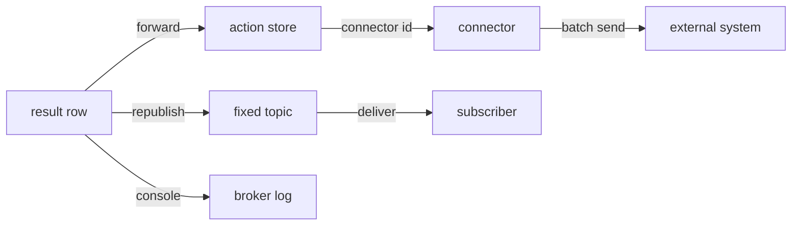

# Rule actions A: alloydb to dynamodb

<!-- GENERATED by `python3 docs/_tools/entries.py` from `docs/_inventory/`, `docs/_text/` and `docs/_verified/`. Do not edit by hand. -->

The complete MQTT platform in one small binary: broker, SQL rules, data connectors and multi-tenancy in a single process.

An action sends each result row to a backend. You create it through the management API and you point a rule at it. Use this page when a rule must reach a database, a cloud service or a log. You get one entry per action, each with a run against the broker.



Create the connector first, then the action, then the rule. A created action reads `connected` when enabled. The broker runs no probe behind that status; the status mirrors the enable flag. The docs run verifies creation only; no external server runs, so no rows reach a backend here.

## Before you start

- Read [Rule SQL](./sql.md) for the query shape.
- Create each connector before an action names it. See [Connectors](../connectors/index.md).
- Each entry below ran against the built broker through `POST /api/v5/actions`.

## Actions

| Action | What it does |
|---|---|
| `alloydb` | `alloydb` sends each result row to Google AlloyDB. |
| `aws_iot` | `aws_iot` bridges each result row to AWS IoT. |
| `aws_timestream` | `aws_timestream` is the console name for the `timestream` runtime. |
| `azure_blob` | `azure_blob` stores result rows as Azure blobs. |
| `azure_blob_storage` | `azure_blob_storage` is the console name for the `azure_blob` runtime. |
| `azure_event_grid` | `azure_event_grid` is an accepted action name with no send runtime in this build. |
| `azure_event_hub_producer` | `azure_event_hub_producer` is the console name for the `azure_eventhubs` runtime. |
| `azure_eventhubs` | `azure_eventhubs` is the runtime behind the `azure_event_hub_producer` name. |
| `azure_iot` | `azure_iot` bridges each result row to Azure IoT Hub. |
| `bigquery` | `bigquery` loads each result row into BigQuery. |
| `cassandra` | `cassandra` writes each result row to Cassandra. |
| `clickhouse` | `clickhouse` inserts each result row into ClickHouse. |
| `cockroachdb` | `cockroachdb` writes each result row to CockroachDB. |
| `confluent` | `confluent` is the runtime behind the `confluent_producer` name. |
| `confluent_producer` | `confluent_producer` is the console name for the `confluent` runtime. |
| `console` | `console` writes each result row to the broker log. |
| `couchbase` | `couchbase` stores each result row as a Couchbase document. |
| `databricks` | `databricks` loads each result row into Databricks SQL. |
| `datalayers` | `datalayers` writes each result row to Datalayers. |
| `disk_log` | `disk_log` appends each result row to local log files. |
| `doris` | `doris` loads each result row into Doris. |
| `dynamo` | `dynamo` is the console name for the `dynamodb` runtime. |
| `dynamodb` | `dynamodb` writes each result row as a DynamoDB item. |

## Actions in detail

### `alloydb`

`alloydb` sends each result row to Google AlloyDB.

The sink runs batched `INSERT` statements against the `table`. `column_mappings` maps each payload field to a database column. `auth` selects password or IAM token login. The tier is enterprise.

Signature: `POST /api/v5/actions` with `{"type": "alloydb", "name": "<id>"}`.

Example (verified through `POST /api/v5/actions`):

```json no-test
{"name": "dx2-action-alloydb", "type": "alloydb"}
```

The broker answered `201` with `"type": "alloydb"` and `"status": "connected"`.
Another create with the same name answered `400` with code `ALREADY_EXISTS`.

`GET /api/v5/action_types` lists this name.

Verified: `POST /api/v5/actions` exits 0. See `../_verified/rules/action-alloydb.json`.

Notes:

- The type catalogue lists this name.
- The connector config names `table` and `column_mappings`.
- The tier is enterprise.
- The docs run verifies creation only. No external server runs, so no rows reach the backend.
- Repeat the check with the same call against a live broker.

### `aws_iot`

`aws_iot` bridges each result row to AWS IoT.

The sink forwards rows to the topics of `topic_mappings`. The config names `endpoint`, `region` and `client_id`. The tier is enterprise.

Signature: `POST /api/v5/actions` with `{"type": "aws_iot", "name": "<id>"}`.

Example (verified through `POST /api/v5/actions`):

```json no-test
{"name": "dx2-action-aws_iot", "type": "aws_iot"}
```

The broker answered `201` with `"type": "aws_iot"` and `"status": "connected"`.
Another create with the same name answered `400` with code `ALREADY_EXISTS`.

`GET /api/v5/action_types` omits this name.

Verified: `POST /api/v5/actions` exits 0. See `../_verified/rules/action-aws_iot.json`.

Notes:

- The type catalogue omits this name. The store still accepts it.
- The connector config names `endpoint`, `region` and `topic_mappings`.
- The tier is enterprise.
- The docs run verifies creation only. No external server runs, so no rows reach the backend.
- Repeat the check with the same call against a live broker.

### `aws_timestream`

`aws_timestream` is the console name for the `timestream` runtime.

The sink writes each result row to a Timestream database table. `dimensions` labels each record. `measure_name_template` selects the measure. The tier is enterprise.

Signature: `POST /api/v5/actions` with `{"type": "aws_timestream", "name": "<id>"}`.

Example (verified through `POST /api/v5/actions`):

```json no-test
{"name": "dx2-action-aws_timestream", "type": "aws_timestream"}
```

The broker answered `201` with `"type": "aws_timestream"` and `"status": "connected"`.
Another create with the same name answered `400` with code `ALREADY_EXISTS`.

`GET /api/v5/action_types` lists this name.

Verified: `POST /api/v5/actions` exits 0. See `../_verified/rules/action-aws_timestream.json`.

Notes:

- The type catalogue lists this name. It is the console name for the `timestream` runtime.
- The connector config names the database, the table and `dimensions`.
- The tier is enterprise.
- The docs run verifies creation only. No external server runs, so no rows reach the backend.
- Repeat the check with the same call against a live broker.

### `azure_blob`

`azure_blob` stores result rows as Azure blobs.

The sink batches rows into one blob per flush. `blob_path_template` sets the blob path. `max_records_per_blob` and `max_bytes_per_blob` bound each blob. The tier is enterprise.

Signature: `POST /api/v5/actions` with `{"type": "azure_blob", "name": "<id>"}`.

Example (verified through `POST /api/v5/actions`):

```json no-test
{"name": "dx2-action-azure_blob", "type": "azure_blob"}
```

The broker answered `201` with `"type": "azure_blob"` and `"status": "connected"`.
Another create with the same name answered `400` with code `ALREADY_EXISTS`.

`GET /api/v5/action_types` omits this name.

Verified: `POST /api/v5/actions` exits 0. See `../_verified/rules/action-azure_blob.json`.

Notes:

- The type catalogue omits this name. The store still accepts it.
- The console sends `azure_blob_storage` for the same runtime.
- The connector config names `container_name` and `blob_path_template`.
- The tier is enterprise.
- The docs run verifies creation only. No external server runs, so no rows reach the backend.
- Repeat the check with the same call against a live broker.

### `azure_blob_storage`

`azure_blob_storage` is the console name for the `azure_blob` runtime.

It stores result rows as Azure blobs. It uses the same batching and the same path template. The tier is enterprise.

Signature: `POST /api/v5/actions` with `{"type": "azure_blob_storage", "name": "<id>"}`.

Example (verified through `POST /api/v5/actions`):

```json no-test
{"name": "dx2-action-azure_blob_storage", "type": "azure_blob_storage"}
```

The broker answered `201` with `"type": "azure_blob_storage"` and `"status": "connected"`.
Another create with the same name answered `400` with code `ALREADY_EXISTS`.

`GET /api/v5/action_types` lists this name.

Verified: `POST /api/v5/actions` exits 0. See `../_verified/rules/action-azure_blob_storage.json`.

Notes:

- The type catalogue lists this name. It is the console name for the `azure_blob` runtime.
- The connector config names `container_name` and `blob_path_template`.
- The tier is enterprise.
- The docs run verifies creation only. No external server runs, so no rows reach the backend.
- Repeat the check with the same call against a live broker.

### `azure_event_grid`

`azure_event_grid` is an accepted action name with no send runtime in this build.

Create accepts it. No rows leave the broker through it. Use the event hub producer name for Azure event delivery.

Signature: `POST /api/v5/actions` with `{"type": "azure_event_grid", "name": "<id>"}`.

Example (verified through `POST /api/v5/actions`):

```json no-test
{"name": "dx2-action-azure_event_grid", "type": "azure_event_grid"}
```

The broker answered `201` with `"type": "azure_event_grid"` and `"status": "connected"`.
Another create with the same name answered `400` with code `ALREADY_EXISTS`.

`GET /api/v5/action_types` omits this name.

Verified: `POST /api/v5/actions` exits 0. See `../_verified/rules/action-azure_event_grid.json`.

Notes:

- The type catalogue omits this name. The store still accepts it.
- No send runtime stands behind this name in this build. No rows leave the broker through it.
- The docs run verifies creation only. No external server runs, so no rows reach the backend.
- Repeat the check with the same call against a live broker.

### `azure_event_hub_producer`

`azure_event_hub_producer` is the console name for the `azure_eventhubs` runtime.

The sink sends each result row to an Event Hub. `partition_key_template` selects the partition. `batch_size` and `batch_bytes` bound each batch. The tier is enterprise.

Signature: `POST /api/v5/actions` with `{"type": "azure_event_hub_producer", "name": "<id>"}`.

Example (verified through `POST /api/v5/actions`):

```json no-test
{"name": "dx2-action-azure_event_hub_producer", "type": "azure_event_hub_producer"}
```

The broker answered `201` with `"type": "azure_event_hub_producer"` and `"status": "connected"`.
Another create with the same name answered `400` with code `ALREADY_EXISTS`.

`GET /api/v5/action_types` lists this name.

Verified: `POST /api/v5/actions` exits 0. See `../_verified/rules/action-azure_event_hub_producer.json`.

Notes:

- The type catalogue lists this name. It is the console name for the `azure_eventhubs` runtime.
- The connector config names `namespace`, `event_hub` and `partition_key_template`.
- The tier is enterprise.
- The docs run verifies creation only. No external server runs, so no rows reach the backend.
- Repeat the check with the same call against a live broker.

### `azure_eventhubs`

`azure_eventhubs` is the runtime behind the `azure_event_hub_producer` name.

It sends each result row to an Event Hub. It uses the same namespace, hub and partition key template. The tier is enterprise.

Signature: `POST /api/v5/actions` with `{"type": "azure_eventhubs", "name": "<id>"}`.

Example (verified through `POST /api/v5/actions`):

```json no-test
{"name": "dx2-action-azure_eventhubs", "type": "azure_eventhubs"}
```

The broker answered `201` with `"type": "azure_eventhubs"` and `"status": "connected"`.
Another create with the same name answered `400` with code `ALREADY_EXISTS`.

`GET /api/v5/action_types` omits this name.

Verified: `POST /api/v5/actions` exits 0. See `../_verified/rules/action-azure_eventhubs.json`.

Notes:

- The type catalogue omits this name. The store still accepts it.
- The console sends `azure_event_hub_producer` for the same runtime.
- The tier is enterprise.
- The docs run verifies creation only. No external server runs, so no rows reach the backend.
- Repeat the check with the same call against a live broker.

### `azure_iot`

`azure_iot` bridges each result row to Azure IoT Hub.

The config names `iot_hub_name` and `device_id`. `auth` selects the credential. The tier is enterprise.

Signature: `POST /api/v5/actions` with `{"type": "azure_iot", "name": "<id>"}`.

Example (verified through `POST /api/v5/actions`):

```json no-test
{"name": "dx2-action-azure_iot", "type": "azure_iot"}
```

The broker answered `201` with `"type": "azure_iot"` and `"status": "connected"`.
Another create with the same name answered `400` with code `ALREADY_EXISTS`.

`GET /api/v5/action_types` omits this name.

Verified: `POST /api/v5/actions` exits 0. See `../_verified/rules/action-azure_iot.json`.

Notes:

- The type catalogue omits this name. The store still accepts it.
- The connector config names `iot_hub_name` and `device_id`.
- The tier is enterprise.
- The docs run verifies creation only. No external server runs, so no rows reach the backend.
- Repeat the check with the same call against a live broker.

### `bigquery`

`bigquery` loads each result row into BigQuery.

The sink writes to `project_id`, `dataset_id` and `table_template`. `batch_size` and `batch_bytes` bound each load. The tier is enterprise.

Signature: `POST /api/v5/actions` with `{"type": "bigquery", "name": "<id>"}`.

Example (verified through `POST /api/v5/actions`):

```json no-test
{"name": "dx2-action-bigquery", "type": "bigquery"}
```

The broker answered `201` with `"type": "bigquery"` and `"status": "connected"`.
Another create with the same name answered `400` with code `ALREADY_EXISTS`.

`GET /api/v5/action_types` lists this name.

Verified: `POST /api/v5/actions` exits 0. See `../_verified/rules/action-bigquery.json`.

Notes:

- The type catalogue lists this name.
- The connector config names `project_id`, `dataset_id` and `table_template`.
- The tier is enterprise.
- The docs run verifies creation only. No external server runs, so no rows reach the backend.
- Repeat the check with the same call against a live broker.

### `cassandra`

`cassandra` writes each result row to Cassandra.

The sink maps rows to a keyspace table. `cql_statement_template` sets the statement. `consistency` sets the write level. The tier is enterprise.

Signature: `POST /api/v5/actions` with `{"type": "cassandra", "name": "<id>"}`.

Example (verified through `POST /api/v5/actions`):

```json no-test
{"name": "dx2-action-cassandra", "type": "cassandra"}
```

The broker answered `201` with `"type": "cassandra"` and `"status": "connected"`.
Another create with the same name answered `400` with code `ALREADY_EXISTS`.

`GET /api/v5/action_types` lists this name.

Verified: `POST /api/v5/actions` exits 0. See `../_verified/rules/action-cassandra.json`.

Notes:

- The type catalogue lists this name.
- The connector config names `contact_points`, `keyspace` and `cql_statement_template`.
- The tier is enterprise.
- The docs run verifies creation only. No external server runs, so no rows reach the backend.
- Repeat the check with the same call against a live broker.

### `clickhouse`

`clickhouse` inserts each result row into ClickHouse.

The sink posts rows to `endpoint` into `database` and `table`. `batch_size` and `batch_timeout_ms` bound each insert. The tier is community.

Signature: `POST /api/v5/actions` with `{"type": "clickhouse", "name": "<id>"}`.

Example (verified through `POST /api/v5/actions`):

```json no-test
{"name": "dx2-action-clickhouse", "type": "clickhouse"}
```

The broker answered `201` with `"type": "clickhouse"` and `"status": "connected"`.
Another create with the same name answered `400` with code `ALREADY_EXISTS`.

`GET /api/v5/action_types` lists this name.

Verified: `POST /api/v5/actions` exits 0. See `../_verified/rules/action-clickhouse.json`.

Notes:

- The type catalogue lists this name.
- The connector config names `endpoint`, `database` and `table`.
- The tier is community.
- The docs run verifies creation only. No external server runs, so no rows reach the backend.
- Repeat the check with the same call against a live broker.

### `cockroachdb`

`cockroachdb` writes each result row to CockroachDB.

The sink runs batched upserts against `table`. `upsert_conflict_columns` sets the conflict target. The tier is enterprise.

Signature: `POST /api/v5/actions` with `{"type": "cockroachdb", "name": "<id>"}`.

Example (verified through `POST /api/v5/actions`):

```json no-test
{"name": "dx2-action-cockroachdb", "type": "cockroachdb"}
```

The broker answered `201` with `"type": "cockroachdb"` and `"status": "connected"`.
Another create with the same name answered `400` with code `ALREADY_EXISTS`.

`GET /api/v5/action_types` lists this name.

Verified: `POST /api/v5/actions` exits 0. See `../_verified/rules/action-cockroachdb.json`.

Notes:

- The type catalogue lists this name.
- The connector config names `connection_string` and `table`.
- The tier is enterprise.
- The docs run verifies creation only. No external server runs, so no rows reach the backend.
- Repeat the check with the same call against a live broker.

### `confluent`

`confluent` is the runtime behind the `confluent_producer` name.

It sends each result row to Confluent Cloud Kafka. It uses the same bootstrap servers and topic template. The tier is enterprise.

Signature: `POST /api/v5/actions` with `{"type": "confluent", "name": "<id>"}`.

Example (verified through `POST /api/v5/actions`):

```json no-test
{"name": "dx2-action-confluent", "type": "confluent"}
```

The broker answered `201` with `"type": "confluent"` and `"status": "connected"`.
Another create with the same name answered `400` with code `ALREADY_EXISTS`.

`GET /api/v5/action_types` omits this name.

Verified: `POST /api/v5/actions` exits 0. See `../_verified/rules/action-confluent.json`.

Notes:

- The type catalogue omits this name. The store still accepts it.
- The console sends `confluent_producer` for the same runtime.
- The tier is enterprise.
- The docs run verifies creation only. No external server runs, so no rows reach the backend.
- Repeat the check with the same call against a live broker.

### `confluent_producer`

`confluent_producer` is the console name for the `confluent` runtime.

The sink sends each result row to a Kafka topic. `topic_template` selects the topic. `partition_key_template` selects the key. The tier is enterprise.

Signature: `POST /api/v5/actions` with `{"type": "confluent_producer", "name": "<id>"}`.

Example (verified through `POST /api/v5/actions`):

```json no-test
{"name": "dx2-action-confluent_producer", "type": "confluent_producer"}
```

The broker answered `201` with `"type": "confluent_producer"` and `"status": "connected"`.
Another create with the same name answered `400` with code `ALREADY_EXISTS`.

`GET /api/v5/action_types` lists this name.

Verified: `POST /api/v5/actions` exits 0. See `../_verified/rules/action-confluent_producer.json`.

Notes:

- The type catalogue lists this name. It is the console name for the `confluent` runtime.
- The connector config names `bootstrap_servers` and `topic_template`.
- The tier is enterprise.
- The docs run verifies creation only. No external server runs, so no rows reach the backend.
- Repeat the check with the same call against a live broker.

### `console`

`console` writes each result row to the broker log.

The sink logs one line per row at info level. Longer rows truncate. The tier is community.

Signature: `POST /api/v5/actions` with `{"type": "console", "name": "<id>"}`.

Example (verified through `POST /api/v5/actions`):

```json no-test
{"name": "dx2-action-console", "type": "console"}
```

The broker answered `201` with `"type": "console"` and `"status": "connected"`.
Another create with the same name answered `400` with code `ALREADY_EXISTS`.

`GET /api/v5/action_types` omits this name.

Verified: `POST /api/v5/actions` exits 0. See `../_verified/rules/action-console.json`.

Notes:

- The type catalogue omits this name. The store still accepts it.
- A created row reads `connected` when enabled. The broker runs no probe behind it.
- The tier is community.
- The docs run verifies creation only. No external server runs, so no rows reach the backend.
- Repeat the check with the same call against a live broker.

### `couchbase`

`couchbase` stores each result row as a Couchbase document.

The sink writes to `bucket`, `scope` and `collection`. `doc_id_template` sets the document id. `operation` selects insert, upsert or replace. The tier is enterprise.

Signature: `POST /api/v5/actions` with `{"type": "couchbase", "name": "<id>"}`.

Example (verified through `POST /api/v5/actions`):

```json no-test
{"name": "dx2-action-couchbase", "type": "couchbase"}
```

The broker answered `201` with `"type": "couchbase"` and `"status": "connected"`.
Another create with the same name answered `400` with code `ALREADY_EXISTS`.

`GET /api/v5/action_types` lists this name.

Verified: `POST /api/v5/actions` exits 0. See `../_verified/rules/action-couchbase.json`.

Notes:

- The type catalogue lists this name.
- The connector config names `connection_string`, `bucket` and `doc_id_template`.
- The tier is enterprise.
- The docs run verifies creation only. No external server runs, so no rows reach the backend.
- Repeat the check with the same call against a live broker.

### `databricks`

`databricks` loads each result row into Databricks SQL.

The sink writes to `catalog`, `schema` and `table_template`. `http_path` selects the warehouse. `column_mappings` maps payload fields to columns. The tier is enterprise.

Signature: `POST /api/v5/actions` with `{"type": "databricks", "name": "<id>"}`.

Example (verified through `POST /api/v5/actions`):

```json no-test
{"name": "dx2-action-databricks", "type": "databricks"}
```

The broker answered `201` with `"type": "databricks"` and `"status": "connected"`.
Another create with the same name answered `400` with code `ALREADY_EXISTS`.

`GET /api/v5/action_types` omits this name.

Verified: `POST /api/v5/actions` exits 0. See `../_verified/rules/action-databricks.json`.

Notes:

- The type catalogue omits this name. The store still accepts it.
- The connector config names `host`, `catalog` and `table_template`.
- The tier is enterprise.
- The docs run verifies creation only. No external server runs, so no rows reach the backend.
- Repeat the check with the same call against a live broker.

### `datalayers`

`datalayers` writes each result row to Datalayers.

The sink posts rows to `endpoint` into `database` and `table`. `batch_size` and `buffer_capacity` bound the queue. The tier is enterprise.

Signature: `POST /api/v5/actions` with `{"type": "datalayers", "name": "<id>"}`.

Example (verified through `POST /api/v5/actions`):

```json no-test
{"name": "dx2-action-datalayers", "type": "datalayers"}
```

The broker answered `201` with `"type": "datalayers"` and `"status": "connected"`.
Another create with the same name answered `400` with code `ALREADY_EXISTS`.

`GET /api/v5/action_types` lists this name.

Verified: `POST /api/v5/actions` exits 0. See `../_verified/rules/action-datalayers.json`.

Notes:

- The type catalogue lists this name.
- The connector config names `endpoint`, `database` and `table`.
- The tier is enterprise.
- The docs run verifies creation only. No external server runs, so no rows reach the backend.
- Repeat the check with the same call against a live broker.

### `disk_log`

`disk_log` appends each result row to local log files.

The sink writes under `directory` with `filename_prefix`. `format` selects the row encoding. Rotation bounds each file by size and age. The tier is community.

Signature: `POST /api/v5/actions` with `{"type": "disk_log", "name": "<id>"}`.

Example (verified through `POST /api/v5/actions`):

```json no-test
{"name": "dx2-action-disk_log", "type": "disk_log"}
```

The broker answered `201` with `"type": "disk_log"` and `"status": "connected"`.
Another create with the same name answered `400` with code `ALREADY_EXISTS`.

`GET /api/v5/action_types` lists this name.

Verified: `POST /api/v5/actions` exits 0. See `../_verified/rules/action-disk_log.json`.

Notes:

- The type catalogue lists this name.
- The connector config names `directory` and `filename_prefix`.
- The tier is community.
- The docs run verifies creation only. No external server runs, so no rows reach the backend.
- Repeat the check with the same call against a live broker.

### `doris`

`doris` loads each result row into Doris.

The sink stream-loads into `database` and `table_template`. `format` selects the payload encoding. `max_filter_ratio` bounds tolerated bad rows. The tier is enterprise.

Signature: `POST /api/v5/actions` with `{"type": "doris", "name": "<id>"}`.

Example (verified through `POST /api/v5/actions`):

```json no-test
{"name": "dx2-action-doris", "type": "doris"}
```

The broker answered `201` with `"type": "doris"` and `"status": "connected"`.
Another create with the same name answered `400` with code `ALREADY_EXISTS`.

`GET /api/v5/action_types` lists this name.

Verified: `POST /api/v5/actions` exits 0. See `../_verified/rules/action-doris.json`.

Notes:

- The type catalogue lists this name.
- The connector config names `fe_host`, `database` and `table_template`.
- The tier is enterprise.
- The docs run verifies creation only. No external server runs, so no rows reach the backend.
- Repeat the check with the same call against a live broker.

### `dynamo`

`dynamo` is the console name for the `dynamodb` runtime.

It writes each result row as a DynamoDB item. It uses the same table and key mapping. The tier is enterprise.

Signature: `POST /api/v5/actions` with `{"type": "dynamo", "name": "<id>"}`.

Example (verified through `POST /api/v5/actions`):

```json no-test
{"name": "dx2-action-dynamo", "type": "dynamo"}
```

The broker answered `201` with `"type": "dynamo"` and `"status": "connected"`.
Another create with the same name answered `400` with code `ALREADY_EXISTS`.

`GET /api/v5/action_types` lists this name.

Verified: `POST /api/v5/actions` exits 0. See `../_verified/rules/action-dynamo.json`.

Notes:

- The type catalogue lists this name. It is the console name for the `dynamodb` runtime.
- The connector config names `table_name` and the key mapping.
- The tier is enterprise.
- The docs run verifies creation only. No external server runs, so no rows reach the backend.
- Repeat the check with the same call against a live broker.

### `dynamodb`

`dynamodb` writes each result row as a DynamoDB item.

The sink puts items into `table_name`. `partition_key` and `sort_key` map the keys. `ttl_attribute` with `ttl_secs` expires items. The tier is enterprise.

Signature: `POST /api/v5/actions` with `{"type": "dynamodb", "name": "<id>"}`.

Example (verified through `POST /api/v5/actions`):

```json no-test
{"name": "dx2-action-dynamodb", "type": "dynamodb"}
```

The broker answered `201` with `"type": "dynamodb"` and `"status": "connected"`.
Another create with the same name answered `400` with code `ALREADY_EXISTS`.

`GET /api/v5/action_types` omits this name.

Verified: `POST /api/v5/actions` exits 0. See `../_verified/rules/action-dynamodb.json`.

Notes:

- The type catalogue omits this name. The store still accepts it.
- The console sends `dynamo` for the same runtime.
- The tier is enterprise.
- The docs run verifies creation only. No external server runs, so no rows reach the backend.
- Repeat the check with the same call against a live broker.

## Check that it works

Create one action and read it back:

```sh no-test
# Needs a live broker and an operator key. Use your own name.
curl -H "Authorization: Bearer $KEY" -H "Content-Type: application/json" \
  -d '{"type": "disk_log", "name": "dx-check"}' \
  http://127.0.0.1:18083/api/v5/actions
```

The answer is `201` with the stored shape. A second create with the same name answers `400` with code `ALREADY_EXISTS`.

## Next steps

- Write the query with [Rule SQL](./sql.md).
- Shape payloads with [Functions](./functions.md).
- Send results with [Actions](./actions.md).
