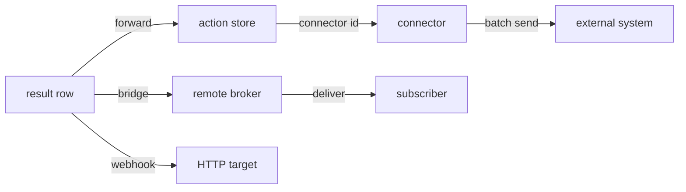

# Connector actions: Elasticsearch to OpenTSDB

<!-- GENERATED by `python3 docs/_tools/entries.py` from `docs/_inventory/`, `docs/_text/` and `docs/_verified/`. Do not edit by hand. -->

The complete MQTT platform in one small binary: broker, SQL rules, data connectors and multi-tenancy in a single process.

An action sends each result row to a backend. You create it through the management API and you point a rule at it. Use this page when a rule must reach a search index, a queue, a database or a device cloud. You get one entry per action, each with a run against the broker.



Create the connector first, then the action, then the rule. A created action reads `connected` when enabled. The broker runs no probe behind that status; the status mirrors the enable flag. The docs run verifies creation only; no external server runs, so no rows reach a backend here.

## Before you start

- Read [Rule SQL](./sql.md) for the query shape.
- Create each connector before an action names it. See [Connectors](../connectors/index.md).
- Each entry below ran against the built broker through `POST /api/v5/actions`.

## Actions

| Action | What it does |
|---|---|
| `elasticsearch` | `elasticsearch` sends each result row to Elasticsearch. |
| `gcp_iot` | `gcp_iot` bridges each result row to Google Cloud IoT. |
| `gcp_pubsub` | `gcp_pubsub` publishes each result row to Google Cloud Pub/Sub. |
| `gcp_pubsub_consumer` | `gcp_pubsub_consumer` names the Google Cloud Pub/Sub ingress source. |
| `gcp_pubsub_producer` | `gcp_pubsub_producer` is the console name for the `gcp_pubsub` runtime. |
| `greptimedb` | `greptimedb` writes each result row to GreptimeDB. |
| `http` | `http` posts each result row to a URL as a webhook. |
| `influxdb` | `influxdb` writes each result row to InfluxDB. |
| `iotdb` | `iotdb` writes each result row to Apache IoTDB. |
| `kafka` | `kafka` sends each result row to Apache Kafka. |
| `kafka_consumer` | `kafka_consumer` names the Kafka ingress source. |
| `kafka_producer` | `kafka_producer` is the console name for the `kafka` runtime. |
| `kinesis` | `kinesis` writes each result row to AWS Kinesis. |
| `mongodb` | `mongodb` stores each result row as a MongoDB document. |
| `mqtt` | `mqtt` is the console name for the `mqtt_bridge` runtime. |
| `mqtt_bridge` | `mqtt_bridge` forwards each result row to another broker. |
| `mssql` | `mssql` writes each result row to Microsoft SQL Server. |
| `mysql` | `mysql` writes each result row to MySQL. |
| `oci_streaming` | `oci_streaming` writes each result row to OCI Streaming. |
| `opc_ua` | `opc_ua` publishes each result row to an OPC UA server. |
| `opents` | `opents` is the console name for the `opentsdb` runtime. |
| `opentsdb` | `opentsdb` writes each result row to OpenTSDB. |

## Actions in detail

### `elasticsearch`

`elasticsearch` sends each result row to Elasticsearch.

The sink posts rows in bulk to the `url`. `index_template` selects the index. The tier is community.

Signature: `POST /api/v5/actions` with `{"type": "elasticsearch", "name": "<id>"}`.

Example (verified through `POST /api/v5/actions`):

```json no-test
{"name": "dx2-action-elasticsearch", "type": "elasticsearch"}
```

The broker answered `201` with `"type": "elasticsearch"` and `"status": "connected"`.
Another create with the same name answered `400` with code `ALREADY_EXISTS`.

`GET /api/v5/action_types` lists this name.

Verified: `POST /api/v5/actions` exits 0. See `../_verified/rules/action-elasticsearch.json`.

Notes:

- The type catalogue lists this name.
- The connector config names `url` and `index_template`.
- The tier is community.
- The docs run verifies creation only. No external server runs, so no rows reach the backend.
- Repeat the check with the same call against a live broker.

### `gcp_iot`

`gcp_iot` bridges each result row to Google Cloud IoT.

The sink addresses `project_id`, `registry_id` and `device_id`. `private_key` holds the key file path. The tier is enterprise.

Signature: `POST /api/v5/actions` with `{"type": "gcp_iot", "name": "<id>"}`.

Example (verified through `POST /api/v5/actions`):

```json no-test
{"name": "dx2-action-gcp_iot", "type": "gcp_iot"}
```

The broker answered `201` with `"type": "gcp_iot"` and `"status": "connected"`.
Another create with the same name answered `400` with code `ALREADY_EXISTS`.

`GET /api/v5/action_types` omits this name.

Verified: `POST /api/v5/actions` exits 0. See `../_verified/rules/action-gcp_iot.json`.

Notes:

- The type catalogue omits this name. The store still accepts it.
- The connector config names `project_id`, `registry_id` and `device_id`.
- The tier is enterprise.
- The docs run verifies creation only. No external server runs, so no rows reach the backend.
- Repeat the check with the same call against a live broker.

### `gcp_pubsub`

`gcp_pubsub` publishes each result row to Google Cloud Pub/Sub.

The sink addresses the `topic` of `project_id`. The tier is enterprise.

Signature: `POST /api/v5/actions` with `{"type": "gcp_pubsub", "name": "<id>"}`.

Example (verified through `POST /api/v5/actions`):

```json no-test
{"name": "dx2-action-gcp_pubsub", "type": "gcp_pubsub"}
```

The broker answered `201` with `"type": "gcp_pubsub"` and `"status": "connected"`.
Another create with the same name answered `400` with code `ALREADY_EXISTS`.

`GET /api/v5/action_types` omits this name.

Verified: `POST /api/v5/actions` exits 0. See `../_verified/rules/action-gcp_pubsub.json`.

Notes:

- The type catalogue omits this name. The store still accepts it.
- The console sends `gcp_pubsub_producer` for the same runtime.
- The connector config names `project_id` and `topic`.
- The tier is enterprise.
- The docs run verifies creation only. No external server runs, so no rows reach the backend.
- Repeat the check with the same call against a live broker.

### `gcp_pubsub_consumer`

`gcp_pubsub_consumer` names the Google Cloud Pub/Sub ingress source.

The source reads the `topic` of `project_id`. The action store rejects this name. Use `gcp_pubsub_producer` for the send path.

Signature: `POST /api/v5/actions` with `{"type": "gcp_pubsub_consumer", "name": "<id>"}`.

> **Not verified: see `../_verification/failures.md`.**

Notes:

- The type catalogue omits this name. The action store rejects it.
- It is a source name: the source catalogue lists it with `project_id` and `topic`.
- Use `gcp_pubsub_producer` for the send path.
- The docs run verifies creation only. No external server runs, so no rows reach the backend.
- Repeat the check with the same call against a live broker.

### `gcp_pubsub_producer`

`gcp_pubsub_producer` is the console name for the `gcp_pubsub` runtime.

It publishes each result row to the `topic` of `project_id`. The tier is community.

Signature: `POST /api/v5/actions` with `{"type": "gcp_pubsub_producer", "name": "<id>"}`.

Example (verified through `POST /api/v5/actions`):

```json no-test
{"name": "dx2-action-gcp_pubsub_producer", "type": "gcp_pubsub_producer"}
```

The broker answered `201` with `"type": "gcp_pubsub_producer"` and `"status": "connected"`.
Another create with the same name answered `400` with code `ALREADY_EXISTS`.

`GET /api/v5/action_types` lists this name.

Verified: `POST /api/v5/actions` exits 0. See `../_verified/rules/action-gcp_pubsub_producer.json`.

Notes:

- The type catalogue lists this name. It is the console name for the `gcp_pubsub` runtime.
- The connector config names `project_id` and `topic`.
- The tier is community.
- The docs run verifies creation only. No external server runs, so no rows reach the backend.
- Repeat the check with the same call against a live broker.

### `greptimedb`

`greptimedb` writes each result row to GreptimeDB.

The sink addresses the `table` of `database` at the `url`. The tier is community.

Signature: `POST /api/v5/actions` with `{"type": "greptimedb", "name": "<id>"}`.

Example (verified through `POST /api/v5/actions`):

```json no-test
{"name": "dx2-action-greptimedb", "type": "greptimedb"}
```

The broker answered `201` with `"type": "greptimedb"` and `"status": "connected"`.
Another create with the same name answered `400` with code `ALREADY_EXISTS`.

`GET /api/v5/action_types` lists this name.

Verified: `POST /api/v5/actions` exits 0. See `../_verified/rules/action-greptimedb.json`.

Notes:

- The type catalogue lists this name.
- The connector config names `url`, `database` and `table`.
- The tier is community.
- The docs run verifies creation only. No external server runs, so no rows reach the backend.
- Repeat the check with the same call against a live broker.

### `http`

`http` posts each result row to a URL as a webhook.

The sink reads the target from the `url`. A missing URL fails the send closed. The tier is community.

Signature: `POST /api/v5/actions` with `{"type": "http", "name": "<id>"}`.

Example (verified through `POST /api/v5/actions`):

```json no-test
{"name": "dx2-action-http", "type": "http"}
```

The broker answered `201` with `"type": "http"` and `"status": "connected"`.
Another create with the same name answered `400` with code `ALREADY_EXISTS`.

`GET /api/v5/action_types` lists this name.

Verified: `POST /api/v5/actions` exits 0. See `../_verified/rules/action-http.json`.

Notes:

- The type catalogue lists this name.
- The sink posts each row to the `url`. A missing URL fails the send closed.
- The tier is community.
- The docs run verifies creation only. No external server runs, so no rows reach the backend.
- Repeat the check with the same call against a live broker.

### `influxdb`

`influxdb` writes each result row to InfluxDB.

The sink posts line protocol to the `url`. `org`, `bucket` and `token` select the target. The tier is community.

Signature: `POST /api/v5/actions` with `{"type": "influxdb", "name": "<id>"}`.

Example (verified through `POST /api/v5/actions`):

```json no-test
{"name": "dx2-action-influxdb", "type": "influxdb"}
```

The broker answered `201` with `"type": "influxdb"` and `"status": "connected"`.
Another create with the same name answered `400` with code `ALREADY_EXISTS`.

`GET /api/v5/action_types` lists this name.

Verified: `POST /api/v5/actions` exits 0. See `../_verified/rules/action-influxdb.json`.

Notes:

- The type catalogue lists this name.
- The connector config names `url`, `org`, `bucket` and `token`.
- The tier is community.
- The docs run verifies creation only. No external server runs, so no rows reach the backend.
- Repeat the check with the same call against a live broker.

### `iotdb`

`iotdb` writes each result row to Apache IoTDB.

The sink addresses the `table` of `database` at the `url`. The tier is enterprise.

Signature: `POST /api/v5/actions` with `{"type": "iotdb", "name": "<id>"}`.

Example (verified through `POST /api/v5/actions`):

```json no-test
{"name": "dx2-action-iotdb", "type": "iotdb"}
```

The broker answered `201` with `"type": "iotdb"` and `"status": "connected"`.
Another create with the same name answered `400` with code `ALREADY_EXISTS`.

`GET /api/v5/action_types` lists this name.

Verified: `POST /api/v5/actions` exits 0. See `../_verified/rules/action-iotdb.json`.

Notes:

- The type catalogue lists this name.
- The connector config names `url`, `database` and `table`.
- The tier is enterprise.
- The docs run verifies creation only. No external server runs, so no rows reach the backend.
- Repeat the check with the same call against a live broker.

### `kafka`

`kafka` sends each result row to Apache Kafka.

The sink dials `bootstrap_servers` and writes the `topic`. The tier is community.

Signature: `POST /api/v5/actions` with `{"type": "kafka", "name": "<id>"}`.

Example (verified through `POST /api/v5/actions`):

```json no-test
{"name": "dx2-action-kafka", "type": "kafka"}
```

The broker answered `201` with `"type": "kafka"` and `"status": "connected"`.
Another create with the same name answered `400` with code `ALREADY_EXISTS`.

`GET /api/v5/action_types` omits this name.

Verified: `POST /api/v5/actions` exits 0. See `../_verified/rules/action-kafka.json`.

Notes:

- The type catalogue omits this name. The store still accepts it.
- The console sends `kafka_producer` for the same runtime.
- The connector config names `bootstrap_servers` and `topic`.
- The tier is community.
- The docs run verifies creation only. No external server runs, so no rows reach the backend.
- Repeat the check with the same call against a live broker.

### `kafka_consumer`

`kafka_consumer` names the Kafka ingress source.

The source reads `topic` from `bootstrap_hosts`. The store still accepts it as an action name. It runs on the `kafka` runtime. The tier is community.

Signature: `POST /api/v5/actions` with `{"type": "kafka_consumer", "name": "<id>"}`.

Example (verified through `POST /api/v5/actions`):

```json no-test
{"name": "dx2-action-kafka_consumer", "type": "kafka_consumer"}
```

The broker answered `201` with `"type": "kafka_consumer"` and `"status": "connected"`.
Another create with the same name answered `400` with code `ALREADY_EXISTS`.

`GET /api/v5/action_types` omits this name.

Verified: `POST /api/v5/actions` exits 0. See `../_verified/rules/action-kafka_consumer.json`.

Notes:

- The type catalogue omits this name. The store still accepts it.
- It is the console name for the Kafka ingress source. It runs on the `kafka` runtime.
- The source config names `bootstrap_hosts` and `topic`.
- The tier is community.
- The docs run verifies creation only. No external server runs, so no rows reach the backend.
- Repeat the check with the same call against a live broker.

### `kafka_producer`

`kafka_producer` is the console name for the `kafka` runtime.

It sends each result row to the `topic`. It uses the same bootstrap servers. The tier is community.

Signature: `POST /api/v5/actions` with `{"type": "kafka_producer", "name": "<id>"}`.

Example (verified through `POST /api/v5/actions`):

```json no-test
{"name": "dx2-action-kafka_producer", "type": "kafka_producer"}
```

The broker answered `201` with `"type": "kafka_producer"` and `"status": "connected"`.
Another create with the same name answered `400` with code `ALREADY_EXISTS`.

`GET /api/v5/action_types` lists this name.

Verified: `POST /api/v5/actions` exits 0. See `../_verified/rules/action-kafka_producer.json`.

Notes:

- The type catalogue lists this name. It is the console name for the `kafka` runtime.
- The connector config names `bootstrap_servers` and `topic`.
- The tier is community.
- The docs run verifies creation only. No external server runs, so no rows reach the backend.
- Repeat the check with the same call against a live broker.

### `kinesis`

`kinesis` writes each result row to AWS Kinesis.

The sink addresses `stream_name` in the `region`. The tier is enterprise.

Signature: `POST /api/v5/actions` with `{"type": "kinesis", "name": "<id>"}`.

Example (verified through `POST /api/v5/actions`):

```json no-test
{"name": "dx2-action-kinesis", "type": "kinesis"}
```

The broker answered `201` with `"type": "kinesis"` and `"status": "connected"`.
Another create with the same name answered `400` with code `ALREADY_EXISTS`.

`GET /api/v5/action_types` lists this name.

Verified: `POST /api/v5/actions` exits 0. See `../_verified/rules/action-kinesis.json`.

Notes:

- The type catalogue lists this name.
- The connector config names `stream_name` and `region`.
- The tier is enterprise.
- The docs run verifies creation only. No external server runs, so no rows reach the backend.
- Repeat the check with the same call against a live broker.

### `mongodb`

`mongodb` stores each result row as a MongoDB document.

`connection_string`, `database` and `collection` select the target. The tier is enterprise.

Signature: `POST /api/v5/actions` with `{"type": "mongodb", "name": "<id>"}`.

Example (verified through `POST /api/v5/actions`):

```json no-test
{"name": "dx2-action-mongodb", "type": "mongodb"}
```

The broker answered `201` with `"type": "mongodb"` and `"status": "connected"`.
Another create with the same name answered `400` with code `ALREADY_EXISTS`.

`GET /api/v5/action_types` lists this name.

Verified: `POST /api/v5/actions` exits 0. See `../_verified/rules/action-mongodb.json`.

Notes:

- The type catalogue lists this name.
- The connector config names `connection_string`, `database` and `collection`.
- The tier is enterprise.
- The docs run verifies creation only. No external server runs, so no rows reach the backend.
- Repeat the check with the same call against a live broker.

### `mqtt`

`mqtt` is the console name for the `mqtt_bridge` runtime.

It forwards each result row to another broker. `endpoint` sets the remote broker. `topic_template` selects the target topic. The tier is community.

Signature: `POST /api/v5/actions` with `{"type": "mqtt", "name": "<id>"}`.

Example (verified through `POST /api/v5/actions`):

```json no-test
{"name": "dx2-action-mqtt", "type": "mqtt"}
```

The broker answered `201` with `"type": "mqtt"` and `"status": "connected"`.
Another create with the same name answered `400` with code `ALREADY_EXISTS`.

`GET /api/v5/action_types` lists this name.

Verified: `POST /api/v5/actions` exits 0. See `../_verified/rules/action-mqtt.json`.

Notes:

- The type catalogue lists this name. It is the console name for the `mqtt_bridge` runtime.
- The connector config names `endpoint` and `topic_template`.
- The tier is community.
- The docs run verifies creation only. No external server runs, so no rows reach the backend.
- Repeat the check with the same call against a live broker.

### `mqtt_bridge`

`mqtt_bridge` forwards each result row to another broker.

`endpoint` sets the remote broker. `topic_template` selects the target topic. The tier is community.

Signature: `POST /api/v5/actions` with `{"type": "mqtt_bridge", "name": "<id>"}`.

Example (verified through `POST /api/v5/actions`):

```json no-test
{"name": "dx2-action-mqtt_bridge", "type": "mqtt_bridge"}
```

The broker answered `201` with `"type": "mqtt_bridge"` and `"status": "connected"`.
Another create with the same name answered `400` with code `ALREADY_EXISTS`.

`GET /api/v5/action_types` omits this name.

Verified: `POST /api/v5/actions` exits 0. See `../_verified/rules/action-mqtt_bridge.json`.

Notes:

- The type catalogue omits this name. The store still accepts it.
- The console sends `mqtt` for the same runtime.
- The connector config names `endpoint` and `topic_template`.
- The tier is community.
- The docs run verifies creation only. No external server runs, so no rows reach the backend.
- Repeat the check with the same call against a live broker.

### `mssql`

`mssql` writes each result row to Microsoft SQL Server.

`connection_url` and `table` select the target. The tier is enterprise.

Signature: `POST /api/v5/actions` with `{"type": "mssql", "name": "<id>"}`.

Example (verified through `POST /api/v5/actions`):

```json no-test
{"name": "dx2-action-mssql", "type": "mssql"}
```

The broker answered `201` with `"type": "mssql"` and `"status": "connected"`.
Another create with the same name answered `400` with code `ALREADY_EXISTS`.

`GET /api/v5/action_types` omits this name.

Verified: `POST /api/v5/actions` exits 0. See `../_verified/rules/action-mssql.json`.

Notes:

- The type catalogue omits this name. The store still accepts it.
- The console sends `sqlserver` for the same runtime.
- The connector config names `connection_url` and `table`.
- The tier is enterprise.
- The docs run verifies creation only. No external server runs, so no rows reach the backend.
- Repeat the check with the same call against a live broker.

### `mysql`

`mysql` writes each result row to MySQL.

`connection_url` and `table` select the target. The tier is community.

Signature: `POST /api/v5/actions` with `{"type": "mysql", "name": "<id>"}`.

Example (verified through `POST /api/v5/actions`):

```json no-test
{"name": "dx2-action-mysql", "type": "mysql"}
```

The broker answered `201` with `"type": "mysql"` and `"status": "connected"`.
Another create with the same name answered `400` with code `ALREADY_EXISTS`.

`GET /api/v5/action_types` lists this name.

Verified: `POST /api/v5/actions` exits 0. See `../_verified/rules/action-mysql.json`.

Notes:

- The type catalogue lists this name.
- The connector config names `connection_url` and `table`.
- The tier is community.
- The docs run verifies creation only. No external server runs, so no rows reach the backend.
- Repeat the check with the same call against a live broker.

### `oci_streaming`

`oci_streaming` writes each result row to OCI Streaming.

`stream_ocid` and `compartment_ocid` select the target. The tier is enterprise.

Signature: `POST /api/v5/actions` with `{"type": "oci_streaming", "name": "<id>"}`.

Example (verified through `POST /api/v5/actions`):

```json no-test
{"name": "dx2-action-oci_streaming", "type": "oci_streaming"}
```

The broker answered `201` with `"type": "oci_streaming"` and `"status": "connected"`.
Another create with the same name answered `400` with code `ALREADY_EXISTS`.

`GET /api/v5/action_types` omits this name.

Verified: `POST /api/v5/actions` exits 0. See `../_verified/rules/action-oci_streaming.json`.

Notes:

- The type catalogue omits this name. The store still accepts it.
- The connector config names `stream_ocid` and `compartment_ocid`.
- The tier is enterprise.
- The docs run verifies creation only. No external server runs, so no rows reach the backend.
- Repeat the check with the same call against a live broker.

### `opc_ua`

`opc_ua` publishes each result row to an OPC UA server.

`endpoint_url` and `node_id` select the target. `security_policy` selects the policy. The tier is enterprise.

Signature: `POST /api/v5/actions` with `{"type": "opc_ua", "name": "<id>"}`.

Example (verified through `POST /api/v5/actions`):

```json no-test
{"name": "dx2-action-opc_ua", "type": "opc_ua"}
```

The broker answered `201` with `"type": "opc_ua"` and `"status": "connected"`.
Another create with the same name answered `400` with code `ALREADY_EXISTS`.

`GET /api/v5/action_types` omits this name.

Verified: `POST /api/v5/actions` exits 0. See `../_verified/rules/action-opc_ua.json`.

Notes:

- The type catalogue omits this name. The store still accepts it.
- The connector config names `endpoint_url`, `security_policy` and `node_id`.
- The tier is enterprise.
- The docs run verifies creation only. No external server runs, so no rows reach the backend.
- Repeat the check with the same call against a live broker.

### `opents`

`opents` is the console name for the `opentsdb` runtime.

It writes each point to the `host` and `port`. The tier is community.

Signature: `POST /api/v5/actions` with `{"type": "opents", "name": "<id>"}`.

Example (verified through `POST /api/v5/actions`):

```json no-test
{"name": "dx2-action-opents", "type": "opents"}
```

The broker answered `201` with `"type": "opents"` and `"status": "connected"`.
Another create with the same name answered `400` with code `ALREADY_EXISTS`.

`GET /api/v5/action_types` lists this name.

Verified: `POST /api/v5/actions` exits 0. See `../_verified/rules/action-opents.json`.

Notes:

- The type catalogue lists this name. It is the console name for the `opentsdb` runtime.
- The connector config names `host` and `port`.
- The tier is community.
- The docs run verifies creation only. No external server runs, so no rows reach the backend.
- Repeat the check with the same call against a live broker.

### `opentsdb`

`opentsdb` writes each result row to OpenTSDB.

The sink dials the `host` and `port`. The tier is community.

Signature: `POST /api/v5/actions` with `{"type": "opentsdb", "name": "<id>"}`.

Example (verified through `POST /api/v5/actions`):

```json no-test
{"name": "dx2-action-opentsdb", "type": "opentsdb"}
```

The broker answered `201` with `"type": "opentsdb"` and `"status": "connected"`.
Another create with the same name answered `400` with code `ALREADY_EXISTS`.

`GET /api/v5/action_types` omits this name.

Verified: `POST /api/v5/actions` exits 0. See `../_verified/rules/action-opentsdb.json`.

Notes:

- The type catalogue omits this name. The store still accepts it.
- The console sends `opents` for the same runtime.
- The connector config names `host` and `port`.
- The tier is community.
- The docs run verifies creation only. No external server runs, so no rows reach the backend.
- Repeat the check with the same call against a live broker.

## Check that it works

Create one action and read it back:

```sh no-test
# Needs a live broker and an operator key. Use your own name.
curl -H "Authorization: Bearer $KEY" -H "Content-Type: application/json" \
  -d '{"type": "mqtt", "name": "dx-check"}' \
  http://127.0.0.1:18083/api/v5/actions
```

The answer is `201` with the stored shape. A second create with the same name answers `400` with code `ALREADY_EXISTS`.

## Next steps

- Write the query with [Rule SQL](./sql.md).
- Shape payloads with [Functions](./functions.md).
- Send results with [Actions](./actions.md).
