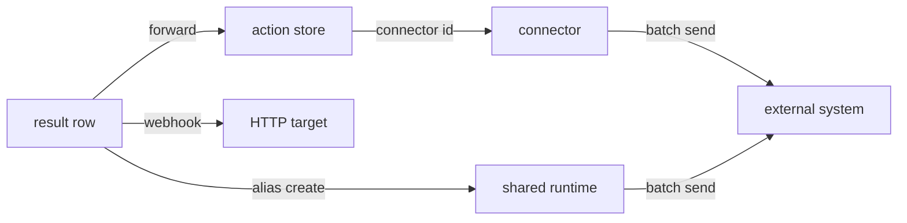

# Connector actions: Oracle to Webhook

<!-- GENERATED by `python3 docs/_tools/entries.py` from `docs/_inventory/`, `docs/_text/` and `docs/_verified/`. Do not edit by hand. -->

The complete MQTT platform in one small binary: broker, SQL rules, data connectors and multi-tenancy in a single process.

An action sends each result row to a backend. You create it through the management API and you point a rule at it. Use this page when a rule must reach a relational store, a stream, a lake, a warehouse or a webhook. You get one entry per action, each with a run against the broker.



Create the connector first, then the action, then the rule. A created action reads `connected` when enabled. The broker runs no probe behind that status; the status mirrors the enable flag. The docs run verifies creation only; no external server runs, so no rows reach a backend here.

## Before you start

- Read [Rule SQL](./sql.md) for the query shape.
- Create each connector before an action names it. See [Connectors](../connectors/index.md).
- Each entry below ran against the built broker through `POST /api/v5/actions`.

## Actions

| Action | What it does |
|---|---|
| `oracle` | `oracle` sends each result row to Oracle Database. |
| `pgsql` | `pgsql` sends each result row to PostgreSQL. |
| `postgres` | `postgres` is the historic name for the `pgsql` runtime. |
| `pulsar` | `pulsar` sends each result row to Apache Pulsar. |
| `rabbitmq` | `rabbitmq` sends each result row to RabbitMQ. |
| `redis` | `redis` sends each result row to a Redis stream or list. |
| `redshift` | `redshift` sends each result row to Amazon Redshift. |
| `rocketmq` | `rocketmq` sends each result row to Apache RocketMQ. |
| `s3` | `s3` stores each result row as an object in S3 storage. |
| `s3_tables` | `s3_tables` sends each result row to AWS S3 Tables. |
| `s3tables` | `s3tables` is the console name for the `s3_tables` runtime. |
| `snowflake` | `snowflake` sends each result row to Snowflake. |
| `snowflake_streaming` | `snowflake_streaming` is the console name for the `snowflake` runtime. |
| `sparkplug_b` | `sparkplug_b` sends each result row to a Sparkplug B edge node. |
| `sqlserver` | `sqlserver` is the console name for the `mssql` runtime. |
| `tablestore` | `tablestore` sends each result row to Alibaba Tablestore. |
| `tdengine` | `tdengine` sends each result row to TDengine. |
| `test` | `test` names the unit-test helper. |
| `timescale` | `timescale` is the console name for the `timescaledb` runtime. |
| `timescaledb` | `timescaledb` sends each result row to TimescaleDB. |
| `timestream` | `timestream` sends each result row to AWS Timestream. |
| `webhook` | `webhook` posts each result row to an HTTP target. |

## Actions in detail

### `oracle`

`oracle` sends each result row to Oracle Database.

The connector config names `connection_url` and `table`. The tier is enterprise.

Signature: `POST /api/v5/actions` with `{"type": "oracle", "name": "<id>"}`.

Example (verified through `POST /api/v5/actions`):

```json no-test
{"name": "dx2-action-oracle", "type": "oracle"}
```

The broker answered `201` with `"type": "oracle"` and `"status": "connected"`.
Another create with the same name answered `400` with code `ALREADY_EXISTS`.

`GET /api/v5/action_types` lists this name.

Verified: `POST /api/v5/actions` exits 0. See `../_verified/rules/action-oracle.json`.

Notes:

- The type catalogue lists this name.
- The connector config names `connection_url` and `table`.
- The tier is enterprise.
- The docs run verifies creation only. No external server runs, so no rows reach the backend.
- Repeat the check with the same call against a live broker.

### `pgsql`

`pgsql` sends each result row to PostgreSQL.

The connector config names `server`, `database`, `username` and `password`. The historic name `postgres` runs on the same runtime. The tier is community.

Signature: `POST /api/v5/actions` with `{"type": "pgsql", "name": "<id>"}`.

Example (verified through `POST /api/v5/actions`):

```json no-test
{"name": "dx2-action-pgsql", "type": "pgsql"}
```

The broker answered `201` with `"type": "pgsql"` and `"status": "connected"`.
Another create with the same name answered `400` with code `ALREADY_EXISTS`.

`GET /api/v5/action_types` lists this name.

Verified: `POST /api/v5/actions` exits 0. See `../_verified/rules/action-pgsql.json`.

Notes:

- The type catalogue lists this name.
- The connector config names `server`, `database`, `username` and `password`.
- The historic name `postgres` runs on the same runtime.
- The tier is community.
- The docs run verifies creation only. No external server runs, so no rows reach the backend.
- Repeat the check with the same call against a live broker.

### `postgres`

`postgres` is the historic name for the `pgsql` runtime.

It sends each result row to PostgreSQL. The console sends `pgsql` for the same runtime. The connector config names `connection_url` and `table`. The tier is community.

Signature: `POST /api/v5/actions` with `{"type": "postgres", "name": "<id>"}`.

Example (verified through `POST /api/v5/actions`):

```json no-test
{"name": "dx2-action-postgres", "type": "postgres"}
```

The broker answered `201` with `"type": "postgres"` and `"status": "connected"`.
Another create with the same name answered `400` with code `ALREADY_EXISTS`.

`GET /api/v5/action_types` omits this name.

Verified: `POST /api/v5/actions` exits 0. See `../_verified/rules/action-postgres.json`.

Notes:

- The type catalogue omits this name. The store still accepts it.
- The console sends `pgsql` for the same runtime.
- The connector config names `connection_url` and `table`.
- The tier is community.
- The docs run verifies creation only. No external server runs, so no rows reach the backend.
- Repeat the check with the same call against a live broker.

### `pulsar`

`pulsar` sends each result row to Apache Pulsar.

The connector config names `service_url` and `topic`. The tier is enterprise.

Signature: `POST /api/v5/actions` with `{"type": "pulsar", "name": "<id>"}`.

Example (verified through `POST /api/v5/actions`):

```json no-test
{"name": "dx2-action-pulsar", "type": "pulsar"}
```

The broker answered `201` with `"type": "pulsar"` and `"status": "connected"`.
Another create with the same name answered `400` with code `ALREADY_EXISTS`.

`GET /api/v5/action_types` lists this name.

Verified: `POST /api/v5/actions` exits 0. See `../_verified/rules/action-pulsar.json`.

Notes:

- The type catalogue lists this name.
- The connector config names `service_url` and `topic`.
- The tier is enterprise.
- The docs run verifies creation only. No external server runs, so no rows reach the backend.
- Repeat the check with the same call against a live broker.

### `rabbitmq`

`rabbitmq` sends each result row to RabbitMQ.

The connector config names `endpoint`, `exchange` and `routing_key`. The tier is community.

Signature: `POST /api/v5/actions` with `{"type": "rabbitmq", "name": "<id>"}`.

Example (verified through `POST /api/v5/actions`):

```json no-test
{"name": "dx2-action-rabbitmq", "type": "rabbitmq"}
```

The broker answered `201` with `"type": "rabbitmq"` and `"status": "connected"`.
Another create with the same name answered `400` with code `ALREADY_EXISTS`.

`GET /api/v5/action_types` lists this name.

Verified: `POST /api/v5/actions` exits 0. See `../_verified/rules/action-rabbitmq.json`.

Notes:

- The type catalogue lists this name.
- The connector config names `endpoint`, `exchange` and `routing_key`.
- The tier is community.
- The docs run verifies creation only. No external server runs, so no rows reach the backend.
- Repeat the check with the same call against a live broker.

### `redis`

`redis` sends each result row to a Redis stream or list.

The connector config names `endpoint` and `key`. The tier is community.

Signature: `POST /api/v5/actions` with `{"type": "redis", "name": "<id>"}`.

Example (verified through `POST /api/v5/actions`):

```json no-test
{"name": "dx2-action-redis", "type": "redis"}
```

The broker answered `201` with `"type": "redis"` and `"status": "connected"`.
Another create with the same name answered `400` with code `ALREADY_EXISTS`.

`GET /api/v5/action_types` lists this name.

Verified: `POST /api/v5/actions` exits 0. See `../_verified/rules/action-redis.json`.

Notes:

- The type catalogue lists this name.
- The connector config names `endpoint` and `key`.
- The tier is community.
- The docs run verifies creation only. No external server runs, so no rows reach the backend.
- Repeat the check with the same call against a live broker.

### `redshift`

`redshift` sends each result row to Amazon Redshift.

The connector config names `url`, `table`, `user` and `password`. The tier is enterprise.

Signature: `POST /api/v5/actions` with `{"type": "redshift", "name": "<id>"}`.

Example (verified through `POST /api/v5/actions`):

```json no-test
{"name": "dx2-action-redshift", "type": "redshift"}
```

The broker answered `201` with `"type": "redshift"` and `"status": "connected"`.
Another create with the same name answered `400` with code `ALREADY_EXISTS`.

`GET /api/v5/action_types` lists this name.

Verified: `POST /api/v5/actions` exits 0. See `../_verified/rules/action-redshift.json`.

Notes:

- The type catalogue lists this name.
- The connector config names `url`, `table`, `user` and `password`.
- The tier is enterprise.
- The docs run verifies creation only. No external server runs, so no rows reach the backend.
- Repeat the check with the same call against a live broker.

### `rocketmq`

`rocketmq` sends each result row to Apache RocketMQ.

The connector config names `name_server` and `topic`. The tier is enterprise.

Signature: `POST /api/v5/actions` with `{"type": "rocketmq", "name": "<id>"}`.

Example (verified through `POST /api/v5/actions`):

```json no-test
{"name": "dx2-action-rocketmq", "type": "rocketmq"}
```

The broker answered `201` with `"type": "rocketmq"` and `"status": "connected"`.
Another create with the same name answered `400` with code `ALREADY_EXISTS`.

`GET /api/v5/action_types` lists this name.

Verified: `POST /api/v5/actions` exits 0. See `../_verified/rules/action-rocketmq.json`.

Notes:

- The type catalogue lists this name.
- The connector config names `name_server` and `topic`.
- The tier is enterprise.
- The docs run verifies creation only. No external server runs, so no rows reach the backend.
- Repeat the check with the same call against a live broker.

### `s3`

`s3` stores each result row as an object in S3 storage.

The connector config names `bucket`, `region` and `key_template`. The tier is community.

Signature: `POST /api/v5/actions` with `{"type": "s3", "name": "<id>"}`.

Example (verified through `POST /api/v5/actions`):

```json no-test
{"name": "dx2-action-s3", "type": "s3"}
```

The broker answered `201` with `"type": "s3"` and `"status": "connected"`.
Another create with the same name answered `400` with code `ALREADY_EXISTS`.

`GET /api/v5/action_types` lists this name.

Verified: `POST /api/v5/actions` exits 0. See `../_verified/rules/action-s3.json`.

Notes:

- The type catalogue lists this name.
- The connector config names `bucket`, `region` and `key_template`.
- The tier is community.
- The docs run verifies creation only. No external server runs, so no rows reach the backend.
- Repeat the check with the same call against a live broker.

### `s3_tables`

`s3_tables` sends each result row to AWS S3 Tables.

The connector config names `table_bucket_arn` and `table_name`. The tier is enterprise.

Signature: `POST /api/v5/actions` with `{"type": "s3_tables", "name": "<id>"}`.

Example (verified through `POST /api/v5/actions`):

```json no-test
{"name": "dx2-action-s3_tables", "type": "s3_tables"}
```

The broker answered `201` with `"type": "s3_tables"` and `"status": "connected"`.
Another create with the same name answered `400` with code `ALREADY_EXISTS`.

`GET /api/v5/action_types` omits this name.

Verified: `POST /api/v5/actions` exits 0. See `../_verified/rules/action-s3_tables.json`.

Notes:

- The type catalogue omits this name. The store still accepts it.
- The console sends `s3tables` for the same runtime.
- The connector config names `table_bucket_arn` and `table_name`.
- The tier is enterprise.
- The docs run verifies creation only. No external server runs, so no rows reach the backend.
- Repeat the check with the same call against a live broker.

### `s3tables`

`s3tables` is the console name for the `s3_tables` runtime.

It sends each result row to AWS S3 Tables. It uses the same bucket ARN and table name. The tier is enterprise.

Signature: `POST /api/v5/actions` with `{"type": "s3tables", "name": "<id>"}`.

Example (verified through `POST /api/v5/actions`):

```json no-test
{"name": "dx2-action-s3tables", "type": "s3tables"}
```

The broker answered `201` with `"type": "s3tables"` and `"status": "connected"`.
Another create with the same name answered `400` with code `ALREADY_EXISTS`.

`GET /api/v5/action_types` lists this name.

Verified: `POST /api/v5/actions` exits 0. See `../_verified/rules/action-s3tables.json`.

Notes:

- The type catalogue lists this name. It is the console name for the `s3_tables` runtime.
- The connector config names `table_bucket_arn` and `table_name`.
- The tier is enterprise.
- The docs run verifies creation only. No external server runs, so no rows reach the backend.
- Repeat the check with the same call against a live broker.

### `snowflake`

`snowflake` sends each result row to Snowflake.

The connector config names `account`, `database` and `table`. The tier is enterprise.

Signature: `POST /api/v5/actions` with `{"type": "snowflake", "name": "<id>"}`.

Example (verified through `POST /api/v5/actions`):

```json no-test
{"name": "dx2-action-snowflake", "type": "snowflake"}
```

The broker answered `201` with `"type": "snowflake"` and `"status": "connected"`.
Another create with the same name answered `400` with code `ALREADY_EXISTS`.

`GET /api/v5/action_types` lists this name.

Verified: `POST /api/v5/actions` exits 0. See `../_verified/rules/action-snowflake.json`.

Notes:

- The type catalogue lists this name.
- The connector config names `account`, `database` and `table`.
- The tier is enterprise.
- The docs run verifies creation only. No external server runs, so no rows reach the backend.
- Repeat the check with the same call against a live broker.

### `snowflake_streaming`

`snowflake_streaming` is the console name for the `snowflake` runtime.

It sends each result row to Snowflake. It uses the same account, database and table. The tier is enterprise.

Signature: `POST /api/v5/actions` with `{"type": "snowflake_streaming", "name": "<id>"}`.

Example (verified through `POST /api/v5/actions`):

```json no-test
{"name": "dx2-action-snowflake_streaming", "type": "snowflake_streaming"}
```

The broker answered `201` with `"type": "snowflake_streaming"` and `"status": "connected"`.
Another create with the same name answered `400` with code `ALREADY_EXISTS`.

`GET /api/v5/action_types` lists this name.

Verified: `POST /api/v5/actions` exits 0. See `../_verified/rules/action-snowflake_streaming.json`.

Notes:

- The type catalogue lists this name. It is the console name for the `snowflake` runtime.
- The connector config names `account`, `database` and `table`.
- The tier is enterprise.
- The docs run verifies creation only. No external server runs, so no rows reach the backend.
- Repeat the check with the same call against a live broker.

### `sparkplug_b`

`sparkplug_b` sends each result row to a Sparkplug B edge node.

The connector config names `group_id`, `edge_node_id` and `device_id`. The tier is enterprise.

Signature: `POST /api/v5/actions` with `{"type": "sparkplug_b", "name": "<id>"}`.

Example (verified through `POST /api/v5/actions`):

```json no-test
{"name": "dx2-action-sparkplug_b", "type": "sparkplug_b"}
```

The broker answered `201` with `"type": "sparkplug_b"` and `"status": "connected"`.
Another create with the same name answered `400` with code `ALREADY_EXISTS`.

`GET /api/v5/action_types` omits this name.

Verified: `POST /api/v5/actions` exits 0. See `../_verified/rules/action-sparkplug_b.json`.

Notes:

- The type catalogue omits this name. The store still accepts it.
- The connector config names `group_id`, `edge_node_id` and `device_id`.
- The tier is enterprise.
- The docs run verifies creation only. No external server runs, so no rows reach the backend.
- Repeat the check with the same call against a live broker.

### `sqlserver`

`sqlserver` is the console name for the `mssql` runtime.

It writes each result row to Microsoft SQL Server. It uses `connection_url` and `table`. The tier is enterprise.

Signature: `POST /api/v5/actions` with `{"type": "sqlserver", "name": "<id>"}`.

Example (verified through `POST /api/v5/actions`):

```json no-test
{"name": "dx2-action-sqlserver", "type": "sqlserver"}
```

The broker answered `201` with `"type": "sqlserver"` and `"status": "connected"`.
Another create with the same name answered `400` with code `ALREADY_EXISTS`.

`GET /api/v5/action_types` lists this name.

Verified: `POST /api/v5/actions` exits 0. See `../_verified/rules/action-sqlserver.json`.

Notes:

- The type catalogue lists this name. It is the console name for the `mssql` runtime.
- The connector config names `connection_url` and `table`.
- The tier is enterprise.
- The docs run verifies creation only. No external server runs, so no rows reach the backend.
- Repeat the check with the same call against a live broker.

### `tablestore`

`tablestore` sends each result row to Alibaba Tablestore.

The connector config names `endpoint`, `instance` and `table`. The tier is enterprise.

Signature: `POST /api/v5/actions` with `{"type": "tablestore", "name": "<id>"}`.

Example (verified through `POST /api/v5/actions`):

```json no-test
{"name": "dx2-action-tablestore", "type": "tablestore"}
```

The broker answered `201` with `"type": "tablestore"` and `"status": "connected"`.
Another create with the same name answered `400` with code `ALREADY_EXISTS`.

`GET /api/v5/action_types` lists this name.

Verified: `POST /api/v5/actions` exits 0. See `../_verified/rules/action-tablestore.json`.

Notes:

- The type catalogue lists this name.
- The connector config names `endpoint`, `instance` and `table`.
- The tier is enterprise.
- The docs run verifies creation only. No external server runs, so no rows reach the backend.
- Repeat the check with the same call against a live broker.

### `tdengine`

`tdengine` sends each result row to TDengine.

The connector config names `url`, `database` and `table`. The tier is enterprise.

Signature: `POST /api/v5/actions` with `{"type": "tdengine", "name": "<id>"}`.

Example (verified through `POST /api/v5/actions`):

```json no-test
{"name": "dx2-action-tdengine", "type": "tdengine"}
```

The broker answered `201` with `"type": "tdengine"` and `"status": "connected"`.
Another create with the same name answered `400` with code `ALREADY_EXISTS`.

`GET /api/v5/action_types` lists this name.

Verified: `POST /api/v5/actions` exits 0. See `../_verified/rules/action-tdengine.json`.

Notes:

- The type catalogue lists this name.
- The connector config names `url`, `database` and `table`.
- The tier is enterprise.
- The docs run verifies creation only. No external server runs, so no rows reach the backend.
- Repeat the check with the same call against a live broker.

### `test`

`test` names the unit-test helper.

It has no send path. The action store rejects this name. Use `console` for the log path.

Signature: `POST /api/v5/actions` with `{"type": "test", "name": "<id>"}`.

> **Not verified: see `../_verification/failures.md`.**

Notes:

- The type catalogue omits this name. The action store rejects it.
- It is a unit-test helper with no send path. Use `console` for the log path.
- The docs run verifies creation only. No external server runs, so no rows reach the backend.
- Repeat the check with the same call against a live broker.

### `timescale`

`timescale` is the console name for the `timescaledb` runtime.

It sends each result row to TimescaleDB. It uses `connection_url` and `table`. The tier is community.

Signature: `POST /api/v5/actions` with `{"type": "timescale", "name": "<id>"}`.

Example (verified through `POST /api/v5/actions`):

```json no-test
{"name": "dx2-action-timescale", "type": "timescale"}
```

The broker answered `201` with `"type": "timescale"` and `"status": "connected"`.
Another create with the same name answered `400` with code `ALREADY_EXISTS`.

`GET /api/v5/action_types` lists this name.

Verified: `POST /api/v5/actions` exits 0. See `../_verified/rules/action-timescale.json`.

Notes:

- The type catalogue lists this name. It is the console name for the `timescaledb` runtime.
- The connector config names `connection_url` and `table`.
- The tier is community.
- The docs run verifies creation only. No external server runs, so no rows reach the backend.
- Repeat the check with the same call against a live broker.

### `timescaledb`

`timescaledb` sends each result row to TimescaleDB.

The console sends `timescale` for the same runtime. The connector config names `connection_url` and `table`. The tier is community.

Signature: `POST /api/v5/actions` with `{"type": "timescaledb", "name": "<id>"}`.

Example (verified through `POST /api/v5/actions`):

```json no-test
{"name": "dx2-action-timescaledb", "type": "timescaledb"}
```

The broker answered `201` with `"type": "timescaledb"` and `"status": "connected"`.
Another create with the same name answered `400` with code `ALREADY_EXISTS`.

`GET /api/v5/action_types` omits this name.

Verified: `POST /api/v5/actions` exits 0. See `../_verified/rules/action-timescaledb.json`.

Notes:

- The type catalogue omits this name. The store still accepts it.
- The console sends `timescale` for the same runtime.
- The connector config names `connection_url` and `table`.
- The tier is community.
- The docs run verifies creation only. No external server runs, so no rows reach the backend.
- Repeat the check with the same call against a live broker.

### `timestream`

`timestream` sends each result row to AWS Timestream.

The console sends `aws_timestream` for the same runtime. The connector config names `database`, `table` and `region`. The tier is enterprise.

Signature: `POST /api/v5/actions` with `{"type": "timestream", "name": "<id>"}`.

Example (verified through `POST /api/v5/actions`):

```json no-test
{"name": "dx2-action-timestream", "type": "timestream"}
```

The broker answered `201` with `"type": "timestream"` and `"status": "connected"`.
Another create with the same name answered `400` with code `ALREADY_EXISTS`.

`GET /api/v5/action_types` omits this name.

Verified: `POST /api/v5/actions` exits 0. See `../_verified/rules/action-timestream.json`.

Notes:

- The type catalogue omits this name. The store still accepts it.
- The console sends `aws_timestream` for the same runtime.
- The connector config names `database`, `table` and `region`.
- The tier is enterprise.
- The docs run verifies creation only. No external server runs, so no rows reach the backend.
- Repeat the check with the same call against a live broker.

### `webhook`

`webhook` posts each result row to an HTTP target.

The console sends `http` for the same runtime. The connector config names `url`. The tier is community.

Signature: `POST /api/v5/actions` with `{"type": "webhook", "name": "<id>"}`.

Example (verified through `POST /api/v5/actions`):

```json no-test
{"name": "dx2-action-webhook", "type": "webhook"}
```

The broker answered `201` with `"type": "webhook"` and `"status": "connected"`.
Another create with the same name answered `400` with code `ALREADY_EXISTS`.

`GET /api/v5/action_types` omits this name.

Verified: `POST /api/v5/actions` exits 0. See `../_verified/rules/action-webhook.json`.

Notes:

- The type catalogue omits this name. The store still accepts it.
- The console sends `http` for the same runtime.
- The connector config names `url`.
- The tier is community.
- The docs run verifies creation only. No external server runs, so no rows reach the backend.
- Repeat the check with the same call against a live broker.

## Check that it works

Create one action and read it back:

```sh no-test
# Needs a live broker and an operator key. Use your own name.
curl -H "Authorization: Bearer $KEY" -H "Content-Type: application/json" \
  -d '{"type": "redis", "name": "dx-check"}' \
  http://127.0.0.1:18083/api/v5/actions
```

The answer is `201` with the stored shape. A second create with the same name answers `400` with code `ALREADY_EXISTS`.

## Next steps

- Write the query with [Rule SQL](./sql.md).
- Shape payloads with [Functions](./functions.md).
- Send results with [Actions](./actions.md).
