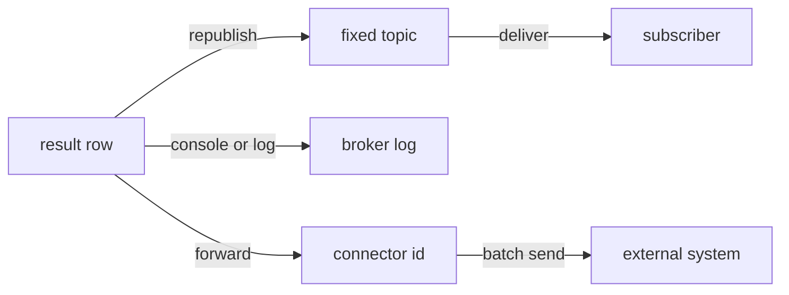

# Rule actions

An action runs for each result row. It republishes to a topic, writes a log line, or forwards to a connector. A rule with no action matches and drops.

Use this page to send rule results somewhere. You get each action with its fields.



## Before you start

- Read [Rule SQL](./sql.md) and [Functions](./functions.md).
- Create each connector before a rule names it. See [Connectors](../connectors/index.md).
- Keep one topic pair free, for example `docs/in` and `docs/out`.

## The five actions

| Action | What it does | Fields |
|---|---|---|
| `republish` | Publishes the row to a fixed topic. | `topic` (topic name), `qos` (0, 1, or 2). |
| `republish` function | Publishes with templates for topic, payload, QoS, and flags. | `topic`, `payload` (default `${payload}`), `qos` (default `${qos}`), `retain`, `mqtt_properties`, `user_properties`, `direct_dispatch`. |
| `console` | Writes the row to the log at info level, one line, at most 1024 characters. | None. |
| `log` | Emits a structured log line for the event. | None. |
| `forwardconnector` | Forwards the row to a connector by id. | `connector_id`. |

Create a rule through `POST /api/v1/rules` with `name`, `topic_filter`, an optional `sql_query`, and `actions`. The answer is 201 with the rule id. Each action object carries a `type` of `republish`, `log`, or `forwardconnector`.

Templates in the `republish` function use `${name}` placeholders. Available names are the result-row fields with dotted paths, plus `payload` for the raw payload, `topic` for the input topic, `qos`, and `retain`. A missing variable in `payload` renders as `undefined`. A missing variable in `topic` is an error. A missing `qos` gives 0. Each template holds at most 65536 bytes.

## Tested example

This rule filters hot readings and republishes them. A subscriber on `docs/out` receives the publish sent to `docs/in`.

```toml test
[node]
id = "docs-rules-actions"

[listeners.tcp]
bind = "0.0.0.0:1883"

[listeners.api]
bind = "0.0.0.0:18083"

[logging]
level = "warn"

[auth]
allow_anonymous = true
```

```sh test
python3 - <<'PY'
import json, os, socket, struct, urllib.request
mqtt_port = int(os.environ.get("MQTT_PORT", "1883"))
api_port = os.environ.get("API_PORT", "18083")
key = os.environ["API_KEY"]

def call(method, path, body=None):
    req = urllib.request.Request(
        f"http://127.0.0.1:{api_port}{path}",
        data=None if body is None else json.dumps(body).encode(),
        method=method,
        headers={"Authorization": f"Bearer {key}", "Content-Type": "application/json"})
    with urllib.request.urlopen(req, timeout=5) as res:
        return res.status, json.load(res) if res.status != 204 else None

status, rule = call("POST", "/api/v1/rules", {
    "name": "docs-hot-republish",
    "topic_filter": "docs/in",
    "sql_query": 'SELECT device, temp FROM "docs/in" WHERE temp > 80.0',
    "actions": [{"type": "republish", "topic": "docs/out", "qos": 0}]})
assert status == 201, rule

def packet(kind, body):
    return bytes([kind, len(body)]) + body

def field(data):
    return struct.pack(">H", len(data)) + data

def connect(client_id):
    sock = socket.create_connection(("127.0.0.1", mqtt_port), timeout=5)
    sock.sendall(packet(0x10, b"\x00\x04MQTT\x04\x02\x00\x3c" + field(client_id)))
    assert sock.recv(4) == b"\x20\x02\x00\x00"
    return sock

topic_in, topic_out = b"docs/in", b"docs/out"
sub = connect(b"docs-actions-sub")
sub.sendall(packet(0x82, b"\x00\x01" + field(topic_out) + b"\x00"))
assert sub.recv(5)[:1] == b"\x90"
pub = connect(b"docs-actions-pub")
payload = json.dumps({"device": "heater-1", "temp": 90}).encode()
pub.sendall(packet(0x30, field(topic_in) + payload))
sub.settimeout(10)
got = sub.recv(200)
arrived = json.loads(got.split(topic_out)[-1].decode())
assert arrived == {"device": "heater-1", "temp": 90}, arrived
print("delivered")
PY
```

```output
delivered
```

## How to test a rule

Dry-run first through `POST /api/v1/rules/test` with `sql_query`, `topic_filter`, `topic`, and `payload`. The answer holds `matched` and `projected`. Nothing is stored. See the tested dry run in [Rule SQL](./sql.md).

Then create the rule and watch the effect:

1. Subscribe to the target topic with an MQTT client.
2. Publish a matching message to the source topic.
3. Read the republished message within 10 s.
4. Publish a non-matching message. Nothing arrives.
5. Delete the rule with `DELETE /api/v1/rules/{id}`. It answers 204.

Check rule counters at `GET /api/v5/rules/{id}/metrics` with `matched`, `passed`, and `failed`. `failed` counts `WHERE`-false rows and non-JSON payloads.

## Limits

- The rule engine ingress buffer holds `rules_engine.window_channel_depth` rows (default 65536).
- Overflow follows `rules_engine.backpressure_policy` (default `DropOldest`).
- `rules_engine.spill_dir` names a directory for disk spill. Empty keeps memory-only behavior.
- A rule with an unknown tenant is refused with 400. A rule keeps its tenant.
- A `forwardconnector` action names a connector id that must exist. A missing id drops the row and logs the miss.
- Console output truncates at 1024 characters per line.
- A republish template holds at most 65536 bytes per field.

## Next steps

- Send rows outside the broker with [Connectors](../connectors/index.md).
- Isolate rules per customer with [Multi-tenancy](../multi-tenancy/index.md).
