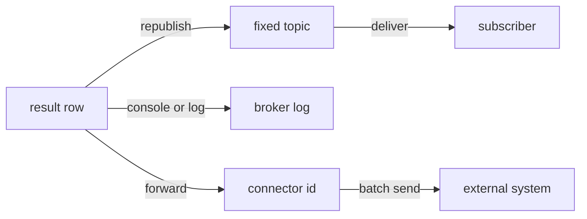

# Rule actions

An action runs for each result row. It republishes to a topic, writes a log line, or forwards to a connector. A rule with no action matches and drops.

Use this page to send rule results somewhere. You get each action with its fields.



## Before you start

- Read [Rule SQL](./sql.md) and [Functions](./functions.md).
- Create each connector before a rule names it. See [Connectors](../connectors/index.md).
- Keep one topic pair free, for example `docs/in` and `docs/out`.

## The five actions

| Action | What it does | Fields |
|---|---|---|
| `republish` | Publishes the row to a fixed topic. | `topic` (topic name), `qos` (0, 1, or 2). |
| `republish` function | Publishes with templates for topic, payload, QoS, and flags. | `topic`, `payload` (default `${payload}`), `qos` (default `${qos}`), `retain`, `mqtt_properties`, `user_properties`, `direct_dispatch`. |
| `console` | Writes the row to the log at info level, one line, at most 1024 characters. | None. |
| `log` | Emits a structured log line for the event. | None. |
| `forwardconnector` | Forwards the row to a connector by id. | `connector_id`. |

Create a rule through `POST /api/v1/rules` with `name`, `topic_filter`, an optional `sql_query`, and `actions`. The answer is 201 with the rule id. Each action object carries a `type` of `republish`, `log`, or `forwardconnector`.

Templates in the `republish` function use `${name}` placeholders. Available names are the result-row fields with dotted paths, plus `payload` for the raw payload, `topic` for the input topic, `qos`, and `retain`. A missing variable in `payload` renders as `undefined`. A missing variable in `topic` is an error. A missing `qos` gives 0. Each template holds at most 65536 bytes.

## Tested example

This rule filters hot readings and republishes them. A subscriber on `docs/out` receives the publish sent to `docs/in`.

```toml test
[node]
id = "docs-rules-actions"

[listeners.tcp]
bind = "0.0.0.0:1883"

[listeners.api]
bind = "0.0.0.0:18083"

[logging]
level = "warn"

[auth]
allow_anonymous = true
```

```sh test
python3 - <<'PY'
import json, os, socket, struct, urllib.request
mqtt_port = int(os.environ.get("MQTT_PORT", "1883"))
api_port = os.environ.get("API_PORT", "18083")
key = os.environ["API_KEY"]

def call(method, path, body=None):
    req = urllib.request.Request(
        f"http://127.0.0.1:{api_port}{path}",
        data=None if body is None else json.dumps(body).encode(),
        method=method,
        headers={"Authorization": f"Bearer {key}", "Content-Type": "application/json"})
    with urllib.request.urlopen(req, timeout=5) as res:
        return res.status, json.load(res) if res.status != 204 else None

status, rule = call("POST", "/api/v1/rules", {
    "name": "docs-hot-republish",
    "topic_filter": "docs/in",
    "sql_query": 'SELECT device, temp FROM "docs/in" WHERE temp > 80.0',
    "actions": [{"type": "republish", "topic": "docs/out", "qos": 0}]})
assert status == 201, rule

def packet(kind, body):
    return bytes([kind, len(body)]) + body

def field(data):
    return struct.pack(">H", len(data)) + data

def connect(client_id):
    sock = socket.create_connection(("127.0.0.1", mqtt_port), timeout=5)
    sock.sendall(packet(0x10, b"\x00\x04MQTT\x04\x02\x00\x3c" + field(client_id)))
    assert sock.recv(4) == b"\x20\x02\x00\x00"
    return sock

topic_in, topic_out = b"docs/in", b"docs/out"
sub = connect(b"docs-actions-sub")
sub.sendall(packet(0x82, b"\x00\x01" + field(topic_out) + b"\x00"))
assert sub.recv(5)[:1] == b"\x90"
pub = connect(b"docs-actions-pub")
payload = json.dumps({"device": "heater-1", "temp": 90}).encode()
pub.sendall(packet(0x30, field(topic_in) + payload))
sub.settimeout(10)
got = sub.recv(200)
arrived = json.loads(got.split(topic_out)[-1].decode())
assert arrived == {"device": "heater-1", "temp": 90}, arrived
print("delivered")
PY
```

```output
delivered
```

## How to test a rule

Dry-run first through `POST /api/v1/rules/test` with `sql_query`, `topic_filter`, `topic`, and `payload`. The answer holds `matched` and `projected`. Nothing is stored. See the tested dry run in [Rule SQL](./sql.md).

Then create the rule and watch the effect:

1. Subscribe to the target topic with an MQTT client.
2. Publish a matching message to the source topic.
3. Read the republished message within 10 s.
4. Publish a non-matching message. Nothing arrives.
5. Delete the rule with `DELETE /api/v1/rules/{id}`. It answers 204.

Check rule counters at `GET /api/v5/rules/{id}/metrics` with `matched`, `passed`, `failed` and `failed.no_result`. `failed` counts `WHERE`-false rows and non-JSON payloads. `failed.no_result` counts the subset that produced no SQL result. The same body carries `node_metrics` for the local node. `PUT /api/v5/rules/{id}/metrics/reset` zeroes every counter.

## Action resource options and counters

An action of kind `http`, `webhook`, `pgsql`, `mysql`, `mssql`, `oracle`, `alloydb`, `cockroachdb`, `redshift`, `clickhouse`, `tdengine`, `greptimedb`, `iotdb`, `opentsdb`, `doris`, `datalayers`, `influxdb`, `timestream`, `cassandra`, `mongodb`, `couchbase`, `elasticsearch`, `kafka`, `confluent`, `rabbitmq`, `pulsar`, `rocketmq`, `mqtt_bridge` or `redis` owns a send runtime. The runtime reads these `resource_opts` fields. An absent field takes its default. A refused field answers 400 and names the field.

### `batch_size`

Type: integer. Default: `1`. Minimum: `1`. Maximum rows in one driver batch. It applies only when `batch_time` is more than `0ms`. A value of `1` sends each row alone.

Example: `{"batch_size": 2, "batch_time": "1s"}` sends two rows in one driver call.

### `batch_time`

Type: duration string. Default: `0ms`. Maximum wait to form a batch. A value of `0ms` sends each row at once. The runtime sends when the batch is full or when the wait ends, whichever comes first. A `batch_time` larger than `request_ttl` is refused. The value `infinity` is refused.

Example: `{"batch_size": 10, "batch_time": "100ms"}` sends a partial batch after 100 ms.

### `inflight_window`

Type: integer. Default: `100`. Minimum: `1`. Maximum driver calls in flight. A value above the semaphore maximum is refused.

Example: `{"inflight_window": 4, "worker_pool_size": 2}` sends two chunks of two rows.

### `max_buffer_bytes`

Type: byte-size string. Default: `256MB`. Maximum queued bytes. The bound counts topic bytes, payload bytes and a fixed per-row overhead. A full buffer drops the oldest rows and counts each drop. A row larger than the bound alone is refused and counted. A value of `0` is refused.

Example: `{"max_buffer_bytes": "32MB"}` bounds one action buffer at 32 MB.

### `request_ttl`

Type: duration string or `infinity`. Default: `45s`. Maximum time in the buffer. The runtime checks each row when it enters the batch and again before the send. A row older than `request_ttl` is dropped and counted. `infinity` turns off expiry.

Example: `{"request_ttl": "10s"}` drops a row that waits 10 s in the buffer.

### `query_mode`

Type: enum. Default: `async`. `sync` flushes a partial batch before the send returns. `async` waits for the batch size or the batch time.

Example: `{"query_mode": "sync"}` sends each row before the publish returns.

### `worker_pool_size`

Type: integer. Default: `16`. Minimum: `1`. Maximum: `1024`. Maximum rows in one driver batch chunk.

Example: `{"worker_pool_size": 4}` sends a large batch as chunks of four rows.

### `dispatch_strategy`

Type: enum. Default: `per_clientid`. Only the default is accepted. Another value answers 400.

Example: `{"dispatch_strategy": "random"}` is refused with 400. The answer names the field.

### `health_check_interval`

Type: duration string. Default: `15s`. Interval of one target health check. The runtime dials the action target and reports `disconnected` with the probe reason when the check fails.

Example: `{"health_check_interval": "30s"}` checks the target every 30 s.

The probe resolves a `file:` or `env:` reference first. It dials only a real `http` or `https` result; any other result runs no probe. The dial uses `health_check_timeout`.

### `health_check_interval_jitter`

Type: duration string. Default: `0ms`. Only the default is accepted. Another value answers 400.

Example: `{"health_check_interval_jitter": "1s"}` is refused with 400. The answer names the field.

### `health_check_timeout`

Type: duration string. Default: `60s`. Only the default is accepted. Another value answers 400. The accepted value bounds one probe dial.

Example: `{"health_check_timeout": "30s"}` is refused with 400. The answer names the field.

## Read the action counters

Read the counters at `GET /api/v5/actions/{id}/metrics`. Each counter starts at zero. The verified example below shows `matched`, `success` and the reset for two rows.

### `total`

Type: integer. Rows that reached the action. It equals `matched` for an action runtime. The example below reports `matched=2`.

### `matched`

Type: integer. Rows that matched the action rule. The example below reports `matched=2`.

### `success`

Type: integer. Rows that the driver sent without error. The example below reports `success=2`.

### `failed`

Type: integer. Rows that the driver refused or failed to send.

### `dropped`

Type: integer. Rows dropped for every reason.

### `dropped.queue_full`

Type: integer. Rows dropped because the bounded buffer was full. A full buffer drops the oldest rows.

### `dropped.resource_not_found`

Type: integer. Rows dropped because the action target was missing.

### `dropped.resource_stopped`

Type: integer. Rows dropped because the action or its connector was stopped.

### `dropped.other`

Type: integer. Rows dropped for another reason, including request expiry.

### `queuing`

Type: integer. Rows in the action buffer.

### `inflight`

Type: integer. Rows in flight at the driver.

The broker does not measure a retry count, so the answer has no `retried` field.

`PUT /api/v5/actions/{id}/metrics/reset` sets every counter to zero. A restart also starts every counter at zero.

This example creates a `webhook` action with non-default options, sends two rows through a rule, reads the counters and resets them.

```sh test
python3 - <<'PY'
import json, os, socket, struct, threading, time, urllib.error, urllib.request
from http.server import BaseHTTPRequestHandler, HTTPServer
api_port = os.environ.get("API_PORT", "18083")
mqtt_port = int(os.environ.get("MQTT_PORT", "1883"))
key = os.environ["API_KEY"]
hits = []
class Handler(BaseHTTPRequestHandler):
    def do_POST(self):
        length = int(self.headers.get("Content-Length", "0"))
        hits.append(self.rfile.read(length))
        self.send_response(200)
        self.send_header("Content-Length", "0")
        self.end_headers()
    def log_message(self, *args):
        pass
server = HTTPServer(("127.0.0.1", 0), Handler)
threading.Thread(target=server.serve_forever, daemon=True).start()
port = server.server_address[1]
def call(method, path, body=None):
    req = urllib.request.Request(
        f"http://127.0.0.1:{api_port}{path}",
        data=None if body is None else json.dumps(body).encode(),
        method=method,
        headers={"Authorization": f"Bearer {key}", "Content-Type": "application/json"})
    try:
        with urllib.request.urlopen(req, timeout=5) as res:
            return res.status, json.load(res) if res.status != 204 else None
    except urllib.error.HTTPError as err:
        return err.code, None
def field(data):
    return struct.pack(">H", len(data)) + data
def packet(kind, body):
    return bytes([kind]) + bytes([len(body)]) + body
def connect(client_id):
    sock = socket.create_connection(("127.0.0.1", mqtt_port), timeout=5)
    sock.sendall(packet(0x10, b"\x00\x04MQTT\x04\x02\x00\x3c" + field(client_id)))
    assert sock.recv(4) == b"\x20\x02\x00\x00"
    return sock
status, _ = call("POST", "/api/v5/connectors", {
    "name": "docs-ro-hook", "type": "webhook", "url": f"http://127.0.0.1:{port}"})
assert status == 201, status
status, _ = call("POST", "/api/v5/actions", {
    "name": "docs-ro-action", "type": "webhook", "connector": "docs-ro-hook",
    "parameters": {"path": "/docs"},
    "resource_opts": {
        "batch_size": 2, "batch_time": "1s", "inflight_window": 3,
        "worker_pool_size": 2, "max_buffer_bytes": "1MB",
        "request_ttl": "30s", "query_mode": "async",
        "health_check_interval": "1h"}})
assert status == 201, status
status, rule = call("POST", "/api/v5/rules", {
    "name": "docs-ro-rule", "sql": 'SELECT * FROM "docs/ro/in"',
    "actions": ["docs-ro-action"]})
assert status == 201, status
rule_id = rule["id"]
pub = connect(b"docs-ro-pub")
topic = b"docs/ro/in"
pub.sendall(packet(0x30, field(topic) + b'{"n":1}'))
time.sleep(0.15)
assert len(hits) == 0, hits
pub.sendall(packet(0x30, field(topic) + b'{"n":2}'))
deadline = time.time() + 5
while len(hits) < 2 and time.time() < deadline:
    time.sleep(0.01)
assert len(hits) == 2, hits
status, metrics = call("GET", "/api/v5/actions/docs-ro-action/metrics")
assert status == 200 and metrics["metrics"]["matched"] == 2, metrics
assert metrics["metrics"]["success"] == 2, metrics
assert "retried" not in metrics["metrics"], metrics
status, _ = call("PUT", "/api/v5/actions/docs-ro-action/metrics/reset", {})
assert status == 204, status
status, metrics = call("GET", "/api/v5/actions/docs-ro-action/metrics")
assert status == 200 and metrics["metrics"]["matched"] == 0, metrics
call("DELETE", f"/api/v5/rules/{rule_id}")
call("DELETE", "/api/v5/actions/docs-ro-action")
call("DELETE", "/api/v5/connectors/docs-ro-hook")
server.shutdown()
print("matched=2 success=2 reset=0")
PY
```

```output
matched=2 success=2 reset=0
```

## Limits

- The rule engine ingress buffer holds `rules_engine.window_channel_depth` rows (default 65536).
- Overflow follows `rules_engine.backpressure_policy` (default `DropOldest`).
- `rules_engine.spill_dir` names a directory for disk spill. Empty keeps memory-only behavior.
- A rule with an unknown tenant is refused with 400. A rule keeps its tenant.
- A `forwardconnector` action names a connector id that must exist. A missing id drops the row and logs the miss.
- Console output truncates at 1024 characters per line.
- A republish template holds at most 65536 bytes per field.

## Next steps

- Send rows outside the broker with [Connectors](../connectors/index.md).
- Isolate rules per customer with [Multi-tenancy](../multi-tenancy/index.md).
