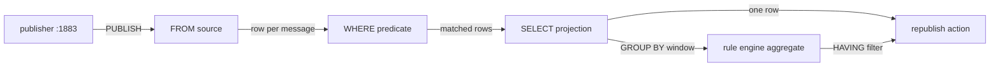

# Rule clauses and operators

<!-- GENERATED by `python3 docs/_tools/entries.py` from `docs/_inventory/`, `docs/_text/` and `docs/_verified/`. Do not edit by hand. -->

The complete MQTT platform in one small binary: broker, SQL rules, data connectors and multi-tenancy in a single process.

A clause shapes what a rule reads, keeps, groups, and returns. An operator combines the tests inside `WHERE` and `HAVING`. Use this page when a query surprises you. You get one entry per clause and per operator, each with a run against the broker.



Clauses run in a fixed order: `FROM` picks rows, `WHERE` keeps rows, `GROUP BY` groups them, `HAVING` keeps groups, `SELECT` shapes each result, `LIMIT` requests a row cap.

## Before you start

- Read [Rule SQL](./sql.md) for the full query shape.
- Send JSON payloads while you learn. Field access reads JSON keys.
- Each entry below ran against the built broker through `POST /api/v1/rules/test`.

## Clauses

| Clause | What it does |
|---|---|
| `SELECT` | `SELECT` names the output columns of a rule. |
| `FROM` | `FROM` names the inputs of a rule. |
| `WHERE` | `WHERE` keeps only the rows that pass a boolean test. |
| `GROUP BY` | `GROUP BY` groups rows that share column values. |
| `HAVING` | `HAVING` keeps only the groups that pass a boolean test. |
| `LIMIT` | `LIMIT` requests at most N result rows. |

## Operators

| Operator | What it does |
|---|---|
| `AND` | `AND` keeps a row when both sides are true. |
| `OR` | `OR` keeps a row when at least one side is true. |
| `NOT` | `NOT` negates a boolean test. |
| `BETWEEN` | `BETWEEN` keeps a row when a value falls inside a closed range. |
| `IN` | `IN` keeps a row when a value equals any member of a list. |
| `LIKE` | `LIKE` keeps a row when text matches a pattern. |

## Clauses in detail

### `clause SELECT`

`SELECT` names the output columns of a rule.

Each expression reads payload fields, calls functions, or computes
values. `AS` renames the column. `*` keeps the full payload object.

A missing field projects as null. The rule still matches. A payload
that is not a JSON object never matches a rule with `SELECT`.

Syntax: `SELECT <expression> [AS <name>], ...` or `SELECT *`.

Example (verified through `POST /api/v1/rules/test`):

```sql no-test
-- Comment: illustrative query. The verifier runs each case.
SELECT temperature FROM "sensors/+"
```

Input topic `sensors/kitchen`, payload `{"temperature": 72.5}`. The broker answered `matched: true` with `projected: {"temperature": 72.5}`.
Another run with `SELECT humidity FROM "sensors/+"` on topic `sensors/kitchen` with payload `{"temperature": 72.5}` answered `matched: true`.

Verified: `POST /api/v1/rules/test` exits 0. See `../_verified/rules/clause-select.json`.

Notes:

- Repeat the check with the same call against a live broker.

### `clause FROM`

`FROM` names the inputs of a rule. Each message on a named input is one row.

A source is a quoted MQTT topic filter (`"sensors/+"`), an event
source (`"$events/client_connected"`), or a bare stream name.
Several filters mean a message on any filter is one row.

A message outside every source never matches. An event source never
matches an MQTT message. A bare stream name constrains nothing.

Syntax: `FROM <source> [, ...]` where a source is `"topic/filter"`, `"$events/..."` or a bare stream name.

Example (verified through `POST /api/v1/rules/test`):

```sql no-test
-- Comment: illustrative query. The verifier runs each case.
SELECT temperature FROM "sensors/+"
```

Input topic `sensors/kitchen`, payload `{"temperature": 72.5}`. The broker answered `matched: true` with `projected: {"temperature": 72.5}`.
Another run on topic `other/branch` with payload `{"temperature": 72.5}` answered `matched: false`.

Verified: `POST /api/v1/rules/test` exits 0. See `../_verified/rules/clause-from.json`.

Notes:

- An event source never matches an MQTT message. The engine drops it before evaluation.
- Repeat the check with the same call against a live broker.

### `clause WHERE`

`WHERE` keeps only the rows that pass a boolean test.

The predicate compares fields (`temperature > 80.0`), combines tests
(`AND`, `OR`, `NOT`), and matches text (`LIKE`, `IN`, `BETWEEN`,
`IS NULL`).

A false predicate means no match. The rule then produces no row.
A missing field reads as null, so a comparison against it does
not match.

Syntax: `WHERE <predicate>`.

Example (verified through `POST /api/v1/rules/test`):

```sql no-test
-- Comment: illustrative query. The verifier runs each case.
SELECT temperature FROM "sensors/+" WHERE temperature > 80.0
```

Input topic `sensors/kitchen`, payload `{"temperature": 95.0}`. The broker answered `matched: true` with `projected: {"temperature": 95.0}`.
Another run on topic `sensors/kitchen` with payload `{"temperature": 72.5}` answered `matched: false`.

Verified: `POST /api/v1/rules/test` exits 0. See `../_verified/rules/clause-where.json`.

Notes:

- Repeat the check with the same call against a live broker.

### `clause GROUP BY`

`GROUP BY` groups rows that share column values. Aggregates then fold each group into one row.

A window call (`TUMBLINGWINDOW`, `HOPPINGWINDOW`, `SLIDINGWINDOW`,
`COUNTWINDOW`) buckets rows in time or in count. Plain expressions
group by value.

One message forms one group. Its aggregates see one row, so
`count(field)` returns 1. A batch of messages returns one row per
group. See `HAVING` for filtering groups.

Syntax: `GROUP BY <expression> [, ...]` or `GROUP BY <window>`.

Example (verified through `POST /api/v1/rules/test`):

```sql no-test
-- Comment: illustrative query. The verifier runs each case.
SELECT device, count(temperature) AS n FROM "sensors/+" GROUP BY device
```

Input topic `sensors/kitchen`, payload `[{"device": "a", "temperature": 70}, {"device": "b", "temperature": 72}]`. The broker answered `matched: true` with `projected: [{"device": "a", "n": 1}, {"device": "b", "n": 1}]`.
Another run on topic `sensors/kitchen` with payload `{"temperature": 72.5}` answered `matched: true`.

Verified: `POST /api/v1/rules/test` exits 0. See `../_verified/rules/clause-group-by.json`.

Notes:

- Stateful windows buffer rows in memory. Bound the ingress buffer with `rules_engine.window_channel_depth`.
- Repeat the check with the same call against a live broker.

### `clause HAVING`

`HAVING` keeps only the groups that pass a boolean test. It runs after `GROUP BY`.

The predicate may call aggregates (`HAVING count(temperature) > 1`).
A group that fails the test produces no row.

A batch of two rows in one group passes `count(temperature) > 1`.
A batch of one row does not pass it. A single message returns its
row without group filtering.

TODO(parity): does `HAVING` filter a single non-windowed row on the
live path, or only grouped batches and windows?

Syntax: `HAVING <predicate>` after `GROUP BY`.

Example (verified through `POST /api/v1/rules/test`):

```sql no-test
-- Comment: illustrative query. The verifier runs each case.
SELECT device, count(temperature) AS n FROM "sensors/+" GROUP BY device HAVING count(temperature) > 1
```

Input topic `sensors/kitchen`, payload `[{"device": "a", "temperature": 70}, {"device": "a", "temperature": 72}]`. The broker answered `matched: true` with `projected: [{"device": "a", "n": 2}]`.
Another run on topic `sensors/kitchen` with payload `[{"device": "a", "temperature": 70}]` answered `matched: false`.

Verified: `POST /api/v1/rules/test` exits 0. See `../_verified/rules/clause-having.json`.

Notes:

- The single-message test returns its row without group filtering. The batch run above shows the filter.
- Repeat the check with the same call against a live broker.

### `clause LIMIT`

`LIMIT` requests at most N result rows.

The broker parses the clause and accepts the rule. A single-message
test returns its row unchanged, also with `LIMIT 0`. No row trimming
was observed through the test entry. Treat `LIMIT` as accepted but
not applied until proven otherwise.

TODO(parity): does a live windowed rule trim its output rows to `LIMIT`?
TODO(parity): does a live `LIMIT` rule keep its `FROM` topic filter?
BUG(parity): `LIMIT` parses, but no code path reads the parsed limit.

Syntax: `SELECT ... LIMIT <n>`.

Example (verified through `POST /api/v1/rules/test`):

```sql no-test
-- Comment: illustrative query. The verifier runs each case.
SELECT temperature FROM "sensors/+" LIMIT 10
```

Input topic `sensors/kitchen`, payload `{"temperature": 72.5}`. The broker answered `matched: true` with `projected: {"temperature": 72.5}`.
Another run with `SELECT temperature FROM "sensors/+" LIMIT 0` on topic `sensors/kitchen` with payload `{"temperature": 72.5}` answered `matched: true`.

Verified: `POST /api/v1/rules/test` exits 0. See `../_verified/rules/clause-limit.json`.

Notes:

- The test entry returns the single row unchanged, also with `LIMIT 0`. No row trimming was observed through it.
- Repeat the check with the same call against a live broker.

## Operators in detail

### `operator AND`

`AND` keeps a row when both sides are true.

Both comparisons run against the same row. The row matches only when
each side is true.

One false side means no match. A comparison against a missing field
does not match on that side.

Syntax: `<test> AND <test>`.

Example (verified through `POST /api/v1/rules/test`):

```sql no-test
-- Comment: illustrative query. The verifier runs each case.
SELECT temperature FROM "sensors/+" WHERE temperature > 60 AND temperature < 80
```

Input topic `sensors/kitchen`, payload `{"temperature": 72.5}`. The broker answered `matched: true` with `projected: {"temperature": 72.5}`.
Another run on topic `sensors/kitchen` with payload `{"temperature": 95.0}` answered `matched: false`.

Verified: `POST /api/v1/rules/test` exits 0. See `../_verified/rules/op-and.json`.

Notes:

- Repeat the check with the same call against a live broker.

### `operator OR`

`OR` keeps a row when at least one side is true.

Each comparison runs against the same row. The row matches when
either side is true.

Two false sides mean no match. `AND` binds tighter than `OR`, so
`a OR b AND c` reads as `a OR (b AND c)`. Parentheses override this.

Syntax: `<test> OR <test>`.

Example (verified through `POST /api/v1/rules/test`):

```sql no-test
-- Comment: illustrative query. The verifier runs each case.
SELECT temperature FROM "sensors/+" WHERE temperature > 100 OR temperature < 80
```

Input topic `sensors/kitchen`, payload `{"temperature": 72.5}`. The broker answered `matched: true` with `projected: {"temperature": 72.5}`.
Another run on topic `sensors/kitchen` with payload `{"temperature": 90.0}` answered `matched: false`.

Verified: `POST /api/v1/rules/test` exits 0. See `../_verified/rules/op-or.json`.

Notes:

- Repeat the check with the same call against a live broker.

### `operator NOT`

`NOT` negates a boolean test.

The row matches when the inner test is false. `NOT` also prefixes
range tests: `NOT BETWEEN`, `NOT IN`, and `NOT LIKE` bind at the
range level.

Parentheses set the scope: `NOT (a AND b)` negates the whole group.
A missing field reads as null, and `NOT` on it still matches.

Syntax: `NOT <test>`, `NOT BETWEEN`, `NOT IN`, `NOT LIKE`.

Example (verified through `POST /api/v1/rules/test`):

```sql no-test
-- Comment: illustrative query. The verifier runs each case.
SELECT temperature FROM "sensors/+" WHERE NOT temperature > 100
```

Input topic `sensors/kitchen`, payload `{"temperature": 72.5}`. The broker answered `matched: true` with `projected: {"temperature": 72.5}`.
Another run on topic `sensors/kitchen` with payload `{"temperature": 150.0}` answered `matched: false`.
Another run on topic `sensors/kitchen` with payload `{}` answered `matched: true`.

Verified: `POST /api/v1/rules/test` exits 0. See `../_verified/rules/op-not.json`.

Notes:

- Repeat the check with the same call against a live broker.

### `operator BETWEEN`

`BETWEEN` keeps a row when a value falls inside a closed range.

Both ends count: `temperature BETWEEN 60 AND 80` matches 60 and 80.
Values outside the range do not match. `NOT BETWEEN` negates the test.

The range works on numbers and on text. Both ends must be present;
a missing end is a parse error.

Syntax: `<value> BETWEEN <low> AND <high>`.

Example (verified through `POST /api/v1/rules/test`):

```sql no-test
-- Comment: illustrative query. The verifier runs each case.
SELECT temperature FROM "sensors/+" WHERE temperature BETWEEN 60 AND 80
```

Input topic `sensors/kitchen`, payload `{"temperature": 72.5}`. The broker answered `matched: true` with `projected: {"temperature": 72.5}`.
Another run on topic `sensors/kitchen` with payload `{"temperature": 80.1}` answered `matched: false`.

Verified: `POST /api/v1/rules/test` exits 0. See `../_verified/rules/op-between.json`.

Notes:

- Repeat the check with the same call against a live broker.

### `operator IN`

`IN` keeps a row when a value equals any member of a list.

Members are literals such as numbers or quoted text. A value outside
the list does not match. `NOT IN` negates the test.

An empty list matches nothing. A missing value reads as null, so it
matches no member and `NOT IN` keeps the row.

Syntax: `<value> IN (<member> [, ...])`.

Example (verified through `POST /api/v1/rules/test`):

```sql no-test
-- Comment: illustrative query. The verifier runs each case.
SELECT temperature FROM "sensors/+" WHERE temperature IN (70, 72.5, 80)
```

Input topic `sensors/kitchen`, payload `{"temperature": 72.5}`. The broker answered `matched: true` with `projected: {"temperature": 72.5}`.
Another run with `SELECT device FROM "sensors/+" WHERE device IN ('a', 'b')` on topic `sensors/kitchen` with payload `{"device": "kitchen"}` answered `matched: false`.

Verified: `POST /api/v1/rules/test` exits 0. See `../_verified/rules/op-in.json`.

Notes:

- An empty list matches nothing.
- Repeat the check with the same call against a live broker.

### `operator LIKE`

`LIKE` keeps a row when text matches a pattern.

`%` matches any run of characters, including none. `_` matches exactly
one character. `NOT LIKE` negates the test.

Matching is case-sensitive: `'KIT%'` does not match `kitchen-1`.
A non-text value never matches a pattern.

Syntax: `<text> LIKE '<pattern>'` with `%` and `_`.

Example (verified through `POST /api/v1/rules/test`):

```sql no-test
-- Comment: illustrative query. The verifier runs each case.
SELECT device FROM "sensors/+" WHERE device LIKE 'kit%'
```

Input topic `sensors/kitchen`, payload `{"device": "kitchen-1"}`. The broker answered `matched: true` with `projected: {"device": "kitchen-1"}`.
Another run with `SELECT device FROM "sensors/+" WHERE device LIKE 'KIT%'` on topic `sensors/kitchen` with payload `{"device": "kitchen-1"}` answered `matched: false`.

Verified: `POST /api/v1/rules/test` exits 0. See `../_verified/rules/op-like.json`.

Notes:

- Matching is case-sensitive. A non-text value never matches a pattern.
- Repeat the check with the same call against a live broker.

## Next steps

- Write the query with [Rule SQL](./sql.md).
- Shape payloads with [Functions](./functions.md).
- Send results with [Actions](./actions.md).
