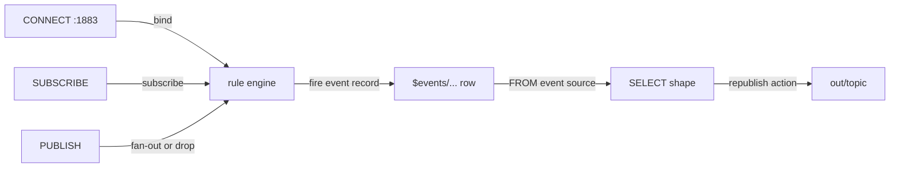

# Rule events

<!-- GENERATED by `python3 docs/_tools/entries.py` from `docs/_inventory/`, `docs/_text/` and `docs/_verified/`. Do not edit by hand. -->

The complete MQTT platform in one small binary: broker, SQL rules, data connectors and multi-tenancy in a single process.

An event source turns a broker event into one rule row. A connect, a subscribe, a delivery and a drop each fire one row. Use this page when a rule must react to the broker itself and not to a message. You get one entry per inventory name, each with a run against the broker.



Name the source in `FROM`. The kernel fires the source on the publish-path drain. An event source never matches an MQTT message. The engine drops such a message before evaluation. The docs run checks source selection only through `POST /api/v1/rules/test`. No client connects during the run.

## Before you start

- Read [Rule SQL](./sql.md) for the query shape.
- List the live sources with `GET /api/v1/rules/sources`.
- Each entry below ran against the built broker through `POST /api/v1/rules/test`.

## Events

| Event | What it does |
|---|---|
| `$events/client_check_authz_complete` | `$events/client_check_authz_complete` is one row per completed authorization check. |
| `$events/client_connack` | `$events/client_connack` is one row per answered `CONNECT`. |
| `$events/client_connected` | `$events/client_connected` is one row per accepted connection. |
| `$events/client_disconnected` | `$events/client_disconnected` is one row per disconnect. |
| `$events/delivery_dropped` | `$events/delivery_dropped` is one row per missed delivery. |
| `$events/message_acked` | `$events/message_acked` is one row per client acknowledgement. |
| `$events/message_delivered` | `$events/message_delivered` is one row per delivery to a subscriber mailbox. |
| `$events/message_dropped` | `$events/message_dropped` is one row per dropped message. |
| `$events/session_subscribed` | `$events/session_subscribed` is one row per subscribe. |
| `$events/session_unsubscribed` | `$events/session_unsubscribed` is one row per unsubscribe. |

## Names that select no event

These inventory names select no event. A `$events/...` name here has no producer. A bare name here is a stream and constrains nothing.

| Name | What it does |
|---|---|
| `$events/message_publish` | `$events/message_publish` is not an event of this broker. |
| `$events/no_such_event` | `$events/no_such_event` is not an event of this broker. |
| `description` | `description` alone is not an event source. |
| `event` | `event` alone is not an event source. |
| `message_publish` | `message_publish` alone is not an event source. |

## Events in detail

### `event $events/client_check_authz_complete`

`$events/client_check_authz_complete` is one row per completed authorization check.

Name it in `FROM` to run the rule on each verdict. The row carries `clientid`, `action`, `topic`, `qos`, `allow` and `source`. It carries `retain` only for a publish check.

An MQTT message never matches this source. The engine drops it before evaluation.

Syntax: `FROM "$events/client_check_authz_complete"`.

Example (verified through `POST /api/v1/rules/test`):

```sql no-test
-- Comment: illustrative query. The verifier runs each case.
SELECT allow FROM "$events/client_check_authz_complete"
```

Input topic `$events/client_check_authz_complete`, payload `{"allow": true}`. The broker answered `matched: true` with `projected: {"allow": true}`.
Another run on topic `sensors/kitchen` with payload `{"allow": true}` answered `matched: false`.

Verified: `POST /api/v1/rules/test` exits 0. See `../_verified/rules/event-events-client_check_authz_complete.json`.

Notes:

- `GET /api/v1/rules/sources` lists this name.
- The row omits `retain` for a subscribe check.
- Repeat the check with the same call against a live broker.

### `event $events/client_connack`

`$events/client_connack` is one row per answered `CONNECT`.

Name it in `FROM` to run the rule on each answer. The row carries `clientid`, `return_code` and `session_present`.

An MQTT message never matches this source. The engine drops it before evaluation.

Syntax: `FROM "$events/client_connack"`.

Example (verified through `POST /api/v1/rules/test`):

```sql no-test
-- Comment: illustrative query. The verifier runs each case.
SELECT return_code FROM "$events/client_connack"
```

Input topic `$events/client_connack`, payload `{"return_code": 0}`. The broker answered `matched: true` with `projected: {"return_code": 0}`.
Another run on topic `sensors/kitchen` with payload `{"return_code": 0}` answered `matched: false`.

Verified: `POST /api/v1/rules/test` exits 0. See `../_verified/rules/event-events-client_connack.json`.

Notes:

- `GET /api/v1/rules/sources` lists this name.
- The row carries the answer code in `return_code`.
- Repeat the check with the same call against a live broker.

### `event $events/client_connected`

`$events/client_connected` is one row per accepted connection.

Name it in `FROM` to run the rule on each connect. The row carries `clientid`, `keepalive`, `proto_ver` and `clean_start`.

An MQTT message never matches this source. The engine drops it before evaluation.

Syntax: `FROM "$events/client_connected"`.

Example (verified through `POST /api/v1/rules/test`):

```sql no-test
-- Comment: illustrative query. The verifier runs each case.
SELECT clientid FROM "$events/client_connected"
```

Input topic `$events/client_connected`, payload `{"clientid": "sensor-1"}`. The broker answered `matched: true` with `projected: {"clientid": "sensor-1"}`.
Another run on topic `sensors/kitchen` with payload `{"clientid": "sensor-1"}` answered `matched: false`.

Verified: `POST /api/v1/rules/test` exits 0. See `../_verified/rules/event-events-client_connected.json`.

Notes:

- `GET /api/v1/rules/sources` lists this name.
- The row carries the connect arguments `keepalive`, `proto_ver` and `clean_start`.
- Repeat the check with the same call against a live broker.

### `event $events/client_disconnected`

`$events/client_disconnected` is one row per disconnect.

Name it in `FROM` to run the rule on each close. The row carries `clientid`, `reason` and `disconnect_code`. The code is absent when the edge sends none.

An MQTT message never matches this source. The engine drops it before evaluation.

Syntax: `FROM "$events/client_disconnected"`.

Example (verified through `POST /api/v1/rules/test`):

```sql no-test
-- Comment: illustrative query. The verifier runs each case.
SELECT reason FROM "$events/client_disconnected"
```

Input topic `$events/client_disconnected`, payload `{"reason": "closed"}`. The broker answered `matched: true` with `projected: {"reason": "closed"}`.
Another run on topic `sensors/kitchen` with payload `{"reason": "closed"}` answered `matched: false`.

Verified: `POST /api/v1/rules/test` exits 0. See `../_verified/rules/event-events-client_disconnected.json`.

Notes:

- `GET /api/v1/rules/sources` lists this name.
- The row omits `disconnect_code` when the edge sends none.
- Repeat the check with the same call against a live broker.

### `event $events/delivery_dropped`

`$events/delivery_dropped` is one row per missed delivery.

Name it in `FROM` to run the rule on each miss. The row carries `clientid`, `topic`, `qos` and `reason`. The kernel fires it at route failure for dead connections.

An MQTT message never matches this source. The engine drops it before evaluation.

Syntax: `FROM "$events/delivery_dropped"`.

Example (verified through `POST /api/v1/rules/test`):

```sql no-test
-- Comment: illustrative query. The verifier runs each case.
SELECT reason FROM "$events/delivery_dropped"
```

Input topic `$events/delivery_dropped`, payload `{"reason": "route-failure"}`. The broker answered `matched: true` with `projected: {"reason": "route-failure"}`.
Another run on topic `sensors/kitchen` with payload `{"reason": "route-failure"}` answered `matched: false`.

Verified: `POST /api/v1/rules/test` exits 0. See `../_verified/rules/event-events-delivery_dropped.json`.

Notes:

- `GET /api/v1/rules/sources` lists this name.
- The kernel fires it at route failure for dead connections.
- Repeat the check with the same call against a live broker.

### `event $events/message_acked`

`$events/message_acked` is one row per client acknowledgement.

Name it in `FROM` to run the rule on each ack. The row carries `clientid`, `topic`, `qos` and `msg_id`. The kernel fires it at `PUBACK`.

An MQTT message never matches this source. The engine drops it before evaluation.

Syntax: `FROM "$events/message_acked"`.

Example (verified through `POST /api/v1/rules/test`):

```sql no-test
-- Comment: illustrative query. The verifier runs each case.
SELECT msg_id FROM "$events/message_acked"
```

Input topic `$events/message_acked`, payload `{"msg_id": 7}`. The broker answered `matched: true` with `projected: {"msg_id": 7}`.
Another run on topic `sensors/kitchen` with payload `{"msg_id": 7}` answered `matched: false`.

Verified: `POST /api/v1/rules/test` exits 0. See `../_verified/rules/event-events-message_acked.json`.

Notes:

- `GET /api/v1/rules/sources` lists this name.
- The row carries the packet id in `msg_id`.
- Repeat the check with the same call against a live broker.

### `event $events/message_delivered`

`$events/message_delivered` is one row per delivery to a subscriber mailbox.

Name it in `FROM` to run the rule on each delivery. The row carries `clientid`, `topic`, `qos`, `retain`, `payload` and `msg_id`. The kernel fires it at fan-out.

An MQTT message never matches this source. The engine drops it before evaluation.

Syntax: `FROM "$events/message_delivered"`.

Example (verified through `POST /api/v1/rules/test`):

```sql no-test
-- Comment: illustrative query. The verifier runs each case.
SELECT retain FROM "$events/message_delivered"
```

Input topic `$events/message_delivered`, payload `{"retain": false}`. The broker answered `matched: true` with `projected: {"retain": false}`.
Another run on topic `sensors/kitchen` with payload `{"retain": false}` answered `matched: false`.

Verified: `POST /api/v1/rules/test` exits 0. See `../_verified/rules/event-events-message_delivered.json`.

Notes:

- `GET /api/v1/rules/sources` lists this name.
- The row carries the delivered bytes in `payload`.
- Repeat the check with the same call against a live broker.

### `event $events/message_dropped`

`$events/message_dropped` is one row per dropped message.

Name it in `FROM` to run the rule on each drop. The row carries `clientid`, `topic`, `qos` and `reason`. The kernel fires it at quota shed and at detached clean sessions.

An MQTT message never matches this source. The engine drops it before evaluation.

Syntax: `FROM "$events/message_dropped"`.

Example (verified through `POST /api/v1/rules/test`):

```sql no-test
-- Comment: illustrative query. The verifier runs each case.
SELECT reason FROM "$events/message_dropped"
```

Input topic `$events/message_dropped`, payload `{"reason": "quota-shed"}`. The broker answered `matched: true` with `projected: {"reason": "quota-shed"}`.
Another run on topic `sensors/kitchen` with payload `{"reason": "quota-shed"}` answered `matched: false`.

Verified: `POST /api/v1/rules/test` exits 0. See `../_verified/rules/event-events-message_dropped.json`.

Notes:

- `GET /api/v1/rules/sources` lists this name.
- The kernel fires it at quota shed and at detached clean sessions.
- Repeat the check with the same call against a live broker.

### `event $events/session_subscribed`

`$events/session_subscribed` is one row per subscribe.

Name it in `FROM` to run the rule on each subscribe. The row carries `clientid`, `topic`, `qos`, `nl`, `rap` and `rh`.

An MQTT message never matches this source. The engine drops it before evaluation.

Syntax: `FROM "$events/session_subscribed"`.

Example (verified through `POST /api/v1/rules/test`):

```sql no-test
-- Comment: illustrative query. The verifier runs each case.
SELECT qos FROM "$events/session_subscribed"
```

Input topic `$events/session_subscribed`, payload `{"qos": 1}`. The broker answered `matched: true` with `projected: {"qos": 1}`.
Another run on topic `sensors/kitchen` with payload `{"qos": 1}` answered `matched: false`.

Verified: `POST /api/v1/rules/test` exits 0. See `../_verified/rules/event-events-session_subscribed.json`.

Notes:

- `GET /api/v1/rules/sources` lists this name.
- The row carries the subscribe options `nl`, `rap` and `rh`.
- Repeat the check with the same call against a live broker.

### `event $events/session_unsubscribed`

`$events/session_unsubscribed` is one row per unsubscribe.

Name it in `FROM` to run the rule on each unsubscribe. The row carries `clientid` and `topic`.

An MQTT message never matches this source. The engine drops it before evaluation.

Syntax: `FROM "$events/session_unsubscribed"`.

Example (verified through `POST /api/v1/rules/test`):

```sql no-test
-- Comment: illustrative query. The verifier runs each case.
SELECT topic FROM "$events/session_unsubscribed"
```

Input topic `$events/session_unsubscribed`, payload `{"topic": "sensors/+"}`. The broker answered `matched: true` with `projected: {"topic": "sensors/+"}`.
Another run on topic `sensors/kitchen` with payload `{"topic": "sensors/+"}` answered `matched: false`.

Verified: `POST /api/v1/rules/test` exits 0. See `../_verified/rules/event-events-session_unsubscribed.json`.

Notes:

- `GET /api/v1/rules/sources` lists this name.
- The row carries the filter in `topic`.
- Repeat the check with the same call against a live broker.

## Names that select no event in detail

### `event $events/message_publish`

`$events/message_publish` is not an event of this broker.

The event catalogue omits this name. No kernel producer fires it. A rule that names it never runs in production.

Match MQTT publishes with a quoted topic source instead. See `clause FROM`.

Syntax: `FROM "$events/message_publish"` (no producer fires it).

Example (verified through `POST /api/v1/rules/test`):

```sql no-test
-- Comment: illustrative query. The verifier runs each case.
SELECT reason FROM "$events/message_publish"
```

Input topic `sensors/kitchen`, payload `{"reason": "x"}`. The broker answered `matched: false` with `projected: null`.
Another run on topic `$events/client_connected` with payload `{"reason": "x"}` answered `matched: false`.

Verified: `POST /api/v1/rules/test` exits 0. See `../_verified/rules/event-events-message_publish.json`.

Notes:

- `GET /api/v1/rules/sources` omits this name.
- No kernel producer fires it. A rule that names it never runs in production.
- Repeat the check with the same call against a live broker.

### `event $events/no_such_event`

`$events/no_such_event` is not an event of this broker.

The event catalogue omits this name. No kernel producer fires it. A rule that names it never runs in production.

Pick a listed `$events/...` name instead. See the table above.

Syntax: `FROM "$events/no_such_event"` (no producer fires it).

Example (verified through `POST /api/v1/rules/test`):

```sql no-test
-- Comment: illustrative query. The verifier runs each case.
SELECT reason FROM "$events/no_such_event"
```

Input topic `sensors/kitchen`, payload `{"reason": "x"}`. The broker answered `matched: false` with `projected: null`.
Another run on topic `$events/client_connected` with payload `{"reason": "x"}` answered `matched: false`.

Verified: `POST /api/v1/rules/test` exits 0. See `../_verified/rules/event-events-no_such_event.json`.

Notes:

- `GET /api/v1/rules/sources` omits this name.
- No kernel producer fires it. A rule that names it never runs in production.
- Repeat the check with the same call against a live broker.

### `event description`

`description` alone is not an event source.

It is a field name of the event catalogue entry. As a bare `FROM` name it is a stream. A stream constrains nothing. The rule matches every message.

Select events only with a full `$events/...` name.

Syntax: `FROM description` (a bare stream name, not an event).

Example (verified through `POST /api/v1/rules/test`):

```sql no-test
-- Comment: illustrative query. The verifier runs each case.
SELECT temp FROM description
```

Input topic `sensors/kitchen`, payload `{"temp": 21.5}`. The broker answered `matched: true` with `projected: {"temp": 21.5}`.
Another run on topic `factory/line1` with payload `{"temp": 21.5}` answered `matched: true`.

Verified: `POST /api/v1/rules/test` exits 0. See `../_verified/rules/event-description.json`.

Notes:

- This name selects no event.
- As a bare stream name it constrains nothing. The rule matches every message.
- Repeat the check with the same call against a live broker.

### `event event`

`event` alone is not an event source.

It is a field name of the event catalogue entry. As a bare `FROM` name it is a stream. A stream constrains nothing. The rule matches every message.

Select events only with a full `$events/...` name.

Syntax: `FROM event` (a bare stream name, not an event).

Example (verified through `POST /api/v1/rules/test`):

```sql no-test
-- Comment: illustrative query. The verifier runs each case.
SELECT temp FROM event
```

Input topic `sensors/kitchen`, payload `{"temp": 21.5}`. The broker answered `matched: true` with `projected: {"temp": 21.5}`.
Another run on topic `factory/line1` with payload `{"temp": 21.5}` answered `matched: true`.

Verified: `POST /api/v1/rules/test` exits 0. See `../_verified/rules/event-event.json`.

Notes:

- This name selects no event.
- As a bare stream name it constrains nothing. The rule matches every message.
- Repeat the check with the same call against a live broker.

### `event message_publish`

`message_publish` alone is not an event source.

Only a full `$events/...` name selects events. As a bare `FROM` name it is a stream. A stream constrains nothing. The rule matches every message.

Match MQTT publishes with a quoted topic source instead. See `clause FROM`.

Syntax: `FROM message_publish` (a bare stream name, not an event).

Example (verified through `POST /api/v1/rules/test`):

```sql no-test
-- Comment: illustrative query. The verifier runs each case.
SELECT temp FROM message_publish
```

Input topic `sensors/kitchen`, payload `{"temp": 21.5}`. The broker answered `matched: true` with `projected: {"temp": 21.5}`.
Another run on topic `factory/line1` with payload `{"temp": 21.5}` answered `matched: true`.

Verified: `POST /api/v1/rules/test` exits 0. See `../_verified/rules/event-message_publish.json`.

Notes:

- This name selects no event.
- As a bare stream name it constrains nothing. The rule matches every message.
- Repeat the check with the same call against a live broker.

## Check that it works

Dry-run one event source and one miss:

```sh no-test
# Needs a live broker and an operator key. Use your own values.
curl -H "Authorization: Bearer $KEY" -H "Content-Type: application/json" \
  -d '{"sql_query": "SELECT clientid FROM \"$events/client_connected\"", "topic": "$events/client_connected", "payload": {"clientid": "sensor-1"}}' \
  http://127.0.0.1:18083/api/v1/rules/test
```

The answer is `matched: true` with `projected: {"clientid": "sensor-1"}`. The same call with `"topic": "sensors/kitchen"` answers `matched: false`.

## Next steps

- Write the query with [Rule SQL](./sql.md).
- Shape payloads with [Functions](./functions.md).
- Send results with [Actions](./actions.md).
